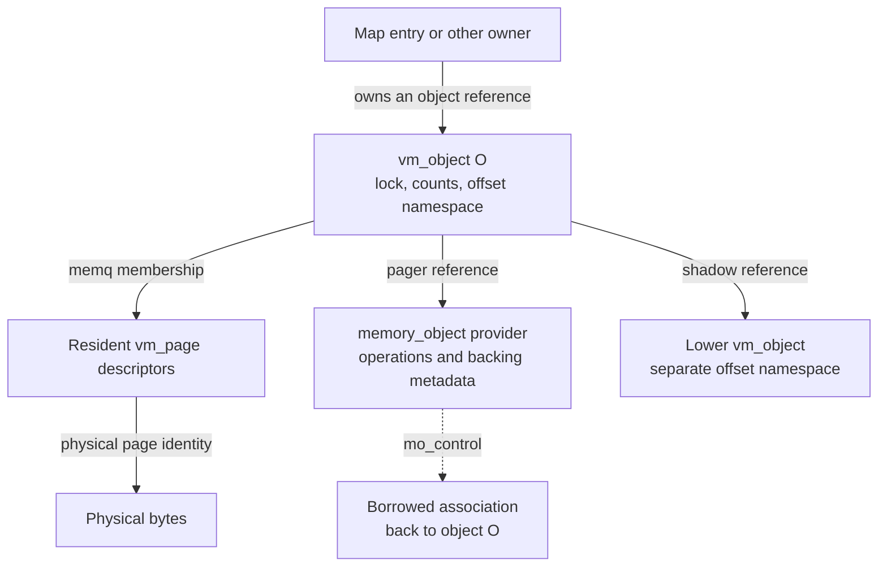
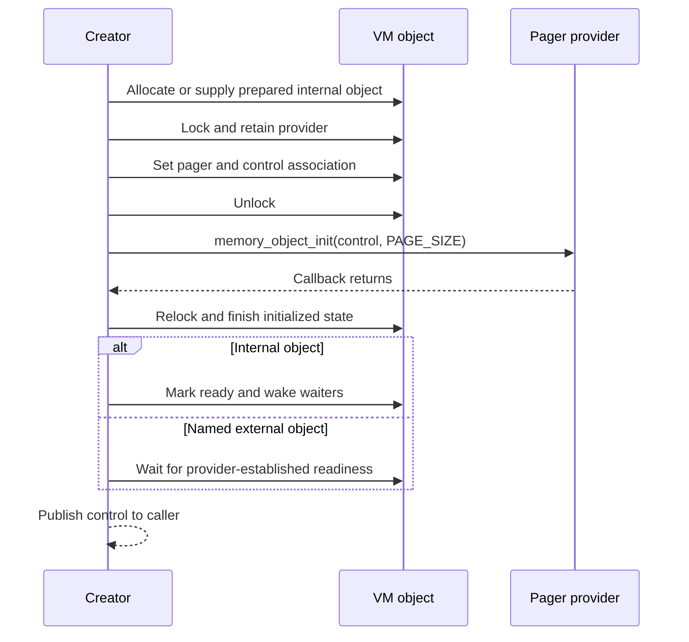
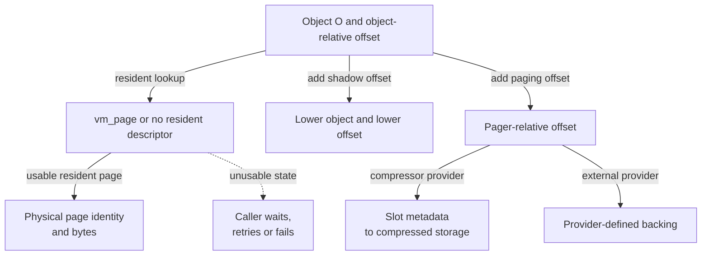
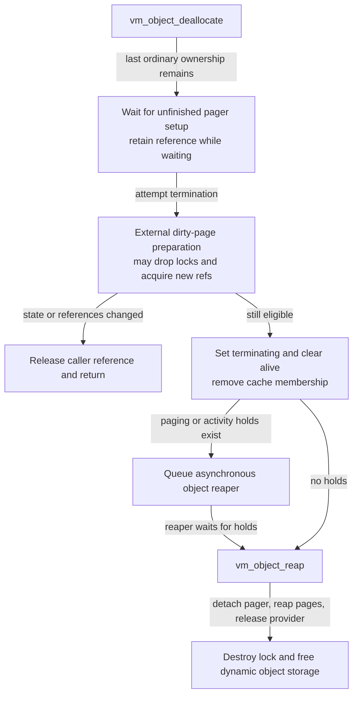

# VM objects and backing storage

A `vm_object` gives contents an offset namespace, a lifetime and a backing policy. It does not contain the mapped bytes. This companion follows the object allocation, fields, references, pager association and eventual storage release in `xnu-12377.121.6`. Start with the [structure guide](README.md) and [map and entry companion](vm-maps-and-entries.md); continue to [page descriptors](vm-pages-and-resident-storage.md) for resident backing and [memory entries and VM copies](memory-entries-and-vm-copies.md) for containers that carry object references.

The existing [objects and pages chapter](../subsystems/vm/objects-and-pages.md) explains copy and collapse algorithms. Here the emphasis is recognizing which pointer, offset, lock and lifetime obligation a source expression uses.

Inspect the live [`vm_object`](layout-browser.md?declaration=vm_object) layout for the selected source profile.

## The object is metadata, not its contents

The central definition is [`struct vm_object`](../../platydoc-data/xnu/osfmk/vm/vm_object_xnu.h#L136-L205). Its `memq` links resident descriptors; its `pager` identifies a provider; its `shadow` can lead to another object's contents. Neither resident pages nor a pager must exist when the object is created. A map entry can also defer creating an anonymous object until it is needed; follow that map-side publication in [maps and entries](vm-maps-and-entries.md).



Solid arrows are ownership or membership relationships with the labels shown; the dotted pager backlink is an association, not an extra ordinary VM-object reference. The shadow arrow describes ordinary copy objects; pageout objects have a different hold convention described below. A resident descriptor's object pointer likewise does not independently increment `ref_count` each time a page is inserted. See [insertion accounting](../../platydoc-data/xnu/osfmk/vm/vm_resident.c#L3461-L3527) and [ordinary reference helpers](../../platydoc-data/xnu/osfmk/vm/vm_object_internal.h#L300-L327).

### Fields whose interpretation changes with the object

| Storage | Read it as | Update and synchronization rule |
| --- | --- | --- |
| `memq`, `memq_hint`, `resident_page_count` | Resident descriptors currently associated with the object; the hint accelerates lookup. A count of zero says nothing by itself about compressed or file backing. | Insert/remove require the object exclusively locked; lookup requires its lock and can update the hint. Queue/accounting operations may additionally require page-queue protection. |
| `vo_un1` | `vo_size` for an **internal** object; `vo_cache_pages_to_scan` for an external object being cached. | Read the discriminator and operation before interpreting the union. It is not a universal file-size field. |
| `vo_un2` | `vo_shadow_offset`, external-cache age `vo_cache_ts`, or task ownership `vo_owner`. | These uses cannot coexist arbitrarily. Cache insertion rejects ledger-owned objects because owner and timestamp overlap. |
| `shadow`, `vo_copy`, `vo_copy_version` | Downward content dependency, reverse delayed-copy relationship, and version used to detect a changed copy relationship. | Structural operations require object locking and sometimes paired-object locking/retry. Assigning a pointer is not by itself a retain. |
| `pager`, `pager_control`, `paging_offset` | Provider, control association back to this object, and offset added when accessing provider backing. | Association publishes under the object lock; calls into providers can run after dropping it. Teardown nulls/disables the association before releasing the provider. |
| `wired_page_count`, `wire_tag`, ownership/ledger fields | Accounting for pages held resident and charged to a consumer. | Use the wired-page update helpers and ownership routines; a raw count change omits accounting. |
| `last_alloc`, `cow_hint`, `sequential` | Allocation/sequential-access hints. | The declaration explicitly permits atomic updates without the object lock; these are not lifetime protection. |

Sources: [union and page fields](../../platydoc-data/xnu/osfmk/vm/vm_object_xnu.h#L130-L205), [wired/accounting and hints](../../platydoc-data/xnu/osfmk/vm/vm_object_xnu.h#L309-L343), [cache union exclusion](../../platydoc-data/xnu/osfmk/vm/vm_object.c#L1099-L1131), [page insertion](../../platydoc-data/xnu/osfmk/vm/vm_resident.c#L3426-L3536), [lookup](../../platydoc-data/xnu/osfmk/vm/vm_resident.c#L3963-L4119), [copy setter](../../platydoc-data/xnu/osfmk/vm/vm_object_internal.h#L826-L836).

The object has an ordinary read/write lock. [`vm_object_lock`](../../platydoc-data/xnu/osfmk/vm/vm_object.c#L7583-L7591) takes it exclusively; [`vm_object_lock_shared`](../../platydoc-data/xnu/osfmk/vm/vm_object.c#L7630-L7637) takes it shared. [`vm_object_unlock`](../../platydoc-data/xnu/osfmk/vm/vm_object.c#L7686-L7694) also asserts that delayed page-hash insertion has completed. An accessor that returns a pointer or computes an offset does not acquire this lock for its caller.

## Allocation and initialization: writable, aligned, initially empty

Ordinary objects come from the **writable `vm objects` zone**, not a `proc_ro`-style RO zone and not a `kalloc_type` call site. The zone's element size is the configured `sizeof(struct vm_object)` rounded to `VM_PAGE_PACKED_PTR_ALIGNMENT` (64 bytes). `ZC_ALIGNMENT_REQUIRED` matters because packed resident-page links can point back to `memq`, which must remain the first field. Configuration-dependent fields make a single universal byte-size claim inappropriate. See [layout/alignment requirement](../../platydoc-data/xnu/osfmk/vm/vm_object_xnu.h#L136-L150) and [zone construction](../../platydoc-data/xnu/osfmk/vm/vm_object.c#L565-L569).

[`osfmk/vm/vm_object.c` lines 565–569](../../platydoc-data/xnu/osfmk/vm/vm_object.c#L565-L569):

<!-- source-excerpt: ../../platydoc-data/xnu/osfmk/vm/vm_object.c#L565-L569 -->
```c
	vm_object_size = (sizeof(struct vm_object) + (VM_PAGE_PACKED_PTR_ALIGNMENT - 1)) &
	    ~(VM_PAGE_PACKED_PTR_ALIGNMENT - 1);

	vm_object_zone = zone_create("vm objects", vm_object_size,
	    ZC_NOENCRYPT | ZC_ALIGNMENT_REQUIRED | ZC_VM);
```

[`vm_object_allocate`](../../platydoc-data/xnu/osfmk/vm/vm_object.c#L538-L548) uses `Z_WAITOK | Z_NOFAIL`, then calls `_vm_object_allocate`. It can wait for storage; this body does not implement an ordinary nullable allocation-failure return. Initialization copies a constant template, initializes the queue and lock, records provenance, rounds the size, and creates the initial ordinary reference:

[`osfmk/vm/vm_object.c` lines 517–527](../../platydoc-data/xnu/osfmk/vm/vm_object.c#L517-L527):

<!-- source-excerpt: ../../platydoc-data/xnu/osfmk/vm/vm_object.c#L517-L527 -->
```c
	*object = vm_object_template;
	object->vmo_provenance = provenance;

	vm_page_queue_init(&object->memq);
#if UPL_DEBUG || CONFIG_IOSCHED
	queue_init(&object->uplq);
#endif
	vm_object_lock_init(object);
	vm_object_set_size(object, size, size);

	os_ref_init_raw(&object->ref_count, &vm_object_refgrp);
```

The [template](../../platydoc-data/xnu/osfmk/vm/vm_object.c#L285-L335) starts with no resident pages, no pager, no shadow/copy, no paging/activity holds, `internal = TRUE`, `alive = TRUE`, and symmetric copy strategy. [`vm_object_set_size`](../../platydoc-data/xnu/osfmk/vm/vm_object.c#L490-L502) rounds to object-page granularity; under KASAN it also preserves an inner-size delta. None of these steps allocates or zeroes the object's content pages.

The same initializer also handles **statically allocated, explicitly aligned** kernel, compressor, retired-page and other special objects. Their storage does not originate in the dynamic zone. Bootstrap changes their copy strategy to `MEMORY_OBJECT_COPY_NONE`; `HAS_MTE` adds tagged kernel/tag-storage variants and corresponding cache attributes. Do not confuse the global `compressor_object`, whose resident pages hold compressor storage, with an ordinary anonymous object's separate compressor pager. See [static stores](../../platydoc-data/xnu/osfmk/vm/vm_object.c#L235-L273) and [bootstrap variants](../../platydoc-data/xnu/osfmk/vm/vm_object.c#L583-L621).

### Several variants share the same structure

| Variant | Concrete change from a fresh internal object | Consequence for reading its fields |
| --- | --- | --- |
| External/provider-backed | Association creates an object, clears `internal`, and starts with `MEMORY_OBJECT_COPY_INVALID` until provider setup supplies policy. | `vo_size` is no longer a generally valid size interpretation; provider readiness matters. |
| Internal with compressor pager | Existing internal object lazily acquires a trusted pager. | Internal contents can survive with no corresponding resident page. |
| Private physical backing | `pager_map_to_phys_contiguous` resolves the supplied kernel VA to a physical page and populates private descriptors. It restores the previous `private` flag on failure. | These descriptors need not represent allocator-owned physical pages. The flag describes this backing arrangement, not private user mapping permissions. |
| Pageout/UPL map object | Non-lite UPL setup creates an object, assigns `shadow`, marks `pageout`, sets copy strategy to none and records the source offset. | The shadow's hold and finalization differ from an ordinary COW shadow reference. |
| Special kernel object | Static storage, special provenance and non-copying strategy. | Deallocation has dedicated branches that preserve the permanent object. |

Sources: [external setup](../../platydoc-data/xnu/osfmk/vm/vm_object.c#L4509-L4525), [compressor setup](../../platydoc-data/xnu/osfmk/vm/vm_object.c#L4591-L4695), [private population](../../platydoc-data/xnu/osfmk/vm/vm_object.c#L7534-L7576), [UPL map object](../../platydoc-data/xnu/osfmk/vm/vm_pageout.c#L6674-L6696), [special-object deallocation](../../platydoc-data/xnu/osfmk/vm/vm_object.c#L686-L703).

## References, paging holds and activity holds are different ledgers

An ordinary reference keeps an owner attached to the object. `vm_object_reference_locked` requires exclusive locking; `vm_object_reference_shared` performs an atomic retain under the shared lock; `vm_object_reference` acquires that shared lock around the retain. These functions presuppose that the caller already has a valid object pointer. They are not a stale-address validation mechanism. See [the three helpers](../../platydoc-data/xnu/osfmk/vm/vm_object_internal.h#L300-L327).

| Mechanism | What it records | Begin/end or lookup discipline | What it does not imply |
| --- | --- | --- | --- |
| `ref_count` | Ordinary object ownership, for example a map entry or ordinary shadow dependency. | Use reference helpers and `vm_object_deallocate`; last-reference handling includes state transitions and callbacks. | A reference does not lock fields or pin each physical page. |
| `paging_in_progress` | In-flight paging work protected across lock drops. | 16-bit counter, modified under exclusive object lock, overflow/underflow checked. | It is not another increment of `ref_count`. |
| `activity_in_progress` | Longer activities, including UPL-related work. | 32-bit counter, modified under exclusive object lock, overflow/underflow checked. | An activity hold is not a map entry or necessarily a page wire. |
| `pl_req_in_progress` | Page-list gathering that must coordinate with copy preparation. | Dedicated begin/end/wait helpers under the object lock. | It is not interchangeable with waiting only for pager I/O. |
| Page busy/wire state | Stability of selected resident pages for an operation. | Object/page-queue protocol; see [page companion](vm-pages-and-resident-storage.md). | Neither supplies general ownership of every object relationship. |

Sources: [counter widths](../../platydoc-data/xnu/osfmk/vm/vm_object_xnu.h#L196-L205), [page-list request helpers](../../platydoc-data/xnu/osfmk/vm/vm_object_internal.h#L660-L681), [activity and paging helpers](../../platydoc-data/xnu/osfmk/vm/vm_object_internal.h#L684-L748), [UPL hold use](../subsystems/vm/upl-gather-and-completion.md#the-state-that-must-survive-a-lock-drop).

The shared completion event is signaled only after both paging and activity counts reach zero. `vm_object_paging_only_wait` deliberately has a narrower contract. The end of an activity is therefore observable without changing the ordinary reference count:

[`osfmk/vm/vm_object_internal.h` lines 694–705](../../platydoc-data/xnu/osfmk/vm/vm_object_internal.h#L694-L705):

<!-- source-excerpt: ../../platydoc-data/xnu/osfmk/vm/vm_object_internal.h#L694-L705 -->
```c
vm_object_activity_end(vm_object_t object)
{
	vm_object_lock_assert_exclusive(object);
	if (os_dec_overflow(&object->activity_in_progress)) {
		panic("vm_object_activity_end(%p): underflow\n", object);
	}
	if (object->paging_in_progress == 0 &&
	    object->activity_in_progress == 0) {
		vm_object_wakeup((object),
		    VM_OBJECT_EVENT_PAGING_IN_PROGRESS);
	}
}
```

A last ordinary deallocation can consequently mark the object terminating and hand it to the reaper while work still holds paging/activity state. Waiting synchronously in that situation can deadlock with the operation responsible for ending the hold. The dedicated reaper waits for the holds and completes final release; this is a concrete distinction between logical termination and storage reclamation, not an assumption that `ref_count == 0` immediately frees memory. See [termination decision](../../platydoc-data/xnu/osfmk/vm/vm_object.c#L1464-L1527) and [reaper wait](../../platydoc-data/xnu/osfmk/vm/vm_object.c#L2049-L2090).

## Pager association is an in-kernel pointer relationship

Inside the kernel, [`memory_object_control_t`](../../platydoc-data/xnu/osfmk/mach/memory_object_types.h#L110-L136) is `struct vm_object *`. A `memory_object_t` points to a provider header with `mo_pager_ops`, `mo_control`, and provider lifetime state. The control allocation and conversion bodies are unusually important to read because nearby historical comments still describe ports:

[`osfmk/vm/memory_object.c` lines 1844–1864](../../platydoc-data/xnu/osfmk/vm/memory_object.c#L1844-L1864):

<!-- source-excerpt: ../../platydoc-data/xnu/osfmk/vm/memory_object.c#L1844-L1864 -->
```c
__private_extern__ memory_object_control_t
memory_object_control_allocate(
	vm_object_t             object)
{
	return object;
}

__private_extern__ void
memory_object_control_collapse(
	memory_object_control_t *control,
	vm_object_t             object)
{
	*control = object;
}

__private_extern__ vm_object_t
memory_object_control_to_vm_object(
	memory_object_control_t control)
{
	return control;
}
```

`memory_object_control_reference` and `memory_object_control_deallocate` are [no-ops](../../platydoc-data/xnu/osfmk/vm/memory_object.c#L1882-L1898); [`memory_object_control_disable`](../../platydoc-data/xnu/osfmk/vm/memory_object.c#L1900-L1906) clears the supplied pointer. [`memory_object_to_vm_object`](../../platydoc-data/xnu/osfmk/vm/memory_object.c#L1866-L1880) checks the provider/control for null and returns the associated object without retaining it. These helpers are not task-local Mach-name lookup. User-visible memory-entry ports are covered separately in [memory entries and VM copies](memory-entries-and-vm-copies.md).

[`vm_object_memory_object_associate`](../../platydoc-data/xnu/osfmk/vm/vm_object.c#L4499-L4573) either uses a prepared internal object or creates an external one. It retains the provider, publishes `pager` and `pager_control` under the object lock, drops the lock to call `memory_object_init`, then reacquires it to finish initialization. The init return is explicitly discarded in this body; do not infer a generic callback-error rollback that is absent here. Internal objects become ready here, whereas external readiness is established through provider setup. [`memory_object_create_named`](../../platydoc-data/xnu/osfmk/vm/vm_object.c#L5858-L5894) waits for that readiness before publishing its output control.



This combines association with the named creator's subsequent readiness wait; it does not imply that every internal creator returns a named object. Dispatch such as [`memory_object_data_request`](../../platydoc-data/xnu/osfmk/vm/memory_object.c#L1969-L1986) calls the provider's operations table directly.

A concrete external owner is UBC. [`ubc_info_init`](../../platydoc-data/xnu/bsd/kern/ubc_subr.c#L1148-L1176) calls `memory_object_create_named`, drops its temporary vnode-pager reference, stores `ui_control` and records `UI_HASOBJREF`. This named VM-object ownership is distinct from the pointer's representation. The vnode/file-size state remains in UBC and the filesystem path; an external object's union field is not a substitute for that size. Filesystem/provider availability remains the boundary described in [pagers and UPL](../subsystems/vm/pagers-and-upl.md).

## Follow offsets through resident, shadow and compressed backing

For an object offset, first distinguish **where content is represented** from **whether the content is immediately usable**. A successful resident lookup may find an absent, busy or error-marked descriptor. A missing descriptor can lead to a lower shadow, pager request, decompression, zero fill or failure according to the fault operation. This diagram summarizes representations, not the complete priority/order of the fault state machine:



[`vm_page_lookup`](../../platydoc-data/xnu/osfmk/vm/vm_resident.c#L3963-L4119) only searches resident identity. [`vm_object_compressor_pager_state_get`](../../platydoc-data/xnu/osfmk/vm/vm_object.c#L4698-L4715) is a separate query: while the object is live, internal and has a pager, it passes `offset + paging_offset` to compressor state lookup; otherwise it returns unknown. “No resident descriptor,” “no compressed slot” and “unknown compressed state” are distinct observations. See [fault resolution](../subsystems/vm/fault-resolution.md).

### A shadow takes over the caller's reference

In the path that really creates a shadow, [`vm_object_shadow`](../../platydoc-data/xnu/osfmk/vm/vm_object.c#L4322-L4412) allocates a new top object and moves the caller's original ownership into `result->shadow`. It does **not** retain the source and then leak the caller's old reference:

[`osfmk/vm/vm_object.c` lines 4373–4380](../../platydoc-data/xnu/osfmk/vm/vm_object.c#L4373-L4380):

<!-- source-excerpt: ../../platydoc-data/xnu/osfmk/vm/vm_object.c#L4373-L4380 -->
```c
	/*
	 *	The new object shadows the source object, adding
	 *	a reference to it.  Our caller changes his reference
	 *	to point to the new object, removing a reference to
	 *	the source object.  Net result: no change of reference
	 *	count.
	 */
	result->shadow = source;
```

The new object gets the original source offset in `vo_shadow_offset`, and the caller's mapping is adjusted to the new object's offset namespace. With a **16 KiB VM page and 16 KiB map page**, an original source range starting at `0x8000` can become a new object with mapping offset zero and `vo_shadow_offset = 0x8000`. New-object offset `0x4120` refers to lower-object offset `0xc120` when it is satisfied from the shadow. Neither value is a physical address or CPU virtual address. The implementation also handles smaller map-page alignment by preserving an intra-VM-page offset adjustment; see [rounding and adjustment](../../platydoc-data/xnu/osfmk/vm/vm_object.c#L4360-L4363) and [output publication](../../platydoc-data/xnu/osfmk/vm/vm_object.c#L4393-L4412).

The reverse `vo_copy` relationship is different. It tells a source where changed contents may need to be preserved; the ordinary delayed-copy object's `shadow` retains the source, while the reverse pointer does not create a symmetric reference cycle. `VM_OBJECT_COPY_SET` updates the pointer/version but performs no retain. Copy code must acquire stable references and revalidate relationships around lock drops. Follow [delayed copies](../subsystems/vm/objects-and-pages.md#delayed-copies-preserve-snapshots-by-pushing-old-contents-upward) and [collapse/bypass](../subsystems/vm/objects-and-pages.md#collapse-and-bypass-remove-a-level-without-changing-visible-contents) for the paired locks and moved pages, rather than interpreting the two pointers as interchangeable. [Setter body](../../platydoc-data/xnu/osfmk/vm/vm_object_internal.h#L826-L836), [delayed-copy construction](../../platydoc-data/xnu/osfmk/vm/vm_object.c#L3784-L4149).

### Compressed bytes belong to a separate representation

[`vm_object_compressor_pager_create`](../../platydoc-data/xnu/osfmk/vm/vm_object.c#L4591-L4695) begins a paging hold, serializes competing creators with `pager_created/pager_ready`, and can drop the object lock to allocate the provider. It rejects an object whose page count does not fit the provider's 32-bit slot count; `HAS_MTE` has an additional tagged-pager availability branch. Once created, association retains the pager, the creator releases its temporary pager reference, and the function reacquires the object lock to end the paging hold.

The [`compressor_pager`](../../platydoc-data/xnu/osfmk/vm/vm_compressor_pager.c#L141-L175) has its own header, lock, reference count, total/occupied slot counts and a union for embedded, direct or indirect slots. A slot is not a `vm_page *`, and compressed storage need not occupy the original physical frame. Resident descriptor release can therefore coexist with persistent logical contents. Read [compressor segments and swapfiles](../subsystems/vm/compressor-segments-and-swapfiles.md) for slot-to-segment storage, compaction and swap, and [MTE page lifecycle](../subsystems/vm/mte-tag-storage-and-page-lifecycle.md#8-compressing-tags-differs-from-borrowing-backing-for-the-compressor) for compressed tags.

## Cache membership, last unmap and termination

External-object cache membership is a resident-page reclamation aid. [`memory_object_mark_unused`](../../platydoc-data/xnu/osfmk/vm/memory_object.c#L1633-L1649) reaches `vm_object_cache_add`; [`mark_used`](../../platydoc-data/xnu/osfmk/vm/memory_object.c#L1615-L1630) removes membership. Insertion skips empty or ledger-owned objects, sets the age and scan budget under the cache lock, and adds no ordinary reference in that body. Eviction holds the cache lock while finding a candidate and uses an object try-lock before dropping cache protection. It skips busy/wired/cleaning/laundry pages rather than treating the cache queue as ownership of immediately freeable bytes. See [cache insertion](../../platydoc-data/xnu/osfmk/vm/vm_object.c#L1099-L1131) and [scan acquisition/skip paths](../../platydoc-data/xnu/osfmk/vm/vm_object.c#L1190-L1270).

The named object's transition from two references to one can trigger a provider `memory_object_last_unmap` call. [`vm_object_deallocate`](../../platydoc-data/xnu/osfmk/vm/vm_object.c#L794-L837) waits for mapping serialization, rechecks the pager/count/named predicate, begins mapping activity, records the callback thread, drops the object lock for the callback, and relocks/rechecks the provider afterward. The count before the callback cannot simply be reused after it. Special-object and ordinary multi-reference paths can avoid full termination; the latter use atomic decrement under shared locking when their predicates permit it. [Fast paths](../../platydoc-data/xnu/osfmk/vm/vm_object.c#L674-L782).



The full sequence matters:

1. A last-reference deallocator waits for a created-but-not-ready pager while still retaining that last reference. It saves the ordinary shadow pointer before calling termination. [`vm_object_deallocate` tail](../../platydoc-data/xnu/osfmk/vm/vm_object.c#L852-L914).
2. For a persistent external object, termination first reaps/returns pages while it is still alive; pageout can drop locks and allow new references. It checks the termination/refcount predicates again after that work. [`vm_object_terminate` preflight](../../platydoc-data/xnu/osfmk/vm/vm_object.c#L1421-L1458).
3. It sets `terminating`, clears `alive`, removes external cache membership, and clears a matching reverse copy link under the shadow's lock. Remaining holds lead to asynchronous reaping. A `KERN_FAILURE` return here is an internal “caller must stop this deallocation path” result, not necessarily failure to schedule cleanup. [Transition and queueing](../../platydoc-data/xnu/osfmk/vm/vm_object.c#L1464-L1527).
4. Reaping requires zero paging/activity holds. It disowns ledger ownership before releasing compressed backing, saves and clears the pager pointer, disables control, and drops the final ordinary reference. Resident pages and purgeable/wired accounting are then drained; pageout objects have their special termination path. [Reap body](../../platydoc-data/xnu/osfmk/vm/vm_object.c#L1552-L1696).
5. Provider termination/deallocation runs with the object unlocked; after relocking, reaping clears terminating state and wakes relevant waiters, unlocks, destroys the lock and frees the dynamic zone element. The caller or reaper subsequently releases the saved **ordinary** shadow reference. [Final object release](../../platydoc-data/xnu/osfmk/vm/vm_object.c#L1698-L1728), [provider release](../../platydoc-data/xnu/osfmk/vm/vm_object.c#L2110-L2123), [asynchronous shadow release](../../platydoc-data/xnu/osfmk/vm/vm_object.c#L2071-L2090).

### Destroying the pager association need not free the object

[`vm_object_destroy`](../../platydoc-data/xnu/osfmk/vm/vm_object.c#L2190-L2254) handles loss of the provider even while mappings/references remain. It records the no-pager reason, clears persistence/named state, detaches the pager and disables control, then waits for paging, page-list requests and relevant mapping callbacks. It avoids waiting on the current thread's own last-unmap callback. Outside the lock it releases the old provider and, when one existed, the caller's assumed reference.

The apparent `alive = FALSE` statement in this function is inside `#if 00`; it is not executed. Consequently this path must not be described as synonymous with `vm_object_terminate`. A surviving external object can have `pager_created` set but `pager == NULL`; cache eviction explicitly recognizes this lost-pager state and disconnects mapped pages before discarding their bytes. [Disabled assignment and detach](../../platydoc-data/xnu/osfmk/vm/vm_object.c#L2190-L2209), [lost-pager eviction](../../platydoc-data/xnu/osfmk/vm/vm_object.c#L1271-L1297).

## Source-reading checkpoints and limits

For a concrete operation, record the object's variant, which union members are valid, who owns the ordinary reference, and whether a lock drop is protected by a paging/activity hold or by stable ownership elsewhere. Then follow each offset conversion separately: map VA to object offset, shadow offset addition, provider offset addition, and resident descriptor to physical page number. Follow the [page companion](vm-pages-and-resident-storage.md) before interpreting resident removal as reusable physical memory, and the [pmap companion](pmap-and-translation-storage.md) before interpreting object lifetime as translation lifetime.

This chapter reviews the local object/control/page interfaces and selected external/compressor/UPL paths. It does not reconstruct missing filesystem, device, secure-monitor or hardware-provider implementations. `HAS_MTE`, KASAN, object tracking and other configuration fields change the representation and selected branches. The exact source citations describe this snapshot; neither the structure layout nor the historical port terminology is a promise about a different XNU release.

<!-- BEGIN PLATYDOC DOCUMENTATION LICENSE -->
Original Platydoc text and diagrams are licensed under [CC BY 4.0](https://creativecommons.org/licenses/by/4.0/). Quoted source code and third-party material retain their respective licenses.
<!-- END PLATYDOC DOCUMENTATION LICENSE -->
