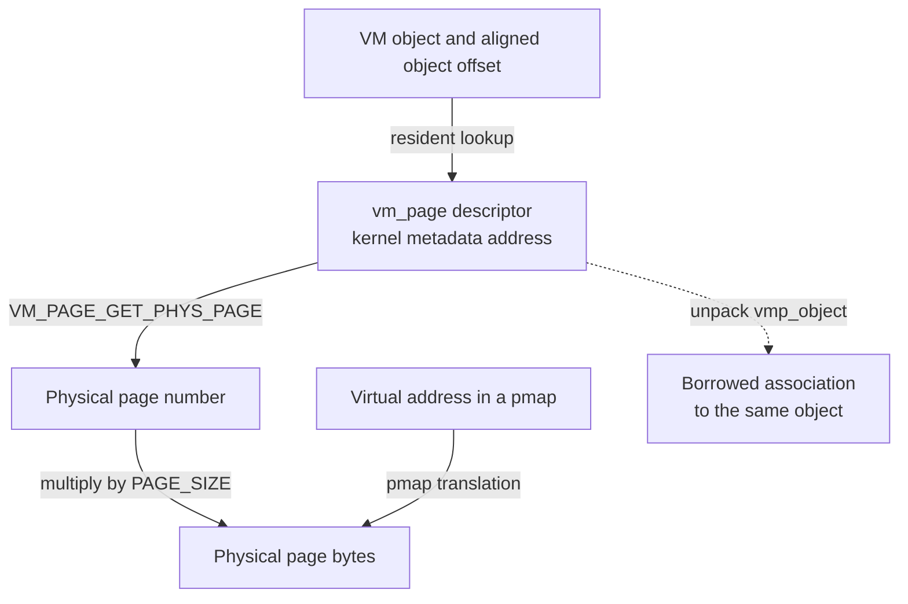
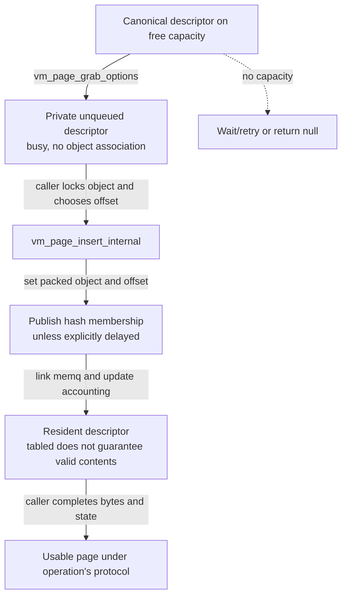
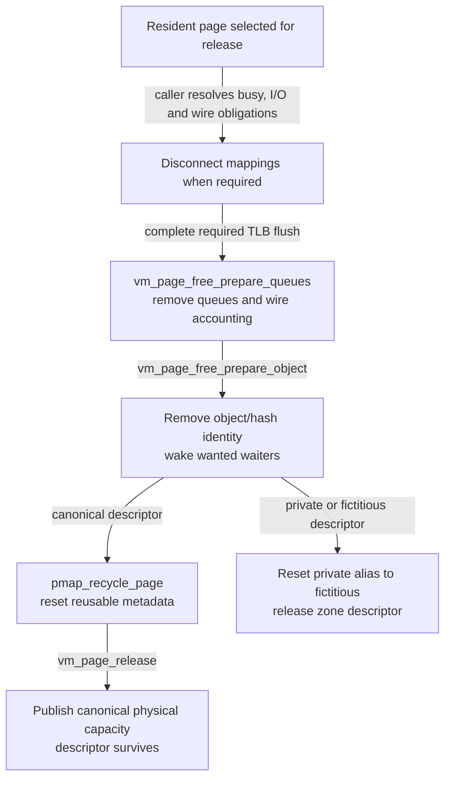

# VM pages and resident storage

A `vm_page` is a descriptor for resident-page state. Its address identifies metadata; its physical-page number identifies bytes; its object/offset pair identifies those bytes in a VM object's namespace. This companion follows how those identities are constructed, published, accessed, moved and released in `xnu-12377.121.6`. Return to the [structure guide](README.md), or read alongside [VM objects and backing](vm-objects-and-backing.md) and [pmap translation storage](pmap-and-translation-storage.md).

For full operations, follow [fault resolution](../subsystems/vm/fault-resolution.md), [reclaim and pressure](../subsystems/vm/reclaim-and-pressure.md), [UPL gathering and completion](../subsystems/vm/upl-gather-and-completion.md), and [MTE page lifecycle](../subsystems/vm/mte-tag-storage-and-page-lifecycle.md). This page concentrates on the descriptors and the guarantees those operations must establish.

Inspect the live [`vm_page`](layout-browser.md?declaration=vm_page) layout for the selected source profile.

## Four different identities surround one resident page

| Expression or value | What it denotes | What must already be established |
| --- | --- | --- |
| `vm_page_t m` | A kernel pointer to the descriptor, not the page's contents. | The descriptor is still live and the caller has the required object/queue/private ownership protection. |
| `VM_PAGE_OBJECT(m)`, `m->vmp_offset` | The object's resident-page association and a VM-page-aligned byte offset. | The page is associated with an object; synchronization protects the association. A free page has no object. |
| `VM_PAGE_GET_PHYS_PAGE(m)` | A physical page **number**, or a sentinel for a fictitious/guard descriptor. | The descriptor category determines whether physical bytes actually exist and who owns them. |
| A task/kernel virtual address | A mapping through a particular pmap to some bytes of a physical page. | Mapping, protections, translation tables and TLB state belong to the pmap path, not to the descriptor pointer. |

The [structure](../../platydoc-data/xnu/osfmk/vm/vm_page.h#L286-L414) has no general-purpose `ref_count`. A busy bit, a wire count, object ownership and queue membership serve different purposes; none is a substitute for understanding how the caller stabilizes the page. `vmp_reference` is a page-use hint, not a retain count.



The arrows show lookup/identity relationships, not interchangeable pointers. Several virtual mappings can reach one frame. A descriptor can also exist without mappable content, such as a guard or an absent page awaiting data. See [physical identity accessors](../../platydoc-data/xnu/osfmk/vm/vm_page.h#L549-L579), [status fields](../../platydoc-data/xnu/osfmk/vm/vm_page.h#L383-L404), and the [pmap companion](pmap-and-translation-storage.md).

## Where descriptors come from

### The boot array describes physical memory

[`vm_page_bootstrap`](../../platydoc-data/xnu/osfmk/vm/vm_resident.c#L2647-L2672) reserves the `vm_pages` descriptor array with `pmap_steal_freeable_memory`. The calculation accounts for both physical-page storage and per-page metadata (`PAGE_SIZE + sizeof(struct vm_page)`). Under `XNU_VM_HAS_LINEAR_PAGES_ARRAY`, it uses the physical span; other builds use the available-page count. This is early VM/bootstrap allocation, before normal page grabs consume the resulting free capacity.

The [initialization loop](../../platydoc-data/xnu/osfmk/vm/vm_resident.c#L2732-L2788) gets physical page numbers from `pmap_next_page`, initializes descriptors, records the first page number for a linear array, and publishes eligible pages through startup release. Delayed-page, high-memory, retired-page and MTE branches affect the boot path. The array is accessed through [`vm_page_get`](../../platydoc-data/xnu/osfmk/vm/vm_page.h#L447-L465), not by assuming that every caller can directly index a globally exposed array pointer.

`vm_page_init` initializes **metadata**. The selected excerpt sets offset to an invalid sentinel, clears queue/membership state and begins busy; it does not fill the physical page:

[`osfmk/vm/vm_resident.c` lines 4213–4223](../../platydoc-data/xnu/osfmk/vm/vm_resident.c#L4213-L4223):

<!-- source-excerpt: ../../platydoc-data/xnu/osfmk/vm/vm_resident.c#L4213-L4223 -->
```c
	assert(VM_PAGE_NOT_ON_Q == 0);
	assert(sizeof(*mem) % sizeof(uintptr_t) == 0);
	*mem = (struct vm_page) {
		.vmp_offset      = (vm_object_offset_t)-1,
		.vmp_q_state     = VM_PAGE_NOT_ON_Q,
		.vmp_on_specialq = VM_PAGE_SPECIAL_Q_EMPTY,
		.vmp_canonical   = vm_page_in_array(mem),
		.vmp_busy        = true,
	};

	VM_PAGE_INIT_PHYS_PAGE(mem, phys_page);
```

The optional bootstrap `fillPage` call is separate. So are later page-zeroing and pager-input operations. `vm_page_init` even contains a disabled `#if 0` ref/mod clearing block; that historical block must not be described as an executed hardware-state reset. [Surrounding initialization](../../platydoc-data/xnu/osfmk/vm/vm_resident.c#L4196-L4244).

### The descriptor zone supplies additional categories

The **writable `vm pages` zone** is a second source of metadata. [`vm_page_module_init`](../../platydoc-data/xnu/osfmk/vm/vm_resident.c#L2868-L2898) rounds `sizeof(struct vm_page_with_ppnum)` to 64-byte packed-pointer alignment, creates the zone with `ZC_ALIGNMENT_REQUIRED | ZC_VM`, and sets a reserve of ten elements. It is not an RO zone, and allocating an element does not by itself allocate a physical data page.

[`vm_page_create`](../../platydoc-data/xnu/osfmk/vm/vm_resident.c#L3183-L3208) allocates that element and initializes it. The callers determine its category:

| Category | Construction and identity | Release meaning |
| --- | --- | --- |
| Canonical boot descriptor | Array element; `vmp_canonical` is set by initialization. | Its descriptor survives ordinary physical-page reuse. |
| Additional canonical descriptor | `vm_page_create_canonical` uses the zone, marks canonical, and registers it in the radix structure on linear-array builds. | Its physical page joins VM free capacity; ordinary release preserves the descriptor even though it came from a zone. |
| Fictitious descriptor | `vm_page_create_fictitious` supplies `vm_page_fictitious_addr`. | Describes a placeholder/alias preparation; final descriptor release returns zone storage. |
| Guard descriptor | `vm_page_create_guard` supplies the guard sentinel and can select `Z_NOWAIT`. | No ordinary data frame is returned; guard accounting and zone storage are released. |
| Private descriptor | `vm_page_create_private` supplies a physical page number with `canonical = false`, or `vm_page_make_private` changes a fictitious descriptor's physical identity. | The external physical page is not added to canonical VM free capacity. Preparation resets the descriptor to fictitious identity, then frees its zone element. |

Sources: [additional canonical pages](../../platydoc-data/xnu/osfmk/vm/vm_resident.c#L3210-L3226), [constructors/category tests](../../platydoc-data/xnu/osfmk/vm/vm_resident.c#L4246-L4304), [private transition](../../platydoc-data/xnu/osfmk/vm/vm_resident.c#L4306-L4321), [fictitious release](../../platydoc-data/xnu/osfmk/vm/vm_resident.c#L4323-L4339), [free preparation and split](../../platydoc-data/xnu/osfmk/vm/vm_resident.c#L5881-L5978).

“Outside the boot array” therefore does not mean “fictitious.” The canonical flag is an independent distinction, and `vm_page_is_private` is defined as neither canonical nor fictitious. A private page descriptor is also distinct from the `private` flag on a VM object and from a private user mapping.

## Packed links and physical-page accessors

The descriptor contains three list roles: `vmp_listq` links pages in one object's resident set; `vmp_pageq` links free/reclaim queues or shares storage with the temporary `vmp_snext` list pointer; `vmp_next_m` links the object/offset hash bucket. `vmp_specialq` is an additional special-queue link. Those fields can make the same descriptor reachable through several indexes without allocating another physical copy. [Link layout](../../platydoc-data/xnu/osfmk/vm/vm_page.h#L286-L310).

Page and object pointers are packed, but not in the same way. A page pointer into `vm_pages` becomes an array index with bit 31 set. Other supported pointers use a 31-bit relative representation with a six-bit shift and `VM_MIN_KERNEL_AND_KEXT_ADDRESS` base. The non-array representation is why object heads and zone descriptors require 64-byte alignment. `VM_PAGE_OBJECT` unpacks `vmp_object` using the object form; it does not perform a zone lookup, retain or liveness check. [Packing geometry](../../platydoc-data/xnu/osfmk/vm/vm_page.h#L595-L618), [pack/unpack bodies](../../platydoc-data/xnu/osfmk/vm/vm_page.h#L620-L657).

[`osfmk/vm/vm_page.h` lines 620–632](../../platydoc-data/xnu/osfmk/vm/vm_page.h#L620-L632):

<!-- source-excerpt: ../../platydoc-data/xnu/osfmk/vm/vm_page.h#L620-L632 -->
```c
static inline vm_page_packed_t
vm_page_pack_ptr(uintptr_t p)
{
	if (vm_page_in_array(__unsafe_forge_single(vm_page_t, p))) {
		ptrdiff_t diff = (vm_page_t)p - vm_pages_array_internal();
		assert((vm_page_t)p == vm_page_get((uint32_t)diff));
		return (vm_page_packed_t)(diff | VM_PAGE_PACKED_FROM_ARRAY);
	}

	VM_ASSERT_POINTER_PACKABLE(p, VM_PAGE_PACKED_PTR);
	vm_offset_t packed = VM_PACK_POINTER(p, VM_PAGE_PACKED_PTR);
	return CAST_DOWN_EXPLICIT(vm_page_packed_t, packed);
}
```

For physical identity, linear-array descriptors derive the page number from their array index. Zone descriptors in those builds have an extended `vm_page_with_ppnum`; non-linear builds store the physical number in the descriptor itself. Always follow the accessor rather than assuming `m->vmp_phys_page` exists in every build:

[`osfmk/vm/vm_page.h` lines 549–560](../../platydoc-data/xnu/osfmk/vm/vm_page.h#L549-L560):

<!-- source-excerpt: ../../platydoc-data/xnu/osfmk/vm/vm_page.h#L549-L560 -->
```c
static inline ppnum_t
VM_PAGE_GET_PHYS_PAGE(const struct vm_page *m)
{
#if XNU_VM_HAS_LINEAR_PAGES_ARRAY
	if (vm_page_in_array(m)) {
		uintptr_t index = (uintptr_t)(m - vm_pages_array_internal());

		return (ppnum_t)(vm_pages_first_pnum + index);
	}
#endif /* XNU_VM_HAS_LINEAR_PAGES_ARRAY */
	return ((const struct vm_page_with_ppnum *)m)->vmp_phys_page;
}
```

`VM_PAGE_SET_PHYS_PAGE` asserts that the descriptor is neither in the array nor canonical. Reassigning an alias/fictitious descriptor's physical number is supported; rewriting the physical identity of an ordinary canonical descriptor is not this helper's contract. [Setter](../../platydoc-data/xnu/osfmk/vm/vm_page.h#L574-L579).

### Worked coordinates with a 16 KiB VM page

Assume a linear array, `PAGE_SIZE = 0x4000`, `vm_pages_first_pnum = 0x80000`, and a valid descriptor at array index `0x1234`. These are illustrative values, not addresses measured from a device:

| Quantity | Calculation | Result |
| --- | --- | --- |
| Packed page link | `0x80000000 | 0x1234` | `0x80001234` |
| Physical page number | `0x80000 + 0x1234` | `0x81234` |
| Physical byte base | `0x81234 * 0x4000` | `0x2048d0000` |
| Physical byte at displacement `0x120` | `0x2048d0000 + 0x120` | `0x2048d0120` |
| Object byte if inserted at offset `0x8000` | `0x8000 + 0x120` | Object-relative `0x8120` |

The packed value `0x80001234` is not a physical page number or a CPU pointer. The object offset `0x8120` is not a virtual address. A virtual address requires a map entry and translation; see [maps and entries](vm-maps-and-entries.md). The source formulas are the [page-link encoding](../../platydoc-data/xnu/osfmk/vm/vm_page.h#L620-L645) and [physical-number accessor](../../platydoc-data/xnu/osfmk/vm/vm_page.h#L549-L560).

## Access protection follows the state being changed

The header's `O` and `P` annotations mean object-lock and page-queue protection, with some association fields requiring both for changes and either for reads. The header immediately qualifies that shorthand: queue-state protection depends on the current queue, and separate bitfield structures prevent compiler coalescing across different locking domains. A single claim that “all page fields use the queue lock” would contradict the definition. [Annotation contract](../../platydoc-data/xnu/osfmk/vm/vm_page.h#L210-L234), [queue-word qualification](../../platydoc-data/xnu/osfmk/vm/vm_page.h#L312-L345).

| Field group | Readers and writers | Protection and interpretation |
| --- | --- | --- |
| `vmp_object`, `vmp_offset`, `vmp_listq`, tabled state | Resident insertion, lookup, removal and rename. | Object locking protects the association; changes visible to page queues can additionally need their lock. Fresh unqueued/private state has narrower exposure. |
| `vmp_next_m`, `vmp_hashed` | Global object/offset hash operations. | Object protection plus the selected hash-bucket ticket lock for mutations; lookup has object-lock fast paths. |
| `vmp_q_state`, `vmp_pageq`, `vmp_local_id` | Free-capacity allocator, per-CPU queues, pageout and wire/unwire. | The relevant global queue lock, free-queue lock, per-CPU preemption discipline or private transitional ownership depends on the state. |
| `vmp_busy`, `vmp_wanted`, `vmp_absent`, `vmp_error`, `vmp_dirty`, `vmp_cleaning`, `vmp_precious` | Fault/I/O/reclaim paths. | Generally object-lock state. Busy records an operation's exclusive use; wanted records waiters; absent/error describe content availability. |
| `vmp_pmapped`, `vmp_xpmapped`, `vmp_clustered` | Fault-to-pmap publication and page-consumption paths. | May be updated under exclusive object locking, or shared object locking plus the pmap physical-page lock. `pmapped` means mapped at some time, not a current mapping count. |
| `vmp_wire_count` | Wire/unwire and IOPL-specific preparation. | Ordinary wire/unwire use exclusive object plus page-queue locking. The storage is a union with local-queue ID; interpret it with queue state. |
| `vmp_using_mte` | Tagged free pools and transitions into/out of tagged use. | The header specifies free-queue lock, exclusive ownership in busy limbo, or owning CPU with preemption disabled; it is stable under the object lock. |
| Code-signing masks | Validation/taint/NX state attached to resident contents. | `VMP_CS_BITS`-wide fields, not map permissions or an instruction-cache synchronization operation. |

Sources: [all flag groups](../../platydoc-data/xnu/osfmk/vm/vm_page.h#L286-L414), [hash mutation](../../platydoc-data/xnu/osfmk/vm/vm_resident.c#L3316-L3377), [queue state enumeration](../../platydoc-data/xnu/osfmk/vm/vm_page.h#L239-L261), [wire/unwire](../../platydoc-data/xnu/osfmk/vm/vm_resident.c#L6073-L6284). The [fault chapter](../subsystems/vm/fault-resolution.md) and [pmap mapping lifecycle](../subsystems/vm/pmap-mapping-lifecycle.md) connect these metadata bits to enforcement.

Two consequences are easy to miss. A newly initialized free descriptor is **busy**, so busy alone does not mean that it is attached to an object or performing disk I/O. And a successful lookup returns a borrowed descriptor pointer under the caller's existing protection; it does not retain, wire, busy or validate the page contents automatically. [Initializer](../../platydoc-data/xnu/osfmk/vm/vm_resident.c#L4213-L4223), [lookup return](../../platydoc-data/xnu/osfmk/vm/vm_resident.c#L4113-L4119).

## Acquiring a page and publishing its resident identity

[`vm_page_grab_options`](../../platydoc-data/xnu/osfmk/vm/vm_resident.c#L5261-L5358) first disables preemption to inspect the current CPU's page magazine, including separate tagged/zeroed paths where configured. After reenabling preemption it finalizes a successful grab. A miss can reach delayed pages, global free queues or a secluded pool. A privileged thread can block and retry unless `VM_PAGE_GRAB_NOPAGEWAIT` was requested; other exhausted paths return null. This is consumption of available physical capacity, not a fresh `zalloc` of the canonical descriptor.

[`vm_page_grab_finalize`](../../platydoc-data/xnu/osfmk/vm/vm_resident.c#L4647-L4719) checks clean descriptor state in assertion builds, sets `VM_PAGE_NOT_ON_Q`, clears queue linkage, and applies selected accounting/tag rules. `VM_PAGE_GRAB_ZERO_FILL` causes physical zeroing unless the selected CPU path already satisfied it. Without such preparation the caller must supply valid bytes through its own zero/copy/I/O path. [Zero option](../../platydoc-data/xnu/osfmk/vm/vm_resident.c#L4716-L4719), [prezeroed CPU page selection](../../platydoc-data/xnu/osfmk/vm/vm_resident.c#L4997-L5011).



This is a relationship/publication sketch, not a universal ordering of zeroing versus insertion; individual callers can fill before or after insertion while maintaining their required exclusion.

### Object, hash and resident-list publication are separate steps

[`vm_page_insert_internal`](../../platydoc-data/xnu/osfmk/vm/vm_resident.c#L3426-L3477) asserts aligned offset and exclusive object locking. `VMPI_Q_LOCKED` requires the queue lock; otherwise the queue lock must not be held and the page must not be pageable. Tagged-object/page compatibility and wired-page accounting tags are checked before publication.

[`osfmk/vm/vm_resident.c` lines 3461–3477](../../platydoc-data/xnu/osfmk/vm/vm_resident.c#L3461-L3477):

<!-- source-excerpt: ../../platydoc-data/xnu/osfmk/vm/vm_resident.c#L3461-L3477 -->
```c
	/*
	 *	Record the object/offset pair in this page
	 */
	mem->vmp_object = VM_PAGE_PACK_OBJECT(object);
	mem->vmp_offset = offset;

	if (flags & VMPI_REPLACE) {
		assert((flags & VMPI_DELAY_HASH) == 0);
		vm_page_hash_replace(mem, object, offset);
	} else if (flags & VMPI_DELAY_HASH) {
#if MACH_ASSERT
		assert(!object->delayed_page_insert);
		object->delayed_page_insert = true;
#endif /* MACH_ASSERT */
	} else {
		vm_page_hash_insert(mem, object, offset);
	}
```

The ordinary [`vm_page_hash_insert`](../../platydoc-data/xnu/osfmk/vm/vm_resident.c#L3341-L3377) checks internal-object bounds, verifies the page's object/offset association, locks the selected bucket, asserts that the key is absent, and inserts it. Other flags can replace a bucket entry or defer hashing. `vmp_tabled` and `vmp_hashed` consequently describe related but distinct membership states; delayed insertion must finish before object unlock. [Unlock assertion](../../platydoc-data/xnu/osfmk/vm/vm_object.c#L7686-L7694).

The object resident-list publication is visible separately:

[`osfmk/vm/vm_resident.c` lines 3516–3527](../../platydoc-data/xnu/osfmk/vm/vm_resident.c#L3516-L3527):

<!-- source-excerpt: ../../platydoc-data/xnu/osfmk/vm/vm_resident.c#L3516-L3527 -->
```c
	/*
	 *	Now link into the object's list of backed pages.
	 */
	vm_page_queue_enter(&object->memq, mem, vmp_listq);
	object->memq_hint = mem;
	mem->vmp_tabled = TRUE;

	/*
	 *	Show that the object has one more resident page.
	 */

	object->resident_page_count++;
```

The remaining insertion body updates wired/shared-cache/internal/external/purgeable/ledger counts and cache attributes as appropriate. Publishing only the packed pointer and offset would omit both index membership and accounting. [Remaining insertion](../../platydoc-data/xnu/osfmk/vm/vm_resident.c#L3480-L3673).

### A real caller: gathering an initially empty object into a UPL

[`vm_object_iopl_wire_empty`](../../platydoc-data/xnu/osfmk/vm/vm_pageout.c#L8493-L8613) is a useful bounded example because its preconditions exclude pager, shadow, copy and volatile/empty purgeable state. With a 16 KiB VM page, an illustrative two-page object range `[0, 0x8000)` produces descriptors at offsets `0` and `0x4000`; each UPL slot records a physical page number, not either offset.

The helper grabs pages in a loop. On shortage it waits with the selected interruptibility; interruption exits with `MACH_SEND_INTERRUPTED`. For each acquired page it records absent/reference/dirty state. In the ordinary zero-fill path it establishes IOPL wire state, clears busy under the held object lock, inserts the page, then zeroes the physical bytes before completing the operation. In the no-zero-fill path it retains absent/busy state and does not claim completed contents. The bitmap and physical-page output record which pages were actually obtained. [Grab/wait](../../platydoc-data/xnu/osfmk/vm/vm_pageout.c#L8526-L8547), [state, insertion and zeroing](../../platydoc-data/xnu/osfmk/vm/vm_pageout.c#L8549-L8579), [output and partial-progress accounting](../../platydoc-data/xnu/osfmk/vm/vm_pageout.c#L8585-L8613).

The `done` path flushes accumulated insertion accounting and reports the acquired count even after interruption. Earlier acquired pages do not vanish because the later grab failed. The caller and UPL completion/abort paths must resolve the recorded partial progress; see [UPL gathering and completion](../subsystems/vm/upl-gather-and-completion.md). This example is why a structure walkthrough must keep “inserted,” “busy cleared,” “bytes initialized” and “returned to the consumer” separate.

## Lookup, busy waits and reassociation

[`vm_page_lookup`](../../platydoc-data/xnu/osfmk/vm/vm_resident.c#L3963-L4119) requires an object lock and page-aligned offset. It tries the object's hint, adjacent resident-list entries, an empty-bucket rejection, then either a short resident-list scan or the locked global hash bucket. The small-object threshold is ten resident pages in this snapshot. For the hash path it uses `hw_lck_ticket_unlock_after_lookup`, whose ordering is deliberately narrower than a normal release barrier. It updates `memq_hint`; the older comment “No side effects” should not be read as “no metadata writes.” [Threshold and old comment](../../platydoc-data/xnu/osfmk/vm/vm_resident.c#L3903-L3912), [hint writes](../../platydoc-data/xnu/osfmk/vm/vm_resident.c#L3986-L4025), [hash ordering](../../platydoc-data/xnu/osfmk/vm/vm_resident.c#L4072-L4095).

A descriptor found by lookup can be busy or cleaning. [`vm_page_sleep`](../../platydoc-data/xnu/osfmk/vm/vm_object.c#L8568-L8589) sets wanted and sleeps using the descriptor address as event while coordinating release/reacquisition of the object lock. `PAGE_SLEEP_WITH_INHERITOR` selects the inheritor path; other builds call `lck_rw_sleep`. A wakeup says that the caller can retry its state check. It is not a promise that the same descriptor still names the same object offset.

A concrete caller makes that rule explicit:

[`osfmk/vm/vm_object.c` lines 7480–7493](../../platydoc-data/xnu/osfmk/vm/vm_object.c#L7480-L7493):

<!-- source-excerpt: ../../platydoc-data/xnu/osfmk/vm/vm_object.c#L7480-L7493 -->
```c
				if (dst_page->vmp_busy || dst_page->vmp_cleaning) {
					/*
					 * someone else is playing with the
					 * page, we will have to wait
					 */
					vm_page_sleep(object, dst_page, THREAD_UNINT, LCK_SLEEP_DEFAULT);
					/*
					 * need to relook the page up since it's
					 * state may have changed while we slept
					 * it might even belong to a different object
					 * at this point
					 */
					continue;
				}
```

Here `vm_object_range_op` redoes the lookup after sleeping; it does not trust its saved `dst_page`. [`vm_page_wakeup_done`](../../platydoc-data/xnu/osfmk/vm/vm_object.c#L8613-L8624) requires exclusive object locking, clears busy and invokes wakeup. Plain [`vm_page_wakeup`](../../platydoc-data/xnu/osfmk/vm/vm_object.c#L8593-L8610) clears wanted and wakes waiters; it does not itself clear busy, and allows an already detached page with a null object argument.

### Rename changes identity without copying bytes

[`vm_page_rename`](../../platydoc-data/xnu/osfmk/vm/vm_resident.c#L4131-L4186) takes queue protection, normalizes a local active-queue state when necessary, removes the page from the old object's indexes/accounting and inserts it into the new object at the supplied offset. Its called removal and insertion require the relevant objects exclusively locked. Internal/external pageable counts are adjusted when crossing that boundary. The physical identity and bytes need not change.

With the previous 16 KiB example, renaming `(O, 0x8000)` to `(N, 0x4000)` keeps physical page `0x81234`; byte displacement `0x120` moves from logical `O:0x8120` to `N:0x4120`. It is not a memcpy and does not itself change the CPU virtual addresses that map the frame. Collapse and related callers must establish that the reassociation preserves their logical contents; see [collapse/bypass](../subsystems/vm/objects-and-pages.md#collapse-and-bypass-remove-a-level-without-changing-visible-contents).

## Wiring, unmapping and freeing are different transitions

Ordinary [`vm_page_wire`](../../platydoc-data/xnu/osfmk/vm/vm_resident.c#L6073-L6201) requires queue locking and, for an associated page, exclusive object locking. The first wire removes pageable queue membership, establishes wired state and updates object/global/ledger accounting; each wire increments the count, with overflow checked. [`vm_page_unwire`](../../platydoc-data/xnu/osfmk/vm/vm_resident.c#L6213-L6284) decrements it and only on the final wire removes wired accounting and optionally queues the page again. Neither operation is equivalent to installing/removing a PTE. IOPL wire state has additional rules, including the special absent/busy preparation described in the [UPL chapter](../subsystems/vm/upl-gather-and-completion.md#why-an-io-wired-upl-can-contain-pages-with-wire-count-zero).

Physical reuse also requires the pmap side to stop referring to the frame. A simple visible path is [`vm_object_range_op` with `UPL_ROP_DUMP`](../../platydoc-data/xnu/osfmk/vm/vm_object.c#L7474-L7502): it waits/relooks up busy or cleaning pages, steals pending laundry if necessary, disconnects prior mappings when `vmp_pmapped` is set, and only then calls `VM_PAGE_FREE`. The flag is a conservative history bit; the disconnect operation is what removes translations.

For batched purge, [`vm_object_reap_pages`](../../platydoc-data/xnu/osfmk/vm/vm_object.c#L1901-L1948) skips wired or ineligible pages, disconnects with deferred-flush options, and accumulates pages. It performs [`pmap_flush` before releasing the final list](../../platydoc-data/xnu/osfmk/vm/vm_object.c#L2012-L2020), with the same ordering for intermediate batches. [Intermediate batch flush](../../platydoc-data/xnu/osfmk/vm/vm_object.c#L1831-L1845). The exact mapping locks, reverse maps, TLB operations and backend boundary belong to [pmap translation storage](pmap-and-translation-storage.md) and [TLB/cache maintenance](../subsystems/vm/pmap-tlb-and-cache.md).



This diagrams the obligations around the free helpers; it does not claim that `vm_page_free` itself performs the earlier disconnect or every wait. Caller-specific bulk and UPL paths can arrange those steps differently while preserving the required completion before reuse.

### Object detachment and descriptor release

[`vm_page_free_prepare_queues`](../../platydoc-data/xnu/osfmk/vm/vm_resident.c#L5761-L5852) requires queue ownership and exclusive locking of an associated object. It removes laundry and queue membership, adjusts wire/gobble/MTE/accounting state, and leaves the page out of those queues. [`vm_page_free_prepare_object`](../../platydoc-data/xnu/osfmk/vm/vm_resident.c#L5881-L5901) then removes tabled membership, wakes waiters, resets private identity, and checks/resets canonical pages:

[`osfmk/vm/vm_resident.c` lines 5881–5901](../../platydoc-data/xnu/osfmk/vm/vm_resident.c#L5881-L5901):

<!-- source-excerpt: ../../platydoc-data/xnu/osfmk/vm/vm_resident.c#L5881-L5901 -->
```c
vm_page_free_prepare_object(vm_page_t mem)
{
	if (mem->vmp_tabled) {
		vm_page_remove(mem);  /* clears tabled, object, offset */
	}
	vm_page_wakeup(VM_OBJECT_NULL, mem);               /* clears wanted */

	if (vm_page_is_private(mem)) {
		vm_page_reset_private(mem);
	}
	if (vm_page_is_canonical(mem)) {
		assert(mem->vmp_pageq.next == 0 && mem->vmp_pageq.prev == 0 &&
		    mem->vmp_listq.next == 0 && mem->vmp_listq.prev == 0 &&
		    mem->vmp_specialq.next == 0 && mem->vmp_specialq.prev == 0 &&
		    mem->vmp_next_m == 0);

		pmap_recycle_page(VM_PAGE_GET_PHYS_PAGE(mem));

		vm_page_reset_canonical(mem);
	}
}
```

Removal is more than setting `vmp_object = 0`: [`vm_page_remove`](../../platydoc-data/xnu/osfmk/vm/vm_resident.c#L3742-L3900) removes hash and resident-list links, updates page/ledger/wire/reusable counts, may remove an emptied external object from its cache, resets cache attributes where needed, and finally clears tabled/object/offset. [`vm_page_remove_internal`](../../platydoc-data/xnu/osfmk/vm/vm_resident.c#L10767-L10792) also repairs `memq_hint` when it pointed at the departing page.

On the inspected ARM backends, `pmap_recycle_page` **checks** that the frame is no longer referenced; it is not the general unmap-all operation. Legacy/PPL-side code verifies free state and panics otherwise. SPTM-side code additionally checks frame type and retypes selected frame categories to `XNU_DEFAULT`. The secure monitor's own implementation is outside this source boundary. [Legacy/PPL recycle](../../platydoc-data/xnu/osfmk/arm/pmap/pmap.c#L2950-L2966), [SPTM recycle](../../platydoc-data/xnu/osfmk/arm64/sptm/pmap/pmap_data.c#L2292-L2315).

[`vm_page_reset_canonical`](../../platydoc-data/xnu/osfmk/vm/vm_resident.c#L5858-L5878) restores unassociated/busy metadata while retaining physical identity and selected immutable/configuration state. [`vm_page_release`](../../platydoc-data/xnu/osfmk/vm/vm_resident.c#L5912-L5931) checks canonical/unqueued state, optionally repeats the pmap free check, clears no-encrypt state and publishes the frame to free capacity. It does not `zfree` the canonical descriptor or unconditionally zero the data bytes.

The final [`vm_page_free`](../../platydoc-data/xnu/osfmk/vm/vm_resident.c#L5967-L5978) branch sends canonical pages to `vm_page_release`, and noncanonical descriptors to `vm_page_release_fictitious`. The latter releases zone metadata and guard accounting. [`vm_page_free_unlocked`](../../platydoc-data/xnu/osfmk/vm/vm_resident.c#L5982-L5996) acquires/releases queue protection internally, but does **not** mean “the associated object can be unlocked.” In this snapshot [`VM_PAGE_FREE`](../../platydoc-data/xnu/osfmk/vm/vm_page_internal.h#L1067-L1068) expands directly to that wrapper.

## Configuration boundaries and reading route

`XNU_VM_HAS_LINEAR_PAGES_ARRAY` changes physical identity storage; `HAS_MTE` changes tagged pools, descriptor state and recycle obligations; SPTM changes protected-frame ownership operations; delayed, low-page and secluded pools change free-capacity selection. The small descriptor is therefore not a complete description of all physical-memory metadata. MTE tag-storage cells, pmap reverse mappings and protected frame types have separate representations and synchronization. Follow [MTE storage](../subsystems/vm/mte-tag-storage-and-page-lifecycle.md) and [pmap structures](pmap-and-translation-storage.md) before drawing conclusions from one flag word.

When following a page through a source operation, write down its category, physical page number, object/offset pair, queue state, busy/absent/cleaning flags and wire count. At each lock drop or callback, identify what keeps the descriptor and association stable or where the code redoes the lookup. At release, separately find data preservation/discard, translation removal and flush completion, object/hash detachment, then physical-capacity or metadata-zone publication. This chapter documents those local source contracts; it does not simulate hardware or missing provider bodies.

<!-- BEGIN PLATYDOC DOCUMENTATION LICENSE -->
Original Platydoc text and diagrams are licensed under [CC BY 4.0](https://creativecommons.org/licenses/by/4.0/). Quoted source code and third-party material retain their respective licenses.
<!-- END PLATYDOC DOCUMENTATION LICENSE -->
