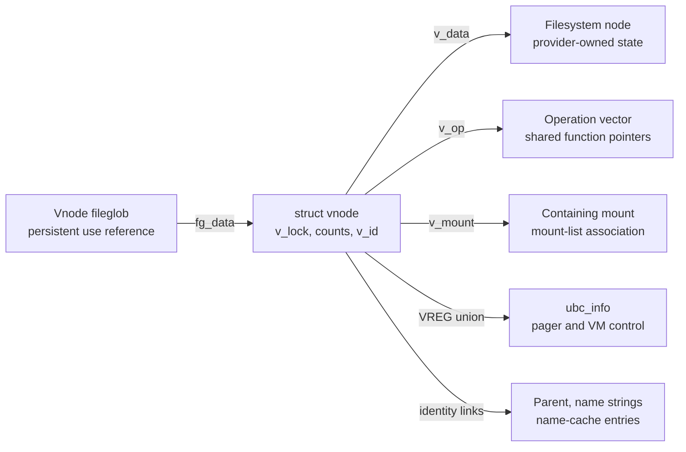
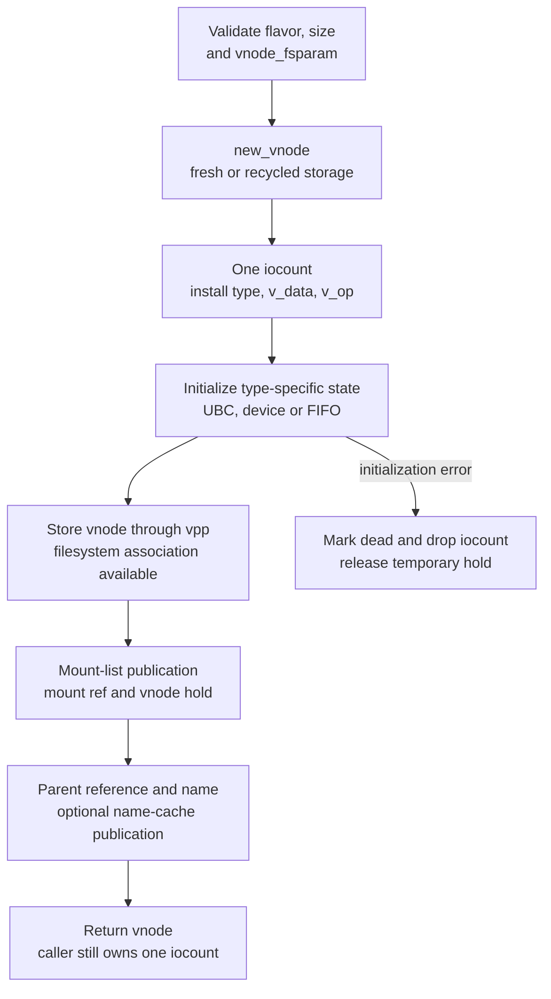
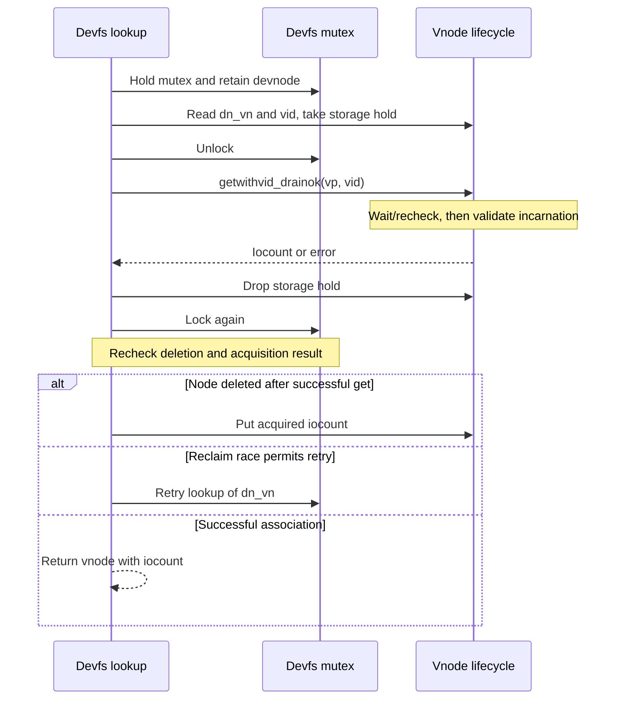
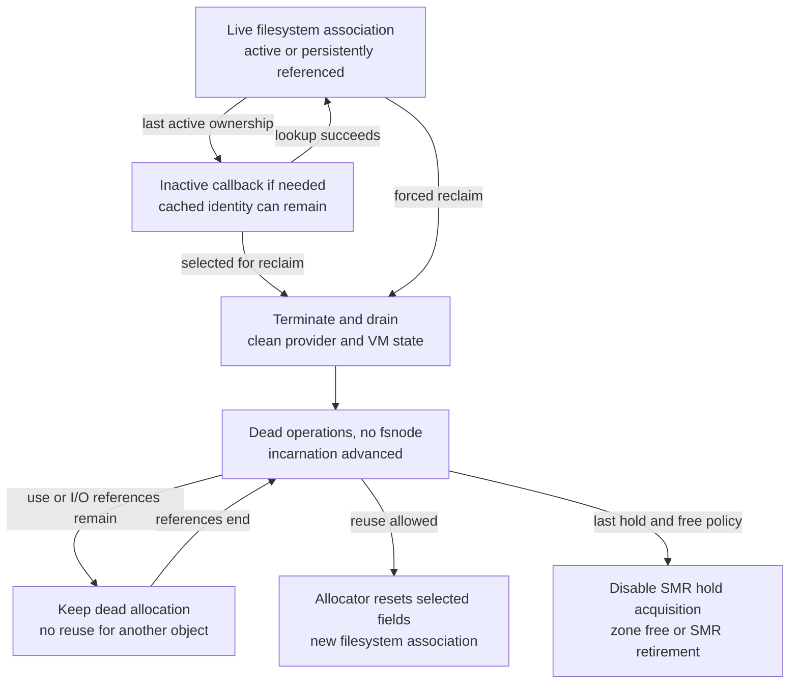

# Vnodes and vnode identity

A vnode joins a filesystem object's private state to VFS dispatch, open-file references, cached names and, for a regular file, VM backing. Follow one pointer through allocation, publication, lookup, use and reclaim: keeping its storage allocated, keeping its incarnation stable and keeping its filesystem state operational require different mechanisms. This chapter documents `xnu-12377.121.6`, commit `ac9718fb1af618d5ce8678d0dc6e8a58f252216f`.

[Key structures](README.md) · [VFS overview](../subsystems/vfs/vnodes-mounts-and-dispatch.md) · [Vnode cache identity and reuse](../subsystems/vfs/vnode-cache-identity-and-reuse.md) · [Name cache and reclaim](../subsystems/vfs/name-cache-and-vnode-reclaim.md) · [Fileprocs and fileglobs](fileprocs-and-fileglobs.md) · [UBC and vnode pagers](ubc-and-vnode-pagers.md)

The operation chapters explain pathname walking, queue policy and unmount. Here the questions are narrower: which bytes belong to the vnode, who owns each association, which reference permits a call through `v_op`, and what changes while the numerical pointer stays the same? The local devfs implementation supplies a concrete filesystem example. APFS's private node allocator, lookup locks and reclaim method are outside this source checkout; generic VFS calls do not establish those implementation details.

## 1. The allocation and the objects attached to it

`vnode_t` names a `struct vnode`; the common allocator obtains one element from `vnode_zone`. The zone is ordinary writable storage. Its declaration uses `ZC_NOGC | ZC_ZFREE_CLEARMEM`, with no RO-zone ID or controlled RO update interface. `ZC_NOGC` does not mean that individual vnode elements can never be returned: the final-drop path explicitly calls `zfree()` or `zfree_smr()`. [Zone declaration](../../xnu/bsd/vfs/vfs_subr.c#L169-L170), [allocation](../../xnu/bsd/vfs/vfs_subr.c#L5799-L5803), [element release](../../xnu/bsd/vfs/vfs_subr.c#L6249-L6253).

From [`vfs_subr.c:169–170`](../../xnu/bsd/vfs/vfs_subr.c#L169-L170):

<!-- source-excerpt: ../../xnu/bsd/vfs/vfs_subr.c#L169-L170 -->
```c
ZONE_DEFINE(vnode_zone, "vnodes",
    sizeof(struct vnode), ZC_NOGC | ZC_ZFREE_CLEARMEM);
```

The embedded mutex, counts, flags and links occupy that element. The filesystem node, operation vector, mount, name strings, UBC information and MAC label have separate storage and ownership. Pointer-authentication annotations on selected members describe pointer representation; they do not allocate a companion object or acquire a reference. [Vnode declaration](../../xnu/bsd/sys/vnode_internal.h#L159-L232).



Arrows show associations, not a uniform ownership rule. In particular, one fileglob owns a use reference, mount-list membership takes a vnode storage hold and a mount reference, and a positive name-cache entry holds vnode storage while separately remembering its incarnation. [Open reference](../../xnu/bsd/vfs/vfs_vnops.c#L185-L205), [mount insertion](../../xnu/bsd/vfs/vfs_subr.c#L2070-L2090), [cache insertion](../../xnu/bsd/vfs/vfs_cache.c#L2962-L2971).

### A field map for reading callers

| Fields | Meaning and associated storage | Access and lifetime rule on the selected paths |
| --- | --- | --- |
| `v_lock`, `v_owner` | Embedded mutex; thread owning drain/suspend work | The mutex serializes lifecycle decisions. Ownership lets selected acquisition paths proceed during a transition; it is not the identity of an open-file owner. [Drain](../../xnu/bsd/vfs/vfs_subr.c#L6652-L6684), [owner exception](../../xnu/bsd/vfs/vfs_subr.c#L6733-L6742). |
| `v_type`, `v_tag`, `v_id` | Object kind, provider/debug tag, 32-bit incarnation | Type selects union interpretation. A tag is not a lifetime guarantee. `v_id` must be compared through acquisition after a potentially blocking lookup. [Fields](../../xnu/bsd/sys/vnode_internal.h#L176-L185), [comparison](../../xnu/bsd/vfs/vfs_subr.c#L6801-L6809). |
| `v_op`, `v_data` | Operation-vector pointer and filesystem-private node pointer | Creation installs them; filesystem methods interpret private data; cleanup replaces the vector and clears the node. `vnode_fsnode()` merely returns `v_data`. [Initialization](../../xnu/bsd/vfs/vfs_subr.c#L7054-L7059), [accessors](../../xnu/bsd/vfs/kpi_vfs.c#L1925-L1935), [cleanup](../../xnu/bsd/vfs/vfs_subr.c#L3185-L3191). |
| `v_mount`, `v_mntvnodes` | Containing mount and membership in one of its vnode lists | `insmntque()` manages membership under the mount lock; insertion takes a mount reference and vnode hold. Removal drops both. A mount pointer is not a `vfs_busy()` lock. [Membership](../../xnu/bsd/vfs/vfs_subr.c#L2034-L2090), [mount busy](../../xnu/bsd/vfs/vfs_subr.c#L1037-L1115). |
| `v_name`, `v_parent` | Cached component string and parent association | Strings are separately interned; an installed parent owns a vnode use reference. These assist lookup/path construction, not a unique pathname for every hard link. Replacement uses the name-cache lock and releases old ownership after that lock is dropped. [Creation](../../xnu/bsd/vfs/vfs_subr.c#L7213-L7227), [identity update](../../xnu/bsd/vfs/vfs_cache.c#L1140-L1270). |
| `v_nclinks`, `v_ncchildren` | Entries naming this vnode; entries naming children of this vnode | These are embedded list heads, not copies of pathnames. The global name-cache lock protects structural changes; lockless cache readers use their own SMR/sequence protocol. [Lock domains](../../xnu/bsd/sys/vnode_internal.h#L151-L157), [cache reader](../../xnu/bsd/vfs/vfs_cache.c#L2735-L2800). |
| `v_cred`, `v_authorized_actions`, `v_cred_timestamp`, `v_nc_generation` | Credential-specific cached permission and name-cache generation | The declaration explicitly assigns these four fields to exclusive name-cache locking. `v_nc_generation` is distinct from the vnode incarnation `v_id` and the name-cache entry's sequence counter. Purge clears permission state and releases the detached credential outside the cache lock. [Fields](../../xnu/bsd/sys/vnode_internal.h#L189-L197), [purge](../../xnu/bsd/vfs/vfs_cache.c#L1211-L1268). |
| `v_cleanblkhd`, `v_dirtyblkhd`, `v_iterblkflags`, `v_numoutput` | Buffered-I/O lists/iteration and outstanding output | The first three use `buf_mtx`, rather than the vnode mutex alone. Reclaim separately checks that output has drained. [Lock domains](../../xnu/bsd/sys/vnode_internal.h#L151-L157), [reclaim checks](../../xnu/bsd/vfs/vfs_subr.c#L6920-L6937). |
| `v_label`, conditional resolver/firmlink/lease fields | Security label and feature-specific associations | `v_label` is an atomic pointer under `CONFIG_MACF`; its lazy publication and free protocol is separate from the vnode mutex's ordinary field rules. See [MAC label storage](mac-label-storage.md). [Conditional layout](../../xnu/bsd/sys/vnode_internal.h#L210-L231), [final label detach](../../xnu/bsd/vfs/vfs_subr.c#L6236-L6247). |

The broad header comment that “the rest” uses the vnode lock is an introduction, not a complete per-access specification. The same declaration gives the authorization fields a different lock, and the bodies use atomics for holds and some usecount operations. A reference protects a lifetime; it does not serialize arbitrary field reads. [Header exceptions](../../xnu/bsd/sys/vnode_internal.h#L151-L203), [atomic hold](../../xnu/bsd/vfs/vfs_subr.c#L6120-L6134), [usecount implementation](../../xnu/bsd/vfs/vfs_subr.c#L2354-L2355).

### The type-dependent union

From [`vnode_internal.h:179–185`](../../xnu/bsd/sys/vnode_internal.h#L179-L185):

<!-- source-excerpt: ../../xnu/bsd/sys/vnode_internal.h#L179-L185 -->
```c
	union {
		struct mount    * XNU_PTRAUTH_SIGNED_PTR("vnode.v_data") vu_mountedhere;  /* ptr to mounted vfs (VDIR) */
		struct socket   * XNU_PTRAUTH_SIGNED_PTR("vnode.vu_socket") vu_socket;     /* unix ipc (VSOCK) */
		struct specinfo * XNU_PTRAUTH_SIGNED_PTR("vnode.vu_specinfo") vu_specinfo;   /* device (VCHR, VBLK) */
		struct fifoinfo * XNU_PTRAUTH_SIGNED_PTR("vnode.vu_fifoinfo") vu_fifoinfo;   /* fifo (VFIFO) */
		struct ubc_info * XNU_PTRAUTH_SIGNED_PTR("vnode.vu_ubcinfo") vu_ubcinfo;    /* valid for (VREG) */
	} v_un;
```

| `v_type` | Union alias | Interpretation |
| --- | --- | --- |
| `VDIR` | `v_mountedhere` | Filesystem mounted on this directory; distinct from `v_mount`, the filesystem containing the directory. |
| `VSOCK` | `v_socket` | Socket association for this vnode kind. |
| `VCHR`, `VBLK` | `v_specinfo` | Special-device data, including device/alias bookkeeping. |
| `VFIFO` | `v_fifoinfo` | Separately allocated FIFO information; creation allocates it and reclaim frees it. [Allocate](../../xnu/bsd/vfs/vfs_subr.c#L7181-L7185), [release](../../xnu/bsd/vfs/vfs_subr.c#L6909-L6918). |
| `VREG` | `v_ubcinfo` | UBC information for a regular file, when initialized. `UBCINFOEXISTS()` checks both `VREG` and a non-null pointer. [Predicate](../../xnu/bsd/kern/ubc_subr.c#L3025-L3029). |

The aliases occupy the same bytes. A non-null union value alone cannot establish that a UBC, FIFO or device object exists. Reclaim changes `v_type` to `VBAD` and ultimately clears the union through `v_socket = NULL`; follow those transitions before interpreting a snapshot. [Aliases](../../xnu/bsd/sys/vnode_internal.h#L234-L238), [type and union cleanup](../../xnu/bsd/vfs/vfs_subr.c#L6909-L6949).

## 2. Reference counts, subsets and lifecycle flags

The important counts are declared together, but are not interchangeable. `v_references` is especially easy to misread: it is an 8-bit acquisition/aging counter, incremented by selected iocount grants and periodically reset to remove a vnode from an aging list. It is not the number of outstanding references. [Count fields](../../xnu/bsd/sys/vnode_internal.h#L170-L178), [aging update](../../xnu/bsd/vfs/vfs_subr.c#L6804-L6809).

| Mechanism | What it establishes | Acquire/release and synchronization |
| --- | --- | --- |
| `v_iocount` | Short-lived active access; an ordinary reclaim must drain other I/O users before removing filesystem state | `vnode_get*()` / `vnode_put()`, normally under `v_lock`; the caller must already have a valid route to storage. A successful acquisition is not a mutex held across the operation. [Get](../../xnu/bsd/vfs/vfs_subr.c#L2290-L2312), [put](../../xnu/bsd/vfs/vfs_subr.c#L6494-L6518). |
| `v_usecount` | Persistent association: the vnode cannot be reused to represent a different object while it remains held | `vnode_ref*()` / `vnode_rele*()`. Forced reclaim may still remove the filesystem state, leaving this same allocation with dead operations. The implementations take the vnode lock and atomically update the count; special lookup paths account for the atomic choice. [Acquire](../../xnu/bsd/vfs/vfs_subr.c#L2329-L2398), [release](../../xnu/bsd/vfs/vfs_subr.c#L2665-L2713). |
| `v_kusecount` | A subset of usecount excluded from selected “in use” decisions | `O_EVTONLY` acquisition increments both usecount and kusecount; named-stream parent accounting also adjusts it. It is not a second reference that must be added to usecount, nor a count of every reference taken by kernel code. [Event-only accounting](../../xnu/bsd/vfs/vfs_subr.c#L2354-L2366), [parent accounting](../../xnu/bsd/vfs/vfs_cache.c#L1154-L1166), [in-use test](../../xnu/bsd/vfs/vfs_subr.c#L6559-L6582). |
| `v_holdcount` | Allocation storage remains available while a lookup or membership owns a hold | `vnode_hold()` / `vnode_drop()`, using atomics. This alone does not stop filesystem reclaim or reuse for a new incarnation. The final drop may lock, detach and free storage. An SMR-only reader uses `vnode_hold_smr()` instead of an unconditional increment. [Hold protocol](../../xnu/bsd/vfs/vfs_subr.c#L6120-L6167), [final-drop conditions](../../xnu/bsd/vfs/vfs_subr.c#L6181-L6226). |
| `v_writecount` | Writer subset of usecount | `vnode_ref_ext(..., FWRITE, ...)` increments it; matching release decrements it. Its role differs from `v_numoutput`, which tracks output work. [Acquire](../../xnu/bsd/vfs/vfs_subr.c#L2357-L2361), [release](../../xnu/bsd/vfs/vfs_subr.c#L2691-L2695). |

A new persistent reference is not a way to resurrect a raw pointer. `vnode_ref_ext()` asserts that some valid iocount or usecount already exists, checks drain/terminate/dead state, and normally refuses a transition unless the caller owns it or the explicit force/operation-change exceptions apply. The adjacent comment proposes a stronger future iocount assertion; this snapshot's body accepts a positive usecount too. [Actual admission test](../../xnu/bsd/vfs/vfs_subr.c#L2335-L2355).

### Flags supplement the counts

| Field and selected flags | Meaning in the lifecycle |
| --- | --- |
| `v_lflag`: `VL_NEEDINACTIVE`, `VL_MARKTERM` | An inactive callback is pending; reclaim should occur when active ownership permits. Neither alone means that filesystem state has already been removed. [Last-use release](../../xnu/bsd/vfs/vfs_subr.c#L2707-L2737), [recycle request](../../xnu/bsd/vfs/vfs_subr.c#L3281-L3298). |
| `v_lflag`: `VL_SUSPENDED`, `VL_DRAIN`, `VL_TERMINATE`, `VL_TERMWANT` | Acquisition gating, drain progress and a waiter indication. The acquiring API's flags determine whether it sleeps, fails or can enter during drain. [Acquisition state machine](../../xnu/bsd/vfs/vfs_subr.c#L6703-L6803). |
| `v_lflag`: `VL_DEAD`, `VL_OPSCHANGE` | Cleaned filesystem state; special-device operation-vector replacement. An allocated dead vnode can retain persistent references. [Cleanup](../../xnu/bsd/vfs/vfs_subr.c#L3185-L3204), [device replacement](../../xnu/bsd/vfs/vfs_subr.c#L7148-L7172). |
| `v_lflag`: `VNAMED_UBC`, `VNAMED_MOUNT`, `VNAMED_FSHASH` | Named associations that reuse checks must find detached. They are bits, not a shared integer reference count. `vnode_addfsref()` sets a bit without incrementing usecount or holdcount. [Definitions](../../xnu/bsd/sys/vnode_internal.h#L276-L278), [FS helpers](../../xnu/bsd/vfs/vfs_subr.c#L7408-L7432), [reuse assertions](../../xnu/bsd/vfs/vfs_subr.c#L5473-L5486). |
| `v_flag`: `VSTANDARD`, `VCANDEALLOC`, `VISDIRTY`, `VNCACHEABLE` | Common-pool origin, eligibility for storage deallocation, reclaim that may require I/O, and name-cache eligibility. These answer different questions from liveness. [Definitions](../../xnu/bsd/sys/vnode_internal.h#L293-L312). |
| `v_listflag`: `VLIST_RAGE`, `VLIST_DEAD`, `VLIST_ASYNC_WORK`, `VLIST_NO_REUSE` | Queue classification and prohibition on allocation reuse, protected by the vnode-list lock. [Definitions](../../xnu/bsd/sys/vnode_internal.h#L250-L256), [free selection](../../xnu/bsd/vfs/vfs_subr.c#L6220-L6226). |

For `VNAMED_MOUNT`, inspect the corresponding calls: insertion increments a vnode hold and a mount reference; removal clears the bit and drops both. For `VNAMED_UBC`, follow the pager/control and named VM-object reference in [UBC and vnode pagers](ubc-and-vnode-pagers.md). Counting the number of set named bits cannot reconstruct either `v_usecount` or `v_holdcount`. [Mount association](../../xnu/bsd/vfs/vfs_subr.c#L2034-L2090), [named VM backing](../../xnu/bsd/kern/ubc_subr.c#L1148-L1176).

## 3. Allocate storage, initialize identity, then publish it

### Fresh storage and recycled storage

`new_vnode()` combines storage allocation with cache-reuse policy. A fresh allocation uses the zeroed no-fail zone primitive, initializes its mutex, list/knote state and optional label, seeds `v_id` from `nanouptime().tv_nsec`, and returns with `v_iocount = 1`. The seed is not a globally unique filesystem identifier. [Fresh path](../../xnu/bsd/vfs/vfs_subr.c#L5799-L5844).

From [`vfs_subr.c:5799–5813`](../../xnu/bsd/vfs/vfs_subr.c#L5799-L5813):

<!-- source-excerpt: ../../xnu/bsd/vfs/vfs_subr.c#L5799-L5813 -->
```c
		if (nc_smr_enabled) {
			vp = zalloc_smr(vnode_zone, Z_WAITOK_ZERO_NOFAIL);
		} else {
			vp = zalloc_flags(vnode_zone, Z_WAITOK_ZERO_NOFAIL);
		}

		VLISTNONE(vp);          /* avoid double queue removal */
		lck_mtx_init(&vp->v_lock, &vnode_lck_grp, &vnode_lck_attr);

		TAILQ_INIT(&vp->v_ncchildren);

		klist_init(&vp->v_knotes);
		nanouptime(&ts);
		vp->v_id = (uint32_t)ts.tv_nsec;
		vp->v_flag = VSTANDARD | vflag;
```

Reuse follows a different path. With the list lock held, `process_vp()` snapshots the candidate's `v_id`, removes it, takes a storage hold and drops the list lock. After acquiring the vnode mutex it rechecks the incarnation, usecount, iocount, list membership and termination state. Failure abandons that candidate; pending inactive work or dirty/unreliable backing can send it to deferred work instead. Only a suitable candidate is reclaimed and returned for reuse. [Selection and revalidation](../../xnu/bsd/vfs/vfs_subr.c#L5396-L5491).

A successful reuse does not `bzero()` the live mutex and entire element. The code resets selected flags, counts, mount and deferred-reclaim fields, installs one iocount, then drops the temporary hold and lock. The identity increment happened during reclaim. [Selected reset](../../xnu/bsd/vfs/vfs_subr.c#L6077-L6099), [incarnation change](../../xnu/bsd/vfs/vfs_subr.c#L6902-L6907).

The allocator policy can still return `ENFILE` after retry/exhaustion even though its actual fresh zone allocation is no-fail. Under `CONFIG_JETSAM`, exhaustion can instead request process eviction and retry, or panic if recovery is unavailable. Deallocation tunables select different defaults for macOS and other targets, with boot arguments able to change them. These are source selection rules, not measurements of a running device. The detailed [queue/budget chapter](../subsystems/vfs/vnode-cache-identity-and-reuse.md#3-free-age-dead-and-asynchronous-queues) follows those decisions. [Exhaustion](../../xnu/bsd/vfs/vfs_subr.c#L5958-L6002), [defaults](../../xnu/bsd/vfs/vfs_subr.c#L239-L253), [policy setup](../../xnu/bsd/vfs/vfs_subr.c#L426-L444).

### Construction inputs and discoverability

`struct vnode_fsparam` supplies the containing mount, vnode type, parent, provider's node pointer and operation vector, root/system flags, device number, initial file size and optional component name. These are input associations; passing `vnfs_fsnode` does not tell generic VFS how to free the provider's node. [Input declaration](../../xnu/bsd/sys/vnode.h#L242-L262).

For the ordinary non-aliased path, construction proceeds as follows. [Constructor](../../xnu/bsd/vfs/vfs_subr.c#L6975-L7227):



The diagram selects successful ordinary construction plus one initialization failure. Device alias replacement and empty-vnode initialization have different ordering, described below. Mount/name-cache publication is conditional on the supplied parameters; it is not mandatory for every vnode.

A small source passage explains why output assignment is an intermediate publication event, not simply the final line before return. From [`vfs_subr.c:7187–7197`](../../xnu/bsd/vfs/vfs_subr.c#L7187-L7197):

<!-- source-excerpt: ../../xnu/bsd/vfs/vfs_subr.c#L7187-L7197 -->
```c
	/* The file systems must pass the address of the location where
	 * they store the vnode pointer. When we add the vnode into the mount
	 * list and name cache they become discoverable. So the file system node
	 * must have the connection to vnode setup by then
	 */
	*vpp = vp;

	/* Add fs named reference. */
	if (param->vnfs_flags & VNFS_ADDFSREF) {
		vp->v_lflag |= VNAMED_FSHASH;
	}
```

VFS then inserts into the mount's normal or iteration-time list; it acquires a persistent reference on `vnfs_dvp` before assigning `v_parent`; and it obtains an owned interned name, either through `cache_enter_create()` or directly through `vfs_addname()`. `VNFS_NOCACHE` suppresses the initial entry, whereas `VNFS_CANTCACHE` also prevents setting `VNCACHEABLE` for later caching. The parent reference can fail, in which case this assignment is omitted. [Mount insertion](../../xnu/bsd/vfs/vfs_subr.c#L2070-L2090), [parent/name setup](../../xnu/bsd/vfs/vfs_subr.c#L7213-L7227), [cacheability flag](../../xnu/bsd/vfs/vfs_subr.c#L7235-L7241).

The constructor comment states the intended filesystem connection contract. Its local callers still require their own synchronization. Devfs, for example, uses `DN_CREATE` to serialize creation, drops its mutex around `vnode_create_ext()`, then reacquires it before publishing `dn_vn` and taking the devnode reference that lasts until reclaim. Cloned devices intentionally do not install that shared `dn_vn` pointer. The constructor's `*vpp` store cannot substitute for these provider-specific steps. [Devfs serialization](../../xnu/bsd/miscfs/devfs/devfs_tree.c#L1233-L1243), [create and provider publication](../../xnu/bsd/miscfs/devfs/devfs_tree.c#L1293-L1331).

### Creation variants and unwind

| Path | What differs |
| --- | --- |
| `vnode_create()` | Calls `vnode_create_ext()` with `VNODE_CREATE_NODEALLOC`: storage is obtained through the same common allocator, but this caller requests non-deallocatable treatment. This does not mean a static vnode or a permanently live filesystem association. [Wrapper](../../xnu/bsd/vfs/vfs_subr.c#L7370-L7374), [allocator option](../../xnu/bsd/vfs/vfs_subr.c#L7031-L7034). |
| `vnode_create_ext(..., VNODE_CREATE_DEFAULT)` | Permits allocator policy to choose a deallocatable vnode. Devfs uses this path. Not every default allocation receives `VCANDEALLOC`; pool policy makes that decision. [Devfs call](../../xnu/bsd/miscfs/devfs/devfs_tree.c#L1296-L1300), [eligibility](../../xnu/bsd/vfs/vfs_subr.c#L5788-L5795). |
| `vnode_create_empty()` then `vnode_initialize()` | Preallocates storage with one iocount but `VBAD`/`VL_DEAD`, no filesystem node and dead operations. The documented next step is initialize or put. Initialization consumes the supplied handle on failure; callers must not put the original pointer again. This API pair is present, but no filesystem caller of `vnode_initialize()` is traced here. [Contract](../../xnu/bsd/sys/vnode.h#L956-L986), [empty path](../../xnu/bsd/vfs/vfs_subr.c#L7035-L7051), [wrappers](../../xnu/bsd/vfs/vfs_subr.c#L7377-L7405). |
| Special-device alias | `checkalias()` can return another locked vnode. Construction discards its unneeded candidate, switches to the alias, sets `VL_OPSCHANGE`, calls `vclean()`, then installs new provider state and mount membership. The returned pointer need not be the initially allocated candidate. [Alias path](../../xnu/bsd/vfs/vfs_subr.c#L7121-L7172). |
| `bdevvp()` and the system root | `bdevvp()` uses ordinary `vnode_create()`, with `VBLK`, special-device operations and initially no mount or fsnode; it adds a use reference. The root filesystem vnode comes from `VFS_ROOT()` and is retained in global pointer variables. Neither selected route constructs a static `struct vnode` merely because it is a boot/root object. [Block-device construction](../../xnu/bsd/vfs/vfs_subr.c#L2099-L2150), [root acquisition](../../xnu/bsd/kern/bsd_init.c#L920-L931), [global assignment](../../xnu/bsd/kern/bsd_init.c#L424-L445). |

For normal `vnode_create_ext()` options, the wrapper clears the output before calling the internal constructor. Unsupported option bits return `EINVAL` before that clearing step. Internal parameter errors do not promise that a caller-supplied empty vnode remains owned: `error_out` puts it. A UBC or resolver initialization error marks the vnode dead and drops its iocount under a temporary hold; that cleanup is not a generic `VNOP_RECLAIM()` call on arbitrary supplied private data. Providers must follow their own create-failure ownership contract. [Wrapper validation](../../xnu/bsd/vfs/vfs_subr.c#L7357-L7364), [parameter validation](../../xnu/bsd/vfs/vfs_subr.c#L6994-L7029), [UBC error cleanup](../../xnu/bsd/vfs/vfs_subr.c#L7067-L7079), [resolver failure](../../xnu/bsd/vfs/vfs_subr.c#L7094-L7118), [existing-vnode unwind](../../xnu/bsd/vfs/vfs_subr.c#L7348-L7353).

The UBC error branch is visible cleanup code, not evidence of a normal allocation-error return on this selected path. `ubc_info_init_withsize()` supplies `withfsize = 1`; the current helper starts with `error = 0`, panics on named-object creation failure, assigns the supplied size and returns that zero. The separate no-size initializer can return a `vnode_size()` error after creating the association. [Wrapper](../../xnu/bsd/kern/ubc_subr.c#L1061-L1064), [initial state](../../xnu/bsd/kern/ubc_subr.c#L1095-L1102), [association and return](../../xnu/bsd/kern/ubc_subr.c#L1155-L1178).

The ordinary constructor uses unpublished-object assumptions for many assignments. The source explicitly singles out `bdevvp` alias reuse as different: another user can already observe that vnode, and the tail performs a wakeup plus locked reapplication of selected flags. Read that branch as an existing-object transition, rather than generalizing the fresh-object diagram to it. [Alias-tail handling](../../xnu/bsd/vfs/vfs_subr.c#L7304-L7343).

## 4. Recover a usable incarnation from a cached pointer

`vnode_vid()` is a plain read of `v_id`, and `vnode_fsnode()`/`vnode_mount()` are plain association accessors. None obtains a reference, checks whether a pointer came from a valid owner, or waits for reclaim. A safe cached lookup first preserves allocation storage, then asks an acquisition API to validate the remembered incarnation and grant an iocount. [Accessors](../../xnu/bsd/vfs/kpi_vfs.c#L1855-L1864), [fsnode accessor](../../xnu/bsd/vfs/kpi_vfs.c#L1925-L1935).

### Choose the acquisition API by the reference already owned

| API | Existing basis for access | Transition behavior |
| --- | --- | --- |
| `vnode_get()` / `vnode_get_locked()` | A valid vnode pointer under the caller's appropriate lifetime protocol | No `v_id` comparison. The selected body rejects terminate/dead when iocount is zero, then increments. It is not a stale-cache identity check. [Body](../../xnu/bsd/vfs/vfs_subr.c#L6329-L6360). |
| `vnode_getwithvid(vp, saved_vid)` | Storage remains valid; the remembered association supplied a saved incarnation | Requests no-dead and identity checking, and may cut ahead of an active drain to avoid lock-order deadlock. It does not bypass every later termination stage. [Flags and rationale](../../xnu/bsd/vfs/vfs_subr.c#L6362-L6372). |
| `vnode_getwithvid_drainok()` | Same storage/identity requirement | Despite the name, waits behind drain. An unmount observed during this path can yield `ENODEV`; identity mismatch yields `ENOENT`. [Wrapper](../../xnu/bsd/vfs/vfs_subr.c#L6374-L6383), [unmount exit](../../xnu/bsd/vfs/vfs_subr.c#L6756-L6778). |
| `vnode_getwithref()` | A persistent use reference belonging to the caller's association | Can wait through transitions and return a dead vnode; it does not request `VNODE_NODEAD` or `VNODE_WITHID`. The contract warns against calling it while the same caller already holds an iocount, because waiting for drain can then wait on itself. [Body](../../xnu/bsd/vfs/vfs_subr.c#L6385-L6389), [contract](../../xnu/bsd/sys/vnode.h#L1700-L1713). |
| `vnode_getwithref_noblock()` | Existing iocount/usecount; the helper asserts such a count exists | Adds both nonblocking and no-dead semantics. It is not just the preceding API with waiting disabled. [Wrapper](../../xnu/bsd/vfs/vfs_subr.c#L6391-L6400), [assertion](../../xnu/bsd/vfs/vfs_subr.c#L2290-L2300). |
| `vnode_getalways()` / `vnode_getalways_from_pager()` | Internal caller with a separately established safe association | `VNODE_ALWAYS` bypasses the normal transition wait; the pager variant also avoids acquisition-aging work. This is an internal protocol, not a general way to recover arbitrary pointers. [Wrappers](../../xnu/bsd/vfs/vfs_subr.c#L6402-L6412), [gate](../../xnu/bsd/vfs/vfs_subr.c#L6742-L6749), [pager aging exception](../../xnu/bsd/vfs/vfs_subr.c#L6804-L6809). |

The `vnode_getwithref()` header's return-value line includes dead/reused failures, but its preceding discussion and current body explicitly permit dead vnodes. For this snapshot, follow the implementation: it passes neither the identity flag nor the no-dead flag, and `vnode_getiocount()` admits a settled dead vnode. A use reference prevents reuse for another object; it does not preserve the old filesystem methods after forced reclaim. [Header](../../xnu/bsd/sys/vnode.h#L1700-L1713), [body](../../xnu/bsd/vfs/vfs_subr.c#L6385-L6389), [state test](../../xnu/bsd/vfs/vfs_subr.c#L6715-L6727).

`vget_internal()` takes `v_lock`; `vnode_getiocount()` examines flags, sleeps with the lock released as appropriate, and reexamines state when awakened. Only after that loop does it compare `saved_vid` and grant the reference. From [`vfs_subr.c:6801–6809`](../../xnu/bsd/vfs/vfs_subr.c#L6801-L6809):

<!-- source-excerpt: ../../xnu/bsd/vfs/vfs_subr.c#L6801-L6809 -->
```c
	if (withvid && vid != vp->v_id) {
		return ENOENT;
	}
	if (!forpager && (++vp->v_references >= UNAGE_THRESHHOLD ||
	    (vp->v_flag & VISDIRTY && vp->v_references >= UNAGE_DIRTYTHRESHHOLD))) {
		vp->v_references = 0;
		vnode_list_remove(vp);
	}
	vp->v_iocount++;
```

### Devfs: preserve storage while dropping a provider lock

The existing-vnode branch of `devfs_dntovn()` starts with the devfs mutex held. It retains the devnode across the lock drop, reads `dn_vn` and its vid, holds the vnode storage, releases the mutex, and uses the drain-waiting acquisition variant. [Full branch](../../xnu/bsd/miscfs/devfs/devfs_tree.c#L1123-L1230).



After reacquiring the devfs mutex, deletion can invalidate an otherwise successful acquisition, so the function puts that iocount. It converts unmount-related `ENODEV` to `ENOENT`, and retries other acquisition failures up to its bound because reclaim may have cleared `dn_vn` or another lookup may already have replaced it. `devfs_reclaim()` makes the other side concrete: under the devfs mutex it clears `dn_vn`, clears `v_data`, and releases the devnode ownership established for the vnode. [Recheck/retry](../../xnu/bsd/miscfs/devfs/devfs_tree.c#L1166-L1225), [reclaim](../../xnu/bsd/miscfs/devfs/devfs_vnops.c#L1568-L1591).

### SMR cache lookup adds another identity check

A positive name-cache entry owns a vnode storage hold and records `nc_vid`. Its entry-validity sequence, the target vnode's incarnation and the storage hold are three separate protections. The SMR lookup reads the entry's sequence, target and saved vid, then rechecks the sequence. Before leaving SMR it attempts `vnode_hold_smr()`; after leaving, it calls `vnode_getwithvid()` and drops that temporary hold on both success and failure. A failed hold or identity check falls back rather than returning an unchecked pointer. [Entry ownership](../../xnu/bsd/vfs/vfs_cache.c#L2962-L2971), [SMR handoff](../../xnu/bsd/vfs/vfs_cache.c#L2765-L2800), [entry deletion drops hold](../../xnu/bsd/vfs/vfs_cache.c#L3243-L3290).

From [`vfs_cache.c:2780–2793`](../../xnu/bsd/vfs/vfs_cache.c#L2780-L2793):

<!-- source-excerpt: ../../xnu/bsd/vfs/vfs_cache.c#L2780-L2793 -->
```c
	if (vp) {
		bool holdcount_acquired = vnode_hold_smr(vp);

		vfs_smr_leave();

		if (!holdcount_acquired) {
			goto out_fallback;
		}

		if (vnode_getwithvid(vp, vid) != 0) {
			vnode_drop(vp);
			goto out_fallback;
		}
		vnode_drop(vp);
```

A deallocatable vnode can be in SMR-retired storage while a reader still sees its bytes. `vnode_hold_smr()` tests `VNODE_HOLD_NO_SMR` and uses a compare/exchange loop to acquire a hold only before final-free commitment. Non-deallocatable vnodes take the simpler unconditional hold path. The more detailed entry publication/odd-even sequence protocol is in [name-cache lookup](../subsystems/vfs/name-cache-and-vnode-reclaim.md#a-single-component-cache-lookup). [Hold implementation](../../xnu/bsd/vfs/vfs_subr.c#L6136-L6167), [final-free commitment](../../xnu/bsd/vfs/vfs_subr.c#L6223-L6226).

### Worked incarnation example

These values are illustrative, not a promise about actual seeds or addresses. Assume a cache/provider records `(vp = P, saved_vid = 41)` while object A is valid, and a storage hold keeps allocation P accessible across a lock drop.

| Point | Allocation P | Acquisition result |
| --- | --- | --- |
| Before reclaim | A's operations and private node, `v_id = 41` | A successful `getwithvid(P, 41)` adds an iocount for A. |
| Reclaim completes | Dead operations, cleared private state, `v_id = 42` | A saved `41` cannot authorize access to the new incarnation. |
| Allocator reuses P | Object B's associations installed; the reclaimed incarnation value is retained for this reuse | The numerical address still matches P, but `getwithvid(P, 41)` fails. |
| Temporary hold is dropped | Other references or policy now decide retention/free | The old holder may no longer dereference P without another valid ownership route. |

A hold can span reclaim/reuse because candidate selection checks usecount and iocount, not a requirement that holdcount be zero. Conversely, a use reference keeps the vnode from becoming B, though it may become dead A. The 32-bit vid is a generation check inside this protocol, not an eternal globally unique identity, and cannot make dereferencing freed storage safe. [Candidate test](../../xnu/bsd/vfs/vfs_subr.c#L5402-L5427), [increment](../../xnu/bsd/vfs/vfs_subr.c#L6902-L6907), [use-reference contract](../../xnu/bsd/sys/vnode.h#L1737-L1746).

## 5. An open file retains the vnode; each operation obtains active access

A vnode-backed open has a concrete ownership transfer. `vn_open_auth_finish()` takes a use reference with the effective open mode. `open1()` installs the vnode in `fg_data`, installs `&vnops` in `fg_ops`, and eventually drops its temporary lookup iocount before releasing the descriptor reservation. The fileglob then accounts for the persistent vnode reference. Independent opens can create separate fileglobs; duplicated descriptors can share one. The descriptor/fileglob counts are described in [fileprocs and fileglobs](fileprocs-and-fileglobs.md). [Open reference](../../xnu/bsd/vfs/vfs_vnops.c#L185-L205), [association](../../xnu/bsd/vfs/vfs_syscalls.c#L4987-L4993), [publication](../../xnu/bsd/vfs/vfs_syscalls.c#L5165-L5187).

For a read, `vn_read()` gets `vp` from the fileproc's fileglob and calls `vnode_getwithref()`. It serializes the shared regular-file offset when applicable, performs the operation, advances that offset by the actual reduction in `uio_resid()`, and puts the iocount. The offset belongs to the fileglob, not the vnode. A short/error-returning I/O can still have transferred bytes and advanced that offset. [Read body](../../xnu/bsd/vfs/vfs_vnops.c#L1220-L1270).

From [`vfs_vnops.c:1238–1245`](../../xnu/bsd/vfs/vfs_vnops.c#L1238-L1245):

<!-- source-excerpt: ../../xnu/bsd/vfs/vfs_vnops.c#L1238-L1245 -->
```c
	vp = (struct vnode *)fp_get_data(fp);
	if ((error = vnode_getwithref(vp))) {
		if (offset_locked) {
			vn_offset_unlock(fp->fp_glob);
		}
		return error;
	}

```

Dispatch then has two levels. `fg_ops->fo_read` selects the generic vnode file operation; `VNOP_READ()` builds a typed argument record and calls the current `v_op` slot indexed by `vnop_read_desc.vdesc_offset`. The boot operation-vector initialization assigns descriptor offsets, allocates vectors and fills registered implementations/defaults. An individual vnode points to a selected vector; it does not contain a private copy of every method. [File operations](../../xnu/bsd/vfs/vfs_vnops.c#L132-L146), [vector initialization](../../xnu/bsd/vfs/vfs_init.c#L158-L245), [offset assignment](../../xnu/bsd/vfs/vfs_init.c#L255-L273).

From [`kpi_vfs.c:4037–4043`](../../xnu/bsd/vfs/kpi_vfs.c#L4037-L4043):

<!-- source-excerpt: ../../xnu/bsd/vfs/kpi_vfs.c#L4037-L4043 -->
```c
	a.a_desc = &vnop_read_desc;
	a.a_vp = vp;
	a.a_uio = uio;
	a.a_ioflag = ioflag;
	a.a_context = ctx;

	_err = (*vp->v_op[vnop_read_desc.vdesc_offset])(&a);
```

The active reference prevents ordinary concurrent teardown of the filesystem state during the call; it is not an authorization decision or the filesystem's own private lock. Policy and mode checks happen along the surrounding read path, and the concrete method supplies provider-specific synchronization. A vnode already made dead by forced reclaim can still be reached by a persistent fileglob; `dead_read()` returns `EIO` for non-tty objects and EOF for tty objects. Thus a successful iocount acquisition need not imply that the original filesystem method will run. [Read admission](../../xnu/bsd/vfs/vfs_vnops.c#L1124-L1213), [dead read](../../xnu/bsd/miscfs/deadfs/dead_vnops.c#L173-L186).

### Worked ownership ledger for one ordinary fileglob

Select a regular file opened for ordinary read/write access, with no event-only mode, concurrent users or forced reclaim during the table. Counts below are **this open's contribution**, not totals: mount/name-cache holds, mappings, parent relationships and unrelated opens may coexist.

| Step | Usecount contribution | Iocount contribution | Writer/kuse contribution | What has become owned or released |
| --- | --- | --- | --- | --- |
| Lookup supplies the vnode | 0 | 1 | 0 / 0 | Temporary active access permits open work. |
| `vn_open_auth_finish()` succeeds with `FWRITE` | 1 | 1 | 1 / 0 | The successful open owns a persistent reference with writer accounting. |
| `open1()` finishes | 1 | 0 | 1 / 0 | `fg_data` retains the association after the lookup iocount is put. |
| `vn_read()` acquires/finishes | 1 | 0 → 1 → 0 | 1 / 0 | The use reference is unchanged; the read brackets active access. |
| Final fileglob close acquires I/O access | 1 | 1 | 1 / 0 | `vn_closefile()` can call close/lock-release operations. |
| `vn_close()` releases this regular-file open | 0 | 1 | 0 / 0 | Matching mode releases use/writer accounting even if close reports an error. |
| `vn_closefile()` puts its I/O reference | 0 | 0 | 0 / 0 | Last-reference processing may call inactive and reconsider reclaim. |

This ledger follows [mode accounting](../../xnu/bsd/vfs/vfs_subr.c#L2354-L2366), [read](../../xnu/bsd/vfs/vfs_vnops.c#L1220-L1270), [closefile](../../xnu/bsd/vfs/vfs_vnops.c#L1882-L1921) and [regular-file close ordering](../../xnu/bsd/vfs/vfs_vnops.c#L899-L924). With `O_EVTONLY`, the corresponding use reference also contributes one to kusecount and matching release removes it. For special devices, `vn_close()` deliberately drops the use reference **before** `VNOP_CLOSE()` so device last-close code sees the updated usage count. [Device ordering](../../xnu/bsd/vfs/vfs_vnops.c#L879-L889), [matching subset release](../../xnu/bsd/vfs/vfs_subr.c#L2691-L2705).

Open failure can occur after the persistent reference was acquired and `fg_data` assigned, for example during lease, advisory-lock or truncate work. The `bad` path calls `vn_close()`, puts the remaining iocount and frees the unpublished fileproc. Those releases do not establish that earlier filesystem changes, such as successful creation or some operation's partial work, have been rolled back. [Post-open work](../../xnu/bsd/vfs/vfs_syscalls.c#L4995-L5053), [cleanup](../../xnu/bsd/vfs/vfs_syscalls.c#L5188-L5207).

## 6. Inactive, reclaim, dead state, reuse and storage release

The last put is not just a decrement. If another use reference or another iocount remains, `vnode_put_internal_locked()` drops the count and returns. Otherwise it may service `VL_NEEDINACTIVE`, release `v_lock` for `VNOP_INACTIVE()`, reacquire it and retry the whole decision. A callback can change the counts or mark the vnode for termination; the old decision is no longer authoritative after the lock drop. [Put state machine](../../xnu/bsd/vfs/vfs_subr.c#L6426-L6485).

From [`vfs_subr.c:6443–6454`](../../xnu/bsd/vfs/vfs_subr.c#L6443-L6454):

<!-- source-excerpt: ../../xnu/bsd/vfs/vfs_subr.c#L6443-L6454 -->
```c
	if (((vp->v_lflag & (VL_DEAD | VL_NEEDINACTIVE)) == VL_NEEDINACTIVE)) {
		vp->v_lflag &= ~VL_NEEDINACTIVE;

		if (UBCINFOEXISTS(vp)) {
			ubc_cs_free_and_vnode_unlock(vp);
		} else {
			vnode_unlock(vp);
		}

		VNOP_INACTIVE(vp, ctx);

		vnode_lock_spin(vp);
```

If the vnode is marked for termination and no other owner prevents it, the ordinary put can run reclaim; a pager-originated put instead queues asynchronous cleanup to avoid reclaim deadlocking with the pager itself. `vnode_put()` takes a temporary storage hold while it executes this work, then drops it and the lock together. `vnode_rele_internal()` can also drive inactive/reclaim when a persistent reference ends, including deferred parent-chain cleanup. [Pager distinction and wrapper hold](../../xnu/bsd/vfs/vfs_subr.c#L6467-L6526), [last-use processing](../../xnu/bsd/vfs/vfs_subr.c#L2707-L2799), [parent-chain deferral](../../xnu/bsd/vfs/vfs_cache.c#L1270-L1346).



This is a lifecycle map, not a promise that every inactive vnode is reclaimed or every dead vnode is freed. `vnode_recycle()` merely sets `VL_MARKTERM` and returns zero if iocount or usecount is nonzero; when neither is present, it holds the allocation and invokes reclaim immediately. Forced-unmount/revoke paths have different admission and can clean a vnode with persistent users. [Recycle body](../../xnu/bsd/vfs/vfs_subr.c#L3281-L3298), [reclaim handling of open users](../../xnu/bsd/vfs/vfs_subr.c#L6868-L6885).

### Reclaim removes associations before making the slot reusable

`vnode_reclaim_internal()` sets `VL_TERMINATE`, records drain ownership through `vnode_drain()`, and waits for other iocounts to leave. The normal drain threshold permits the reclaiming thread's own single iocount. For tty revocation it can first call `VNOP_IOCTL(TIOCREVOKE)` outside the mutex to make existing reads release their counts. The drain code also has a special configured shutdown escape; the ordinary ownership argument is the wait, not that escape. [Reclaim entry](../../xnu/bsd/vfs/vfs_subr.c#L6841-L6871), [drain](../../xnu/bsd/vfs/vfs_subr.c#L6652-L6684).

`vgone()` invokes `vclean()` with close semantics and additionally handles special-device alias removal. `vclean()` records whether persistent users or inactive work exist, marks termination and drops the mutex before calling filesystem/VM operations. The selected cleanup order is: optional close/sync and buffer flushing, required inactive notification, destruction of the UBC named association, filesystem `VNOP_RECLAIM()`, identity/name-cache purge, then locked mount removal and installation of dead operations. Error handling differs by operation: a nonzero `VNOP_RECLAIM()` result panics rather than leaving a generally recoverable half-reclaimed vnode. [Vgone](../../xnu/bsd/vfs/vfs_subr.c#L3315-L3379), [cleaning operations](../../xnu/bsd/vfs/vfs_subr.c#L3012-L3177), [dead installation](../../xnu/bsd/vfs/vfs_subr.c#L3179-L3204).

From [`vfs_subr.c:3185–3191`](../../xnu/bsd/vfs/vfs_subr.c#L3185-L3191):

<!-- source-excerpt: ../../xnu/bsd/vfs/vfs_subr.c#L3185-L3191 -->
```c
	vp->v_lflag |= VL_DEAD;
	vp->v_mount = dead_mountp;
	vp->v_op = dead_vnodeop_p;
	vp->v_tag = VT_NON;
	vp->v_data = NULL;

	vp->v_flag &= ~VISDIRTY;
```

The provider owns its private node teardown. Devfs's reclaim clears both sides of its vnode/devnode link and drops its devnode reference; generic VFS then verifies the cleaned vnode. The UBC teardown route has to synchronize pager/VM work before private backing is discarded; see [UBC and vnode pagers](ubc-and-vnode-pagers.md). [Devfs callback](../../xnu/bsd/miscfs/devfs/devfs_vnops.c#L1568-L1591), [UBC-before-provider order](../../xnu/bsd/vfs/vfs_subr.c#L3137-L3172).

`vnode_update_identity()` removes name-cache links and child entries, detaches the cached credential, name and parent, and drops those owners outside the name-cache lock. Parent release can recursively make more vnodes reclaimable, so the function uses a deferred list/loop rather than assuming a shallow call chain. These releases are part of dismantling an identity; clearing `v_data` alone is insufficient. [Identity detachment](../../xnu/bsd/vfs/vfs_cache.c#L1211-L1270), [parent release](../../xnu/bsd/vfs/vfs_cache.c#L1270-L1350).

After provider cleanup, reclaim takes the vnode-list lock, removes the vnode from allocator-visible lists, and increments `v_id`. It clears FIFO state when applicable, sets `VBAD`, checks private state, output, parent and name, clears the union, releases transition ownership, wakes waiters and queues the dead vnode when the caller is not immediately reusing it. The list/lock ordering ensures a selector must revalidate the incarnation after changing locks. [Identity transition and checks](../../xnu/bsd/vfs/vfs_subr.c#L6888-L6972).

The nearby `UBCINFOEXISTS(vp)` panic test occurs **after** `v_type = VBAD`. Since that predicate requires `VREG`, it is not an independent null-pointer assertion for the union at this point. The actual pager detach path and the later allocator checks for `VNAMED_UBC` must be read separately; the diagnostic string alone does not prove the association was tested here. [Order of statements](../../xnu/bsd/vfs/vfs_subr.c#L6918-L6928), [type-dependent predicate](../../xnu/bsd/kern/ubc_subr.c#L3025-L3029), [reuse marker check](../../xnu/bsd/vfs/vfs_subr.c#L5473-L5486).

### Final storage release is a separate decision

A dead vnode may remain as a reusable cache allocation or be retained by use references, iocounts or holds. `vnode_drop_internal()` considers actual deallocation only when policy permits, the dropped hold was the last one, and `VCANDEALLOC` plus `VL_DEAD` are set. Under `v_lock` it rechecks that holdcount, iocount and usecount are all zero. Under the list lock it additionally requires the dead-list/retention conditions. [Early and locked checks](../../xnu/bsd/vfs/vfs_subr.c#L6199-L6226).

The final compare/exchange changes holdcount from zero to `VNODE_HOLD_NO_SMR`; this closes acquisition from readers whose only remaining protection is SMR. From [`vfs_subr.c:6223–6231`](../../xnu/bsd/vfs/vfs_subr.c#L6223-L6231):

<!-- source-excerpt: ../../xnu/bsd/vfs/vfs_subr.c#L6223-L6231 -->
```c
	if (VONLIST(vp) && (vp->v_listflag & VLIST_DEAD) &&
	    (numvnodes > desiredvnodes || (vp->v_listflag & VLIST_NO_REUSE) ||
	    vn_dealloc_level != DEALLOC_VNODE_ALL || deadvnodes >= deadvnodes_high) &&
	    (os_atomic_cmpxchg(&vp->v_holdcount, 0, VNODE_HOLD_NO_SMR, relaxed) != 0)) {
		VREMDEAD("vnode_list_remove", vp);
		numvnodes--;
		freeablevnodes--;
		deallocedvnodes++;
		vp->v_listflag = 0;
```

The path removes queue/accounting state, detaches and frees the MAC label when configured, drops the vnode lock, then uses `zfree_smr()` when name-cache SMR is enabled or `zfree()` otherwise. `vntblinit()` enables the zone's SMR callback; that callback zeroes the vnode storage once the retired element can be reclaimed. No new holder may be fabricated from the old pointer merely because its bytes have not yet been overwritten. [Final release](../../xnu/bsd/vfs/vfs_subr.c#L6233-L6261), [SMR registration](../../xnu/bsd/vfs/vfs_subr.c#L443-L445), [callback](../../xnu/bsd/vfs/vfs_subr.c#L6169-L6178).

## 7. Reading limits and next structures

This chapter covers the common vnode zone, selected creation variants, devfs lookup/reclaim, name-cache-to-iocount handoff, vnode-backed open/read/close and common teardown. It does not describe APFS's private node layout, persistent file identifiers or provider locks as if they were present. Device aliasing is included as a distinct constructor transition, not a full account of every device-driver close/revoke path. Optional labels, triggers, streams, leases and shutdown escape behavior remain conditional on the shown configuration and callers.

Continue with [descriptor tables](file-descriptor-tables.md) for task-local handle lookup, [fileprocs and fileglobs](fileprocs-and-fileglobs.md) for sharing and final close, [UBC and vnode pagers](ubc-and-vnode-pagers.md) for VM ownership, and [code-signature blob storage](code-signature-blob-storage.md) for signing metadata attached through UBC. Use [vnode cache identity and reuse](../subsystems/vfs/vnode-cache-identity-and-reuse.md) for queue budgets, cache eviction and authorization-cache behavior, and [name-cache/reclaim operations](../subsystems/vfs/name-cache-and-vnode-reclaim.md) for the complete lookup and transition walks.

<!-- BEGIN PLATYDOC DOCUMENTATION LICENSE -->
Original Platydoc text and diagrams are licensed under [CC BY 4.0](https://creativecommons.org/licenses/by/4.0/). Quoted source code and third-party material retain their respective licenses.
<!-- END PLATYDOC DOCUMENTATION LICENSE -->
