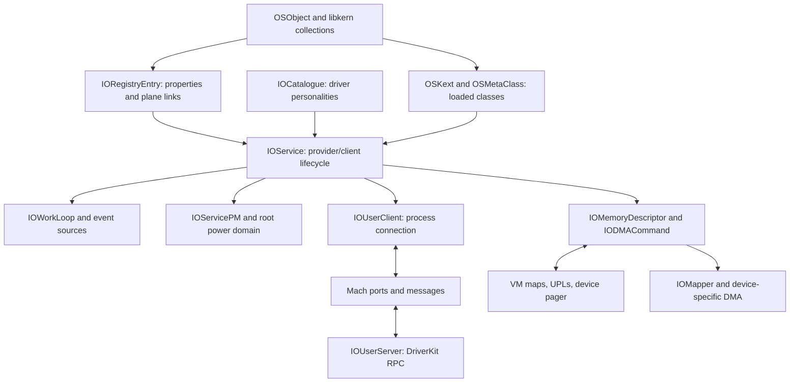

# IOKit, driver execution, and libkern

[Guide index](../../README.md) · [Architecture](../../architecture.md)

IOKit connects discoverable devices and software services to drivers, gives those drivers execution and memory-transfer facilities, and exposes selected operations to user processes. `libkern` supplies the object runtime beneath this machinery. The central relationship is a provider and its clients: a provider describes a resource; clients attach to it, negotiate access, publish further services, and eventually detach. A storage controller can therefore participate in several layers without the generic IOKit code knowing the disk format or hardware command set. See [`IOService`](../../../xnu/iokit/IOKit/IOService.h#L446) and [`IORegistryEntry`](../../../xnu/iokit/IOKit/IORegistryEntry.h#L101).

This checkout contains the generic runtime, selected platform classes, DriverKit interfaces, and kernel-side DriverKit transport. It does not contain every driver family or device implementation shipped with an operating system. Follow an implemented virtual call to its concrete subclass before attributing device behavior to this repository.

## The components and their connections

The arrows show ownership or call relationships, not a boot sequence. Three graphs coexist: registry planes describe relationships, the C++ superclass chain describes implementation inheritance, and `OSKext` dependency lists describe executable dependencies. A service's provider is not necessarily its C++ superclass. The power plane can also differ from the service plane; [`joinPMtree`](../../../xnu/iokit/Kernel/IOServicePM.cpp#L665) delegates placement to the platform expert.

| Component | Main state | Questions it answers |
| --- | --- | --- |
| Registry | Property dictionaries, plane-specific parent/child arrays, entry ID | What objects exist, and how are they connected? |
| Service/catalogue | Published and inactive flags, provider, matching category, personality dictionaries | Which driver should attach, and is it ready or terminating? |
| Workloop | Recursive gate, worker thread, event-source chains | Which callbacks may change shared driver state together? |
| User client/server | Connection ports, task ownership, method arguments, RPC objects | Which process can invoke which exported operations? |
| Memory/DMA | Source ranges, prepared pages, CPU maps, device maps, segment constraints | What memory may the CPU or device access during a transfer? |
| Power management | Requested/current states, parent capabilities, queued requests and acknowledgments | When can devices and the system change power state? |
| libkern/runtime | Object references, class registration, executable dependencies | How are objects allocated and classes made available? |

## Reading routes

1. Start with [bootstrap and BSD integration](bootstrap-and-bsd-integration.md) for framework initialization, device-tree import, platform matching and root-device discovery.
2. Read [libkern and kext runtime](libkern-and-kext-runtime.md), then [object runtime and collections](object-runtime-and-collections.md), for allocation, reference counts, metaclasses, casts and container ownership. Follow [symbol interning](symbol-interning.md) for shared key identity, no-copy backing and delayed destruction.
3. Read [registry and service lifecycle](registry-and-service-lifecycle.md), then [registry planes and properties](registry-planes-and-properties.md), [matching and termination](service-matching-and-termination.md), and [notifications and arbitration](service-notifications-and-arbitration.md). These connect object discovery to concurrent driver attachment, callbacks and removal.
4. Read [workloops and power](workloops-and-power.md), [callback protocols](workloop-and-power-protocols.md), and [interrupt routing and command queues](interrupt-routing-and-command-queues.md) to follow execution context, wakeups, command ownership and handler teardown.
5. Read [user clients and DriverKit](user-clients-and-driverkit.md), [connection lifetime](user-client-and-driverkit-lifetime.md), [DriverKit dispatch and actions](driverkit-dispatch-and-actions.md), and [shared queues and notifications](shared-data-queues-and-notifications.md) for process-facing calls and asynchronous results.
6. Read [memory and DMA](memory-and-dma.md), [descriptors and CPU mappings](memory-descriptors-and-cpu-mappings.md), and [DMA preparation and mapping](dma-preparation-and-mapping.md). CPU virtual, physical and device-visible addresses have different owners and lifetimes.
7. Follow [device power transitions](device-power-state-machine.md) into [system sleep and wake](system-sleep-and-wake.md), then [hibernation creation](../platform/hibernation-image-creation.md) and [restore](../platform/hibernation-restore.md).
8. Read [reporting and performance control](reporting-and-performance-control.md) for report channels, state residency, sample consistency and device-work attribution.
9. Follow [kernel collections and OSKext loading](kext-loading-and-unloading.md), [serialization and property transport](serialization-and-property-transport.md), and [NVRAM variables and persistence](nvram-variables-and-persistence.md) for executable dependencies, module start/unload, parser ownership, receiver policy, and V3/CHRP bank updates.

The focused implementation chapters extend those introductions:

| Question | Detailed chapter |
|---|---|
| How do matching retries and start failures interact with termination? | [Matching and coordinated termination](service-matching-and-termination.md) follows publication, candidate ownership, start deferral, finalization, stop, and detach. |
| What survives close, no-senders, or provider loss? | [Connection and DriverKit lifetime](user-client-and-driverkit-lifetime.md) follows typed exports, active-call finalization, mapping exports, transport cleanup, and remote stop. |
| Where does a callback run, and what does cancellation wait for? | [Workloop and power protocols](workloop-and-power-protocols.md) follows wakeup locking, source removal, timer delivery/generations, PM callouts, and acknowledgments. |
| Which preparation owns pages, IOVAs, and bounce buffers? | [DMA preparation and mapping](dma-preparation-and-mapping.md) follows UPL rollback, command activity/error state, mapper accounting, segment generation, and completion. |
| What exactly does `genIOVMSegments()` return, and how are its addresses computed? | [DMA segment walkthrough](dma-segment-walkthrough.md) traces descriptor dispatch, UPL/physical/IOVA coordinates, padded mappings, splitting/coalescing, bounce copies, bounded iteration and partial errors. |
| How does a sleep request reach CPU shutdown and return to working services? | [System sleep and wake](system-sleep-and-wake.md) follows capability policy, client replies/cancellation, filesystem and task preparation, CPU handoff and wake completion. |
| Which references belong to an object, its class, a collection, or an iterator? | [Object runtime and collections](object-runtime-and-collections.md) follows class registration, instance accounting, collection mutation and object release. |
| How does a shared string become a stable dictionary key, and when can its storage be freed? | [Symbol interning](symbol-interning.md) follows try-retain, duplicate insertion, ordinary/huge lookup, permanent backing, resize and SMR-zone destruction. |
| What does a registry traversal or property lookup protect? | [Registry planes and properties](registry-planes-and-properties.md) distinguishes graph synchronization, retained results, iterator validity and serialization. |
| What happens if a notifier removes itself or a service changes during registration? | [Notifications and arbitration](service-notifications-and-arbitration.md) follows registration, replay, dispatch ownership, removal and lock ordering. |
| How does an interrupt source reach a handler, and who owns a queued command? | [Interrupt routing and command queues](interrupt-routing-and-command-queues.md) connects controller lookup, shared vectors, filtering, legacy command queues and command pools. |
| How is a device's desired power state constrained by its parents and children? | [Device power state machine](device-power-state-machine.md) follows state ordering, tree admission, requests, callouts, acknowledgments and stopping. |
| How is a remote method assigned to a queue or completed through an action? | [DriverKit dispatch and actions](driverkit-dispatch-and-actions.md) follows local class/method metadata, queue routing, actions, dispatch sources and external implementation boundaries. |
| How do subdescriptors, mappings and redirected backing interact? | [Memory descriptors and CPU mappings](memory-descriptors-and-cpu-mappings.md) follows concrete backing, composite ranges, map compatibility, pager/cache policy and cleanup. |
| Are shared queues lossless, and what does a Mach notification acknowledge? | [Shared queues and notifications](shared-data-queues-and-notifications.md) contrasts full-queue failure, overwrite detection, memory publication and completion messages. |
| How does a published device become BSD's root device? | [Bootstrap and BSD integration](bootstrap-and-bsd-integration.md) follows readiness resources, matching completion, media identity and VFS handoff. |
| What does a report sample capture, and how does device work retain its submitter? | [Reporting and performance control](reporting-and-performance-control.md) follows reporter buffer swaps, sample copying, state/histogram updates, work tokens and thread-group/coalition references. |
| How does a boot collection become started driver code, and when can it unload? | [Kernel collections and module lifetime](kext-loading-and-unloading.md) follows metadata ingestion, dependencies, C++ initialization, start, matching and teardown. |
| How do serialized bytes become authorized property operations? | [Serialization and property transport](serialization-and-property-transport.md) follows all three parser families, graph ownership, binary formats and registry dispatch. |
| When does an NVRAM property update reach persistent storage? | [NVRAM variables and persistence](nvram-variables-and-persistence.md) follows namespace/permission checks, staged updates, raw/block sync, bank reclaim and controller boundaries. |

For surrounding machinery, use [Mach IPC](../ipc/README.md), [kernel execution and locking](../runtime/README.md), [VM](../vm/README.md), and [VFS/storage](../vfs/README.md). [Platform code](../platform/README.md) owns processor startup and the low-level sleep boundary; [security](../security/README.md) explains the authorization mechanisms called from IOKit.

## Sources inspected and limits

“Deep” means selected function bodies, state definitions, and adjacent cleanup/error paths were read together. It does not mean every line of a large source file was reviewed. “Survey” means declarations, selected boundaries, or build/source inventories were checked.

| Area | Sources and depth | Limits |
| --- | --- | --- |
| Bootstrap | Deep selected paths: [`IOStartIOKit.cpp`](../../../xnu/iokit/Kernel/IOStartIOKit.cpp), [`IODeviceTreeSupport.cpp`](../../../xnu/iokit/Kernel/IODeviceTreeSupport.cpp), platform init, [`IOKitBSDInit.cpp`](../../../xnu/iokit/bsddev/IOKitBSDInit.cpp), BSD root mounting | Full device-tree address/interrupt translation, boot recovery, firmware and concrete storage/network families remain separate. |
| Registry and matching | Deep: [`IORegistryEntry.cpp`](../../../xnu/iokit/Kernel/IORegistryEntry.cpp), [`IOCatalogue.cpp`](../../../xnu/iokit/Kernel/IOCatalogue.cpp), [`IOService.cpp`](../../../xnu/iokit/Kernel/IOService.cpp), corresponding headers; selected notifier and arbitration bodies | Every rematching policy, graph mutation race and user-visible notification variant is not exhaustively traced. Iterator and partial-attachment limitations are stated where visible. |
| Execution | Deep: [`IOWorkLoop.cpp`](../../../xnu/iokit/Kernel/IOWorkLoop.cpp), [`IOCommandGate.cpp`](../../../xnu/iokit/Kernel/IOCommandGate.cpp), [`IOEventSource.cpp`](../../../xnu/iokit/Kernel/IOEventSource.cpp), timer, interrupt/filter/controller and command-pool sources | Concrete interrupt-controller hardware, every callback subclass and external event-link consumers remain separate. `IOCommandQueue` is identified as a legacy non-LP64 implementation. |
| User connections | Deep: open, method dispatch, mapping, ownership and no-senders paths in [`IOUserClient.cpp`](../../../xnu/iokit/Kernel/IOUserClient.cpp), typed lookup in [`iokit_rpc.c`](../../../xnu/osfmk/device/iokit_rpc.c) | Legacy method shims and all notification variants were surveyed rather than individually verified. |
| DriverKit | Deep selected paths: server/RPC, launch/check-in, class/method metadata, queue routing, `OSAction`, dispatch sources and entitlement boundaries in [`IOUserServer.cpp`](../../../xnu/iokit/Kernel/IOUserServer.cpp). Interface inspection: [`DriverKit`](../../../xnu/iokit/DriverKit) | External executables, user dispatch scheduling, missing timer bodies, launch policy and every generated RPC method remain boundaries. |
| Memory transfer | Deep selected paths: concrete buffer/composite descriptors, named entries, CPU map compatibility/redirect/pager lifetime, prepare/complete, UPL creation and DMA operations in [`IOMemoryDescriptor.cpp`](../../../xnu/iokit/Kernel/IOMemoryDescriptor.cpp), descriptor subclasses and [`IODMACommand.cpp`](../../../xnu/iokit/Kernel/IODMACommand.cpp). Survey: [`IOMapper.cpp`](../../../xnu/iokit/Kernel/IOMapper.cpp) | Concrete IOMMU drivers, cache instructions, every page-size/redirect combination and all VM faults remain outside this driver-layer trace. |
| Shared queues | Deep selected paths: [`IODataQueue.cpp`](../../../xnu/iokit/Kernel/IODataQueue.cpp), [`IOSharedDataQueue.cpp`](../../../xnu/iokit/Kernel/IOSharedDataQueue.cpp), [`IOCircularDataQueueImplementation.h`](../../../xnu/iokit/IOKit/IOCircularDataQueueImplementation.h), asynchronous-result construction | No formal memory-order proof, hostile-writer audit, full circular reset/cursor audit or classic userspace framework reconstruction. |
| Reporting and performance control | Deep selected paths: [`IOReporter.cpp`](../../../xnu/iokit/Kernel/IOReporter.cpp), simple/state/histogram update bodies, legend publication and [`IOPerfControl.cpp`](../../../xnu/iokit/Kernel/IOPerfControl.cpp) tokens/work contexts | External report aggregation, performance-controller algorithms, every telemetry format and concrete driver work cancellation remain separate. |
| Power | Deep selected paths: state choice, power-tree admission, request/reply scheduling, driver-call/acknowledgment races and stop in [`IOServicePM.cpp`](../../../xnu/iokit/Kernel/IOServicePM.cpp); capability policy, client replies/cancellation, filesystem/tasks, CPU handoff and wake completion in [`IOPMrootDomain.cpp`](../../../xnu/iokit/Kernel/IOPMrootDomain.cpp) | Every thermal, assertion, battery, dark-wake/AOT policy combination and concrete hardware sequence remain separate. Hibernation image creation/restoration now have platform chapters. |
| Object/runtime libraries | Deep selected paths: [`OSObject.cpp`](../../../xnu/libkern/c++/OSObject.cpp), [`OSMetaClass.cpp`](../../../xnu/libkern/c++/OSMetaClass.cpp), [`OSRuntime.cpp`](../../../xnu/libkern/c++/OSRuntime.cpp), collection and iterator ownership/mutation; [`OSSymbol.cpp`](../../../xnu/libkern/c++/OSSymbol.cpp) pool insertion, ordinary/huge lookup, borrowed/permanent backing and delayed destruction; selected OSKext start/unload | This is not a complete KXLD relocation review, every-container/concurrency audit, crypto review or account of every kernel-collection format. |

The upstream [startup guide](../../../xnu/doc/lifecycle/startup.md), [hibernation guide](../../../xnu/doc/lifecycle/hibernation.md), and [allocator guide](../../../xnu/doc/allocators/api-basics.md) provide useful context. Configuration guards such as `CONFIG_KXLD`, `CONFIG_MACF`, `NO_KEXTD`, `HIBERNATION`, `XNU_TARGET_OS_*`, and development/debug options select materially different paths. These pages describe source behavior; they do not infer which configuration a particular machine runs.

<!-- BEGIN PLATYDOC DOCUMENTATION LICENSE -->
Original Platydoc text and diagrams are licensed under [CC BY 4.0](https://creativecommons.org/licenses/by/4.0/). Quoted source code and third-party material retain their respective licenses.
<!-- END PLATYDOC DOCUMENTATION LICENSE -->
