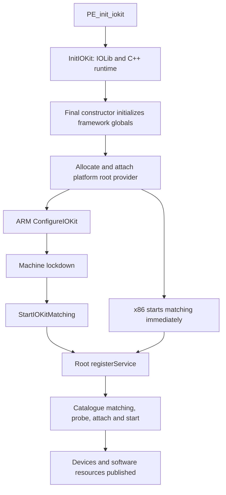
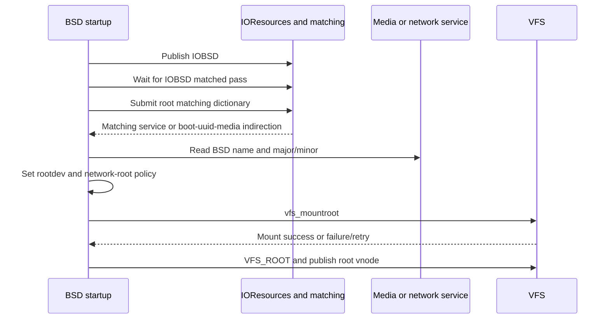

# IOKit bootstrap, device-tree import, and the BSD handoff

[Drivers](README.md) · [Platform boot](../platform/boot.md) · [Registry internals](registry-planes-and-properties.md) · [Matching](service-matching-and-termination.md) · [Device nodes](../vfs/device-nodes-and-fifos.md)

IOKit startup establishes an object runtime and registry, imports platform descriptions, loads a catalogue of matching rules, and eventually starts service matching. BSD later publishes its own readiness and asks IOKit to identify the root device. These are distinct transitions. A registry node can exist before a matching driver starts; an `IOBSD` resource can exist before a matching pass completes; and finding an `IOMedia` service does not itself mount a filesystem.

## 1. Kernel startup deliberately splits initialization from matching

The common bootstrap calls `PE_init_iokit()` before `machine_lockdown()` and calls `PE_lockdown_iokit()` afterward. The platform implementations use those hooks differently:

| Platform path | Initial hook | Lockdown hook |
| --- | --- | --- |
| ARM/ARM64 | `InitIOKit()` followed by `ConfigureIOKit()`. | `zalloc_iokit_lockdown()` and then `StartIOKitMatching()`. |
| x86 | `InitIOKit()`, `zalloc_iokit_lockdown()`, and `StartIOKitMatching()` immediately. | Wait for maximum CPU enumeration with `ml_wait_max_cpus()`. |

See [common initial call](../../../xnu/osfmk/kern/startup.c#L801-L802), [common lockdown ordering](../../../xnu/osfmk/kern/startup.c#L890-L911), [ARM hooks](../../../xnu/pexpert/arm/pe_init.c#L404-L425), and [x86 hooks](../../../xnu/pexpert/i386/pe_init.c#L188-L203).

The ARM source explains the split as restricting pre-lockdown execution to trusted kernel and specially entitled code. General matching can execute other drivers and expose their input-processing paths, so it starts afterward. The x86 comment explains its earlier start through CPU enumeration and ACPI dependencies needed by other initialization. This checkout therefore does not support a single architecture-independent statement that “all drivers start after lockdown.”

[Source: pexpert/arm/pe_init.c, lines 409–424](../../../xnu/pexpert/arm/pe_init.c#L409-L424)

<!-- source-excerpt: ../../../xnu/pexpert/arm/pe_init.c#L409-L424 -->
```c
PE_lockdown_iokit(void)
{
	/*
	 * On arm/arm64 platforms, and especially those that employ KTRR/CTRR,
	 * machine_lockdown() is treated as a hard security checkpoint, such that
	 * code which executes prior to lockdown must be minimized and limited only to
	 * trusted parts of the kernel and specially-entitled kexts.  We therefore
	 * cannot start the general-purpose IOKit matching process until after lockdown,
	 * as it may involve execution of untrusted/non-entitled kext code.
	 * Furthermore, such kext code may process attacker controlled data (e.g.
	 * network packets), which dramatically increases the potential attack surface
	 * against a kernel which has not yet enabled the full set of available
	 * hardware protections.
	 */
	zalloc_iokit_lockdown();
	StartIOKitMatching();
```

This ordering concerns the initialization paths visible here. Which personalities and executable drivers are actually present in a booted kernel collection is a separate build/boot input.

## 2. C++ constructors initialize the framework before the root provider is allocated

`InitIOKit()` first initializes IOLib support, calls `OSlibkernInit()`, and initializes IOKit Mach-port support. `OSlibkernInit()` initializes the metaclass base, records kernel image addresses, invokes `OSRuntimeInitializeCPP(NULL)`, and panics on failure before declaring kernel C++ initialized. [Outer startup](../../../xnu/iokit/Kernel/IOStartIOKit.cpp#L131-L150), [C++ entry](../../../xnu/libkern/c++/OSRuntime.cpp#L136-L155).

The final kernel constructor calls `iokit_post_constructor_init()`. That callback initializes registry/service/catalogue state, kext metadata, user-client and memory-descriptor infrastructure, the root power parent, reporting and shared PM locks. It also publishes build/diagnostic properties in the registry. Thus the call sequence is nested through C++ constructor execution; `iokit_post_constructor_init()` is not merely a later external initialization command. [Constructor](../../../xnu/libsa/lastkernelconstructor.c#L29-L37), [framework initialization](../../../xnu/iokit/Kernel/IOStartIOKit.cpp#L91-L123).

[Source: iokit/Kernel/IOStartIOKit.cpp, lines 96–110](../../../xnu/iokit/Kernel/IOStartIOKit.cpp#L96-L110)

<!-- source-excerpt: ../../../xnu/iokit/Kernel/IOStartIOKit.cpp#L96-L110 -->
```cpp
	IOCPUInitialize();
	IOPlatformActionsInitialize();
	root = IORegistryEntry::initialize();
	assert( root );
	IOService::initialize();
	IOCatalogue::initialize();
	IOStatistics::initialize();
	OSKext::initialize();
	IOUserClient::initialize();
	IOMemoryDescriptor::initialize();
	IORootParent::initialize();
	IOReporter::initialize();

	// Initializes IOPMinformeeList class-wide shared lock
	IOPMinformeeList::getSharedRecursiveLock();
```

After that runtime setup, `InitIOKit()` allocates `IOPlatformExpertDevice`, initializes it from the device-tree input, attaches it as the root nub, and calls the optional startup-extension recorder. Allocation or initialization failure panics. This object provides the initial service on which the platform driver can match; it is not itself a statement that every device has been enumerated. [Root provider and extension hook](../../../xnu/iokit/Kernel/IOStartIOKit.cpp#L152-L167), [root initialization](../../../xnu/iokit/Kernel/IOPlatformExpert.cpp#L2083-L2100).

The catalogue is already initialized by then: `IOCatalogue::initialize()` unserializes `gIOKernelConfigTables`, creates the key symbols and constructs the catalogue. Later personality publication by kext machinery can add additional entries. Catalogue presence, metaclass registration, executable availability, and an instance's successful `start()` are separate states. [Initial catalogue](../../../xnu/iokit/Kernel/IOCatalogue.cpp#L99-L127), [personality publication](../../../xnu/libkern/c++/OSKext.cpp#L14948), [runtime objects](object-runtime-and-collections.md), [matching decisions](service-matching-and-termination.md).



## 3. Device-tree import creates registry objects and preserves backing lifetime

`IODeviceTreeAlloc()` creates the `IODeviceTree` plane, interns property keys, allocates phandle and address-resolver bookkeeping, and walks the secure device-tree iterator. `MakeReferenceTable()` creates an `IOService` object for each imported node and populates its property dictionary. The traversal attaches child objects to parents in the device-tree plane; registry ownership permits dropping the temporary child references. [Importer setup/walk](../../../xnu/iokit/Kernel/IODeviceTreeSupport.cpp#L113-L252), [node construction](../../../xnu/iokit/Kernel/IODeviceTreeSupport.cpp#L420-L475).

Property ownership depends on whether the original tree can be freed. `freeDT` requires a discovered loader memory range and a tree not already locked down. When true, names and values are copied; otherwise symbols and `OSData` refer to the existing backing. After a copied import the function detaches the secure-tree input and frees its loader storage. This is a concrete reason to distinguish copying a property from wrapping existing immutable bytes.

[Source: iokit/Kernel/IODeviceTreeSupport.cpp, lines 453–462](../../../xnu/iokit/Kernel/IODeviceTreeSupport.cpp#L453-L462)

<!-- source-excerpt: ../../../xnu/iokit/Kernel/IODeviceTreeSupport.cpp#L453-L462 -->
```cpp
			if (copy) {
				nameKey = OSSymbol::withCString(name);
				data = OSData::withBytes(prop, propSize);
			} else {
				nameKey = OSSymbol::withCStringNoCopy(name);
				/* There is no OSDataConst or other way to indicate
				 * that the OSData is actually immutable. But CTRR
				 * will catch any write attempts. */
				data = OSData::withBytesNoCopy((void**)(uintptr_t)prop, propSize);
			}
```

The source comment attributes immutability of the noncopying case to hardware protection rather than an `OSDataConst` type. On nondevelopment/nondebug builds, a `kernel-only` node has imported data marked nonserializable. This controls serialization exposure; it does not remove the node or prevent kernel property lookup. [Copy decision](../../../xnu/iokit/Kernel/IODeviceTreeSupport.cpp#L189-L196), [original storage release](../../../xnu/iokit/Kernel/IODeviceTreeSupport.cpp#L250-L259), [serialization restriction](../../../xnu/iokit/Kernel/IODeviceTreeSupport.cpp#L443-L475).

After import, the code walks the plane to derive interrupt mappings and shared-interrupt information. The resulting controller/specifier properties become inputs to later interrupt registration. Importing that metadata is not the same operation as registering a handler or enabling an interrupt. [Post-import interrupt mapping](../../../xnu/iokit/Kernel/IODeviceTreeSupport.cpp#L261-L282), [interrupt routing](interrupt-routing-and-command-queues.md).

The imported topology and later service topology may diverge. A service can be initialized using a device-tree entry, participate in the service plane, and publish further children discovered by its driver. Traversing `IODeviceTree` answers a different question from traversing the active provider/client relationships in `IOService`. See [registry planes](registry-planes-and-properties.md).

## 4. Selected platform services exist before general matching

On ARM, `ConfigureIOKit()` invokes the root provider's `configureDefaults()`. That routine creates an NVRAM service where `/options` exists, publishes a serial-number string and generates the platform UUID. NVRAM setup directly allocates, initializes, attaches and starts `IODTNVRAM`; the comment explains that security-related operations may need it before lockdown and before general-purpose matching. [Configuration entry](../../../xnu/iokit/Kernel/IOStartIOKit.cpp#L170-L175), [defaults](../../../xnu/iokit/Kernel/IOPlatformExpert.cpp#L2176-L2190), [early NVRAM](../../../xnu/iokit/Kernel/IOPlatformExpert.cpp#L2192-L2215).

`StartIOKitMatching()` calls `IOPlatformExpertDevice::startIOServiceMatching()`. That method creates a workloop and publishes the root provider with `registerService()`. Matching then follows the catalogue/probe/start machinery described in the service chapter. Under `!NO_KEXTD`, an available IOKit daemon causes an additional root busy count, released by the later daemon protocol. This keeps registry quietness distinct from “the root provider's register call returned.” [Start entry and busy count](../../../xnu/iokit/Kernel/IOStartIOKit.cpp#L178-L196), [root workloop and publication](../../../xnu/iokit/Kernel/IOPlatformExpert.cpp#L2102-L2119).

The root provider also implements a user-client factory for diagnostic and user-server connection types. It delegates creation to the corresponding task-aware factory, then attaches and starts the resulting client; failure detaches/releases it. This explains one kernel-side entry for DriverKit control without reconstructing the absent userspace launcher. [Factory and failure cleanup](../../../xnu/iokit/Kernel/IOPlatformExpert.cpp#L2127-L2165), [DriverKit setup](driverkit-dispatch-and-actions.md).

`IOKitInitializeTime()` waits up to 30 seconds for the `IORTC` resource and, on x86, separately for `IONVRAM`, then initializes the calendar clock. These are bounded resource waits in this function, not proof that every provider of time or NVRAM always appears during that interval. [Time initialization](../../../xnu/iokit/Kernel/IOStartIOKit.cpp#L72-L88).

## 5. Resource publication and a completed matching pass are different observations

Software facilities use the `IOResources` service to publish readiness as properties. `IOKitBSDInit()` publishes `IOBSD`. The generic `publishResource()` stores the value, substitutes a marker object for a null value, increments the resource generation and registers the resource service for matching. If the caller already holds the notification lock, it returns after setting the property instead of recursively starting that registration path. [BSD publication](../../../xnu/iokit/bsddev/IOKitBSDInit.cpp#L116-L126), [resource publication](../../../xnu/iokit/Kernel/IOService.cpp#L5171-L5185).

[Source: iokit/Kernel/IOService.cpp, lines 5173–5184](../../../xnu/iokit/Kernel/IOService.cpp#L5173-L5184)

<!-- source-excerpt: ../../../xnu/iokit/Kernel/IOService.cpp#L5173-L5184 -->
```cpp
	if (NULL == value) {
		value = (OSObject *) gIOServiceKey;
	}

	gIOResources->setProperty( key, value);

	if (IORecursiveLockHaveLock( gNotificationLock)) {
		return;
	}

	gIOResourceGenerationCount++;
	gIOResources->registerService();
```

`resourceMatching()` builds a dictionary with provider class `IOResources` and `IOResourceMatch`. The resource matching callback tests that the named property or properties exist. Another key, `IOResourceMatched`, instead asks whether a key appears in the array captured by a completed matching pass. The configuration path copies resource keys before probing and records them after the pass when the service is active and not module-stalled. [Dictionary construction](../../../xnu/iokit/Kernel/IOService.cpp#L7032-L7042), [presence versus matched tests](../../../xnu/iokit/Kernel/IOService.cpp#L7364-L7399), [capture/publication around probes](../../../xnu/iokit/Kernel/IOService.cpp#L5566-L5602).

This distinction is used in root-device discovery. `IOFindBSDRoot()` first waits up to 30 seconds for `IOResourceMatched` to contain `IOBSD`, allowing clients that match that resource to run. A timeout logs `!BSD` and continues; this initial wait is not an unlimited barrier guaranteeing every possible filesystem driver has started. [Wait and timeout](../../../xnu/iokit/bsddev/IOKitBSDInit.cpp#L706-L717).

The C-facing `IOServiceWaitForMatchingResource()` helper builds a presence-matching dictionary, waits, and releases both dictionary and retained service. `IOCatalogueMatchingDriversPresent()` instead queries catalogue personalities and releases the candidate set. Finding a personality does not prove that its service instance exists. [Resource wrapper ownership](../../../xnu/iokit/bsddev/IOKitBSDInit.cpp#L138-L164), [catalogue query](../../../xnu/iokit/bsddev/IOKitBSDInit.cpp#L166-L194).

## 6. Root-device discovery converts matching policy into a BSD device identity

`bsd_autoconf()` initializes console and configured pseudo-devices, then calls `IOKitBSDInit()`. Later, BSD's root-mount loop calls `setconf()`, which invokes `IOFindBSDRoot()` to obtain a name, `dev_t`, and flags before `vfs_mountroot()` attempts the actual filesystem operation. [Autoconfiguration](../../../xnu/bsd/kern/bsd_init.c#L1112-L1130), [configuration handoff](../../../xnu/bsd/kern/bsd_init.c#L1135-L1161), [mount loop](../../../xnu/bsd/kern/bsd_init.c#L885-L914).

Root matching is selected from several inputs:

* `/chosen/root-matching` can provide a serialized matching dictionary.
* `/chosen/boot-uuid`, or `rd=uuid` with a boot UUID argument, publishes a `boot-uuid` resource and waits for the `boot-uuid-media` resource.
* A configured memory-disk name is resolved through the memory-device code.
* An explicit BSD device name becomes an `IOBSDName` match; an `en` prefix uses the network-interface matching path.
* If no earlier selection built a dictionary, the visible fallback matches `IOMedia` with `Content = Apple_HFS`.

The fallback is a branch of this code, not evidence that modern systems normally boot HFS or that APFS is implemented here. See [device-tree and boot arguments](../../../xnu/iokit/bsddev/IOKitBSDInit.cpp#L730-L768), [memory disks](../../../xnu/iokit/bsddev/IOKitBSDInit.cpp#L770-L839), [name/UUID/fallback selection](../../../xnu/iokit/bsddev/IOKitBSDInit.cpp#L841-L885), [UUID resource dictionary](../../../xnu/iokit/bsddev/IOKitBSDInit.cpp#L227-L243).

The wait loop retains the matching dictionary for each `waitForService()` invocation, uses `ROOTDEVICETIMEOUT`, and continues until it obtains a service unless the selected failure-policy branch takes over. Depending on target and watchdog settings, missing media can produce diagnostics, recovery handling, or a panic. Network/single-user paths start deferred matches before this wait. [Wait ownership and target-specific outcomes](../../../xnu/iokit/bsddev/IOKitBSDInit.cpp#L901-L943).

For the UUID route, the matched object can be the resource service; the code then obtains the actual media service from its `boot-uuid-media` property. Network-interface results must have a BSD name; `IORegisterNetworkInterface()` locates `IONetworkStack`, requests unit/path registration through `setProperties()`, and checks for that name. [Media indirection](../../../xnu/iokit/bsddev/IOKitBSDInit.cpp#L945-L960), [network registration](../../../xnu/iokit/bsddev/IOKitBSDInit.cpp#L308-L375).

Finally, the code reads `IOBSDName`, `IOBSDMajor`, and `IOBSDMinor` from the selected service, marks the network flag where appropriate, constructs `dev_t`, and records root media. These values bridge IOKit identity to BSD dispatch; neither the C++ class pointer nor a registry path is itself a device number.

[Source: iokit/bsddev/IOKitBSDInit.cpp, lines 967–978](../../../xnu/iokit/bsddev/IOKitBSDInit.cpp#L967-L978)

<!-- source-excerpt: ../../../xnu/iokit/bsddev/IOKitBSDInit.cpp#L967-L978 -->
```cpp
		iostr = (OSString *) service->getProperty( kIOBSDNameKey );
		if (iostr) {
			strlcpy( rootName, iostr->getCStringNoCopy(), rootNameSize );
		}
		off = (OSNumber *) service->getProperty( kIOBSDMajorKey );
		if (off) {
			mjr = off->unsigned32BitValue();
		}
		off = (OSNumber *) service->getProperty( kIOBSDMinorKey );
		if (off) {
			mnr = off->unsigned32BitValue();
		}
```

See [result construction](../../../xnu/iokit/bsddev/IOKitBSDInit.cpp#L962-L1001), [device-number and vnode dispatch](../vfs/device-nodes-and-fifos.md), and [mount publication](../vfs/mount-lifecycle.md).



## 7. Mount completion and later security hooks remain outside service matching

`setconf()` selects the network mount-root routine only where `CONFIG_NETBOOT` and the result flags require it; otherwise it leaves filesystem selection to VFS. On mount failure, BSD clears the root-device name and retries its outer loop, with separate network failure handling. After a successful mount it calls `IOSecureBSDRoot()`, marks the root mount, obtains `VFS_ROOT`, and installs the root vnode under its lock. [Mount completion](../../../xnu/bsd/kern/bsd_init.c#L885-L931).

Under `CONFIG_SECURE_BSD_ROOT`, `IOSecureBSDRoot()` asks the platform expert for the `SecureRootName` function. The visible reaction to `kIOReturnNotPrivileged` is `mdevremoveall()`. The wrapper does not itself contain the platform's root-device validation algorithm. Calling that hook is not a substitute for the filesystem code-signing, authenticated-root or executable-validation mechanisms described elsewhere. [Exact hook and result](../../../xnu/iokit/bsddev/IOKitBSDInit.cpp#L1041-L1066), [security overview](../security/README.md).

The boot route illustrates the same rule as ordinary device operation: catalogue matching chooses a service implementation, registry properties carry identity and capability information, BSD translates selected identities into its objects, and actual filesystem or driver operations have their own completion/error contracts.

## Inspection scope

Deep inspection covered framework bootstrap, architecture-specific matching start, device-tree property ownership, resource publication/matched-pass behavior, root selection/wait/result conversion, and the BSD mount handoff. Address-cell translation, full device-tree interrupt-map parsing, every boot-recovery/NVRAM command, kernel-collection loading, concrete storage/network families and APFS remain separate or external. Device-tree import and platform callbacks provide local evidence of interfaces and ordering; they cannot establish absent firmware or hardware-driver implementation.

<!-- BEGIN PLATYDOC DOCUMENTATION LICENSE -->
Original Platydoc text and diagrams are licensed under [CC BY 4.0](https://creativecommons.org/licenses/by/4.0/). Quoted source code and third-party material retain their respective licenses.
<!-- END PLATYDOC DOCUMENTATION LICENSE -->
