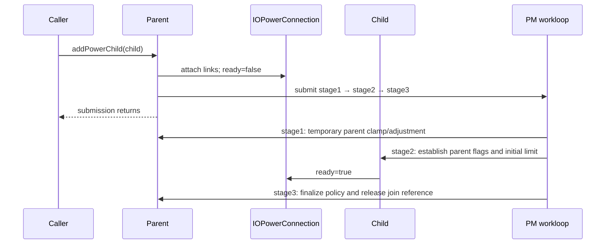
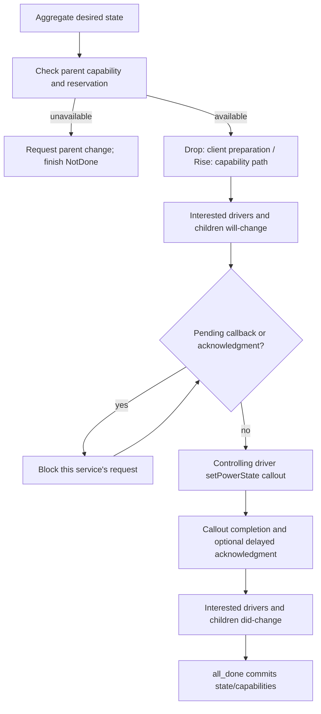

# Device power states, parent dependencies, and transition completion

[Drivers](README.md) · [Workloop introduction](workloops-and-power.md) · [Callout and acknowledgment protocol](workloop-and-power-protocols.md) · [System sleep and wake](system-sleep-and-wake.md)

An `IOService` power transition combines three different decisions: what the device's clients want, what its power parents can supply, and when dependent devices and driver callbacks have finished preparing for the change. A successful request submission answers none of those completion questions by itself. `IOServicePM` records the requested state, current state, transition target, parent-derived limit and pending acknowledgments separately. The machine advances on the shared PM workloop; selected callbacks execute outside that gate and return through a completion/reply path. [`IOServicePM` fields](../../../xnu/iokit/Kernel/IOServicePMPrivate.h#L169), [`adjustPowerState`](../../../xnu/iokit/Kernel/IOServicePM.cpp#L1764), [`isPMBlocked`](../../../xnu/iokit/Kernel/IOServicePM.cpp#L8068)

This chapter follows ordinary per-device changes and power-tree dependencies. The [callback protocol chapter](workloop-and-power-protocols.md) explains queue/reply dispatch and the acknowledgment race in more detail. The [system-sleep chapter](system-sleep-and-wake.md) adds root-domain policy, application capabilities, storage/task preparation and the platform sleep boundary. A per-device `setPowerState` callback is not itself that system-wide boundary.

## 1. A state index is not necessarily its power order

The public `IOPMPowerState` describes capability flags visible at the device, output power supplied to children, and input power required from parents. These are different flag sets with different consumers. Its `stateOrder` field is interpreted for version 2 entries; version 1 uses the array index as the ordering. The internal `IOPMPSEntry` stores both index-to-order information and the inverse `stateOrderToIndex` map. [`IOPMPowerState`](../../../xnu/iokit/IOKit/pwr_mgt/IOPMpowerState.h#L57), [`internal entry`](../../../xnu/iokit/Kernel/IOServicePMPrivate.h#L147)

`registerPowerDriver` requires initialized services and at least two states, and rejects a first entry whose version exceeds version 2. Each entry's version then selects whether to use its explicit order or its index; the body does not separately reject every later entry's version. It copies selected fields into a new internal array, initializes the inverse slots to an invalid value, fills them from each entry's order, then rejects a missing order. An out-of-range or duplicate ordering leaves at least one inverse slot missing. The copied table and a retained driver are carried in a queued registration request. The caller's input array is not subsequently the machine's live table. [`registerPowerDriver`](../../../xnu/iokit/Kernel/IOServicePM.cpp#L1156-L1256)

[Registration constructs and validates the inverse ordering](../../../xnu/iokit/Kernel/IOServicePM.cpp#L1207-L1225)

<!-- source-excerpt: ../../../xnu/iokit/Kernel/IOServicePM.cpp#L1207-L1225 -->
```cpp
			if (powerStates[i].version >= kIOPMPowerStateVersion2) {
				stateOrder = powerStates[i].stateOrder;
			} else {
				stateOrder = i;
			}

			if (stateOrder < numberOfStates) {
				powerStatesCopy[i].stateOrder = stateOrder;
				powerStatesCopy[stateOrder].stateOrderToIndex = i;
			}
		}

		for (IOPMPowerStateIndex i = 0; i < numberOfStates; i++) {
			if (powerStatesCopy[i].stateOrderToIndex == kIOPMPowerStateMax) {
				// power state order missing
				error = kIOReturnBadArgument;
				break;
			}
		}
```

`handleRegisterPowerDriver` installs the first table, determines the lowest/highest indices through the inverse map, merges all output flags and identifies a usable state. It applies root-domain/device-tree policy, including the shown AOT-state filtering. Existing power-client requests outside the new range are clamped. If parents are already known, the driver maps their flags to a maximum and an initial state and PM schedules an adjustment. A later duplicate registration frees the new table; the temporary queued-driver reference is released at the end of this handler. Do not interpret a second successful enqueue as replacing an already installed table. [`handleRegisterPowerDriver`](../../../xnu/iokit/Kernel/IOServicePM.cpp#L1259-L1396)

All ordinary maximum/minimum comparisons must be read through the order helpers:

[State comparisons preserve the driver's version-2 ordering](../../../xnu/iokit/Kernel/IOServicePMPrivate.h#L478-L482)

<!-- source-excerpt: ../../../xnu/iokit/Kernel/IOServicePMPrivate.h#L478-L482 -->
```cpp
#define StateOrder(state)           (((state) < fNumberOfPowerStates)               \
	                            ? pwrMgt->PowerStates[(state)].stateOrder       \
	                            : (state))
#define StateMax(a, b)               (StateOrder((a)) < StateOrder((b)) ? (b) : (a))
#define StateMin(a, b)               (StateOrder((a)) < StateOrder((b)) ? (a) : (b))
```

For example, a table can use index 0/order 0 for off, index 1/order 2 for full operation, and index 2/order 1 for reduced operation. `StateMax(1, 2)` selects index 1, even though 2 is the greater integer. This is an illustrative table, not a declaration of any device's hardware states. The driver still receives the selected **index** in `setPowerState`; PM uses its order when deciding rise/drop and aggregating desires. [`comparison macros`](../../../xnu/iokit/Kernel/IOServicePMPrivate.h#L478), [`driverSetPowerState`](../../../xnu/iokit/Kernel/IOServicePM.cpp#L4247)

The public table contains more fields than this implementation consumes for transition scheduling. In particular, this checkout disables the settle timer; the existence of `settleUpTime`, `settleDownTime` or transition-time fields is not proof that PM waits those durations. Section 7 follows the actual configured behavior.

## 2. Read the state as several independent coordinates

| Field or object | Meaning during a transition |
|---|---|
| `PowerClients`, `DeviceDesire` | Per-client requests and the remembered device-policy request. A device request is one input among several. |
| `DesiredPowerState` | Result of aggregating applicable desires and clamps. It can exceed currently available parent capability. |
| `MaxPowerState` | Driver-derived limit under power supplied by parents. It changes at different points for a parent power drop and rise. |
| `CurrentPowerState`, `CurrentCapabilityFlags` | State and advertised capabilities committed by PM's completion path. They are not updated at request enqueue. |
| `HeadNotePowerState`, `HeadNotePowerArrayEntry`, `HeadNoteChangeFlags` | Target and flags for the current transition. These can be amended or marked `kIOPMNotDone`. |
| `ParentsCurrentPowerFlags`, `ParentsKnowState` | OR of supplied parent flags and the aggregate known-state condition, derived from the connections. |
| `HeadNotePendingAcks`, `DriverTimer`, `DriverCallBusy`, `ResponseArray` | Different reasons a running transition may be unable to advance. |
| `RequestHead`, `MachineState`, saved machine states | Per-service request order and the current/resumable stage of its PM machine. |

These fields live in [`IOServicePM`](../../../xnu/iokit/Kernel/IOServicePMPrivate.h#L169-L350); the macros in the same header expose them through `IOService`. Most transition methods assert the PM workloop gate. `PMLock` separately protects such data as interested-driver admission and tracked driver-call state; `ActivityLock` protects activity/tickle accounting. Being on the shared PM workloop does not make all outside driver callbacks or interrupt-side activity use that same serialization. [`computeDesiredState`](../../../xnu/iokit/Kernel/IOServicePM.cpp#L2832), [`driver-call admission`](../../../xnu/iokit/Kernel/IOServicePM.cpp#L8641), [`activityTickle`](../../../xnu/iokit/Kernel/IOServicePM.cpp#L3130)

`requestPowerState` retains its client symbol and queues a request carrying the index. When called in the gate with a valid state, it also adds a temporary clamp so the pending request cannot be ignored by an intervening adjustment. The handler removes that temporary contribution, clamps oversized requests to the highest state, updates/removes the client entry, calls `adjustPowerState`, and releases the symbol. The handler's special treatment of the device, driver and child-proxy clients means removing one ordinary client's request is not equivalent to resetting all device demand. [`requestPowerState`](../../../xnu/iokit/Kernel/IOServicePM.cpp#L2609), [`handleRequestPowerState`](../../../xnu/iokit/Kernel/IOServicePM.cpp#L2667)

`computeDesiredState` first examines ready child connections and derives the parent state requested on their behalf. It then takes the highest order among applicable power clients. Device override can ignore driver and child desires; an actual child request supersedes the child proxy; advisory tickles are ignored while the global advisory policy disables them. Local/temporary clamps raise the result, and `OverrideMaxPowerState` caps it. A higher raw index is not necessarily a stronger request. [`computeDesiredState`](../../../xnu/iokit/Kernel/IOServicePM.cpp#L2832-L2935)

`adjustPowerState` starts a self-initiated change only when there is a controlling driver, parents know their state and the service is in the power plane. Hence `DesiredPowerState` is useful diagnostic state even when no hardware transition can yet be started. For ordinary APIs, distinguish “the request was accepted,” “the selected target is now reachable,” and “completion committed the target.” [`adjustPowerState`](../../../xnu/iokit/Kernel/IOServicePM.cpp#L1764)

## 3. A power-tree edge is an object with its own readiness and acknowledgment

The power plane is distinct from provider attachment in the service plane. Its edge contains an `IOPowerConnection` between parent and child, carrying readiness, the parent's known/output state, the child's requested parent state and whether the parent awaits an acknowledgment through that edge. A child can have multiple power parents. `setParentInfo` updates one connection, ORs the power flags across parents, and computes whether every parent knows its state. [`IOPowerConnection`](../../../xnu/iokit/IOKit/pwr_mgt/IOPowerConnection.h#L43), [`setParentInfo`](../../../xnu/iokit/Kernel/IOServicePM.cpp#L2180)

`addPowerChild` publishes the parent → connection → child links immediately, but sets the connection not ready. It allocates three requests and links their execution order: parent stage 1, child stage 2, parent stage 3. This allows callers to observe the topology without blocking until the PM workloop finishes joining it. Ready-state checks keep the incomplete edge out of ordinary demand/notification paths. [`addPowerChild`](../../../xnu/iokit/Kernel/IOServicePM.cpp#L829-L936)



Stage 1 can raise the parent's temporary desire to its highest state, within the available parent capability, so child initialization does not start with an avoidable power deficit. Stage 2 runs on the child after the first request: it obtains the parent's stable table/current state, establishes parent information, marks the connection ready and computes the child's maximum/initial state when possible. Stage 3 applies tree-order/aggressiveness details and releases the join's connection reference. A missing/detached parent or a not-yet-installed driver is a real branch in these handlers; topology publication alone does not establish every driver's state. [`addPowerChild1`](../../../xnu/iokit/Kernel/IOServicePM.cpp#L945), [`addPowerChild2`](../../../xnu/iokit/Kernel/IOServicePM.cpp#L972), [`addPowerChild3`](../../../xnu/iokit/Kernel/IOServicePM.cpp#L1026)

The error contract is unusually important: after initial null/uninitialized checks, several allocation/duplicate/failure paths clean up and deliberately return success. The comment says this prevents platform drivers from adding the child to the root domain as a fallback. Consequently, a return code alone is insufficient evidence that all join work took place; inspect the actual edge and readiness when diagnosing the result. [`addPowerChild` failure cleanup](../../../xnu/iokit/Kernel/IOServicePM.cpp#L914-L936)

Request links have two meanings. `attachNextRequest` increments the **next** request's work-wait count, preventing execution until its predecessor detaches that link. The normal retirement path detaches it when enqueueing the predecessor for completion, before final release. `attachRootRequest` increments the **root** request's free-wait count, delaying its completion while a subordinate request remains. Request initialization retains the target service; reset requires both wait counts to be zero, detaches dependencies and releases the target. These are execution/completion dependencies, not a promise that the three requests run recursively on one stack. [`IOPMRequest::init/reset`](../../../xnu/iokit/Kernel/IOServicePM.cpp#L8870-L8914), [`next/root links`](../../../xnu/iokit/Kernel/IOServicePM.cpp#L8916-L9004)

The work queue processes the head of each service's request queue, stops on an attached-work dependency or blocked machine, and retires finished work to the completion queue. Enqueueing completion detaches the next-request link; the completion scan waits for free dependencies before releasing/resetting a request. These dependency changes signal further work. A per-service queue can therefore stall while work for another service progresses and supplies its acknowledgment. [`IOPMWorkQueue::checkRequestQueue`](../../../xnu/iokit/Kernel/IOServicePM.cpp#L9213), [`completion/retirement`](../../../xnu/iokit/Kernel/IOServicePM.cpp#L8008-L8060), [`completion queue`](../../../xnu/iokit/Kernel/IOServicePM.cpp#L9406-L9440)

## 4. Parent power is negotiated as flags, then mapped back to states

`requestDomainPower` obtains the selected child's `inputPowerFlags` and sends them to each ready, known parent. The parent does not receive the child's state index as its own hardware setting. In `requestPowerDomainState`, it masks the requested flags against the OR of output flags it could ever supply, then scans its table in power order for the first state whose output contains those flags. It records that parent-state index on the child's connection and schedules an adjustment when needed. [`requestDomainPower`](../../../xnu/iokit/Kernel/IOServicePM.cpp#L4914), [`parent request mapping`](../../../xnu/iokit/Kernel/IOServicePM.cpp#L2259-L2410)

A reservation also collects each parent's current or impending contribution in the child's `HeadNoteDomainTargetFlags`. The child's controlling driver maps that combined flag set back to a maximum reachable child state. If its order is below the proposed state, reservation reports no power. This extra check handles transitions already in progress: available output is not always simply the parent's last committed `CurrentPowerState`. [`requestPowerDomainState`](../../../xnu/iokit/Kernel/IOServicePM.cpp#L2297-L2353), [`reservation check`](../../../xnu/iokit/Kernel/IOServicePM.cpp#L4948-L4959)

The parent method carefully distinguishes transition directions. During a cancellable non-root power drop, an incoming child request can set `DoNotPowerDown` and request reevaluation. Once the drop is past that point, it reports the impending lower output. During a rise it uses output already recorded on that child's connection, because the child may have learned the new supply before the parent has committed its own current index. This prevents a child from waiting on an obsolete interpretation of a rise, or raising on supply that is about to disappear. [`requestPowerDomainState` transition handling](../../../xnu/iokit/Kernel/IOServicePM.cpp#L2300-L2349)

`OurChangeStart` first checks the parent-derived `MaxPowerState`. If the target is too high, it marks the transition not done, requests parent power, and finishes without pretending the target was installed. Even when the existing maximum seems sufficient, a rise makes the reservation above; failure similarly defers it. A redundant change skips the ordinary sequence after the initial-change case. [`OurChangeStart`](../../../xnu/iokit/Kernel/IOServicePM.cpp#L4797-L4863)

[An unreachable target requests parent power instead of committing it](../../../xnu/iokit/Kernel/IOServicePM.cpp#L4806-L4811)

<!-- source-excerpt: ../../../xnu/iokit/Kernel/IOServicePM.cpp#L4806-L4811 -->
```cpp
	if (!IS_PM_ROOT && (StateOrder(fMaxPowerState) < StateOrder(fHeadNotePowerState))) {
		fHeadNoteChangeFlags |= kIOPMNotDone;
		requestDomainPower(fHeadNotePowerState);
		OurChangeFinish();
		return;
	}
```

For an illustrative child requiring flag A for its usable state, a parent's current output lacking A leaves the desired child state pending. The child request maps A to a suitable parent state; the parent transitions and advertises changed flags; the child recalculates its maximum and can then proceed. If another parent already supplies the needed combination, the driver mapping can produce a different result. The actual flag interpretation is the controlling driver's policy, so generic PM code cannot alone prove electrical supply or hardware readiness.

## 5. Self-initiated and parent-forced transitions have different sequencing

For a self-initiated drop, `OurChangeStart` begins by asking clients about the power reduction. Later stages can cancel via `DoNotPowerDown` or the client response state, then notify priority clients/interested drivers and children before programming the controlling driver. A rise instead checks parent reservation and enters the capability/prechange sequence. The root domain adds capability and policy stages that ordinary devices skip. [`OurChangeStart`](../../../xnu/iokit/Kernel/IOServicePM.cpp#L4797), [`OurChangeTellClientsPowerDown`](../../../xnu/iokit/Kernel/IOServicePM.cpp#L5009), [`OurChangeTellPriorityClientsPowerDown`](../../../xnu/iokit/Kernel/IOServicePM.cpp#L5043), [`OurChangeNotifyInterestedDriversWillChange`](../../../xnu/iokit/Kernel/IOServicePM.cpp#L5074)

The simplified path below omits root-specific branches, application-policy sub-states and cancellation edges; it preserves the main callback/dependency boundaries:



Parent changes establish an asymmetric safety ordering. The child's will-change handler computes a maximum using the parent's proposed output. For a parent drop, it reduces the child limit **before** the parent changes hardware. On did-change, it records parent flags and updates the maximum after an increase. `ParentChangeStart` forces a child down when the parent's limit is below its current order; it does not run the same permission-to-refuse-drop path as an elective self-change. When more power becomes available, it caps the proposed rise at the child's desired state, or keeps the existing state if no higher demand exists. An actual rise begins on the did-change phase. [`handlePowerDomainWillChangeTo`](../../../xnu/iokit/Kernel/IOServicePM.cpp#L1902), [`handlePowerDomainDidChangeTo`](../../../xnu/iokit/Kernel/IOServicePM.cpp#L2039), [`ParentChangeStart`](../../../xnu/iokit/Kernel/IOServicePM.cpp#L5189-L5260)

A root broadcast can still propagate through a child that needs no hardware state change. That path marks the transition not done and runs notification work so the subtree receives the system event. `ParentChangeAcknowledgePowerChange` first finishes the local transition, then obtains the parent's service and acknowledges through the retained connection. The parent can thus wait for the child's whole local protocol, including its own dependent children, rather than just for receipt of the original notification. [`ParentChangeStart` broadcast branch](../../../xnu/iokit/Kernel/IOServicePM.cpp#L5240), [`ParentChangeAcknowledgePowerChange`](../../../xnu/iokit/Kernel/IOServicePM.cpp#L5458-L5472)

At normal completion `all_done` sets the machine to finished and, unless the change is not done, updates current index, capability flags and power consumption. It updates sleep-prevention bookkeeping, invokes the selected completion actions and may call `powerChangeDone`. Self-change completion also requests the corresponding parent power, allowing a reduction in dependency demand after the child has changed. Synchronized notifications and canceled/deferred changes have separate branches; “machine finished” alone is not evidence that the original target was reached. [`all_done`](../../../xnu/iokit/Kernel/IOServicePM.cpp#L4625-L4791)

## 6. Child and driver acknowledgments carry explicit ownership

`notifyChild` obtains a retained child, increments `HeadNotePendingAcks`, marks the connection awaiting acknowledgment, and creates a will/did-change request for that child. A successfully submitted request carries a retained connection; the child's handlers release that notification reference after processing it. If request creation fails, the parent clears the awaiting flag and undoes the count instead of waiting for a reply that cannot arrive. These count/ref updates surround submission; they are not reconstructed later from a raw child pointer. [`notifyChild`](../../../xnu/iokit/Kernel/IOServicePM.cpp#L4463-L4514), [`will-change handler cleanup`](../../../xnu/iokit/Kernel/IOServicePM.cpp#L1902-L2028), [`did-change handler cleanup`](../../../xnu/iokit/Kernel/IOServicePM.cpp#L2039-L2169)

`notifyChildren` ignores not-ready connections. Ordinary notification can address multiple children, while strict tree ordering constructs a list and dispatches one at a time. Policy can defer selected postchange children until the other children have acknowledged. Those branches are dependency scheduling; they do not give all devices one fixed hardware traversal order independent of root policy or joining state. [`notifyChildren`](../../../xnu/iokit/Kernel/IOServicePM.cpp#L4000), [`ordered/delayed stages`](../../../xnu/iokit/Kernel/IOServicePM.cpp#L4062-L4165)

Interested drivers use `IOPMinformee` entries. PM retains each selected informee for the callout, starts its timer sentinel at -1, counts a pending acknowledgment, and calls outside the gate. Completion interprets the returned value and the timer state, allowing an acknowledgment to have arrived before the callback returned. Zero/implied or negative results remove the wait; a still-pending positive result becomes timer ticks with a minimum timeout. Informee deregistration and callback completion must be read together: the completion path checks the live timer rather than blindly decrementing every old list entry. [`notifyInterestedDrivers`](../../../xnu/iokit/Kernel/IOServicePM.cpp#L3750), [`notifyInterestedDriversDone`](../../../xnu/iokit/Kernel/IOServicePM.cpp#L3872)

The controlling-driver path separately uses `DriverCallBusy` while the callout runs and `DriverTimer` for an acknowledgment after its return. `notifyControllingDriver` may deliberately skip the first call when the target advertises `kIOPMInitialDeviceState`; parameter allocation failure also returns false. Both proceed through the state-machine completion path, so the existence of a transition is not a guarantee that the hardware callback was invoked. The [existing acknowledgment guide](workloop-and-power-protocols.md#6-driver-return-and-driver-acknowledgment-can-race) details the -1 sentinel and early-ack race. [`notifyControllingDriver`](../../../xnu/iokit/Kernel/IOServicePM.cpp#L4523), [`notifyControllingDriverDone`](../../../xnu/iokit/Kernel/IOServicePM.cpp#L4568)

## 7. Distinguish acknowledgment timeout from hardware settling

The controlling driver's positive return specifies a delayed-ack interval interpreted in microseconds. PM clamps it to `kMinAckTimeoutTicks` (10,000,000 in this checkout), converts it to periodic acknowledgment ticks and adds one. This is a wait for the driver's eventual acknowledgment, not an independent guarantee that the hardware stabilized at the end of a table-specified settling interval. A driver returning implied acknowledgment is responsible for the meaning of that completion. [`minimum timeout`](../../../xnu/iokit/Kernel/IOServicePM.cpp#L196), [`timeout conversion`](../../../xnu/iokit/Kernel/IOServicePM.cpp#L4583-L4613)

The state enumeration contains `OurChangeWaitForPowerSettle` and its parent-change counterpart. However, the private header sets `USE_SETTLE_TIMER` to 0. `startSettleTimer` is therefore empty in this configuration, and the blocked-state predicate omits the settle field. Even the disabled implementation documents that it schedules a timer without setting the nonzero `fSettleTimeUS` required to stall the machine. Do not infer a working settle delay from these state names or from the public table layout. [`configuration`](../../../xnu/iokit/Kernel/IOServicePMPrivate.h#L37), [`wait stage`](../../../xnu/iokit/Kernel/IOServicePM.cpp#L5115), [`blocked predicate`](../../../xnu/iokit/Kernel/IOServicePM.cpp#L8103)

[The source explicitly bounds the disabled settling implementation](../../../xnu/iokit/Kernel/IOServicePM.cpp#L5522-L5528)

<!-- source-excerpt: ../../../xnu/iokit/Kernel/IOServicePM.cpp#L5522-L5528 -->
```cpp
IOService::startSettleTimer( void )
{
#if USE_SETTLE_TIMER
	// This function is broken and serves no useful purpose since it never
	// updates fSettleTimeUS to a non-zero value to stall the state machine,
	// yet it starts a delay timer. It appears no driver relies on a delay
	// from settleUpTime and settleDownTime in the power state table.
```

`ackTimerTick` treats different waiters differently. It decrements controlling-driver or interested-driver timers, logs tardiness and can allow progress as if an acknowledgment arrived. The controlling-driver timeout also contains configuration, boot-argument, driver identity and debugging branches that can panic. Application response timeout clears the response bookkeeping and treats tardiness as approval. Child acknowledgments are not simply all converted to the same informee timer: children use connection state and the subtree protocol, with watchdog machinery providing a further failure boundary. The timer body must not be summarized as “every missing acknowledgment is harmlessly ignored after one timeout.” [`ackTimerTick`](../../../xnu/iokit/Kernel/IOServicePM.cpp#L5590-L5747), [`watchdog setup`](../../../xnu/iokit/Kernel/IOServicePM.cpp#L5756)

For diagnosis, `isPMBlocked` provides a useful order of inspection: callout busy at the driver-call completion state, controlling-driver timer, pending child/interested-driver acknowledgments, application response array, then the compiled settle condition. It records a wait reason. Check the callback stage and count owner before blaming a blocked PM workloop; the workloop may be successfully processing other devices while this service intentionally waits. [`isPMBlocked`](../../../xnu/iokit/Kernel/IOServicePM.cpp#L8068-L8125)

## 8. Removal and stop must release dependency state too

`removePowerChild` retains the connection while detaching child and parent links. If the connection was awaiting acknowledgment, removal clears that flag and decrements the parent's pending count. Removing the last awaited child stops the relevant timer/watchdog and signals work so a parent blocked on that edge can continue. It then schedules a power adjustment if needed. Merely removing registry links without accounting for the outstanding acknowledgment would strand the parent's transition. [`removePowerChild`](../../../xnu/iokit/Kernel/IOServicePM.cpp#L1090-L1150)

`PMstop` first marks the service stopped under `PMLock`, so new tracked callbacks fail admission, and attempts to wait for previous calls before queuing gated cleanup. The wait skips a call running on the current thread and has a 15-second bound; it is not an unconditional drain proof. The gated stop handler removes parent/child relationships and interested-driver state and cancels the idle timer with the corresponding pending-call reference release. See the existing [bounded stop analysis](workloop-and-power-protocols.md#7-pm-stop-blocks-new-calls-and-performs-bounded-coordination) for the exact admission/wait ownership. [`PMstop and handlePMstop`](../../../xnu/iokit/Kernel/IOServicePM.cpp#L696-L820), [`waitForPMDriverCall`](../../../xnu/iokit/Kernel/IOServicePM.cpp#L8754-L8798)

System sleep introduces a further activity-generation boundary. On root power-down, `ParentChangeRootChangeDown` stops the idle timer and can remove the device desire for services that reset state on wake. It invalidates cached tickle state under `ActivityLock`. Later tickles/idle requests carry generation checks so work queued for an earlier activity interval does not blindly undo a newer state. This is selected device-demand bookkeeping; full-wake/dark-wake/AOT policy remains in the root-domain chapter. [`ParentChangeRootChangeDown`](../../../xnu/iokit/Kernel/IOServicePM.cpp#L5274), [`handleActivityTickle`](../../../xnu/iokit/Kernel/IOServicePM.cpp#L3203), [system sleep and wake](system-sleep-and-wake.md)

## Sources inspected and limits

| Source | Inspection depth and boundary |
|---|---|
| `IOServicePMPrivate.h`, `IOPMpowerState.h`, `IOPowerConnection.h` | State fields, order mapping, request dependencies, connection flags and the configured settle limit. |
| `IOServicePM.cpp` registration, child join/removal, desire aggregation, domain request mapping | Deep bodies and selected failure/cleanup paths, including silent join failure, ready-state filtering and reservation behavior. |
| Self/parent transition stages, child and interested-driver notification, controlling-driver completion | Deep selected rise/drop paths, reference/count ownership, staged notifications and completion updates. Root-specific policy branches are crosslinked rather than exhaustively audited here. |
| Request work/completion dependencies, blocked-state predicate, acknowledgment timer, PM stop | Selected concrete scheduling, timeout and teardown paths. Existing protocol chapter supplies the detailed callback race and shared-workloop internals. |
| Driver hardware and platform policy | Device-specific `setPowerState`, external power-controller code, electrical timing, every DriverKit behavior and all boot/debug timeout choices are not established by these generic bodies. No device-power or suspend/resume test was executed. |

To investigate a concrete service, record its ordered table, all ready power parents and their flags, client desires, current/head target, machine state and pending acknowledgment owners. That set connects a user-visible stuck device to the exact request, callback or dependency that must make progress.

<!-- BEGIN PLATYDOC DOCUMENTATION LICENSE -->
Original Platydoc text and diagrams are licensed under [CC BY 4.0](https://creativecommons.org/licenses/by/4.0/). Quoted source code and third-party material retain their respective licenses.
<!-- END PLATYDOC DOCUMENTATION LICENSE -->
