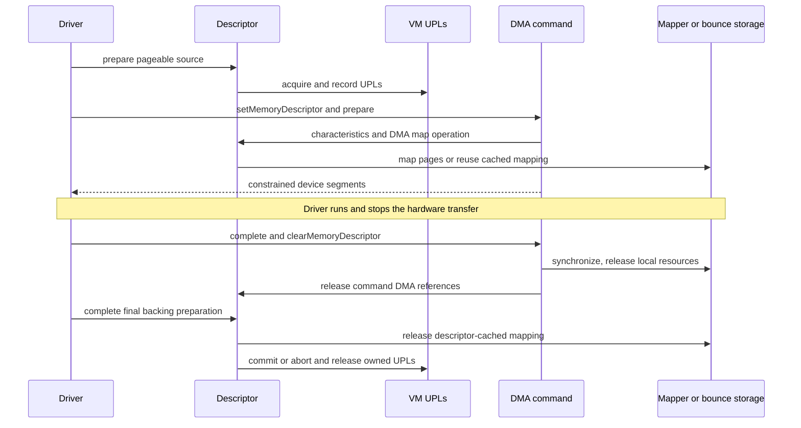

# DMA preparation, mapping ownership, and failure cleanup

[Drivers](README.md) · [Memory introduction](memory-and-dma.md) · [VM wiring](../vm/wiring-and-memory-entries.md) · [UPLs](../vm/pagers-and-upl.md)

A pageable DMA transfer has at least three lifetimes: VM backing must remain available, the device must have suitable addresses, and any CPU mapping must remain valid for its users. `IOGeneralMemoryDescriptor`, `IODMACommand`, and `IOMemoryMap` implement these separately. A successful CPU mapping does not substitute for page preparation; a DMA command does not directly establish every page hold; a command's mapping may be cached by its descriptor instead of released at that command's completion. [`descriptor preparation`](../../../xnu/iokit/Kernel/IOMemoryDescriptor.cpp#L5023-L5071), [`command setup`](../../../xnu/iokit/Kernel/IODMACommand.cpp#L397-L472), [`mapping cache`](../../../xnu/iokit/Kernel/IOMemoryDescriptor.cpp#L3251-L3400), [`CPU map cleanup`](../../../xnu/iokit/Kernel/IOMemoryDescriptor.cpp#L5800-L5891).

The selected trace here starts with virtual memory already described by a descriptor, acquires its UPL-backed preparation, prepares device segments, and unwinds command and descriptor state. Physical, externally supplied UPL, remote, mapper-less, and noncoherent branches are called out where they change that contract. Hardware command rings and a concrete IOMMU backend are outside this generic code's implementation.

For the generation algorithm itself, continue with the [DMA segment walkthrough](dma-segment-walkthrough.md): descriptor dispatch, mapped versus physical coordinates, coalescing and splitting, bounded continuation, output formatting, and errors that do not roll back internal state.

## 1. Read the state as several ownership ledgers

| Object/state | Meaning in the traced path |
|---|---|
| Descriptor `_task`, ranges, `_flags`, `_length` | Source address space/type/direction and byte ranges; construction alone is not a universal pinning operation. [`IOMemoryDescriptor.h`](../../../xnu/iokit/IOKit/IOMemoryDescriptor.h#L1115-L1189), [`withAddressRange` contract](../../../xnu/iokit/IOKit/IOMemoryDescriptor.h#L560-L586). |
| `_wireCount`, optional `_prepareLock` | Successful nested local preparations and their serialization when the lock exists. Physical descriptors return before this count changes. [`prepare`](../../../xnu/iokit/Kernel/IOMemoryDescriptor.cpp#L5023-L5071). |
| `_memoryEntries` and `ioPLBlock` records | Collected page information, UPL handles, descriptor offsets, and mapper/preparation metadata. These distinguish created UPL ownership from an external UPL. [`wireVirtual`](../../../xnu/iokit/Kernel/IOMemoryDescriptor.cpp#L4436-L4808), [`complete`](../../../xnu/iokit/Kernel/IOMemoryDescriptor.cpp#L5083-L5185). |
| Descriptor `_dmaReferences` | Active DMA accounting checked before final backing release. Command-map records and the no-mapper association path adjust it. [`dmaMapRecord`/`dmaUnmap`](../../../xnu/iokit/Kernel/IOMemoryDescriptor.cpp#L4865-L4936), [`DMA-active operations`](../../../xnu/iokit/Kernel/IOMemoryDescriptor.cpp#L3251-L3400). |
| Command `fMemory`, `fMapper`, `fActive` | Retained source descriptor, mapper choice, and nested command activity. `fActive` is changed before some prepare error returns; it is not equivalent to the internal successful-preparation flag. [`IODMACommand.cpp`](../../../xnu/iokit/Kernel/IODMACommand.cpp#L397-L472), [`prepare`](../../../xnu/iokit/Kernel/IODMACommand.cpp#L836-L899). |
| Command prepared range/copy/mapping state | `fPreparedOffset`, `fPreparedLength`, `fPrepared`, `fCopyMD`, sparse copy pages, `fLocalMapperAllocValid`, and segment state describe resources for the current attempt. [`initialization`](../../../xnu/iokit/Kernel/IODMACommand.cpp#L868-L881), [`mapping`](../../../xnu/iokit/Kernel/IODMACommand.cpp#L909-L1054). |
| CPU map `fMemory`, `fSuperMap`, `fAddressMap` | Retained descriptor, optional parent mapping, and VM map reference, with a separate unmap/free protocol. [`IOMemoryMap`](../../../xnu/iokit/Kernel/IOMemoryDescriptor.cpp#L5800-L5996). |

The public command contract explicitly allows preparation to block and warns against automatic preparation while holding a workloop gate. It also says `prepare()` is not thread-safe for simultaneous use of one command. These are caller obligations; retaining a descriptor does not make command mutation concurrent-safe. [`IODMACommand.h`](../../../xnu/iokit/IOKit/IODMACommand.h#L304-L346), [gate execution](workloop-and-power-protocols.md).

## 2. Descriptor prepare: direction, UPL construction, and rollback

`IOGeneralMemoryDescriptor::prepare()` returns success immediately for physical descriptors. It rejects the local path for remote descriptors. For virtual/UIO/vnode types, it optionally acquires `_prepareLock`, handles the avoid-throttling option, calls `wireVirtual()`, and increments `_wireCount` only on success. First successful preparation performs the additional encryption/trace work; another successful preparation extends the interval rather than independently rebuilding all pages. [`IOMemoryDescriptor.cpp`](../../../xnu/iokit/Kernel/IOMemoryDescriptor.cpp#L5023-L5071).

[IOMemoryDescriptor.cpp, lines 5050–5061](../../../xnu/iokit/Kernel/IOMemoryDescriptor.cpp#L5050-L5061)

<!-- source-excerpt: ../../../xnu/iokit/Kernel/IOMemoryDescriptor.cpp#L5050-L5061 -->
```cpp
		error = wireVirtual(forDirection);
	}

	if (kIOReturnSuccess == error) {
		if (1 == ++_wireCount) {
			if (kIOMemoryClearEncrypt & _flags) {
				performOperation(kIOMemoryClearEncrypted, 0, _length);
			}

			ktraceEmitPhysicalSegments();
		}
	}
```

`wireVirtual()` derives VM and device permissions from the direction. For `kIODirectionOut`, the device reads host memory, so the code requests `UPL_COPYOUT_FROM` and marks read-only DMA preparation. Device-input direction requires writable handling. A nested attempt cannot silently upgrade an already read-only preparation to writable. Flags additionally select no-fault/no-zero-fill/noncoherent behavior and low-address requirements, including the no-mapper physical-address limit branch. [`IOMemoryDescriptor.cpp`](../../../xnu/iokit/Kernel/IOMemoryDescriptor.cpp#L4436-L4527).

For a first preparation, the routine arranges storage for page information and chooses the source map or memory reference. It walks the descriptor's ranges and splits them into UPL-sized requests, preserving the offset of useful bytes inside the first page. Depending on the representation it uses `memory_object_iopl_request()`, the static-kernel UPL helper, or `vm_map_create_upl()`. An `ioPLBlock` records the UPL, page-list position, descriptor offset, and page offset; device-memory handling may represent a physically contiguous range differently from ordinary page information. The highest observed page feeds later addressing decisions. [`IOMemoryDescriptor.cpp`](../../../xnu/iokit/Kernel/IOMemoryDescriptor.cpp#L4528-L4743).

Failures must undo both the just-created request and previously recorded work. If recording a newly obtained UPL fails, the code aborts/deallocates that UPL. The common abort path then visits prior blocks, aborts/deallocates their UPLs, truncates the descriptor's memory-entry storage, and translates VM failures to IOKit statuses. The outer `prepare()` does not increment `_wireCount` for that failed attempt. This is the relevant contrast with the command's later activity counter, whose error behavior is different. [`IOMemoryDescriptor.cpp`](../../../xnu/iokit/Kernel/IOMemoryDescriptor.cpp#L4744-L4808), [`success-only increment`](../../../xnu/iokit/Kernel/IOMemoryDescriptor.cpp#L5053-L5061).

## 3. Final descriptor completion owns the backing teardown

`complete()` handles physical and remote cases separately and uses the same optional preparation lock. It records completion error state, handles the final encryption transition, and decrements `_wireCount`. An intermediate completion can mark data valid when requested while leaving the shared preparation intact. On final completion, active DMA references are an invariant failure: backing pages must not be released while a command still accounts for device use. [`IOMemoryDescriptor.cpp`](../../../xnu/iokit/Kernel/IOMemoryDescriptor.cpp#L5083-L5140).

The final path removes a descriptor-cached device mapping, then handles UPL ownership by descriptor type. Created virtual/UIO/vnode UPLs are aborted when completion reported error or committed otherwise, and deallocated. An external `kIOMemoryTypeUPL` instead clears the UPL's referenced state; this branch does not claim ownership of creating and destroying that external UPL. The descriptor then truncates temporary memory-entry storage, resets its preparation ID, and clears read-only-prepared state. [`IOMemoryDescriptor.cpp`](../../../xnu/iokit/Kernel/IOMemoryDescriptor.cpp#L5142-L5170).

[IOMemoryDescriptor.cpp, lines 5151–5165](../../../xnu/iokit/Kernel/IOMemoryDescriptor.cpp#L5151-L5165)

<!-- source-excerpt: ../../../xnu/iokit/Kernel/IOMemoryDescriptor.cpp#L5151-L5165 -->
```cpp
				// Only complete iopls that we created which are for TypeVirtual
				if (kIOMemoryTypeVirtual == type || kIOMemoryTypeVirtual64 == type || kIOMemoryTypeUIO == type || kIOMemoryTypeVnode == type) {
					for (ind = 0; ind < count; ind++) {
						if (ioplList[ind].fIOPL) {
							if (dataP->fCompletionError) {
								upl_abort(ioplList[ind].fIOPL, 0 /*!UPL_ABORT_DUMP_PAGES*/);
							} else {
								upl_commit(ioplList[ind].fIOPL, NULL, 0);
							}
							upl_deallocate(ioplList[ind].fIOPL);
						}
					}
				} else if (kIOMemoryTypeUPL == type) {
					upl_set_referenced(ioplList[0].fIOPL, false);
				}
```

A conceptual successful transfer therefore stops the device first, completes and clears the command's DMA use, then completes the backing descriptor. This ordering is derived from the command's DMA-reference adjustments and the descriptor's final-reference assertion; it is not a measurement of a particular controller. A device-specific abort/reset path must establish that the device has stopped using those addresses before entering this generic resource release sequence. [`command clear`](../../../xnu/iokit/Kernel/IODMACommand.cpp#L455-L472), [`DMA unmap accounting`](../../../xnu/iokit/Kernel/IOMemoryDescriptor.cpp#L4894-L4936), [`descriptor final completion`](../../../xnu/iokit/Kernel/IOMemoryDescriptor.cpp#L5120-L5144).

## 4. Attaching a descriptor to a reusable command

`setMemoryDescriptor()` refuses to replace a different descriptor while `fActive` is nonzero. With the same descriptor, `autoPrepare == false` drains outstanding command activity and returns; with `autoPrepare == true`, that same-descriptor branch returns without preparing again. For a new descriptor, it first queries characteristics, computes whether physical-address checking is needed, retains the descriptor, and records a new-source flag. Thus this setter has more semantics than an unconditional assignment followed by an unconditional prepare. [`IODMACommand.cpp`](../../../xnu/iokit/Kernel/IODMACommand.cpp#L397-L452).

When there is no mapper, the setter records DMA-active usage immediately through `kIOMDSetDMAActive`, before optional command preparation. `clearMemoryDescriptor()` drains `fActive` with `complete()`, clears that no-mapper activity record, and releases the descriptor. If asked not to auto-complete while active it returns `kIOReturnNotReady`. Mapper-backed command activity is instead accounted through map/unmap records. [`IODMACommand.cpp`](../../../xnu/iokit/Kernel/IODMACommand.cpp#L437-L472), [`descriptor DMA accounting operations`](../../../xnu/iokit/Kernel/IOMemoryDescriptor.cpp#L3251-L3400).

[IODMACommand.cpp, lines 437–448](../../../xnu/iokit/Kernel/IODMACommand.cpp#L437-L448)

<!-- source-excerpt: ../../../xnu/iokit/Kernel/IODMACommand.cpp#L437-L448 -->
```cpp
		fInternalState->fNewMD = true;
		fMemory.reset(const_cast<IOMemoryDescriptor *>(mem), OSRetain);
		fInternalState->fSetActiveNoMapper = (!fMapper);
		if (fInternalState->fSetActiveNoMapper) {
			mem->dmaCommandOperation(kIOMDSetDMAActive, this, 0);
		}
		if (autoPrepare) {
			err = prepare();
			if (err) {
				clearMemoryDescriptor();
			}
		}
```

Automatic preparation failure calls `clearMemoryDescriptor()` in this wrapper. A direct caller of `prepare()` must not assume every error leaves the command unchanged: after checking output format and maximum transfer size, the body evaluates `fActive++`. A nested mismatched range returns `NotReady` after incrementing it, and the first-use length-alignment failure also occurs after the increment. Later resource/setup errors have no single rollback label restoring an initial inactive state. `fPrepared` is only set on the successful final path. This is an implementation observation, not a recommendation to use a partially prepared command. [`IODMACommand.cpp`](../../../xnu/iokit/Kernel/IODMACommand.cpp#L836-L881), [`prepare completion`](../../../xnu/iokit/Kernel/IODMACommand.cpp#L1034-L1054), [`automatic cleanup`](../../../xnu/iokit/Kernel/IODMACommand.cpp#L443-L447).

[IODMACommand.cpp, lines 855–863](../../../xnu/iokit/Kernel/IODMACommand.cpp#L855-L863)

<!-- source-excerpt: ../../../xnu/iokit/Kernel/IODMACommand.cpp#L855-L863 -->
```cpp
	if (fActive++) {
		if ((state->fPreparedOffset != offset)
		    || (state->fPreparedLength != length)) {
			ret = kIOReturnNotReady;
		}
	} else {
		if (fAlignMaskLength & length) {
			return kIOReturnNotAligned;
		}
```

The descriptor's source segment walker separately enforces that nonphysical backing is wired. Command preparation is not an implicit replacement for `IOGeneralMemoryDescriptor::prepare()`. A caller evaluating a failure must track which preparation stage was entered and which wrapper owns cleanup, rather than use one undifferentiated “prepared” boolean for both objects. [`IOMemoryDescriptor.cpp`](../../../xnu/iokit/Kernel/IOMemoryDescriptor.cpp#L3535-L3574), [`IODMACommand` contracts](../../../xnu/iokit/IOKit/IODMACommand.h#L330-L354).

## 5. Direct iteration, sparse bounce pages, and full copying

First command preparation records its requested range and clears old copy/mapping state. It derives a source-alignment mask, relaxing the relevant part when a mapper can supply aligned device addresses. `fCursor` selects the iterate-only/direct path when requested or when addressing/alignment evidence allows it. Otherwise `walkAll()` preflights the source, adding synchronization-out work when requested. This decision depends on physical/address constraints and source alignment, not solely on whether a mapper pointer is null. [`IODMACommand.cpp`](../../../xnu/iokit/Kernel/IODMACommand.cpp#L868-L899).

`segmentOp()` detects address and alignment violations and counts pages requiring substitution. Misalignment or a forced copy can select full double buffering. For address-limited memory without a mapper, `walkAll()` first tries to allocate a sparse low-memory page list with nonwaiting page allocation. If it can do that, it records original physical pages in those temporary page records and uses them to substitute only the affected portions. If it cannot, or full buffering is required, it creates a copy-buffer memory descriptor for the prepared range. Resource failure reports `NoResources`; this is not guaranteed to succeed just because the original descriptor is wired. [`IODMACommand.cpp`](../../../xnu/iokit/Kernel/IODMACommand.cpp#L515-L629), [`walkAll`](../../../xnu/iokit/Kernel/IODMACommand.cpp#L632-L757).

Synchronization-out copies host data into bounce storage for applicable output direction; synchronization-in copies results back for applicable input direction. Sparse pages use segment/page copying, while a full copy descriptor uses `readBytes()`/`writeBytes()` and checks the returned byte count. Completion releases sparse pages and resets the copy descriptor. Noncoherent command preparation additionally performs a store/cache operation on the copy descriptor or original range; final command completion can perform the corresponding flush/invalidate operation before copy-back. These generic calls do not specify every hardware cache instruction emitted by a platform. [`IODMACommand.cpp`](../../../xnu/iokit/Kernel/IODMACommand.cpp#L632-L757), [`prepare cache work`](../../../xnu/iokit/Kernel/IODMACommand.cpp#L901-L907), [`complete`](../../../xnu/iokit/Kernel/IODMACommand.cpp#L1067-L1085).

## 6. Device mapping can belong to the command or the descriptor

The command's mapper branch constructs `IOMDDMAMapArgs` with device identity, alignment, address-bit constraint, requested length, and either the original prepared offset or zero into a copy descriptor. It invokes the descriptor's `kIOMDDMAMap` operation. When an allocation covers a different layout/length from the requested byte range, the command can build a segment array accounting for mapper page padding across source segments. That array has its own allocation-failure path. Successful local mapping state records the allocation, length, and validity for final completion. [`IODMACommand.cpp`](../../../xnu/iokit/Kernel/IODMACommand.cpp#L909-L1054).

On the descriptor side, the map operation accumulates stricter address/alignment requirements and distinguishes a reusable full-range mapping through the descriptor's system mapper from a command-owned mapping. Under its preparation lock where applicable, it can reuse a cached mapping or create a new one. For a new cached mapping it transfers allocation ownership to descriptor state and reports zero allocation length to the command; zero length does not mean no mapping or no DMA accounting exists. [`IOMemoryDescriptor.cpp`](../../../xnu/iokit/Kernel/IOMemoryDescriptor.cpp#L3251-L3360).

`IOGeneralMemoryDescriptor::dmaMap()` handles host-only and remote branches, chooses the general fallback for physical/subrange cases, and otherwise builds `IODMAMapPageList` from prepared page information. The flags include whether pages are externally supplied, whether the range occupies full pages, read-only preparation, and contiguous device-memory representation. It then calls `mapper->iovmMapMemory()` and records successful mapping/accounting. The concrete mapper decides the device translation implementation; the generic descriptor is not itself an IOMMU page-table backend. [`IOMemoryDescriptor.cpp`](../../../xnu/iokit/Kernel/IOMemoryDescriptor.cpp#L4835-L4891), [`prepared page-list mapping`](../../../xnu/iokit/Kernel/IOMemoryDescriptor.cpp#L4938-L5012).

`dmaUnmap()` decrements command DMA references before its zero-allocation-length early return. A command using a descriptor-owned cached mapping can therefore release its active-use accounting without freeing the shared mapping. The descriptor's final completion later removes that mapping with a null command argument. For a nonzero local allocation, unmapping also invokes the mapper and adjusts allocation accounting. [`IOMemoryDescriptor.cpp`](../../../xnu/iokit/Kernel/IOMemoryDescriptor.cpp#L4894-L4936), [`cached mapping release`](../../../xnu/iokit/Kernel/IOMemoryDescriptor.cpp#L5142-L5145).

The return-value path also deserves literal reading: the generic `kIOMDDMAUnmap` dispatch calls `dmaUnmap()` but returns success in that dispatch branch. Likewise, command preparation can assign a later mapping result after earlier work. These bodies should not be summarized as an abstract transaction that automatically propagates every intermediate failure and rolls back every stage. Follow the actual branch and ownership fields when diagnosing a failure. [`IOMemoryDescriptor.cpp`](../../../xnu/iokit/Kernel/IOMemoryDescriptor.cpp#L3316-L3327), [`command preparation`](../../../xnu/iokit/Kernel/IODMACommand.cpp#L893-L939).

## 7. Segment generation advances a bounded cursor

`genIOVMSegments()` requires active command state and valid output/offset/count arguments. Its input offset is relative to the prepared subrange; internally it adds `fPreparedOffset`. It rejects exhaustion and resets the saved cursor when the requested position is discontinuous or the descriptor changed. It can source addresses from a local mapper allocation, an allocation's segment array, a copy descriptor, or the original descriptor's DMA segment walker. Device-visible segment generation is therefore not simply virtual-to-physical translation of one CPU pointer. [`IODMACommand.cpp`](../../../xnu/iokit/Kernel/IODMACommand.cpp#L1272-L1465).

The loop coalesces contiguous input where allowed, handles addressability and sparse substitution, and splits output to satisfy maximum segment size, segment-length alignment, and following-segment alignment. Cursor-only operation detects alignment it cannot repair and reports `NotAligned`. The output callback can also reject a segment. Only on success does the function commit its saved offset and caller's output offset/count. This permits repeated bounded calls with a small output array while preserving explicit error reporting. [`IODMACommand.cpp`](../../../xnu/iokit/Kernel/IODMACommand.cpp#L1466-L1645).

[IODMACommand.cpp, lines 1626–1631](../../../xnu/iokit/Kernel/IODMACommand.cpp#L1626-L1631)

<!-- source-excerpt: ../../../xnu/iokit/Kernel/IODMACommand.cpp#L1626-L1631 -->
```cpp
	if (kIOReturnSuccess == ret) {
		state->fOffset = offset;
		*offsetP       = offset - internalState->fPreparedOffset;
		*numSegmentsP  = segIndex;
	}
	return ret;
```

A conceptual example is an 8-KiB prepared subrange split into two device segments because of a configured segment-size limit. A two-element output array may describe the range in one call; a one-element array requires another call with the returned relative offset. The example is illustrative rather than observed output: real segmentation also depends on physical continuity, mapper allocation, alignments, and output function. The source's offset/count updates, rather than assumed physical contiguity, define how the caller continues. [`IODMACommand.cpp`](../../../xnu/iokit/Kernel/IODMACommand.cpp#L1530-L1632).

## 8. Command completion and CPU maps remain separate

Final `IODMACommand::complete()` first decrements `fActive`; nested completions do not immediately tear down shared command resources. At zero it saves the copy descriptor, performs configured noncoherent invalidation and synchronization-in/copy cleanup, unmaps valid command-owned mapping state, clears allocation fields and any segment array, and clears `fPrepared`. Saving the copy descriptor preserves the object needed for subsequent unmapping even if `walkAll(kWalkComplete)` clears the command's copy-buffer field. [`IODMACommand.cpp`](../../../xnu/iokit/Kernel/IODMACommand.cpp#L1057-L1117).



A CPU `IOMemoryMap` has an independent lifecycle. `makeMapping()` runs under the global recursive memory lock, can reuse a compatible map, create a submap retaining a supermap, or call `doMap()` for a new mapping. Compatibility includes target map/task, options, range containment, and address constraints; it is not merely descriptor-pointer equality. For a new general mapping, `doMap()` can reuse the original same-task range as a static mapping under specific options or create a memory reference and VM mapping. The copy-on-write memory-reference setup is attempted before the global mapping lock because it may allocate pages. [`IOMemoryDescriptor.cpp`](../../../xnu/iokit/Kernel/IOMemoryDescriptor.cpp#L5208-L5340), [`compatibility`](../../../xnu/iokit/Kernel/IOMemoryDescriptor.cpp#L5920-L5996), [`makeMapping`](../../../xnu/iokit/Kernel/IOMemoryDescriptor.cpp#L6228-L6331).

`unmap()` removes an actual VM mapping only when this map owns that operation: an address/map must exist, and it must not be a supermap-backed or static mapping. It still drops its VM-map reference. `taskDied()` follows its own invalidation path. The class's release threshold accounts for the descriptor's mappings-set reference; `free()` unmaps, removes the map from that set, releases descriptor/supermap ownership, and completes any redirection UPL. Removing a CPU view does not itself complete a DMA command or prove a device has stopped reading its IOVA. [`IOMemoryDescriptor.cpp`](../../../xnu/iokit/Kernel/IOMemoryDescriptor.cpp#L5800-L5891), [VM mapping ownership](../vm/virtual-address-maps.md).

## Sources inspected and limits

Deep review covered virtual descriptor preparation and UPL error rollback, nested/final completion, external-UPL distinctions, command descriptor replacement/automatic failure cleanup, direct/copy preflight, selected sparse/full bounce paths, mapper ownership transfer and DMA accounting, segment splitting/cursor updates, final command cleanup, and CPU map reuse/unmap/reference release. The concrete `IOMapper` backend, every constructor/redirected-map path, all physical contiguity/page-size combinations, and controller stop/error semantics remain boundaries. No DMA transfer or IOMMU experiment was run.

For source reading, begin with one successful virtual preparation and one failed UPL recording, then compare automatic command-prepare failure against direct nested prepare failure. Track `_wireCount`, `fActive`, `fPrepared`, `_dmaReferences`, and mapping ownership independently at each return; those fields explain more than the shared method name `prepare`.

<!-- BEGIN PLATYDOC DOCUMENTATION LICENSE -->
Original Platydoc text and diagrams are licensed under [CC BY 4.0](https://creativecommons.org/licenses/by/4.0/). Quoted source code and third-party material retain their respective licenses.
<!-- END PLATYDOC DOCUMENTATION LICENSE -->
