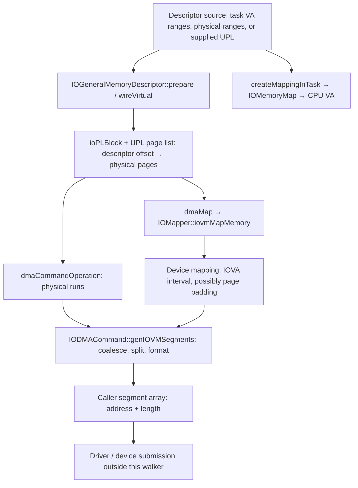
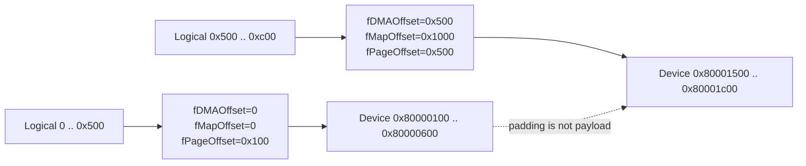
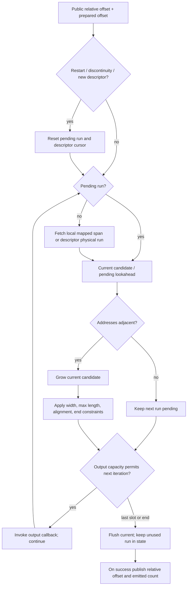
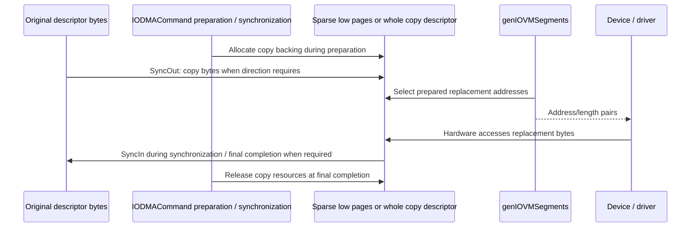
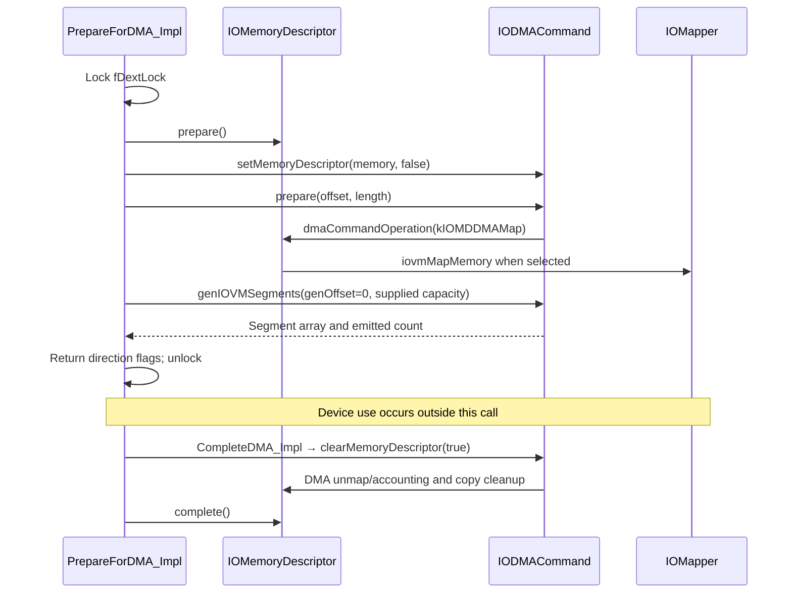

# DMA segment generation: descriptor offsets, physical runs, and device addresses

[Drivers](README.md) · [Memory introduction](memory-and-dma.md) · [Preparation and cleanup](dma-preparation-and-mapping.md) · [Descriptor composition and CPU maps](memory-descriptors-and-cpu-mappings.md)

The API sometimes shortened to “genVMSegments” is **`IODMACommand::genIOVMSegments()`** in this checkout. It turns a prepared descriptor interval into bounded address/length pairs suitable for a device's addressing and segment constraints. Its ordinary client path produces a representation of memory: it does not itself submit a hardware command or transfer the payload. The same internal walker also serves preparation, bounce-copy synchronization, and explicit command byte-copy operations through different callbacks. [`public entry and internal walker`](../../../xnu/iokit/Kernel/IODMACommand.cpp#L1271-L1290), [`walkAll`](../../../xnu/iokit/Kernel/IODMACommand.cpp#L631-L754), [`transfer`](../../../xnu/iokit/Kernel/IODMACommand.cpp#L1140-L1255).

The important question is therefore not just “which addresses does it return?” It is “which prepared byte interval, through which descriptor implementation, in which address space, with which resource lifetime?” This chapter follows that path through actual bodies. The existing [preparation guide](dma-preparation-and-mapping.md) covers UPL rollback and final cleanup in greater detail; the [CPU mapping guide](memory-descriptors-and-cpu-mappings.md) covers descriptor construction and `IOMemoryMap` ownership.

## 1. Four coordinates and three separate operations

| Value | Meaning | Where the conversion occurs |
| --- | --- | --- |
| Task or kernel CPU virtual address | An address in a CPU VM map. A descriptor may contain several disjoint virtual ranges. | `wireVirtual()` obtains UPL page information for those ranges. |
| Descriptor offset | Position in the descriptor's logical concatenation of bytes, independent of the original range addresses. | `ioPLBlock::fIOMDOffset` and descriptor-specific range walkers locate the backing portion. |
| Physical address | Page-frame address plus an offset; adjacent descriptor bytes need not occupy adjacent physical pages. | The general descriptor's physical walker uses UPL page information or physical ranges. |
| I/O virtual address, or IOVA | Address presented to the device through a mapper. Without a mapper, this path commonly emits the physical address instead. | `IOMapper::iovmMapMemory()` creates the mapping; command iteration selects addresses within it. |

The structures and conversions are visible in [`ioPLBlock`](../../../xnu/iokit/Kernel/IOMemoryDescriptor.cpp#L139-L146), [`physical page walk`](../../../xnu/iokit/Kernel/IOMemoryDescriptor.cpp#L3536-L3628), and [`mapper interface`](../../../xnu/iokit/IOKit/IOMapper.h#L108-L131). A separate `IOMemoryMap` can give a CPU another virtual mapping of the same backing; its address is not the DMA address returned by the command.



Three operations must not be collapsed. Descriptor preparation stabilizes backing for the applicable descriptor type. Command preparation records a selected byte interval and may allocate mapper or bounce resources. Segment generation enumerates that state. Retaining an object is also separate from all three: it preserves the C++ object, not necessarily a successful preparation interval or a serialized mutable cursor. [`descriptor prepare`](../../../xnu/iokit/Kernel/IOMemoryDescriptor.cpp#L5023-L5071), [`setMemoryDescriptor`](../../../xnu/iokit/Kernel/IODMACommand.cpp#L397-L452), [`command prepare`](../../../xnu/iokit/Kernel/IODMACommand.cpp#L836-L1054).

## 2. The public call and the state it changes

The public method supplies the client operation flag, the adapter that checks/formats output, and the output function chosen when constructing the command:

[IODMACommand::genIOVMSegments public entry](../../../xnu/iokit/Kernel/IODMACommand.cpp#L1271-L1278)

<!-- source-excerpt: ../../../xnu/iokit/Kernel/IODMACommand.cpp#L1271-L1278 -->
```cpp
IOReturn
IODMACommand::genIOVMSegments(UInt64 *offsetP,
    void   *segmentsP,
    UInt32 *numSegmentsP)
{
	return genIOVMSegments(kWalkClient, clientOutputSegment, (void *) fOutSeg,
	           offsetP, segmentsP, numSegmentsP);
}
```

The caller supplies:

- `offsetP`: input offset **relative to the command's prepared interval**; on success it becomes the next relative offset.
- `segmentsP`: storage interpreted by the configured output callback.
- `numSegmentsP`: input capacity; on success it becomes the number emitted by this call.

These are not three independent output values. The loop uses capacity to decide where to stop and preserves an unconsumed segment for a continuation. The command's private state also changes while looking ahead. Only the final successful return publishes the updated offset and count. [`entry checks and offset conversion`](../../../xnu/iokit/Kernel/IODMACommand.cpp#L1292-L1324), [`capacity stop and publication`](../../../xnu/iokit/Kernel/IODMACommand.cpp#L1601-L1631).

| State | Role in generation |
| --- | --- |
| `fPreparedOffset`, `fPreparedLength` | Descriptor interval selected by `prepare()`. Public generation offsets are rebased by the first field. |
| `fState` / `IOMDDMAWalkSegmentArgs` | Descriptor-walker state: current logical offset, returned address/length, and mapped-mode information. The reserved state also holds implementation-specific cursor fields. |
| `fIOVMAddrValid` | A pending input run or leftover split still occupies the shared walker state. |
| Local `curSeg`, `curSegValid` | Candidate being grown by adjacency or shortened by constraints before output. |
| `fLocalMapperAlloc`, `fLocalMapperAllocLength`, `fLocalMapperAllocValid` | Mapping result available to the command; allocation length also participates in ownership accounting. |
| `fMapSegments`, index/offset cache | Translation between logical descriptor offsets and padded mapper intervals. |
| `fCopyMD`, `fCopyPageAlloc`, `fNextRemapPage` | Whole-buffer or sparse bounce resources established by preparation. |
| `fActive`, `fPrepared` | Nested command activity and successful-preparation state. They are distinct; some failed prepares have already incremented `fActive`. |

See [`IODMACommandInternal`](../../../xnu/iokit/Kernel/IOKitKernelInternal.h#L105-L158), [`walker arguments`](../../../xnu/iokit/IOKit/IOMemoryDescriptor.h#L255-L264), and [`prepare counter ordering`](../../../xnu/iokit/Kernel/IODMACommand.cpp#L847-L881).

`gen32IOVMSegments()` and `gen64IOVMSegments()` are typed wrappers around this same call. They **do not select a different formatter**. A command configured for 64-bit output must receive 64-bit output storage; the header explicitly warns that mixing these produces incorrect results. The alternate `genIOVMSegments(SegmentFunction, ...)` overload supplies a formatter for that invocation. [`typed wrappers`](../../../xnu/iokit/IOKit/IODMACommand.h#L399-L425), [`alternate bridge`](../../../xnu/iokit/Kernel/IODMACommand.cpp#L1657-L1665).

## 3. How descriptor classes enter the walk

The command works through the virtual `dmaCommandOperation()` interface. This is why the source is split: much of `IOGeneralMemoryDescriptor` is implemented in **`IOMemoryDescriptor.cpp`**, while `IODMACommand.cpp` supplies the device-facing constraint walker. There is no universal operation that simply applies `pmap_extract()` to the caller's original pointer.

| Descriptor implementation | How it supplies a segment |
| --- | --- |
| `IOGeneralMemoryDescriptor`, virtual/UIO-style backing | Finds the `ioPLBlock` containing the descriptor offset, selects its page list, and returns consecutive physical pages up to the block/range boundary. Unprepared ordinary virtual backing triggers a panic in this walk. |
| General descriptor, physical ranges | Locates the physical range and can merge successive adjacent physical ranges. This branch does not need the virtual-memory wiring count. |
| General descriptor, external UPL/device memory | Uses the supplied page information; the device-contiguous flag changes the address calculation. |
| `IOBufferMemoryDescriptor` | Inherits from `IOGeneralMemoryDescriptor`; its allocated storage therefore enters the general descriptor machinery according to the backing/options established during construction. |
| `IOSubMemoryDescriptor` | The base `IOMemoryDescriptor` walker dispatches `getPhysicalSegment()` to the subdescriptor, which adds `_start` to its offset into the retained parent and caps the result to the subrange. |
| `IOMultiMemoryDescriptor` | Its physical-segment method selects a child by subtracting preceding child lengths and returns that child's result directly. |
| `IOInterleavedMemoryDescriptor` | Selects a component interval, adds that component's recorded source offset, and caps the returned run to that interval. |

Sources: [`general dispatcher and walk`](../../../xnu/iokit/Kernel/IOMemoryDescriptor.cpp#L3251-L3631), [`base DMA dispatcher`](../../../xnu/iokit/Kernel/IOMemoryDescriptor.cpp#L3916-L3984), [`buffer inheritance`](../../../xnu/iokit/IOKit/IOBufferMemoryDescriptor.h#L62), [`subrange physical segment`](../../../xnu/iokit/Kernel/IOSubMemoryDescriptor.cpp#L120-L142), [`multi physical segment`](../../../xnu/iokit/Kernel/IOMultiMemoryDescriptor.cpp#L237-L260), [`interleaved physical segment`](../../../xnu/iokit/Kernel/IOInterleavedMemoryDescriptor.cpp#L257-L287).

The base implementation obtains physical segments with `kIOMemoryMapperNone` and coalesces physically adjacent results from successive logical offsets. That flag matters: some descriptor methods can otherwise return mapped addresses or, for a specially requested source-segment mode, original virtual source addresses. The command-to-descriptor operation must be read with its operation flags rather than treating every method named `getPhysicalSegment` as an unconditional CPU-VA-to-PA translator. [`base walk`](../../../xnu/iokit/Kernel/IOMemoryDescriptor.cpp#L3935-L3959), [`general getPhysicalSegment`](../../../xnu/iokit/Kernel/IOMemoryDescriptor.cpp#L3635-L3722).

For ordinary prepared pages, the general walker finds a physical run by testing successive page numbers. It preserves the byte offset in the first page and stops when the next page number is not consecutive:

[IOGeneralMemoryDescriptor physical-run construction](../../../xnu/iokit/Kernel/IOMemoryDescriptor.cpp#L3594-L3617)

<!-- source-excerpt: ../../../xnu/iokit/Kernel/IOMemoryDescriptor.cpp#L3594-L3617 -->
```cpp
			// Now we need compute the index into the pageList
			UInt pageInd = atop_32(offset);
			offset &= PAGE_MASK;

			// Compute the starting address of this segment
			IOPhysicalAddress pageAddr = pageList[pageInd].phys_addr;
			if (!pageAddr) {
				panic("!pageList phys_addr");
			}

			address = ptoa_64(pageAddr) + offset;

			// length is currently set to the length of the remainider of the iopl.
			// We need to check that the remainder of the iopl is contiguous.
			// This is indicated by pageList[ind].phys_addr being sequential.
			IOByteCount contigLength = PAGE_SIZE - offset;
			while (contigLength < length
			    && ++pageAddr == pageList[++pageInd].phys_addr) {
				contigLength += PAGE_SIZE;
			}

			if (contigLength < length) {
				length = contigLength;
			}
```

That adjacency test concerns **physical** contiguity. A later mapper can present nonadjacent physical pages as adjacent IOVAs. Conversely, a descriptor formed from partial-page pieces may require holes in a mapper allocation even though its logical bytes are concatenated without holes.

## 4. What must exist before enumeration

For pageable virtual backing, `wireVirtual()` converts direction into access flags and obtains UPL page information through `memory_object_iopl_request()`, the static-kernel helper, or `vm_map_create_upl()`. The recorded `ioPLBlock` identifies the descriptor offset, page-list location, starting page offset, and UPL handle. `kIODirectionOut` describes the device reading host bytes; `kIODirectionIn` describes the device writing host bytes. This is the basis for read-only versus writable preparation and later bounce-copy direction. [`direction and UPL flags`](../../../xnu/iokit/Kernel/IOMemoryDescriptor.cpp#L4436-L4499), [`UPL acquisition`](../../../xnu/iokit/Kernel/IOMemoryDescriptor.cpp#L4638-L4705), [UPL lifetime](dma-preparation-and-mapping.md).

Command `setSpecification()` stores the formatter, maximum segment/transfer lengths, address-bit limit, mapper, and three alignment constraints. Zero maximum sizes become effectively unlimited. Zero alignment becomes one-byte alignment; internal-segment alignment defaults to the initial alignment, while length alignment has its own mask. Built-in 32-bit output functions constrain address bits during setup. The implementation converts alignment values to masks; do not infer an additional general power-of-two validation pass that this body does not perform. [`specification setup`](../../../xnu/iokit/Kernel/IODMACommand.cpp#L246-L347).

Mapper selection is also concrete setup behavior. When no mapper was supplied, `setSpecification()` attempts to obtain the system mapper unless the mapping type is `kUnmapped`. `kMapped`, `kUnmapped`, and `kNonCoherent` are accepted mapping types; `kBypassed` is accepted only when the resulting mapper is null. `kIterateOnly` separately selects cursor behavior. Consequently, do not use “noncoherent” as a synonym for “no mapper”: the body can select a system mapper before processing that type. Noncoherent command preparation/completion additionally invokes cache-maintenance operations. [`mapper/type selection`](../../../xnu/iokit/Kernel/IODMACommand.cpp#L289-L344), [`prepare maintenance`](../../../xnu/iokit/Kernel/IODMACommand.cpp#L901-L906), [`complete maintenance`](../../../xnu/iokit/Kernel/IODMACommand.cpp#L1069-L1083).

`prepare(offset, length)` chooses the descriptor interval. Its `length == 0` branch uses the descriptor's **whole length**, not “whole length minus offset.” It checks the maximum transfer size, increments the activity count, initializes preparation state, and determines whether it can use a cursor-only path. `fIterateOnly` or suitable address/alignment characteristics can avoid bounce preflight. Otherwise `walkAll()` discovers address/alignment problems and prepares copy resources. This classification is implementation state, not a promise that every later formatter call will succeed. [`prepare`](../../../xnu/iokit/Kernel/IODMACommand.cpp#L836-L899), [`preflight and copy allocation`](../../../xnu/iokit/Kernel/IODMACommand.cpp#L631-L754).

When a mapper is present, the command asks the selected original or copy descriptor to map the interval. A whole copy descriptor is mapped from offset zero; the original descriptor is mapped from the prepared offset:

[command mapping request](../../../xnu/iokit/Kernel/IODMACommand.cpp#L910-L926)

<!-- source-excerpt: ../../../xnu/iokit/Kernel/IODMACommand.cpp#L910-L926 -->
```cpp
			IOMDDMAMapArgs mapArgs;
			bzero(&mapArgs, sizeof(mapArgs));
			mapArgs.fMapper = fMapper.get();
			mapArgs.fCommand = this;
			mapArgs.fMapSpec.device         = state->fDevice;
			mapArgs.fMapSpec.alignment      = fAlignMask + 1;
			mapArgs.fMapSpec.numAddressBits = fNumAddressBits ? ((UInt8) fNumAddressBits) : 64;
			mapArgs.fLength = state->fPreparedLength;
			OSSharedPtr<IOMemoryDescriptor> md = state->fCopyMD;
			if (md) {
				mapArgs.fOffset = 0;
			} else {
				md = fMemory;
				mapArgs.fOffset = state->fPreparedOffset;
			}

			ret = md->dmaCommandOperation(kIOMDDMAMap, &mapArgs, sizeof(mapArgs));
```

The map operation carries an `IODMAMapSpecification` with alignment, device, options, and address bits; the command pointer can accompany the mapper request. The general descriptor can pass an `IODMAMapPageList` when it has an applicable whole prepared page list. Physical descriptors, partial intervals, and other cases use the base mapper path, where the mapper receives the descriptor and no preassembled page-list argument. Read/write access flags come from preparation and the selected path. [`map structures`](../../../xnu/iokit/IOKit/IOMemoryDescriptor.h#L181-L207), [`base dmaMap`](../../../xnu/iokit/Kernel/IOMemoryDescriptor.cpp#L4835-L4863), [`general dmaMap`](../../../xnu/iokit/Kernel/IOMemoryDescriptor.cpp#L4938-L5020).

The map specification is not forwarded identically through every descriptor branch. In the optimized whole prepared general-descriptor path, `dmaMap()` constructs a fresh local specification from the descriptor's accumulated address-bit and alignment requirements; the base fallback uses the supplied specification. The optimized path also derives paging-path, fully occupied page-list, access, and physically contiguous flags from its backing. Follow the branch before assuming a field in the command's original map request reaches a particular provider unchanged. [`general map specification and page-list flags`](../../../xnu/iokit/Kernel/IOMemoryDescriptor.cpp#L4961-L5002).

`IOMapper::iovmMapMemory()` is the virtual hardware-provider boundary. This checkout exposes its inputs, outputs, and unmap interface, not a universal IOMMU page-table format or device-specific TLB protocol. Mapper selection may resolve a device's `iommu-parent` relationship. A successful mapping normally gives the device a new address translation to existing backing; it does not imply a payload copy. [`IOMapper virtual methods`](../../../xnu/iokit/IOKit/IOMapper.h#L108-L131), [`copyMapperForDeviceWithIndex`](../../../xnu/iokit/Kernel/IOMapper.cpp#L174-L226).

## 5. Linear mapping versus padded mapping

If a local mapper allocation exists and no padding table was built, generation uses:

`device_address = fLocalMapperAlloc + descriptor_offset - fPreparedOffset`

and starts with the remaining prepared length. Physical fragmentation is then hidden behind the mapper's device address interval. [`linear local mapping branch`](../../../xnu/iokit/Kernel/IODMACommand.cpp#L1349-L1356).

A different branch runs during preparation if the mapper returns a **nonzero allocation length unequal to the requested data length**. It asserts that the allocation is larger, walks physical segments, and builds `IODMACommandMapSegment` records. The records are an interpretation of the already returned mapper allocation; this loop does not itself call `iovmInsert()` to create mappings. Each record stores:

| Field | Coordinate |
| --- | --- |
| `fDMAOffset` | Starting logical descriptor offset of the physical run. |
| `fMapOffset` | Offset of the run's page-aligned span within the mapper allocation. |
| `fPageOffset` | Original physical run's offset within a mapper page. |

The next mapper span begins after rounding the previous physical run's covered pages, using **`fMapper->getPageSize()`**, not an assumed universal 4 KiB page. The allocation base is rounded down with that same mapper-page mask. [`table construction`](../../../xnu/iokit/Kernel/IODMACommand.cpp#L928-L1035).

[padded-mapping coordinate table](../../../xnu/iokit/Kernel/IODMACommand.cpp#L1023-L1035)

<!-- source-excerpt: ../../../xnu/iokit/Kernel/IODMACommand.cpp#L1023-L1035 -->
```cpp
						assert(segCount < state->fMapSegmentsCount);
						state->fMapSegments[segCount].fDMAOffset = state->fPreparedOffset + index;
						state->fMapSegments[segCount].fMapOffset = insertOffset;
						state->fMapSegments[segCount].fPageOffset = align;
						index  += segLen;

						// segment page align
						segLen  = ((phys + segLen + mapperPageMask) & ~mapperPageMask);
						phys   -= align;
						segLen -= phys;
						insertOffset += segLen;
					}
					state->fLocalMapperAllocBase = (mapArgs.fAlloc & ~mapperPageMask);
```

During generation, the table selects the record containing the logical offset and caps the run at the next record's logical boundary. Its formula is:

`device_address = allocation_base + fMapOffset + fPageOffset + (descriptor_offset - fDMAOffset)`

The cached record index speeds forward traversal; it does not eliminate the logical-boundary calculation. [`padded mapping lookup`](../../../xnu/iokit/Kernel/IODMACommand.cpp#L1357-L1410).

This illustrative example assumes a mapper page size of `0x1000`, prepared offset zero, and two nonadjacent physical pieces. It shows the table arithmetic, not a measured mapping returned by a particular hardware mapper:

| Logical bytes | Physical piece | Map offset | Page offset | Device bytes with base `0x80000000` |
| --- | --- | --- | --- | --- |
| `[0, 0x500)` | `0x10100`, length `0x500` | `0` | `0x100` | `[0x80000100, 0x80000600)` |
| `[0x500, 0xc00)` | `0x20500`, length `0x700` | `0x1000` | `0x500` | `[0x80001500, 0x80001c00)` |



A single address-plus-total-logical-length would incorrectly include the gap. The table keeps the logical byte stream contiguous while emitting the actual separated device spans. A mapped command therefore does not universally collapse every descriptor into one segment.

There is an ownership wrinkle: the general descriptor can retain a whole-range system-mapper mapping in its own cache and return `fAllocLength == 0` to the command. Zero here does not mean “there are no mapped bytes”; it indicates the command is not holding that allocation length for independent disposal. `dmaUnmap()` still adjusts DMA accounting before its zero-length early return. The [preparation guide](dma-preparation-and-mapping.md) follows this distinction through final descriptor completion. [`mapping cache`](../../../xnu/iokit/Kernel/IOMemoryDescriptor.cpp#L3261-L3349), [`dmaUnmap`](../../../xnu/iokit/Kernel/IOMemoryDescriptor.cpp#L4894-L4936).

## 6. The generator is a lookahead iterator with constraints

The internal generator first requires activity, valid pointers, and a nonzero output capacity. It converts the public offset to a descriptor offset, rejects an offset at or beyond the prepared end, and resets its walker on a restart, a discontinuous offset, or a new descriptor:

[generation offset and restart](../../../xnu/iokit/Kernel/IODMACommand.cpp#L1303-L1315)

<!-- source-excerpt: ../../../xnu/iokit/Kernel/IODMACommand.cpp#L1303-L1315 -->
```cpp
	UInt64 offset    = *offsetP + internalState->fPreparedOffset;
	UInt64 memLength = internalState->fPreparedOffset + internalState->fPreparedLength;

	if (offset >= memLength) {
		return kIOReturnOverrun;
	}

	if ((offset == internalState->fPreparedOffset) || (offset != state->fOffset) || internalState->fNewMD) {
		state->fOffset                                   = 0;
		internalState->fIOVMAddrValid = state->fIOVMAddr = 0;
		internalState->fNextRemapPage                    = NULL;
		internalState->fNewMD                            = false;
		mdOp                                             = kIOMDFirstSegment;
```

The normal progression has six decisions:

1. **Acquire a run.** Use the local mapper formula/table if present; otherwise call `dmaCommandOperation()` on the copy descriptor if one exists, or on the original descriptor. This call is initially `kIOMDFirstSegment` after reset, then `kIOMDWalkSegments`.
2. **Coalesce lookahead.** If a current candidate ends exactly where the next returned address begins, add the next run's length. Adjacency is tested in the address space being returned: physical or IOVA according to the selected branch.
3. **Handle the address limit.** In client mode, a run exceeding the permitted address bits either fails in cursor mode or is split/remapped using prepared bounce pages.
4. **Reduce output length.** Apply maximum segment size, length-alignment mask, and next-segment address-alignment adjustment. Store the leftover as pending input and subtract its bytes from the tentative offset.
5. **Check cursor alignment and end.** The first emitted segment of the current call uses the source-alignment mask; later segments use the internal-segment mask. The candidate is clipped to the prepared end.
6. **Emit or preserve continuation.** A pending next run triggers output of the current one, except that the last available slot is reserved for the final flush. Successful return publishes progress and count.

The selection and coalescing bodies are at [`run acquisition`](../../../xnu/iokit/Kernel/IODMACommand.cpp#L1339-L1422) and [`adjacency test`](../../../xnu/iokit/Kernel/IODMACommand.cpp#L1448-L1461). Constraints are at [`address limit`](../../../xnu/iokit/Kernel/IODMACommand.cpp#L1473-L1531), [`size and alignment`](../../../xnu/iokit/Kernel/IODMACommand.cpp#L1534-L1599), and [`capacity/output`](../../../xnu/iokit/Kernel/IODMACommand.cpp#L1601-L1631).

[adjacent-run coalescing](../../../xnu/iokit/Kernel/IODMACommand.cpp#L1451-L1456)

<!-- source-excerpt: ../../../xnu/iokit/Kernel/IODMACommand.cpp#L1451-L1456 -->
```cpp
				if (curSegValid && ((curSeg.fIOVMAddr + curSeg.fLength) == state->fIOVMAddr)) {
					UInt64 length = state->fLength;
					offset          += length;
					curSeg.fLength  += length;
					internalState->fIOVMAddrValid = state->fIOVMAddr = 0;
				}
```



The loop does not guarantee one output per UPL, source range, physical page, or mapper page. It may combine several input runs, then split the combined candidate to satisfy a smaller maximum. The pending run can be either a genuinely nonadjacent input or the remainder of a constrained candidate. This is why `curSeg` and the shared walker state coexist.

The reduction logic also does not independently allocate a new aligned buffer at each output boundary. Alignment repair involving copying was decided in preparation. Cursor mode rejects remaining address/length misalignment; other paths can rely on the prepared copy representation. For a precise investigation, inspect both `segmentOp()`'s preflight alignment test and the final client walk rather than attributing all alignment behavior to one mask. [`preflight alignment`](../../../xnu/iokit/Kernel/IODMACommand.cpp#L498-L552), [`cursor validation`](../../../xnu/iokit/Kernel/IODMACommand.cpp#L1573-L1591).

## 7. Continuation, output encoding, and nontransactional errors

Here is the successful publication point:

[successful cursor publication](../../../xnu/iokit/Kernel/IODMACommand.cpp#L1626-L1632)

<!-- source-excerpt: ../../../xnu/iokit/Kernel/IODMACommand.cpp#L1626-L1632 -->
```cpp
	if (kIOReturnSuccess == ret) {
		state->fOffset = offset;
		*offsetP       = offset - internalState->fPreparedOffset;
		*numSegmentsP  = segIndex;
	}
	return ret;
}
```

A capacity-limited success is a normal partial result. The caller must use the returned offset to determine whether the prepared interval is finished. It must reset `numSegments` to its array capacity before the next call. Calling again with an offset equal to the prepared length returns `kIOReturnOverrun`; it is not an empty successful completion. Starting again at relative offset zero resets the walk. [`entry/end behavior`](../../../xnu/iokit/Kernel/IODMACommand.cpp#L1303-L1324), [`output-capacity branch`](../../../xnu/iokit/Kernel/IODMACommand.cpp#L1601-L1615).

A real in-tree test uses an output array of one segment and repeatedly passes the returned offset until it reaches the descriptor length:

[one-segment continuation test](../../../xnu/iokit/Tests/TestIOMemoryDescriptor.cpp#L871-L878)

<!-- source-excerpt: ../../../xnu/iokit/Tests/TestIOMemoryDescriptor.cpp#L871-L878 -->
```cpp
				offset = 0;
				do{
					numSegments = 1;
					ret = dma->gen64IOVMSegments(&offset, &segments[0], &numSegments);
					assert(kIOReturnSuccess == ret);
					assert(1 == numSegments);
					kprintf("seg 0x%qx, 0x%qx\n", segments[0].fIOVMAddr, segments[0].fLength);
				}while (offset < md->getLength());
```

For an illustrative unmapped descriptor, assume 4 KiB pages, prepared offset zero, length `0x3000`, 64-bit addressing, byte alignment, and no maximum smaller than `0x2000`. Its physical pages are `0x10000`, `0x11000`, and `0x30000`. The first two form a single `0x2000` physical run; the third is separate. With output capacity one:

| Call | Input relative offset/capacity | Output | Successful next offset/count |
| --- | --- | --- | --- |
| 1 | `0`, `1` | address `0x10000`, length `0x2000` | `0x2000`, `1` |
| 2 | `0x2000`, `1` | address `0x30000`, length `0x1000` | `0x3000`, `1` |

If a mapper instead provides a linear IOVA interval over these same three physical pages, the candidate can cover all `0x3000` bytes. A maximum output length of `0x2000` then creates two outputs whose **device** addresses are adjacent despite the physical discontinuity. These examples illustrate the branches; page sizes and concrete mapper outputs depend on configuration/provider.

The output adapter first tests address width under its specified mapping conditions, then calls the formatter. Critically, it still calls the formatter after setting an address-width error:

[client output validation and formatting](../../../xnu/iokit/Kernel/IODMACommand.cpp#L1642-L1652)

<!-- source-excerpt: ../../../xnu/iokit/Kernel/IODMACommand.cpp#L1642-L1652 -->
```cpp
	if (target->fNumAddressBits && (target->fNumAddressBits < 64)
	    && ((segment.fIOVMAddr + segment.fLength - 1) >> target->fNumAddressBits)
	    && (target->reserved->fLocalMapperAllocValid || !target->fMapper)) {
		DEBG("kIOReturnMessageTooLarge(fNumAddressBits) %qx, %qx\n", segment.fIOVMAddr, segment.fLength);
		ret = kIOReturnMessageTooLarge;
	}

	if (!(*segmentFunction)(target, segment, vSegList, outSegIndex)) {
		DEBG("kIOReturnMessageTooLarge(fOutSeg) %qx, %qx\n", segment.fIOVMAddr, segment.fLength);
		ret = kIOReturnMessageTooLarge;
	}
```

`OutputHost32()` itself assigns truncated 32-bit address/length fields and returns true; it is not a second comprehensive range validator. The built-in endian variants perform the corresponding encoding. The 64-bit host formatter copies the `Segment64`. A custom `SegmentFunction` can reject encoding by returning false. Configure the segment-size limit as well as address width for the hardware/output representation: address bits do not themselves impose a matching maximum length. [`formatters`](../../../xnu/iokit/Kernel/IODMACommand.cpp#L1668-L1726), [`formatter signature`](../../../xnu/iokit/IOKit/IODMACommand.h#L125-L136).

| Failure boundary | Result and what must not be assumed |
| --- | --- |
| No activity, invalid pointers/zero capacity, starting at end | Early `NotReady`, `BadArgument`, or `Overrun` before the main walk. |
| Descriptor walk returns an error other than its end marker | Immediate return of that error. Earlier callbacks and internal cursor changes are not rolled back. |
| Address exceeds the configured limit in cursor mode | `MessageTooLarge`; preparation did not provide a sparse remap for this cursor path. |
| Final cursor address/length alignment fails | `NotAligned`; the candidate is discarded, but previous output/storage mutations can remain. |
| Width check or formatter failure | `MessageTooLarge`; the formatter can already have written the output slot. |
| Any error after walking begins | The final successful offset/count publication is skipped. Unchanged caller offset/count is **not** proof that internal state or output storage is unchanged. |

These behaviors follow the [`direct descriptor-error return`](../../../xnu/iokit/Kernel/IODMACommand.cpp#L1459-L1463), [`client failures`](../../../xnu/iokit/Kernel/IODMACommand.cpp#L1473-L1591), and [`output adapter/publication`](../../../xnu/iokit/Kernel/IODMACommand.cpp#L1601-L1654). The API does not provide transactional rollback of a partially generated array. A caller must treat the error as failure and use its established cleanup/recovery protocol rather than consuming unreported entries.

## 8. Where bounce addresses and payload copies enter

A device without a suitable mapper may be unable to address some physical pages. In non-cursor mode, preflight counts the affected pages. `walkAll()` first attempts a sparse low-memory page list when appropriate; otherwise it creates a whole copy descriptor. Misalignment or a forced-double-buffer request selects the whole-buffer route. The sparse list records each original physical page number in the replacement page's offset field so that generation can find the corresponding low page later. [`counting and page association`](../../../xnu/iokit/Kernel/IODMACommand.cpp#L498-L619), [`sparse/full allocation`](../../../xnu/iokit/Kernel/IODMACommand.cpp#L631-L705).

For an entirely out-of-range client run, `genIOVMSegments()` looks up the remap page by original page number, emits its low physical address with the original within-page offset, and limits the run to that page where needed. A run crossing the address limit is first split at that limit. Failure to find the prearranged sparse page is an internal panic, not a request to allocate a replacement on demand during enumeration. [`client sparse substitution`](../../../xnu/iokit/Kernel/IODMACommand.cpp#L1473-L1531).



For example, with 4 KiB pages and 32-bit device addressing, an original physical address `0x100001080` can be represented by a prepared low page at `0x00201000`, producing device address `0x00201080` for that portion. The `0x80` byte offset survives; the returned length cannot run past the corresponding replacement page unless a later valid combination permits it. This is illustrative sparse-page arithmetic, not a particular allocation promised by XNU.

Copy direction follows the memory descriptor's direction and explicit synchronization options. `segmentOp()` performs physical copies for sparse pages; a mapper-address input can first be translated through `mapToPhysicalAddress()`. Whole-buffer synchronization uses descriptor `readBytes()`/`writeBytes()` for the prepared interval. `genIOVMSegments()` on the ordinary client path selects addresses after this resource preparation; it does not imply a fresh full payload copy on every call. [`copy direction`](../../../xnu/iokit/Kernel/IODMACommand.cpp#L70-L76), [`sparse copying`](../../../xnu/iokit/Kernel/IODMACommand.cpp#L571-L619), [`whole-buffer copying and release`](../../../xnu/iokit/Kernel/IODMACommand.cpp#L705-L754).

## 9. A concrete DriverKit-facing caller and its completion

`IODMACommand::Create_Impl()` constructs a command with host 64-bit output, caller-selected address bits, byte alignments, and mapped/Dext-owner options. It obtains a mapper for the device and releases the temporary mapper reference after command construction. The command's private Dext lock serializes this wrapper's operations. This does not make every direct kernel use of a command independently thread-safe. [`Create_Impl`](../../../xnu/iokit/Kernel/IOUserServer.cpp#L959-L1006), [`command threading contract`](../../../xnu/iokit/IOKit/IODMACommand.h#L304-L346).

`PrepareForDMA_Impl()` then performs the concrete sequence:



The exact generation call is bounded by the caller's supplied segment capacity:

[PrepareForDMA_Impl segment generation](../../../xnu/iokit/Kernel/IOUserServer.cpp#L1054-L1064)

<!-- source-excerpt: ../../../xnu/iokit/Kernel/IOUserServer.cpp#L1054-L1064 -->
```cpp
	static_assert(sizeof(IODMACommand::Segment64) == sizeof(IOAddressSegment));

	numSegments = *segmentsCount;
	genOffset   = 0;
	ret = genIOVMSegments(&genOffset, segments, &numSegments);

	if (kIOReturnSuccess != ret) {
		clearMemoryDescriptor(true);
		memory->complete();
		goto exit;
	}
```

On success, this body publishes direction flags and the emitted count. It does **not** test that `genOffset` reached the prepared length, nor does it return that offset through this method's parameters. Therefore this local body alone is not evidence that every successful result covers the entire requested interval when capacity is insufficient. The general kernel iterator supports continuation, as the test above demonstrates; generated RPC interfaces and an external driver must be considered before inferring any additional user-facing continuation contract. [`success return`](../../../xnu/iokit/Kernel/IOUserServer.cpp#L1066-L1080).

On generation failure, the wrapper invokes automatic command clearing and then descriptor completion. Earlier failure branches differ: association failure completes the descriptor; command-prepare failure attempts `clearMemoryDescriptor(false)` and then completes it. Since command preparation can increment activity before returning an error, those branches must be read with the known prepare-error behavior; do not describe them as proof that all failed prepares leave pristine state. [`wrapper failures`](../../../xnu/iokit/Kernel/IOUserServer.cpp#L1035-L1064), [`prepare ordering`](../../../xnu/iokit/Kernel/IODMACommand.cpp#L847-L881), [failure cleanup details](dma-preparation-and-mapping.md).

`CompleteDMA_Impl()` checks successful preparation under the Dext lock, retains the descriptor across `clearMemoryDescriptor(true)`, then completes and releases the descriptor. Final command `complete()` performs selected cache maintenance, synchronization/copy-resource release, mapper unmap/accounting, and padding-table destruction. Final descriptor completion later releases its own mapping cache and UPL-backed preparation. This ordering is why returned numeric segments do not own their backing: retaining the segment array after completion does not keep either its address translation or its pages prepared for device access. [`CompleteDMA_Impl`](../../../xnu/iokit/Kernel/IOUserServer.cpp#L1084-L1120), [`command complete`](../../../xnu/iokit/Kernel/IODMACommand.cpp#L1057-L1117), [`descriptor complete`](../../../xnu/iokit/Kernel/IOMemoryDescriptor.cpp#L5083-L5185).

## 10. Sources inspected and limits

| Source | Inspection and limit |
| --- | --- |
| [`IODMACommand.cpp`](../../../xnu/iokit/Kernel/IODMACommand.cpp#L246-L347) | Read specification, association, preflight/sparse/full copying, prepare/map-table construction, complete, both generation bridges, full internal walker, and output formatters. Transfer helpers were surveyed to distinguish their callback use from client enumeration. |
| [`IOMemoryDescriptor.cpp`](../../../xnu/iokit/Kernel/IOMemoryDescriptor.cpp#L3251-L3631) | Read general/base DMA dispatch, physical/page-list walkers, map cache and ownership, map/unmap, and virtual prepare/complete bodies. The accompanying guides contain fuller constructor, VM entry, CPU mapping, and UPL rollback treatment. |
| [`IODMACommand.h`](../../../xnu/iokit/IOKit/IODMACommand.h#L82-L136), [`IOMemoryDescriptor.h`](../../../xnu/iokit/IOKit/IOMemoryDescriptor.h#L181-L264), [`IOKitKernelInternal.h`](../../../xnu/iokit/Kernel/IOKitKernelInternal.h#L105-L158) | Read public option/format/cursor interfaces and internal data structures; no claim that private layout is a stable driver ABI. |
| [`subdescriptor`](../../../xnu/iokit/Kernel/IOSubMemoryDescriptor.cpp#L120-L142), [`multi descriptor`](../../../xnu/iokit/Kernel/IOMultiMemoryDescriptor.cpp#L237-L260), [`interleaved descriptor`](../../../xnu/iokit/Kernel/IOInterleavedMemoryDescriptor.cpp#L257-L287) | Checked concrete physical-segment dispatch to establish how composition enters the common walker. Full construction and reference lifetimes remain in the composition guide. |
| [`IOMapper.h`](../../../xnu/iokit/IOKit/IOMapper.h#L108-L131), [`IOMapper.cpp`](../../../xnu/iokit/Kernel/IOMapper.cpp#L168-L226) | Read generic mapper ABI and device selection. Hardware-specific IOMMU mappings, invalidation, cache coherency implementation, and device command completion are provider boundaries. |
| [`IOUserServer.cpp`](../../../xnu/iokit/Kernel/IOUserServer.cpp#L959-L1120) | Read the concrete command creation, preparation/generation, and completion wrappers. Generated transport and external DriverKit client behavior are not reconstructed from this body. |
| [`TestIOMemoryDescriptor.cpp`](../../../xnu/iokit/Tests/TestIOMemoryDescriptor.cpp#L180-L235), [`continuation case`](../../../xnu/iokit/Tests/TestIOMemoryDescriptor.cpp#L840-L884), [`32-bit output case`](../../../xnu/iokit/Tests/TestIOMemoryDescriptor.cpp#L928-L956) | Read source examples for forced-double-buffer direction, bounded continuation, and mapped 32-bit output. These tests were not executed; examples with explicit addresses above are illustrative. |

The important configuration boundaries are mapper presence/type, mapper page size versus VM page size, descriptor source type, prepared direction, copy requirements, and command constraints. The source supports all of these decisions in the common path, but this chapter does not assert every combination has been exercised on hardware.
