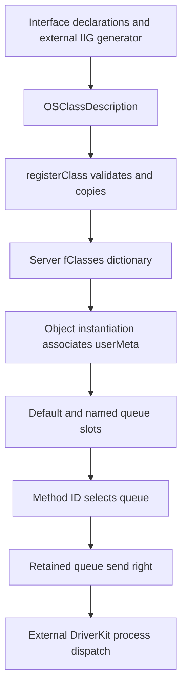
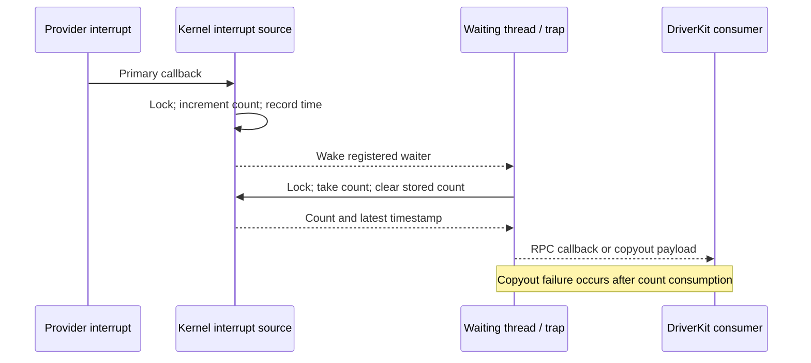

# DriverKit class dispatch, actions, and event sources

[Drivers](README.md) · [User-client and object lifetime](user-client-and-driverkit-lifetime.md) · [Shared queues and notifications](shared-data-queues-and-notifications.md) · [Service matching](service-matching-and-termination.md)

DriverKit's visible kernel machinery has three connected jobs: associate exported objects with class and queue metadata, route method invocations across Mach ports, and retain callback state until the relevant references disappear. This chapter follows those mechanisms in `IOUserServer.cpp`. The callback object here is named `OSAction`. The user-space queue scheduler, generated IIG dispatch bodies, and a complete timer-source implementation are outside this checkout; their interface declarations should not be mistaken for kernel implementations.

The [object-lifetime chapter](user-client-and-driverkit-lifetime.md) already follows typed object ports, no-senders generations, request/reply conversion, `message_moved`, and service-stop completion. Those transport rules apply to the objects below.

## 1. Interface declarations become class and method metadata

The `.iig` files declare classes, methods, object arguments, callback types, and routing attributes. The DriverKit makefile invokes an external `IIG` tool to emit headers and implementation files. Attributes such as `LOCAL`, `LOCALONLY`, `LOCALHOST`, `REPLY`, `TYPE`, and `TARGET` influence the generated interface. A method declaration therefore does not imply an ordinary C++ call with identical ownership on both sides. [Generation rules](../../../xnu/iokit/DriverKit/Makefile#L31), [tool invocation](../../../xnu/iokit/DriverKit/Makefile#L60), [action interface](../../../xnu/iokit/DriverKit/OSAction.iig#L40).

`OSClassDescription` contains a total description size, fixed-size class/superclass names, and offsets/sizes for method options, metaclass options, queue names, and method-name metadata. Its flags describe properties such as remote usability. `OSUserMetaClass` stores the copied description, a class-name symbol, local and user superclass associations, parsed queue names, and a method array. These are per-server registrations; they do not dynamically install an arbitrary new native kernel C++ class. [Description layout](../../../xnu/iokit/DriverKit/IORPC.h#L241), [kernel metadata](../../../xnu/iokit/Kernel/IOUserServer.cpp#L143).

`registerClass()` checks the fixed header and declared total size, checked-adds the queue-name and method-option ranges, checks their ends against the supplied size, applies overlap tests, requires method-option size to be a multiple of two 64-bit words, and requires terminated class names. It then copies the description and method data. Under `fLock`, it resolves the registered user superclass, rejects a duplicate name, and inserts the new object into `fClasses`. The dictionary retains the class; the raw-pointer overload returns a pointer backed by that ownership, while the `OSSharedPtr` overload explicitly retains its result. [Registration and publication](../../../xnu/iokit/Kernel/IOUserServer.cpp#L4412).

The method representation consists of `N` message IDs followed by `N` option words. Queue names are encoded as length-prefixed strings, parsed by `copyInStringArray()`, with a zero terminator. The parser rejects overlong allocations and invalid steps. Registration does not visibly establish every later invariant: for example, it copies method ordering without checking that the IDs are sorted, although queue lookup uses binary search. It also does not explicitly reject a null queue-name parser result before publication. Treat the generated-format contract and the checks actually present as separate facts. [String parser](../../../xnu/iokit/Kernel/IOUserServer.cpp#L2787), [method copy](../../../xnu/iokit/Kernel/IOUserServer.cpp#L4484).



`objectInstantiate()` resolves an exported object's user class and superclass chain, chooses the remotely usable class, and describes object/method/queue information in its reply. For a locally hosted service it installs `userMeta` and allocates the queue array, whose first slot is the default queue and following slots correspond to registered queue names. An inactive service is rejected except for the start path. Actions have additional handling: their target and creator server help determine routing, and reference-bearing action instances have a kernel-side representation. The function supplies transport metadata; it does not instantiate a user-space execution thread in XNU. [Instantiation](../../../xnu/iokit/Kernel/IOUserServer.cpp#L2907).

## 2. A dispatch queue is also a retained transport endpoint

`IODispatchQueue::Create_Impl()` allocates the kernel queue object. A queue named `Root` is attached to the current server obtained from IOKit thread-local state. `setRootQueue()` retains it and rejects a second installation. The kernel creation body does not interpret the supplied priority/options as scheduler settings. [Queue creation](../../../xnu/iokit/Kernel/IOUserServer.cpp#L2354), [root installation](../../../xnu/iokit/Kernel/IOUserServer.cpp#L4542).

The queue owns a send right for its server port. It can install that right only once:

[Queue-port installation](../../../xnu/iokit/Kernel/IOUserServer.cpp#L2388):
<!-- source-excerpt: ../../../xnu/iokit/Kernel/IOUserServer.cpp#L2388-L2399 -->
```cpp
IODispatchQueue::SetPort_Impl(
	mach_port_t port)
{
	if (MACH_PORT_NULL != ivars->serverPort) {
		return kIOReturnNotReady;
	}
	ivars->serverPort = ipc_port_copy_send_mqueue(port);
	if (ivars->serverPort == MACH_PORT_NULL) {
		return kIOReturnBadArgument;
	}
	return kIOReturnSuccess;
}
```

Queue destruction releases that send right. The local `OnQueue()` body simply returns false, which is a useful boundary marker: this kernel source is not the implementation of DriverKit's complete queue-affinity and block-scheduling runtime. A retained queue endpoint keeps routing state alive; it is not itself proof that its user process is still servicing messages. [Queue release and local stub](../../../xnu/iokit/Kernel/IOUserServer.cpp#L2409).

`IOService::SetDispatchQueue()` installs a default or registered named queue into the service's `queueArray` and retains it. `CopyDispatchQueue()` retains the returned queue; when the name is not among the class's known names, it can ask the provider. A known slot with no queue produces not-found. The setter's visible body is not a general replacement transaction: it assigns and retains without an old-slot release, so the expected setup protocol matters. [Service queue accessors](../../../xnu/iokit/Kernel/IOUserServer.cpp#L392).

For outbound RPC, `queueForObject()` starts with slot zero and searches the registered method IDs. The low eight bits of a matched method's option select a named queue:

[Method-specific queue choice](../../../xnu/iokit/Kernel/IOUserServer.cpp#L2888):
<!-- source-excerpt: ../../../xnu/iokit/Kernel/IOUserServer.cpp#L2888-L2894 -->
```cpp
			if (msgid == uvars->userMeta->methods[idx]) {
				option = uvars->userMeta->methods[uvars->userMeta->methodCount + idx];
				option &= 0xFF;
				if (option < uvars->userMeta->queueNames->count) {
					queue = uvars->queueArray[option + 1];
				}
				break;
```

A service with no queue array returns null while not stopped, but returns the special `kIODispatchQueueStopped` sentinel after stop. In `rpc()`, null can fall back to the server's root queue; the stopped sentinel must not. Under `gIOUserServerLock`, RPC selects the queue and copies its send right, then drops that lock before message transport. This reference acquisition prevents queue destruction from invalidating the endpoint pointer during the send preparation. A missing usable port produces `kIOReturnNotReady`. Queue availability, service stopping, Mach send failure, and remote method failure are different results. [Queue selection](../../../xnu/iokit/Kernel/IOUserServer.cpp#L2863), [RPC destination acquisition](../../../xnu/iokit/Kernel/IOUserServer.cpp#L3551).

## 3. Dispatch uses object identity, server context, and method identity

`IOUserServer::Invoke()` validates the RPC content, marks kernel-originated traffic, and decides whether to call a remote server or a local object's dispatch routine. Unless the message is constrained to the local host, server selection can come from the receiver, a service's user variables, an action's target/server, or other supported exported objects. A remote selection sets the remote flag and enters `rpc()`; local dispatch temporarily adjusts the IOKit thread-local server context. [Invocation selection](../../../xnu/iokit/Kernel/IOUserServer.cpp#L2430).

The inbound `server()` path imports object references, marks the message remote, clears its kernel-origin flag, and can replace an action receiver with its target. It sets thread-local server/allocation context around `kernelDispatch()`, then clears that context and performs object/port cleanup. `kernelDispatch()` handles the object-instantiation method specially and otherwise invokes the object's generated dispatch entry. Consequently, the 64-bit DriverKit method ID is distinct from the outer Mach message/version fields, and the imported receiver must have the expected native dispatch behavior. [Inbound dispatch](../../../xnu/iokit/Kernel/IOUserServer.cpp#L3243), [kernel dispatch](../../../xnu/iokit/Kernel/IOUserServer.cpp#L3149), [RPC representation](../../../xnu/iokit/DriverKit/IORPC.h#L57).

This is where `.iig` declarations connect to handwritten C++ bodies such as `SetHandler_Impl()`. Reconstructing every generated size check, argument conversion, and reply packer would require the generated files or generator implementation. The handwritten transport validation and cleanup are visible and are covered in [RPC lifetime](user-client-and-driverkit-lifetime.md#4-driverkit-message-dispatch-and-object-conversion).

## 4. An action retains a target and translates one callback method

`OSAction_IVars` stores the retained target, an incoming callback method ID (`msgid`), the method ID to invoke on the target (`targetmsgid`), optional retained creator server, an aborted-handler block, type name, private reference storage, and an aborted bit. The private bytes are zero-initialized at construction. Generated `CreateAction...` methods use this mechanism to bind a callback endpoint to a particular receiver method. [Action state](../../../xnu/iokit/Kernel/IOUserServer.cpp#L204), [interface contract](../../../xnu/iokit/DriverKit/OSAction.iig#L40).

Construction retains the target. For a remotely requested action whose target is not an `IOService`, it also captures and retains the current server from IOKit TLS; services already have server associations. Kernel-side typed construction looks up the named native metaclass and requires its immediate superclass to be `OSAction`. That is narrower than accepting an arbitrary descendant chain. Failures release partially allocated objects, symbols, and reference bytes. `free()` releases the handler block, target, type name, creator server, and reference storage. [Construction](../../../xnu/iokit/Kernel/IOUserServer.cpp#L1251), [destruction](../../../xnu/iokit/Kernel/IOUserServer.cpp#L1372).

`target()` only retargets a message when its method ID matches the action's callback ID and a target exists:

[Action method translation](../../../xnu/iokit/Kernel/IOUserServer.cpp#L3185):
<!-- source-excerpt: ../../../xnu/iokit/Kernel/IOUserServer.cpp#L3185-L3193 -->
```cpp
	if (message->msgid != action->ivars->msgid) {
		return action;
	}
	object = action->ivars->target;
	if (!object) {
		return action;
	}
	message->msgid      = action->ivars->targetmsgid;
	message->objects[0] = (OSObjectRef) object;
```

For a remote message, it also retains the replacement target and releases the imported action reference. This preserves the ownership slot consumed by subsequent dispatch cleanup. Calling this helper as if it returned an unrelated borrowed pointer would be wrong: its contract depends on the remote flag. If the IDs do not match, the action remains the receiver, allowing operations on the action itself. [Remote reference substitution](../../../xnu/iokit/Kernel/IOUserServer.cpp#L3194).

The local `GetReference()` asserts that nonzero reference storage exists. The broader interface describes null results in some user-space situations, but that should not be applied to this kernel body. Likewise, `SetAbortedHandler()` copies a block into the action; the visible body does not release a previous block, so repeated replacement is not a demonstrated protocol. [Reference and handler access](../../../xnu/iokit/Kernel/IOUserServer.cpp#L1391).

## 5. Aborted delivery, cancellation, and completion are separate events

The IOKit no-senders path checks the object-port association and make-send generation before acting. For a qualifying `IKOT_UEXT_OBJECT` action, it invokes `Aborted()`. The kernel body uses an atomic false-to-true transition to make handler invocation one-shot:

[One-shot abort notification](../../../xnu/iokit/Kernel/IOUserServer.cpp#L1405):
<!-- source-excerpt: ../../../xnu/iokit/Kernel/IOUserServer.cpp#L1405-L1415 -->
```cpp
void
OSAction::Aborted_Impl(void)
{
	if (!os_atomic_cmpxchg(&ivars->aborted, false, true, relaxed)) {
		// already aborted
		return;
	}
	if (ivars->abortedHandler) {
		ivars->abortedHandler();
	}
}
```

This callback signals the reference-lifetime event. It does not itself wait for hardware operations, drain a dispatch queue, or synchronize arbitrary callback state. The source-level guarantee is the atomic claim and the block invocation; the relaxed atomic does not establish a general publication protocol for driver-owned data. [No-senders bridge](../../../xnu/iokit/Kernel/IOUserClient.cpp#L264).

`OSAction.iig` also declares `Cancel()`, `WillWait()`, `Wait()`, and `EndWait()` as `LOCALONLY` operations. Their documented user-space contract includes waiting for outstanding callbacks and a single waiter. Those implementations are absent from this kernel file. Do not replace them conceptually with `Aborted_Impl()`, or infer that kernel action destruction implements the same cancellation barrier. [Cancellation/wait interface](../../../xnu/iokit/DriverKit/OSAction.iig#L111).

A concrete use is asynchronous external-method completion. `IOUserUserClient::externalMethod()` makes an extra send right for the caller's asynchronous wake port, creates a kernel completion action with private `IOUserUserClientActionRef` bytes, and copies the asynchronous reference into it. Its aborted handler releases that asynchronous-reference right and clears the stored reference:

[Completion-action cleanup](../../../xnu/iokit/Kernel/IOUserServer.cpp#L6596):
<!-- source-excerpt: ../../../xnu/iokit/Kernel/IOUserServer.cpp#L6596-L6604 -->
```cpp
		kr = action->SetAbortedHandler(^(void) {
			IOUserUserClientActionRef * ref;
			IOReturn ret;

			ref = (typeof(ref))action->GetReference();
			ret = releaseAsyncReference64(ref->asyncRef);
			assert(kIOReturnSuccess == ret);
			bzero(&ref->asyncRef[0], sizeof(ref->asyncRef));
		});
```

The method sends the action through `_ExternalMethod()` and releases its local action reference afterward. `KernelCompletion_Impl()` obtains the stored reference and sends the result through `sendAsyncResult64()`; sending a result is not where this action's retained asynchronous-reference right is released. Error and success tails also account for the original MIG argument right: the code distinguishes the right intended for action cleanup from the one associated with the incoming call. [External-method bridge](../../../xnu/iokit/Kernel/IOUserServer.cpp#L6568), [completion callback](../../../xnu/iokit/Kernel/IOUserServer.cpp#L6512), [result transport and port ownership](shared-data-queues-and-notifications.md#9-external-method-completion-is-a-separate-mach-message-protocol).

## 6. Interrupt sources transfer counts from interrupt context to a consumer

`IOInterruptDispatchSource_IVars` holds provider, interrupt index/flags/type, an interrupt-safe simple lock, a single waiter, accumulated count, last timestamp, retained action, and enabled/canceled flags. Creation queries the provider's interrupt type and registers a primary interrupt callback; successful registration retains the provider. The queue argument exists in the interface, but this kernel creation body does not use it to schedule a block. [State and creation](../../../xnu/iokit/Kernel/IOUserServer.cpp#L1457).

The primary callback does only the count/time/wakeup work under the source lock, with interrupts disabled, and disables a level-triggered interrupt:

[Primary interrupt recording](../../../xnu/iokit/Kernel/IOUserServer.cpp#L1482):
<!-- source-excerpt: ../../../xnu/iokit/Kernel/IOUserServer.cpp#L1482-L1493 -->
```cpp
	is = IOSimpleLockLockDisableInterrupt(ivars->lock);
	ivars->count++;
	ivars->time = (kIOInterruptSourceContinuousTime & ivars->flags)
	    ? mach_continuous_time() : mach_absolute_time();
	if (ivars->waiter) {
		thread_wakeup_thread((event_t) ivars, ivars->waiter);
		ivars->waiter = NULL;
	}
	if (kIOInterruptTypeLevel & ivars->interruptType) {
		ivars->provider->disableInterrupt(ivars->intIndex);
	}
	IOSimpleLockUnlockEnableInterrupt(ivars->lock, is);
```

The timestamp uses continuous time when requested, otherwise absolute time. A count greater than one represents coalesced occurrences; the single timestamp is the most recent recorded occurrence, not an array of timestamps. The callback wakes an existing waiter but does not directly run a driver's user-space action.

`CheckForWork_Impl()` consumes the count and timestamp while holding the lock. In synchronous mode, an empty source records `current_thread()` as its sole waiter and calls `assert_wait()` before unlocking; this closes the ordinary lost-wakeup window. Before blocking for a level interrupt, it can reenable the provider interrupt if logically enabled. `thread_block()` then waits outside the lock. Interruption clears the waiter, and the loop stops on an event or cancellation. If a count and action are available, it invokes `InterruptOccurred()` with that count/time through the RPC interface. The local `InterruptOccurred_Impl()` is empty; the `REPLY`/`TARGET` declaration describes the generated delivery role. [Consume/wait loop](../../../xnu/iokit/Kernel/IOUserServer.cpp#L1660), [interface](../../../xnu/iokit/DriverKit/IOInterruptDispatchSource.iig).



The specialized `waitInterruptTrap()` translates the caller's typed object port, retains the `IOInterruptDispatchSource`, and performs a similar interruptible wait. It returns aborted for cancellation/interruption without a count. A successful count is already removed from the source before payload copyout:

[Trap copyout and retained-object release](../../../xnu/iokit/Kernel/IOUserServer.cpp#L2240):
<!-- source-excerpt: ../../../xnu/iokit/Kernel/IOUserServer.cpp#L2240-L2249 -->
```cpp
	if (kIOReturnSuccess == ret) {
		int copyerr = copyout(&payload, (user_addr_t) p2, sizeof(payload));
		if (copyerr) {
			ret = kIOReturnVMError;
		}
	}

	object->release();

	return ret;
```

Thus an invalid destination address can produce `kIOReturnVMError` after consumption; there is no count requeue in this tail. This is an observable failure boundary, not an indication that the hardware event never happened. [Trap consume step](../../../xnu/iokit/Kernel/IOUserServer.cpp#L2204).

## 7. Source cancellation has a visible kernel portion and an external contract

`SetHandler_Impl()` retains the new action and attempts to release the previous action after a successful compare-and-swap to null. `SetEnableWithCompletion_Impl()` updates logical enable state and calls the provider's interrupt enable/disable method. The ordering differs by direction: enabling publishes state before the provider call, disabling calls the provider first. Provider failure is returned without a general state rollback. A request equal to the current enable value returns success before the canceled check. [Handler and enable](../../../xnu/iokit/Kernel/IOUserServer.cpp#L1583).

`Cancel_Impl()` marks canceled under the simple lock, wakes/clears a waiter, detaches the provider pointer, then unregisters the interrupt and releases the provider outside the lock. `free()` also unregisters/releases a still-attached provider, frees the lock, and frees state. The visible cancellation body does not invoke its completion-handler argument or release the stored action; the visible destructor also does not release that action. The API's full callback-release/completion protocol cannot therefore be established from these two kernel bodies alone. Keep the external/generated runtime boundary explicit instead of claiming a universal cancel-and-drain implementation. [Cancel](../../../xnu/iokit/Kernel/IOUserServer.cpp#L1633), [free](../../../xnu/iokit/Kernel/IOUserServer.cpp#L1565).

There are similarly bounded construction failures: a failed interrupt-type query releases the new source, while the shown registration-failure tail simply returns the provider error. This chapter records the implemented transitions rather than claiming all error cases have a symmetric teardown sequence. Hardware-family overrides and runtime behavior require their own inspection.

## 8. Service notifications combine pending arrays with retained registry objects

`IOServiceNotificationDispatchSource` registers matching and general-interest notifications and holds pending service arrays plus an interest-notifier dictionary. The matching callback restricts publication across servers using publisher/subscriber entitlements, records matches under its lock, and arranges interest notification for termination. The termination callback uses `taggedTryRetain()` because it may execute after notifier removal has begun. It removes the interest association and queues the terminated service before notifying the consumer outside the lock. [Creation and callbacks](../../../xnu/iokit/Kernel/IOUserServer.cpp#L1754).

`CopyNextNotification_Impl()` scans the pending arrays under the lock, retains the selected service, removes it from the array, and returns its notification type. The consumer consequently owns a returned service reference independently of the pending collection. Installing a handler retains the new action and releases the old one under the lock; if pending work already exists, notification occurs after unlocking. Free removes matching registration, detaches the interest dictionary under the lock, removes its notifiers outside the lock, and releases pending arrays/action/state. [Dequeue and destruction](../../../xnu/iokit/Kernel/IOUserServer.cpp#L1922).

The local source is deliberately incomplete as a general dispatch runtime: notification `Cancel_Impl()` and `DeliverNotifications()` return unsupported, and `CheckForWork_Impl()` returns not-ready. Although enable state is recorded, the inspected producer callbacks do not uniformly gate queueing/notification on that state. Kernel pending-object ownership can be traced here; complete user-space scheduling/cancellation behavior cannot. [Local source operations](../../../xnu/iokit/Kernel/IOUserServer.cpp#L2019).

A separate `IOServiceStateNotificationDispatchSource` uses an armed bit and state-notification listener, retaining an action for delivery outside its lock. This is another notification mechanism, not the classic shared-memory `IODataQueue`. This chapter surveys that boundary only. [State notification source](../../../xnu/iokit/Kernel/IOUserServer.cpp#L7215), [shared-memory queue protocols](shared-data-queues-and-notifications.md).

## 9. Authorization precedes usable class and queue routing

`IOUserServer::withTask()` requires the current task and rejects tasks not marked as driver tasks. It retains the owning task, copies entitlements, normally requires the DriverKit entitlement, records signing/platform information, and labels the task's IPC space as eligible for user-extension object ports. Debug options can change the entitlement checks. The user-client entitlement property is set to false because the DriverKit entitlement requirement is enforced elsewhere; that property alone is not proof of unrestricted server creation. [Server construction](../../../xnu/iokit/Kernel/IOUserServer.cpp#L4136).

The external-method table separately exposes class registration and server startup. Startup resolves a check-in token through `IKOT_IOKIT_IDENT` in the owning task's space, verifies its dynamic type, and binds it before exporting the server object. `setCheckInToken()` retains the token before calling `complete()` and clears registered task ports; a completion error does not undo that stored association. This is a launch-identity gate, distinct from method routing or a service's eventual registration. [External selectors](../../../xnu/iokit/Kernel/IOUserServer.cpp#L4556), [startup](../../../xnu/iokit/Kernel/IOUserServer.cpp#L4607), [binding](../../../xnu/iokit/Kernel/IOUserServer.cpp#L2618).

Under `gDriverKitLaunchLock`, token completion changes pending to complete and removes it from the pending-launch collection. It intentionally preserves cancellation handlers. `cancel()` can subsequently change a completed token to canceled and invoke those handlers, covering the interval between check-in and server registration. A token that is already canceled makes completion fail. “Checked in” is therefore not an irreversible declaration that a functioning service exists. [Token cancellation and completion](../../../xnu/iokit/Kernel/IOUserServer.cpp#L6713).

`checkEntitlements()` consumes its required-property reference. A string requires an entitlement's presence; a top-level array provides alternatives; a leaf array requires all its names. Presence is the visible test, not `value == true`. For provider matching, present entitlement values can be inserted into a copied matching dictionary and passed to `matchPropertyTable()`. Provider and driver requirements are checked separately. These checks complement the typed-port boundary and user-client-opening rules; they do not reconstruct external installation, signing, approval, or launch-daemon policy. [Entitlement aggregation](../../../xnu/iokit/Kernel/IOUserServer.cpp#L2651), [service matching](service-matching-and-termination.md), [code-signing boundary](../security/README.md).

## Sources inspected and limits

| Depth | Sources and mechanisms |
| --- | --- |
| Detailed | `IOUserServer.cpp`: class copy/registration, queue accessors/port lifetime/selection, object instantiation, invocation/target substitution, action create/free/abort, completion-action reference cleanup, interrupt create/enable/wait/cancel/free, matching notification queues, server entitlement/check-in token transitions |
| Interface and integration | `IORPC.h`, `OSAction.iig`, `IOInterruptDispatchSource.iig`, DriverKit generation makefile, IOKit no-senders action bridge; existing RPC and asynchronous-result guides cover transport ownership |
| Survey | State-notification dispatch source; no reconstruction of every DriverKit class or hardware provider |
| External or absent | IIG executable/generated implementation files, DriverKit user-space queue scheduling and action wait/cancel runtime, launch daemon/driver executable, complete `IOTimerDispatchSource` implementation. The timer forwarding header is present, but it is not the kernel `IOTimerEventSource` implementation |

The paths were read from source; no DriverKit process, driver, device interrupt, or kernel build was run. In particular, public callback contracts are identified separately from the smaller kernel bodies actually available here.
