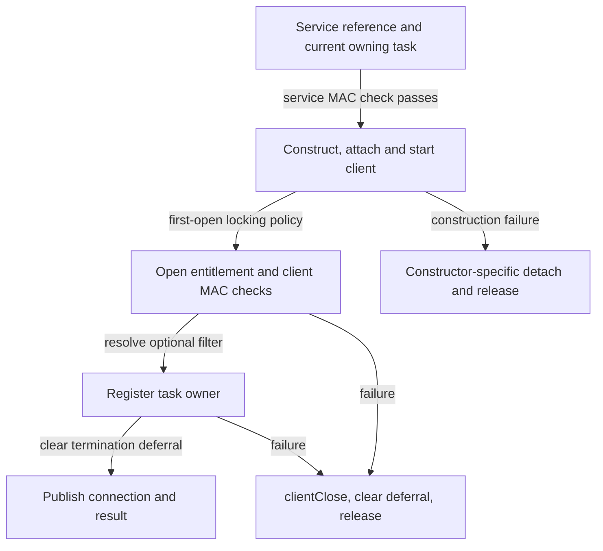
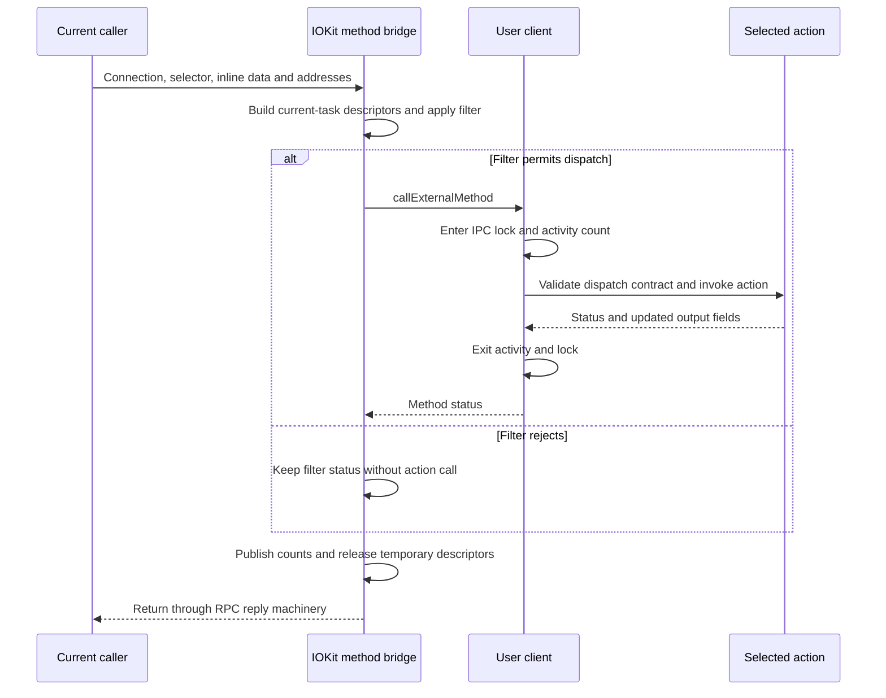

# External methods: connection admission, arguments and completion

[Drivers](README.md) · [User-client overview](user-clients-and-driverkit.md) · [Connection lifetime](user-client-and-driverkit-lifetime.md) · [Command dispatch](../../interfaces/command-dispatch-and-validation.md)

An IOKit external method starts with a connection, a selector and arguments, then crosses several independently meaningful boundaries: conversion of the connection port, current-caller policy, argument representation, method dispatch and provider execution. This chapter follows those boundaries in `xnu-12377.121.6`. Its concrete provider is the local `TestIOUserClient2022Entitlements` service; larger buffers and asynchronous results are traced through the common framework and the kernel-side DriverKit bridge. No unspecified hardware driver's implementation is assumed.

## 1. Keep the service, connection and calling task separate

A registry service is an `IOService`. Opening it asks for an `IOUserClient`, whose exported connection uses `IKOT_IOKIT_CONNECT`. The userspace port name, the kernel port, its `IOMachPort` wrapper and the C++ client are distinct objects. The `.defs` declaration selects `iokit_lookup_connect_port` for input conversion and `iokit_remove_connect_reference` for destruction of the converted reference. [`Connection conversion declaration`](../../../xnu/osfmk/device/device.defs#L133-L140).

The conversion looks up the expected kobject type under the port's message-queue lock and retains the wrapper before unlocking. `iokit_copy_object_for_consumed_kobject` then retains the exported object and consumes the wrapper reference. The routine can therefore hold an object reference independently of the lookup lock. This is the MIG port-conversion path; a raw-name lookup used by a direct trap is a separate entry. [`Typed conversion`](../../../xnu/osfmk/device/iokit_rpc.c#L89-L126), [`wrapper-to-object reference`](../../../xnu/iokit/Kernel/IOUserClient.cpp#L649-L671), [`converted-reference release`](../../../xnu/iokit/Kernel/IOUserClient.cpp#L587-L594).

| Role | Source-visible identity | How it affects the operation |
| --- | --- | --- |
| Service being opened | `_service`, checked as `IOService` | Selects `newUserClient`, the connection type and concrete client construction. |
| Opening task | `owningTask`, required to equal `current_task()` during open | Used for construction, open entitlement and filter resolution, and owner registration. |
| Current method caller | `current_task()` in the method entry | Selects the method filter record and the task whose virtual addresses describe large buffers. |
| Method target | `target` passed to the selected dispatch action | Chosen by the subclass; the local test passes `this`. It need not be a task. |
| Async destination | Kernel-held wake-port send right | Names the destination for a later completion message, independently of the synchronous reply. |

These roles remain explicit even when the same task fills the first two task roles in an ordinary call. The table is not a claim that connection rights are freely transferable: their kobject policy is declared separately. Nor does base `initWithTask` retain the opening task as a universal buffer owner; that base body initializes/reserves client state, while subclasses decide which task-derived resources to retain. [`Kobject declarations`](../../../xnu/osfmk/device/iokit_rpc.c#L76-L87), [`base initialization`](../../../xnu/iokit/Kernel/IOUserClient.cpp#L1651-L1675).

## 2. Open creates the client before all admission has completed

`is_io_service_open_extended` rejects a null or non-current owning task and performs the configured service-open MAC check. Non-null serialized open properties return unsupported in this snapshot; the following disabled XML parser is not an available input path. The routine then calls `service->newUserClient(owningTask, owningTask, connect_type, ...)`. [`Open entry`](../../../xnu/iokit/Kernel/IOUserClient.cpp#L4377-L4443).

The generic service constructor can delegate to DriverKit, try the older virtual constructor, or resolve `IOUserClientClass`. Its class-name path allocates a client, invokes `initWithTask`, attaches it to the provider and calls `start`. An init or attach failure releases the client; a start failure detaches and releases it. Successful `start` therefore precedes the remaining framework open checks. [`Constructor and rollback`](../../../xnu/iokit/Kernel/IOService.cpp#L8205-L8276).

The local test makes this sequence concrete. Its service publishes `TestIOUserClient2022EntitlementsUserClient` as the client class. The client's `start` enables all three default-locking properties and sets `IOUserClientEntitlements` to `com.apple.iokit.test-check-entitlement-open`. Its `clientClose` calls `terminate`. [`Service publication`](../../../xnu/iokit/Tests/TestServices/TestIOUserClient2022Entitlements.cpp#L13-L24), [`client start and close`](../../../xnu/iokit/Tests/TestServices/TestIOUserClient2022Entitlements.cpp#L26-L46).

After construction, the framework establishes creator/shared-instance state and, on first open, selects its locking policy. For `IOUserClient2022`, omission of any of the three locking properties records an error. Older clients have compatibility behavior, including the default chosen when no locking properties and no relevant IOSurface dependency are present. A property's presence and its boolean-false value affect this code differently. [`First-open policy`](../../../xnu/iokit/Kernel/IOUserClient.cpp#L4464-L4525).

The 2022 entitlement property is mandatory and must be an `OSString` or `kOSBooleanFalse`. False explicitly permits this entitlement step; a string names the entitlement checked against the opening task. This property check is followed by the configured client-open MAC check, optional filter resolution and owner registration. [`Entitlement and MAC checks`](../../../xnu/iokit/Kernel/IOUserClient.cpp#L4527-L4568), [`filter and owner registration`](../../../xnu/iokit/Kernel/IOUserClient.cpp#L4570-L4591).

The entitlement helper tests boolean entitlement success through the AMFI interface; it does not merely ask whether an arbitrary-valued entitlement exists. `IOCurrentTaskHasEntitlement` delegates to the same helper with the current task selected. The local query boundary is present; the entitlement provider's full implementation is not reconstructed here. [`Boolean query`](../../../xnu/iokit/bsddev/IOKitBSDInit.cpp#L1593-L1633).

On a later open failure, the framework calls `clientClose`, clears termination deferral, releases the client and publishes no connection. The successful path also clears deferral, then writes the connection and separate `result` output. `is_io_service_open_extended` has a transport return as well as this operation result; reaching its final `KERN_SUCCESS` return does not by itself mean open succeeded. [`Open completion`](../../../xnu/iokit/Kernel/IOUserClient.cpp#L4593-L4609), [`MIG outputs`](../../../xnu/osfmk/device/device.defs#L585-L593).



The diagram selects the ordinary class-construction path. Subclass constructors and DriverKit can implement additional work; the framework's later cleanup is not a promise that arbitrary provider side effects are undone.

## 3. The message describes bounded inline arrays and numeric user addresses

The common method declaration supplies scalar and small-structure arrays, plus separate addresses and sizes for larger structures:

[Source: osfmk/device/device.defs, lines 614–627](../../../xnu/osfmk/device/device.defs#L614-L627)

<!-- source-excerpt: ../../../xnu/osfmk/device/device.defs#L614-L627 -->
```text
routine io_connect_method(
	    connection		: io_connect_t;
	in  selector		: uint32_t;

	in  scalar_input	: io_scalar_inband64_t;
	in  inband_input	: io_struct_inband_t;
	in  ool_input		: mach_vm_address_t;
	in  ool_input_size	: mach_vm_size_t;

	out inband_output	: io_struct_inband_t, CountInOut;
	out scalar_output	: io_scalar_inband64_t, CountInOut;
	in  ool_output		: mach_vm_address_t;
	inout ool_output_size	: mach_vm_size_t
	);
```

The declarations bound the inline structure at 4096 bytes, each scalar array at 16 elements and the async reference array at eight elements. The kernel scalar representation is 64-bit. These are transport-array declarations, distinct from the exact counts required by a particular method. [`MIG array types`](../../../xnu/osfmk/device/device.defs#L93-L121), [`kernel C types`](../../../xnu/osfmk/device/device_types.h#L95-L108).

The names `ool_input` and `ool_output` do not mean these two parameters carry MIG out-of-line byte descriptors. In this declaration they are numeric `mach_vm_address_t` values. The receiving framework constructs IOKit memory descriptors for them. The variable-output operation uses a different declaration, `io_buf_ptr_t, physicalcopy`, for its returned bytes. [`Variable-output declaration`](../../../xnu/osfmk/device/device.defs#L703-L715).

`is_io_connect_method` checks that its converted object is an `IOUserClient`, initializes `IOExternalMethodArguments` and clears the synchronous call's async fields. Inline pointers refer to the call's marshalled argument storage. The bridge initializes output capacities from incoming counts and zeroes the scalar-output capacity before dispatch. The body does not similarly promise that every byte of inline structure output was initialized by this layer. [`Type check macro`](../../../xnu/iokit/Kernel/IOUserClient.cpp#L2390-L2394), [`argument initialization`](../../../xnu/iokit/Kernel/IOUserClient.cpp#L5151-L5172), [`output setup`](../../../xnu/iokit/Kernel/IOUserClient.cpp#L5194-L5208).

| Argument field | Meaning at method entry | Relevant unit |
| --- | --- | --- |
| `scalarInput`, `scalarInputCount` | Marshalled input values | Count of 64-bit scalar elements |
| `structureInput`, `structureInputSize` | Inline bytes and their length | Bytes |
| `structureInputDescriptor` | Optional descriptor of a large current-task input range | Descriptor length in bytes |
| `scalarOutput`, `scalarOutputCount` | Kernel output storage and supplied capacity, then method-reported count | Scalar elements |
| `structureOutput`, `structureOutputSize` | Inline output storage and supplied capacity, then method-reported length | Bytes |
| `structureOutputDescriptor`, `structureOutputDescriptorSize` | Optional large output range and returned length field | Bytes |
| `structureVariableOutputData` | Optional pointer through which the method supplies an output object | `OSObject` reference, not a user pointer |

The full representation is in [`IOExternalMethodArguments`](../../../xnu/iokit/IOKit/IOUserClient.h#L122-L154). A scalar that happens to contain an address is still a scalar until the concrete method interprets it; the common bridge does not recursively copy pointer-shaped fields from arbitrary input bytes.

## 4. Large buffers belong to the current call's address space

A nonzero large-input address requires a size greater than `sizeof(io_struct_inband_t)`. Large output has the same lower boundary and also rejects lengths greater than `UINT_MAX`. These checks return `kIOReturnIPCError` before dispatch. A nonzero address with a 4096-byte size therefore follows the rejection branch, not the large-buffer path. [`Representation checks`](../../../xnu/iokit/Kernel/IOUserClient.cpp#L5174-L5184).

Descriptor construction explicitly selects `current_task()` for both directions:

[Source: iokit/Kernel/IOUserClient.cpp, lines 5186–5203](../../../xnu/iokit/Kernel/IOUserClient.cpp#L5186-L5203)

<!-- source-excerpt: ../../../xnu/iokit/Kernel/IOUserClient.cpp#L5186-L5203 -->
```cpp
	if (ool_input) {
		inputMD = IOMemoryDescriptor::withAddressRange(ool_input, ool_input_size,
		    kIODirectionOut | kIOMemoryMapCopyOnWrite,
		    current_task());
	}

	args.structureInputDescriptor = inputMD;

	args.scalarOutput = scalar_output;
	args.scalarOutputCount = *scalar_outputCnt;
	bzero(&scalar_output[0], *scalar_outputCnt * sizeof(scalar_output[0]));
	args.structureOutput = inband_output;
	args.structureOutputSize = *inband_outputCnt;

	if (ool_output && ool_output_size) {
		outputMD = IOMemoryDescriptor::withAddressRange(ool_output, *ool_output_size,
		    kIODirectionIn, current_task());
	}
```

Input uses `kIODirectionOut | kIOMemoryMapCopyOnWrite`; output uses `kIODirectionIn`. The directions describe reads from and writes into host memory, while the COW option controls the descriptor's VM mapping path. An input user virtual address, a kernel pointer to an inline structure, an `IOMemoryDescriptor *` and a device DMA address are different representations. [`Descriptor options and backing`](memory-descriptors-and-cpu-mappings.md), [DMA preparation](dma-preparation-and-mapping.md).

`withAddressRange` packages one address/length pair and calls `withAddressRanges`. A supplied task selects virtual64 backing; absent task selects physical64 backing in that factory. The method bridge supplies a task and does not add `kIOMemoryAutoPrepare`, invoke `prepare` or produce DMA segments itself. Descriptor creation is therefore not a completed DMA transfer or a promise of indefinitely wired pages. [`Factory`](../../../xnu/iokit/Kernel/IOMemoryDescriptor.cpp#L1804-L1835), [complete buffer-to-DMA path](../../cross-cutting/user-buffer-to-dma-completion.md).

There is a source-specific boundary here: the common entry assigns the factory results into the argument record without a separate null-result error return. Dispatch checks later select descriptor length only when a descriptor is nonnull; otherwise they use the inline size. An explanation cannot insert a universal allocation-error branch that this body does not contain. Concrete methods must interpret the representation they actually receive. [`Assignments and call`](../../../xnu/iokit/Kernel/IOUserClient.cpp#L5186-L5218), [`2022 size selection`](../../../xnu/iokit/Kernel/IOUserClient.cpp#L6630-L6646).

After dispatch, both synchronous and asynchronous entries release their temporary descriptors. A concrete method that retains work beyond the call must establish the object, buffer and completion lifetimes required by that work. The stack argument record and its inline pointers are not an asynchronous request allocation. [`Synchronous release`](../../../xnu/iokit/Kernel/IOUserClient.cpp#L5220-L5232), [`asynchronous release`](../../../xnu/iokit/Kernel/IOUserClient.cpp#L5334-L5346).

## 5. Current-caller filtering precedes the client's method lock

The open path resolves a filter for the owning task when callbacks are installed. A resolver's `kIOReturnUnsupported` result is converted into success; a successful result is stored with `filterForTask`. At method entry, the lookup uses `current_task()` again. `filterForTask` searches a per-client linked list under `filterLock`, comparing task identities; it does not select one undifferentiated filter for every caller. [`Open resolution`](../../../xnu/iokit/Kernel/IOUserClient.cpp#L4570-L4586), [`filter records`](../../../xnu/iokit/Kernel/IOUserClient.cpp#L1906-L1940).

The bridge applies a filter only when a nonzero policy and an applier callback exist. It passes the selector and a distinct operation kind for synchronous methods, asynchronous methods or traps. If application returns an error, `callExternalMethod` is skipped, but the bridge still executes its count-publication and descriptor-release tail. The external-method filter runs before the default IPC lock is acquired inside `callExternalMethod`. [`Synchronous filter`](../../../xnu/iokit/Kernel/IOUserClient.cpp#L5210-L5231), [`async filter`](../../../xnu/iokit/Kernel/IOUserClient.cpp#L5324-L5345), [`operation kinds`](../../../xnu/iokit/IOKit/IOUserClient.h#L185-L198).

The callback registration body permits one successful installation and rejects a second with busy. The concrete filter provider determines the policy; neither callback names nor a stored policy value describe its internal decisions. Filter release occurs in user-client `free`, separately from each call's descriptor release. [`Registration`](../../../xnu/iokit/Kernel/IOUserClient.cpp#L6819-L6829), [`policy cleanup`](../../../xnu/iokit/Kernel/IOUserClient.cpp#L1954-L1966).

The selected method then enters the client's locking/activity protocol:

[Source: iokit/Kernel/IOUserClient.cpp, lines 6582–6596](../../../xnu/iokit/Kernel/IOUserClient.cpp#L6582-L6596)

<!-- source-excerpt: ../../../xnu/iokit/Kernel/IOUserClient.cpp#L6582-L6596 -->
```cpp
IOReturn
IOUserClient::callExternalMethod(uint32_t selector, IOExternalMethodArguments * args)
{
	IOReturn ret;

	ipcEnter(defaultLocking ? (defaultLockingSingleThreadExternalMethod ? kIPCLockWrite : kIPCLockRead) : kIPCLockNone);
	if (uc2022) {
		ret = ((IOUserClient2022 *) this)->externalMethod(selector, (IOExternalMethodArgumentsOpaque *) args);
	} else {
		ret = externalMethod(selector, args);
	}
	ipcExit(defaultLocking ? (defaultLockingSingleThreadExternalMethod ? kIPCLockWrite : kIPCLockRead) : kIPCLockNone);

	return ret;
}
```

| Client policy | Lock selected for an external method | Consequence |
| --- | --- | --- |
| Default locking disabled | None | The call still participates in `__ipc` activity counting. |
| Default locking enabled, single-thread methods disabled | Read lock | Multiple external methods can execute concurrently. |
| Default locking and single-thread methods enabled | Write lock | These calls serialize through this client lock. |

`ipcEnter` takes the requested lock and increments `__ipc`. `ipcExit` decrements it and, when the final active call leaves an inactive client with deferred finalization pending, schedules finalization before unlocking. A driver's workloop gate and private asynchronous work are separate from this counter. The local test's three true properties select the write-lock row. [`IPC entry/exit`](../../../xnu/iokit/Kernel/IOUserClient.cpp#L602-L647), [`finalization handshake`](../../../xnu/iokit/Kernel/IOUserClient.cpp#L673-L687), [connection lifetime](user-client-and-driverkit-lifetime.md#2-opening-a-connection-and-entering-a-method).

## 6. Dispatch validates a method contract, then calls its implementation

Legacy `IOUserClient::externalMethod` can receive a single `IOExternalMethodDispatch` selected by its subclass. It checks the declared scalar input/output counts and structure input/output sizes, then invokes `function(target, reference, args)`. This helper has no whole-table length argument with which to validate the subclass's selector calculation. If no dispatch entry is supplied, it follows the older target/method shims, which reject structure descriptors. [`Legacy dispatch`](../../../xnu/iokit/Kernel/IOUserClient.cpp#L6666-L6719), [`older shim routing`](../../../xnu/iokit/Kernel/IOUserClient.cpp#L6720-L6816).

`IOUserClient2022::dispatchExternalMethod` receives the complete table and its length. It rejects a null table and a selector at or beyond its length before indexing. For each of the four count/size fields it accepts the variable-size sentinel or requires equality. For a structure with a descriptor it checks `descriptor->getLength()`, otherwise the inline size. Output fields are checked against the capacity arriving at dispatch, not against bytes already produced. [`Bounds and shape checks`](../../../xnu/iokit/Kernel/IOUserClient.cpp#L6606-L6646), [`dispatch structures`](../../../xnu/iokit/IOKit/IOUserClient.h#L160-L176).

It then applies the async and current-task entitlement predicates:

[Source: iokit/Kernel/IOUserClient.cpp, lines 6648–6656](../../../xnu/iokit/Kernel/IOUserClient.cpp#L6648-L6656)

<!-- source-excerpt: ../../../xnu/iokit/Kernel/IOUserClient.cpp#L6648-L6656 -->
```cpp
	if (args->asyncWakePort && !dispatch->allowAsync) {
		return kIOReturnBadArgument;
	}

	if (dispatch->checkEntitlement) {
		if (!IOCurrentTaskHasEntitlement(dispatch->checkEntitlement)) {
			return kIOReturnNotPrivileged;
		}
	}
```

`allowAsync` is tested when `asyncWakePort` is nonzero. The per-method entitlement uses the current task's boolean entitlement query; it is independent of the named entitlement already checked against the opening task. If the action pointer exists, the helper calls it. An absent action produces `kIOReturnNoCompletion`, which permits a subclass to continue its own dispatch. [`Action call`](../../../xnu/iokit/Kernel/IOUserClient.cpp#L6658-L6664).

These checks establish a structural contract. They do not validate a length embedded inside a variable structure, an index into provider state, ownership of a provider-specific object, or an allowed hardware transition. Such meanings reside in the selected action and its callees. A subclass override can also implement a different dispatch path; the helper's checks apply when the subclass calls it.

### The supplied test has two actual method contracts

The test's override passes its whole table, computed length, `this` target and null reference to the 2022 helper. Selector 0 has no method entitlement; selector 1 requires an additional entitlement. Both require zero scalar/structure input and output sizes and prohibit async invocation. Both action bodies simply return success. This is a useful local admission example, not an implemented device command. [`Actions and full table`](../../../xnu/iokit/Tests/TestServices/TestIOUserClient2022Entitlements.cpp#L48-L85).

[Source: iokit/Tests/TestServices/TestIOUserClient2022Entitlements.cpp, lines 73–84](../../../xnu/iokit/Tests/TestServices/TestIOUserClient2022Entitlements.cpp#L73-L84)

<!-- source-excerpt: ../../../xnu/iokit/Tests/TestServices/TestIOUserClient2022Entitlements.cpp#L73-L84 -->
```cpp
		[1] {
			.function                 = &TestIOUserClient2022EntitlementsUserClient::extPerSelectorCheck,
			.checkScalarInputCount    = 0,
			.checkStructureInputSize  = 0,
			.checkScalarOutputCount   = 0,
			.checkStructureOutputSize = 0,
			.allowAsync               = false,
			.checkEntitlement         = "com.apple.iokit.test-check-entitlement-per-selector",
		},
	};

	return dispatchExternalMethod(selector, args, dispatchArray, sizeof(dispatchArray) / sizeof(dispatchArray[0]), this, NULL);
```

| Source-selected request to this table | Where the result is decided |
| --- | --- |
| Open without the required open entitlement | Common open rejects before publishing a usable connection. |
| Selector 0 with zero counts/sizes and no wake port | Shape checks pass; its action returns success without further provider work. |
| Selector 1 with the same shape, missing method entitlement | The 2022 helper returns not-privileged before the action. |
| Selector 2 | The two-entry table's bounds check returns bad-argument. |
| Either method with nonzero scalar output capacity | Exact count check rejects the capacity because the contract declares zero. |
| Either method with a nonzero async wake port | `allowAsync == false` rejects after the size checks. |

These rows describe the inspected implementation; section 10 distinguishes the supplied test's actual assertions. In particular, a larger output buffer is not automatically accepted when a dispatch entry requires an exact count.

## 7. Returning a method result does not undo published output

The ordinary bridge copies `args.scalarOutputCount`, `args.structureOutputSize` and `args.structureOutputDescriptorSize` back to its C out-parameters after either method dispatch or filter rejection. It then releases temporary descriptors and returns the chosen status. There is no common rollback of provider work, descriptor-backed writes or other action side effects. C out-parameter updates are evidence of bridge execution; the generated reply machinery determines what is ultimately delivered for a particular RPC result. [`Return tail`](../../../xnu/iokit/Kernel/IOUserClient.cpp#L5210-L5232).

The variable-output entry uses `structureVariableOutputData` to receive an object from the action. On successful action status it accepts `OSSerialize` or `OSData`; the latter is clipped for copyout. It records the object's length and calls `copyoutkdata`, which constructs a `vm_map_copy_t` from kernel bytes. A different or missing object produces underrun. The input descriptor and returned output object are released afterward, including failure paths. [`Variable-output conversion`](../../../xnu/iokit/Kernel/IOUserClient.cpp#L5099-L5128), [`VM-copy construction`](../../../xnu/iokit/Kernel/IOUserClient.cpp#L2406-L2425).

This path is distinct from writing into a caller-supplied large-output descriptor. Successful action execution can precede failure while preparing the variable output; the action's earlier effects are not reversed by releasing its output object. The `.defs` specifies a physical-copy reply, but its generated server/client code is not reproduced here.



The action arrow represents a selected method whose contract passed. Earlier representation, type and dispatch failures return without running the action; reply transport success is separate from the method's effect.

## 8. Async completion has a separate right and resource lifetime

`io_connect_async_method` supplies a `mach_port_make_send_t` wake port and an async reference array. The receiving entry rejects an empty reference array, replaces `reference[0]` with the kernel-held wake port and marks 64-bit callers using their current task's map. It fills the ordinary argument record, applies the async-method filter kind and calls the same external-method entry. Its descriptor-release tail still runs when that initial call finishes. [`Async declaration`](../../../xnu/osfmk/device/device.defs#L629-L644), [`reference setup`](../../../xnu/iokit/Kernel/IOUserClient.cpp#L5259-L5282), [`async dispatch and cleanup`](../../../xnu/iokit/Kernel/IOUserClient.cpp#L5324-L5346).

An asynchronous request therefore has at least two results: the immediate method status and any later completion notification. A successful immediate result is not evidence that the user consumed a completion, and a descriptor passed to the initial call is not automatically retained until that notification. Concrete implementations need their own retained request/completion state.

The local DriverKit bridge supplies a concrete ownership example. `IOUserUserClient::externalMethod` wraps inline input in no-copy `OSData` and, for an async wake port, makes an additional send right for a completion `OSAction`. It copies the async reference into action-owned storage. An aborted-handler block releases that reference's right and clears its stored bytes. [`Bridge and action creation`](../../../xnu/iokit/Kernel/IOUserServer.cpp#L6567-L6606).

It passes the action, structure descriptors and scalar arrays to `_ExternalMethod`, then drops its local input/action references. Returned ordinary structure output is checked against inline capacity before copying; variable structure output transfers the `OSData` reference to the outer bridge instead. The supplied base `_ExternalMethod_Impl` returns unsupported; concrete user-driver behavior and generated dispatch remain separate. [`Outbound call and output handling`](../../../xnu/iokit/Kernel/IOUserServer.cpp#L6608-L6638), [`base implementation`](../../../xnu/iokit/Kernel/IOUserServer.cpp#L6525-L6540).

The success tail releases the original MIG-created send-right ownership; an error returns before that release so MIG error cleanup handles it. This is separate from the additional right associated with the action. `KernelCompletion_Impl` obtains the action's stored reference and calls `sendAsyncResult64`; sending the result is not where the action's retained right is released. [`MIG ownership tail`](../../../xnu/iokit/Kernel/IOUserServer.cpp#L6640-L6652), [`completion callback`](../../../xnu/iokit/Kernel/IOUserServer.cpp#L6511-L6523), [action lifetime](driverkit-dispatch-and-actions.md#4-an-action-retains-a-target-and-translates-one-callback-method).

`_sendAsyncResult64` constructs a separate notification using `COPY_SEND`. A null destination succeeds without sending; too many completion arguments return message-too-large. It chooses a 32/64-bit message layout and leaves outgoing `reference[0]` zero instead of exposing its kernel-held port representation. The send returns transport status without waiting for application processing and does not consume the retained reference right. `releaseAsyncReference64` performs that release separately. [`Notification construction and send`](../../../xnu/iokit/Kernel/IOUserClient.cpp#L2297-L2385), [`reference release`](../../../xnu/iokit/Kernel/IOUserClient.cpp#L2236-L2247), [completion-message details](shared-data-queues-and-notifications.md#9-external-method-completion-is-a-separate-mach-message-protocol).

## 9. Close, final call exit and object destruction are different events

`is_io_service_close` uses an atomic transition of `closed` for a non-shared client; shared instances take the callback path independently. It enters write IPC locking, calls `clientClose` and exits. The wrapper does not return the callback's status: after this path it returns success. It also recognizes a surviving mappings-set object as a special successful close. [`Explicit close`](../../../xnu/iokit/Kernel/IOUserClient.cpp#L4612-L4635).

That write lock coordinates close with methods using the client's default read/write lock. It does not serialize an external method configured with no default lock, and it is not a wait for all driver-private asynchronous requests. The common `callExternalMethod` body does not itself reject a call merely by reading `closed`; a retained connection reference, admission to a method and provider readiness remain separate matters. [`Method locking body`](../../../xnu/iokit/Kernel/IOUserClient.cpp#L6582-L6596).

The local test's `clientClose` initiates `terminate`, whereas base `IOUserClient::clientClose` returns unsupported. A provider must supply its actual cancellation/resource-release behavior. No-senders invokes the client-death protocol, and IPC activity can defer finalization until the last entered call exits. Neither explicit close nor a successful completion message proves final C++ storage release. [`Test close`](../../../xnu/iokit/Tests/TestServices/TestIOUserClient2022Entitlements.cpp#L41-L46), [`base death and close`](../../../xnu/iokit/Kernel/IOUserClient.cpp#L1979-L1995), [complete teardown routes](user-client-and-driverkit-lifetime.md#3-three-different-connection-shutdown-routes).

| Lifetime ending | Resource or state that actually ends | What can remain |
| --- | --- | --- |
| Typed argument conversion cleanup | This call's C++ connection reference | Other references, exported ports, owner records and provider state |
| Common method return | Stack arguments and bridge-owned temporary descriptors | Explicitly retained descriptors or provider work |
| Async notification send | One attempt to send completion data | The retained async-reference right and application processing |
| `clientClose` callback return | Provider-specific close operation | Other connections, mapped exports, calls or deferred work as defined by the provider |
| Final inactive IPC exit | Deferred-finalization admission can be released | Remaining object references and later lifecycle callbacks |

These boundaries connect to [memory descriptor ownership](memory-descriptors-and-cpu-mappings.md), [driver workloops](workloop-and-power-protocols.md) and [connection finalization](user-client-and-driverkit-lifetime.md); none should be replaced by one generic “the handle was closed” event.

## 10. What the local test and this review establish

The test service bodies compile only under `DEVELOPMENT || DEBUG`; the source file is selected with `iokitcpp`. The userspace helper requests creation through `kern.iokit_test_service_setup`, then searches for the service. The test therefore depends on a suitable test-enabled kernel and service-management authorization; source presence alone does not make the service available on a product kernel. [`Source guard`](../../../xnu/iokit/Tests/TestServices/TestIOUserClient2022Entitlements.cpp#L1-L11), [`build selection`](../../../xnu/iokit/conf/files#L96-L111), [`service helper`](../../../xnu/tests/iokit/service_helpers.c#L13-L46).

`IOUserClient2022_entitlements.c` has two source-selected cases. With `OPEN_ENTITLED`, it asserts successful open and a non-success result from selector 1. Without it, it asserts that open does not succeed. The supplied entitled manifest grants the open entitlement but omits the selector entitlement; the unentitled manifest grants only test-service management. The test compares failure with success rather than asserting a particular errno/IOReturn. Its assertion label says “method 2,” but the call's selector argument is 1. [`Test body`](../../../xnu/tests/iokit/IOUserClient2022_entitlements.c#L20-L40), [open-entitled manifest](../../../xnu/tests/iokit/IOUserClient2022_entitlements.entitlements), [other manifest](../../../xnu/tests/iokit/IOUserClient2022_unentitled.entitlements).

The inspected test does not assert selector 0 success, table-bound rejection, output-capacity mismatch, descriptor lifetime, async completion, call/close races or permission changes between open and call. The corresponding descriptions above come from implementation bodies, with those cases kept separate from test evidence. The test was read, not run.

| Review area | Evidence and boundary |
| --- | --- |
| Connection conversion and transport | `device.defs`, C types and local conversion/destructor helpers; generated MIG server/client C and the external IOKit userspace framework were not built or reconstructed. |
| Common call path | Open policy, task-filter lookup, sync/async/variable-output bridges, default IPC locking, legacy and 2022 dispatch, close and selected completion bodies. |
| Concrete provider | The development/debug entitlement test, including its complete two-method table and close callback; its actions perform no device or buffer work. |
| Large memory | Current-task descriptor creation, representation checks and bridge release; VM backing and DMA mechanisms continue in the linked chapters. |
| DriverKit async | Local action creation, reference ownership, output conversion and completion callback; the external driver and generated `_ExternalMethod` transport bodies remain outside this trace. |
| Policy/configuration | `CONFIG_MACF`, 2022 opt-in, default-locking properties, callback registration and boolean entitlement query are explicit. External MAC, filter and AMFI implementation decisions are not inferred. |

The reviewed path does not include every pre-Leopard shim, every selector override, `iokit_user_client_trap`, arbitrary notification registrations, or all user-memory mapping APIs. No live IOKit method, kernel build or kernel test was executed.

<!-- BEGIN PLATYDOC DOCUMENTATION LICENSE -->
Original Platydoc text and diagrams are licensed under [CC BY 4.0](https://creativecommons.org/licenses/by/4.0/). Quoted source code and third-party material retain their respective licenses.
<!-- END PLATYDOC DOCUMENTATION LICENSE -->
