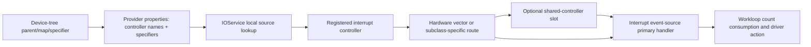

# Interrupt routing, deferred handlers, and command ownership

[Drivers](README.md) · [Workloops and power](workloops-and-power.md) · [Workloop lifetime protocols](workloop-and-power-protocols.md) · [Platform interrupts](../platform/README.md)

An IOKit interrupt number is initially local to the provider service: source index zero on one nub need not identify the same hardware vector as index zero on another. Registration resolves that index through registry properties into a controller and an opaque specifier. The controller can introduce a shared-vector layer before dispatching an interrupt event source. The event source then separates primary interrupt work from the action executed under a workloop gate. These are distinct translations and execution contexts. [`IOService::lookupInterrupt`](../../../xnu/iokit/Kernel/IOService.cpp#L8825), [`IOInterruptController::registerInterrupt`](../../../xnu/iokit/Kernel/IOInterruptController.cpp#L56), [`IOInterruptEventSource::checkForWork`](../../../xnu/iokit/Kernel/IOInterruptEventSource.cpp#L317)

This chapter also examines `IOCommandPool` and the legacy `IOCommandQueue`. The pool transfers command objects through a gate; the queue transfers four untyped fields through a bounded ring. **The entire queue implementation is excluded under `__LP64__` and its header methods are deprecated.** Its presence in the source tree must not be presented as a current 64-bit kernel queue mechanism. [`IOCommandQueue.cpp` build guard](../../../xnu/iokit/Kernel/IOCommandQueue.cpp#L31), [`deprecated API`](../../../xnu/iokit/IOKit/IOCommandQueue.h#L67)

## 1. Resolve a provider-local index before discussing vectors

`IOService::resolveInterrupt` reads the provider nub's `IOInterruptControllers` array. On its first invocation it allocates `_interruptSources` and the parallel private source array, records the count, and returns. `lookupInterrupt` then validates the requested local index and, when resolution is allowed, calls back to resolve that entry. Resolution takes the controller-name symbol at the same index, finds the controller through the platform expert, and reads the matching `IOInterruptSpecifiers` `OSData`. The result is cached in `IOInterruptSource`. [`resolveInterrupt`](../../../xnu/iokit/Kernel/IOService.cpp#L8760), [`lookupInterrupt`](../../../xnu/iokit/Kernel/IOService.cpp#L8825)

This lookup can wait. `IOPlatformExpert::lookUpInterruptController` sleeps on the controller dictionary until the named object appears; registration inserts under `gIOInterruptControllersLock` and wakes sleepers. The registry's descriptive controller name can therefore precede the controller driver's availability. It is not a constant-time lookup suitable for arbitrary interrupt-context execution. [`controller registration and lookup`](../../../xnu/iokit/Kernel/IOPlatformExpert.cpp#L419)

The generic service wrappers then delegate registration/type/enable/disable/cause to that controller with the original nub and local source. Registration and type query allow resolution; enable, disable, cause and unregister require an existing resolved entry. Event sources typically call these methods on the provider passed at initialization, rather than interpreting device-tree specifier bytes themselves. [`registerInterrupt`](../../../xnu/iokit/Kernel/IOService.cpp#L8861), [`enable/disable/cause`](../../../xnu/iokit/Kernel/IOService.cpp#L9162)

Device-tree mapping is an earlier translation. `IODTMapOneInterrupt` follows the interrupt parent, obtains address/interrupt cell counts, optionally matches `interrupt-map` entries under `interrupt-map-mask`, and stops when it reaches a controller entry. It returns a specifier and controller name; it deliberately does not continue through a cascaded controller's own upstream connection. `IODTGetInterruptOptions` compares specifiers against recorded shared interrupt information. Firmware encoding, controller-specific interpretation and physical register layout are different layers. [`IODTMapOneInterrupt`](../../../xnu/iokit/Kernel/IODeviceTreeSupport.cpp#L618), [`IODTGetInterruptOptions`](../../../xnu/iokit/Kernel/IODeviceTreeSupport.cpp#L748)



## 2. Vector state is separate from device state

`IOInterruptVector` contains an active flag, soft/hard disabled flags, registered flag, registration mutex, nub/source, target/handler/refCon and optional shared controller. The callback triple is stored as pointers; this registration body does not retain the arbitrary target object. The driver's surrounding ownership protocol must preserve it until callbacks can no longer use it. [`IOInterruptVector`](../../../xnu/iokit/IOKit/IOInterruptController.h#L45), [`registration assignment`](../../../xnu/iokit/Kernel/IOInterruptController.cpp#L208)

The generic controller reads its vector number from the nub's `vectorData`, locks that vector, and asks subclass hooks whether sharing is possible and what initialization/type is required. An already registered non-shareable vector fails with `kIOReturnNoResources`. A new ordinary registration stores callback state, initializes the vector, then marks it registered and both soft/hard disabled. Registration success is not enablement. [`IOInterruptController::registerInterrupt`](../../../xnu/iokit/Kernel/IOInterruptController.cpp#L56)

Soft disable records the client's request and, when outside interrupt level, spins until `interruptActive` is clear. In the generic implementation it does **not** directly call the hardware-mask hook. Enable clears soft disable, waits for an active handler when appropriate, and if hard-disabled clears that state, performs `OSSynchronizeIO`, and invokes `enableVector`. The source explains why the hardware ordering needs more than a CPU data-memory barrier on ARM: callback data must be visible before MMIO enables interrupt delivery. [`enableInterrupt`](../../../xnu/iokit/Kernel/IOInterruptController.cpp#L296), [`disableInterrupt`](../../../xnu/iokit/Kernel/IOInterruptController.cpp#L337)

[Order initialized vector state before hardware enable](../../../xnu/iokit/Kernel/IOInterruptController.cpp#L318-L330)

<!-- source-excerpt: ../../../xnu/iokit/Kernel/IOInterruptController.cpp#L318-L330 -->
```cpp
		if (vector->interruptDisabledHard) {
			vector->interruptDisabledHard = 0;

			// A DSB ISH on ARM is needed to make sure the vector data are
			// properly initialized before the MMIO enabling the interrupts
			// in hardware. OSMemoryBarrier(), which maps to DMB, is not
			// sufficient here as the CPUs are not consumers of the device
			// write. Hence, the DMB does not guarantee the CPUs won't see an
			// interrupt before it initalizes the vector data properly.
			OSSynchronizeIO();

			enableVector(vectorNumber, vector);
		}
```

Unregister takes the vector mutex, soft-disables, explicitly invokes `disableVectorHard`, and clears callback/registration state. The active-handler wait is conditional on not being at interrupt level, so this should not be generalized into “unregister is an unconditional callback drain in any context.” Subclasses supply the interrupt entry and hardware behavior that complete the protocol. The base `handleInterrupt` returns invalid and the base hardware hooks are empty; base `vectorCanBeShared` returns false. [`unregisterInterrupt`](../../../xnu/iokit/Kernel/IOInterruptController.cpp#L230), [`subclass hooks`](../../../xnu/iokit/Kernel/IOInterruptController.cpp#L381)

Block registration adds an explicit ownership layer: `IOService::registerInterruptBlock` copies the block, releases it on registration failure, and stores it in private source state on success. Successful unregister releases and clears the stored block. This block retention does not mean every object passed to a raw function-pointer registration receives the same treatment. [`registerInterruptBlock`](../../../xnu/iokit/Kernel/IOService.cpp#L8887), [`unregisterInterrupt`](../../../xnu/iokit/Kernel/IOService.cpp#L8910)

## 3. Sharing inserts another controller and changes the nub's route

When sharing is requested or an existing shareable vector needs another consumer, the generic controller creates `IOSharedInterruptController`. If an original consumer exists, it temporarily hard-disables the physical vector, initializes the shared controller, migrates that consumer's registration, and replaces the parent vector callback with the shared controller's handler. The failure branches restore the original route/enable state as appropriate. This is a live restructuring of the routing chain, not simply appending a second callback to the same original nub entry. [`shared-controller construction/migration`](../../../xnu/iokit/Kernel/IOInterruptController.cpp#L104)

The shared controller presents one upstream source referring to the parent controller/specifier, which it retains during initialization. It allocates a fixed set of sub-vectors with per-vector locks and a controller simple lock. Registering a consumer finds a free sub-vector, creates new `OSData` containing that local sub-vector number, and rewrites the consumer nub's `_interruptSources[source]` to point at the shared controller. The parent physical vector remains the route into this fan-out. [`initInterruptController`](../../../xnu/iokit/Kernel/IOInterruptController.cpp#L525), [`shared registerInterrupt`](../../../xnu/iokit/Kernel/IOInterruptController.cpp#L594)

Each sub-vector has its own soft-enable state. `vectorsRegistered`, `vectorsEnabled` and `controllerDisabled` track aggregate readiness. Enabling a child increments the enabled count under the controller lock; the upstream source is enabled once all registered children are enabled. The shared handler marks each examined vector active, checks soft-disable/registration, invokes its callback, and clears active. At the end, if enabled and registered counts differ, it disables the upstream source and records that aggregate state. A filtered consumer can reject an interrupt without producing deferred work; the shared handler itself visits enabled registered consumers. [`shared enable/disable`](../../../xnu/iokit/Kernel/IOInterruptController.cpp#L734), [`shared handleInterrupt`](../../../xnu/iokit/Kernel/IOInterruptController.cpp#L808)

Unregistration scans for matching nub/source, disables the sub-vector, releases its generated specifier, clears its callback state and decrements the registered count. It may re-enable upstream if the remaining registration/enable counts now agree. Do not assume that removing one consumer tears down the original physical controller or immediately destroys the shared-controller object: that is not what this method does. [`shared unregisterInterrupt`](../../../xnu/iokit/Kernel/IOInterruptController.cpp#L670)

## 4. A concrete CPU-controller boundary differs from generic hardware hooks

`IOCPUInterruptController` supplies a visible adapter between machine interrupt installation and IOKit callbacks. Initialization permanently allocates the vector array and per-vector locks. `setCPUInterruptProperties` constructs parallel controller/specifier arrays when the service does not already supply them. `enableCPUInterrupt` installs a handler through `ml_install_interrupt_handler`, increments the enabled-CPU count, and wakes registration waiters when all expected CPUs are ready. [`CPU-controller initialization and properties`](../../../xnu/iokit/Kernel/IOCPU.cpp#L604), [`enableCPUInterrupt`](../../../xnu/iokit/Kernel/IOCPU.cpp#L680)

Its registration override asserts interrupts are enabled because registration can allocate/block, stores the callback under a vector lock, and can wait for CPU readiness. Its entry handler dispatches the registered vector callback. Its enable/disable methods in this file are no-ops, while cause invokes `ml_cause_interrupt`; therefore the generic controller's enable/mask explanation cannot be applied indiscriminately to every subclass. The low-level exception-vector and physical interrupt-controller programming belongs to [platform execution](../platform/README.md) and the platform-specific implementations present or externally supplied for the build. [`CPU registerInterrupt`](../../../xnu/iokit/Kernel/IOCPU.cpp#L699), [`CPU controller dispatch overrides`](../../../xnu/iokit/Kernel/IOCPU.cpp#L752)

## 5. Filtering and counted delivery cross execution contexts

`IOInterruptEventSource::init` stores its provider without retaining it and explicitly assumes the owner holds the provider alive. It initializes producer/consumer counters and uses a complemented negative index to represent an unregistered index. Registration asks the provider for type, chooses the normal or auto-disable handler, and registers the event source as the callback target. The actual auto-disable test is equality to `kIOInterruptTypeLevel`, so do not silently rewrite it as an arbitrary capability-bit predicate. [`init`](../../../xnu/iokit/Kernel/IOInterruptEventSource.cpp#L82), [`registerInterruptHandler`](../../../xnu/iokit/Kernel/IOInterruptEventSource.cpp#L131)

The primary normal handler increments the producer count and signals work. The auto-disable variant first calls the provider's disable operation. Later `checkForWork` snapshots the producer count, subtracts the consumer count, and invokes the action under the workloop's execution protocol; multiple arrivals can be combined into one callback. It updates the consumer to the captured count, then re-enables an auto-disabled source unless the driver explicitly disabled it. This implementation also handles a negative signed difference with an action path; a callback count should not be interpreted as a universally unbounded, exact hardware-event history. [`primary handlers`](../../../xnu/iokit/Kernel/IOInterruptEventSource.cpp#L447), [`checkForWork`](../../../xnu/iokit/Kernel/IOInterruptEventSource.cpp#L317)

`IOFilterInterruptEventSource` runs its filter in the primary path. The normal variant only calls `signalInterrupt` if the filter returns true. The auto-disable variant similarly disables the provider and signals only after a true filter result; a rejected interrupt does not take that disable branch. This is useful for a shared line whose current assertion belongs to another device. The filter is not running with the later workloop gate merely because its eventual action does. Sleeping, taking inappropriate blocking locks or using state whose lifetime depends solely on a deferred action would cross the wrong context boundary. [`normal filter`](../../../xnu/iokit/Kernel/IOFilterInterruptEventSource.cpp#L209), [`auto-disable filter`](../../../xnu/iokit/Kernel/IOFilterInterruptEventSource.cpp#L265)

[Only an accepted filtered interrupt disables and schedules](../../../xnu/iokit/Kernel/IOFilterInterruptEventSource.cpp#L308-L311)

<!-- source-excerpt: ../../../xnu/iokit/Kernel/IOFilterInterruptEventSource.cpp#L308-L311 -->
```cpp
	if (filterRes) {
		prov->disableInterrupt(source); /* disable the interrupt */
		signalInterrupt();
	}
```

Removing an event source from a workloop invokes its `setWorkLoop(nullptr)` behavior, which unregisters before clearing the association and complements the index. The source explicitly says waiting until `free` may be too late because the provider could disappear. Reattachment can re-register. `free` also unregisters if still registered. Use this together with the [workloop source-removal protocol](workloop-and-power-protocols.md), which covers gate serialization and membership references; provider lifetime and source membership solve different problems. [`setWorkLoop`](../../../xnu/iokit/Kernel/IOInterruptEventSource.cpp#L272), [`free`](../../../xnu/iokit/Kernel/IOInterruptEventSource.cpp#L231)

## 6. Command pools transfer retained objects through a gate

`IOCommandPool::initWithWorkLoop` initializes an empty intrusive queue, creates a command gate owned by the pool, and adds it to the supplied workloop. It creates no command objects. The obsolete initializer's owner and size arguments are ignored by its current body, which simply calls `initWithWorkLoop`. The header's historical semaphore/size overview should not override this implementation. [`pool initialization`](../../../xnu/iokit/Kernel/IOCommandPool.cpp#L75), [`obsolete initializer`](../../../xnu/iokit/Kernel/IOCommandPool.cpp#L117)

| Operation | Ownership and synchronization |
|---|---|
| Populate / `returnCommand` | The header marks the pointer `LIBKERN_CONSUMED`; the call transfers an existing owned reference into the pool. The body inserts the command's intrusive link and does not add a new retain. |
| `getCommand(false)` | Runs the gated dequeue; returns no resource/null if empty. Successful dequeue adopts the pointer using `OSNoRetain`, transferring the existing reference back into an `OSSharedPtr`. |
| `getCommand(true)` | Waits for queue availability through `commandSleep`, releasing and reacquiring the gate while sleeping. The dequeue loop rechecks emptiness. |
| Pool destruction | Removes/releases its serializer. The shown `free` does not enumerate and release queued commands. Its owner must arrange command and waiter teardown separately. |

[`consumed return API`](../../../xnu/iokit/IOKit/IOCommandPool.h#L181), [`getCommand`](../../../xnu/iokit/Kernel/IOCommandPool.cpp#L153), [`gatedGetCommand`](../../../xnu/iokit/Kernel/IOCommandPool.cpp#L176), [`free`](../../../xnu/iokit/Kernel/IOCommandPool.cpp#L129)

[A successful dequeue adopts the existing command reference](../../../xnu/iokit/Kernel/IOCommandPool.cpp#L155-L166)

<!-- source-excerpt: ../../../xnu/iokit/Kernel/IOCommandPool.cpp#L155-L166 -->
```cpp
	IOReturn     result  = kIOReturnSuccess;
	IOCommand *command = NULL;

	IOCommandGate::Action func = OSMemberFunctionCast(
		IOCommandGate::Action, this, &IOCommandPool::gatedGetCommand);
	result = fSerializer->
	    runAction(func, (void *) &command, (void *) blockForCommand);
	if (kIOReturnSuccess == result) {
		return OSSharedPtr<IOCommand>(command, OSNoRetain);
	} else {
		return NULL;
	}
```

The pool is LIFO in this implementation: return inserts at the first position and get removes the first position. Empty blocking acquisition increments `fSleepers` and sleeps uninterruptibly on its address. Returning a command wakes one sleeper and decrements the count. This is a gate/wakeup protocol, not an invocation of a command's work method. A command pool itself neither executes I/O nor determines when an outstanding hardware operation has completed; the consumer returns a command when its own operation lifecycle permits reuse. [`gatedGetCommand`](../../../xnu/iokit/Kernel/IOCommandPool.cpp#L176), [`gatedReturnCommand`](../../../xnu/iokit/Kernel/IOCommandPool.cpp#L214)

The public blocking-get comment promises a command, but the wrapper still checks `runAction`'s return and can return null if entering/executing the gate fails. The destructor also does not visibly provide a cancellation protocol for every sleeping borrower. Read the implementation together with driver shutdown ordering instead of inferring a self-contained pool shutdown facility from the class name. [command-gate failure/lifetime](workloop-and-power-protocols.md), [`getCommand`](../../../xnu/iokit/Kernel/IOCommandPool.cpp#L153)

## 7. The legacy command ring has a different capacity and completion model

Under the non-LP64 build guard, `IOCommandQueue` allocates `inSize + 1` entries but initializes its producer semaphore to `inSize`. The spare ring slot distinguishes empty from full. Each entry is exactly four `void *` fields. A producer reserves capacity first—waiting with bounded retries for selected semaphore errors, or using a zero-time wait—then serializes with `producerLock`, stores all fields, advances/wraps the producer index, unlocks and signals the workloop. No field is retained or copied as an object. [`queue initialization`](../../../xnu/iokit/Kernel/IOCommandQueue.cpp#L85), [`enqueueCommand`](../../../xnu/iokit/Kernel/IOCommandQueue.cpp#L219)

The nonblocking-capacity option does not make the whole method an interrupt-safe operation: it still takes `producerLock`. Nor is queueing equivalent to a command-gate action: the producer returns after enqueueing, and the workloop later consumes an entry. The action's object/reference contract must be agreed by producer and consumer because the ring only transports raw values. [`enqueueCommand`](../../../xnu/iokit/Kernel/IOCommandQueue.cpp#L219)

`checkForWork` checks enabled/empty state, copies the four fields to locals, returns a capacity token to the producer semaphore, advances the consumer index, then invokes the configured action. Capacity therefore becomes available before the action completes. Queue slots measure unconsumed entries, not the number of device operations still in flight. Its return asks the workloop to scan again when more entries remain. [`checkForWork`](../../../xnu/iokit/Kernel/IOCommandQueue.cpp#L160)

`performAndFlush` is explicitly restricted by the header to the appropriate workloop-thread context. It drains available semaphore tokens, walks queued entries invoking a chosen or default action, and refills capacity. This should not be described as a universal concurrent producer/callback cancellation primitive. The body's `numEntries` variable is initialized but not incremented in the displayed loop, so do not use its return as documented proof of the number of actions performed without considering this implementation detail. `free` releases the ring, semaphore and lock; it does not dispose of objects referenced by pending fields. [`performAndFlush`](../../../xnu/iokit/Kernel/IOCommandQueue.cpp#L276), [`context requirement`](../../../xnu/iokit/IOKit/IOCommandQueue.h#L83), [`free`](../../../xnu/iokit/Kernel/IOCommandQueue.cpp#L140)

## 8. Read a driver's complete callback lifetime

For a concrete driver, follow this chain: controller registration and provider retention → event-source registration → workloop membership → source enable → primary/filter access → deferred action → explicit disable/unregister and source removal → release of callback state. For command objects, add producer-to-queue or caller-to-pool reference transfer and the actual device-completion point before reuse. These chains explain why an interrupt source, a command gate, a command pool and a hardware completion callback cannot substitute for one another.

Sources inspected and limits:

| Source | Inspection |
|---|---|
| `IOService.cpp`, `IOPlatformExpert.cpp`, `IODeviceTreeSupport.cpp` | Deep selected local-source resolution, controller registration/waiting, block ownership, DT single-interrupt mapping and sharing options. Firmware encodings and every platform path not audited. |
| `IOInterruptController.cpp/.h` | Deep ordinary/shared registration, enable/disable, handler, unregister and pointer/lock state; empty subclass hooks identified. |
| `IOCPU.cpp` | CPU-controller registration, properties, machine-handler installation and dispatch overrides. Hardware-controller register programming outside this selected path. |
| Interrupt/filter event-source bodies | Deep provider/index lifetime, handler selection, counted delivery, filter acceptance and teardown. Workloop internals are in the existing protocol chapter. |
| `IOCommandPool.cpp/.h`, `IOCommandQueue.cpp/.h` | Complete small pool/ring bodies and API ownership/build limits; no hardware consumer benchmark or runtime workload executed. |
