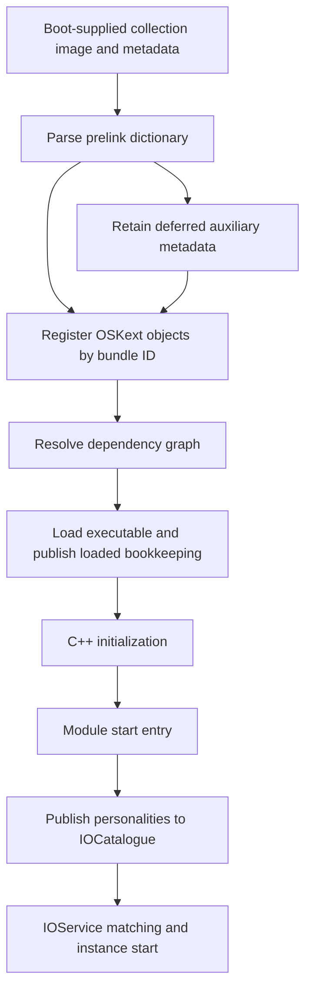

# Kernel collections and OSKext load, start and unload

[Driver guide](README.md) · [Object runtime](object-runtime-and-collections.md) · [Serialization](serialization-and-property-transport.md) · [Matching and termination](service-matching-and-termination.md)

An `OSKext` describes a module and its executable dependencies; an `IOService` is a runtime service instance; a kernel collection is an image containing kernel/module material and metadata. Registering metadata, making executable code available, starting a module and matching a driver are separate transitions. This chapter follows the ARM64/common paths in this checkout, especially prelinked collections delivered at boot.

## 1. State exists at several levels

| Object or field | Role |
| --- | --- |
| `OSKext::infoDict`, `bundleID` | Metadata and stable module identity used for lookup and policy |
| `dependencies` | Retained module objects representing resolved executable dependencies |
| `linkedExecutable`, `kmod_info` | Executable storage/bookkeeping and module start/stop entry points |
| `flags.loaded`, `starting`, `started`, `stopping`, `unloading` | Distinct lifecycle states; they are not synonymous with service attachment |
| `metaClasses` | Classes implemented by the module; their pins and instance counts constrain unloading |
| `kc_type` | Collection provenance, such as primary or auxiliary |
| `sKextsByID`, `sLoadedKexts` | Registered-module lookup and loaded-module bookkeeping |
| `OSKextAccount`, load tag | Allocation/reference accounting and observer identity for a loaded instance |
| `IOCatalogue` personalities | Matching descriptions which can cause driver classes to be instantiated |

Definitions and transitions are in [`OSKext.h`](../../../xnu/libkern/libkern/c++/OSKext.h), [`load`](../../../xnu/libkern/c++/OSKext.cpp#L6483-L6881), and [`unload`](../../../xnu/libkern/c++/OSKext.cpp#L8645-L8932). The [metaclass chapter](object-runtime-and-collections.md#5-metaclasses-are-registered-in-a-module-load-transaction) explains why class registration and executable lifetime must agree.

## 2. Boot collection metadata creates module objects

[`KLDBootstrap::readPrelinkedExtensions`](../../../xnu/libsa/bootstrap.cpp#L228-L303) locates the collection's prelink-info section and parses its XML as an `OSDictionary`. It rejects a missing/invalid dictionary. For an auxiliary collection it validates its relationship to the loaded collection UUIDs and can defer processing by retaining the parsed metadata.

The primary path invokes `addKextsFromKextCollection`. That routine:

1. Extracts/validates a collection UUID when supplied.
2. Finds the array of per-module information dictionaries.
3. Builds the exclusion list before processing individual modules.
4. Calls `withPrelinkedInfoDict` for each dictionary, registering `OSKext` objects.
5. Handles the supported old-style coalesced-slide metadata when present, then adjusts VM attributes.
6. Publishes collection metadata and returns an owned UUID copy when requested.

[`collection ingestion`](../../../xnu/libkern/c++/OSKext.cpp#L10888-L11005), [`module factory`](../../../xnu/libkern/c++/OSKext.cpp#L1976-L1989).

A malformed per-module entry can be logged and skipped while iteration continues. Collection ingestion is therefore not a promise that every array member became a usable or started module. Nor does an `OSKext` in the registration dictionary imply its executable has run.



The graph omits failures and optional exclusions. In particular, callers can request loading without starting or starting without initiating matching.

## 3. Deferred auxiliary collections and runtime file loading differ

For ARM64, the collection path must be read from the actual guards. `loadFileSetKexts` disables its file-set loading permission for this architecture. It can instead find an auxiliary collection header already supplied by the booter, consume deferred metadata, and register its modules. [`collection request selection`](../../../xnu/libkern/c++/OSKext.cpp#L13203-L13218), [`in-memory auxiliary branch`](../../../xnu/libkern/c++/OSKext.cpp#L13292-L13344).

[`consumeDeferredKextCollection`](../../../xnu/libkern/c++/OSKext.cpp#L11077-L11084) moves the saved object reference out, making the ownership transfer explicit. This is different from reparsing a filesystem file on each module request:

<!-- source-excerpt: ../../../xnu/libkern/c++/OSKext.cpp#L11077-L11084 -->
```cpp
OSKext::consumeDeferredKextCollection(kc_kind_t type)
{
	if (type != KCKindAuxiliary || !deferredAuxKCXML) {
		return NULL;
	}

	return os::move(deferredAuxKCXML);
}
```

The `VM_MAPPED_KEXTS` selection and `loadExecutable`'s prelinked branch matter more than the existence of a function named `loadKCFileSet`. The ARM64 path described here does not dynamically map an arbitrary user-provided KC file using that function. Collection construction, signing, bootloader placement and approval by external policy services are outside these bodies. [`configuration selection`](../../../xnu/libkern/c++/OSKext.cpp#L170-L179), [`prelinked executable branch`](../../../xnu/libkern/c++/OSKext.cpp#L7245-L7260).

## 4. Lookup may defer work instead of loading immediately

[`loadKextWithIdentifier`](../../../xnu/libkern/c++/OSKext.cpp#L6091-L6183) acquires `sKextLock`, looks up the identifier and records the request. If the object is absent, it can reject immediately or, when deferral is allowed, build a request for the IOKit daemon. `sPostedKextLoadIdentifiers` avoids repeatedly posting the same identifier. Disabled userspace requests or a missing daemon are separate outcomes.

This makes the handoff visible: a queued request is not an executable image, a completed start, or a matched driver. Completion requires the external participant and later kernel work. The recursive lock serializes module bookkeeping at this entry; it does not make arbitrary callbacks immune to reentry or turn collection methods into independently thread-safe containers.

When the module is present, `load` checks exclusion policy, loadability, global enablement, tag availability, safe-boot restrictions and configuration-dependent MAC admission. Codeless and DriverKit entries have metadata/bookkeeping paths without a kernel module start function. [`load decisions`](../../../xnu/libkern/c++/OSKext.cpp#L6483-L6650).

## 5. Dependency resolution checks identity, compatibility and cycles

`resolveDependencies` reads `OSBundleLibraries`, locates module objects by bundle identifier and checks the requested version against each provider. It maintains a traversal stack so a dependency cycle is detected before recursive load. It also distinguishes kernel/KPI dependency categories and flushes prior unresolved dependency state before rebuilding it. [`resolution`](../../../xnu/libkern/c++/OSKext.cpp#L9487-L9660).

The cycle test is concrete. [`loop detection`](../../../xnu/libkern/c++/OSKext.cpp#L9520-L9527):

<!-- source-excerpt: ../../../xnu/libkern/c++/OSKext.cpp#L9520-L9527 -->
```cpp
		if (loopStack->getNextIndexOfObject(this, 0) != (unsigned int)-1) {
			OSKextLog(this,
			    kOSKextLogErrorLevel |
			    kOSKextLogDependenciesFlag,
			    "Kext %s has a dependency loop; can't resolve dependencies.",
			    getIdentifierCString());
			goto finish;
		}
```

After resolution, `load` recursively loads dependencies, adjusting exclusion options for the requested module versus its dependencies. Failure to load one dependency invokes its removal path and returns dependency-load failure. Previously loaded shared dependencies can still exist; this is not one atomic graph transaction that rolls every module back to its original state. [`recursive loading`](../../../xnu/libkern/c++/OSKext.cpp#L6679-L6732).

Illustrative graph: module A depends on B and C, and C also depends on B. The registered B object supplies common identity and retained lifetime; it is not loaded as two unrelated copies merely because two edges point to it. If C fails, the caller must inspect which modules reached loaded/started state rather than assuming B never changed.

## 6. Executable registration, C++ initialization and start are ordered

For prelinked modules, `loadExecutable` takes the registration route using already supplied executable information. It does not invoke the ordinary runtime-link path merely because KXLD source is present elsewhere. After success, `load` creates per-instance identity/accounting, marks loaded state, inserts loaded bookkeeping, updates module lists and notifies observers. [`executable choice`](../../../xnu/libkern/c++/OSKext.cpp#L7178-L7280), [`loaded publication`](../../../xnu/libkern/c++/OSKext.cpp#L6733-L6806).

`start` verifies dependency start state, marks `starting`, invokes `OSRuntimeInitializeCPP`, and only after that succeeds calls the module's start function. Success marks `started`; failure cancels outstanding request callbacks and returns a start error. C++ initialization itself uses the metaclass pre/post-load protocol. [`start body`](../../../xnu/libkern/c++/OSKext.cpp#L8389-L8504), [class transaction](object-runtime-and-collections.md#5-metaclasses-are-registered-in-a-module-load-transaction).

After optional start, `load` may send personalities to the catalogue. The nearby comment says this never affects the result, but the body assigns the result of `sendPersonalitiesToCatalog`; use the body when explaining the return value. A failure at this later stage does not mean executable publication never happened. [`start/matching result`](../../../xnu/libkern/c++/OSKext.cpp#L6820-L6850).

## 7. Stop and unload protect code that still has users

An attached service instance, a retained metaclass lookup, a dependent module and a pending callback can all keep code relevant. Unloading starts by checking global policy, module retain count, loaded/kernel-component state, and `OSMetaClass::removeClasses`. Class removal can fail because instances or special metaclass pins remain. [`unload gates`](../../../xnu/libkern/c++/OSKext.cpp#L8645-L8714), [class pins](object-runtime-and-collections.md#5-metaclasses-are-registered-in-a-module-load-transaction).

It sets `flags.unloading` before callbacks or stop code can reenter the framework. If started, it calls `stop`; a failed module stop prevents the rest of normal unload. `stop` validates the mapping, calls the module stop routine and finalizes C++ on success before clearing `started`. [`unloading publication`](../../../xnu/libkern/c++/OSKext.cpp#L8715-L8743), [`stop`](../../../xnu/libkern/c++/OSKext.cpp#L8548-L8634).

The later cleanup flushes metaclass references, finalizes runtime state, removes loaded-list entries, repairs compatibility links, drops dependency bookkeeping, unregisters observers/instrumentation and detaches accounting. Allocation accounting can outlive the module association when the VM tag still has work to track. Executable disposal is configuration/provenance dependent. For collection-backed code, mutable segments may be reset from an immutable copy instead of treating every unload as a fresh arbitrary `free` of the entire collection. [`runtime/list cleanup`](../../../xnu/libkern/c++/OSKext.cpp#L8767-L8842), [`segment/reset completion`](../../../xnu/libkern/c++/OSKext.cpp#L8898-L8932).

The enclosing IOService termination protocol must detach clients and dispose of instances before these predicates can succeed. Removing a personality alone does not prove the code has no live users.

## 8. Autounload is conditional work, not a reference-count destructor

`autounloadKext` checks policy, references, module category, live class instances and outstanding request callbacks. `delayAutounload` is consumed as a one-pass delay. `NO_KEXTD` prevents autounloading prelinked modules for which the platform cannot request reload/matching. Only an eligible module reaches `removeKext`. [`autounload`](../../../xnu/libkern/c++/OSKext.cpp#L9118-L9166).

These predicates explain why “there are no service instances” is insufficient. They also explain why an `OSKext` object's final C++ reference release is not the whole unload protocol: code publication and callback lifetimes require explicit state transitions first.

## Inspection boundary

Reviewed here are boot metadata ingestion, deferred auxiliary ownership, request lookup, dependency resolution, principal load/start/stop/unload and autounload branches. The chapter does not audit every collection binary format, relocation algorithm, external daemon policy or boot authentication implementation. It deliberately leaves legacy-architecture file-mapping paths outside this expansion.

<!-- BEGIN PLATYDOC DOCUMENTATION LICENSE -->
Original Platydoc text and diagrams are licensed under [CC BY 4.0](https://creativecommons.org/licenses/by/4.0/). Quoted source code and third-party material retain their respective licenses.
<!-- END PLATYDOC DOCUMENTATION LICENSE -->
