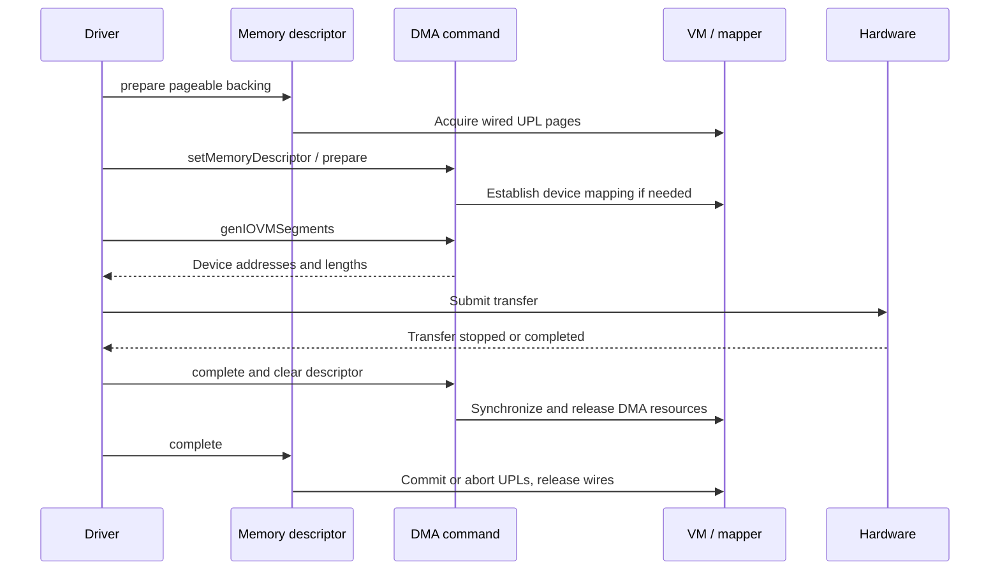

# Memory descriptors, mappings, and DMA

[Subsystem overview](README.md) · [VM pagers and UPLs](../vm/pagers-and-upl.md) · [VFS I/O](../vfs/io-and-cache.md)

Continue with [DMA preparation and mapping ownership](dma-preparation-and-mapping.md) for UPL rollback, command prepare failures, sparse/full bounce storage, cached versus command-owned device mappings, segment cursors, and final cleanup.

The [DMA segment walkthrough](dma-segment-walkthrough.md) follows `genIOVMSegments()` through descriptor dispatch, physical-run coalescing, padded mapper allocations, output constraints, continuation, and concrete DriverKit-facing calls.

For CPU access, [descriptor composition and mapping lifetimes](memory-descriptors-and-cpu-mappings.md) follows buffer allocation, subranges and composites, named-memory references, mapping reuse, device-pager faults, redirection, and destruction.

For the underlying VM ownership, see [objects and resident pages](../vm/objects-and-pages.md), [wiring and memory entries](../vm/wiring-and-memory-entries.md), and [pmap mapping lifetimes](../vm/pmap-mapping-lifecycle.md). A CPU translation, a physical-page hold, and a device-visible mapping each need their own completion and cleanup.

## Three addresses and three different objects

A CPU virtual address identifies bytes in a VM map. A physical address identifies backing memory. A DMA address identifies bytes in the address space presented to a device, possibly through an `IOMapper`. Never infer that equality between two of these on one machine is an interface guarantee. The code explicitly supports both mapper-backed and unmapped transfer paths. [`IOGeneralMemoryDescriptor::dmaMap`](../../../xnu/iokit/Kernel/IOMemoryDescriptor.cpp#L4938), [`IOMapper::copyMapperForDevice`](../../../xnu/iokit/Kernel/IOMapper.cpp#L168).

| Object | State worth tracking | Meaning |
| --- | --- | --- |
| `IOMemoryDescriptor` / `IOGeneralMemoryDescriptor` | Ranges, `_task`, direction/type flags, `_wireCount`, memory entries and page information | Describes the transfer's backing memory and its preparation state. |
| `IOMemoryMap` | `fMemory`, `fSuperMap`, `fOffset`, `fLength`, `fAddress`, `fAddressMap` | Describes a CPU mapping of some or all of a descriptor. |
| `IODMACommand` | `fMemory`, `fMapper`, `fActive`, address/segment/alignment limits, prepared range and temporary mappings | Describes device-visible segments for a particular transfer configuration. |

See [`IOGeneralMemoryDescriptor` fields](../../../xnu/iokit/IOKit/IOMemoryDescriptor.h#L1115), [`IOMemoryMap` fields](../../../xnu/iokit/IOKit/IOMemoryDescriptor.h#L922), and [`IODMACommand` fields](../../../xnu/iokit/IOKit/IODMACommand.h#L576).

Descriptor construction can describe task virtual ranges, physical ranges, UPLs, or vnode-related memory. Construction does not universally pin every page. API variants differ: the header explicitly requires preparation even for kernel-task memory passed through `withAddressRange`, while other convenience paths can describe already prepared memory. Check the constructor contract and flags in the actual caller. [`descriptor factory methods`](../../../xnu/iokit/Kernel/IOMemoryDescriptor.cpp#L1752), [`withAddressRange` contract](../../../xnu/iokit/IOKit/IOMemoryDescriptor.h#L560).

## Descriptor preparation acquires VM backing

`IOGeneralMemoryDescriptor::prepare` returns immediately for physical descriptors. For virtual/UIO/vnode types it calls `wireVirtual`, using `_prepareLock` when configured, and increments `_wireCount` only after success. Nested preparation is tracked; the first preparation performs the expensive page work. Remote descriptors have a different ownership model and are rejected by this local path. [`prepare`](../../../xnu/iokit/Kernel/IOMemoryDescriptor.cpp#L5023).

`wireVirtual` translates transfer direction into UPL and DMA-access flags. `kIODirectionOut` means the device reads host memory, so the UPL can be requested with `UPL_COPYOUT_FROM` and read access. `kIODirectionIn` means the device writes host memory, so writable/dirty handling is needed. An existing read-only preparation cannot simply be reused as a writable one. Additional flags select no-fault, no-zero-fill, low-address, or coherency behavior. [`wireVirtual`](../../../xnu/iokit/Kernel/IOMemoryDescriptor.cpp#L4436).

For each virtual range, the routine obtains page information with `memory_object_iopl_request`, a special static-kernel UPL path, or `vm_map_create_upl`. It records `ioPLBlock` entries linking descriptor offsets, UPLs, page offsets, and page-list locations. A range can require multiple UPLs. Error cleanup aborts and deallocates a partially constructed UPL before returning. This is the explicit bridge from a driver's byte ranges to VM's page-lifetime rules. [`UPL creation and recording`](../../../xnu/iokit/Kernel/IOMemoryDescriptor.cpp#L4650), [UPL ownership](../vm/pagers-and-upl.md).

`complete` reverses this state. It records error completion, decrements `_wireCount`, and on the final completion tears down descriptor-owned DMA mappings and commits or aborts created UPLs, then deallocates them. The implementation panics if active DMA references remain when the backing is about to be released. `complete` is consequently not a generic “free this object” operation: it closes a successful preparation interval and must occur after device use has stopped. [`complete`](../../../xnu/iokit/Kernel/IOMemoryDescriptor.cpp#L5083).

## CPU mapping is separate from DMA preparation

`createMappingInTask` constructs an `IOMemoryMap`; `makeMapping` may reuse a compatible mapping, create a unique physical mapping descriptor, or call `doMap` for a new mapping. Mapping options and compatibility determine which branch runs. The memory-reference map helpers eventually enter named memory objects into a VM map through VM mapping routines. [`createMappingInTask`](../../../xnu/iokit/Kernel/IOMemoryDescriptor.cpp#L6114), [`makeMapping`](../../../xnu/iokit/Kernel/IOMemoryDescriptor.cpp#L6228), [`memoryReferenceMap`](../../../xnu/iokit/Kernel/IOMemoryDescriptor.cpp#L965).

Physical and UPL-backed references can use `device_pager_setup`, followed by a named memory entry. Thus an IOKit physical-memory mapping can still appear in VM as an object backed by a pager; “physical memory” does not mean that VM object bookkeeping disappears. The cache mode and contiguous-device flags influence this path. [`device pager creation`](../../../xnu/iokit/Kernel/IOMemoryDescriptor.cpp#L782), [device pager boundary](../vm/pagers-and-upl.md).

Mapping ownership is unusual enough to read explicitly. The descriptor tracks its mappings, while a map retains its descriptor and possibly a supermap. `IOMemoryMap::taggedRelease` uses a threshold of two to handle the descriptor's mapping-set reference; `free` unmaps, removes itself from the descriptor, and releases its backing references. `unmap` also drops the retained `vm_map`. Task death has its own invalidation path. Applying a simplistic “one reference reaches zero” explanation misses this class's cycle-breaking protocol. The `LOCK` used around mapping operations is the global recursive `gIOMemoryLock`, distinct from the optional per-descriptor preparation lock. [`unmap`, `taskDied`, `taggedRelease`, `free`](../../../xnu/iokit/Kernel/IOMemoryDescriptor.cpp#L5800), [`mapping lock`](../../../xnu/iokit/Kernel/IOMemoryDescriptor.cpp#L112).

## DMA commands prepare device mappings, not the source pages

The two `prepare` methods have different responsibilities. `IODMACommand::setMemoryDescriptor` retains the descriptor, reads its characteristics, and can automatically prepare the command. It does not replace the caller's obligation to prepare pageable backing. The descriptor's segment walker explicitly panics if nonphysical memory is not wired for the command. [`setMemoryDescriptor`](../../../xnu/iokit/Kernel/IODMACommand.cpp#L397), [`wired-memory check`](../../../xnu/iokit/Kernel/IOMemoryDescriptor.cpp#L3535).

`IODMACommand::prepare` applies maximum-transfer, range and alignment constraints, tracks `fActive`, and decides whether it can iterate source segments directly or needs preflight/copy work. It can perform noncoherent cache operations and request an I/O mapping through `dmaCommandOperation(kIOMDDMAMap, ...)`. `IOGeneralMemoryDescriptor::dmaMap` converts the recorded page list into `IODMAMapPageList` and calls `mapper->iovmMapMemory` with direction-derived access. Some full-range system mappings are retained by the descriptor for reuse; command-owned mappings are tracked separately. [`command prepare`](../../../xnu/iokit/Kernel/IODMACommand.cpp#L836), [`descriptor DMA operations`](../../../xnu/iokit/Kernel/IOMemoryDescriptor.cpp#L3251), [`dmaMap`](../../../xnu/iokit/Kernel/IOMemoryDescriptor.cpp#L4938).

This diagram is the pageable-memory ownership sequence; prewired descriptors and caller-selected automatic options can combine steps. `genIOVMSegments` requires an active command and walks a bounded prepared range, applying the configured output format and segmentation rules. `complete` performs needed synchronization/copy-back and unmapping on the final active reference; `clearMemoryDescriptor` completes outstanding activity when requested and drops the descriptor. [`genIOVMSegments`](../../../xnu/iokit/Kernel/IODMACommand.cpp#L1272), [`complete`](../../../xnu/iokit/Kernel/IODMACommand.cpp#L1057), [`clearMemoryDescriptor`](../../../xnu/iokit/Kernel/IODMACommand.cpp#L455).

Preparation can allocate and block. The `setMemoryDescriptor` contract specifically warns against automatic preparation from a gated workloop action; the `prepare` contract also says the command operation is not thread-safe. The owner must serialize reuse of an individual command and choose a context that may block without holding the gate. The [deep DMA chapter](dma-preparation-and-mapping.md) follows selected sparse/full bounce-buffer paths and preparation-error cleanup. Concrete IOMMU implementations and device command-ring formats remain beyond these generic paths. [`IODMACommand` preparation contracts](../../../xnu/iokit/IOKit/IODMACommand.h#L308).

<!-- BEGIN PLATYDOC DOCUMENTATION LICENSE -->
Original Platydoc text and diagrams are licensed under [CC BY 4.0](https://creativecommons.org/licenses/by/4.0/). Quoted source code and third-party material retain their respective licenses.
<!-- END PLATYDOC DOCUMENTATION LICENSE -->
