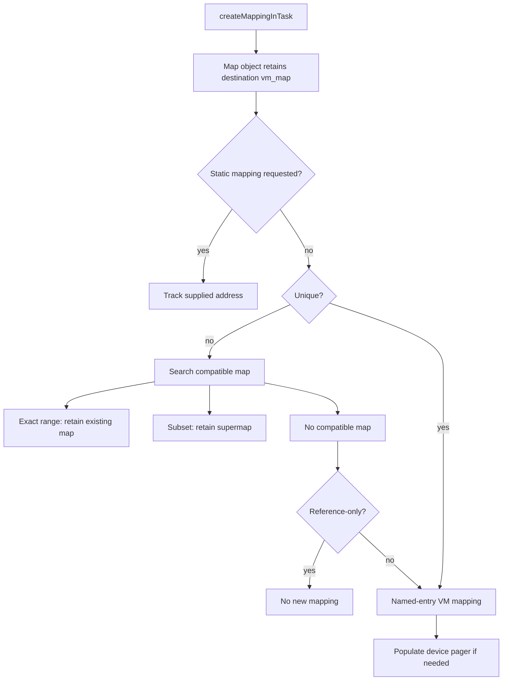

# Memory descriptor composition and CPU mapping lifetimes

[Drivers](README.md) · [Memory and DMA introduction](memory-and-dma.md) · [DMA preparation](dma-preparation-and-mapping.md) · [VM memory entries](../vm/wiring-and-memory-entries.md)

An `IOMemoryDescriptor` describes bytes and their backing. It can own allocated storage, refer to task memory, describe physical ranges, or compose other descriptors. Mapping those bytes into a CPU address space creates an `IOMemoryMap`; preparing them for device access creates separate page holds and DMA state. This chapter follows concrete descriptor construction, named-memory references, mapping reuse, faults, redirection, and destruction. The [DMA chapter](dma-preparation-and-mapping.md) handles UPL preparation, device-address mapping, bounce storage, and completion in depth.

The [DMA segment walkthrough](dma-segment-walkthrough.md) shows how these descriptor classes enter `genIOVMSegments()` and how logical offsets become physical or device-visible address/length pairs.

## 1. Separate the objects before following a pointer

| Object | Relevant state | Lifetime represented |
| --- | --- | --- |
| `IOGeneralMemoryDescriptor` | `_task`, `_ranges`, `_flags`, `_wireCount`, `_memoryEntries`, `_memRef` | Source ranges, prepared page information, and retained VM backing references |
| `IOBufferMemoryDescriptor` | `_buffer`, `_capacity`, `_alignment`, `_options`, `_internalFlags`, private mapping | Allocated storage and the mechanism needed to release it |
| `IOMemoryReference` | atomic reference count, protection, entry count/capacity, optional `mapRef` | A collection of named-memory-entry rights, optionally with a different mapping reference for COW |
| `IOMemoryEntry` | entry port, signed offset, size, source start | One named-entry interval within the descriptor's logical byte stream |
| `IOMemoryMap` | `fMemory`, `fSuperMap`, `fAddressMap`, address/task/options/offset/length | A CPU mapping or a retained view of an existing mapping |

The signed entry offset is useful because a page-aligned memory entry can begin before descriptor offset zero. These fields describe different coordinate systems: descriptor byte offset, memory-entry offset, CPU virtual address, physical address, and device-visible address. [Reference structures](../../../xnu/iokit/Kernel/IOMemoryDescriptor.cpp#L412), [map fields](../../../xnu/iokit/IOKit/IOMemoryDescriptor.h#L922).

Most CPU mapping operations use the global recursive `gIOMemoryLock`. That is separate from the optional descriptor preparation lock and from VM's own locks. A retained descriptor stabilizes its C++ object lifetime; it does not by itself serialize arbitrary mutations of child arrays, DMA commands, or driver state. [Mapping lock macros](../../../xnu/iokit/Kernel/IOMemoryDescriptor.cpp#L112).

## 2. Buffer descriptors select an allocation and release protocol

`IOBufferMemoryDescriptor::initWithPhysicalMask()` is the common construction path. It rejects zero capacity, preserves the requested capacity separately from page-rounded allocation size, derives alignment/address restrictions, and records allocation flags before calling the general descriptor initializer. A non-kernel task requires pageable memory. With no task, the object is marked `AsIfUnmapped`: it may still use internal kernel storage, but `getBytesNoCopy()` returns null. This API choice separates internal implementation from an exposed CPU mapping. [Construction](../../../xnu/iokit/Kernel/IOBufferMemoryDescriptor.cpp#L184), [address accessor](../../../xnu/iokit/Kernel/IOBufferMemoryDescriptor.cpp#L885).

By default, allocation uses `KHEAP_DATA_SHARED`. `initControlWithPhysicalMask()` sets the pointer-containing flag, selecting `KHEAP_IOBMD_CONTROL`. These heap choices are part of kernel allocation isolation, not a declaration that every byte in an arbitrary descriptor is safe to expose to another task. The [allocator interface chapter](../vm/allocator-interfaces.md) follows the underlying IOKit allocation wrappers. [Control constructor](../../../xnu/iokit/Kernel/IOBufferMemoryDescriptor.cpp#L497).

Contiguity has two meanings in this code. `kIOMemoryHostPhysicallyContiguous` requires host physical contiguity. `kIOMemoryPhysicallyContiguous` requires host contiguity when no system mapper is available or mapping is explicitly disabled; otherwise the mapper can satisfy device-address constraints without physically adjacent pages. The constructor can translate a physical address mask into the mapper specification's address-bit limit. Alignment greater than a page forces the relevant restricted allocation path. [Mapper and mask decisions](../../../xnu/iokit/Kernel/IOBufferMemoryDescriptor.cpp#L242), [contiguity selection](../../../xnu/iokit/Kernel/IOBufferMemoryDescriptor.cpp#L319).

For nonpageable buffers, the visible choices are restricted physical allocation, guarded kernel VM, x86 small allocations from a page allocator when mapped/shared, or aligned/general heap allocation. Guarded allocation reserves a leading and trailing page and returns the interior address. Guard pages are rejected with pageable memory or the physical-mask/contiguous path. The descriptor's internal flags remember which release operation is required. [Allocation branches](../../../xnu/iokit/Kernel/IOBufferMemoryDescriptor.cpp#L333).

Pageable buffers instead use named memory entries. Persistent setup creates the object backing; when a task mapping is requested, `createMappingInTask()` installs it and the buffer stores the resulting address. The constructor adjusts the map/descriptor reference arrangement and removes the private map from the ordinary mapping set. That special ownership arrangement should not be generalized to independently returned `IOMemoryMap` objects. Nonpageable construction currently requests automatic preparation for compatibility, despite the source comment's preference for explicit preparation. [Pageable/persistent setup](../../../xnu/iokit/Kernel/IOBufferMemoryDescriptor.cpp#L409), [private map ownership](../../../xnu/iokit/Kernel/IOBufferMemoryDescriptor.cpp#L467).

`setLength()` changes the logical transfer length within capacity; it does not resize the allocation. Memory-reference creation deliberately uses buffer capacity so later transfer-length changes do not recreate underlying storage. `withCopy()` uses `vm_map_copyin()` without destroying the source, copies the VM copy into the destination task, then initializes the descriptor over that destination. It is a VM copy operation with VM's sharing/COW semantics, not evidence of a per-byte memcpy. [Length](../../../xnu/iokit/Kernel/IOBufferMemoryDescriptor.cpp#L823), [copy constructor](../../../xnu/iokit/Kernel/IOBufferMemoryDescriptor.cpp#L130), [capacity-aware memory reference](../../../xnu/iokit/Kernel/IOMemoryDescriptor.cpp#L598).

Destruction caches allocation information on the stack, releases any private mapping, then runs superclass cleanup before freeing backing storage. The ordering is explicit:

[Unwire before freeing buffer allocation](../../../xnu/iokit/Kernel/IOBufferMemoryDescriptor.cpp#L753):
<!-- source-excerpt: ../../../xnu/iokit/Kernel/IOBufferMemoryDescriptor.cpp#L753-L762 -->
```cpp
	/* super::free may unwire - deallocate buffer afterwards */
	super::free();

	if (options & kIOMemoryPageable) {
#if IOALLOCDEBUG
		OSAddAtomicLong(-size, &debug_iomallocpageable_size);
#endif
	} else if (buffer) {
		if (kInternalFlagPhysical & internalFlags) {
			IOKernelFreePhysical(kheap, (mach_vm_address_t) buffer, size);
```

The remaining branches return physical allocations, page-allocator slots, guarded VM ranges, or aligned/general heap objects to their matching allocator. The pageable branch relies on the VM/reference/mapping lifetime rather than passing the virtual address to a wired-buffer free routine. Failure during construction must use the fields already initialized to choose the corresponding cleanup path; it is not safe to infer cleanup from the eventual public class name alone.

## 3. Subranges and composite descriptors retain their constituents

`IOSubMemoryDescriptor` retains one parent and records `_start` and `_length`. Segment lookup adds `_start` to the requested offset and clips the returned length to the subrange. Preparation and completion delegate to the parent, so preparing a narrow view may prepare the parent's backing rather than create a separate partial UPL. Mapping delegates to the parent's `makeMapping()` with the adjusted offset; the resulting map follows that parent's mapping machinery. Purgeability and ownership operations also delegate. [Subrange construction and segments](../../../xnu/iokit/Kernel/IOSubMemoryDescriptor.cpp#L63), [prepare/map delegation](../../../xnu/iokit/Kernel/IOSubMemoryDescriptor.cpp#L172).

`IOMultiMemoryDescriptor` concatenates whole child descriptors. It retains every child whether the pointer array is copied or borrowed with `asReference`; only ownership of the array storage changes. The constructor checks consistent pageable-buffer flags and asserts matching transfer directions. Segment lookup subtracts child lengths until it reaches the child covering the logical offset. This is composition of byte streams, not a promise of physical adjacency across children. [Multi construction](../../../xnu/iokit/Kernel/IOMultiMemoryDescriptor.cpp#L64), [segment lookup](../../../xnu/iokit/Kernel/IOMultiMemoryDescriptor.cpp#L237).

Preparation visits children in order. If child `i` fails, it completes the children that had already succeeded:

[Composite preparation rollback](../../../xnu/iokit/Kernel/IOMultiMemoryDescriptor.cpp#L197):
<!-- source-excerpt: ../../../xnu/iokit/Kernel/IOMultiMemoryDescriptor.cpp#L197-L202 -->
```cpp
	if (status != kIOReturnSuccess) {
		for (unsigned indexUndo = 0; indexUndo < index; indexUndo++) {
			statusUndo = _descriptors[indexUndo]->complete(forDirection);
			assert(statusUndo == kIOReturnSuccess);
		}
	}
```

Normal completion visits all children, records a failure status if any, and asserts success in the expected protocol. `doMap()` reserves one CPU VA span and maps successive child pieces with fixed/overwrite options. Releasing these temporary child map objects must not deallocate the span, because the composite owns the outer reservation; `kIOMapOverwrite` supplies that distinction. If a child mapping cannot be produced, the function reports underrun. The visible body has no complete reverse walk undoing every installed child mapping, so do not characterize this path as an independently transactional mapping operation. [Composite CPU map](../../../xnu/iokit/Kernel/IOMultiMemoryDescriptor.cpp#L266).

`IOInterleavedMemoryDescriptor` stores arrays of child pointers, offsets, and lengths. In this implementation it concatenates explicitly selected slices; the name does not imply an automatic stride/permutation algorithm. Adding a slice retains its descriptor and rejects additions while prepared or beyond capacity. Segment lookup selects the slice, adds its source offset, and clips the result at the slice boundary. Preparation has the same successful-prefix rollback pattern, then marks `_descriptorPrepared`; completion clears that flag. [Slice registration](../../../xnu/iokit/Kernel/IOInterleavedMemoryDescriptor.cpp#L129), [prepare/complete/segments](../../../xnu/iokit/Kernel/IOInterleavedMemoryDescriptor.cpp#L186).

`clearMemoryDescriptors()` completes children when the prepared flag is set and releases their references. It does not itself reset `_descriptorPrepared` in this visible body, so it should not be assumed to reestablish every aspect of a fresh unprepared object. The class has no dedicated `doMap()` override in this file; the base implementation returns unsupported. Physical-segment composition and CPU mapping support are distinct capabilities. [Clear](../../../xnu/iokit/Kernel/IOInterleavedMemoryDescriptor.cpp#L99), [base mapping](../../../xnu/iokit/Kernel/IOMemoryDescriptor.cpp#L5525).

## 4. Named memory references preserve VM backing identity

`memoryReferenceCreate()` produces an `IOMemoryReference` containing owned named-memory-entry ports. For task ranges it coalesces adjacent source ranges, asks VM to create entries, records each returned size and logical offset, and rejects unsupported interior misalignment. Existing task memory uses `MAP_MEM_USE_DATA_ADDR`; pageable buffer allocation uses `MAP_MEM_NAMED_CREATE`, optional purgeability, and ledger settings. Under MTE, source addresses are canonicalized and VM receives IOKit policy flags. [Reference creation](../../../xnu/iokit/Kernel/IOMemoryDescriptor.cpp#L548).

Protection is derived from transfer direction, cache mode, and explicit mapping needs. Output-only device direction usually starts read-only, but creating a writable CPU map requests a writable reference; a development warning calls attention to that mismatch. Actual CPU map protection is intersected with the reference's protection. Direction therefore does not replace CPU-map permissions, and a mapping call cannot simply exceed the memory-entry capability. [Reference protection](../../../xnu/iokit/Kernel/IOMemoryDescriptor.cpp#L490), [mapping options](../../../xnu/iokit/Kernel/IOMemoryDescriptor.cpp#L5188).

For `kIOMemoryMapCopyOnWrite`, creation recursively builds a `mapRef` using `MAP_MEM_VM_COPY`. Mapping follows that reference while other backing operations can use the original. The general `makeMapping()` override attempts this potentially allocating COW setup before taking the global recursive mapping lock, then publishes `_memRef` with compare-and-swap; a losing concurrent creator frees its temporary reference. [COW reference](../../../xnu/iokit/Kernel/IOMemoryDescriptor.cpp#L833), [publication](../../../xnu/iokit/Kernel/IOMemoryDescriptor.cpp#L5214).

A reuse request can reuse the existing reference only when the entries returned by VM continue to match the original ports, sizes, and offsets. Otherwise it keeps the newly constructed reference. The atomic reference count protects shared reference lifetime; final release recursively frees `mapRef`, releases each memory-entry port, and frees the variable-sized record. This is another layer below the descriptor object's own retain count. [Reuse/failure tail](../../../xnu/iokit/Kernel/IOMemoryDescriptor.cpp#L841), [release](../../../xnu/iokit/Kernel/IOMemoryDescriptor.cpp#L436).

Physical or UPL-backed descriptors without a source task take a device-pager path. It records the descriptor in pager-private state, chooses contiguous/cache flags, calls `device_pager_setup()`, then creates a named memory entry for that pager. A physical descriptor can consequently be represented by an ordinary VM mapping/object relationship even though its backing pages come from hardware or supplied physical ranges. [Device-pager reference](../../../xnu/iokit/Kernel/IOMemoryDescriptor.cpp#L782), [VM device pager](../vm/pagers-and-upl.md).

## 5. CPU mapping may return an existing object or a view

`createMappingInTask()` initializes a new `IOMemoryMap`, retaining the destination `vm_map` and storing task/address/options/offset/length. A zero requested length becomes the descriptor's full length; it is not automatically “the remainder after offset.” It delegates to `makeMapping()`, whose return may be a different compatible map. [Factory](../../../xnu/iokit/Kernel/IOMemoryDescriptor.cpp#L6114), [map initialization](../../../xnu/iokit/Kernel/IOMemoryDescriptor.cpp#L5468).



Compatibility requires the same live destination map, matching read-only and guard options, acceptable cache mode, compatible fixed address when requested, and range containment. The code uses `taggedTryRetain()` before adopting an existing map. For an exact range it returns that map; for a strict subset the new map retains the old one as `fSuperMap` and derives its address:

[Exact map versus retained view](../../../xnu/iokit/Kernel/IOMemoryDescriptor.cpp#L5985):
<!-- source-excerpt: ../../../xnu/iokit/Kernel/IOMemoryDescriptor.cpp#L5985-L5995 -->
```cpp
	if (!taggedTryRetain(NULL)) {
		return NULL;
	}

	if ((fLength == _length) && !_offset) {
		newMapping = this;
	} else {
		newMapping->fSuperMap.reset(this, OSNoRetain);
		newMapping->fOffset   = fOffset + _offset;
		newMapping->fAddress  = fAddress + _offset;
	}
```

A submap here is a C++ mapping view, not necessarily a VM `is_sub_map` entry. The child does not independently own the parent's whole VM reservation. Conversely, `kIOMapUnique` skips reuse; for a physical descriptor it first requires a sufficiently long contiguous physical segment and creates a distinct descriptor over that segment. `kIOMapReference` without a compatible map prevents creation of a new mapping. [Mapping choice](../../../xnu/iokit/Kernel/IOMemoryDescriptor.cpp#L6228).

There is also a same-source-task optimization inside `IOGeneralMemoryDescriptor::doMap()`: for one suitable range, zero offset, anywhere placement, and no unique/guard request, it returns the existing source virtual address marked static. That returned object tracks a reference to existing address-space state; it did not create a fresh mapping or pin the source by itself. [Static alias](../../../xnu/iokit/Kernel/IOMemoryDescriptor.cpp#L5297).

## 6. VM allocation, page geometry, cache mode, and prefaulting

`memoryReferenceMap()` dispatches to `memoryReferenceMapNew()` for data-address entries. The newer path first asks `mach_memory_entry_map_size()` how much destination VA each requested entry slice consumes. It then reserves that total span and maps each named entry into it with fixed/overwrite flags, requesting the data address rather than assuming equal source/destination page offsets. This matters when a task's page size differs from the kernel's. The older path explicitly tracks source page offsets and validates alignment as it advances through entries. [Data-address map path](../../../xnu/iokit/Kernel/IOMemoryDescriptor.cpp#L1276), [older path](../../../xnu/iokit/Kernel/IOMemoryDescriptor.cpp#L965).

`IOMemoryDescriptorMapAlloc()` reserves a VM range with `VM_INHERIT_NONE`. Kernel-map allocations select `KMEM_RANGE_ID_DATA_SHARED`, with a source comment that mapped memory should not contain kernel pointers. Guarded mapping is accepted only for anywhere placement. It adds a guard range on each side, applies `VM_PROT_NONE` to them, and returns the interior address. Deallocation rounds the useful range and includes both guards. These CPU mapping guards are distinct from the allocation-time guards of an `IOBufferMemoryDescriptor`. [Reservation and guards](../../../xnu/iokit/Kernel/IOMemoryDescriptor.cpp#L861).

Pageable kernel buffers may use one of IOKit's pageable maps through `IOIteratePageableMaps()` and `IOPageableMapForAddress()`. Code must retain that distinction when deallocating; the nominal `kernel_map` argument is not always the final map containing the bytes. Explicit overwrite requests skip new reservation and later skip deallocation, leaving reservation ownership to the caller or composite map. [Pageable selection](../../../xnu/iokit/Kernel/IOMemoryDescriptor.cpp#L1383), [unmap](../../../xnu/iokit/Kernel/IOMemoryDescriptor.cpp#L5656).

An explicit cache mode updates the named entry using the VM memory-entry interface, which requires write capability for that change. Mapping entries carry the resulting protection/cache contract; device-pager population can also adopt the descriptor's default cache mode. These are CPU cache/mapping decisions, not DMA coherence completion. [Cache update and entry mapping](../../../xnu/iokit/Kernel/IOMemoryDescriptor.cpp#L1486), [DMA coherence](dma-preparation-and-mapping.md).

`kIOMapPrefault` requires previously prepared UPL/page-list state. The code selects the relevant `ioPLBlock`, handles externally supplied page-info arrays, computes the initial page index, and passes those pages to `vm_map_enter_mem_object_prefault()`. It is not an alternate way to make an arbitrary unprepared descriptor DMA-safe. The source has a device-pager condition that clears this option, then relies on pager population. Read the condition itself rather than assuming its adjacent comment describes every combination. [Prefault prerequisites](../../../xnu/iokit/Kernel/IOMemoryDescriptor.cpp#L1422).

The ordinary returned-error tail deallocates a newly reserved span when `didAlloc` is true. That is not a blanket rollback guarantee: some prerequisite checks return early after reservation, the newer entry-mapping branch panics on unexpected VM insertion failure, and composite mapping has different cleanup structure. These APIs assume correctly constructed descriptor/reference state; invalid internal geometry is often an assertion or panic rather than an ordinary caller error. [Mapping finish](../../../xnu/iokit/Kernel/IOMemoryDescriptor.cpp#L1549), [common cleanup tail](../../../xnu/iokit/Kernel/IOMemoryDescriptor.cpp#L1589).

## 7. Device-pager faults and two meanings of redirect

`populateDevicePager()` walks physical segments, requires whole-page interior boundaries, and inserts backing pages with `device_pager_populate_object()`. Contiguous pager mode can populate a larger range at once. For kernel-map use, it invokes `vm_fault()` early so the resulting translation is available before interrupt-level code tries to access it; later faulting may be impossible in that context. A population error after a new map causes `doMap()` to unmap it. [Pager population](../../../xnu/iokit/Kernel/IOMemoryDescriptor.cpp#L5553), [failure cleanup](../../../xnu/iokit/Kernel/IOMemoryDescriptor.cpp#L5386).

`redirect(safeTask, doRedirect)` is a temporary-access protocol. The descriptor publishes `kIOMemoryRedirected` under the global lock and visits its maps. Non-static maps outside the safe task have their CPU translations removed; safe/static write-combined maps can have their cache mode changed. VM map entries remain, allowing later access to fault. The device-pager callback obtains the descriptor under the same lock and its `handleFault()` sleeps until redirection is cleared:

[Fault waiting during redirection](../../../xnu/iokit/Kernel/IOMemoryDescriptor.cpp#L5541):
<!-- source-excerpt: ../../../xnu/iokit/Kernel/IOMemoryDescriptor.cpp#L5541-L5549 -->
```cpp
	if (kIOMemoryRedirected & _flags) {
#if DEBUG
		IOLog("sleep mem redirect %p, %qx\n", this, sourceOffset);
#endif
		do {
			SLEEP;
		} while (kIOMemoryRedirected & _flags);
	}
	return kIOReturnSuccess;
```

Unredirect clears the flag, can repopulate kernel mappings, and wakes waiters. The wait uses the recursive-lock sleep primitive with `THREAD_UNINT`. This is not an unmap/free operation, and it does not itself stop a device's DMA. [Descriptor/map redirection](../../../xnu/iokit/Kernel/IOMemoryDescriptor.cpp#L5701), [pager callback](../../../xnu/iokit/Kernel/IOMemoryDescriptor.cpp#L217).

The overload `IOMemoryMap::redirect(newBackingMemory, options, offset)` changes backing through a different mechanism. It obtains a blocking-access UPL for a single-entry reference, then invokes the new descriptor with unique/reference mapping options. The special `doMap()` path obtains another UPL, drops all recursive mapping-lock holds around `upl_transpose()`, reacquires them, commits/deallocates the temporary UPL, swaps memory-reference records, and repopulates a device pager if present. The code logs a transpose error and resets it to success before continuing, so describing this as all-or-nothing remapping with full rollback would be inaccurate. [Backing redirect](../../../xnu/iokit/Kernel/IOMemoryDescriptor.cpp#L6167), [transpose path](../../../xnu/iokit/Kernel/IOMemoryDescriptor.cpp#L5327).

## 8. Destruction breaks references at each layer

`IOMemoryMap::unmap()` calls the descriptor's `doUnmap()` only for a non-static, top-level mapping with a live address/map. It then drops the retained VM map and clears the address. A subset view leaves the parent mapping intact. `taskDied()` either performs requested user-client unmapping or invalidates its task/map association and bookkeeping; it is not the same operation as dropping the last reference to the descriptor. [Map cleanup](../../../xnu/iokit/Kernel/IOMemoryDescriptor.cpp#L5800).

Maps retain descriptors, while descriptors track maps in a retaining set. `taggedRelease()` uses the special threshold of two to break that ownership arrangement. `free()` unmaps, removes itself from the descriptor's set, releases its descriptor/supermap, and commits/deallocates a retained redirect UPL. This is why a naive cycle diagram based on ordinary `OSObject::release()` would predict the wrong lifetime. [Special release and free](../../../xnu/iokit/Kernel/IOMemoryDescriptor.cpp#L5854).

General descriptor destruction clears the device-pager backpointer under `gIOMemoryLock`, preventing new pager callbacks from retaining a disappearing descriptor. It completes remaining preparations or removes cached physical DMA mapping state, releases range/page-info storage, drops the pager and named-entry references, and frees the preparation lock. The pager owns its private reserved structure until its close callback; after dropping that pager reference, the descriptor must not access the reserved structure again. [General free](../../../xnu/iokit/Kernel/IOMemoryDescriptor.cpp#L2480), [pager close](../../../xnu/iokit/Kernel/IOMemoryDescriptor.cpp#L241).

## Sources inspected and limits

Deep reads cover the buffer constructor/allocation/free branches, copy and length/accessor behavior, complete sub/multi/interleaved composition bodies, named-reference creation/reuse/COW/release, both CPU mapping paths, guards/cache/prefault choices, compatibility/static/unique mapping, both redirects, pager population/callback/free, and map task-death/release. Purgeability and ownership dispatch were inspected as VM interfaces; every ledger, device-pager, VM-map, and mapper implementation was not re-derived here. DriverKit wrappers and a particular device's mapping policy are separate callers. No driver or kernel was built, and no concurrent mapping or hardware transfer was executed.

<!-- BEGIN PLATYDOC DOCUMENTATION LICENSE -->
Original Platydoc text and diagrams are licensed under [CC BY 4.0](https://creativecommons.org/licenses/by/4.0/). Quoted source code and third-party material retain their respective licenses.
<!-- END PLATYDOC DOCUMENTATION LICENSE -->
