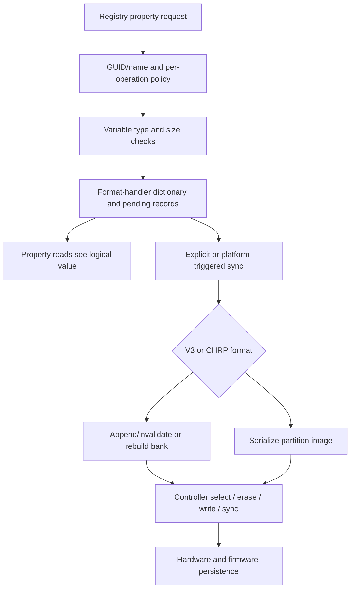

# NVRAM variables, format handlers and persistence

[Driver guide](README.md) · [Registry properties](registry-planes-and-properties.md) · [Property transport](serialization-and-property-transport.md) · [Platform services](../platform/platform-services.md)

`IODTNVRAM` turns registry/property operations into typed firmware-variable updates. It selects a local image-format implementation, applies per-variable policy and hands byte-level storage operations to an `IONVRAMController`. The V3 and CHRP image handlers are present in this checkout; a concrete hardware controller and firmware durability guarantees are separate boundaries.

## 1. Name, dictionary value, image record and hardware storage are distinct

| Representation | Owner and purpose |
| --- | --- |
| GUID plus variable name | Logical namespace; defaults and allow-list translation can select a system/common destination |
| Canonical `OSSymbol` key | Dictionary identity made from namespace and name |
| `OSBoolean`, `OSNumber`, `OSString`, `OSData` | Kernel representation after variable-type validation |
| `IODTNVRAMFormatHandler` | Interface implemented by V3 or CHRP storage-image logic |
| `_varDict` | Current object values exposed through property reads |
| V3 `_varEntries` | Encoded records plus pending append/remove state and prior image offsets |
| `_nvramImage`, bank/generation fields | Last image and persistence bookkeeping |
| `_variableLock`, `_controllerLock` | Dictionary/update coordination versus serialization of controller operations |
| `IONVRAMController` | `read`, `write`, bank selection/erase and synchronization boundary |

[`service interface`](../../../xnu/iokit/IOKit/IONVRAM.h#L80), [`V3 structures`](../../../xnu/iokit/Kernel/IONVRAMV3Handler.cpp#L37-L92), [`CHRP state`](../../../xnu/iokit/Kernel/IONVRAMCHRPHandler.cpp#L41-L124), [`controller contract`](../../../xnu/iokit/IOKit/nvram/IONVRAMController.h#L36-L54).



An ordinary property update reaches the dictionary/pending-record stage. It must not be described as proof of an immediate durable flash commit.

## 2. Initialization can precede hardware-controller registration

[`initImageFormat`](../../../xnu/iokit/Kernel/IONVRAM.cpp#L1562-L1620) looks under `/chosen` for bank size and proxy image data. It tests the V3 signature/version and otherwise selects the CHRP handler, asks that handler to decode variables, and obtains the dictionary. Release builds remove the proxy property after initialization when the entry is present.

Later `registerNVRAMController` passes the controller to the selected format. V3 controller registration takes `_controllerLock`, attempts reload and can perform reclaim recovery if the state requires it. Thus boot-proxy availability and live hardware access are separate phases. [`registration`](../../../xnu/iokit/Kernel/IONVRAM.cpp#L1623-L1634), [`V3 reconciliation`](../../../xnu/iokit/Kernel/IONVRAMV3Handler.cpp#L950-L979).

V3 image decoding scans variable records, checks bounds/state and validates data CRCs before accepting values. Records include `startId`, state, attributes, name/data lengths, GUID and CRC; pending in-memory wrappers add `new_state` and `existing_offset`. The wrapper is not the on-storage structure. [`record layout`](../../../xnu/iokit/Kernel/IONVRAMV3Handler.cpp#L52-L90), [`decode`](../../../xnu/iokit/Kernel/IONVRAMV3Handler.cpp#L639-L705).

## 3. Permissions depend on the operation and variable

[`verifyPermission`](../../../xnu/iokit/Kernel/IONVRAM.cpp#L632-L740) first checks variable-specific entitlement rules, then the variable's permission bits. Kernel-only, restore-modify-only and internal-only restrictions precede ordinary read/write/delete decisions.

Reads consider kernel/admin/read entitlement, full-access policy, variable-specific permission and hidden-system-variable rules. Writes and deletions additionally consider system GUID policy, allow-listed names and system entitlements. Delete, reset and obliterate are separate operations: a variable can be never deletable or removable only by reset. A blanket statement such as “administrator can modify every variable” does not match this dispatch.

[`copyPropertyWithGUIDAndName`](../../../xnu/iokit/Kernel/IONVRAM.cpp#L1837-L1873) obtains a dictionary snapshot, checks read permission, translates the GUID/name and retains the selected object. Reads are therefore policy-filtered object access, not raw controller reads on every request.

## 4. A property write has special-command and ordinary-value paths

[`setPropertyWithGUIDAndName`](../../../xnu/iokit/Kernel/IONVRAM.cpp#L1949-L2118) retains the incoming object and recognizes special deletion and sync properties before ordinary value handling. The deletion command can parse a GUID from its string value. One deletion variant reports the removal error; the compatibility variant can leave the original success result. Sync and forced-sync select different rate-limit behavior.

For an ordinary write it checks permission, selects the required object type, converts a string to data where supported, enforces `boot-args` and variable size limits, handles special variables, translates the GUID and calls the format handler. The macOS empty-data case can mean removal. A type mismatch returns bad argument; insufficient space is distinct from lack of privilege.

`setProperties` requires a dictionary and applies entries until one fails. Earlier successful entries are not undone. [`multi-property loop`](../../../xnu/iokit/Kernel/IONVRAM.cpp#L2198-L2234):

<!-- source-excerpt: ../../../xnu/iokit/Kernel/IONVRAM.cpp#L2218-L2230 -->
```cpp
	while (ret == kIOReturnSuccess) {
		key = OSDynamicCast(OSSymbol, iter->getNextObject());
		if (key == nullptr) {
			break;
		}

		object = dict->getObject(key);
		if (object == nullptr) {
			continue;
		}

		ret = setPropertyInternal(key, object);
	}
```

This is one reason the [property transport](serialization-and-property-transport.md) chapter separates parser success from the receiver's operation result.

## 5. V3 updates stage append/removal state

`setVariable` normalizes the destination GUID and takes `_variableLock` for writing. `setVariableInternal` finds a matching encoded entry, calculates new space consumption separately for the system/common regions, rejects overflow of the quota, creates a replacement record, calculates its data CRC and marks it `VAR_NEW_STATE_APPEND`. Existing physical offset/state is preserved so a later sync can invalidate the prior version. It updates `_varEntries`, `_varDict`, usage and `_newData`. Deletion uses the removal state instead. [`update wrapper`](../../../xnu/iokit/Kernel/IONVRAMV3Handler.cpp#L889-L923), [`record construction`](../../../xnu/iokit/Kernel/IONVRAMV3Handler.cpp#L777-L886).

The pending states have an explicit local meaning. [`state constants`](../../../xnu/iokit/Kernel/IONVRAMV3Handler.cpp#L45-L50):

<!-- source-excerpt: ../../../xnu/iokit/Kernel/IONVRAMV3Handler.cpp#L45-L50 -->
```cpp
// No changes needed on save
#define VAR_NEW_STATE_NONE            0x01
// Remove existing entry on save
#define VAR_NEW_STATE_REMOVE          0x02
// Add new value on save, mark previous as inactive
#define VAR_NEW_STATE_APPEND          0x03
```

Illustrative replacement:

```text
logical key GUID:name -> new OSData value in _varDict
pending entry:
    new_state = APPEND
    existing_offset = old record offset
    header + name + new data + new CRC
sync:
    write new record at append offset
    invalidate old record's state byte
```

The two controller writes are ordered by the handler. They are not a proof that a physical device makes the sequence atomic across power loss.

## 6. V3 raw sync appends before invalidating; reclaim rebuilds a bank

[`syncRaw`](../../../xnu/iokit/Kernel/IONVRAMV3Handler.cpp#L1087-L1200) checks controller, dirty-state and bank-size readiness. Under the variable lock it computes whether appends fit, builds an append buffer and a list of old offsets to invalidate, then writes new payload records before updating old state bytes. Removed entries are omitted from the retained array. On success it advances the offset, clears dirty state and adopts the remaining entries.

If space is insufficient, it releases the variable lock and calls `reclaim`. Reclaim chooses the next bank, selects/erases it, copies live and pending-append records into a new image, updates their offsets, increments the generation and writes the new contents. Deleted entries are dropped. [`reclaim`](../../../xnu/iokit/Kernel/IONVRAMV3Handler.cpp#L983-L1060).

`sync` serializes these operations with `_controllerLock`. It performs a required reload and attempts reclaim recovery if reload fails; for a raw controller it likewise attempts reclaim after `syncRaw` failure. [`sync decision`](../../../xnu/iokit/Kernel/IONVRAMV3Handler.cpp#L1288-L1318):

<!-- source-excerpt: ../../../xnu/iokit/Kernel/IONVRAMV3Handler.cpp#L1304-L1312 -->
```cpp
	if (_rawController == true) {
		ret = syncRaw();

		if (ret != kIOReturnSuccess) {
			ret = reclaim();
			require_noerr_action(ret, exit, DEBUG_ERROR("Reclaim recovery failed, ret=%#x\n", ret));
		}
	} else {
		ret = syncBlock();
```

Read the failure semantics carefully: routines update some in-memory record state before all controller calls complete, and some selection/erase errors are logged rather than immediately returning. The recovery path is part of the implementation; there is no general promise that an error leaves every in-memory field and device byte unchanged.

For block controllers, `syncBlock` constructs a whole next-bank image, drops removal records, fills unused space with `0xFF`, writes the bank and calls controller sync. It then installs the retained entry set and clears `_newData`. This differs from raw append/invalidate operation. [`block path`](../../../xnu/iokit/Kernel/IONVRAMV3Handler.cpp#L1203-L1284).

## 7. CHRP serializes common/system partitions into a replacement image

CHRP uses a 16-byte partition header whose length is measured in 16-byte units, plus Apple header information including checksum/generation. Its handler tracks common/system partition offsets and sizes, a value dictionary and controller/variable locks. [`layout`](../../../xnu/iokit/Kernel/IONVRAMCHRPHandler.cpp#L41-L96).

[`serializeVariables`](../../../xnu/iokit/Kernel/IONVRAMCHRPHandler.cpp#L617-L747) clones the current image, clears each applicable variable partition, walks the dictionary, selects entries belonging in that partition, converts object values to the storage representation and tracks remaining capacity. Failure to fit returns `kIOReturnNoSpace`. On success it updates the Apple header/generation, rotates banks and invokes select, erase, write and sync before installing the new image.

This conversion is not simply an `OSSerialize` stream written to flash. CHRP has its own name/value encoding and escaping for data. [`data escaping`](../../../xnu/iokit/Kernel/IONVRAMCHRPHandler.cpp#L966-L1052), [`object conversion`](../../../xnu/iokit/Kernel/IONVRAMCHRPHandler.cpp#L1142-L1262). `sync` holds the controller lock and processes reload before serialization. [`CHRP sync`](../../../xnu/iokit/Kernel/IONVRAMCHRPHandler.cpp#L914-L932).

## 8. Synchronization success has a limited meaning

`IODTNVRAM::syncInternal` may skip when locking is unsafe or a rate-limited request arrives too soon. Its initial result is success, so a skipped attempt need not return an error. The forced variant bypasses the time gate but still depends on the rest of the path. [`rate gate`](../../../xnu/iokit/Kernel/IONVRAM.cpp#L1637-L1656), [`syncInternal`](../../../xnu/iokit/Kernel/IONVRAM.cpp#L1659-L1695).

At the final interface, `IONVRAMController::sync` returns `void`, while read/write/select/erase have their own return types. The handler cannot propagate a nonexistent sync status as a proof of durable storage. Concrete controller behavior and firmware bank selection after reboot must be studied in their implementations, which are not supplied here.

## Inspection boundary

This chapter covers registry dispatch, namespace/type/permission decisions, local V3/CHRP data structures, update staging, raw/block sync, bank reclaim and principal error paths. It does not reconstruct a hardware controller or assert power-loss guarantees. The examples describe source-level state transitions; no NVRAM was read or modified during this work.

<!-- BEGIN PLATYDOC DOCUMENTATION LICENSE -->
Original Platydoc text and diagrams are licensed under [CC BY 4.0](https://creativecommons.org/licenses/by/4.0/). Quoted source code and third-party material retain their respective licenses.
<!-- END PLATYDOC DOCUMENTATION LICENSE -->
