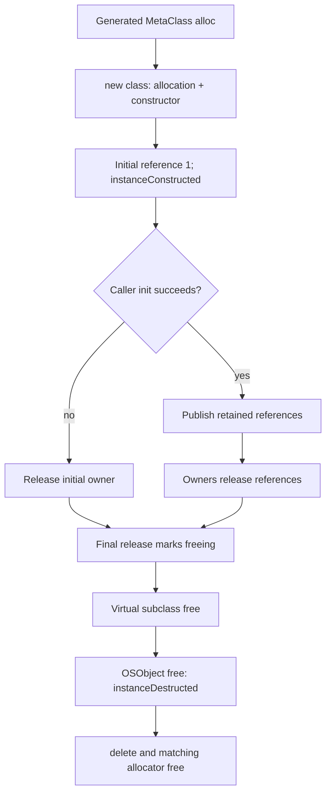

# IOKit object runtime, class registration, and collection ownership

This chapter follows an object from allocation through collection membership and final release, then connects those rules to class lookup and module lifetime. Read [the libkern introduction](libkern-and-kext-runtime.md) first; [registry planes and properties](registry-planes-and-properties.md) applies these contracts to the registry, and [service notifications](service-notifications-and-arbitration.md) applies them to retained callback snapshots. The implementations studied here are the kernel C++ runtime in this checkout, including `KERNEL_PRIVATE` allocator macros; they do not describe the separately supplied userspace DriverKit runtime. [`OSMetaClass.h`](../../../xnu/libkern/libkern/c++/OSMetaClass.h#L2071-L2120).

## 1. Construction, initialization, and destruction are separate steps

An `OSObject` begins with `retainCount = 1`. The generated concrete constructor calls the superclass constructor with its metaclass and increments that concrete metaclass's instance count. The generated `MetaClass::alloc()` performs `new className`; it does **not** call `init()`. `OSMakeShared<T>()` similarly calls `OSTypeAlloc(T)` and adopts the initial reference with `OSNoRetain`. A typical factory must therefore check initialization separately; `OSArray::withCapacity()` and `OSCollectionIterator::withCollection()` illustrate the cleanup convention. [`OSObject.cpp`](../../../xnu/libkern/c++/OSObject.cpp#L427-L437), [`constructor macros`](../../../xnu/libkern/libkern/c++/OSMetaClass.h#L2071-L2075), [`OSSharedPtr.h`](../../../xnu/libkern/libkern/c++/OSSharedPtr.h#L78-L86), [`OSArray.cpp`](../../../xnu/libkern/c++/OSArray.cpp#L125-L139), [`OSCollectionIterator.cpp`](../../../xnu/libkern/c++/OSCollectionIterator.cpp#L58-L67).

The macros make the boundary visible: constructing a class records its existence, while initialization remains a caller responsibility. [`OSDefineBasicStructors`](../../../xnu/libkern/libkern/c++/OSMetaClass.h#L2071-L2075).

<!-- source-excerpt: ../../../xnu/libkern/libkern/c++/OSMetaClass.h#L2071-L2075 -->
```cpp
#define OSDefineBasicStructors(className, superclassName)       \
	OSObject * className ::MetaClass::alloc() const             \
	{ return new className; }                                   \
	className :: className () : superclassName (&gMetaClass)    \
	{ gMetaClass.instanceConstructed(); }
```

The default `OSObject::init()` succeeds, with optional tracking. The final reference-release path invokes virtual `free()`, and the base `OSObject::free()` decrements the most-derived metaclass's instance count before `delete this`. Consequently subclasses normally release owned resources in their `free()` override and eventually call the superclass implementation; calling `delete` directly would bypass the reference-release protocol and the base `free()` accounting. This is an implementation consequence of the visible paths, rather than a claim that C++ forbids direct deletion. [`init/free`](../../../xnu/libkern/c++/OSObject.cpp#L388-L413), [`final release`](../../../xnu/libkern/c++/OSObject.cpp#L199-L230).



The generated kernel-private allocator creates a `KALLOC_TYPE_DEFINE` view and calls `OSObject_typed_operator_new/delete`. The implementation uses the typed external entry point when the requested size fits the view. A subclass that inherits an allocator without declaring its own structor macros can request a larger size; that case falls back to `KHEAP_DEFAULT`, with a corresponding sized-free fallback. `IOTRACKING` can route both operations through the tracking allocator instead. The non-`KERNEL_PRIVATE` macro uses the base `OSObject` allocator; the separate `WithZone` macros use a class zone when available. These are concrete configuration distinctions, so “every OSObject allocation has a unique typed zone” is not a supported conclusion. [`allocator macros`](../../../xnu/libkern/libkern/c++/OSMetaClass.h#L2077-L2120), [`allocation/deallocation`](../../../xnu/libkern/c++/OSObject.cpp#L285-L383), [typed allocation policy](../vm/typed-allocation.md).

## 2. The reference word includes collection membership

`retainCount` is treated as two 16-bit quantities inside one atomic update: the low half is the ordinary reference count, and a retain tagged with `OSTypeID(OSCollection)` increments the high half as well. A collection reference therefore contributes to both total ownership and the collection-membership count. `getRetainCount()` exposes only the low half. The extra bucket detects a class of bad releases: after decrement, the low count must not be less than the collection count. It is a diagnostic invariant, not a garbage collector or a complete use-after-free detector. [`OSObject.cpp`](../../../xnu/libkern/c++/OSObject.cpp#L102-L230).

`taggedTryRetain()` computes a CAS update; the tag changes the increment: [`taggedTryRetain`](../../../xnu/libkern/c++/OSObject.cpp#L107-L118).

<!-- source-excerpt: ../../../xnu/libkern/c++/OSObject.cpp#L107-L118 -->
```cpp
bool
OSObject::taggedTryRetain(const void *tag) const
{
	volatile UInt32 *countP = (volatile UInt32 *) &retainCount;
	UInt32 inc = 1;
	UInt32 origCount;
	UInt32 newCount;

	// Increment the collection bucket.
	if ((const void *) OSTypeID(OSCollection) == tag) {
		inc |= (1UL << 16);
	}
```

Two low-count values have special meaning. `0xffff` marks an object being freed: try-retain fails, ordinary tagged-retain panics, and a release seeing that value returns. `0xfffe` pegs an overflowing count in non-debug builds, deliberately leaking instead of wrapping to a false final reference; debug builds panic. The final release CAS writes `0xffff` before invoking `free()`, so concurrent reference updates observe the terminal marker rather than a conventional zero. None of this grants permission to call try-retain through arbitrary freed storage: the caller still needs a protocol that keeps the memory address valid while attempting the operation. [`retain handling`](../../../xnu/libkern/c++/OSObject.cpp#L120-L157), [`release handling`](../../../xnu/libkern/c++/OSObject.cpp#L180-L230).

The release operation takes a `when` threshold, normally one. It subtracts the tagged amount and chooses the terminal value if the remaining low half is below that threshold. This matters when reading specialized subclasses or `release(when)`: the implementation is not simply an unconditional atomic decrement followed by a test for zero. [`OSObject.cpp`](../../../xnu/libkern/c++/OSObject.cpp#L166-L207), [`release wrappers`](../../../xnu/libkern/c++/OSObject.cpp#L234-L261).

`OSSharedPtr` supplies ordinary intrusive retain/release; `OSTaggedSharedPtr<T, OSCollection>` supplies collection-tagged operations. `OSRetain` means acquire an additional reference; `OSNoRetain` means adopt an existing one. An rvalue `OSDynamicPtrCast` transfers the source reference on successful cast using `detach()`, whereas the lvalue form acquires another reference. The wrapper's `reset(p, retain)` retains `p` before releasing its old object, which makes self-replacement safe at that level. [`retainers and casts`](../../../xnu/libkern/libkern/c++/OSSharedPtr.h#L32-L134), [`intrusive reset`](../../../xnu/libkern/libkern/c++/intrusive_shared_ptr.h#L381-L399).

| Operation | Ownership result | Implementation |
|---|---|---|
| `OSMakeShared<T>()` | Adopts `new`/`OSTypeAlloc`'s initial reference; does not initialize the object | [`OSSharedPtr.h`](../../../xnu/libkern/libkern/c++/OSSharedPtr.h#L78-L86) |
| `OSSharedPtr(p, OSRetain)` | Adds an ordinary reference | [`retainer`](../../../xnu/libkern/libkern/c++/OSSharedPtr.h#L32-L46) |
| `array->setObject(p)` | Adds a collection-tagged reference on successful insertion | [`OSArray.cpp`](../../../xnu/libkern/c++/OSArray.cpp#L259-L282), [`array storage type`](../../../xnu/libkern/libkern/c++/OSArray.h#L101-L103) |
| `array->getObject(i)` | Returns a borrowed pointer | [`OSArray.cpp`](../../../xnu/libkern/c++/OSArray.cpp#L394-L402) |
| `array->removeObject(i)` | Drops the array's reference after moving remaining entries | [`OSArray.cpp`](../../../xnu/libkern/c++/OSArray.cpp#L340-L357) |
| `OSCollectionIterator::withCollection(c)` | Retains `c`; returned elements remain borrowed | [`iterator initialization`](../../../xnu/libkern/c++/OSCollectionIterator.cpp#L43-L55), [`next`](../../../xnu/libkern/c++/OSCollectionIterator.cpp#L316-L331) |

## 3. Collections own members but do not serialize callers

`OSArray::setObject(index, object)` rejects null objects and indices beyond `count`, ensures capacity before mutation, increments the update stamp, shifts entries with move operations, and retains the inserted object. `merge()` checks count overflow before extending storage. Replacement retains the new value through the shared-pointer helper. Removing an element first moves its owner into a local variable, shifts subsequent entries, and releases the removed object when that local goes out of scope. [`OSArray.cpp`](../../../xnu/libkern/c++/OSArray.cpp#L259-L357).

A dictionary owns both keys and values. Its normal symbol-key lookup compares interned symbol identities. The body uses binary search when `kSort` is enabled and a linear scan otherwise, despite the introductory header's simpler statement that dictionaries use linear search. The `onlyAdd` variant refuses replacement; regular replacement updates the stamp and resets the value. New entries grow capacity first, then install retained key and value owners. [`OSDictionary.cpp`](../../../xnu/libkern/c++/OSDictionary.cpp#L358-L409), [`dictionary fields`](../../../xnu/libkern/libkern/c++/OSDictionary.h#L125-L151), [`header description`](../../../xnu/libkern/libkern/c++/OSDictionary.h#L98-L118).

The mutation stamp supports invalidation detection, not mutual exclusion. `OSCollection::haveUpdated()` increments `updateStamp`; if `kImmutable` is set, it normally panics, with the `kOSRegistryModsMode` debug option reporting a backtrace and continuing. `OSArray::setOptions()` and `OSDictionary::setOptions()` propagate changed options into child collections. This explains why publishing a nested collection into a registry property can change the allowed operations on that same collection object retained elsewhere. [`haveUpdated`](../../../xnu/libkern/c++/OSCollection.cpp#L66-L87), [`array options`](../../../xnu/libkern/c++/OSArray.cpp#L477-L491), [`dictionary options`](../../../xnu/libkern/c++/OSDictionary.cpp#L757-L775), [`registry setProperty`](../../../xnu/iokit/Kernel/IORegistryEntry.cpp#L759-L777).

The check is intentionally visible here because it is sometimes mistaken for a lock: [`OSCollection::haveUpdated`](../../../xnu/libkern/c++/OSCollection.cpp#L65-L76).

<!-- source-excerpt: ../../../xnu/libkern/c++/OSCollection.cpp#L65-L76 -->
```cpp
void
OSCollection::haveUpdated()
{
	if (fOptions & kImmutable) {
		if (!(gIOKitDebug & kOSRegistryModsMode)) {
			panic("Trying to change a collection in the registry");
		} else {
			OSReportWithBacktrace("Trying to change a collection in the registry");
		}
	}
	updateStamp++;
}
```

`OSCollectionIterator` retains the collection and lazily initializes its iteration storage. `isValid()` compares the stored stamp to the current stamp. `getNextObject()` returns null both when invalid and when exhausted; callers that need a complete scan must distinguish those cases with `isValid()`. Reset reinitializes storage and captures a new stamp. A concurrent writer can still race the storage access itself, so a stamp check does not make unsynchronized enumeration safe. `OSDictionary`'s documented concurrency restriction and the absence of locking in these operations make the required external synchronization explicit. [`iterator lifecycle`](../../../xnu/libkern/c++/OSCollectionIterator.cpp#L43-L115), [`getNextObject`](../../../xnu/libkern/c++/OSCollectionIterator.cpp#L316-L331), [`dictionary restriction`](../../../xnu/libkern/libkern/c++/OSDictionary.h#L102-L118).

For callback iteration, `OSCollection::iterateObjects()` uses a small local iterator and compares the update stamp after each callback. Its Boolean result means the stamp stayed unchanged; a callback may have requested an early stop. It does not mean every member was visited. That distinction is useful when reviewing a helper that returns the iteration result as a higher-level success condition. [`OSCollection.cpp`](../../../xnu/libkern/c++/OSCollection.cpp#L107-L130).

## 4. Copying the container graph is not cloning every object

`OSArray::withArray()` and `OSDictionary::withDictionary()` make new containers whose elements retain the original objects. `copyCollection()` goes further for nested collections: it creates a cycle dictionary if necessary, checks whether the original collection was already copied, creates a shallow container copy, records original-address-to-copy identity, then recursively replaces child collections. Non-collection objects remain shared. The address keys in the private cycle dictionary are internal identity tokens, not ordinary external registry property names. [`array copy`](../../../xnu/libkern/c++/OSArray.cpp#L113-L123), [`array recursive copy`](../../../xnu/libkern/c++/OSArray.cpp#L494-L543), [`dictionary recursive copy`](../../../xnu/libkern/c++/OSDictionary.cpp#L778-L824), [`base lookup`](../../../xnu/libkern/c++/OSCollection.cpp#L91-L104).

The crucial order is “record this copy, then recurse,” which prevents repeated descent through the same collection cycle: [`OSArray::copyCollection`](../../../xnu/libkern/c++/OSArray.cpp#L515-L537).

<!-- source-excerpt: ../../../xnu/libkern/c++/OSArray.cpp#L515-L537 -->
```cpp
		newArray = OSArray::withArray(this);
		if (!newArray) {
			continue;
		}

		// Insert object into cycle Dictionary
		cycleDict->setObject((const OSSymbol *) this, newArray.get());

		for (unsigned int i = 0; i < count; i++) {
			OSCollection *coll =
			    OSDynamicCast(OSCollection, static_cast<OSObject *>(
				    const_cast<OSMetaClassBase *>(
					    newArray->array[i].get())));

			if (coll) {
				OSSharedPtr<OSCollection> newColl = coll->copyCollection(cycleDict);
				if (!newColl) {
					return ret;
				}

				newArray->replaceObject(i, newColl.get());
			}
		}
```

Conceptually, if two properties refer to the same nested array, a successful graph copy can preserve that shared nested identity through the cycle dictionary. If they refer to an `OSData`, that data object is retained, not byte-cloned by this routine. This is a reading example derived from the dispatch on `OSDynamicCast(OSCollection, ...)`, not output from an executed test. A custom collection subclass that does not override the base copy routine cannot be assumed to provide deep-copy behavior; the base fallback can return itself or only a prior cycle-dictionary result. [`OSArray.cpp`](../../../xnu/libkern/c++/OSArray.cpp#L527-L543), [`OSCollection.cpp`](../../../xnu/libkern/c++/OSCollection.cpp#L91-L104).

Serialization uses a related but separate identity table. Array and dictionary serializers call `previouslySerialized(this)` before descending. The XML path emits an `IDREF` for an object already in the serializer's tag array; the binary case dispatches to `binarySerialize`. This preserves reference identity in the serialized representation, but does not itself lock the source graph. For registry properties, a separate snapshot step provides the intended ownership boundary. [`OSSerialize.cpp`](../../../xnu/libkern/c++/OSSerialize.cpp#L88-L114), [`array serializer`](../../../xnu/libkern/c++/OSArray.cpp#L457-L474), [`dictionary serializer`](../../../xnu/libkern/c++/OSDictionary.cpp#L703-L753), [registry serialization](registry-planes-and-properties.md).

## 5. Metaclasses are registered in a module-load transaction

An `OSMetaClass` records class size, superclass link, and initially a raw class-name string stored in the `className` slot. It cannot yet be treated as an `OSSymbol`. `preModLoad()` takes `sStalledClassesLock`, allocates a stalled-class array, and leaves that lock held until `postModLoad()`. Constructors append metaclasses to that array; the array grows in fixed increments. `checkModLoad()` verifies the handle and stored result. The constructor logs a missing `preModLoad()` rather than silently treating registration as complete. [`constructor`](../../../xnu/libkern/c++/OSMetaClass.cpp#L574-L640), [`load setup`](../../../xnu/libkern/c++/OSMetaClass.cpp#L780-L813).

`postModLoad()` performs the decisive registration sequence under `sAllClassesLock`: it checks for duplicate names, computes the maximum class depth, and only after the duplicate-check pass converts names to symbols and inserts metaclasses into the global class dictionary. It resolves the owning `OSKext` and calls `addClass()`, while deliberately storing an unretained pointer to the kext. Duplicate handling differs by target: the OSX branch logs the duplicate; the other branch invokes `panic`. The second pass can still fail in `addClass()`, so the first-pass duplicate check should not be described as a general all-or-nothing rollback guarantee. [`OSMetaClass.cpp`](../../../xnu/libkern/c++/OSMetaClass.cpp#L818-L950).

At completion it releases temporary kext/name references, frees the stalled storage, clears the global stalled pointer, and unlocks `sStalledClassesLock`. A metaclass destructor removes its name from the class dictionary, removes it from its owning kext, releases the symbol only after that operation, and removes itself from the stalled list if construction is being unwound. This handles the distinction between a still-raw class name and an installed symbol. [`post-load cleanup`](../../../xnu/libkern/c++/OSMetaClass.cpp#L955-L979), [`destructor`](../../../xnu/libkern/c++/OSMetaClass.cpp#L659-L716).

Named allocation needs a separate pin: ordinary `OSMetaClass::retain/release` are empty overrides. `copyMetaClassWithName()` increments `reserved->retain` while holding `sAllClassesLock`; `allocClassWithName()` calls `meta->alloc()` while that pin is held and then calls `releaseMetaClass()`. `removeClasses()` refuses removal if a class has either instances or this special retain count. Merely obtaining a raw pointer with `getMetaClassWithName()` does not acquire that pin. [`empty overrides`](../../../xnu/libkern/c++/OSMetaClass.cpp#L723-L750), [`lookup/allocation`](../../../xnu/libkern/c++/OSMetaClass.cpp#L1233-L1299), [`removal check`](../../../xnu/libkern/c++/OSMetaClass.cpp#L1194-L1228).

The named allocation handoff is short enough to inspect whole: [`allocClassWithName`](../../../xnu/libkern/c++/OSMetaClass.cpp#L1284-L1299).

<!-- source-excerpt: ../../../xnu/libkern/c++/OSMetaClass.cpp#L1284-L1299 -->
```cpp
OSObject *
OSMetaClass::allocClassWithName(const OSSymbol * name)
{
        const OSMetaClass * meta;
        OSObject          * result;

        result = NULL;
        meta = copyMetaClassWithName(name);
        if (meta) {
                result = meta->alloc();
                meta->releaseMetaClass();
	}

        return result;
}

```

## 6. Casts, instance counts, and service-instance enumeration

`OSDynamicCast` ultimately asks whether the requested metaclass appears in the object's `getMetaClass()->superClassLink` chain. `safeMetaCast` returns null for a null input or incompatible object; `requiredMetaCast` still returns null for null input but panics on an incompatible non-null object. This is the IOKit class metadata path, rather than a lookup through the registry or an ownership operation. A successful raw cast does not retain the object. [`safe/required casts`](../../../xnu/libkern/c++/OSMetaClass.cpp#L291-L321), [`metaclass chain`](../../../xnu/libkern/c++/OSMetaClass.cpp#L1381-L1397).

Instance accounting has a subtle aggregate meaning. `instanceConstructed()` propagates to the superclass only when the current class transitions from zero to one; `instanceDestructed()` propagates only when one transitions to zero. A superclass therefore counts its own direct instances plus nonempty immediate descendant branches, recursively, rather than counting every descendant object. The useful unload predicate is zero versus nonzero. `OSKext::hasOSMetaClassInstances()` checks that predicate across the module's classes, and autounload also checks references, policy flags and request callbacks. [`instance counters`](../../../xnu/libkern/c++/OSMetaClass.cpp#L985-L1010), [`module predicate`](../../../xnu/libkern/c++/OSKext.cpp#L10126-L10151), [`autounload gates`](../../../xnu/libkern/c++/OSKext.cpp#L9118-L9164).

The transition-based propagation is explicit: [`instanceConstructed/instanceDestructed`](../../../xnu/libkern/c++/OSMetaClass.cpp#L984-L1010).

<!-- source-excerpt: ../../../xnu/libkern/c++/OSMetaClass.cpp#L984-L1010 -->
```cpp
void
OSMetaClass::instanceConstructed() const
{
        // if ((0 == OSIncrementAtomic(&(((OSMetaClass *) this)->instanceCount))) && superClassLink)
        if ((0 == OSIncrementAtomic(&instanceCount)) && superClassLink) {
                superClassLink->instanceConstructed();
	}
}

/*********************************************************************
*********************************************************************/
void
OSMetaClass::instanceDestructed() const
{
        if ((1 == OSDecrementAtomic(&instanceCount)) && superClassLink) {
                superClassLink->instanceDestructed();
	}

        if (((int)instanceCount) < 0) {
                OSKext * myKext = reserved->kext;

                OSKextLog(myKext, kOSMetaClassLogSpec,
                    // xxx - this phrasing is rather cryptic
                    "OSMetaClass: Class %s - bad retain (%d)",
                    getClassName(), instanceCount);
	}
}
```

The service-instance index is a different mechanism. `OSMetaClass::addInstance()` lazily creates an ordered set, installs that set into its superclass's instance tree, and inserts the object. `removeInstance()` tears down empty sets. `applyToInstances()` walks this hierarchy under `sInstancesLock`; its helper uses a 24-level local traversal stack, allocating larger storage if `sDeepestClass` requires it. Named traversal obtains a retained set under `sAllClassesLock` before acquiring the instances lock. [`instance-tree operations`](../../../xnu/libkern/c++/OSMetaClass.cpp#L1045-L1180).

For IOService, the insertion happens at first publication in `doServiceMatch()`, and removal happens on detach when the service is marked inactive. It is therefore incorrect to equate this index with every constructed `OSObject`. `copyExistingServices()` uses it to obtain matching service candidates; the new [notification chapter](service-notifications-and-arbitration.md) follows that path through replay. [`publication`](../../../xnu/iokit/Kernel/IOService.cpp#L5507-L5536), [`detach`](../../../xnu/iokit/Kernel/IOService.cpp#L980-L1002), [`candidate enumeration`](../../../xnu/iokit/Kernel/IOService.cpp#L6254-L6336).

## Reading route and inspection limits

Start with `OSDefineBasicStructors`, `OSObject::taggedRelease`, and `OSObject::free`; then inspect one array insertion/removal and `OSCollectionIterator::isValid`. Continue into `copyCollection`, metaclass `preModLoad/postModLoad`, and finally `copyMetaClassWithName/removeClasses`. That route separates memory ownership, mutable-container synchronization, and executable-class lifetime before introducing the service-instance index.

| Source inspected | Depth here | Limits |
|---|---|---|
| `OSObject.cpp`, `OSMetaClass.h`, `OSSharedPtr.h`, intrusive-pointer reset | Allocation, initialization, reference transition and final-free bodies | Tracking internals and every macro variant are peripheral |
| `OSMetaClass.cpp`, selected `OSKext.cpp` predicates | Registration, casts, pins, counters and instance-tree traversal | Full module load/unload and linker cleanup remain in [libkern/kext overview](libkern-and-kext-runtime.md) |
| `OSArray.cpp`, `OSDictionary.cpp`, `OSCollection.cpp`, `OSCollectionIterator.cpp` | Mutation, tagged ownership, copies, options, enumeration | Other container algorithms are not exhaustively reviewed |
| `OSSerialize.cpp`, registry/service call sites | Identity handling and consumers of container ownership | Binary wire format, parser validation and userspace runtime are outside this chapter |

This is a source review, not an executed allocation, unload, or concurrent-mutation test. Error paths are described where inspected; the chapter does not claim that collection cycles are automatically reclaimed or that reference counts replace caller locking.
