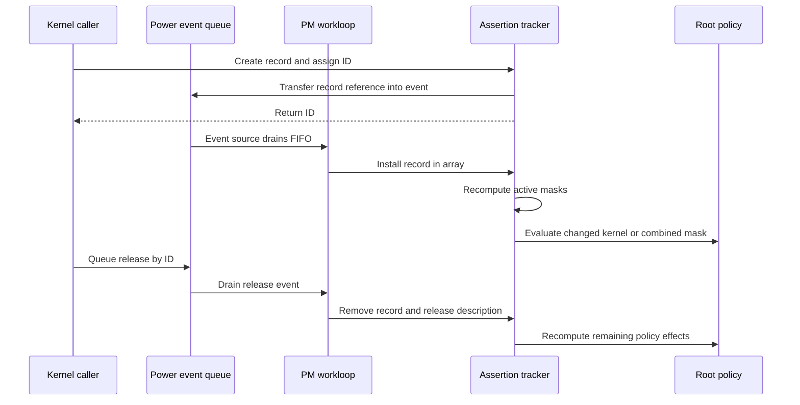
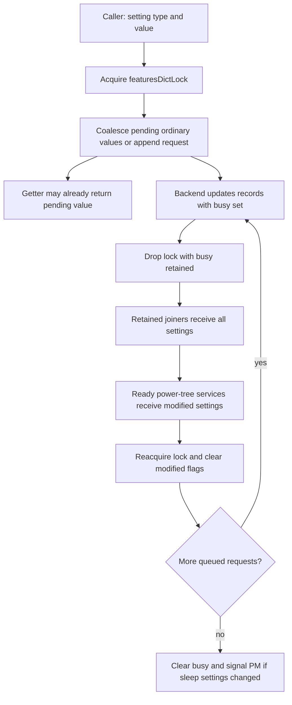
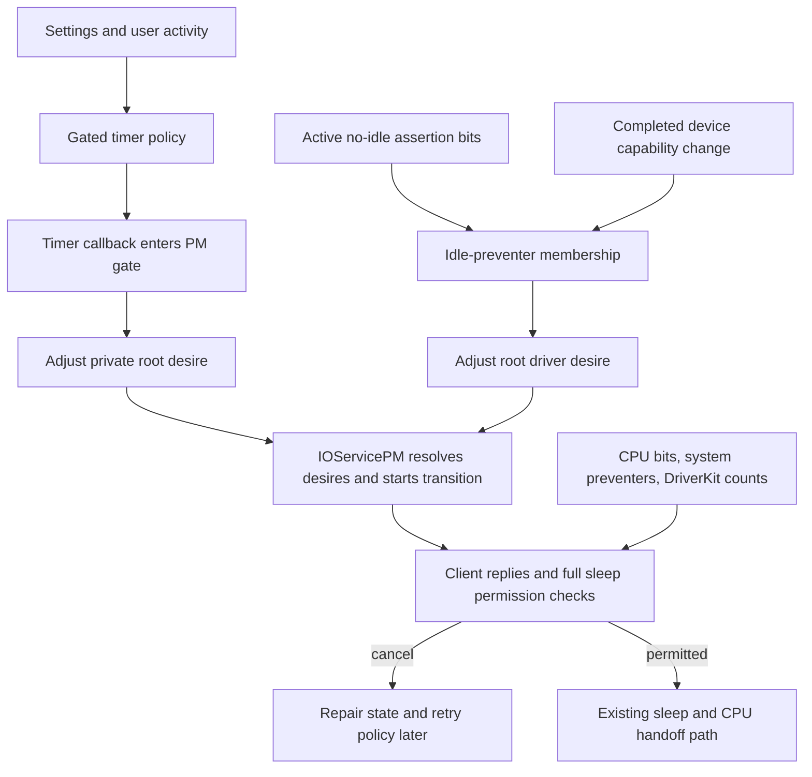

# Power assertions, sleep preventers and idle policy

[Drivers](README.md) · [Device power-state machine](device-power-state-machine.md) · [System sleep and wake](system-sleep-and-wake.md) · [Workloop and callback protocols](workloop-and-power-protocols.md)

A driver can request that the CPU remain running, prevent automatic system sleep, or change a device's idle timeout. These requests reach different state holders and different execution contexts. An assertion ID is a record handle; a sleep-preventer entry is a service reference; an aggressiveness value is a setting distributed to drivers. None of them means that a hardware power transition has completed.

This chapter follows the common and ARM64-relevant implementation in `xnu-12377.121.6`. It connects policy inputs to the existing [sleep transition](system-sleep-and-wake.md) and [per-device PM](device-power-state-machine.md) explanations. It distinguishes macOS (`XNU_TARGET_OS_OSX`), other targets and configured AOT paths where the code differs. User-space power policy, display/storage driver implementations and hardware power sequencing remain external inputs.

## 1. State holders and execution contexts

| Object or state | Representation and purpose | Synchronization or ownership |
| --- | --- | --- |
| `PMAssertStruct` | A 64-bit assertion ID, bit mask, level, owner identity, timestamps and CPU-bit accounting. | Wrapped in `OSValueObject<PMAssertStruct>`; its pointer fields do not acquire automatic object ownership. |
| `PMAssertionsTracker::assertionsArray` | Installed kernel assertion records, including records currently at level off. | PM workloop serializes mutation; `assertionsArrayLock` protects array/detail access against property serialization. |
| `assertionsKernel`, `assertionsUser`, `assertionsCombined` | OR of active kernel records, one supplied userspace mask, and their union. | Recomputed under the PM gate. Public aggregate reads do not force queued updates to run. |
| `pmPowerStateQueue` | FIFO `PowerEventEntry` records carrying event type, pointer argument and 64-bit argument. | Own queue lock; workloop action removes that lock before calling root-domain handlers. |
| `preventIdleSleepList`, `preventSystemSleepList` | `OSSet` collections of services whose state constrains idle or system sleep. | PM gate; set membership retains the service until removal. Repeated insertion is not another caller-specific assertion. |
| `aggressivesQueue`, `aggressivesData` | Pending record/service requests and installed `{flags, type, value}` records. | `featuresDictLock`, with a busy flag spanning unlocked driver callbacks. Backend uses a thread call. |
| `extraSleepTimer`, `idleSleepTimerPending` | A thread call and a policy bookkeeping flag for automatic sleep delay. | Timer callback enters the PM gate before modifying policy. Cancellation is not a callback-join operation. |

Sources: [assertion record and tracker](../../../xnu/iokit/Kernel/IOPMrootDomain.cpp#L838-L905), [power event queue](../../../xnu/iokit/Kernel/IOPMPowerStateQueue.cpp#L64-L105), [aggressiveness records and lock](../../../xnu/iokit/Kernel/IOPMrootDomain.cpp#L409-L473), [preventer initialization](../../../xnu/iokit/Kernel/IOPMrootDomain.cpp#L1905-L1906), [set membership](../../../xnu/libkern/c++/OSSet.cpp#L221-L229), [array retention](../../../xnu/libkern/c++/OSArray.cpp#L259-L282).

The record is deliberately byte-copyable. `ownerString` is explicitly retained and released by the assertion code. `ownerService` is assigned as a raw tracking pointer; creating the record does not retain that service. `registryEntryID` preserves a numeric identity for diagnostics without making that pointer owning. Callers must not infer a service-lifetime guarantee from possession of an assertion ID. [Creation and manual ownership](../../../xnu/iokit/Kernel/IOPMrootDomain.cpp#L12097-L12135), [release](../../../xnu/iokit/Kernel/IOPMrootDomain.cpp#L12140-L12170).

[Source: iokit/Kernel/IOPMrootDomain.cpp, lines 842–853](../../../xnu/iokit/Kernel/IOPMrootDomain.cpp#L842-L853)

<!-- source-excerpt: ../../../xnu/iokit/Kernel/IOPMrootDomain.cpp#L842-L853 -->
```cpp
struct PMAssertStruct {
	IOPMDriverAssertionID       id;
	IOPMDriverAssertionType     assertionBits;
	uint64_t                    createdTime;
	uint64_t                    modifiedTime;
	const OSSymbol              *ownerString;
	IOService                   *ownerService;
	uint64_t                    registryEntryID;
	IOPMDriverAssertionLevel    level;
	uint64_t                    assertCPUStartTime;
	uint64_t                    assertCPUDuration;
};
```

## 2. Creating an ID, installing a record and publishing its effect

`IOPMrootDomain::createPMAssertion()` first requires an initialized tracker. The tracker atomically advances its 64-bit issuer, initialized to `500`, fills a record, interns the description, allocates the value object and writes the ID to the output. If a power queue is available, it transfers the value object's reference into a `kPowerEventAssertionCreate` event. The normal return is therefore an issued handle to **pending** work. There is no synchronous search of the array or acknowledgment from `evaluateAssertions()` before returning. [Public wrapper](../../../xnu/iokit/Kernel/IOPMrootDomain.cpp#L11010-L11043), [tracker initialization](../../../xnu/iokit/Kernel/IOPMrootDomain.cpp#L11849-L11878), [creation body](../../../xnu/iokit/Kernel/IOPMrootDomain.cpp#L12097-L12135).

The queue inserts under `queueLock` and signals its event source. `checkForWork()` removes entries in FIFO order, drops the queue lock around the action and frees each event entry afterward. The root action dispatches create, release and level-change events to separate tracker handlers; their results are discarded by this dispatcher. Ordering comes from actual queue insertion, not from numeric ID order across concurrent callers. [Queue insertion/drain](../../../xnu/iokit/Kernel/IOPMPowerStateQueue.cpp#L64-L105), [assertion dispatch](../../../xnu/iokit/Kernel/IOPMrootDomain.cpp#L8591-L8614).

`handleCreateAssertion()` runs gated, starts CPU accounting when appropriate, records the description, inserts the value object in the array under `assertionsArrayLock`, and releases the queue-transferred reference. It then calls `tabulate()`. This last step scans every record and includes its mask only when `level == kIOPMDriverAssertionLevelOn`, whose value is **255**, not arbitrary nonzero. The mutators shown here do not validate the level into a boolean; an input of `1` will not contribute bits to that scan. [Install](../../../xnu/iokit/Kernel/IOPMrootDomain.cpp#L12060-L12088), [aggregation](../../../xnu/iokit/Kernel/IOPMrootDomain.cpp#L11886-L11924), [level definitions](../../../xnu/iokit/IOKit/pwr_mgt/RootDomain.h#L67-L86).



The diagram shows one possible schedule in initialized normal operation, excluding the special force-wakeup wait and DriverKit synchronization below. The PM worker can also process the event before the caller receives its return. An ID already returned to the caller can precede policy publication; a release submitted afterward does not retroactively make creation synchronous.

### Updating, releasing and interpreting errors

`setPMAssertionLevel(id, level)` and `releasePMAssertion(id)` enqueue work. Their internal handlers use a linear `detailsForID()` lookup. A missing ID produces `kIOReturnNotFound` **inside the handler**, but the enqueue-side wrappers return success without obtaining that later result. The header's suggestion that the level setter reports not-found must therefore be read against this asynchronous implementation. A repeated release is not a second successful removal merely because both submissions return success. [Lookup](../../../xnu/iokit/Kernel/IOPMrootDomain.cpp#L12021-L12053), [release request/handler](../../../xnu/iokit/Kernel/IOPMrootDomain.cpp#L12140-L12183), [level request/handler](../../../xnu/iokit/Kernel/IOPMrootDomain.cpp#L12189-L12231), [API comment](../../../xnu/iokit/IOKit/pwr_mgt/RootDomain.h#L382-L392).

Turning a record off preserves its ID, description and array entry for later reuse. Releasing it updates CPU accounting when active, explicitly releases `ownerString`, removes the array object, and tabulates again. Neither operation directly calls a device's `setPowerState()`. The eventual policy change enters the separate PM state machine.

Creation reports allocation failure for the value object, but this is not a complete transaction API for all initialization failures: if `owner` or its queue is absent, the body can still return success without installing a record; the retained POD description has no automatic destructor to clean it up. Normal startup constructs the tracker and queue before clients use them. The handlers also assume a valid description when logging and do not check the array insertion result. These are visible preconditions/unchecked branches, not evidence of a runtime-tested fault recovery guarantee. [Creation](../../../xnu/iokit/Kernel/IOPMrootDomain.cpp#L12101-L12135), [install assumptions](../../../xnu/iokit/Kernel/IOPMrootDomain.cpp#L12066-L12085).

### Kernel masks, userspace masks and lazy registry diagnostics

`tabulate()` ORs active kernel records into `assertionsKernel`, then combines that with `assertionsUser`. Policy evaluation occurs if **either** the kernel mask or the combined mask changed. Thus a kernel CPU assertion can cause a driver-assertion-change message even if userspace already held the same combined CPU bit. Within `evaluateAssertions()`, bit-specific actions are selected by the XOR of old and new **combined** masks. [Aggregation](../../../xnu/iokit/Kernel/IOPMrootDomain.cpp#L11895-L11924), [policy notification and changed bits](../../../xnu/iokit/Kernel/IOPMrootDomain.cpp#L9641-L9649).

[Source: iokit/Kernel/IOPMrootDomain.cpp, lines 11917–11923](../../../xnu/iokit/Kernel/IOPMrootDomain.cpp#L11917-L11923)

<!-- source-excerpt: ../../../xnu/iokit/Kernel/IOPMrootDomain.cpp#L11917-L11923 -->
```cpp
	tabulateProducerCount++;
	assertionsCombined = assertionsKernel | assertionsUser;

	if ((assertionsKernel != oldKernel) ||
	    (assertionsCombined != oldCombined)) {
		owner->evaluateAssertions(assertionsCombined, oldCombined);
	}
```

For a worked example, suppose kernel records A and B both hold CPU (`0x01`), while userspace holds prevent-display (`0x40`). The kernel mask is `0x01` and combined mask `0x41`. Releasing A leaves both masks unchanged, so no new policy evaluation occurs. Turning B off changes combined to `0x40` and reevaluates CPU policy. If userspace had also held CPU, combined would remain `0x41`: the kernel change still sends the general notification, but CPU-specific changed-bit work does not run. Releasing one record therefore cannot clear another owner's contribution.

Userspace enters through `RootDomainUserClient` selector `kPMSetUserAssertionLevels`, whose scalar is narrowed to 32 bits. The handler requires administrator privilege before mutation, then replaces the **entire userspace mask** through a PM-workloop `runAction()`. The stack-local mask is valid because this action executes under the gate before returning; it is not queued as a pointer for later consumption. This path contains no per-process assertion-ID table or reference count. The source does not provide powerd's decision process for assembling that mask. [Selector and handler](../../../xnu/iokit/Kernel/RootDomainUserClient.cpp#L602-L605), [privilege check](../../../xnu/iokit/Kernel/RootDomainUserClient.cpp#L192-L208), [gated replacement](../../../xnu/iokit/Kernel/IOPMrootDomain.cpp#L12234-L12264).

There is a result-reporting wrinkle: `secureSetUserAssertionLevels()` computes `ret` for permission or mutation, but ends with unconditional `kIOReturnSuccess`. Unauthorized callers do not reach the mutation, yet this return value does not reveal that refusal. This differs from the aggressiveness setter, which places the operation's result in a scalar output. [Exact return](../../../xnu/iokit/Kernel/RootDomainUserClient.cpp#L192-L208), [aggressiveness result channel](../../../xnu/iokit/Kernel/RootDomainUserClient.cpp#L150-L170).

`tabulateProducerCount` advances on every tabulation, including changes that leave masks unchanged. Registry serialization calls `publishProperties()`, which compares producer and consumer counts and rebuilds the detailed assertion array plus kernel-bit property under the array lock. These properties are diagnostic snapshots refreshed on demand, not the mechanism that enforces sleep policy. CPU-bit intervals use continuous time; `createdTime`/`modifiedTime` instead pack calendar seconds and microseconds. [Property publication](../../../xnu/iokit/Kernel/IOPMrootDomain.cpp#L11998-L12018), [serialization entry](../../../xnu/iokit/Kernel/IOPMrootDomain.cpp#L11220-L11225), [CPU accounting](../../../xnu/iokit/Kernel/IOPMrootDomain.cpp#L11927-L11952), [calendar packing](../../../xnu/iokit/Kernel/IOPMrootDomain.cpp#L12362-L12384).

## 3. Assertion bits select different mechanisms

| Bit or group | What the inspected kernel path does |
| --- | --- |
| CPU, `0x01` | Reconsiders dark-wake/AOT policy; the full sleep-permission check rejects ordinary sleep while active. It can retain CPU operation while graphics remain off. |
| Prevent-system-idle, `0x02` | Adds root domain to the idle-preventer set on the first no-idle contribution; may cancel an idle transition. Demand sleep has a separate override path. |
| Prevent-display, `0x40` | Calls the display wrangler's `setIgnoreIdleTimer()` when the aggregate bit changes, if that service exists. |
| Storage-reserved bit, `0x80` | Participates with `0x02` in `NO_IDLE_SLEEP_ASSERTIONS_MASK`; the explicit idle-cancel call additionally tests the changed prevent-system-idle bit. |
| USB `0x04`, Bluetooth HID `0x08`, external media `0x10`, Thunderbolt-reserved `0x20`, magic-packet wake `0x100`, network keepalive `0x200` | Feed factors used by system sleep-policy evaluation. Their presence is not automatically a CPU sleep veto. |
| Force-wakeup `0x400`, force-full-wakeup `0x800` | Sleep completion can accelerate a wake timer or request immediate full wake, subject to the shown ARM64 hibernation guard. Creation with force-wakeup also waits for a completed transition reaching at least `AOT_STATE`. |

Sources: [bit definitions](../../../xnu/iokit/IOKit/pwr_mgt/IOPM.h#L318-L384), [change effects](../../../xnu/iokit/Kernel/IOPMrootDomain.cpp#L9634-L9689), [sleep factors](../../../xnu/iokit/Kernel/IOPMrootDomain.cpp#L5582-L5610), [wake scheduling](../../../xnu/iokit/Kernel/IOPMrootDomain.cpp#L3069-L3084), [force-wakeup wait](../../../xnu/iokit/Kernel/IOPMrootDomain.cpp#L11034-L11037).

The force-wakeup creation path is an exception to the ordinary quick asynchronous return: `waitForSystemTransitionToMinPowerState()` repeatedly enters the PM gate, sleeps on the transition field while a transition exists, and checks the attained root power-state ordinal. This body has no timeout. It waits on system-state progress, not an acknowledgment tied to the issued record ID. The corresponding state setter wakes waiters. [Transition wait/wakeup](../../../xnu/iokit/Kernel/IOPMrootDomain.cpp#L6791-L6821).

`checkSystemSleepEnabled()` checks broad conditions such as boot/shutdown and the user sleep switch. `checkSystemCanSleep()` performs additional gated checks: build support, DriverKit counts and PM-tree readiness, then emergency exceptions, then child system preventers, CPU assertions and platform restrictions. Consequently, an ordinary CPU assertion does not override every emergency condition, whereas DriverKit-readiness checks occur before those emergency exceptions. The ordering is part of the contract. [Full predicate](../../../xnu/iokit/Kernel/IOPMrootDomain.cpp#L7804-L7930).

## 4. DriverKit closes the assertion-installation gap explicitly

DriverKit's service path validates that the service belongs to the user server and has joined power management. An ordinary request permits CPU and force-full-wakeup bits; a synced request permits only CPU bits. The synced helper actually creates a CPU assertion, and its admission mask alone does not reject zero input. Successfully issued IDs are recorded in per-service `pmAssertions` or `pmAssertionsSynced` arrays under the server lock. [RPC implementation](../../../xnu/iokit/Kernel/IOUserServer.cpp#L5620-L5640), [ownership, mask and ID storage](../../../xnu/iokit/Kernel/IOUserServer.cpp#L5152-L5203).

Two root-domain protocols provide immediate sleep exclusion:

- Matching has one shared assertion ID and `_driverKitMatchingAssertionCount`. Nested acquisitions increment the count; the first acquisition refuses an irreversible sleep transition, creates the asynchronous CPU record, and sets the count under the PM gate.
- Synced service operations get separate assertion IDs but share `_driverKitSyncedAssertionCount`, incremented under the same gate after creation succeeds.

The full sleep predicate checks these counts **before** consulting aggregate assertion bits. This is why queuing creation is sufficient for eventual accounting yet insufficient for immediate exclusion by itself. [Matching acquisition/release](../../../xnu/iokit/Kernel/IOPMrootDomain.cpp#L11107-L11147), [synced acquisition/release](../../../xnu/iokit/Kernel/IOPMrootDomain.cpp#L11150-L11181).

[Source: iokit/Kernel/IOPMrootDomain.cpp, lines 11118–11124](../../../xnu/iokit/Kernel/IOPMrootDomain.cpp#L11118-L11124)

<!-- source-excerpt: ../../../xnu/iokit/Kernel/IOPMrootDomain.cpp#L11118-L11124 -->
```cpp
		                // createPMAssertion is asynchronous.
		                // we must also set _driverKitMatchingAssertionCount under the PM workloop lock so that we can cancel sleep immediately
		                // The assertion is used so that on release, we reevaluate all assertions
		                _driverKitMatchingAssertion = createPMAssertion(kIOPMDriverAssertionCPUBit, kIOPMDriverAssertionLevelOn, this, "DK matching");
		                if (_driverKitMatchingAssertion != kIOPMUndefinedDriverAssertionID) {
		                        _driverKitMatchingAssertionCount = 1;
		                        return kIOReturnSuccess;
```

On matching's last release, the count becomes zero and removal of the shared record is queued. Synced release likewise decrements the count and queues record removal. For a short interval the dedicated count may be zero while the installed CPU record still prevents ordinary sleep. Underflow panics, so this is balanced ownership, not an idempotent release API. `createPMAssertionSafe()` is a different wrapper: it rejects an existing sleep transition under the gate, then performs ordinary asynchronous creation; it does not introduce another immediate exclusion count. [Safe wrapper](../../../xnu/iokit/Kernel/IOPMrootDomain.cpp#L11187-L11217).

`serviceReleasePMAssertion()` removes only IDs found in the service's arrays, selects the synced release route when appropriate, and reports not-found locally. `serviceStop()` releases any remaining ordinary and synced IDs after initiating PM stop. This is concrete service-owned cleanup absent from the generic raw tracking pointer in `PMAssertStruct`. Generated DriverKit RPC validation and all external user-driver code are separate evidence boundaries. [ID lookup/removal](../../../xnu/iokit/Kernel/IOUserServer.cpp#L5207-L5249), [stop cleanup](../../../xnu/iokit/Kernel/IOUserServer.cpp#L6093-L6113).

## 5. Sleep-preventer sets follow completed device capabilities

`IOService::trackSystemSleepPreventers()` compares old and new power-state capability flags masked to `kIOPMPreventIdleSleep | kIOPMPreventSystemSleep`. Initial power establishment treats the old capabilities as zero. Completion calls it for successful self-initiated and parent-initiated changes before publishing the new current state; canceled changes skip that path. A desired power state alone is therefore not the published preventer membership. [Capability comparison](../../../xnu/iokit/Kernel/IOServicePM.cpp#L2215-L2250), [self completion](../../../xnu/iokit/Kernel/IOServicePM.cpp#L4671-L4687), [parent completion](../../../xnu/iokit/Kernel/IOServicePM.cpp#L4726-L4747).

The idle set has explicit target policy. On macOS, ordinary driver `kIOPMPreventIdleSleep` capabilities are ignored: only the display wrangler and root domain can add recognized entries. Root domain represents aggregate no-idle assertion bits by its own single set entry. On other targets the same early rejection is absent. Configured AOT counting excludes `AppleARMBacklight` objects even though the set can still contain them. An effective preventer count and the raw set count can differ. [Admission](../../../xnu/iokit/Kernel/IOPMrootDomain.cpp#L3526-L3540), [AOT effective count](../../../xnu/iokit/Kernel/IOPMrootDomain.cpp#L9452-L9469).

The first effective idle preventer raises the root's **driver desire** to its run state. Removing the last drops that desire and evaluates `kStimulusNoIdleSleepPreventers`. The policy maker's own desire, pending timer, other clients and system-level restrictions still matter. The source explicitly distinguishes that driver desire from demand sleep.

[Source: iokit/Kernel/IOPMrootDomain.cpp, lines 3562–3574](../../../xnu/iokit/Kernel/IOPMrootDomain.cpp#L3562-L3574)

<!-- source-excerpt: ../../../xnu/iokit/Kernel/IOPMrootDomain.cpp#L3562-L3574 -->
```cpp
	if ((oldCount == 0) && (newCount != 0)) {
		// Driver added to empty prevent list.
		// Update the driver desire to prevent idle sleep.
		// Driver desire does not prevent demand sleep.

		changePowerStateWithTagTo(getRUN_STATE(), kCPSReasonIdleSleepPrevent);
	} else if ((oldCount != 0) && (newCount == 0)) {
		// Last driver removed from prevent list.
		// Drop the driver clamp to allow idle sleep.

		changePowerStateWithTagTo(SLEEP_STATE, kCPSReasonIdleSleepAllow);
		evaluatePolicy( kStimulusNoIdleSleepPreventers );
	}
```

`updatePreventIdleSleepListInternal()` also notifies the system-capability client of the new effective count. Its boolean is not simply “was the set updated”: on macOS it can insert the wrangler and then return false because full wake cannot be sustained, telling the caller not to cancel idle power-down. `trackSystemSleepPreventers()` uses that result for the configured idle-cancel path. [Post-update result](../../../xnu/iokit/Kernel/IOPMrootDomain.cpp#L3575-L3585), [caller](../../../xnu/iokit/Kernel/IOServicePM.cpp#L2235-L2244).

The system-sleep set excludes root domain itself, retains driver services, contributes directly to the full sleep predicate and reevaluates dark-wake policy when its last member is removed. `handlePMstop()` removes a stopping service from **both** sets under the PM gate before disconnecting its power-plane edges. This releases set ownership independently of queued assertion-record releases. [System set](../../../xnu/iokit/Kernel/IOPMrootDomain.cpp#L3605-L3652), [PM stop cleanup](../../../xnu/iokit/Kernel/IOServicePM.cpp#L735-L752).

## 6. Aggressiveness is coalesced settings delivery

Aggressiveness types include display dim, disk spindown, system sleep, power source and Ethernet wake settings. They are identified settings, not one universal “more aggressive” scale. The root setter rejects values/types wider than 32 bits, builds an `AggressivesRequest`, then acquires `featuresDictLock`. An ordinary request updates the value of an already queued ordinary record with the same type, preserving its queue position; otherwise it appends a new record. [Types](../../../xnu/iokit/Kernel/IOPMrootDomain.cpp#L417-L431), [setter](../../../xnu/iokit/Kernel/IOPMrootDomain.cpp#L2313-L2382).

[Source: iokit/Kernel/IOPMrootDomain.cpp, lines 2353–2362](../../../xnu/iokit/Kernel/IOPMrootDomain.cpp#L2353-L2362)

<!-- source-excerpt: ../../../xnu/iokit/Kernel/IOPMrootDomain.cpp#L2353-L2362 -->
```cpp
		queue_iterate(&aggressivesQueue, entry, AggressivesRequest *, chain)
		{
			if ((entry->dataType == kAggressivesRequestTypeRecord) &&
			    (entry->data.record.type == type) &&
			    ((entry->options & kAggressivesOptionQuickSpindownMask) == 0)) {
				entry->data.record.value = (uint32_t) value;
				found = true;
				break;
			}
		}
```

Thus two pending system-sleep values `10` and `20` minutes can become one request carrying `20`. Drivers need not observe `10`. A getter first checks the quick-spindown override, then pending ordinary requests, then backend records. It can return `20` before any driver callback received `20`. A missing setting writes zero and returns `kIOReturnInvalid`. [Getter precedence](../../../xnu/iokit/Kernel/IOPMrootDomain.cpp#L2392-L2457).

The normal setter schedules a thread call. The internal synchronous option invokes the backend directly, but the backend exits if another consumer has set `kAggressivesStateBusy`; it does not wait for that consumer or driver delivery. The source's “not truly synchronous” comment is supported by this busy check. [Dispatch option](../../../xnu/iokit/Kernel/IOPMrootDomain.cpp#L2375-L2382), [backend admission](../../../xnu/iokit/Kernel/IOPMrootDomain.cpp#L2519-L2528).

### Backend records, callback ownership and joins

The backend claims busy under the lock and drains pending requests. It updates or appends records in `aggressivesData`, marking changed effective settings modified. Appending can relocate the backing buffer, so it recomputes `start` and `count`. It separates service-join requests into a local queue, drops the lock, synchronizes joiners with **all** records, then broadcasts **modified** records across ready power-plane connections. Callback return values are discarded. [Backend mutation and unlock](../../../xnu/iokit/Kernel/IOPMrootDomain.cpp#L2530-L2617), [join synchronization](../../../xnu/iokit/Kernel/IOPMrootDomain.cpp#L2657-L2697), [broadcast](../../../xnu/iokit/Kernel/IOPMrootDomain.cpp#L2705-L2754).

A join request retains its service; synchronization moves that reference into a local `OSSharedPtr` and frees the request. Broadcast obtains a child reference from each ready `IOPowerConnection`. Both routes use `assertPMDriverCall()`/`deassertPMDriverCall()` around callbacks, linking them to [PM stop coordination](workloop-and-power-protocols.md#7-pm-stop-blocks-new-calls-and-performs-bounded-coordination). A stopping service can reject callback admission. A registry iterator invalidated by concurrent tree changes is reset and walked again, so driver delivery is not a strict exactly-once protocol. [Join retain](../../../xnu/iokit/Kernel/IOPMrootDomain.cpp#L2467-L2488), [callback and iteration protocol](../../../xnu/iokit/Kernel/IOPMrootDomain.cpp#L2670-L2754).



Busy keeps another backend from modifying the record buffer while the lock is dropped for callbacks. Setters can still append/coalesce requests during that interval. The active backend reacquires the lock and drains them before clearing busy. If display or system-sleep settings changed, it sends one subsequent `kStimulusAggressivenessChanged` event to the **different**, gated PM policy path. [Drain and policy handoff](../../../xnu/iokit/Kernel/IOPMrootDomain.cpp#L2620-L2646).

### Quick spindown preserves the ordinary preference

Quick-spindown enable/disable requests are never coalesced with ordinary values. The setter immediately updates a global override flag used by getters. Backend enable marks the record's effective-value override; callbacks receive minimum value `1`, while `record.value` preserves the user's preference. Ordinary updates during the override can change the saved value without broadcasting. Disable removes the override and broadcasts the saved value. [Setter special cases](../../../xnu/iokit/Kernel/IOPMrootDomain.cpp#L2342-L2349), [backend override](../../../xnu/iokit/Kernel/IOPMrootDomain.cpp#L2543-L2569), [effective callback value](../../../xnu/iokit/Kernel/IOPMrootDomain.cpp#L2681-L2693).

For example, installed disk timeout `15`, processed quick-enable, ordinary update to `30`, then processed quick-disable yields effective callbacks `1` and `30`; it need not deliver an intermediate `15` or `30` while override remains active. If several requests are drained in one backend batch before broadcasting, intermediate effective changes may also collapse. This is settings convergence, not a history of every requested state.

From userspace, `secureSetAggressiveness()` admits a local-user or administrator task and returns the operation's status through scalar output while returning dispatch success separately. This is independent of the admin-only aggregate-assertion update described earlier. [Admission and scalar result](../../../xnu/iokit/Kernel/RootDomainUserClient.cpp#L150-L170), [selector validation](../../../xnu/iokit/Kernel/RootDomainUserClient.cpp#L340-L361).

## 7. An idle timer releases a policy desire; it does not put the CPU to sleep

`evaluatePolicy()` runs under the PM gate. Its stimulus switch turns input events into local flags, then performs the appropriate timer, state-desire or dark-wake operation. It is not one predicate that all callers bypass in the same way. [Stimulus dispatch](../../../xnu/iokit/Kernel/IOPMrootDomain.cpp#L9090-L9317).

| Stimulus | Relevant effect in the inspected path |
| --- | --- |
| Aggressiveness changed | Fetch current system/display settings; enable automatic sleep for a nonzero system setting; compute `extraSleepDelay`; restart timing when delay/activity changed. |
| User becomes inactive | Record inactivity time and start the timer when automatic sleep is enabled. |
| User becomes active | Publish activity state, cancel the idle timer and restore ordinary spindown timeout through the common disabled-idle handling. |
| Last idle preventer removed | Reevaluate root power desire and whether immediate automatic sleep can be requested. |
| Dark-wake entry/reentry | Accept only the current `_systemStateGeneration`, cancel the ordinary idle timer and accelerate spindown. |
| Dark-wake reevaluation | Check whether CPU operation can end; either request sleep/release the desire or keep the root running. |
| Demand sleep | Ask the display to idle when applicable and request sleep with the override path, separately from ordinary idle desires. |

Sources: [activity and settings](../../../xnu/iokit/Kernel/IOPMrootDomain.cpp#L9131-L9230), [demand and dark-wake events](../../../xnu/iokit/Kernel/IOPMrootDomain.cpp#L9232-L9317), [dark-wake decisions](../../../xnu/iokit/Kernel/IOPMrootDomain.cpp#L9319-L9363), [timer/desire updates](../../../xnu/iokit/Kernel/IOPMrootDomain.cpp#L9372-L9447).

For ordinary macOS settings, `minutesDelta` is system-sleep minutes minus display-dim minutes when positive, **one minute when equal**, and zero when system timeout is shorter. This records a policy delay relationship. The actual `getTimeToIdleSleep()` helper chooses the latest supplied user-activity time, or the recorded inactivity time, counts elapsed **whole minutes**, and subtracts them from `sleepSlider`. Activity older than the last wake is ignored. The non-macOS sentinel `0x7fffffff` has a separate assignment in the settings handler; do not apply the ordinary minutes example to it without following that target's inputs. [Settings arithmetic](../../../xnu/iokit/Kernel/IOPMrootDomain.cpp#L9190-L9229), [remaining-time arithmetic](../../../xnu/iokit/Kernel/IOPMrootDomain.cpp#L2909-L2951).

A numeric example: with ordinary system setting `10` minutes, valid post-wake activity `3 min 40 s` ago produces `minutesSinceUserInactive = 3`, hence a new `7 min` delay. The source does not subtract the extra 40 seconds. If the activity timestamp predates wake, it uses the full configured delay. The comment mentioning a 60-second alternative must not be mistaken for an unconditional literal timeout: the fallback body assigns `sleepDelay = sleepSlider`.

`startIdleSleepTimer(ms)` refuses a global no-idle flag. Nonzero delays shorter than the configured minimum can be lengthened so expiry is not too close to the last wake; it schedules the delayed thread call and marks pending. A **zero** delay instead enters the thread call immediately without setting that flag. `cancelIdleSleepTimer()` only calls `thread_call_cancel()` when the flag is set, ignores the cancel result, and clears the flag. It neither waits for an already-running callback nor provides a separate generation check here. [Timer scheduling](../../../xnu/iokit/Kernel/IOPMrootDomain.cpp#L2790-L2829), [cancellation](../../../xnu/iokit/Kernel/IOPMrootDomain.cpp#L2838-L2858).

The expiration callback enters the PM gate, clears pending, requests quick spindown and calls `adjustPowerState(true)`. Outside AOT, that helper keeps the private/root policy desire at run state if automatic sleep or broad system sleep permission is disabled; otherwise it lowers that desire to sleep. Driver desires and later full permission/client checks still determine whether a transition can complete. A canceled/late callback therefore does not itself constitute a CPU-sleep command. [Expiration](../../../xnu/iokit/Kernel/IOPMrootDomain.cpp#L2865-L2896), [root desire adjustment](../../../xnu/iokit/Kernel/IOPMrootDomain.cpp#L8392-L8436), [later sleep checks](system-sleep-and-wake.md#4-reply-cookies-timeout-and-cancellation-advance-the-pm-machine).



This diagram omits demand-sleep override and configured AOT decisions. They are separate branches, not guarantees that every lower desire leads to sleep. Hardware sequencing begins after the policy and notification paths documented here.

## 8. Evidence, diagnostics and remaining boundaries

The local `iopm_assertion_log_test.cpp` provides an iOS/exclaves-gated test route. It invokes external AOE tools, retrieves the assertion log, maps assertion IDs to names, and asserts that the `AlwaysOnExclaves` name appears. Its interval loop prints durations; it does not assert correct CPU-sleep exclusion or verify create/release interleavings. The fixed `/ 24.0e3` conversion in that test is also not a general timebase API contract. The companion workload-attribution test likewise depends on external components. [Test metadata and flow](../../../xnu/tests/iokit/iopm_assertion_log_test.cpp#L217-L260), [interval output and assertions](../../../xnu/tests/iokit/iopm_assertion_log_test.cpp#L167-L215).

The inspected kernel bodies establish record ownership, queued visibility, aggregate-mask changes, DriverKit admission/cleanup, device-derived preventers, settings coalescing, callback locking and idle-timer effects. They do not establish a complete per-process userspace assertion service, battery/thermal policy matrix, all AOT/run-mode combinations, all hardware-driver responses, generated DriverKit transport guarantees or firmware behavior. Source tests were read, not executed; no sleep/resume workload or hardware validation was performed.

<!-- BEGIN PLATYDOC DOCUMENTATION LICENSE -->
Original Platydoc text and diagrams are licensed under [CC BY 4.0](https://creativecommons.org/licenses/by/4.0/). Quoted source code and third-party material retain their respective licenses.
<!-- END PLATYDOC DOCUMENTATION LICENSE -->
