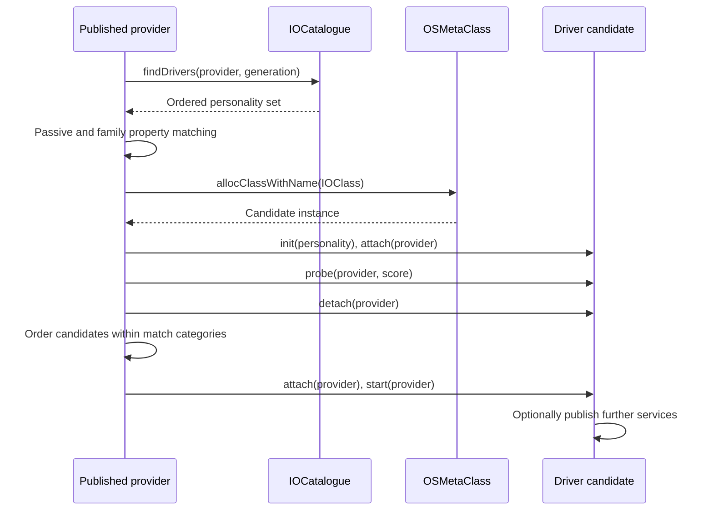

# Registry and service lifecycle

[Subsystem overview](README.md) · [Execution and power](workloops-and-power.md) · [User connections](user-clients-and-driverkit.md)

For the complete selected lifecycle trace, read [service matching and coordinated termination](service-matching-and-termination.md): catalogue-generation retries, probe/start failure ownership, client start deferral, and the phase-3 finalize/stop/detach lists.

The [registry plane and property chapter](registry-planes-and-properties.md) follows reciprocal link references, property snapshot depth, path lookup and live-versus-snapshot iteration. [Notification and arbitration](service-notifications-and-arbitration.md) explains callback registration/replay, removal drains and service-owner handoff.

## A registry entry is an object with relationships

`IORegistryEntry` contains `fPropertyTable` and `fRegistryTable`. The former describes the entry; the latter carries registry bookkeeping, including links indexed by plane. `IORegistryPlane` has symbols identifying parent/child sets and plane-specific names and locations. Consequently, “the registry tree” is an incomplete description: entries can participate in multiple planes, and a plane can have multiple parents. [`IORegistryEntry` fields](../../../platydoc-data/xnu/iokit/IOKit/IORegistryEntry.h#L101), [`IORegistryPlane`](../../../platydoc-data/xnu/iokit/Kernel/IORegistryEntry.cpp#L95).

`attachToParent` takes the global registry write lock, assigns a monotonically allocated entry ID if necessary, and creates reciprocal parent and child links. It releases the graph lock before performing property-table work and the reciprocal attachment callback. `detachFromParent` temporarily retains the parent while removing links and invoking the reciprocal operation. These references matter because an array removal can release its contained object. [`attachToParent`](../../../platydoc-data/xnu/iokit/Kernel/IORegistryEntry.cpp#L2071), [`detachFromParent`](../../../platydoc-data/xnu/iokit/Kernel/IORegistryEntry.cpp#L2192).

The registry has two separate locking domains. `RLOCK`/`WLOCK` protect the global graph and generation count; `PLOCK` protects an entry's property table with its recursive lock. A `getProperty` result is borrowed after the property lock is released. Use the `copyProperty` ownership path when the object must remain valid independently of concurrent replacement. This is especially visible in matching, which repeatedly copies properties and explicitly releases them. [`Registry lock macros`](../../../platydoc-data/xnu/iokit/Kernel/IORegistryEntry.cpp#L113), [`getProperty`](../../../platydoc-data/xnu/iokit/Kernel/IORegistryEntry.cpp#L732), [`copyProperty` definitions](../../../platydoc-data/xnu/iokit/Kernel/IORegistryEntry.cpp#L481).

Published collection-valued properties are marked immutable by `attachToParent` and `setProperty`. This protects the registry's published object graph from casual mutation through an obtained collection pointer; it does not make every other driver field atomic. [`setProperty`](../../../platydoc-data/xnu/iokit/Kernel/IORegistryEntry.cpp#L759).

## Publishing triggers matching

`IOService` adds `__provider`, its provider-generation cache, `__owner`, `__state[2]`, and `pwrMgt`. Attachment, publication, successful start, exclusive opening, and power registration are different transitions. [`IOService` fields](../../../platydoc-data/xnu/iokit/IOKit/IOService.h#L446).

`attach(provider)` serializes against the provider's arbitration state and refuses an inactive provider. It adds the service to `gIOServicePlane`; it does not itself select a driver. `registerService` checks that the object is connected to the registry root, allows platform adjustment, installs platform actions, and calls `startMatching`. The latter records pending configuration and busy state, then arranges synchronous or asynchronous matching according to options and inherited state. [`attach`](../../../platydoc-data/xnu/iokit/Kernel/IOService.cpp#L884), [`registerService`](../../../platydoc-data/xnu/iokit/Kernel/IOService.cpp#L1044), [`startMatching`](../../../platydoc-data/xnu/iokit/Kernel/IOService.cpp#L1104).

`IOCatalogue::findDrivers` traverses the provider's metaclass superclass chain, accumulating personalities indexed by those classes. It returns an ordered set and a catalogue generation under the catalogue read lock. This is candidate discovery, not the entire matching decision. [`findDrivers`](../../../platydoc-data/xnu/iokit/Kernel/IOCatalogue.cpp#L215).

`doServiceMatch` updates publication state and notifications, obtains resources, and invokes `probeCandidates`. It repeats if the service was re-registered or the catalogue generation changed. At completion it clears configuration state, permits deferred termination to advance, and decrements its busy count. A successful return from a publication call therefore should not be confused with a guarantee that every child is fully initialized. [`doServiceMatch`](../../../platydoc-data/xnu/iokit/Kernel/IOService.cpp#L5507).

## Probe results and start are separate decisions

`probeCandidates` copies each personality before matching can modify it. It checks passive matching, category occupancy, availability of the executable, and DriverKit-specific launch conditions. A missing module can stall matching until loading makes the class available. Candidates are allocated by the personality's `IOClass` through the metaclass runtime, initialized, temporarily attached, and probed. `probe` can return an instance and change its score; the implementation then detaches the probing instance and orders returned candidates within each match category. [`probeCandidates`](../../../platydoc-data/xnu/iokit/Kernel/IOService.cpp#L3851), [`probe` and `start` defaults](../../../platydoc-data/xnu/iokit/Kernel/IOService.cpp#L773).

`startCandidate` reattaches the selected service and calls `start`. For DriverKit personalities it also obtains a user server and checks the applicable entitlement/matching conditions before startup; see [DriverKit](user-clients-and-driverkit.md). A failed `start` causes detachment. The category loop tries candidates until one starts, while deferred matching can stop the attempt. This is why a high initial `IOProbeScore` alone does not prove that a driver owns a device. [`startCandidate`](../../../platydoc-data/xnu/iokit/Kernel/IOService.cpp#L4981), [`start` invocation and cleanup](../../../platydoc-data/xnu/iokit/Kernel/IOService.cpp#L5110).

Provider opening is another operation. `open` uses arbitration, checks inactivity, and calls the overridable open policy. The base `handleOpen` stores one `__owner`, with a seize path that requests the existing owner to close; subclasses can implement other policies. The existence of an attachment does not imply exclusive hardware access. [`open`](../../../platydoc-data/xnu/iokit/Kernel/IOService.cpp#L3522), [`handleOpen`](../../../platydoc-data/xnu/iokit/Kernel/IOService.cpp#L3616).

## Removal is a coordinated protocol

`terminate` does not simply delete the object. Phase 1 visits affected services, marks them inactive, removes published/matched state, and coordinates termination through clients. The worker's next phase waits for conflicting configuration/start activity, runs termination callbacks, and records phase-3 state. Finalization is deferred until client relationships allow it. Some callbacks are routed through the service's workloop, so removal crosses both arbitration and driver execution domains. [`terminatePhase1`](../../../platydoc-data/xnu/iokit/Kernel/IOService.cpp#L2547), [`terminateWorker`](../../../platydoc-data/xnu/iokit/Kernel/IOService.cpp#L3171).

`detach` removes the service-plane relationship, updates busy propagation and termination scheduling, and can initiate provider rematching when the appropriate flag is set. `free` separately releases PM, interrupt, user-server, and superclass resources. An inactive service can therefore remain allocated while references or clients still exist. [`detach`](../../../platydoc-data/xnu/iokit/Kernel/IOService.cpp#L946), [`free`](../../../platydoc-data/xnu/iokit/Kernel/IOService.cpp#L832).

When debugging a missing device, follow these questions in order: did its provider publish; did the catalogue produce a personality; did passive/family matching accept it; was the executable available; did probe return an instance; did start succeed; and did the resulting service publish what its next client expects? For a disappearing device, inspect inactive/configuration flags, outstanding clients and opens, and callback completion before assuming the C++ destructor is the relevant boundary.

<!-- BEGIN PLATYDOC DOCUMENTATION LICENSE -->
Original Platydoc text and diagrams are licensed under [CC BY 4.0](https://creativecommons.org/licenses/by/4.0/). Quoted source code and third-party material retain their respective licenses.
<!-- END PLATYDOC DOCUMENTATION LICENSE -->
