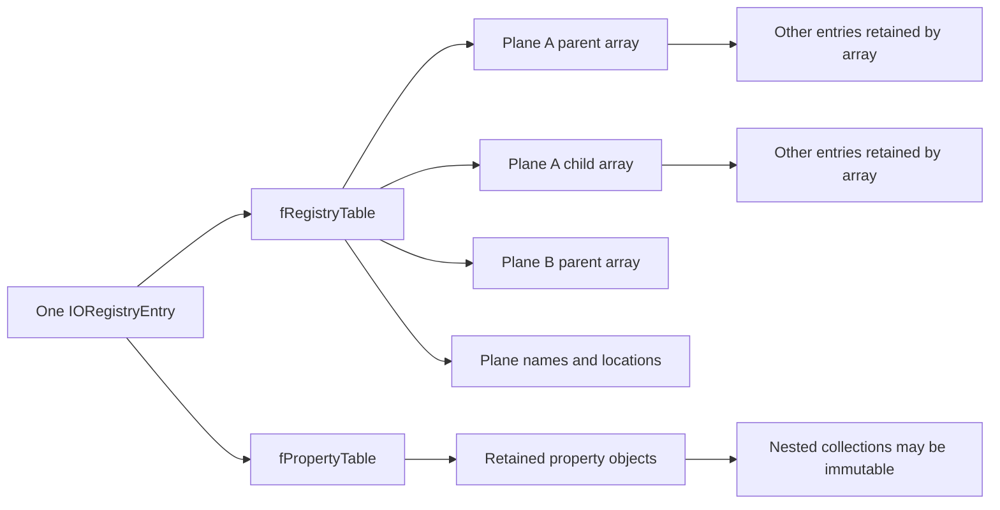

# Registry planes, property ownership, and traversal

The I/O Registry combines a graph of entries with property dictionaries. Those two kinds of state use different locks, lifetimes, and iteration mechanisms. This chapter follows the concrete `IORegistryEntry` and `IORegistryIterator` implementation; [the registry introduction](registry-and-service-lifecycle.md) gives the shorter component map, [object runtime and collections](object-runtime-and-collections.md) explains retained container members, and [service matching and termination](service-matching-and-termination.md) adds IOService-specific lifecycle rules. [`IORegistryEntry.cpp` lock definitions](../../../xnu/iokit/Kernel/IORegistryEntry.cpp#L112-L131).

## 1. One entry can participate in several plane graphs

`IORegistryPlane` stores a plane name and symbols for parent links, child links, plane-specific path name, and plane-specific location. `makePlane()` creates those symbols by appending suffixes to the plane name and installs the plane in the global plane dictionary. An entry's `fRegistryTable` stores graph links and names under those symbols; `fPropertyTable` stores ordinary properties. `IOREGSPLITTABLES` is defined in this implementation, so these are separate dictionaries even though the source retains a non-split macro alternative. [`plane fields and macros`](../../../xnu/iokit/Kernel/IORegistryEntry.cpp#L94-L131), [`makePlane`](../../../xnu/iokit/Kernel/IORegistryEntry.cpp#L201-L265), [`entry initialization`](../../../xnu/iokit/Kernel/IORegistryEntry.cpp#L289-L345).

| State | Owner/synchronization | Meaning |
|---|---|---|
| Plane descriptor and `gIORegistryPlanes` | Global registry graph lock | Symbols that select a particular graph and its path names |
| `fRegistryTable` | Global `gIORegistryLock`, shared for reads and exclusive for writes | Parent/child arrays and name/location metadata |
| `fPropertyTable` | Per-entry recursive `reserved->fLock` | Property dictionary; setters retain values through the dictionary |
| `fRegistryEntryID` | Assigned from `gIORegistryLastID` under graph write lock | Entry identity independent of a particular path |
| `fRegistryEntryParentGenerationCount` | Updated in parent-link make/break helpers | Parent-link change counter, not a snapshot of all properties |
| `fIndexedProperties` | Array publication uses acquire/release atomics; slot accesses are a separate contract | Indexed owners outside the regular property dictionary |

The first five rows follow the plane constructor, lock macros, graph helpers and attachment code; the indexed-array distinction follows its separate implementation. [`locks`](../../../xnu/iokit/Kernel/IORegistryEntry.cpp#L112-L131), [`links`](../../../xnu/iokit/Kernel/IORegistryEntry.cpp#L1707-L1756), [`attachment/ID`](../../../xnu/iokit/Kernel/IORegistryEntry.cpp#L2071-L2155), [`indexed properties`](../../../xnu/iokit/Kernel/IORegistryEntry.cpp#L953-L1001).



This is a graph interface: parent and child relationships are arrays, and an entry may have more than one parent. `getDepth()` follows a single-parent chain directly and recursively takes the maximum parent depth when several parents exist. `getParentEntry()` selects the first parent, so a generated path is not a canonical encoding of every possible route. The attachment body rejects `this == parent/child`, but does not perform a general graph-cycle search. Do not infer that every traversal is cycle-safe merely because one recursive iterator maintains a visited set. [`getDepth`](../../../xnu/iokit/Kernel/IORegistryEntry.cpp#L2294-L2333), [`first parent`](../../../xnu/iokit/Kernel/IORegistryEntry.cpp#L1801-L1829), [`attachment`](../../../xnu/iokit/Kernel/IORegistryEntry.cpp#L2071-L2094), [`recursive iterator`](../../../xnu/iokit/Kernel/IORegistryEntry.cpp#L2522-L2540).

## 2. Reciprocal links retain entries and must be detached

`makeLink()` finds or creates the relation's `OSArray`, avoids duplicate membership, and inserts the other entry as a retained array member. `attachToParent()` holds the graph write lock while installing the local parent link and, if necessary, the parent's child link. After unlocking, it marks collection-valued properties immutable, then calls the reciprocal virtual `attachToChild()` if the parent side needed installation. The reciprocal method finds the already-installed links and avoids endlessly calling back. This permits subclass hooks while keeping the actual adjacency changes under the global lock. [`makeLink`](../../../xnu/iokit/Kernel/IORegistryEntry.cpp#L1707-L1734), [`attachToParent`](../../../xnu/iokit/Kernel/IORegistryEntry.cpp#L2071-L2145), [`attachToChild`](../../../xnu/iokit/Kernel/IORegistryEntry.cpp#L2158-L2189).

The core pair of link installations is small: [`attachToParent`](../../../xnu/iokit/Kernel/IORegistryEntry.cpp#L2090-L2101).

<!-- source-excerpt: ../../../xnu/iokit/Kernel/IORegistryEntry.cpp#L2090-L2101 -->
```cpp
	ret = makeLink( parent, kParentSetIndex, plane );

	if ((links = parent->getChildSetReference( plane ))) {
		needParent = (false == arrayMember( links, this ));
	} else {
		needParent = true;
	}
	if (needParent) {
		ret &= parent->makeLink(this, kChildSetIndex, plane);
	}

	UNLOCK;
```

The Boolean result accumulates success with `ret &= ...`; it does not roll back the first link if the reciprocal allocation/insertion fails. The virtual callback after unlock can also contribute a false result. Callers must read a false result as an unsuccessful operation, not proof that no graph state changed. This chapter does not claim that those allocation failures were reproduced. [`attachToParent`](../../../xnu/iokit/Kernel/IORegistryEntry.cpp#L2091-L2145), [`attachToChild`](../../../xnu/iokit/Kernel/IORegistryEntry.cpp#L2171-L2189).

Detach takes an explicit temporary reference to the other endpoint, removes both adjacency references while holding the write lock, unlocks, performs the reciprocal virtual detach when needed, then releases the temporary owner. The temporary reference matters because removing an array entry drops an object reference. `detachAbove()` similarly retains `this` across repeatedly removing its parents. `detachAll()` first collects descendants, detaches the starting entry, then removes ancestors from those collected entries in reverse order. [`detach pair`](../../../xnu/iokit/Kernel/IORegistryEntry.cpp#L2192-L2251), [`detachAbove/All`](../../../xnu/iokit/Kernel/IORegistryEntry.cpp#L2254-L2291).

Because parent and child arrays retain one another's entries, ordinary reference counting cannot reclaim an attached component simply because its creator drops a reference. Explicit graph teardown is part of lifecycle. `IORegistryEntry::free()` checks for remaining IOService-plane relations and panics if still attached, then releases dictionaries, indexed objects and its property lock. The diagnostic checks the service plane; it should not be described as an exhaustive validation of every plane. [`free`](../../../xnu/iokit/Kernel/IORegistryEntry.cpp#L415-L458), [service termination ordering](service-matching-and-termination.md).

The global generation count increments every time the `WLOCK` macro is used, including operations that later discover no useful change. Parent generation counters likewise increment in the relation helpers for parent operations. These are mutation indicators, not transactional sequence numbers or evidence that a specific object was replaced. [`lock macros`](../../../xnu/iokit/Kernel/IORegistryEntry.cpp#L112-L122), [`parent counters`](../../../xnu/iokit/Kernel/IORegistryEntry.cpp#L1729-L1755).

## 3. Property locks protect lookup; copy APIs add lifetime

`getProperty(symbol)` takes the per-entry property lock, obtains the dictionary's borrowed pointer, and unlocks before returning. It does not give the caller a reference. A caller that will use a value while another thread may replace/remove the property needs `copyProperty()` or another explicit lifetime protocol. The copy macro takes the recursive lock, performs the lookup, retains the object before unlocking, and returns that owner. Its nested call to `getProperty()` is supported by the recursive lock. [`get/remove`](../../../xnu/iokit/Kernel/IORegistryEntry.cpp#L732-L749), [`copy wrapper`](../../../xnu/iokit/Kernel/IORegistryEntry.cpp#L480-L493).

The borrowed path is deliberately brief: [`getProperty`](../../../xnu/iokit/Kernel/IORegistryEntry.cpp#L731-L742).

<!-- source-excerpt: ../../../xnu/iokit/Kernel/IORegistryEntry.cpp#L731-L742 -->
```cpp
OSObject *
IORegistryEntry::getProperty( const OSSymbol * aKey) const
{
	OSObject * obj;

	PLOCK;
	obj = getPropertyTable()->getObject( aKey );
	PUNLOCK;

	return obj;
}

```

`setProperty()` tests whether the new value is a collection and the entry is in a plane, then under the property lock sets its immutable option and inserts it into the dictionary. On initial attachment, existing collection-valued properties receive the same option. This protects the structure of published collections according to `haveUpdated()`'s checks; it is not hardware read-only memory, and it does not make every non-collection value immutable. The dictionary itself remains replaceable through the entry's property APIs. [`setProperty`](../../../xnu/iokit/Kernel/IORegistryEntry.cpp#L759-L777), [`attachment option propagation`](../../../xnu/iokit/Kernel/IORegistryEntry.cpp#L2119-L2141), [`collection mutation check`](../../../xnu/libkern/c++/OSCollection.cpp#L66-L76).

`runPropertyAction()` holds that recursive property lock across a caller callback, making a multi-step property transaction possible for cooperating users of the same entry lock. It does not take the graph lock or the IOService arbitration lock. Conversely, `setProperties()` is a virtual high-level request and the base implementation returns `kIOReturnUnsupported`; it is not an alias for directly replacing all dictionary members. [`property action`](../../../xnu/iokit/Kernel/IORegistryEntry.cpp#L791-L800), [`base setProperties`](../../../xnu/iokit/Kernel/IORegistryEntry.cpp#L584-L598).

Snapshot APIs have different depth. `dictionaryWithProperties()` shallow-copies the property dictionary while holding the property lock; its values remain retained shared objects. `serializeProperties()` calls `copyCollection()` under the lock, then unlocks before invoking `serialize()` on the resulting container graph and releases that snapshot afterward. Nested collections are copied according to their implementations, but non-collection leaves are shared. The resulting serialization is not a global snapshot of all entries or an automatic byte-copy of mutable `OSData` leaves. [`dictionaryWithProperties`](../../../xnu/iokit/Kernel/IORegistryEntry.cpp#L571-L582), [`serializeProperties`](../../../xnu/iokit/Kernel/IORegistryEntry.cpp#L543-L558), [collection-copy depth](object-runtime-and-collections.md).

The snapshot-before-serialization order avoids holding the entry property lock across the entire serializer callback graph: [`serializeProperties`](../../../xnu/iokit/Kernel/IORegistryEntry.cpp#L542-L558).

<!-- source-excerpt: ../../../xnu/iokit/Kernel/IORegistryEntry.cpp#L542-L558 -->
```cpp
bool
IORegistryEntry::serializeProperties( OSSerialize * s ) const
{
//    setProperty( getRetainCount(), 32, "__retain" );

	PLOCK;
	OSCollection *snapshotProperties = getPropertyTable()->copyCollection();
	PUNLOCK;

	if (!snapshotProperties) {
		return false;
	}

	bool ok =  snapshotProperties->serialize( s );
	snapshotProperties->release();
	return ok;
}
```

Indexed properties deserve a separate warning about contract, not a blanket safety claim. `setIndexedProperty()` atomically publishes a lazily allocated array, retains the new object, assigns a slot, and returns the previous pointer without releasing it. The caller receives that previous ownership to handle. Slot reads/writes themselves are plain accesses in this body; array-publication atomics do not establish a general synchronized replacement API. Final free releases objects still present in the array. [`indexed setters/getters`](../../../xnu/iokit/Kernel/IORegistryEntry.cpp#L953-L1001), [`final release`](../../../xnu/iokit/Kernel/IORegistryEntry.cpp#L442-L450).

## 4. Paths identify a route, names and locations are plane-sensitive

`getName(plane)` first looks for the plane-specific name symbol, falls back to the common name, then to the metaclass name. `getLocation()` has the analogous plane-specific lookup. Borrowed name strings are backed by symbols; `copyName()` instead retains the selected symbol under the graph lock or creates a symbol for the fallback class name. [`names`](../../../xnu/iokit/Kernel/IORegistryEntry.cpp#L1008-L1051), [`locations`](../../../xnu/iokit/Kernel/IORegistryEntry.cpp#L1054-L1086).

`getPath()` writes a plane prefix followed by a route from the plane's root. It may use aliases; otherwise it walks parents into a retained stack and emits `name@location` components in reverse. Buffer checks reserve space and update the reported length on the paths shown in the body. `getPathComponent()` includes `@location` only when a location exists. Because parent selection uses the first parent, a graph with several incoming edges can have other valid routes that this call does not emit. [`getPath`](../../../xnu/iokit/Kernel/IORegistryEntry.cpp#L1240-L1342), [`component`](../../../xnu/iokit/Kernel/IORegistryEntry.cpp#L1345-L1376).

`fromPath()` parses a plane prefix if no plane is supplied, resolves an alias if present, and then walks child components under the graph read lock. Components match names and optional locations. Location comparison parses hexadecimal numeric fields and separators, so it is not simply a byte-for-byte string comparison. Alias storage is read from the `/aliases` entry as data containing paths; that is a convention consumed by these helpers, not a general filesystem symlink implementation. [`fromPath`](../../../xnu/iokit/Kernel/IORegistryEntry.cpp#L1563-L1668), [`child matching`](../../../xnu/iokit/Kernel/IORegistryEntry.cpp#L1429-L1477), [`location comparison`](../../../xnu/iokit/Kernel/IORegistryEntry.cpp#L1379-L1426), [`aliases`](../../../xnu/iokit/Kernel/IORegistryEntry.cpp#L1480-L1560).

The residual-path arguments alter success semantics: with `opath` and `length`, the function can return the entry reached so far and report the remaining text; without them, trailing unconsumed path causes failure. A successful result is retained while still under the graph read lock, so the caller owns a reference. `childFromPath()` forwards to the same retained lookup with `this` as its starting entry; it does not drop that returned reference. [`residual and retain`](../../../xnu/iokit/Kernel/IORegistryEntry.cpp#L1636-L1668), [`child wrapper`](../../../xnu/iokit/Kernel/IORegistryEntry.cpp#L1671-L1684).

## 5. Snapshot adjacency iterators and live recursive iterators differ

`getParentIterator()` and `getChildIterator()` copy the relevant link array under the graph read lock and return an iterator over that retained snapshot. `applyToParents/Children()` likewise copies the adjacency array, unlocks, and invokes callbacks afterward. The snapshot keeps those objects alive, but it does not guarantee they remain attached when the callback runs. Code that requires current service activity must recheck the corresponding service state. [`parent iterator`](../../../xnu/iokit/Kernel/IORegistryEntry.cpp#L1772-L1798), [`child iterator`](../../../xnu/iokit/Kernel/IORegistryEntry.cpp#L1843-L1868), [`callback snapshots`](../../../xnu/iokit/Kernel/IORegistryEntry.cpp#L1926-L1975).

`IORegistryIterator` instead maintains a cursor stack through live link arrays. Creation retains the root. `getNextObjectFlat()` takes the graph read lock, creates a collection iterator for the selected parent's/child's links on first entry, releases the previous current entry when advancing, obtains the next borrowed array member, and retains it as the new current entry. If the nested collection iterator became invalid, it sets a sticky invalid flag. Returned entries are owned by the iterator's current cursor, not transferred to the caller. [`creation`](../../../xnu/iokit/Kernel/IORegistryEntry.cpp#L2347-L2375), [`flat iteration`](../../../xnu/iokit/Kernel/IORegistryEntry.cpp#L2482-L2519).

Recursive iteration keeps an ordered `done` set. It enters a returned node only when inserting it into `done` succeeds; encountering the same entry again can still return that entry, but does not recursively descend into it again. Thus the visited set bounds descent through repeated edges; it does not mean each `getNextObject()` result is unique. `iterateAll()` exhausts recursive traversal and returns a retained `done` set, which does contain unique members. [`recursive traversal`](../../../xnu/iokit/Kernel/IORegistryEntry.cpp#L2522-L2540), [`iterateAll`](../../../xnu/iokit/Kernel/IORegistryEntry.cpp#L2563-L2573).

The precise branch is worth reading: [`getNextObjectRecursive`](../../../xnu/iokit/Kernel/IORegistryEntry.cpp#L2521-L2540).

<!-- source-excerpt: ../../../xnu/iokit/Kernel/IORegistryEntry.cpp#L2521-L2540 -->
```cpp
IORegistryEntry *
IORegistryIterator::getNextObjectRecursive( void )
{
	IORegistryEntry *   next;

	do{
		next = getNextObjectFlat();
	} while ((NULL == next) && exitEntry());

	if (next) {
		if (NULL == done) {
			done = OSOrderedSet::withCapacity( 10 );
		}
		if (done->setObject((OSObject *) next)) {
			// done set didn't contain this one, so recurse
			enterEntry();
		}
	}
	return next;
}
```

There is also an implementation limit in `isValid()` worth preserving when reasoning about concurrent graph changes. It initializes `next = where` and advances `next` through cursor links, but the nested check uses `where->iter`, not `next->iter`. The visible body therefore must not be summarized as validating every ancestor iterator. Each flat advancement still tests its current collection iterator, and the sticky invalid flag is checked; this documentation reports the body without asserting a reproduced failure or correcting kernel source. [`IORegistryIterator::isValid`](../../../xnu/iokit/Kernel/IORegistryEntry.cpp#L2385-L2405).

<!-- source-excerpt: ../../../xnu/iokit/Kernel/IORegistryEntry.cpp#L2390-L2402 -->
```cpp
	next = where;

	RLOCK;

	ok = (0 == (kIORegistryIteratorInvalidFlag & options));

	while (ok && next) {
		if (where->iter) {
			ok = where->iter->isValid();
		}
		next = next->next;
	}
	UNLOCK;
```

`reset()` exits every cursor, releases the visited set, points back at the retained root and clears the sticky flag. `free()` resets and releases the root. A restart can therefore recover a traversal after observed invalidation, but it starts a new observation of a potentially different graph rather than continuing an atomic snapshot. [`cursor teardown/reset/free`](../../../xnu/iokit/Kernel/IORegistryEntry.cpp#L2431-L2478).

## Reading route and limits

Read `makeLink/breakLink`, the attach/detach pair, and the borrowed/copy property wrappers first. Then compare `dictionaryWithProperties` with `serializeProperties`, and compare `getChildIterator` with `IORegistryIterator::getNextObjectFlat`. Finish with `fromPath` and the exact validity loop; these explain why ownership, snapshot depth and graph stability must be considered separately.

| Inspected implementation | Coverage | Remaining boundary |
|---|---|---|
| Plane construction, split dictionaries, attach/detach/free | Full selected link and property ownership paths | Every IORegistryEntry subclass hook is not audited |
| Property set/get/copy/action/snapshot/indexed APIs | Locks, retained versus borrowed values, snapshot depth | Per-driver property schemas and user-facing authorization remain driver-specific |
| Names, locations, paths, aliases | Lookup/formatting, residual path, returned reference | All malformed alias graphs and numeric parser corner cases are not tested |
| Both adjacency snapshots and recursive cursor iteration | Reference movement, invalidation, repeated nodes, reset | No concurrent mutation stress test; exact `where`/`next` limitation is source-only |

The graph relationships here are distinct from device-resource allocation or service-start success. Continue with [matching and termination](service-matching-and-termination.md) for those lifecycle rules, and [notification/arbitration](service-notifications-and-arbitration.md) for callback snapshots and service locks.
