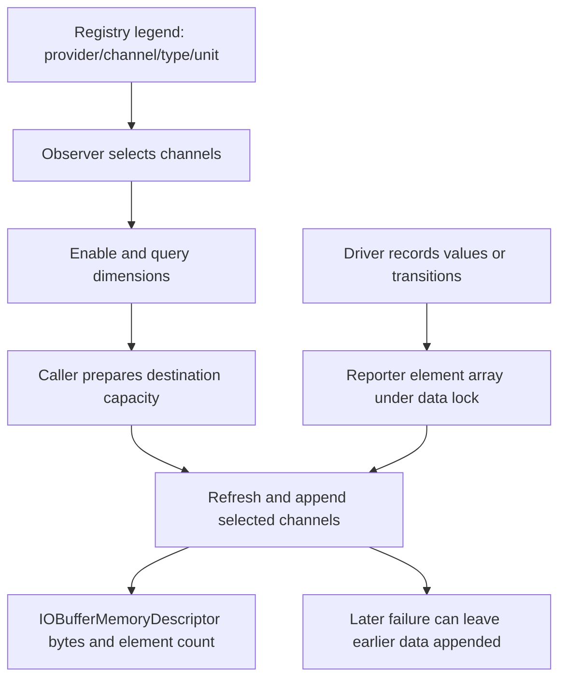

# IOKit reporting and device-work performance accounting

[Drivers](README.md) · [Device power](device-power-state-machine.md) · [Interrupts](interrupt-routing-and-command-queues.md) · [Scheduler policy](../runtime/priority-qos-and-quanta.md)

IOKit reporting exposes named measurements from services. Performance control instead tells a controller that a device-work item was submitted, began, paused or finished, carrying the originating thread group and optional resource-accounting identity. Both connect drivers to system policy and observation, but they maintain different objects and completion rules.

## 1. Reporting identifies a provider, channel and element

An `IOReportElement` contains provider ID, channel ID, channel type, timestamp and values. Provider ID comes from the reporting service's registry entry ID. Channel ID is meaningful with that provider identity; it need not be a globally unique integer by itself. A channel's type records format and number of elements, allowing one channel to represent one simple value, multiple states, or histogram buckets. [Element layout](../../../xnu/iokit/IOKit/IOReportTypes.h#L195-L201), [channel identity contract](../../../xnu/iokit/IOKit/IOKernelReporters.h#L66-L90), [initialization](../../../xnu/iokit/Kernel/IOReporter.cpp#L156-L200).

[Source: iokit/IOKit/IOReportTypes.h, lines 195–201](../../../xnu/iokit/IOKit/IOReportTypes.h#L195-L201)

<!-- source-excerpt: ../../../xnu/iokit/IOKit/IOReportTypes.h#L195-L201 -->
```c
typedef struct {
	uint64_t                provider_id;
	uint64_t                channel_id;
	IOReportChannelType     channel_type;
	uint64_t                timestamp;// mach_absolute_time()
	IOReportElementValues   values;
} __attribute((packed)) IOReportElement;
```

An `IOReporter` keeps `_elements`, `_nElements`, `_nChannels`, `_channelDimension`, channel names, enable counts and locks. All channels in one reporter share format/dimension/unit; histogram reporters currently support a single channel. The driver can own several reporters for different formats. The base initialization stores the registry ID, rather than retaining a pointer to the reporting service as its provider identity. [Reporter contract](../../../xnu/iokit/IOKit/IOKernelReporters.h#L86-L95), [initialization and allocations](../../../xnu/iokit/Kernel/IOReporter.cpp#L174-L226).

Legends describe the available channels through registry properties. `legendWith()` assembles channel IDs, encoded channel types, optional names and unit metadata into dictionaries/arrays. `IOReportLegend::addReporterLegend()` copies the existing legend property, creates a combined legend, and publishes the result with its public marker. A legend describes what can be requested; it is not a live sample buffer. [Legend construction](../../../xnu/iokit/Kernel/IOReporter.cpp#L1018-L1090), [registry publication](../../../xnu/iokit/Kernel/IOReportLegend.cpp#L100-L132).

## 2. Configuration and updates use different locks

`_configLock` is an `IOLock` used by configuration, allocation and legend operations. `_reporterLock` is an interrupt-disabling simple lock used around element reads and updates. Public update wrappers take the data lock before invoking subclass hooks; a hook must not recursively take it or block while it is held. Configuration can allocate and must run in a context that permits blocking. Allocation/teardown do not promise same-instance concurrency safety. [Public contract](../../../xnu/iokit/IOKit/IOKernelReporters.h#L97-L111), [lock implementations](../../../xnu/iokit/Kernel/IOReporter.cpp#L395-L422), [subclass rules](../../../xnu/iokit/IOKit/IOKernelReporters.h#L389-L429).

Adding a channel demonstrates why two locks exist:

1. Acquire the configuration lock, validate the new count, ensure name-array capacity and obtain the name symbol.
2. Allocate larger `_swapElements` and `_swapEnableCounts` buffers while the data lock is free.
3. Take the data lock, copy existing values/counts into the new arrays, exchange active and spare pointers, initialize the new channel's element metadata, and update dimensions.
4. Drop the data lock and free the now-unused arrays under the configuration lock.

If swapping fails after pointer exchange, the handler restores the original buffers so cleanup frees the new allocation. The outer function chooses the correct old/new allocation size for cleanup. A source FIXME explicitly notes missing duplicate-channel detection; a caller must not infer that `addChannel()` rejects every duplicate ID. [Outer transaction](../../../xnu/iokit/Kernel/IOReporter.cpp#L274-L335), [allocation and unwind](../../../xnu/iokit/Kernel/IOReporter.cpp#L426-L488), [swap/rollback](../../../xnu/iokit/Kernel/IOReporter.cpp#L493-L572).

[Source: iokit/Kernel/IOReporter.cpp, lines 312–327](../../../xnu/iokit/Kernel/IOReporter.cpp#L312-L327)

<!-- source-excerpt: ../../../xnu/iokit/Kernel/IOReporter.cpp#L312-L327 -->
```cpp
	// allocate new buffers into _swap* variables
	if ((kerr = handleSwapPrepare(newNChannels))) {
		// on error, channels are *not* swapped
		res = kerr; goto finish;
	}

	// exchange main and _swap* buffers with buffer contents protected
	// IOReporter::handleAddChannelSwap() also increments _nElements, etc
	lockReporter();
	res = handleAddChannelSwap(channelID, symChannelName.get());
	unlockReporter();
	// On failure, handleAddChannelSwap() leaves *new* buffers in _swap*.
	// On success, it's the old buffers, so we put the right size in here.
	if (res == kIOReturnSuccess) {
		freeNChannels = oldNChannels;
	}
```

This permits an interrupt-context value update to continue using the existing array while a configuration caller allocates its replacement. It is not an RCU or SMR scheme: the actual exchange and data access are serialized by the same data lock.

## 3. Enablement, dimensions and sample copying are separate operations

`configureReport()` takes the configuration lock and dispatches to `handleConfigureReport()`. For channel IDs it recognizes, enable/disable adjusts both aggregate and per-channel counts and increments the caller's matched-channel count. A dimensions query adds the channel's element count to the caller's result. Unknown channel IDs are ignored so several reporters can process the same request list. The body does not clamp unmatched disables to zero, so balanced configuration calls remain a caller obligation. [Configuration wrapper](../../../xnu/iokit/Kernel/IOReporter.cpp#L354-L369), [count changes](../../../xnu/iokit/Kernel/IOReporter.cpp#L606-L662).

`updateReport()` instead takes the data lock. The handler checks the destination is an `IOBufferMemoryDescriptor`, requires nonzero aggregate `_enabled`, finds requested channels, refreshes each through `updateChannelValues()` and appends its elements. It does not gate each selected channel on `_enableCounts[channel_index]` in this body. The destination must have sufficient remaining capacity; successful appends advance its length and the caller's element count. A later channel can fail after earlier channels were copied, with no rollback of those bytes. [Update handler](../../../xnu/iokit/Kernel/IOReporter.cpp#L670-L744), [append and capacity checks](../../../xnu/iokit/Kernel/IOReporter.cpp#L821-L871).

Sampling a list is not a global instantaneous snapshot. Every 32 requested channels, the handler releases the data lock, delays briefly and reacquires it so interrupt-context reporters can make progress:

[Source: iokit/Kernel/IOReporter.cpp, lines 696–709](../../../xnu/iokit/Kernel/IOReporter.cpp#L696-L709)

<!-- source-excerpt: ../../../xnu/iokit/Kernel/IOReporter.cpp#L696-L709 -->
```cpp
	for (chIdx = 0; chIdx < channelList->nchannels; chIdx++) {
		// Drop the lock periodically to allow reporters to emit data, as they
		// might be running in interrupt context.
		//
		// This is safe because the spinlock is really only protecting the
		// element array, any other changes to the reporter will need to
		// take the configuration lock.   Keeping the lock between channels
		// isn't protecting us from anything, because there's no API to
		// update multiple channels atomically anyway.
		if ((chIdx & UNLOCK_PERIOD_MASK) == UNLOCK_PERIOD_MASK) {
			unlockReporter();
			delay(1);
			lockReporter();
		}
```

Even without that release, the API supplies no operation that atomically changes all reporters' channels together. Element timestamps and format-specific state are needed to interpret a sample.

The static `configureAllReports()` and `updateAllReports()` helpers iterate a set and call each reporter, but explicitly discard each reporter's return status. Their aggregate success means the helper completed its supported traversal, not that every channel operation succeeded. The base `IOService` reporting methods similarly fan out to PM and interrupt-statistics reporting, with an additional DriverKit forwarding path where present. [Aggregate helpers](../../../xnu/iokit/Kernel/IOReporter.cpp#L50-L145), [service dispatch](../../../xnu/iokit/Kernel/IOService.cpp#L9207-L9308).



## 4. Simple, state and histogram formats have different update semantics

`IOSimpleReporter::setValue()` and `incrementValue()` find the channel's element, copy its values under the data lock, change the scalar and call `setElementValues()`. The base setter writes the value bytes and a recording timestamp, using `mach_absolute_time()` when no timestamp is supplied. Increment uses ordinary integer addition in this body, not a stated saturation policy. [Simple operations](../../../xnu/iokit/Kernel/IOSimpleReporter.cpp#L77-L153), [base timestamp](../../../xnu/iokit/Kernel/IOReporter.cpp#L764-L790).

`IOStateReporter` tracks the current state and last update time for each channel. On a state change it increments the target state's entry count and last-entry timestamp, then credits residency to the previous state. It computes that residency from transition time minus the previous update time when the supplied `prev_state_residency` is zero; a nonzero supplied residency overrides that calculation. The first transition has no earlier update time to charge. Reporting while still in the same state adds residency since the last update and moves the accounting baseline forward. Sampling therefore changes internal accounting even though no hardware state transition occurred. [Transition accounting](../../../xnu/iokit/Kernel/IOStateReporter.cpp#L614-L714), [sample-time refresh](../../../xnu/iokit/Kernel/IOStateReporter.cpp#L807-L871).

[Source: iokit/Kernel/IOStateReporter.cpp, lines 851–865](../../../xnu/iokit/Kernel/IOStateReporter.cpp#L851-L865)

<!-- source-excerpt: ../../../xnu/iokit/Kernel/IOStateReporter.cpp#L851-L865 -->
```cpp
	// calculate time in state
	currentTime = mach_absolute_time();
	time_in_state = currentTime - last_ch_update_time;
	state_values.upticks += time_in_state;

	// and store the values
	kerr = setElementValues(element_idx,
	    (IOReportElementValues *)&state_values,
	    currentTime);
	if (kerr) {
		result = kerr; goto finish;
	}

	// Record basis for next "prior time" calculation
	_lastUpdateTimes[channel_index] = currentTime;
```

Manual increment/override APIs are a different mode. The state reporter comments and checks prohibit mixing those with automatic time-in-state tracking for the same channel. A consumer should not combine an externally supplied residency total with inferred elapsed time without understanding which mode the producer uses. [Mode distinction](../../../xnu/iokit/Kernel/IOStateReporter.cpp#L670-L711), [no automatic refresh before initialization/manual mode](../../../xnu/iokit/Kernel/IOStateReporter.cpp#L823-L833).

`IOHistogramReporter::tallyValue()` finds the first bucket whose upper bound contains the value, leaving the last bucket unbounded above. On its first hit it initializes minimum and maximum; each hit updates extrema, sum and hit count. The sum uses `os_add_overflow()` and assigns `INT64_MAX` on overflow; the hit counter is incremented directly. Thus “histogram arithmetic saturates” would overstate the behavior. Bucket geometry and other configuration are supplied at creation and described in the legend. [Tally body](../../../xnu/iokit/Kernel/IOHistogramReporter.cpp#L331-L383), [configuration](../../../xnu/iokit/Kernel/IOHistogramReporter.cpp#L73-L254), [legend extension](../../../xnu/iokit/Kernel/IOHistogramReporter.cpp#L273-L302).

## 5. Performance control registers callbacks and preserves submitter identity

`IOPerfControlClient` owns a per-client work table and shares a controller interface. Initialization publishes the shared interface with an atomic compare-exchange; a losing initializer frees its temporary state. Default callbacks provide no controller policy, and work admission defaults to declining tracking. A fixed work-table capacity is allocated when requested, reserving token zero for untracked work. [Shared initialization and table](../../../xnu/iokit/Kernel/IOPerfControl.cpp#L32-L108).

Device registration runs under `interfaceLock`. If the controller has not registered, the client is retained in `deviceRegistrationList`; installing a versioned controller later invokes registration callbacks for pending devices and removes them from the set. Newer interface versions add driver-state registration, work updates and resource-accounting completion. The visible registration body accepts installation only while the current version is `NONE`. [Device registration](../../../xnu/iokit/Kernel/IOPerfControl.cpp#L350-L383), [controller publication/replay](../../../xnu/iokit/Kernel/IOPerfControl.cpp#L818-L874).

With `CONFIG_THREAD_GROUPS`, `workSubmit()` captures the current thread's group, builds a `WorkState`, and asks `workCanSubmit()`. If accepted, it allocates a free table entry under an interrupt-disabling lock, retains the group, and conditionally retains the current task's resource coalition. The entry holds controller-private work bytes and a started flag. The controller receives the local index combined with driver-index bits. These tokens identify tracked work; they are not Mach rights or authorization capabilities. The source explicitly notes that driver indices can wrap. [Submit](../../../xnu/iokit/Kernel/IOPerfControl.cpp#L416-L445), [token allocation](../../../xnu/iokit/Kernel/IOPerfControl.cpp#L223-L269), [token encoding](../../../xnu/iokit/Kernel/IOPerfControl.cpp#L182-L193), [index limitation](../../../xnu/iokit/Kernel/IOPerfControl.cpp#L91-L96).

If tracking is declined, no thread group exists, or table allocation cannot provide a token, the untracked result tells the driver that no performance-control work identity was created. Development/debug builds panic on table exhaustion to expose leaked or undersized token pools. This status concerns tracking, not whether the device command itself was submitted successfully.

## 6. End of a work interval is not necessarily final completion

`workBegin()` reports the saved group/work state and marks the entry started. `workEnd(..., done=false)` reports an interval ending and clears started while retaining the token and submitter references for later work. With `done=true`, it returns the entry to the pool and releases those references. Version-four controllers can return resource deltas before final cleanup; the visible `accountResources()` implementation handles ANE accounting and asserts on an unexpected device type, rather than implementing arbitrary device-energy attribution. [Begin](../../../xnu/iokit/Kernel/IOPerfControl.cpp#L486-L507), [end](../../../xnu/iokit/Kernel/IOPerfControl.cpp#L510-L543), [accounting branch](../../../xnu/iokit/Kernel/IOPerfControl.cpp#L201-L213).

[Source: iokit/Kernel/IOPerfControl.cpp, lines 278–293](../../../xnu/iokit/Kernel/IOPerfControl.cpp#L278-L293)

<!-- source-excerpt: ../../../xnu/iokit/Kernel/IOPerfControl.cpp#L278-L293 -->
```cpp
	auto s = IOSimpleLockLockDisableInterrupt(workTableLock);

	auto &entry = workTable[token];
	auto *thread_group = entry.thread_group;
	auto *coal = entry.coal;
	bzero(&entry, sizeof(entry));
	workTableNextIndex = token;

	IOSimpleLockUnlockEnableInterrupt(workTableLock, s);

	// This can call into the performance controller if the last reference is dropped here. Are we sure
	// the driver isn't holding any locks? If not, we may want to async this to another context.
	thread_group_release(thread_group);
	if (coal != nullptr) {
		coalition_release(coal);
	}
```

The entry is zeroed and made reusable under the table lock, but group/coalition release happens afterward. Releasing the last group reference can call into performance control, as the comment warns; dropping the table lock does not establish that every lock held by the driver is safe for that callback. Token lookup and started-state changes also rely on a valid driver lifecycle, rather than retaining a new table entry on each operation. [Lookup and started flag](../../../xnu/iokit/Kernel/IOPerfControl.cpp#L298-L325).

A second API represents work with `IOPerfControlWorkContext`, an `OSObject` containing a unique ID, retained group/coalition, started flag and 32 controller bytes. Submission requires an unused context and retains submitter identity after admission. Final end releases group/coalition and resets the context for reuse; nonfinal end only clears started. Free asserts that no retained group or coalition remains, so releasing the object is not a substitute for finishing tracked work. [Context layout/reset/free](../../../xnu/iokit/Kernel/IOPerfControl.cpp#L548-L590), [context submission](../../../xnu/iokit/Kernel/IOPerfControl.cpp#L641-L685), [context completion](../../../xnu/iokit/Kernel/IOPerfControl.cpp#L745-L790).

These references allow a device operation to remain attributed to its submitter after that thread stops executing on a CPU. They do not prescribe a CPU scheduling algorithm or a device frequency. The performance controller's policy is supplied through callbacks, and most concrete hardware behavior is outside this implementation. See [thread groups and Clutch](../runtime/clutch-and-edge.md) for the scheduler side of workload grouping.

## Inspection scope

Deep reads covered reporter allocation/swap/cleanup, configuration counts, sampling and partial output, simple/state/histogram update bodies, legend publication, performance-interface registration, tokens, work contexts and final-reference release. Histogram construction and service report forwarding were inspected selectively. External report aggregation, userspace visualization, performance-controller algorithms, concrete driver cancellation and every telemetry/report format are not reconstructed. The documentation describes source synchronization and accounting contracts, not measurements from a running machine.

<!-- BEGIN PLATYDOC DOCUMENTATION LICENSE -->
Original Platydoc text and diagrams are licensed under [CC BY 4.0](https://creativecommons.org/licenses/by/4.0/). Quoted source code and third-party material retain their respective licenses.
<!-- END PLATYDOC DOCUMENTATION LICENSE -->
