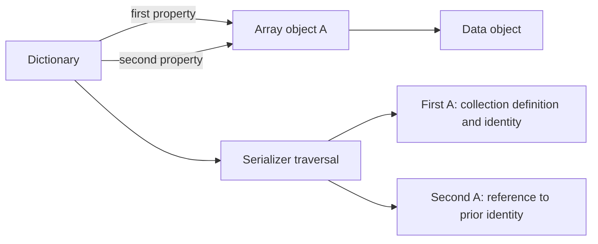
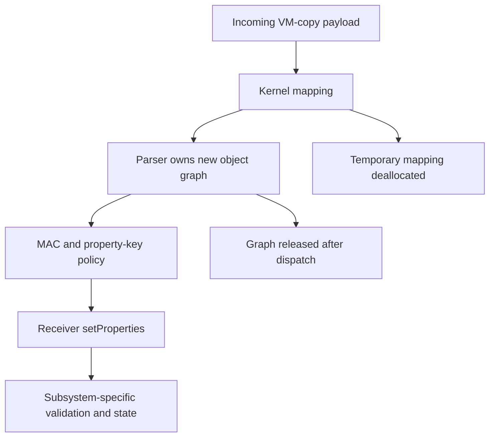

# Libkern serialization and IOKit property transport

[Driver guide](README.md) · [Object and collection ownership](object-runtime-and-collections.md) · [Registry properties](registry-planes-and-properties.md) · [Kernel collections](kext-loading-and-unloading.md) · [NVRAM](nvram-variables-and-persistence.md)

IOKit moves object graphs across several boundaries: compiled configuration into the catalogue, collection metadata into the module loader, registry snapshots out to clients, and client property dictionaries into services. The parser produces `OSObject` instances; the receiving subsystem then decides whether those objects have the expected types and whether the caller may request the operation. Parsing and authorization are separate stages.

## 1. There are three parser families

| Entry | Input and implementation |
| --- | --- |
| `OSUnserialize` | Legacy textual grammar, generated parser in `OSUnserialize.cpp`, grammar in `OSUnserialize.y` |
| `OSUnserializeXML` without length | NUL-terminated XML-like object syntax; reentrant parser state in `OSUnserializeXMLSharedImplementation.h` |
| `OSUnserializeXML` with length | Kernel dispatch wrapper: recognizes binary signatures, otherwise requires a final NUL and invokes the XML parser |
| `OSUnserializeBinary` | Bounded binary stream with typed words, collection markers, payloads and object references |

[`legacy parser`](../../../xnu/libkern/c++/OSUnserialize.cpp#L2294-L2337), [`XML implementation include`](../../../xnu/libkern/c++/OSUnserializeXML.cpp#L1), [`sized dispatch`](../../../xnu/libkern/libkern/c++/OSUnserializeXMLSharedImplementation.h#L3054-L3074), [`binary parser`](../../../xnu/libkern/c++/OSSerializeBinary.cpp#L347-L636).

`OSUnserializeXML.cpp` itself is only an include of the shared implementation. Stopping at that file would miss the actual parser. Likewise, a call named `OSUnserializeXML(data, size)` can parse binary data; the overload and signature matter.

The kernel dispatch is short enough to inspect directly. [`format selection`](../../../xnu/libkern/libkern/c++/OSUnserializeXMLSharedImplementation.h#L3054-L3074):

<!-- source-excerpt: ../../../xnu/libkern/libkern/c++/OSUnserializeXMLSharedImplementation.h#L3054-L3074 -->
```cpp
OSUnserializeXML(const char *buffer, size_t bufferSize, OSString **errorString)
{
	if (!buffer) {
		return 0;
	}
	if (bufferSize < sizeof(kOSSerializeBinarySignature)) {
		return 0;
	}

	if (!strcmp(kOSSerializeBinarySignature, buffer)
	    || (kOSSerializeIndexedBinarySignature == (uint8_t)buffer[0])) {
		return OSUnserializeBinary(buffer, bufferSize, errorString);
	}

	// XML must be null terminated
	if (buffer[bufferSize - 1]) {
		return 0;
	}

	return OSUnserializeXML(buffer, errorString);
}
```

## 2. Serialization preserves repeated identity

`OSSerialize` owns a growable byte buffer and a tag array containing objects already encountered. XML serializers call `previouslySerialized`: a prior object produces an `IDREF` rather than recursively serializing it again; a first encounter enters the tag array. The binary serializer similarly emits a `kOSSerializeObject` reference. [`serializer fields`](../../../xnu/libkern/libkern/c++/OSSerialize.h#L102-L128), [`XML references`](../../../xnu/libkern/c++/OSSerialize.cpp#L88-L114), [`binary references`](../../../xnu/libkern/c++/OSSerializeBinary.cpp#L209-L240).

This supports a graph with repeated objects rather than forcing duplicate values. It does not lock the original graph. Registry snapshotting, collection mutation rules and caller locks are still needed while traversing it. Retained tag entries protect lifetime during serialization, but do not freeze dictionary contents.

Illustrative graph:



The references in the output describe serialization identity, not kernel virtual addresses that a receiver is allowed to dereference.

## 3. The legacy text parser still has callers

[`IOCatalogue::initialize`](../../../xnu/iokit/Kernel/IOCatalogue.cpp#L99-L111) calls `OSUnserialize` on `gIOKernelConfigTables`. Device-tree support and BSD IOKit initialization also contain calls to this entry. It is not interchangeable with the XML grammar. [`device-tree consumer`](../../../xnu/iokit/Kernel/IODeviceTreeSupport.cpp#L1011), [`BSD initialization`](../../../xnu/iokit/bsddev/IOKitBSDInit.cpp#L233).

The legacy entry serializes access with a mutex because its parse buffer, cursor, tag dictionary, result and error state are global. It initializes those fields, invokes `yyparse`, returns the parsed object on success or an optional `OSString` error, releases the tag dictionary and unlocks. [`parse transaction`](../../../xnu/libkern/c++/OSUnserialize.cpp#L2294-L2337).

The `.y` grammar is the readable place to connect syntax tokens to construction actions; the generated `.cpp` is the compiled implementation. Existing [`TestSerialization` fixtures](../../../xnu/libkern/c++/Tests/TestSerialization/test1/test1_main.cpp#L70) illustrate historical callers. Their presence does not establish that every modern property transport uses this syntax or that the parser has been tested during this documentation pass.

## 4. XML parsing owns temporary nodes and an object-reference table

The XML implementation allocates a per-call `parser_state_t`: input/cursor/line number, temporary-node lists, tag dictionary, optional error destination, result and object/reference counters. This differs from the legacy parser's global-state lock. [`state`](../../../xnu/libkern/libkern/c++/OSUnserializeXMLSharedImplementation.h#L190-L203), [`entry`](../../../xnu/libkern/libkern/c++/OSUnserializeXMLSharedImplementation.h#L3011-L3048).

Grammar actions construct dictionaries, arrays, sets, strings, data, numbers and booleans. `ID` registers identity in the tag dictionary; `IDREF` looks it up. A missing reference is a parse failure, not an instruction to allocate a kernel object of arbitrary class. The grammar tracks parsed and retrieved object counts in addition to parser-stack growth. [`identity helpers`](../../../xnu/libkern/libkern/c++/OSUnserializeXMLSharedImplementation.h#L2796-L2827), [`grammar limits/actions`](../../../xnu/libkern/libkern/c++/OSUnserializeXMLSharedImplementation.h#L1590-L1727).

After parsing, `cleanupObjects` walks every temporary node and releases still-owned objects, data allocations, keys and strings. It then releases the tag dictionary and parser state. Successful grammar actions must transfer the result's ownership before this sweep; merely pointing at an object in temporary parser storage is not enough. [`temporary cleanup`](../../../xnu/libkern/libkern/c++/OSUnserializeXMLSharedImplementation.h#L2762-L2790).

The length-aware kernel wrapper requires a terminator at the end of XML input; the underlying unsized entry has no independent byte-count argument. Transport callers must supply appropriately bounded, materialized storage before calling it.

## 5. Binary words encode types, lengths and collection endings

The binary stream begins with a four-byte signature. Subsequent words contain a type field, a 24-bit data field and the `kOSSerializeEndCollecton` bit. That spelling is the source identifier. Payload meaning depends on the type:

| Type | Data field and payload |
| --- | --- |
| Dictionary, array, set | Initial collection capacity/count information; child records follow |
| Number | Width/type selector; value stored in two 32-bit words |
| Symbol | Byte length including a required terminating NUL |
| String/data | Byte length, with payload rounded to a word boundary |
| Boolean | Zero/nonzero value |
| Object reference | Identifier interpreted by the decoder's already-created-object table |

[`format constants`](../../../xnu/libkern/libkern/OSSerializeBinary.h#L32-L48), [`decode switch`](../../../xnu/libkern/c++/OSSerializeBinary.cpp#L423-L522).

The parser rejects a too-short header or unaligned buffer, bounds-checks record/payload consumption and verifies symbol termination. It keeps `objsArray` for object ownership/references and `stackArray` for nested collection parents. The growth macro uses bounded capacities and checks whether storage allocation succeeded. [`entry and arrays`](../../../xnu/libkern/c++/OSSerializeBinary.cpp#L329-L417).

Reference resolution is explicitly backward-looking. [`object reference case`](../../../xnu/libkern/c++/OSSerializeBinary.cpp#L448-L454):

<!-- source-excerpt: ../../../xnu/libkern/c++/OSSerializeBinary.cpp#L448-L454 -->
```cpp
		case kOSSerializeObject:
			if (len >= objsIdx) {
				break;
			}
			o = objsArray[len];
			isRef = true;
			break;
```

The parent state determines insertion: dictionaries alternate keys and values, converting acceptable string keys into symbols; arrays and sets insert members. A new nested collection pushes its prior parent; an end marker unwinds until a parent remains or the root completes. These transitions are why collection counts alone do not describe parser control flow. [`insertion and parent stack`](../../../xnu/libkern/c++/OSSerializeBinary.cpp#L544-L618).

## 6. Indexed output has additional representation rules

`setIndexed` creates an index-data array. The serializer records each object's stream offset in 32-bit words, adds a length word to collection headers and substitutes indexed offsets in emitted references. The first output word includes the indexed signature and object-count information. [`indexed emission`](../../../xnu/libkern/c++/OSSerializeBinary.cpp#L105-L182), [`header and references`](../../../xnu/libkern/c++/OSSerializeBinary.cpp#L186-L240).

The checked-in decoder recognizes the indexed signature and consumes collection length words, but its reference case still indexes `objsArray` by `len`; the consumed `length` does not drive a separate traversal in this body. Do not infer complete serializer/decoder round-trip equivalence for arbitrary indexed graphs from signature acceptance alone. The unindexed object-number example above follows the ordinary binary path. This is an implementation boundary visible in this source, not a claim about every external indexed-format consumer. [`indexed decode choices`](../../../xnu/libkern/c++/OSSerializeBinary.cpp#L386-L454), [`length consumption`](../../../xnu/libkern/c++/OSSerializeBinary.cpp#L524-L541).

## 7. Temporary ownership is released after containers retain children

New binary objects enter the temporary object array. Container insertion takes the container's reference; backward references reuse an existing array member rather than manufacture an unrelated object. At completion, successful root ownership is retained for the caller while temporary references to the other objects are released. On failure, the result is cleared and temporary references are released from the beginning. The parent stack is separate allocation bookkeeping. [`cleanup`](../../../xnu/libkern/c++/OSSerializeBinary.cpp#L622-L636):

<!-- source-excerpt: ../../../xnu/libkern/c++/OSSerializeBinary.cpp#L622-L636 -->
```cpp
	if (!ok) {
		result = NULL;
	}

	if (objsCapacity) {
		for (len = (result != NULL); len < objsIdx; len++) {
			objsArray[len]->release();
		}
		kfree_type(OSObject *, objsCapacity, objsArray);
	}
	if (stackCapacity) {
		kfree_type(OSObject *, stackCapacity, stackArray);
	}

	return result;
```

This cleanup is reference-count based, not a universal graph garbage collector. The dictionary insertion path has an explicit direct-self check, but that should not be generalized into a proof that every cyclic graph is forbidden or reclaimed. The [collection ownership chapter](object-runtime-and-collections.md) explains the underlying retains.

## 8. A concrete property request crosses VM, parsing and policy

[`is_io_registry_entry_set_properties`](../../../xnu/iokit/Kernel/IOUserClient.cpp#L4105-L4217) shows the complete boundary:

1. Verify the target is an `IORegistryEntry` and reject oversized input.
2. Materialize the incoming `vm_map_copy_t` into `kernel_map` with `vm_map_copyout`.
3. Parse the materialized bytes using the sized entry, then deallocate the temporary VM mapping.
4. Reject parse failure; run the configured MAC check.
5. Apply the entry's allowable-property key list when present.
6. Acquire configured user-client locking or execute the receiver's `setProperties` inside the registry property action; the direct path calls `setProperties` without that optional wrapper.
7. Perform the userserver-specific forwarding when applicable, release the parsed object and return the operation result.



The RPC transport return and `*result` operation return are distinct after payload materialization. A parsed dictionary can still be unauthorized, have invalid receiver-specific values, or cause partial progress before a later receiver error. NVRAM's multi-property loop is a concrete example in [the persistence chapter](nvram-variables-and-persistence.md).

The userserver branch also deserves a precise reading: after the local call, `UserSetProperties` runs when the target is a service with a userserver and the parsed object is a dictionary. The branch does not test the local call's return value before forwarding, and its return replaces `res`. A single final operation status therefore does not report both stages independently. [`local call, unlocking and forwarding`](../../../xnu/iokit/Kernel/IOUserClient.cpp#L4180-L4201).

## Inspection boundary

The parser dispatch, legacy and XML state/cleanup, binary representation/ownership and one complete registry property receiver were inspected. This is not a security certification of all grammar branches or an assertion that all indexed formats are interchangeable. Serializer callers still own graph synchronization; receiver code still owns type/value policy.

<!-- BEGIN PLATYDOC DOCUMENTATION LICENSE -->
Original Platydoc text and diagrams are licensed under [CC BY 4.0](https://creativecommons.org/licenses/by/4.0/). Quoted source code and third-party material retain their respective licenses.
<!-- END PLATYDOC DOCUMENTATION LICENSE -->
