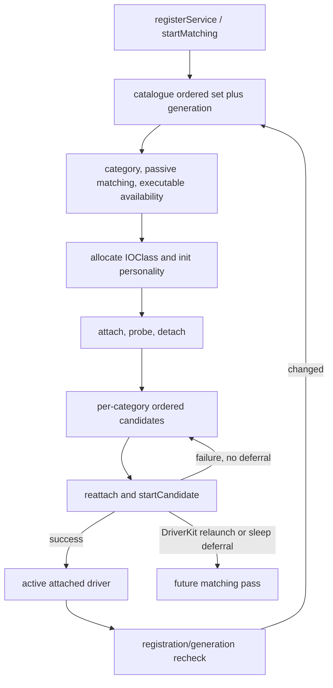

# Service matching, startup, and coordinated termination

[Drivers](README.md) · [Registry introduction](registry-and-service-lifecycle.md) · [User-client lifetime](user-client-and-driverkit-lifetime.md)

An `IOService` can be attached, published, busy, started as a client, opened by another client, inactive, or awaiting finalization. These observations describe different protocols. Publication makes a provider available for matching; `probe()` ranks candidate instances; `start()` initializes a selected instance; `open()` negotiates access; termination prevents new use while existing relationships drain. None of these is equivalent to the final `OSObject` release. [`IOService.cpp`, matching](../../../xnu/iokit/Kernel/IOService.cpp#L5507-L5621), [`candidate start`](../../../xnu/iokit/Kernel/IOService.cpp#L4981-L5158), [`open`](../../../xnu/iokit/Kernel/IOService.cpp#L3522-L3609), [`termination worker`](../../../xnu/iokit/Kernel/IOService.cpp#L3171-L3412).

This chapter follows the generic implementation. A family or device driver overrides matching, resource, start/stop, and open callbacks; the generic code establishes their ordering and surrounding ownership, not the device's register programming. DriverKit adds launch and remote-stop coordination, discussed further in [user-client and DriverKit lifetime](user-client-and-driverkit-lifetime.md).

For the callback and locking protocols around these transitions, continue with [service notifications and arbitration](service-notifications-and-arbitration.md). The [object runtime](object-runtime-and-collections.md) explains the class-instance index used to enumerate published services.

## 1. Objects, state, and lock domains

| State | Where to inspect it and what protects the transition |
|---|---|
| Registry relationships | `gIOServicePlane` parent/child links; the registry's global graph lock protects reciprocal attachment. Service arbitration supplies additional lifecycle coordination. [`IORegistryEntry.cpp`](../../../xnu/iokit/Kernel/IORegistryEntry.cpp#L2071-L2191), [`IOService::attach()`](../../../xnu/iokit/Kernel/IOService.cpp#L884-L938). |
| Published/inactive flags | `__state[0]`, including registered, matched, first-publish/first-match, and inactive bits. Matching and termination combine service arbitration with notification synchronization. [`IOService.cpp`](../../../xnu/iokit/Kernel/IOService.cpp#L5523-L5565), [`phase 1`](../../../xnu/iokit/Kernel/IOService.cpp#L2634-L2646). |
| Configuration/start/termination/busy state | `__state[1]` contains need-config, config-running/config-state, client start deferral, phase bits, and a busy count. These are tested under arbitration at the decision points. [`IOService.cpp`](../../../xnu/iokit/Kernel/IOService.cpp#L1122-L1156), [`phase 2 eligibility`](../../../xnu/iokit/Kernel/IOService.cpp#L3215-L3256). |
| Global matching/termination work | `gJobsLock` and work lists coordinate jobs and termination ownership. The worker drops that lock before service callbacks. [`IOService.cpp`](../../../xnu/iokit/Kernel/IOService.cpp#L2803-L2876), [`worker`](../../../xnu/iokit/Kernel/IOService.cpp#L3197-L3209). |
| Driver execution state | A service workloop, if supplied, gates selected termination actions; it does not replace arbitration or the registry graph lock. [`_workLoopAction()`](../../../xnu/iokit/Kernel/IOService.cpp#L2512-L2526). |

`attach(provider)` checks provider inactivity under provider arbitration before creating the relationship. It can also wait for excessive child count to fall, using a bounded deadline and a detach wakeup. A successful attachment caches the provider if necessary. It does not publish the child or call `start()`. [`IOService.cpp`](../../../xnu/iokit/Kernel/IOService.cpp#L884-L938).

Busy state is hierarchical activity accounting, not an object reference count. `_adjustBusy()` propagates transitions between zero and nonzero to a retained provider, wakes busy waiters, and emits notifications. It does not add the full numerical child count to every ancestor on every increment. When the service root becomes quiet, configured code can consider executable unloading. A held reference can keep an object allocated while its busy count is zero, and a busy object need not currently execute on a CPU. [`IOService.cpp`](../../../xnu/iokit/Kernel/IOService.cpp#L5624-L5725), [libkern ownership](libkern-and-kext-runtime.md).

## 2. Publication records work before invoking matching

`registerService()` checks registry-root connectivity and performs platform adjustment before starting matching. `startMatching()` takes arbitration, derives synchronous behavior from the caller/provider with an asynchronous override, sets `kIOServiceNeedConfigState`, and decides whether a new matching operation is needed. Existing pending/running work is not blindly duplicated. Starting a new configuration interval raises busy state before dropping arbitration. [`IOService.cpp`](../../../xnu/iokit/Kernel/IOService.cpp#L1044-L1102), [`startMatching()`](../../../xnu/iokit/Kernel/IOService.cpp#L1104-L1156).

[IOService.cpp, lines 1132–1135](../../../xnu/iokit/Kernel/IOService.cpp#L1132-L1135)

<!-- source-excerpt: ../../../xnu/iokit/Kernel/IOService.cpp#L1132-L1135 -->
```cpp
	needConfig =  (0 == (__state[1] & (kIOServiceNeedConfigState | kIOServiceConfigRunning)))
	    && (0 == (__state[0] & kIOServiceInactiveState));

	__state[1] |= kIOServiceNeedConfigState;
```

Asynchronous matching queues a job. The synchronous path invokes `doServiceMatch()` when required, then compares busy state against its prior value and sleeps with the busy-wait flags set if more work remains. Wait registration occurs while the busy lock protects the wakeup condition, after releasing arbitration. DriverKit matching can additionally hold a root-domain matching power assertion across the operation. “Synchronous” is a coordination option, not permission to assume that every driver callback is trivial or cannot block. [`IOService.cpp`](../../../xnu/iokit/Kernel/IOService.cpp#L1114-L1120), [`dispatch/wait`](../../../xnu/iokit/Kernel/IOService.cpp#L1158-L1202).

`doServiceMatch()` gets a catalogue snapshot plus generation, marks publication/configuration state, collects relevant notifiers, and invokes notification callbacks outside arbitration/notification locks. It obtains resources before probing candidates. After a pass it repeats if the service was re-registered or the catalogue generation changed, provided it is still active. The completion path clears running/configuration state, gives pending termination another opportunity, and lowers busy state. This explicitly handles matching inputs changing during callbacks. [`IOService.cpp`](../../../xnu/iokit/Kernel/IOService.cpp#L5507-L5621).

[IOService.cpp, lines 5579–5584](../../../xnu/iokit/Kernel/IOService.cpp#L5579-L5584)

<!-- source-excerpt: ../../../xnu/iokit/Kernel/IOService.cpp#L5579-L5584 -->
```cpp
		lockForArbitration();
		reRegistered = (0 != (__state[1] & kIOServiceNeedConfigState));
		keepGuessing =
		    (reRegistered || (catalogGeneration !=
		    gIOCatalogue->getGenerationCount()))
		    && (0 == (__state[0] & kIOServiceInactiveState));
```

## 3. Candidate discovery, filtering, probe, and start

`IOCatalogue::findDrivers()` builds an ordered set by following the provider's metaclass superclass chain through `IOService`, collecting personality arrays indexed by those classes. It records the catalogue generation under the catalogue read lock. It has not yet called the family matching logic or instantiated a driver. [`IOCatalogue.cpp`](../../../xnu/iokit/Kernel/IOCatalogue.cpp#L215-L250).

`probeCandidates()` consumes that set with explicit retains around removal. Notifiers in the set are handled separately from personality dictionaries. For personalities it evaluates DriverKit availability, category occupancy, replacement/rematch rules, and copies the dictionary before allowing passive/family matching to modify it. A consumed category usually prevents another candidate from starting there, but boot replacement and DriverKit rematching have specific branches. [`IOService.cpp`](../../../xnu/iokit/Kernel/IOService.cpp#L3851-L3999).

Executable availability is another gate. `isModuleLoaded()` can cause the pass to stall before constructing instances. Matching references on loaded kexts prevent their disappearance while candidates are built; after instances exist, the code drops those matching references. A module stall adjusts its own busy contribution, so delayed executable loading and ordinary per-pass matching have distinct accounting. [`IOService.cpp`](../../../xnu/iokit/Kernel/IOService.cpp#L4000-L4055), [`matching-reference release and stall accounting`](../../../xnu/iokit/Kernel/IOService.cpp#L4267-L4335).

For each family-matched personality, the implementation allocates `IOClass` through `OSMetaClass`, validates that it is an `IOService`, calls `init(props)`, assigns a match category, and attaches for probing. It passes the current score by reference to `probe()`, then detaches the original probe instance. A non-null probe result gets its returned score saved and enters the category's ordered start set. Probe may return a different object; the code's `inst` and `newInst` variables are deliberately separate. [`IOService.cpp`](../../../xnu/iokit/Kernel/IOService.cpp#L4058-L4166).

[IOService.cpp, lines 4112–4114](../../../xnu/iokit/Kernel/IOService.cpp#L4112-L4114)

<!-- source-excerpt: ../../../xnu/iokit/Kernel/IOService.cpp#L4112-L4114 -->
```cpp
				newInst = inst->probe( this, &score );
				inst->detach( this );
				if (NULL == newInst) {
```

The category loop tries candidates until one starts, subject to deferred matching. Once a candidate succeeds, it still drains/releases remaining candidate objects instead of calling all of their starts. A failed DriverKit start that has arranged a relaunch can stop further candidates from consuming the category. Thus score ordering does not replace start success, and start failure does not always imply immediate fallback to the next driver. [`IOService.cpp`](../../../xnu/iokit/Kernel/IOService.cpp#L4190-L4266).



## 4. Start failure has attachment and launch ownership to unwind

`startCandidate()` first attaches the service. For ordinary providers it checks provider and driver resources before `start()`. A DriverKit personality additionally needs a user-server name/module identity and may launch or reuse a user server. Launch can be rejected during shutdown, disabled by debugging policy, or deferred by power/matching coordination. These are kernel-side launch decisions; the daemon and user driver executable are outside this checkout's implementation. [`IOService.cpp`](../../../xnu/iokit/Kernel/IOService.cpp#L4981-L5074).

After launch, entitlement matching and target-specific restrictions can still fail. Those branches detach the candidate, end matching-power coordination, release the server reference, and in applicable failures request server exit. On the successful setup path, `serviceAttach()` associates the remote service before the generic virtual `start()`. After that call, `serviceStarted()` records the result and the temporary server reference is released. Failed start detaches; successful start installs sleep-platform actions. The helper then balances its matching-power interval. [`IOService.cpp`](../../../xnu/iokit/Kernel/IOService.cpp#L5075-L5158).

The generic class-name `newUserClient()` path has a similar but separate failure ladder: allocate/type-check, initialize with task/type, attach, then start; start failure detaches before release. Creating a connection therefore can overlap service termination and requires its own deferral/IPC protocol, described in the [connection chapter](user-client-and-driverkit-lifetime.md). [`IOService.cpp`](../../../xnu/iokit/Kernel/IOService.cpp#L8205-L8276), [`open completion`](../../../xnu/iokit/Kernel/IOUserClient.cpp#L4582-L4608).

## 5. Open ownership is independent of attachment

The generic `open()` runs an interested-client notification, acquires arbitration, rejects inactivity, performs any DriverKit service-open authorization, and invokes `handleOpen()`. The base policy stores a single `__owner`. Its seize path asks the previous owner to close and succeeds only if that owner field has actually become empty. Subclasses can implement another policy; the existence of several attached clients is not proof that they all hold the provider open. [`IOService.cpp`](../../../xnu/iokit/Kernel/IOService.cpp#L3522-L3558), [`base open policy`](../../../xnu/iokit/Kernel/IOService.cpp#L3616-L3657).

`close()` calls `handleClose()` under arbitration, records whether phase 3 termination is pending, and completes DriverKit service-close bookkeeping. After unlocking, it schedules the client's stop if termination requires it; otherwise it can notify other clients that access closed. This is one of the ways outstanding access releases advance termination without deleting objects directly. [`IOService.cpp`](../../../xnu/iokit/Kernel/IOService.cpp#L3562-L3595).

## 6. Phase 1: make the affected graph inactive

`terminate()` adds the terminate option and enters `terminatePhase1()`. The implementation traverses affected clients using retained arrays, handles multiply attached services, and serializes against another phase-1 traversal. A newly affected victim becomes inactive; registered/matched/first-publish/first-match state is removed, phase-1 state is set, and busy count increases. Inactivity prevents new attachment/open decisions from treating it as usable, but existing object references remain. [`IOService.cpp`](../../../xnu/iokit/Kernel/IOService.cpp#L2547-L2677), [`terminate entry`](../../../xnu/iokit/Kernel/IOService.cpp#L3491-L3497).

[IOService.cpp, lines 2634–2646](../../../xnu/iokit/Kernel/IOService.cpp#L2634-L2646)

<!-- source-excerpt: ../../../xnu/iokit/Kernel/IOService.cpp#L2634-L2646 -->
```cpp
			} else {
				victim->__state[0] |= kIOServiceInactiveState;
				victim->__state[0] &= ~(kIOServiceRegisteredState | kIOServiceMatchedState
				    | kIOServiceFirstPublishState | kIOServiceFirstMatchState);
				victim->__state[1] &= ~kIOServiceRecursing;
				victim->__state[1] |= kIOServiceTermPhase1State;
				waitingInactive->headQ(victim);
				if (victim == this) {
					if (kIOServiceTerminateNeedWillTerminate & options) {
						victim->__state[1] |= kIOServiceNeedWillTerminate;
					}
				}
				victim->_adjustBusy( 1 );
```

Outside victim arbitration, phase 1 invokes termination notifiers, destroys exported user references, and asks each client `requestTerminate()`. Only accepted clients are added to the traversal. The base compatibility implementation checks whether this is its sole provider and cooperates through `terminateClient()`; a multiply attached service is not simply assumed to have one parent. After clearing phase-1 bits and waking waiters, the initiating victim becomes phase-2-ready and is scheduled for later work. [`IOService.cpp`](../../../xnu/iokit/Kernel/IOService.cpp#L2529-L2545), [`phase-1 traversal/completion`](../../../xnu/iokit/Kernel/IOService.cpp#L2678-L2760), [`terminateClient()`](../../../xnu/iokit/Kernel/IOService.cpp#L3476-L3488).

Synchronous phase-2 scheduling can temporarily become the global termination thread and process work directly. If the victim remains busy, it yields that role while waiting, allowing others to progress; the wait has a 15-second deadline and a diagnostic timeout path. Asynchronous scheduling appends work and wakes the termination worker. It is therefore too strong to interpret the synchronous option as an unbounded guarantee that every client has detached before the API returns. [`IOService.cpp`](../../../xnu/iokit/Kernel/IOService.cpp#L2803-L2876).

## 7. Phases 2 and 3: callbacks, finalization, stop, detach

Phase 2 does not begin merely because an inactive bit is present. The worker checks that phase 1, prior phase 2, and configuration state do not conflict, then checks clients for `kIOServiceStartState`. This start-deferral flag can keep a provider from proceeding while a user-client/DriverKit startup operation is being established. `setTerminateDefer(..., false)`, completion of matching, and detach provide paths that reschedule the blocked phase. [`IOService.cpp`](../../../xnu/iokit/Kernel/IOService.cpp#L3215-L3256), [`deferral`](../../../xnu/iokit/Kernel/IOService.cpp#L2765-L2778), [`matching completion`](../../../xnu/iokit/Kernel/IOService.cpp#L5615-L5621), [`detach`](../../../xnu/iokit/Kernel/IOService.cpp#L1010-L1020).

The worker drops `gJobsLock` while performing service operations. `willTerminate` delivery has kernel/user-service distinctions, and selected actions pass through `_workLoopAction()`: that helper retains an available workloop and calls `runAction()` under its gate, or calls the action directly when there is no workloop. Gated delivery does not require a switch to the workloop thread. Victims are accumulated for later did-terminate processing so the traversal and completion ordering remain explicit. [`IOService.cpp`](../../../xnu/iokit/Kernel/IOService.cpp#L3197-L3290), [`workloop wrapper`](../../../xnu/iokit/Kernel/IOService.cpp#L2512-L2526), [`IOWorkLoop::runAction()`](../../../xnu/iokit/Kernel/IOWorkLoop.cpp#L565-L577).

The worker sets phase 3, delivers `didTerminate`, and schedules finalization for leaves. The base `didTerminate()` consults DriverKit state and, unless deferred, schedules stop when the provider is not open by the client. If still open, it requests close and tests again. DriverKit may defer until remote stop completes, then reenter this completion path. [`IOService.cpp`](../../../xnu/iokit/Kernel/IOService.cpp#L2949-L2984), [`phase 3 entry`](../../../xnu/iokit/Kernel/IOService.cpp#L3290-L3310), [`DriverKit stop completion`](../../../xnu/iokit/Kernel/IOUserServer.cpp#L6193-L6257).

Phase 3 processes finalization and stop lists. It marks finalization once, holds objects in a temporary free list across processing, ignores duplicate stop requests whose relationship has already disappeared, and defers stopping an inactive client until it has been finalized. The stop action itself calls `client->stop(provider)`, closes an unexpectedly retained open, and detaches. These are lifecycle callbacks; final C++ destruction still follows references. [`IOService.cpp`](../../../xnu/iokit/Kernel/IOService.cpp#L3312-L3412).

[IOService.cpp, lines 3158–3164](../../../xnu/iokit/Kernel/IOService.cpp#L3158-L3164)

<!-- source-excerpt: ../../../xnu/iokit/Kernel/IOService.cpp#L3158-L3164 -->
```cpp
	client->stop( provider );
	if (provider->isOpen( client )) {
		provider->close( client );
	}

	TLOG("%s[0x%qx]::detach(%s[0x%qx])\n", client->getName(), regID2, provider->getName(), regID1);
	client->detach( provider );
```

Detach then advances parent cleanup: it removes the relationship, adjusts busy propagation, schedules provider finalization when its final client disappears in phase 3, wakes attach waiters, and can rematch the provider when the detached client requested rematching. The cycle from failure/termination back to matching is explicit policy, not a side effect of a destructor. [`IOService.cpp`](../../../xnu/iokit/Kernel/IOService.cpp#L946-L1040).

## Sources inspected and limits

Deep review covered `attach`/`detach`, matching-state publication, catalogue candidate collection, personality filtering, probe/start ownership, start failure, base open/close, phase-1 traversal, phase-2 eligibility, workloop callback routing, and phase-3 finalization/stop lists. DriverKit launch/stop boundaries and user-reference destruction were followed into their adjacent implementations.

Arbitration deadlock-resolution internals, every notification iterator race, every replacement/rematching option, external executable loading, and family-specific hardware teardown remain outside this chapter's detailed review. A source-reading exercise is to follow a provider termination while `doServiceMatch()` still owns configuration state, then identify the exact call that retries phase 2 when that configuration interval ends. No device was attached or removed to validate these source-derived paths.

<!-- BEGIN PLATYDOC DOCUMENTATION LICENSE -->
Original Platydoc text and diagrams are licensed under [CC BY 4.0](https://creativecommons.org/licenses/by/4.0/). Quoted source code and third-party material retain their respective licenses.
<!-- END PLATYDOC DOCUMENTATION LICENSE -->
