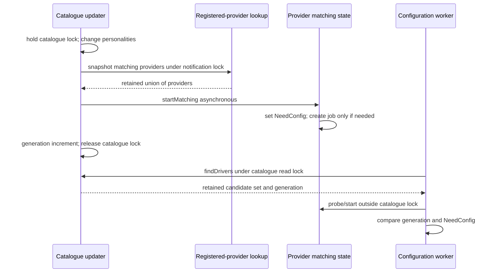
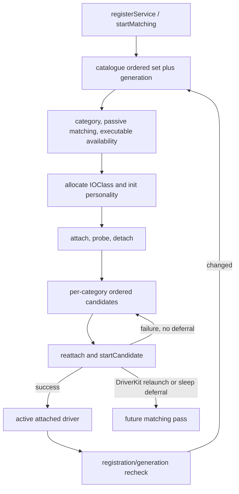
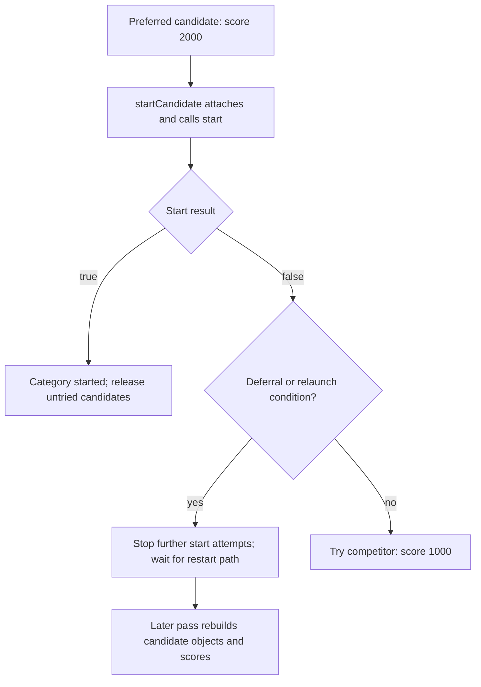

# Service matching, startup, and coordinated termination

[Drivers](README.md) · [Registry introduction](registry-and-service-lifecycle.md) · [User-client lifetime](user-client-and-driverkit-lifetime.md)

An `IOService` can be attached, published, busy, started as a client, opened by another client, inactive, or awaiting finalization. These observations describe different protocols. Publication makes a provider available for matching; `probe()` ranks candidate instances; `start()` initializes a selected instance; `open()` negotiates access; termination prevents new use while existing relationships drain. None of these is equivalent to the final `OSObject` release. [`IOService.cpp`, matching](../../../xnu/iokit/Kernel/IOService.cpp#L5507-L5621), [`candidate start`](../../../xnu/iokit/Kernel/IOService.cpp#L4981-L5158), [`open`](../../../xnu/iokit/Kernel/IOService.cpp#L3522-L3609), [`termination worker`](../../../xnu/iokit/Kernel/IOService.cpp#L3171-L3412).

This chapter follows the generic implementation. A family or device driver overrides matching, resource, start/stop, and open callbacks; the generic code establishes their ordering and surrounding ownership, not the device's register programming. DriverKit adds launch and remote-stop coordination, discussed further in [user-client and DriverKit lifetime](user-client-and-driverkit-lifetime.md).

For the callback and locking protocols around these transitions, continue with [service notifications and arbitration](service-notifications-and-arbitration.md). The [object runtime](object-runtime-and-collections.md) explains the class-instance index used to enumerate published services.

## 1. Objects, state, and lock domains

| State | Where to inspect it and what protects the transition |
|---|---|
| Registry relationships | `gIOServicePlane` parent/child links; the registry's global graph lock protects reciprocal attachment. Service arbitration supplies additional lifecycle coordination. [`IORegistryEntry.cpp`](../../../xnu/iokit/Kernel/IORegistryEntry.cpp#L2071-L2191), [`IOService::attach()`](../../../xnu/iokit/Kernel/IOService.cpp#L884-L938). |
| Published/inactive flags | `__state[0]`, including registered, matched, first-publish/first-match, and inactive bits. Matching and termination combine service arbitration with notification synchronization. [`IOService.cpp`](../../../xnu/iokit/Kernel/IOService.cpp#L5523-L5565), [`phase 1`](../../../xnu/iokit/Kernel/IOService.cpp#L2634-L2646). |
| Configuration/start/termination/busy state | `__state[1]` contains need-config, config-running/config-state, client start deferral, phase bits, and a busy count. These are tested under arbitration at the decision points. [`IOService.cpp`](../../../xnu/iokit/Kernel/IOService.cpp#L1122-L1156), [`phase 2 eligibility`](../../../xnu/iokit/Kernel/IOService.cpp#L3215-L3256). |
| Global matching/termination work | `gJobsLock` and work lists coordinate jobs and termination ownership. The worker drops that lock before service callbacks. [`IOService.cpp`](../../../xnu/iokit/Kernel/IOService.cpp#L2803-L2876), [`worker`](../../../xnu/iokit/Kernel/IOService.cpp#L3197-L3209). |
| Driver execution state | A service workloop, if supplied, gates selected termination actions; it does not replace arbitration or the registry graph lock. [`_workLoopAction()`](../../../xnu/iokit/Kernel/IOService.cpp#L2512-L2526). |

`attach(provider)` checks provider inactivity under provider arbitration before creating the relationship. It can also wait for excessive child count to fall, using a bounded deadline and a detach wakeup. A successful attachment caches the provider if necessary. It does not publish the child or call `start()`. [`IOService.cpp`](../../../xnu/iokit/Kernel/IOService.cpp#L884-L938).

Busy state is hierarchical activity accounting, not an object reference count. `_adjustBusy()` propagates transitions between zero and nonzero to a retained provider, wakes busy waiters, and emits notifications. It does not add the full numerical child count to every ancestor on every increment. When the service root becomes quiet, configured code can consider executable unloading. A held reference can keep an object allocated while its busy count is zero, and a busy object need not currently execute on a CPU. [`IOService.cpp`](../../../xnu/iokit/Kernel/IOService.cpp#L5624-L5725), [libkern ownership](libkern-and-kext-runtime.md).

## 2. Publication records work before invoking matching

`registerService()` checks registry-root connectivity and performs platform adjustment before starting matching. `startMatching()` takes arbitration, derives synchronous behavior from the caller/provider with an asynchronous override, sets `kIOServiceNeedConfigState`, and decides whether a new matching operation is needed. Existing pending/running work is not blindly duplicated. Starting a new configuration interval raises busy state before dropping arbitration. [`IOService.cpp`](../../../xnu/iokit/Kernel/IOService.cpp#L1044-L1102), [`startMatching()`](../../../xnu/iokit/Kernel/IOService.cpp#L1104-L1156).

[IOService.cpp, lines 1132–1135](../../../xnu/iokit/Kernel/IOService.cpp#L1132-L1135)

<!-- source-excerpt: ../../../xnu/iokit/Kernel/IOService.cpp#L1132-L1135 -->
```cpp
	needConfig =  (0 == (__state[1] & (kIOServiceNeedConfigState | kIOServiceConfigRunning)))
	    && (0 == (__state[0] & kIOServiceInactiveState));

	__state[1] |= kIOServiceNeedConfigState;
```

Asynchronous matching queues a job. The synchronous path invokes `doServiceMatch()` when required, then compares busy state against its prior value and sleeps with the busy-wait flags set if more work remains. Wait registration occurs while the busy lock protects the wakeup condition, after releasing arbitration. DriverKit matching can additionally hold a root-domain matching power assertion across the operation. “Synchronous” is a coordination option, not permission to assume that every driver callback is trivial or cannot block. [`IOService.cpp`](../../../xnu/iokit/Kernel/IOService.cpp#L1114-L1120), [`dispatch/wait`](../../../xnu/iokit/Kernel/IOService.cpp#L1158-L1202).

`doServiceMatch()` gets a catalogue snapshot plus generation, marks publication/configuration state, collects relevant notifiers, and invokes notification callbacks outside arbitration/notification locks. It obtains resources before probing candidates. After a pass it repeats if the service was re-registered or the catalogue generation changed, provided it is still active. The completion path clears running/configuration state, gives pending termination another opportunity, and lowers busy state. This explicitly handles matching inputs changing during callbacks. [`IOService.cpp`](../../../xnu/iokit/Kernel/IOService.cpp#L5507-L5621).

[IOService.cpp, lines 5579–5584](../../../xnu/iokit/Kernel/IOService.cpp#L5579-L5584)

<!-- source-excerpt: ../../../xnu/iokit/Kernel/IOService.cpp#L5579-L5584 -->
```cpp
		lockForArbitration();
		reRegistered = (0 != (__state[1] & kIOServiceNeedConfigState));
		keepGuessing =
		    (reRegistered || (catalogGeneration !=
		    gIOCatalogue->getGenerationCount()))
		    && (0 == (__state[0] & kIOServiceInactiveState));
```

### Catalogue updates find providers before starting another pass

The catalogue owns personality dictionaries, while each provider owns its matching state. `addDrivers()` does not instantiate every newly supplied class. Under the catalogue write lock it interns important personality properties, rejects exact dictionary duplicates, and accumulates newly inserted personalities in an ordered set. With `doNubMatching` enabled, a nonempty successful addition calls `catalogNewDrivers()` and then increments `generation`. Adding with matching disabled changes the catalogue without that generation increment or provider rescan. An error after earlier insertions does not roll those insertions back, and skips this final rescan: the Boolean result is not a transaction outcome. [`addDrivers`](../../../xnu/iokit/Kernel/IOCatalogue.cpp#L437-L501), [`personality indexing`](../../../xnu/iokit/Kernel/IOCatalogue.cpp#L191-L250).

`catalogNewDrivers()` consumes the supplied set's entries. For each personality it obtains registered existing services under the notification mutex, merges them into an `OSSet`, and removes that personality from the input set. The union both retains the selected providers and avoids starting one provider repeatedly for different matching personalities in that call. It then requests **asynchronous** matching before removing each provider from the union. The input set object itself is retained temporarily, but its contents have been drained when the function returns. [`catalogNewDrivers`](../../../xnu/iokit/Kernel/IOService.cpp#L1242-L1296).

The forced asynchronous call matters because a catalogue caller can still hold its own lock. A worker must reacquire the catalogue read lock to take the new candidate snapshot; the rescan routine must not synchronously probe drivers or acquire the OSKext lock from inside the catalogue lock. The source explicitly warns about that inversion. This is a handoff from a retained provider selection to per-provider work, not one lock protecting personalities, service state and executable loading together. [`lock-order warning and rescan`](../../../xnu/iokit/Kernel/IOService.cpp#L1242-L1296), [`findDrivers snapshot`](../../../xnu/iokit/Kernel/IOCatalogue.cpp#L215-L250), [`job reference`](../../../xnu/iokit/Kernel/IOService.cpp#L1299-L1319).



This diagram shows successful addition with matching enabled. `removeDrivers()` also uses removed personality dictionaries to select providers for reconsideration; removing a catalogue entry is distinct from terminating an already attached driver. The module-specific `startMatching(const OSSymbol *)` selects personalities whose ordinary or kernel bundle identifier matches the loaded module. Its DriverKit branch can first collect and terminate category occupants of **IOHIDInterface** providers; the body does not grant every DriverKit class this replacement policy. The OSKext lookup occurs before the catalogue lock. [`removal`](../../../xnu/iokit/Kernel/IOCatalogue.cpp#L505-L545), [`module matching and HID restriction`](../../../xnu/iokit/Kernel/IOCatalogue.cpp#L1084-L1200), [module lifetime](kext-loading-and-unloading.md).

### Re-registration records a reason to retry, not a count of calls

`NeedConfig` is one bit, so several registrations during one pass can coalesce. `ConfigRunning` prevents creating a competing matching job while candidate work is running; the worker clears `NeedConfig` when taking a pass and rereads it afterward. The following event orders explain why both bits are needed. [`request predicate`](../../../xnu/iokit/Kernel/IOService.cpp#L1122-L1156), [`pass entry and retry`](../../../xnu/iokit/Kernel/IOService.cpp#L5523-L5588).

| Registration arrives when… | Effect visible in the body |
|---|---|
| A job is queued and `NeedConfig` is already set | Leave the bit set; do not add another job or matching busy increment. |
| A worker has cleared `NeedConfig` but still has `ConfigRunning` | Set `NeedConfig` without another job; the current worker takes another pass. |
| A synchronous publisher is sleeping with `SyncPubState` and new work is needed | Raise busy and wake that publisher rather than enqueue a separate job. |
| Matched callbacks are running after `ConfigRunning` was cleared | `ConfigState` alone does not block the new-work predicate. A new request can schedule or synchronously enter matching while the older callback sequence has not finished. |
| The provider is inactive | Set `NeedConfig`, but do not begin new work; registration does not clear inactivity or resurrect the service. |

The last callback interval is deliberately visible in the implementation: `ConfigRunning` is cleared before matched notification invocation, while `ConfigState` remains until after it. The latter gates termination phase 2, not the new-work predicate. It would therefore be incorrect to describe all callbacks, every re-registration, and termination as one serialized matching transaction. [`completion ordering`](../../../xnu/iokit/Kernel/IOService.cpp#L5590-L5621), [`phase-2 admission`](../../../xnu/iokit/Kernel/IOService.cpp#L3215-L3256).

The synchronous wait is relative to `prevBusy`, the value preceding this operation's increment, and also stops waiting on inactivity. It does not promise that the service becomes globally idle when unrelated activity existed beforehand. The asynchronous job retains the nub until the configuration thread releases it; the busy count alone supplies no allocation lifetime. The visible `startMatching()` caller does not check failure of `_IOServiceJob::startJob()`, so the normal queued-work description assumes successful job allocation rather than promising complete rollback on low memory. [`busy comparison and sleep`](../../../xnu/iokit/Kernel/IOService.cpp#L1158-L1202), [`job allocation`](../../../xnu/iokit/Kernel/IOService.cpp#L1299-L1319), [`worker job completion`](../../../xnu/iokit/Kernel/IOService.cpp#L6050-L6088).

## 3. Candidate discovery, filtering, probe, and start

`IOCatalogue::findDrivers()` builds an ordered set by following the provider's metaclass superclass chain through `IOService`, collecting personality arrays indexed by those classes. It records the catalogue generation under the catalogue read lock. It has not yet called the family matching logic or instantiated a driver. [`IOCatalogue.cpp`](../../../xnu/iokit/Kernel/IOCatalogue.cpp#L215-L250).

`probeCandidates()` consumes that set with explicit retains around removal. Notifiers in the set are handled separately from personality dictionaries. For personalities it evaluates DriverKit availability, category occupancy, replacement/rematch rules, and copies the dictionary before allowing passive/family matching to modify it. A consumed category usually prevents another candidate from starting there, but boot replacement and DriverKit rematching have specific branches. [`IOService.cpp`](../../../xnu/iokit/Kernel/IOService.cpp#L3851-L3999).

Executable availability is another gate. `isModuleLoaded()` can cause the pass to stall before constructing instances. Matching references on loaded kexts prevent their disappearance while candidates are built; after instances exist, the code drops those matching references. A module stall adjusts its own busy contribution, so delayed executable loading and ordinary per-pass matching have distinct accounting. [`IOService.cpp`](../../../xnu/iokit/Kernel/IOService.cpp#L4000-L4055), [`matching-reference release and stall accounting`](../../../xnu/iokit/Kernel/IOService.cpp#L4267-L4335).

For each family-matched personality, the implementation allocates `IOClass` through `OSMetaClass`, validates that it is an `IOService`, calls `init(props)`, assigns a match category, and attaches for probing. It passes the current score by reference to `probe()`, then detaches the original probe instance. A non-null probe result gets its returned score saved and enters the category's ordered start set. Probe may return a different object; the code's `inst` and `newInst` variables are deliberately separate. [`IOService.cpp`](../../../xnu/iokit/Kernel/IOService.cpp#L4058-L4166).

[IOService.cpp, lines 4112–4114](../../../xnu/iokit/Kernel/IOService.cpp#L4112-L4114)

<!-- source-excerpt: ../../../xnu/iokit/Kernel/IOService.cpp#L4112-L4114 -->
```cpp
				newInst = inst->probe( this, &score );
				inst->detach( this );
				if (NULL == newInst) {
```

The category loop tries candidates until one starts, subject to deferred matching. Once a candidate succeeds, it still drains/releases remaining candidate objects instead of calling all of their starts. A failed DriverKit start that has arranged a relaunch can stop further candidates from consuming the category. Thus score ordering does not replace start success, and start failure does not always imply immediate fallback to the next driver. [`IOService.cpp`](../../../xnu/iokit/Kernel/IOService.cpp#L4190-L4266).



### Four delays with different restart and busy ownership

The names “deferred” and “stalled” do not describe one queue. Their triggers and owners differ:

| Delay | What stops this pass | What keeps state and restarts it |
|---|---|---|
| Deferred executable load | `isModuleLoaded()` returns false after `kOSKextReturnDeferred`; `needReloc` stops personality scanning and instance creation | `ModuleStallState` adds one persistent busy contribution. `moduleHasLoaded()` selects matching personalities again; a later nonstalled pass removes that contribution. |
| Daemon/personality readiness | `gIOMatchDeferList` exists and the candidate has `IOMatchDefer == true` | Under `gJobsLock`, add the **provider** once to the array. `startDeferredMatches()` detaches the whole array under the lock, starts asynchronous passes after unlocking, then releases it. |
| System power transition | `IOServicePH::matchingStart(provider)` cannot proceed with system-on state and a matching assertion | Retain the provider in `fMatchingDelayed`; put `IOServiceMatchDeferred` on the failed candidate. Returning to system-on transfers the delayed array out and restarts providers after unlocking. |
| DriverKit relaunch before instantiation | Start failed, user-server state exists, the remote object was not instantiated, and `NeedConfig` was set | Stop trying lower candidates in this pass. The already requested provider pass can give the relaunch another chance. |

These branches are in [`module gating`](../../../xnu/iokit/Kernel/IOService.cpp#L4003-L4055), [`daemon/start deferral`](../../../xnu/iokit/Kernel/IOService.cpp#L4208-L4255), [`module busy accounting`](../../../xnu/iokit/Kernel/IOService.cpp#L4271-L4309), [`daemon-list transfer`](../../../xnu/iokit/Kernel/IOService.cpp#L1205-L1239), and [`power lists and restart`](../../../xnu/iokit/Kernel/IOService.cpp#L4501-L4605). Daemon deferral is compiled under `!NO_KEXTD`. `matchDeferred` is initialized once for `probeCandidates()`, outside the category loop: once set, it stops further start attempts in subsequent categories too, while collection release still cleans up their remaining instances.

`isModuleLoaded()` is especially easy to misread. The kernel bundle identifier is passed to `OSKext::loadKextWithIdentifier()`, but only the deferred return blocks matching. Other returns, including a permanent inability to supply the module, return true so class allocation/probing can fail normally instead of retaining a permanent module stall. A separate differing DriverKit identifier can also be requested, but its result does not introduce the same false return. [`IOCatalogue.cpp`, lines 634–648](../../../xnu/iokit/Kernel/IOCatalogue.cpp#L634-L648).

<!-- source-excerpt: ../../../xnu/iokit/Kernel/IOCatalogue.cpp#L634-L648 -->
```cpp
	moduleName = OSDynamicCast(OSString, driver->getObject(gIOModuleIdentifierKernelKey.get()));
	if (moduleName) {
		ret = OSKext::loadKextWithIdentifier(moduleName, kextRef);
		if (kOSKextReturnDeferred == ret) {
			// a request has been queued but the module isn't necessarily
			// loaded yet, so stall.
			return false;
		}
		OSString *moduleDextName = OSDynamicCast(OSString, driver->getObject(gIOModuleIdentifierKey.get()));
		if (moduleDextName && !(moduleName->isEqualTo(moduleDextName))) {
			OSSharedPtr<OSObject> dextRef;
			ret = OSKext::loadKextWithIdentifier(moduleDextName, dextRef);
		}
		// module is present or never will be
		return true;
```

For a worked busy-count example, assume a provider begins at zero and no other activity changes it. First registration contributes `+1`; a deferred module contributes another `+1`; finishing that matching interval removes one, leaving busy **1**. A module-loaded rescan contributes one matching increment again, and a successful nonstalled pass removes the stall increment and then its own interval increment, returning to **0**. Retries that remain stalled do not repeatedly add stall increments. Thus a completed matching worker can leave a service busy, and absence of a matched notification during module stall is intentional. [`stall transitions`](../../../xnu/iokit/Kernel/IOService.cpp#L4277-L4309), [`matched notification gate and final decrement`](../../../xnu/iokit/Kernel/IOService.cpp#L5590-L5621).

### Replacement reserves a category until the old client detaches

The category lookup does not simply ignore all inactive clients. An inactive client carrying `RematchOnDetach` still occupies its category. That prevents a replacement pass from racing ahead of the old attachment's cleanup. In phase 1, `TerminateWithRematch` marks only the initiating victim for rematch on detach. With `TerminateWithRematchCurrentDext`, it also saves the old matched personality and a retry count on the provider. The first stored count is zero; later existing counts are incremented. [`category lookup`](../../../xnu/iokit/Kernel/IOService.cpp#L3740-L3764), [`rematch state`](../../../xnu/iokit/Kernel/IOService.cpp#L2648-L2679).

`probeCandidates()` removes the saved personality property from the provider after taking a reference. Through the configured retry limit, equality with that dictionary admits the same personality. The comparison is reversed only when `count > gIODextRelaunchMax`, admitting alternatives instead; equality with the maximum still selects the old personality. A zero relaunch maximum has an earlier DriverKit-specific exclusion when a rematch-count property exists. These are exact branch predicates, not a wall-clock retry budget. [`saved state and retry filtering`](../../../xnu/iokit/Kernel/IOService.cpp#L3886-L4001), [`limit initialization`](../../../xnu/iokit/Kernel/IOService.cpp#L492-L500).

`IOUserServer::finalize()` is a concrete producer of those options. It snapshots `fServices` under `fLock`, then acts on the retained array after unlocking. The check-in token's `dextTerminate()` result decides whether to request the current personality again; without a token this path also requests it. When the current personality must not be reused, it clears the provider's saved rematch properties. For started services it terminates roots of the affected service set, letting the ordinary client traversal reach descendants; incompletely started or uninstantiated services get the separate forced-stop path. These are server-lifetime decisions, not evidence that every child is immediately detached when server finalization begins. [`server finalization`](../../../xnu/iokit/Kernel/IOUserServer.cpp#L4041-L4124), [`token's once-only launch-count decrement`](../../../xnu/iokit/Kernel/IOUserServer.cpp#L6841-L6855), [connection and remote-stop ownership](user-client-and-driverkit-lifetime.md).

Boot-driver replacement is another policy. A boot-marked category occupant plus a nonboot personality is only a *candidate* for replacement. Passive matching must succeed, and `canTerminateForReplacement()` requires the media-hiding policy, the old driver's primary-driver termination property and a known root-media parent. It rejects a client on that root-media ancestor chain. Accepted replacement requests termination with rematch, then leaves this candidate attempt; it does not detach the existing driver inline and immediately start the newcomer. When the old client finally detaches, it calls `provider->registerService()` unless the DriverKit object-leak mode suppresses it. [`replacement decision`](../../../xnu/iokit/Kernel/IOService.cpp#L3943-L3992), [`root-media restriction`](../../../xnu/iokit/Kernel/IOService.cpp#L5476-L5503), [`detach restart`](../../../xnu/iokit/Kernel/IOService.cpp#L1032-L1036).

## 4. Start failure has attachment and launch ownership to unwind

`startCandidate()` first attaches the service. For ordinary providers it checks provider and driver resources before `start()`. A DriverKit personality additionally needs a user-server name/module identity and may launch or reuse a user server. Launch can be rejected during shutdown, disabled by debugging policy, or deferred by power/matching coordination. These are kernel-side launch decisions; the daemon and user driver executable are outside this checkout's implementation. [`IOService.cpp`](../../../xnu/iokit/Kernel/IOService.cpp#L4981-L5074).

After launch, entitlement matching and target-specific restrictions can still fail. Those branches detach the candidate, end matching-power coordination, release the server reference, and in applicable failures request server exit. On the successful setup path, `serviceAttach()` associates the remote service before the generic virtual `start()`. After that call, `serviceStarted()` records the result and the temporary server reference is released. Failed start detaches; successful start installs sleep-platform actions. The helper then balances its matching-power interval. [`IOService.cpp`](../../../xnu/iokit/Kernel/IOService.cpp#L5075-L5158).

The generic class-name `newUserClient()` path has a similar but separate failure ladder: allocate/type-check, initialize with task/type, attach, then start; start failure detaches before release. Creating a connection therefore can overlap service termination and requires its own deferral/IPC protocol, described in the [connection chapter](user-client-and-driverkit-lifetime.md). [`IOService.cpp`](../../../xnu/iokit/Kernel/IOService.cpp#L8205-L8276), [`open completion`](../../../xnu/iokit/Kernel/IOUserClient.cpp#L4582-L4608).

The earlier probe stage has a different cleanup contract from a started driver:

| Decision or failure | State already acquired | Visible cleanup or next step |
|---|---|---|
| `IOClass` missing, allocation/type check fails, or `init()` returns false | Retained personality; possibly an allocated original instance | Release the personality and original instance at the iteration tail. No successful probe attachment exists. |
| Probe attachment fails | Initialized instance | Release it without calling `probe()` or `stop()`. |
| `probe()` returns null | A temporary provider attachment existed | Detach the original instance immediately, then release it. |
| `probe()` returns another object | Original instance and returned pointer are distinct | Detach/release the original; the start set retains the returned object. The generic body does not add a separate release of `newInst`, so an override must obey the probe-return ownership convention. |
| `start()` returns false | Candidate was attached again; its own callback may have allocated resources | Detach and release the start-list reference. `startCandidate()` does **not** call `stop()` as generic rollback. |
| Another candidate already started in this category | Remaining start-set instances still exist | Remove/release those candidates without calling their `start()` methods. |

The failure ladder is visible in [`instance creation and probe`](../../../xnu/iokit/Kernel/IOService.cpp#L4059-L4155), [`start-set drain`](../../../xnu/iokit/Kernel/IOService.cpp#L4180-L4258), and [`post-start result`](../../../xnu/iokit/Kernel/IOService.cpp#L5121-L5156). A driver that returns false from `start()` must therefore account for its own partial initialization; the later termination `stop()` protocol is not automatically substituted for a failed start. The generic path also contains allocation assertions and unchecked collection insertions, so this table describes its explicit branches rather than a proof of exhaustive allocation-failure recovery.

## 5. Open ownership is independent of attachment

The generic `open()` runs an interested-client notification, acquires arbitration, rejects inactivity, performs any DriverKit service-open authorization, and invokes `handleOpen()`. The base policy stores a single `__owner`. Its seize path asks the previous owner to close and succeeds only if that owner field has actually become empty. Subclasses can implement another policy; the existence of several attached clients is not proof that they all hold the provider open. [`IOService.cpp`](../../../xnu/iokit/Kernel/IOService.cpp#L3522-L3558), [`base open policy`](../../../xnu/iokit/Kernel/IOService.cpp#L3616-L3657).

`close()` calls `handleClose()` under arbitration, records whether phase 3 termination is pending, and completes DriverKit service-close bookkeeping. After unlocking, it schedules the client's stop if termination requires it; otherwise it can notify other clients that access closed. This is one of the ways outstanding access releases advance termination without deleting objects directly. [`IOService.cpp`](../../../xnu/iokit/Kernel/IOService.cpp#L3562-L3595).

## 6. Phase 1: make the affected graph inactive

`terminate()` adds the terminate option and enters `terminatePhase1()`. The implementation traverses affected clients using retained arrays, handles multiply attached services, and serializes against another phase-1 traversal. A newly affected victim becomes inactive; registered/matched/first-publish/first-match state is removed, phase-1 state is set, and busy count increases. Inactivity prevents new attachment/open decisions from treating it as usable, but existing object references remain. [`IOService.cpp`](../../../xnu/iokit/Kernel/IOService.cpp#L2547-L2677), [`terminate entry`](../../../xnu/iokit/Kernel/IOService.cpp#L3491-L3497).

[IOService.cpp, lines 2634–2646](../../../xnu/iokit/Kernel/IOService.cpp#L2634-L2646)

<!-- source-excerpt: ../../../xnu/iokit/Kernel/IOService.cpp#L2634-L2646 -->
```cpp
			} else {
				victim->__state[0] |= kIOServiceInactiveState;
				victim->__state[0] &= ~(kIOServiceRegisteredState | kIOServiceMatchedState
				    | kIOServiceFirstPublishState | kIOServiceFirstMatchState);
				victim->__state[1] &= ~kIOServiceRecursing;
				victim->__state[1] |= kIOServiceTermPhase1State;
				waitingInactive->headQ(victim);
				if (victim == this) {
					if (kIOServiceTerminateNeedWillTerminate & options) {
						victim->__state[1] |= kIOServiceNeedWillTerminate;
					}
				}
				victim->_adjustBusy( 1 );
```

Outside victim arbitration, phase 1 invokes termination notifiers, destroys exported user references, and asks each client `requestTerminate()`. Only accepted clients are added to the traversal. The base compatibility implementation checks whether this is its sole provider and cooperates through `terminateClient()`; a multiply attached service is not simply assumed to have one parent. After clearing phase-1 bits and waking waiters, the initiating victim becomes phase-2-ready and is scheduled for later work. [`IOService.cpp`](../../../xnu/iokit/Kernel/IOService.cpp#L2529-L2545), [`phase-1 traversal/completion`](../../../xnu/iokit/Kernel/IOService.cpp#L2678-L2760), [`terminateClient()`](../../../xnu/iokit/Kernel/IOService.cpp#L3476-L3488).

Synchronous phase-2 scheduling can temporarily become the global termination thread and process work directly. If the victim remains busy, it yields that role while waiting, allowing others to progress; the wait has a 15-second deadline and a diagnostic timeout path. Asynchronous scheduling appends work and wakes the termination worker. It is therefore too strong to interpret the synchronous option as an unbounded guarantee that every client has detached before the API returns. [`IOService.cpp`](../../../xnu/iokit/Kernel/IOService.cpp#L2803-L2876).

## 7. Phases 2 and 3: callbacks, finalization, stop, detach

Phase 2 does not begin merely because an inactive bit is present. The worker checks that phase 1, prior phase 2, and configuration state do not conflict, then checks clients for `kIOServiceStartState`. This start-deferral flag can keep a provider from proceeding while a user-client/DriverKit startup operation is being established. `setTerminateDefer(..., false)`, completion of matching, and detach provide paths that reschedule the blocked phase. [`IOService.cpp`](../../../xnu/iokit/Kernel/IOService.cpp#L3215-L3256), [`deferral`](../../../xnu/iokit/Kernel/IOService.cpp#L2765-L2778), [`matching completion`](../../../xnu/iokit/Kernel/IOService.cpp#L5615-L5621), [`detach`](../../../xnu/iokit/Kernel/IOService.cpp#L1010-L1020).

The worker drops `gJobsLock` while performing service operations. `willTerminate` delivery has kernel/user-service distinctions, and selected actions pass through `_workLoopAction()`: that helper retains an available workloop and calls `runAction()` under its gate, or calls the action directly when there is no workloop. Gated delivery does not require a switch to the workloop thread. Victims are accumulated for later did-terminate processing so the traversal and completion ordering remain explicit. [`IOService.cpp`](../../../xnu/iokit/Kernel/IOService.cpp#L3197-L3290), [`workloop wrapper`](../../../xnu/iokit/Kernel/IOService.cpp#L2512-L2526), [`IOWorkLoop::runAction()`](../../../xnu/iokit/Kernel/IOWorkLoop.cpp#L565-L577).

The worker sets phase 3, delivers `didTerminate`, and schedules finalization for leaves. The base `didTerminate()` consults DriverKit state and, unless deferred, schedules stop when the provider is not open by the client. If still open, it requests close and tests again. DriverKit may defer until remote stop completes, then reenter this completion path. [`IOService.cpp`](../../../xnu/iokit/Kernel/IOService.cpp#L2949-L2984), [`phase 3 entry`](../../../xnu/iokit/Kernel/IOService.cpp#L3290-L3310), [`DriverKit stop completion`](../../../xnu/iokit/Kernel/IOUserServer.cpp#L6193-L6257).

Phase 3 processes finalization and stop lists. It marks finalization once, holds objects in a temporary free list across processing, ignores duplicate stop requests whose relationship has already disappeared, and defers stopping an inactive client until it has been finalized. The stop action itself calls `client->stop(provider)`, closes an unexpectedly retained open, and detaches. These are lifecycle callbacks; final C++ destruction still follows references. [`IOService.cpp`](../../../xnu/iokit/Kernel/IOService.cpp#L3312-L3412).

[IOService.cpp, lines 3158–3164](../../../xnu/iokit/Kernel/IOService.cpp#L3158-L3164)

<!-- source-excerpt: ../../../xnu/iokit/Kernel/IOService.cpp#L3158-L3164 -->
```cpp
	client->stop( provider );
	if (provider->isOpen( client )) {
		provider->close( client );
	}

	TLOG("%s[0x%qx]::detach(%s[0x%qx])\n", client->getName(), regID2, provider->getName(), regID1);
	client->detach( provider );
```

Detach then advances parent cleanup: it removes the relationship, adjusts busy propagation, schedules provider finalization when its final client disappears in phase 3, wakes attach waiters, and can rematch the provider when the detached client requested rematching. The cycle from failure/termination back to matching is explicit policy, not a side effect of a destructor. [`IOService.cpp`](../../../xnu/iokit/Kernel/IOService.cpp#L946-L1040).

## 8. Concrete rematch fixtures and what they establish

The checkout contains a targeted rematching fixture rather than only generic test names. `TestDextRematchProvider` initially rejects both candidates in `matchPropertyTable()`, publishes itself, and injects a kernel competitor personality with the same category. Its overridden later `registerService()` sets `_bootComplete` before calling the superclass, allowing the candidates to participate. Both initial setup and the later trigger are visible locally. [`provider and personality setup`](../../../xnu/iokit/Tests/TestServices/TestDextRematchKernel.cpp#L35-L105).

The preferred candidate's `probe()` supplies score **2000**; the competitor supplies **1000**. The preferred `start()` can consume a requested failure, or deliberately kill its matching user server and return false to exercise rematching before reaching the remote `Start` call. The competitor's local start returns true after the superclass succeeds. The control user client exposes re-registration, child termination, failure/rematch triggers, attached-client counts and metaclass instance counts. Those last two counts intentionally observe different things: a detached instance may remain allocated. [`trigger methods`](../../../xnu/iokit/Tests/TestServices/TestDextRematchKernel.cpp#L118-L232), [`control dispatch`](../../../xnu/iokit/Tests/TestServices/TestDextRematchKernel.cpp#L272-L321), [`preferred and competitor paths`](../../../xnu/iokit/Tests/TestServices/TestDextRematchKernel.cpp#L439-L551).

The key no-fallback branch in production can now be read against that fixture: after a failed start, an uninstantiated user-server object plus provider `NeedConfig` suppresses the competitor so the pending relaunch can compete again. Otherwise a normal failure permits trying the next candidate. This example connects scoring to state, rather than equating the larger probe score with unconditional ownership. [`production failed-start decisions`](../../../xnu/iokit/Kernel/IOService.cpp#L4238-L4251).

[IOService.cpp, lines 4238–4245](../../../xnu/iokit/Kernel/IOService.cpp#L4238-L4245)

<!-- source-excerpt: ../../../xnu/iokit/Kernel/IOService.cpp#L4238-L4245 -->
```cpp
						if (!started) {
							if (inst->propertyExists(gIOServiceMatchDeferredKey)) {
								matchDeferred = true;
							} else if (inst->reserved->uvars && inst->reserved->uvars->userServer && !inst->reserved->uvars->instantiated &&
							    (0 != (__state[1] & kIOServiceNeedConfigState))) {
								// Start failed with no object instantiation
								// Dext will be rematched as this nub got re-registered
								// Do not start the next candidate, otherwise the rematched dext might not be able to replace it
```



This is a source-derived comparison of explicit branches, not a report of a test run or a promise that the two trigger mechanisms produce every possible interleaving. The fixture is under `DEVELOPMENT || DEBUG`; its `.iig` declaration and generated-file build entry are present, while a complete external DriverKit test executable and all generated transport bodies are not established by reading this kernel fixture. [`build entries`](../../../xnu/iokit/conf/files#L112-L115), [`test interface declaration`](../../../xnu/iokit/Tests/TestServices/TestDextRematch.iig#L30-L50). No failure injection, driver launch, device removal or kernel test was executed.

## Sources inspected and limits

Deep review covered `attach`/`detach`, matching-state publication, catalogue candidate collection and update/rescan handoff, repeated registration, module/daemon/power deferral, personality filtering, selected boot/DriverKit replacement decisions, probe/start ownership, start failure, base open/close, phase-1 traversal, phase-2 eligibility, workloop callback routing, and phase-3 finalization/stop lists. DriverKit launch/stop boundaries and user-reference destruction were followed into their adjacent implementations. The rematching test provider supplies concrete trigger and observation examples.

The [notification companion](service-notifications-and-arbitration.md) covers arbitration and selected callback interleavings. Exhaustive rematching-policy combinations, formal race or allocation-failure proofs, external executable-loading policy, and family-specific hardware teardown remain outside this chapter's detailed review. A source-reading exercise is to follow a provider termination while `doServiceMatch()` still owns configuration state, then identify the exact call that retries phase 2 when that configuration interval ends.

<!-- BEGIN PLATYDOC DOCUMENTATION LICENSE -->
Original Platydoc text and diagrams are licensed under [CC BY 4.0](https://creativecommons.org/licenses/by/4.0/). Quoted source code and third-party material retain their respective licenses.
<!-- END PLATYDOC DOCUMENTATION LICENSE -->
