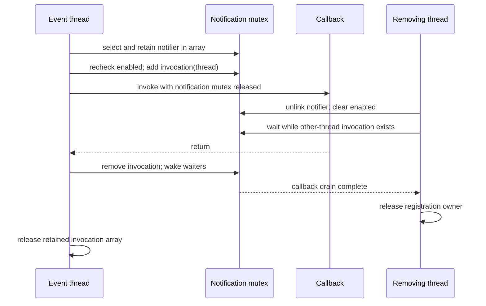

# Service notifications, replay, and arbitration

A service can become visible, become matched, terminate, or send an interest message while other threads register or remove callbacks. This chapter follows the lock and ownership protocols that connect those events. [Service matching and termination](service-matching-and-termination.md) covers candidate selection and the termination phases; [registry planes](registry-planes-and-properties.md) covers graph snapshots. Here the focus is how notification registration, callback invocation, synchronous waiting, and `open/close` remain coordinated. [`notification structures`](../../../xnu/iokit/Kernel/IOServicePrivate.h#L81-L139), [`registration`](../../../xnu/iokit/Kernel/IOService.cpp#L6442-L6652).

## 1. Four locks or protocols should not be conflated

| Mechanism | State it coordinates | Important distinction |
|---|---|---|
| `gNotificationLock` | Global matching-notifier sets, interest chains, enabled bits and callback invocation records | Both `LOCKREADNOTIFY` and `LOCKWRITENOTIFY` acquire the same recursive mutex |
| IOService arbitration | A particular service's serialized operations, including lifecycle and open state | Implemented with global active/waiting lock-owner queues and deadlock handling |
| Registry graph lock | Parent/child arrays and registry name/location state | A separate read/write lock |
| Entry property lock | Property dictionary lookup, replacement and snapshot creation | A separate per-entry recursive lock |

The source explicitly orders arbitration before notification locking. A callback being outside `gNotificationLock` does not establish that no other lock is held: external callers can hold arbitration, which is why the optional notifier-arbitration diagnostic is disabled. [`lock order and diagnostic`](../../../xnu/iokit/Kernel/IOService.cpp#L77-L85), [`notification macros`](../../../xnu/iokit/Kernel/IOService.cpp#L301-L313), [`registry locks`](../../../xnu/iokit/Kernel/IORegistryEntry.cpp#L112-L122), [`arbitration`](../../../xnu/iokit/Kernel/IOService.cpp#L1666-L1929).

The macro names can otherwise suggest a reader/writer design that is not present: [`notification lock macros`](../../../xnu/iokit/Kernel/IOService.cpp#L301-L313).

<!-- source-excerpt: ../../../xnu/iokit/Kernel/IOService.cpp#L301-L313 -->
```cpp
#define LOCKREADNOTIFY()        \
    IORecursiveLockLock( gNotificationLock )
#define LOCKWRITENOTIFY()       \
    IORecursiveLockLock( gNotificationLock )
#define LOCKWRITE2READNOTIFY()
#define UNLOCKNOTIFY()          \
    IORecursiveLockUnlock( gNotificationLock )
#define SLEEPNOTIFY(event) \
    IORecursiveLockSleep( gNotificationLock, (void *)(event), THREAD_UNINT )
#define SLEEPNOTIFYTO(event, deadline) \
    IORecursiveLockSleepDeadline( gNotificationLock, (void *)(event), deadline, THREAD_UNINT )
#define WAKEUPNOTIFY(event) \
	IORecursiveLockWakeup( gNotificationLock, (void *)(event), /* wake one */ false )
```

A matching notifier contains its owning ordered-set pointer `whence`, retained matching dictionary, notification type, handler/target/refcon, priority, enabled/waiter state and a queue of active handler invocations. Each invocation record contains the executing thread and a queue link. An interest notifier has a chain link into a particular service's interest list and the same invocation/state concept. Raw `target` and general `ref` fields are not automatically retained; block-handler wrappers explicitly copy/release the block. The client must give ordinary callback context its own valid lifetime. [`structures`](../../../xnu/iokit/Kernel/IOServicePrivate.h#L88-L139), [`matching setup`](../../../xnu/iokit/Kernel/IOService.cpp#L6460-L6476), [`interest setup`](../../../xnu/iokit/Kernel/IOService.cpp#L2303-L2309), [`block cleanup`](../../../xnu/iokit/Kernel/IOService.cpp#L7197-L7206).

## 2. Installing a matching notifier also captures existing services

`doInstallNotification()` accepts publish, first-publish, matched, first-match, terminated and will-terminate types. It converts the first four to their corresponding service-state masks; termination types use zero and do not replay a current set. Unknown types or a null matching dictionary fail. `setNotification()` initializes a notifier, retains the dictionary, and inserts it into the per-type ordered set in `gNotifications`, ordered using the notifier priority comparator. [`type selection`](../../../xnu/iokit/Kernel/IOService.cpp#L6499-L6539), [`installation`](../../../xnu/iokit/Kernel/IOService.cpp#L6442-L6495), [`priority comparator`](../../../xnu/iokit/Kernel/IOService.cpp#L3660-L3682).

`installNotification()` holds `gNotificationLock` while installing and obtaining the existing-service iterator, then takes an extra notifier reference before unlocking. `addMatchingNotification()` replays that iterator outside the lock, skips services already marked inactive, and invokes the same notifier callback path used for later events. The extra reference permits a callback to call `remove()` during replay. After replay the function checks `whence` under the lock, releases its extra owner, and returns the global null-notifier sentinel if the callback removed the registration. It is therefore possible to receive a callback before the add function returns. [`install extra reference`](../../../xnu/iokit/Kernel/IOService.cpp#L6567-L6588), [`replay and sentinel`](../../../xnu/iokit/Kernel/IOService.cpp#L6614-L6652).

The final replay cleanup makes the self-removal outcome explicit: [`addMatchingNotification`](../../../xnu/iokit/Kernel/IOService.cpp#L6642-L6652).

<!-- source-excerpt: ../../../xnu/iokit/Kernel/IOService.cpp#L6642-L6652 -->
```cpp
	LOCKWRITENOTIFY();
	bool removed = (NULL == notify->whence);
	notify->release();
	if (removed) {
		ret = gIOServiceNullNotifier;
	}
	UNLOCKNOTIFY();

	return ret;
}

```

This implementation closes the ordinary gap between checking the existing set and installing future-event interest by doing both under the notification lock. It does not make replay an immutable snapshot of each service's future activity: a retained service can become inactive after it is selected. The explicit inactive check before replay is evidence of that distinction. Nor should callback order across independently executing service threads be inferred from the ordered notifier set alone. [`installation/snapshot`](../../../xnu/iokit/Kernel/IOService.cpp#L6527-L6538), [`replay`](../../../xnu/iokit/Kernel/IOService.cpp#L6632-L6640).

Matching dictionary ownership depends on the entry point. `setNotification()` adds its own reference, and removal releases it. The compatibility `addNotification()` wrapper additionally releases the caller's matching dictionary on successful installation; the newer `addMatchingNotification()` body does not do that extra caller release. Reading one wrapper's ownership convention into all overloads produces leaks or premature releases. [`dictionary retain`](../../../xnu/iokit/Kernel/IOService.cpp#L6463-L6466), [`compatibility wrapper`](../../../xnu/iokit/Kernel/IOService.cpp#L6591-L6611), [`remove`](../../../xnu/iokit/Kernel/IOService.cpp#L7209-L7230).

### The existing set comes from the class-instance index

`copyExistingServices()` has a direct `IOResources` special case, then normally enumerates published service instances through `OSMetaClass::applyToInstancesOfClassName()` or the IOService metaclass tree. `instanceMatch()` checks required state and inactivity, applies the internal matching predicates, and builds a retained `OSSet` or an early single result. If some matching conditions remain, `copyExistingServices()` runs `matchPassive()` over the candidate set afterward. It normally wraps the result set in an `OSCollectionIterator`, whose retained collection keeps the candidates alive. The registry-walk implementation later in the function is under `MATCH_DEBUG`; it is not the normal lookup algorithm. [`instanceMatch`](../../../xnu/iokit/Kernel/IOService.cpp#L6209-L6250), [`existing-service algorithm`](../../../xnu/iokit/Kernel/IOService.cpp#L6254-L6394), [instance index](object-runtime-and-collections.md).

That result iterator is a snapshot container iterator, unlike the live recursive registry cursor. Its objects remain retained even if the service graph changes, but their active/matched state is not frozen. The type's default state mask also matters: publish and matched notifications represent distinct states and are not interchangeable with “property exists.” [`state masks`](../../../xnu/iokit/Kernel/IOService.cpp#L6513-L6524), [`iterator conversion`](../../../xnu/iokit/Kernel/IOService.cpp#L6384-L6391), [registry iterator distinctions](registry-planes-and-properties.md), [boot/resource integration](bootstrap-and-bsd-integration.md).

## 3. Event selection and callback invocation have separate lifetimes

`copyNotifiers()` takes arbitration, then the notification lock, selects enabled notifiers whose dictionaries pass `matchPassive()`, retains them in an array, and updates the service state before releasing the locks. It allows termination notifications even when the service is inactive. `invokeNotifiers()` consumes the array pointer, sets the caller's pointer to null, invokes every retained notifier, combines Boolean results with `&=`, and finally releases the array. A false callback result does not short-circuit the rest of that array. [`selection/state update`](../../../xnu/iokit/Kernel/IOService.cpp#L6858-L6899), [`array consumption`](../../../xnu/iokit/Kernel/IOService.cpp#L3820-L3843).

The matching worker illustrates this split: it records first-publication state and selects its callbacks under arbitration, then unlocks before invocation; after matching it selects matched/first-match notifications, clears `ConfigRunning`, unlocks, invokes callbacks, and only then clears `ConfigState` and resumes pending termination work. Those two configuration bits are intentionally not cleared at the same point. [`doServiceMatch`](../../../xnu/iokit/Kernel/IOService.cpp#L5526-L5568), [`post-match callbacks`](../../../xnu/iokit/Kernel/IOService.cpp#L5590-L5624), [termination coordination](service-matching-and-termination.md).

`invokeNotifier()` rechecks enabled state under the notification lock even if an earlier selection retained it. If enabled, it inserts a stack invocation record containing `current_thread()`, unlocks, calls the handler, then relocks to remove the record and wake removal/disable waiters. If disabled by then, it simply skips the callback. A retained snapshot supplies object lifetime; the enabled recheck supplies cancellation of callbacks not yet started. They solve different races. [`invokeNotifier`](../../../xnu/iokit/Kernel/IOService.cpp#L3779-L3817).



`deliverNotification()` is not an alternate working shortcut in this checkout: its body panics. Follow `copyNotifiers()` and `invokeNotifiers()` rather than assuming the method name implies a valid generic delivery path. [`deliverNotification`](../../../xnu/iokit/Kernel/IOService.cpp#L6849-L6855).

## 4. Removal waits for other threads, with a self-callback exception

Matching notifier `remove()` unlinks the notifier from `whence`, clears that pointer, releases its matching dictionary, clears enabled state, waits, unlocks, and releases the registration owner. `disable()` clears enabled and waits only if it was previously enabled; it returns the previous state, which `enable(was)` can restore. These methods do not destroy a notifier still retained by a dispatch snapshot. `free()` asserts that the invocation queue is empty. [`matching removal/disable/enable`](../../../xnu/iokit/Kernel/IOService.cpp#L7197-L7260).

Both matching and interest `wait()` implementations scan active invocations and sleep only for records belonging to another thread. The current thread is excluded so a callback can disable/remove itself without waiting for its own return. That does **not** authorize destruction while its callback body still runs: the caller's replay/snapshot reference is what makes the self-removal case safe. It also does not prove a callback is absent merely because `remove()` returned to that same callback. [`matching wait`](../../../xnu/iokit/Kernel/IOService.cpp#L7175-L7194), [`interest wait`](../../../xnu/iokit/Kernel/IOService.cpp#L2412-L2431), [`replay protection`](../../../xnu/iokit/Kernel/IOService.cpp#L6580-L6585), [`array protection`](../../../xnu/iokit/Kernel/IOService.cpp#L6876-L6883).

The exact condition is the critical part of the drain protocol: [`_IOServiceNotifier::wait`](../../../xnu/iokit/Kernel/IOService.cpp#L7180-L7193).

<!-- source-excerpt: ../../../xnu/iokit/Kernel/IOService.cpp#L7180-L7193 -->
```cpp
	do {
		doWait = false;
		queue_iterate( &handlerInvocations, next,
		    _IOServiceNotifierInvocation *, link) {
			if (next->thread != current_thread()) {
				doWait = true;
				break;
			}
		}
		if (doWait) {
			state |= kIOServiceNotifyWaiter;
			SLEEPNOTIFY(this);
		}
	} while (doWait);
```

The wait uses `IORecursiveLockSleep` with `THREAD_UNINT`, and callback exit clears the waiter bit and wakes all notification waiters. Removing a notifier from within a callback therefore requires preserving any callback-owned context until that body is finished; clearing a raw target pointer or freeing shared context solely because self-removal returned would not be justified by this protocol. [`sleep/wake macros`](../../../xnu/iokit/Kernel/IOService.cpp#L308-L313), [`callback completion`](../../../xnu/iokit/Kernel/IOService.cpp#L3806-L3813), [`raw target/ref fields`](../../../xnu/iokit/Kernel/IOServicePrivate.h#L105-L110).

## 5. Interest messages attach to one service

`registerInterestForNotifier()` validates notifier type and handler, accepts a specific set of interest symbols, then takes service arbitration. An inactive service returns `kIOReturnNotReady`. For an active service it enables the notifier, takes the notification lock, locates or creates an `IOCommand` chain head stored in the corresponding registry property, enqueues the notifier and takes a list reference. Unsupported interest types return `kIOReturnBadArgument`. The visible body leaves `rc` as success if chain-head creation/property installation fails, so this path should not be documented as having a complete allocation-failure error return for every list-creation failure. [`registration`](../../../xnu/iokit/Kernel/IOService.cpp#L2291-L2355).

`applyToInterestNotifiers()` copies the chain's notifiers into an `OSArray` under the notification lock, then invokes its applier after unlocking; the array retains the notifiers. `applyToInterested(gIOGeneralInterest, ...)` additionally visits attached service clients. `messageClient()` dispatches directly to a service's virtual `message()` or, for an interest notifier, performs the same enabled-check/invocation-record/callback/drain sequence. `messageClients()` continues through recipients and keeps a non-success result if one is returned. [`interest snapshot`](../../../xnu/iokit/Kernel/IOService.cpp#L2148-L2185), [`general-interest routing`](../../../xnu/iokit/Kernel/IOService.cpp#L2188-L2196), [`message dispatch`](../../../xnu/iokit/Kernel/IOService.cpp#L2101-L2145), [`message aggregation`](../../../xnu/iokit/Kernel/IOService.cpp#L2206-L2235).

Interest removal removes the chain membership and list reference, disables, drains other-thread callbacks, then drops the registration owner. `unregisterAllInterest()` is different: it drains list nodes from the known interest properties and drops their list references through `cleanInterestList()`. It does not call each notifier's public `remove()` or perform that method's enabled/drain sequence. This matters when reading service teardown: the service's surrounding lifecycle and retained callback snapshots still participate in lifetime. [`interest remove`](../../../xnu/iokit/Kernel/IOService.cpp#L2446-L2463), [`bulk list cleanup`](../../../xnu/iokit/Kernel/IOService.cpp#L2359-L2401).

## 6. A synchronous match wait is a temporary notification

`waitForMatchingServiceWithToken()` optionally installs a DriverKit check-in-token cancellation handler, then under the notification lock looks for an already matched service with `kIONotifyOnce`. If none exists and cancellation has not occurred, it creates a matched notifier whose refcon points to its local result slot and sleeps on that slot, with an absolute deadline for finite timeouts. The synchronous handler retains the first service, stores it, and wakes the waiter while holding the same lock. The cancellation handler wakes the same event and records cancellation. [`wait setup and lookup`](../../../xnu/iokit/Kernel/IOService.cpp#L6709-L6795), [`result handler`](../../../xnu/iokit/Kernel/IOService.cpp#L6692-L6706), [`cancellation`](../../../xnu/iokit/Kernel/IOService.cpp#L6681-L6689).

After wakeup the waiter unlocks, unregisters the cancellation handler, removes its notifier (including the invocation drain), releases the cancellation-handler object and returns the retained result or null. The visible body sleeps once inside a `do ... while (false)` block, rather than implementing a generic repeated predicate wait. Cleanup before leaving is especially important because the callback refcon points to stack state. The legacy `waitForService()` wrapper consumes the matching dictionary and releases the returned service before returning a borrowed pointer, unlike `waitForMatchingService()`. [`wait cleanup`](../../../xnu/iokit/Kernel/IOService.cpp#L6796-L6819), [`wrappers`](../../../xnu/iokit/Kernel/IOService.cpp#L6822-L6846).

## 7. Arbitration tracks owners and breaks only permitted deadlocks

`lockForArbitration(isSuccessRequired)` obtains a global queue lock and prepares a queue element recording current thread, service, recursion count, required flag and aborted state. It searches the active queue for an owner. An unlocked service becomes active immediately; recursion by the same thread increments the owner's count. If another thread owns the service, the code follows that owner's waiting dependency through the active/waiting queues to detect a cycle. [`acquisition setup`](../../../xnu/iokit/Kernel/IOService.cpp#L1666-L1736), [`dependency walk`](../../../xnu/iokit/Kernel/IOService.cpp#L1737-L1814).

On a detected cycle, a non-required originating request fails. A required request can instead abort another waiting request encountered with `required == false`, remove that victim from the waiting queue and wake it. If every participant requires success, the implementation panics with an unrecoverable-deadlock diagnostic. This is a narrow, explicit deadlock response; it is not a claim that arbitrary lock combinations across workloops, registry locks and driver mutexes are automatically detected. [`cycle resolution`](../../../xnu/iokit/Kernel/IOService.cpp#L1764-L1801).

Waiting enqueues the request and calls `IOLockSleepWithInheritor()` using the current owner's thread as inheritor and `LCK_SLEEP_UNLOCK`. Required requests wait uninterruptibly; optional requests can return interrupted and remove themselves if still queued. A woken request distinguishes an aborted floating queue element from one already moved to the active queue. Thus a successful wake represents ownership transfer, not merely a signal to race all other contenders for an unlocked flag. [`sleep and interruption`](../../../xnu/iokit/Kernel/IOService.cpp#L1816-L1894), [runtime wait/inheritance mechanisms](../runtime/wait-and-turnstile-protocols.md).

The inheritor and interruptibility are visible at the wait call: [`arbitration sleep`](../../../xnu/iokit/Kernel/IOService.cpp#L1822-L1826).

<!-- source-excerpt: ../../../xnu/iokit/Kernel/IOService.cpp#L1822-L1826 -->
```cpp
				wait_result = IOLockSleepWithInheritor(gArbitrationLockQueueLock,
				    LCK_SLEEP_UNLOCK,
				    &element->service->__machPortHoldDestroy,     // event
				    owner->thread,
				    element->required ? THREAD_UNINT : THREAD_INTERRUPTIBLE, TIMEOUT_WAIT_FOREVER);
```

`unlockForArbitration()` decrements a recursive count or removes the owner from the active queue. It calls `wakeup_one_with_inheritor`, uses the returned thread to find the matching waiting element, moves that element to the active queue while still holding the global queue lock, and drops the returned thread reference. Although requests are appended to a waiting queue, the selected successor comes from the inheritor-aware wake primitive; describing this as unconditional FIFO ownership would overstate the body. [`unlock/handoff`](../../../xnu/iokit/Kernel/IOService.cpp#L1932-L2008).

## 8. Open/close serialize service policy and cooperate with termination

`open()` first sends the general-interest “attempting open” message, then tries optional arbitration. Deadlock avoidance can therefore return false before `handleOpen()`. Once locked, an inactive service fails; a DriverKit client first performs `userServer->serviceOpen`, then the provider's virtual `handleOpen`. If that latter step fails, it rolls back the DriverKit bookkeeping using `serviceClose`. Arbitration is released before returning. [`IOService::open`](../../../xnu/iokit/Kernel/IOService.cpp#L3522-L3559).

The default `handleOpen()` permits one `__owner`. If already owned and `kIOServiceSeize` is supplied, it asks the current owner to close and succeeds only if the message succeeds **and** `__owner` became null. An acknowledgment alone does not forcibly erase ownership. Subclasses can implement a different policy in their handle methods while keeping the public arbitration wrapper. [`default open policy`](../../../xnu/iokit/Kernel/IOService.cpp#L3616-L3640).

`close()` uses required arbitration, checks whether this client is open, calls `handleClose`, snapshots whether termination phase 3 is waiting, and updates DriverKit open bookkeeping. After unlocking, it schedules stop on the closing client when termination is waiting; otherwise it broadcasts “was closed” if a real open was closed. This avoids running the later stop scheduling or general-interest broadcast as part of the locked owner update. `isOpen()` also uses arbitration around the virtual predicate. [`close/isOpen`](../../../xnu/iokit/Kernel/IOService.cpp#L3562-L3613), [termination phase 3](service-matching-and-termination.md), [DriverKit connection lifetime](user-client-and-driverkit-lifetime.md).

## Reading route and source-review limits

Read the notifier structures and lock macros, then `installNotification/addMatchingNotification`, `invokeNotifier`, and `remove/wait`. Compare matching and interest snapshots. Finally trace `lockForArbitration/unlockForArbitration` and one `open/close` pair; keep the registry/property locks distinct throughout.

| Sources inspected | Depth | Limits |
|---|---|---|
| Matching notifier setup, existing-instance snapshot and replay | Full selected registration, callback and cleanup path | Every passive matching predicate and notifier client is not reviewed |
| Interest list setup, message snapshots and removal | Enabled-state, list/snapshot ownership and invocation drain | Device-specific interest semantics and all teardown callers remain outside scope |
| Synchronous matched wait and token cancellation | Stack-refcon lifetime, result reference, timeout cleanup | No timeout/cancellation race test was run |
| Arbitration queue/deadlock/handoff and open/close | Full selected owner-transfer and rollback path | Not a proof of global driver lock-order correctness |
| `doServiceMatch` callback boundaries | State ordering around notification delivery | Candidate probing and termination are covered in the companion lifecycle chapter |

User-facing notification ports and shared queues build on these kernel mechanisms but add their own queue/arming and IPC ownership rules; continue with [shared data queues and notifications](shared-data-queues-and-notifications.md). No callback race or deadlock was executed during this source review.

<!-- BEGIN PLATYDOC DOCUMENTATION LICENSE -->
Original Platydoc text and diagrams are licensed under [CC BY 4.0](https://creativecommons.org/licenses/by/4.0/). Quoted source code and third-party material retain their respective licenses.
<!-- END PLATYDOC DOCUMENTATION LICENSE -->
