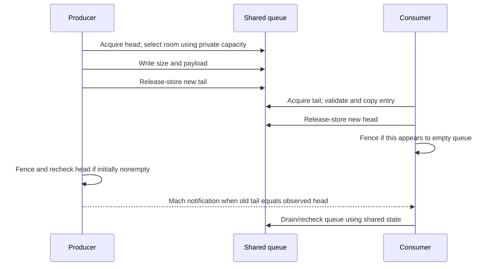
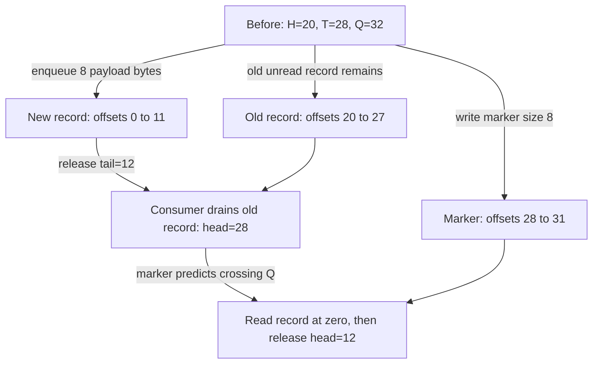
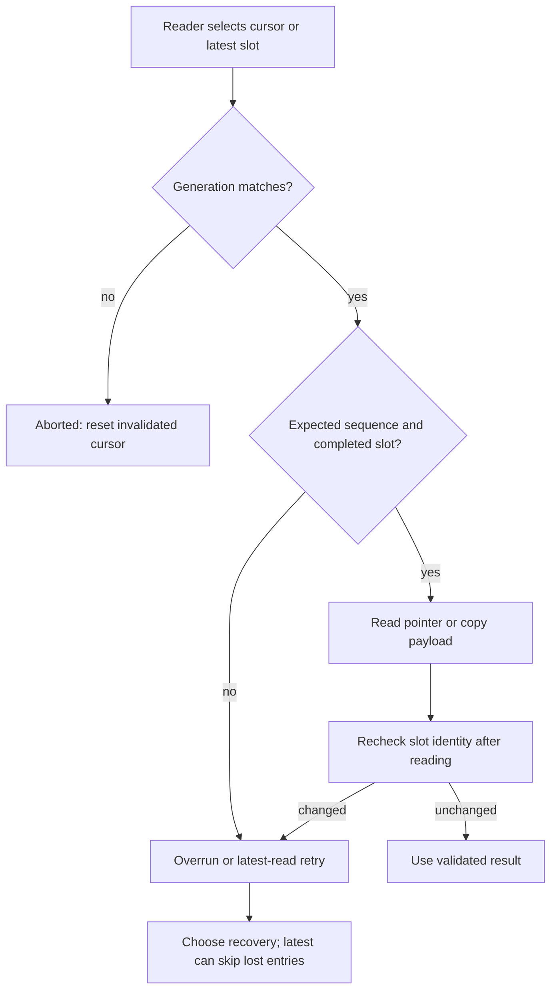
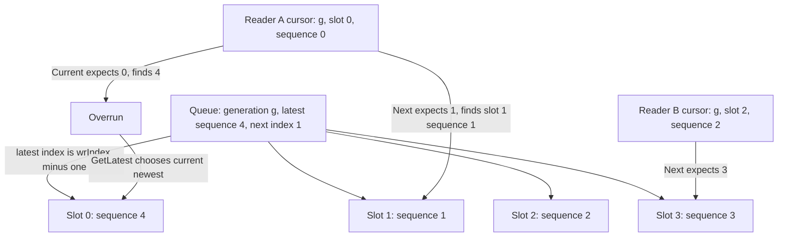
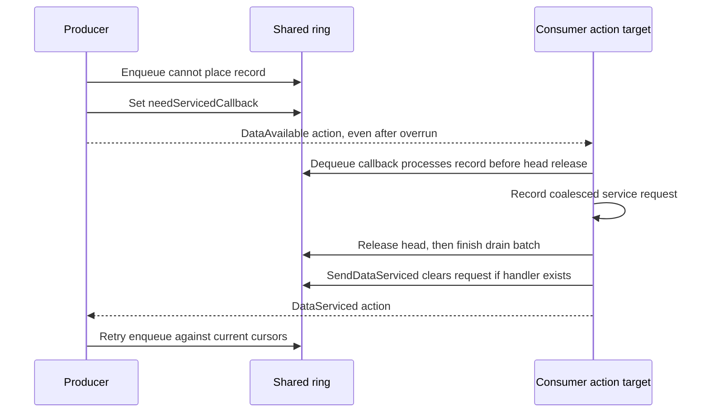

# Shared data queues and asynchronous notifications

[Drivers](README.md) · [User-client lifetime](user-client-and-driverkit-lifetime.md) · [Memory mappings](memory-descriptors-and-cpu-mappings.md) · [Mach delivery](../ipc/message-send-receive.md)

IOKit has several ways to deliver a result after the initiating call returns. A shared queue publishes bytes in mapped memory and may send a Mach message to tell a reader to inspect that memory. An asynchronous external method instead sends a completion message containing its result and arguments. A DriverKit action adds remote object and dispatch rules, described in [DriverKit dispatch and actions](driverkit-dispatch-and-actions.md). These mechanisms do not have interchangeable buffering, ordering, or lifetime contracts.

## 1. Choose the queue by its actual contract

| Implementation | Participants and storage | Full/overwrite behavior | Notification |
| --- | --- | --- | --- |
| `IODataQueue` | Single producer and single consumer; variable-size entries in a byte ring, originally kernel-to-user. | Enqueue returns false when it cannot place an entry without catching the consumer. | Empty-to-nonempty detection sends a small Mach message. |
| `IOSharedDataQueue` | Same basic layout and participant restriction, with kernel-side peek/dequeue and a versioned appendix. | Does not deliberately overwrite unread entries; dequeue can fail without advancing the head. | Inherits the Mach notification mechanism. |
| `IODataQueueDispatchSource` | DriverKit byte ring, four-byte payload rounding, local producer/consumer callbacks, and retained `OSAction` handlers. | Enqueue reports overrun and can request a later data-serviced callback; no overwrite is intended. | Action-target notifications, with explicit batching/coalescing. |
| `IOCircularDataQueue` | Single writer and multiple independent readers; fixed-size slots, per-reader cursors, sequence/generation checks. | Writer can overwrite a reader's slot; readers detect overrun or retry. | No built-in notification; readers pull data. |
| `IOUserClient::sendAsyncResult64()` | Completion payload placed in a Mach message addressed through an asynchronous reference. | Mach send status reports whether sending succeeded; no shared ring is involved. | The message itself contains the completion. |

The participant restrictions are explicit in the [classic queue headers](../../../platydoc-data/xnu/iokit/IOKit/IODataQueue.h#L56-L66), [shared-queue header](../../../platydoc-data/xnu/iokit/IOKit/IOSharedDataQueue.h#L40-L48), and [circular-queue contract](../../../platydoc-data/xnu/iokit/IOKit/IOCircularDataQueueImplementation.h#L370-L395). Atomic head/tail operations do not make the classic queue a multiple-producer queue: two producers could choose the same tail before either publishes it. The DriverKit byte-ring implementation also has no producer reservation or consumer arbitration; its local callers must serialize each side. `IODataQueue.h` explicitly deprecates the base class for security issues in its interfaces and directs callers to `IOSharedDataQueue`; this chapter explains the base code because it also supplies the inherited notification protocol. [Deprecation notice](../../../platydoc-data/xnu/iokit/IOKit/IODataQueue.h#L29-L35), [DriverKit producer cursor loads](../../../platydoc-data/xnu/iokit/System/IODataQueueDispatchSourceShared.h#L506-L529).

## 2. Classic queues separate shared offsets from private allocation metadata

The mapped region begins with a byte capacity and head/tail offsets; entries carry a size followed by that many payload bytes. The four-byte `data` member in the entry declaration marks the start of variable data, not a four-byte payload limit.

[Source: iokit/IOKit/IODataQueueShared.h, lines 57–62](../../../platydoc-data/xnu/iokit/IOKit/IODataQueueShared.h#L57-L62)

<!-- source-excerpt: ../../../platydoc-data/xnu/iokit/IOKit/IODataQueueShared.h#L57-L62 -->
```c
typedef struct _IODataQueueMemory {
	UInt32            queueSize;
	volatile UInt32   head;
	volatile UInt32   tail;
	IODataQueueEntry  queue[1];
} IODataQueueMemory;
```

`IODataQueue::initWithCapacity()` checks addition and page-rounding overflow, allocates zeroed shared kernel memory, and keeps the allocation capacity in a separate `IODataQueueInternal` alongside the notification header. Enqueue and free consult that private capacity, rather than trusting a possibly user-modified `dataQueue->queueSize`. `initWithEntries()` checks the product and reserves space for an extra entry when deriving capacity. [Allocation and overflow checks](../../../platydoc-data/xnu/iokit/Kernel/IODataQueue.cpp#L89-L139), [private metadata](../../../platydoc-data/xnu/iokit/Kernel/IODataQueue.cpp#L44-L47), [free](../../../platydoc-data/xnu/iokit/Kernel/IODataQueue.cpp#L142-L160).

`IOSharedDataQueue` allocates header + queue + `IODataQueueAppendix`, stores capacity in its private expansion data, initializes appendix version zero, and maintains a private notification-message allocation. The appendix declaration contains a message header, but this implementation's notifier uses `notifyMsg`; the layout declaration alone does not show a send using writable appendix bytes. [Allocation](../../../platydoc-data/xnu/iokit/Kernel/IOSharedDataQueue.cpp#L79-L135), [private size accessors](../../../platydoc-data/xnu/iokit/Kernel/IOSharedDataQueue.cpp#L399-L416), [appendix layout](../../../platydoc-data/xnu/iokit/IOKit/IODataQueueShared.h#L64-L74), [notifier](../../../platydoc-data/xnu/iokit/Kernel/IODataQueue.cpp#L261-L292).

`getMemoryDescriptor()` returns an `IOMemoryDescriptor` describing the queue's existing allocation, including the appendix for the shared subclass. It does not transfer the queue object's allocation ownership to that descriptor. The queue's `free()` still frees its backing. Consequently the exporting driver must coordinate queue lifetime with consumers and mappings; retaining the descriptor is not evidence that it retains the queue object. [Base descriptor](../../../platydoc-data/xnu/iokit/Kernel/IODataQueue.cpp#L294-L306), [shared descriptor and free](../../../platydoc-data/xnu/iokit/Kernel/IOSharedDataQueue.cpp#L137-L174), [mapping ownership](user-client-and-driverkit-lifetime.md).

## 3. Enqueue publishes a complete entry before moving the tail

The producer loads its own tail relaxed and the consumer's head with acquire ordering. It checks both offsets against private capacity, including overflow in payload-plus-header size. Placement has three cases:

1. Tail is at or after head, and the entry fits through the end: write there.
2. It does not fit at the end, but fits strictly before head: put the entry at offset zero, and leave a size marker at the old tail if there is room for that header.
3. Tail is before head: require strictly more space than the entry size.

The strict comparisons preserve `head == tail` as empty. A tail exactly equal to capacity is allowed after an entry ends exactly at the buffer boundary; the next operation must handle wrapping. All data copying precedes the release-store of the new tail. [Placement and publication](../../../platydoc-data/xnu/iokit/Kernel/IODataQueue.cpp#L162-L238), [shared-subclass counterpart](../../../platydoc-data/xnu/iokit/Kernel/IOSharedDataQueue.cpp#L224-L291).

[Source: iokit/Kernel/IODataQueue.cpp, lines 237–255](../../../platydoc-data/xnu/iokit/Kernel/IODataQueue.cpp#L237-L255)

<!-- source-excerpt: ../../../platydoc-data/xnu/iokit/Kernel/IODataQueue.cpp#L237-L255 -->
```cpp
	__c11_atomic_store((_Atomic UInt32 *)&dataQueue->tail, newTail, __ATOMIC_RELEASE);

	if (tail != head) {
		//
		// The memory barrier below paris with the one in ::dequeue
		// so that either our store to the tail cannot be missed by
		// the next dequeue attempt, or we will observe the dequeuer
		// making the queue empty.
		//
		// Of course, if we already think the queue is empty,
		// there's no point paying this extra cost.
		//
		__c11_atomic_thread_fence(__ATOMIC_SEQ_CST);
		head = __c11_atomic_load((_Atomic UInt32 *)&dataQueue->head, __ATOMIC_RELAXED);
	}

	if (tail == head) {
		// Send notification (via mach message) that data is now available.
		sendDataAvailableNotification();
```

The extra fence addresses the race where the producer initially sees a nonempty queue while the consumer finishes its last entry. After publishing, the producer executes a sequentially consistent fence and reloads head when needed. If old tail equals observed head, it sends a notification. The consumer executes its matching fence when its head update makes the queue appear empty. This protocol avoids relying solely on the producer's first empty/nonempty observation.



The diagram shows the paired operations, not a mandatory order between the two threads. The consumer must follow the queue protocol, including checking shared state; receiving one message is not permission to assume exactly one entry exists.

### 3.1 Byte offsets, exact-end positions and wrap markers

For the classic classes, define `Q` as the private queue capacity, `H` as head, `T` as tail, and `E = 4 + payloadLength`. The shared queue header precedes this coordinate system: offset zero means the first entry's size word, not the beginning of the allocation. Payload length is not rounded by these classic implementations. The producer chooses a **contiguous** placement; it never splits one payload across the end. [Entry/header sizes](../../../platydoc-data/xnu/iokit/IOKit/IODataQueueShared.h#L42-L62), [placement arithmetic](../../../platydoc-data/xnu/iokit/Kernel/IOSharedDataQueue.cpp#L219-L291).

| Observed cursor relation | Admission predicate | New tail |
| --- | --- | --- |
| `T >= H`, room through end | `T + E <= Q`, with overflow checks | `T + E`, including the distinct value `Q`. |
| `T >= H`, no room through end | `H > E` | `E`, after writing the entry at zero and an optional end marker. |
| `T < H` | `H - T > E` | `T + E`. |
| No predicate succeeds | Full for this requested record | Tail and published records remain unchanged. |

The following are illustrative byte coordinates with `Q = 32`; no CPU page size is needed for arithmetic within the allocation:

1. At `H = 20`, `T = 28`, an eight-byte payload needs `E = 12`. Only four bytes remain at the end, but `20 > 12`, so enqueue writes the new size/payload at `[0,12)` and writes size `8` at offset `28`. The release-store publishes `T = 12`.
2. Assume the previous unread entry occupied `[20,28)`. Its dequeue moves `H` to `28`. The next dequeue reads the marker there, finds that `28 + 4 + 8 > 32`, and selects the complete record at zero. It returns that record and moves `H` to `12`: the queue is now empty.
3. At `H = 20`, `T = 12`, another eight-byte payload cannot fit. The free interval has length eight, less than `E = 12`. Even a four-byte payload, whose entry is eight bytes, fails: equality would set `T = H` and falsely encode empty.



The marker is not a special record type or a separate length to dequeue: it repeats a size that cannot fit at the old tail, causing the reader's normal bounds calculation to wrap. If fewer than four bytes remain at the old tail, the producer omits the marker and the consumer's header-boundary condition selects offset zero instead. [Marker publication](../../../platydoc-data/xnu/iokit/Kernel/IODataQueue.cpp#L202-L217), [consumer wrap selection](../../../platydoc-data/xnu/iokit/Kernel/IOSharedDataQueue.cpp#L333-L374).

Exact-end offsets also explain a surprising capacity case. With `Q = 32`, an empty queue at `H = T = 0` accepts one 28-byte payload and publishes `T = 32`; after consuming it, `H = T = 32`. The same request now fails because there is no end space and the wrap test requires `H > E`, not `H >= E`. Empty does not mean that every record fitting the nominal allocation is admissible at every cursor position. The implementation leaves empty cursors where they stopped rather than resetting them to zero. `initWithEntries()` adds one entry's worth of capacity when deriving a byte capacity, but `withCapacity()` callers need to reason about their own record sizes. [Extra-entry calculation](../../../platydoc-data/xnu/iokit/Kernel/IODataQueue.cpp#L126-L139), [strict wrap condition](../../../platydoc-data/xnu/iokit/Kernel/IOSharedDataQueue.cpp#L240-L289).

### 3.2 Publication and wakeup ordering solve different problems

The release/acquire pairs transfer **permission to access bytes**. A producer's release tail follows writing size and payload; a consumer acquiring that tail can then read the published record. A consumer's release head follows its copy or processing; a producer acquiring that head can reuse the returned storage. Loading one's own cursor relaxed is sufficient for the single-participant algorithm shown. None of these atomics retain the queue object, descriptor, task mapping or notification port. [Producer ordering](../../../platydoc-data/xnu/iokit/Kernel/IODataQueue.cpp#L177-L237), [consumer ordering](../../../platydoc-data/xnu/iokit/Kernel/IOSharedDataQueue.cpp#L326-L394).

The extra sequentially consistent fences address **whether a reader notices work before sleeping**. For example, a producer starts with old `T = 20` and sees `H = 8`, while the consumer is finishing the entry ending at `20`. If the producer only tested its initial snapshot, it would omit the wakeup. After publishing a new tail, its fence and head reload can observe `H = 20` and send. If the consumer instead observes the new tail on its next dequeue attempt, it continues draining. The consumer's empty-transition fence pairs with this producer recheck; it is not itself a new tail load or a wait registration. A caller that consumes one entry and goes to sleep without the required queue recheck does not inherit a proof against missed work. Transport failure remains a separate concern in section 5. [Paired fence comments and code](../../../platydoc-data/xnu/iokit/Kernel/IOSharedDataQueue.cpp#L293-L310), [consumer empty transition](../../../platydoc-data/xnu/iokit/Kernel/IOSharedDataQueue.cpp#L385-L394).

## 4. Dequeue validates a record before returning space to the producer

`IOSharedDataQueue::dequeue()` loads head relaxed and tail acquire. Equal offsets mean empty. It determines whether the head record fits through the end of the queue; if its header or payload would cross the end, it examines the record at offset zero. It checks size arithmetic and capacity again using the selected entry size. The source reads shared record fields at several points, so describing this as a full immutable snapshot would be inaccurate. [Record selection and bounds](../../../platydoc-data/xnu/iokit/Kernel/IOSharedDataQueue.cpp#L314-L374).

If a destination is supplied but its capacity is insufficient, dequeue returns false before changing head. With `data == NULL`, it advances without copying; this supports inspecting an entry with `peek()` and later consuming it. On successful copy it reports the payload length, release-stores the new head, and performs the empty-transition fence where required:

[Source: iokit/Kernel/IOSharedDataQueue.cpp, lines 376–394](../../../platydoc-data/xnu/iokit/Kernel/IOSharedDataQueue.cpp#L376-L394)

<!-- source-excerpt: ../../../platydoc-data/xnu/iokit/Kernel/IOSharedDataQueue.cpp#L376-L394 -->
```cpp
	if (data) {
		if (entrySize > *dataSize) {
			// not enough space
			return false;
		}
		__nochk_memcpy(data, (void *)entry->data, entrySize);
		*dataSize = entrySize;
	}

	__c11_atomic_store((_Atomic UInt32 *)&dataQueue->head, newHeadOffset, __ATOMIC_RELEASE);

	if (newHeadOffset == tailOffset) {
		//
		// If we are making the queue empty, then we need to make sure
		// that either the enqueuer notices, or we notice the enqueue
		// that raced with our making of the queue empty.
		//
		__c11_atomic_thread_fence(__ATOMIC_SEQ_CST);
	}
```

`peek()` returns an address into shared memory. It neither copies the payload nor advances head. Its range/wrap inspection is shorter than dequeue's, and the returned pointer carries no independent object reference. The caller still needs the queue to remain mapped and must respect the participant protocol. [Peek body](../../../platydoc-data/xnu/iokit/Kernel/IOSharedDataQueue.cpp#L177-L221), [documented peek/dequeue pairing](../../../platydoc-data/xnu/iokit/IOKit/IOSharedDataQueue.h#L120-L136).

A false result does not distinguish every reason: full queue, malformed sizes/offsets, empty queue and insufficient output capacity occur in different methods but share boolean return conventions. A driver exposing richer errors must obtain them from its own protocol rather than inventing a specific meaning for every false return.

## 5. A data-available message is a prompt to inspect memory

`setNotificationPort()` constructs a header with `MACH_MSG_TYPE_COPY_SEND`, a remote destination and no local reply port. The body stores the supplied port; it does not itself acquire or release a send-right reference. Port lifetime must therefore be established by the caller/export path. Freeing the queue allocation is not a port-release protocol. [Header setup](../../../platydoc-data/xnu/iokit/Kernel/IODataQueue.cpp#L260-L270), [explicit user-client port-release helper](../../../platydoc-data/xnu/iokit/Kernel/IOUserClient.cpp#L2249-L2257).

`sendDataAvailableNotification()` uses a zero-timeout kernel Mach send. Success, timeout and no-buffer outcomes are ignored by this void method; other errors are logged. The enqueue result stays successful after the bytes were published, even if notification transmission did not succeed. The implementation treats a timeout as an already outstanding notification, but the broader contract remains that ring state determines available data.

[Source: iokit/Kernel/IODataQueue.cpp, lines 279–291](../../../platydoc-data/xnu/iokit/Kernel/IODataQueue.cpp#L279-L291)

<!-- source-excerpt: ../../../platydoc-data/xnu/iokit/Kernel/IODataQueue.cpp#L279-L291 -->
```cpp
	if (msgh->msgh_remote_port) {
		kr = mach_msg_send_from_kernel_with_options(msgh, msgh->msgh_size,
		    MACH64_SEND_TIMEOUT, MACH_MSG_TIMEOUT_NONE);
		switch (kr) {
		case MACH_SEND_TIMED_OUT: // Notification already sent
		case MACH_MSG_SUCCESS:
		case MACH_SEND_NO_BUFFER:
			break;
		default:
			IOLog("%s: dataAvailableNotification failed - msg_send returned: %d\n", /*getName()*/ "IODataQueue", kr);
			break;
		}
	}
```

`setNotificationPort()` only rewrites the private Mach header; unlike the DriverKit available-handler setter described below, it does not inspect the queue or immediately send for data already present. Setting a port after publication therefore needs a caller-level initial queue check or explicit notification. Likewise, neither classic class exposes a reset/cancel operation that stops peers before clearing cursors. Clearing mapped head/tail words directly would be a different protocol, requiring both sides to stop first. [Notification setter](../../../platydoc-data/xnu/iokit/Kernel/IODataQueue.cpp#L260-L270), [classic class operations](../../../platydoc-data/xnu/iokit/IOKit/IOSharedDataQueue.h#L54-L167).

The notification contains no ring payload. This allows many records to be consumed after one wakeup, but it also means the receiving framework/driver must supply its own draining and lifecycle discipline. Userspace framework internals for the classic queue are outside this checkout.

## 6. The circular queue uses reader validation instead of producer backpressure

The newer circular queue implementation is almost entirely in [`IOCircularDataQueueImplementation.h`](../../../platydoc-data/xnu/iokit/IOKit/IOCircularDataQueueImplementation.h); the `.cpp` translation unit includes that header. Its capacity is a fixed number of slots with a fixed maximum payload size, while each entry records its actual payload length.

| Structure | Meaning |
| --- | --- |
| `IOCircularDataQueueState` | Atomic 128-bit queue state containing sequence number, next write index, generation and writing/reset status fields. |
| `IOCircularDataQueueEntryHeaderInfo` | Atomic 128-bit per-slot identity/status: sequence, payload size, generation and write-in-progress bit. |
| `IOCircularDataQueueMemoryCursor` | A reader's generation, slot position and sequence number. Each reader keeps its own position. |
| `IOCircularDataQueueDescription` | Private/shipped-out-of-band geometry: allocation length, slot stride, count, payload capacity and sentinel. |
| `IOCircularDataQueue` | Local cursor, mapped memory pointer, geometry copy, and either a kernel descriptor or userspace connection/memory type. |

See [entry state](../../../platydoc-data/xnu/iokit/IOKit/IOCircularDataQueueImplementation.h#L93-L126), [queue state](../../../platydoc-data/xnu/iokit/IOKit/IOCircularDataQueueImplementation.h#L165-L200), [cursor and description](../../../platydoc-data/xnu/iokit/IOKit/IOCircularDataQueueImplementation.h#L248-L298), and [handle](../../../platydoc-data/xnu/iokit/IOKit/IOCircularDataQueueImplementation.h#L370-L395).

Kernel creation checks count/size arithmetic, rounds slot data for alignment, and allocates a kernel/user-shared `IOBufferMemoryDescriptor`. It places an `OSData` copy of the description in the descriptor's sharing context. The memory header and entries are aligned for the atomic state fields. Initialization makes the sequence `UINT64_MAX` before the first increment and invalidates the reader cursor. [Creation and mapping metadata](../../../platydoc-data/xnu/iokit/IOKit/IOCircularDataQueueImplementation.h#L1621-L1695), [alignment checks](../../../platydoc-data/xnu/iokit/IOKit/IOCircularDataQueueImplementation.h#L351-L365), [cursor initialization](../../../platydoc-data/xnu/iokit/IOKit/IOCircularDataQueueImplementation.h#L1608-L1616).

The sentinel here is the fixed constant `0xA5A5A5A5A5A5A5A5`. It is a consistency check, not an unpredictable security token. `_isQueueMemoryCorrupted()` compares that sentinel; it does not authenticate every byte of the shared region. Geometry is kept separately so calculations need not trust mutable shared lengths. [Sentinel check](../../../platydoc-data/xnu/iokit/IOKit/IOCircularDataQueueImplementation.h#L406-L417), [creation value](../../../platydoc-data/xnu/iokit/IOKit/IOCircularDataQueueImplementation.h#L1634).

## 7. Circular publication has both queue and entry commit points

`_enqueueInternal()` validates the handle, nonzero payload, payload capacity, sentinel and selected slot address. It reads the queue state and reports busy if a write is already in progress. It computes the next index modulo slot count and the next sequence; it does not inspect consumer cursors or wait for them.

A compare-exchange marks the queue as being written while leaving its published index and sequence unchanged. The writer then stores the selected entry's new identity with its write-in-progress bit, copies payload, and release-stores that entry as complete. Finally it release-stores the queue state with the advanced index/sequence and cleared writing bit.

[Source: iokit/IOKit/IOCircularDataQueueImplementation.h, lines 646–666](../../../platydoc-data/xnu/iokit/IOKit/IOCircularDataQueueImplementation.h#L646-L666)

<!-- source-excerpt: ../../../platydoc-data/xnu/iokit/IOKit/IOCircularDataQueueImplementation.h#L646-L666 -->
```cpp
	// Update the entry header info
	IOCircularDataQueueEntryHeaderInfo enHeaderInfo;
	enHeaderInfo.val = 0;
	enHeaderInfo.fields.wrStatus = IOCIRCULARDATAQUEUE_ENTRY_STATE_WRITE_INPROGRESS;
	enHeaderInfo.fields.generation = currState.fields.generation;
	//    enHeaderInfo.fields.seqNum = newState.fields.seqNum;
	enHeaderInfo.fields.seqNum = nextSeqNum;
	enHeaderInfo.fields.dataSize = dataSize;
	atomic_store_explicit(&entry->headerInfoVal, enHeaderInfo.val, memory_order_release);

	entry->sentinel = queueHeaderShadow->sentinel;
	memcpy(entry->data, data, dataSize);
	enHeaderInfo.fields.wrStatus = IOCIRCULARDATAQUEUE_ENTRY_STATE_WRITE_COMPLETE;
	atomic_store_explicit(&entry->headerInfoVal, enHeaderInfo.val, memory_order_release);

	IOCircularDataQueueState finalState = newState;
	finalState.fields.wrStatus = IOCIRCULARDATAQUEUE_STATE_WRITE_COMPLETE;
	// Lets actually update the write index and seq num
	finalState.fields.wrIndex = nextWriteIndex;
	finalState.fields.seqNum = nextSeqNum;
	atomic_store_explicit(&queueMemory->queueStateVal, finalState.val, memory_order_release);
```

This two-level publication lets readers distinguish an incomplete slot from a completed latest queue entry. The compare-exchange can report a concurrent modification; the public contract still specifies a single writer, so it should not be promoted into a general multiwriter guarantee. [Validation and claim](../../../platydoc-data/xnu/iokit/IOKit/IOCircularDataQueueImplementation.h#L563-L644).

Reset advances the generation, returns the write index to zero and the sequence to its initial sentinel through a compare-exchange. Existing reader cursors then fail generation checks. The present `_reset()` body constructs a local `newState` and explicitly assigns those three fields without zero-initializing the entire union; the text here does not assume that every reset/write flag is explicitly cleared by that body. This is a source-level limitation to keep separate from the intended generation contract. [Reset implementation](../../../platydoc-data/xnu/iokit/IOKit/IOCircularDataQueueImplementation.h#L504-L544).

### 7.1 What reset changes, and what it does not

In this checkout `_reset()` is a private static helper, called by `IOCircularDataQueueCreateWithEntries()` after an initially zeroed queue-state word with `seqNum = UINT64_MAX`. The public header and wrappers expose no reset operation. The generation checks in readers can be explained from the implementation, but an exported runtime reset service must not be invented. [Creation call](../../../platydoc-data/xnu/iokit/IOKit/IOCircularDataQueueImplementation.h#L1678-L1688), [public API](../../../platydoc-data/xnu/iokit/IOKit/IOCircularDataQueue.h#L43-L120), [public wrapper tail](../../../platydoc-data/xnu/iokit/IOKit/IOCircularDataQueueImplementation.h#L1778-L1918).

Reset acquires the queue state and refuses an active writer. It increments the 30-bit generation modulo `2^30`, sets the next index to zero and restores the sequence sentinel. It then attempts one compare-exchange, returning busy on interference. It does not clear slot payloads, rewrite their entry headers, invalidate every local reader cursor, or unmap memory. Readers discover stale cursors from the changed generation. Its final sentinel test occurs **after** the CAS, so `kIOReturnBadMedia` can follow a committed state change.

[Source: iokit/IOKit/IOCircularDataQueueImplementation.h, lines 527–540](../../../platydoc-data/xnu/iokit/IOKit/IOCircularDataQueueImplementation.h#L527-L540)

<!-- source-excerpt: ../../../platydoc-data/xnu/iokit/IOKit/IOCircularDataQueueImplementation.h#L527-L540 -->
```cpp
	uint32_t currGeneration = currState.fields.generation;
	uint32_t newGen = (currGeneration + 1) % IOCIRCULARDATAQUEUE_STATE_GENERATION_MAX;

	IOCircularDataQueueState newState;
	newState.fields.generation = newGen;
	newState.fields.wrIndex = 0;
	newState.fields.seqNum = UINT64_MAX; // since we first increment the seq num on an enqueue.

	if (!atomic_compare_exchange_strong(&queueMemory->queueStateVal, &currState.val, newState.val)) {
		return kIOReturnBusy;
	}

	if (os_unlikely(_isQueueMemoryCorrupted(queue))) {
		return kIOReturnBadMedia;
```

There are two literal implementation limits here. First, unlike creation and enqueue, `_reset()` does not initialize the whole `newState.val` before assigning bitfields; `rstStatus` and `wrStatus` receive no explicit value in this body. Do not infer from the intended reset protocol that those bits are reliably cleared. Second, the generation is finite and wraps after `2^30` increments. It is an epoch discriminator used with sequence/position checks, not an everlasting identity or a replacement for storage lifetime. [State widths](../../../platydoc-data/xnu/iokit/IOKit/IOCircularDataQueueImplementation.h#L179-L208).

Enqueue itself can also publish an entry and advanced queue state before its final sentinel check returns bad media. Callers cannot implement retry by assuming all enqueue errors left the ring untouched. Before the claim CAS, the usual bad-argument, sentinel, size, sequence-limit and busy returns leave publication unchanged; after the final store, the record has already been committed. The parameter named `earlyExitForTesting` is present in the private helper's signature but is not used by its body; it supplies no active mid-publication injection point here. [Complete enqueue body](../../../platydoc-data/xnu/iokit/IOKit/IOCircularDataQueueImplementation.h#L563-L673).

## 8. Circular readers must handle overwrite, reset and partial progress

Latest reads take the slot preceding the published next-write index and validate queue/entry generation, sequence and writing status. `_getLatestInQueueMemInternal()` allows five attempts when the latest slot changes underneath it. Copying variants read the entry header before copying and compare it with another atomic header load afterward; a changed header causes retry. Pointer-returning variants require a later validity check after reading the bytes. [Latest read and retry](../../../platydoc-data/xnu/iokit/IOKit/IOCircularDataQueueImplementation.h#L880-L1002), [pointer contract](../../../platydoc-data/xnu/iokit/IOKit/IOCircularDataQueueImplementation.h#L1004-L1007).

`GetNext` requires the next slot's sequence to be exactly cursor sequence + 1. A reader that falls behind therefore gets overrun instead of silently receiving an unrelated record that reused the slot. Generation changes mean abort; no new completed entry means underrun. `CopyNext` also rechecks the header after its copy:

[Source: iokit/IOKit/IOCircularDataQueueImplementation.h, lines 1171–1183](../../../platydoc-data/xnu/iokit/IOKit/IOCircularDataQueueImplementation.h#L1171-L1183)

<!-- source-excerpt: ../../../platydoc-data/xnu/iokit/IOKit/IOCircularDataQueueImplementation.h#L1171-L1183 -->
```cpp
		memcpy(*data, entry->data, enHeaderInfo.fields.dataSize);
		// Lets re-verify after the memcpy if the buffer is/has been overwritten.

		IOCircularDataQueueEntryHeaderInfo enHeaderInfoAfter;
		enHeaderInfoAfter.val = atomic_load_explicit(&entry->headerInfoVal, memory_order_acquire);
		// Did something change, while we were memcopying ?
		if (enHeaderInfo.val == enHeaderInfoAfter.val) {
			ret = kIOReturnSuccess;
		} else {
			// while we were memcopying, the writer wrapped around and is writing into our index. or the queue got reset
			*size = 0;
			ret = kIOReturnOverrun;
		}
```

The cursor advances before the copy-capacity and final-copy-validation checks. An error can therefore coexist with cursor progress; the caller must not assume that every failed read leaves the cursor untouched. After loss, selecting the latest entry is one available recovery operation, but that necessarily abandons skipped records. [Next-entry checks and cursor update](../../../platydoc-data/xnu/iokit/IOKit/IOCircularDataQueueImplementation.h#L1099-L1189).



`IOCircularDataQueueIsCurrentDataValid()` checks the current queue generation and selected entry's sequence/status/sentinel. A pointer into the ring remains overwriteable even after one successful validation; copying into private storage is what preserves bytes beyond that observation. The implementation also has previous/current cursor operations, which use related checks but must be read individually for their return codes. [Validity check](../../../platydoc-data/xnu/iokit/IOKit/IOCircularDataQueueImplementation.h#L717-L792), [previous path](../../../platydoc-data/xnu/iokit/IOKit/IOCircularDataQueueImplementation.h#L1272-L1393), [public wrappers](../../../platydoc-data/xnu/iokit/IOKit/IOCircularDataQueueImplementation.h#L1807-L1918).

Kernel destruction releases the descriptor and deletes the handle; `CopyMemoryDescriptor()` takes a descriptor reference for its caller. In the nonkernel branch, destruction unmaps through the connection. The visible nonkernel creator requires ARM64 LSE2, maps shared memory plus the out-of-band description, and uses assertions for layout consistency. Its body consumes mapping outputs without an immediate success-result branch; these source details are not evidence of a uniformly hardened error path on every platform. [Descriptor and destroy](../../../platydoc-data/xnu/iokit/IOKit/IOCircularDataQueueImplementation.h#L1698-L1707), [nonkernel creation](../../../platydoc-data/xnu/iokit/IOKit/IOCircularDataQueueImplementation.h#L1716-L1774), [storage release](../../../platydoc-data/xnu/iokit/IOKit/IOCircularDataQueueImplementation.h#L481-L502), [handle destruction](../../../platydoc-data/xnu/iokit/IOKit/IOCircularDataQueueImplementation.h#L1778-L1794).

### 8.1 A cursor is a record identity, not a shared head

For a concrete fixed-slot example, choose four entries and a requested payload capacity of 20 bytes. With the selected 16-byte alignment, payload reservation rounds to 32 bytes, the entry header is 32 bytes, each slot strides 64 bytes, and the queue header occupies 32 bytes. The logical descriptor length is therefore `32 + 4 * 64 = 288` bytes, independently of any page rounding by the allocator. Slot `i` starts at `queueBase + 32 + i * 64`, and its payload at another `+32`. `dataSize` in the private description remains 20; a 21-byte enqueue fails even though its rounded reservation has padding. [Layout declarations](../../../platydoc-data/xnu/iokit/IOKit/IOCircularDataQueueImplementation.h#L145-L163), [queue-header size](../../../platydoc-data/xnu/iokit/IOKit/IOCircularDataQueueImplementation.h#L235-L246), [geometry calculation and limits](../../../platydoc-data/xnu/iokit/IOKit/IOCircularDataQueueImplementation.h#L1634-L1673).

After successful initialization, let the queue generation be `g`. Four successful enqueues put sequences `0,1,2,3` in slots `0,1,2,3`; queue state is then `seqNum = 3`, `wrIndex = 0`. The next enqueue writes sequence `4` into slot zero without consulting readers, then publishes `seqNum = 4`, `wrIndex = 1`.



This illustrates a useful distinction: reader A's **current** record has been overwritten, but its **next** record can still be present. `GetNext` does not first validate the old current slot; it verifies the candidate next slot against `cursor.sequenceNum + 1`. If the writer then writes sequence `5` to slot one, A's next check finds `5` rather than `1` and returns overrun. Each reader has an independent local cursor. Several threads sharing one handle would share that cursor too; the multi-reader contract is not an internal lock protecting concurrent updates to one handle. [Next candidate and identity checks](../../../platydoc-data/xnu/iokit/IOKit/IOCircularDataQueueImplementation.h#L1099-L1157), [handle cursor field](../../../platydoc-data/xnu/iokit/IOKit/IOCircularDataQueueImplementation.h#L385-L395).

### 8.2 The reader operations deliberately differ

| Operation | Candidate and identity decision | Failure/progress distinction |
| --- | --- | --- |
| `SetCursorLatest` | Slot preceding queue `wrIndex`; checks queue reset/empty state, address, sentinel and entry generation. | Assigns cursor from the entry header, but does **not** check entry write-in-progress or entry sequence equality with the queue's sequence. It chooses a position; it does not validate payload bytes. |
| `GetLatest` / `CopyLatest` | Same slot selection, then matching queue/entry generation, completed entry and exact queue/entry sequence. | Up to five selection/copy attempts, then timeout. Cursor can change before a size error or failed copy retry. |
| `GetNext` / `CopyNext` | `(position + 1) % count`; requires candidate sequence `cursor.sequenceNum + 1`. | Underrun when already at latest, and also in the implementation's conservative case where cursor is one sequence behind published latest while a write is active. Entry overwrite gives overrun; cursor advances before copy checks. |
| `GetPrevious` / `CopyPrevious` | Previous slot modulo count; rejects an in-progress entry or a sequence **greater than** the cursor's sequence. | It does not demand exact `cursor.sequenceNum - 1`; entry-generation mismatch returns overrun. Cursor changes before size/copy checks. |
| `GetCurrent` / `CopyCurrent` | Existing position; demands exact current sequence and matching generation. | Cursor does not advance. A header change during copying produces **busy**, whereas the corresponding next/previous copy race produces **overrun**. |
| `IsCurrentDataValid` | Existing position plus current queue generation, entry sentinel, sequence and completed status. | A post-read observation; no copying, pinning, cursor movement, or protection against a later overwrite. |

Sources: [cursor-only latest](../../../platydoc-data/xnu/iokit/IOKit/IOCircularDataQueueImplementation.h#L809-L877), [latest retry/copy](../../../platydoc-data/xnu/iokit/IOKit/IOCircularDataQueueImplementation.h#L899-L1001), [next gates](../../../platydoc-data/xnu/iokit/IOKit/IOCircularDataQueueImplementation.h#L1091-L1116), [previous decisions](../../../platydoc-data/xnu/iokit/IOKit/IOCircularDataQueueImplementation.h#L1302-L1392), [current decisions](../../../platydoc-data/xnu/iokit/IOKit/IOCircularDataQueueImplementation.h#L1462-L1546), [validity operation](../../../platydoc-data/xnu/iokit/IOKit/IOCircularDataQueueImplementation.h#L717-L791).

The previous-entry predicate is particularly easy to overstate if inferred from the function name:

[Source: iokit/IOKit/IOCircularDataQueueImplementation.h, lines 1337–1349](../../../platydoc-data/xnu/iokit/IOKit/IOCircularDataQueueImplementation.h#L1337-L1349)

<!-- source-excerpt: ../../../platydoc-data/xnu/iokit/IOKit/IOCircularDataQueueImplementation.h#L1337-L1349 -->
```cpp
	IOCircularDataQueueEntryHeaderInfo enHeaderInfo;
	enHeaderInfo.val = atomic_load_explicit(&entry->headerInfoVal, memory_order_acquire);
	// is the entry currently being written to or this is the newest entry that was just written.
	if (os_unlikely(enHeaderInfo.fields.wrStatus == IOCIRCULARDATAQUEUE_ENTRY_STATE_WRITE_INPROGRESS
	    || enHeaderInfo.fields.seqNum > cursor->sequenceNum)) {
		return kIOReturnOverrun;
	}

	uint32_t entryGeneration = enHeaderInfo.fields.generation;
	if (os_unlikely(entryGeneration != queueGeneration)) {
		queue_debug_note("entryGeneration != queueGeneration " QUEUE_FORMAT " " CURSOR_FORMAT " " ENTRY_FORMAT,
		    QUEUE_ARGS(queueMemory), CURSOR_ARGS(cursor), ENTRY_ARGS(entry));
		return kIOReturnOverrun;
```

With an honest sequential writer, neighboring retained slots normally have consecutive sequences. The implemented predicate is nevertheless weaker than the next-entry equality check. For a one-slot queue it can select the same completed sequence again; after a reset, unrewritten slots can fail generation checks even though the address is in bounds. These are reasons to describe actual comparisons rather than promise a general bidirectional log iterator.

For copy operations, the output buffer may already have been overwritten before a failing post-copy comparison. `CopyNext`/`CopyPrevious` then set `*size = 0`; an insufficient destination instead returns overrun after publishing the entry's required size and advancing the cursor. A caller wishing to retry that selected record would need `CopyCurrent`, with fresh validation and enough space, rather than assuming another `CopyNext` selects it again. The copy recheck compares the entry header, not a second queue-generation snapshot. Since the private reset helper does not rewrite entry headers, that comparison alone does not prove that no reset occurred while the bytes were copied. There is no exported runtime reset API here, and the creation-only reset path must be kept separate from a hypothetical concurrent reset protocol. The size sanity check in these reader bodies compares the entry's declared size against private `entryDataSize` (the whole stride), whereas enqueue compares against private `dataSize` (payload capacity). This difference is visible in the code and is not a claim that arbitrarily modified shared headers are comprehensively sanitized. [Size checks and partial progress](../../../platydoc-data/xnu/iokit/IOKit/IOCircularDataQueueImplementation.h#L1155-L1188), [current size/copy](../../../platydoc-data/xnu/iokit/IOKit/IOCircularDataQueueImplementation.h#L1518-L1539), [writer payload bound](../../../platydoc-data/xnu/iokit/IOKit/IOCircularDataQueueImplementation.h#L581-L583).

### 8.3 Descriptor ownership and mapping permissions are separate from cursor validation

The circular queue's storage belongs to its `IOBufferMemoryDescriptor`; unlike the classic queue's describing wrapper, retaining this descriptor retains the allocation owner. The queue handle's `CopyMemoryDescriptor` returns a retained reference. Destroy drops its own descriptor reference and deletes the local handle; it does not wait for readers, clear the bytes or invalidate every exported map. A user handle owns its own mapping operation and calls `IOConnectUnmapMemory` during destruction, but the helper overwrites the unmap result with success before returning. A successful destroy result therefore does not prove that its unmap call succeeded. [Descriptor retain](../../../platydoc-data/xnu/iokit/IOKit/IOCircularDataQueueImplementation.h#L1698-L1707), [destruction helper](../../../platydoc-data/xnu/iokit/IOKit/IOCircularDataQueueImplementation.h#L481-L502), [buffer ownership](memory-descriptors-and-cpu-mappings.md).

The `CreateProducer`/`CreateConsumer` enum names do not by themselves impose access control: the two creation bodies accept `options` without testing it. Actual writable/read-only access follows the descriptor export and VM mapping. The local test service explicitly returns `kIOMapReadOnly`, so its user consumer cannot safely call the otherwise available enqueue wrapper against that mapping. See section 11 for the concrete test route. The selected nonkernel implementation compiles its atomic operations for ARM64 LSE2 and rejects creation without that capability. [Option declarations](../../../platydoc-data/xnu/iokit/IOKit/IOCircularDataQueue.h#L43-L47), [kernel creator](../../../platydoc-data/xnu/iokit/IOKit/IOCircularDataQueueImplementation.h#L1621-L1690), [nonkernel capability and map](../../../platydoc-data/xnu/iokit/IOKit/IOCircularDataQueueImplementation.h#L1715-L1773), [test export](../../../platydoc-data/xnu/iokit/Tests/TestServices/TestIODataQueues.cpp#L57-L67).

## 9. External-method completion is a separate Mach-message protocol

For an asynchronous external method, `is_io_connect_async_method()` installs the supplied wake port in `reference[0]`, adds the 64-bit-caller flag when appropriate, and fills `IOExternalMethodArguments::asyncWakePort`, `asyncReference`, and `asyncReferenceCount`. The method's synchronous return is separate from a later completion. The input/output descriptors created around that call are released after dispatch, so a method scheduling future work must establish any additional lifetime it needs. [Argument construction](../../../platydoc-data/xnu/iokit/Kernel/IOUserClient.cpp#L5256-L5282), [dispatch and descriptor release](../../../platydoc-data/xnu/iokit/Kernel/IOUserClient.cpp#L5324-L5346).

`_sendAsyncResult64()` masks flag bits from the reference's first word to recover the kernel-held port. Null port returns success without a send. Excess argument count returns message-too-large. It zeroes a stack reply structure, builds a `COPY_SEND` Mach header, chooses the 32- or 64-bit notification layout, and copies the result and supplied arguments. It deliberately does not send `reference[0]` to userspace; that word remains zero in the outgoing reference. [Message construction](../../../platydoc-data/xnu/iokit/Kernel/IOUserClient.cpp#L2297-L2370).

[Source: iokit/Kernel/IOUserClient.cpp, lines 2372–2384](../../../platydoc-data/xnu/iokit/Kernel/IOUserClient.cpp#L2372-L2384)

<!-- source-excerpt: ../../../platydoc-data/xnu/iokit/Kernel/IOUserClient.cpp#L2372-L2384 -->
```cpp
	if ((options & kIOUserNotifyOptionCanDrop) != 0) {
		kr = mach_msg_send_from_kernel_with_options( &replyMsg.msgHdr,
		    replyMsg.msgHdr.msgh_size, MACH64_SEND_TIMEOUT, MACH_MSG_TIMEOUT_NONE);
	} else {
		/* Fail on full queue. */
		kr = mach_msg_send_from_kernel(&replyMsg.msgHdr,
		    replyMsg.msgHdr.msgh_size);
	}
	if ((KERN_SUCCESS != kr) && (MACH_SEND_TIMED_OUT != kr) && !(kIOUCAsyncErrorLoggedFlag & reference[0])) {
		reference[0] |= kIOUCAsyncErrorLoggedFlag;
		IOLog("%s: mach_msg_send_from_kernel(0x%x)\n", __PRETTY_FUNCTION__, kr );
	}
	return kr;
```

The can-drop option selects a zero-timeout send; the ordinary path uses the kernel send helper and returns its status. Neither branch waits for application processing of the completion. Because the send disposition copies the send right, this routine does not consume the driver's retained asynchronous reference. `releaseAsyncReference64()` performs the corresponding port-send release; a driver must arrange its own final completion/cancellation ownership so that reference is released once at the correct boundary. [Reference release](../../../platydoc-data/xnu/iokit/Kernel/IOUserClient.cpp#L2236-L2247), [Mach send ownership](../ipc/message-send-receive.md).

## 10. DriverKit's queue has shared records and two action directions

`IODataQueueDispatchSource` is a different implementation from `IOSharedDataQueue`. Its `.iig` declares which operations are local and which transport objects through RPC. The implementation shared between kernel and nonkernel builds is in `System/IODataQueueDispatchSourceShared.h`, included directly by `IOUserServer.cpp`. Its local `Enqueue`/`Dequeue`/`Peek` methods execute callbacks against mapped queue bytes; the notification methods invoke `OSAction` targets. A notification action is dispatched on the queue assigned to the action's **target method**, not necessarily the queue argument passed to `Create`. [Interface and queue-selection contract](../../../platydoc-data/xnu/iokit/DriverKit/IODataQueueDispatchSource.iig#L35-L55), [local byte operations](../../../platydoc-data/xnu/iokit/DriverKit/IODataQueueDispatchSource.iig#L115-L178), [kernel implementation inclusion](../../../platydoc-data/xnu/iokit/Kernel/IOUserServer.cpp#L76-L90), [action routing](driverkit-dispatch-and-actions.md).

### 10.1 Memory layout and callbacks

Its shared header is 128 bytes: two four-byte cursors, one service-request byte and 119 reserved bytes. Unlike the classic layout, it contains no shared `queueSize` word. The same typedef names in the two implementations do not imply that their mappings have interchangeable layouts.

[Source: iokit/System/IODataQueueDispatchSourceShared.h, lines 8–16](../../../platydoc-data/xnu/iokit/System/IODataQueueDispatchSourceShared.h#L8-L16)

<!-- source-excerpt: ../../../platydoc-data/xnu/iokit/System/IODataQueueDispatchSourceShared.h#L8-L16 -->
```cpp
typedef struct _IODataQueueMemory {
	volatile uint32_t   head;
	volatile uint32_t   tail;
	volatile uint8_t    needServicedCallback;
	volatile uint8_t    _resv[119];
	IODataQueueEntry  queue[0];
} IODataQueueMemory;

#define DATA_QUEUE_MEMORY_HEADER_SIZE (offsetof(IODataQueueMemory, queue))
```

`Create_Impl` requires a byte capacity divisible by four, checks addition of the 128-byte header against `UINT_MAX`, and creates an `IOBufferMemoryDescriptor` with `kIOMemoryKernelUserShared`. It stores the total length privately in `queueByteCount`; local operations subtract the header to recover capacity. On successful creation the output owns the source's initial reference. Failure before publication releases the partial instance and any descriptor held by it. The nonkernel `init()` copies the memory-descriptor reference, maps it, and records its address and length; its assertion-based handling of those results must not be described as a complete recoverable error protocol. [Creation and memory copy](../../../platydoc-data/xnu/iokit/System/IODataQueueDispatchSourceShared.h#L34-L133).

An enqueue request of `n` bytes reserves `4 + round_up(n,4)` bytes but writes the original `n` into the entry header and passes exactly `n` to the callback. For `n = 5`, the slot advances by 12 bytes: four for the size, five payload bytes and three padding bytes. It does not ask the callback to fill the padding. On wrap, the old tail marker receives the rounded payload length, while the real record at zero retains the caller's original length. Dequeue derives the same aligned stride and passes only the original payload length to its callback. [Enqueue rounding and placement](../../../platydoc-data/xnu/iokit/System/IODataQueueDispatchSourceShared.h#L510-L580), [dequeue rounding](../../../platydoc-data/xnu/iokit/System/IODataQueueDispatchSourceShared.h#L397-L457).

The callbacks execute inline, before cursor publication. An enqueue callback fills still-unpublished bytes; the code writes their size and release-stores the new tail afterward. A dequeue callback consumes the record before release-storing head, so the producer cannot legitimately reclaim it until that callback returns and head is published. Callback return types are `void`: this interface has no callback error result with which to cancel the operation. Keeping the raw pointer after returning, recursively advancing the same queue, or permitting another unsynchronized producer/consumer is outside the protocol established by these bodies. `Peek` calls its reader block without advancing head. `IsDataAvailable()` is only a direct head/tail comparison; it has neither the validation nor the acquire operations of `Dequeue`. [Block types](../../../platydoc-data/xnu/iokit/DriverKit/IODataQueueDispatchSource.iig#L35-L36), [producer callback/publication](../../../platydoc-data/xnu/iokit/System/IODataQueueDispatchSourceShared.h#L532-L590), [consumer callback/publication](../../../platydoc-data/xnu/iokit/System/IODataQueueDispatchSourceShared.h#L449-L473), [availability/peek](../../../platydoc-data/xnu/iokit/System/IODataQueueDispatchSourceShared.h#L287-L363).

### 10.2 Coalescing is an obligation transferred to the caller

The ordinary `Enqueue` wrapper initializes a local boolean to false, calls `EnqueueWithCoalesce`, then calls `SendDataAvailable` if requested. `Dequeue` similarly sends a data-serviced notification. A caller using the coalescing variants must initialize its own boolean once before a batch and send the indicated action after the batch. The implementation only sets these booleans to true; it does not reset them on every operation. A failed operation can still request a notification. [Ordinary wrappers](../../../platydoc-data/xnu/iokit/System/IODataQueueDispatchSourceShared.h#L365-L378), [producer wrapper](../../../platydoc-data/xnu/iokit/System/IODataQueueDispatchSourceShared.h#L476-L489), [batching contract](../../../platydoc-data/xnu/iokit/DriverKit/IODataQueueDispatchSource.iig#L153-L178).

On success, the producer follows the same release-tail/fence/head-recheck pattern as the classic ring. When placement instead finds insufficient room, it leaves tail unchanged, sets `needServicedCallback`, and asks for a data-available action anyway:

[Source: iokit/System/IODataQueueDispatchSourceShared.h, lines 606–615](../../../platydoc-data/xnu/iokit/System/IODataQueueDispatchSourceShared.h#L606-L615)

<!-- source-excerpt: ../../../platydoc-data/xnu/iokit/System/IODataQueueDispatchSourceShared.h#L606-L615 -->
```cpp
		if (tail == head) {
			// Send notification that data is now available.
			*sendDataAvailable = true;
			retVal = kIOReturnSuccess;
		}
	} else if (retVal == kIOReturnOverrun) {
		// ask to be notified of Dequeue()
		dataQueue->needServicedCallback = true;
		*sendDataAvailable = true;
	}
```

The additional notification prompts the consumer to inspect or drain the ring. The consumer's dequeue path checks `needServicedCallback` both after processing a record and in the already-empty case, setting its coalesced service flag. Thus the producer can request help even when the consumer raced ahead and emptied the queue. `SendDataServiced` obtains/caches a retained service action if needed; only when an action exists does it clear `needServicedCallback` and invoke `DataServiced`. That event is a reason to retry admission, not a reservation of enough space for the failed record. The one-byte request field uses ordinary volatile accesses here, so the chapter does not extend the head/tail publication explanation into a formal proof of every concurrent request/clear race. [Consumer service requests](../../../platydoc-data/xnu/iokit/System/IODataQueueDispatchSourceShared.h#L449-L462), [send helpers](../../../platydoc-data/xnu/iokit/System/IODataQueueDispatchSourceShared.h#L217-L248).



The diagram omits action-registration failure and concurrent request changes; those are not hidden acknowledgments. Arithmetic-overflow returns near the top of enqueue exit before setting `needServicedCallback`, even though they also use `kIOReturnOverrun`. Invalid head/tail offsets return `kIOReturnUnderrun` in this enqueue body, while `CanEnqueueData` uses `kIOReturnError`. `Dequeue` uses underrun for empty. Interpret result codes at the specific call site rather than assigning each code one global queue meaning. [Early returns](../../../platydoc-data/xnu/iokit/System/IODataQueueDispatchSourceShared.h#L506-L529), [capacity-query errors](../../../platydoc-data/xnu/iokit/System/IODataQueueDispatchSourceShared.h#L636-L659).

### 10.3 A capacity query neither writes nor reserves

`CanEnqueueData(n,count)` computes the same rounded entry size, then inspects a head/tail snapshot. If tail is before head, it divides `(head-tail-1)` by entry size. Otherwise it counts entries through the end and then before head, keeping the strict gap when the request crosses the wrap. The body is short enough to show the boundary directly:

[Source: iokit/System/IODataQueueDispatchSourceShared.h, lines 661–677](../../../platydoc-data/xnu/iokit/System/IODataQueueDispatchSourceShared.h#L661-L677)

<!-- source-excerpt: ../../../platydoc-data/xnu/iokit/System/IODataQueueDispatchSourceShared.h#L661-L677 -->
```cpp
	if (tail >= head) {
		uint32_t endSpace = queueSize - tail;
		uint32_t endElements = endSpace / entrySize;
		uint32_t beginElements = head / entrySize;
		if (endElements < dataCount && endElements + beginElements <= dataCount) {
			return kIOReturnOverrun;
		}
	} else {
		// Do not allow the tail to catch up to the head when the queue is full.
		uint32_t space = head - tail - 1;
		uint32_t elements = space / entrySize;
		if (elements < dataCount) {
			return kIOReturnOverrun;
		}
	}

	return kIOReturnSuccess;
```

For a 32-byte capacity and an eight-byte entry, an initially empty queue at `H = T = 0` can report room for four entries through the end. At `H = 16`, `T = 24`, there is room for one through the end and only one safely before head. Three total entries would exactly catch head and are rejected. With variable payload sizes, this overload models `count` records all of the same requested size; it does not simulate an arbitrary mixed batch.

The query stores no reservation or generation token. Producer serialization still matters between query and enqueue. Its formula can also conservatively reject some exact-gap cases: for `E = 12`, `H = 16`, `T = Q = 32`, one actual wrapped enqueue satisfies `H > E`, but the query computes `beginElements = 1` and rejects a one-entry request because its sum is `<= count`. The ordinary producer is not required to call `CanEnqueueData` first. This is an arithmetic consequence of these two bodies, not a measured test result. [Actual strict wrap condition](../../../platydoc-data/xnu/iokit/System/IODataQueueDispatchSourceShared.h#L547-L565).

### 10.4 Handler references, enable and cancellation boundaries

The kernel handler setters remove an old action using compare-and-swap-to-null and release it if the swap succeeds, then retain/store a new action. The available-handler setter immediately invokes its new action if `IsDataAvailable()` reports queued bytes, handling the common registration-after-publication case. The service-handler setter does not similarly replay an already-set service request. The copy-handler methods return retained action references; send helpers lazily cache those references. None of these bodies establishes a lock protecting arbitrary simultaneous replacement, copying and sending, so a single CAS must not be presented as a full concurrent callback-lifetime protocol. [Setters](../../../platydoc-data/xnu/iokit/System/IODataQueueDispatchSourceShared.h#L172-L213), [retained copy results](../../../platydoc-data/xnu/iokit/System/IODataQueueDispatchSourceShared.h#L135-L170), [cached actions](../../../platydoc-data/xnu/iokit/System/IODataQueueDispatchSourceShared.h#L217-L248).

The interface comments describe canceling callbacks and completion after quiescence, but the local shared implementation does substantially less:

| Body inspected | What it actually does here |
| --- | --- |
| `CheckForWork_Impl` | Returns `kIOReturnNotReady`. It does not drain the ring or invoke a handler. |
| `SetEnableWithCompletion_Impl` | Nonkernel branch stores `ivars->enable`; kernel branch has no corresponding assignment. Neither branch calls the supplied completion. The enqueue/send/dequeue bodies do not test this flag. |
| `Cancel_Impl` | Nonkernel branch immediately calls the supplied block if present; kernel branch ignores it. This body does not set `canceled`, clear actions, empty the ring or wait for callbacks. |
| `free` | Releases memory descriptor and both cached actions, deletes ivars and calls the superclass. No local active-callback join or explicit nonkernel unmap is shown in this body. |

See [interface cancellation/enable comments](../../../platydoc-data/xnu/iokit/DriverKit/IODataQueueDispatchSource.iig#L93-L112), [work check](../../../platydoc-data/xnu/iokit/System/IODataQueueDispatchSourceShared.h#L62-L70), and [enable/free/cancel bodies](../../../platydoc-data/xnu/iokit/System/IODataQueueDispatchSourceShared.h#L250-L285). Consequently, this chapter does not attribute an implementation of the comment's full cancellation contract to these methods. Generated transport, external DriverKit runtime behavior and a concrete driver's own shutdown discipline must be inspected separately before claiming that an action or shared pointer can no longer be used. The source object, descriptor allocation, mappings, remote action and active callback all have distinct lifetimes.

## 11. Tests expose specific invariants, not complete queue correctness

The following are source-inspected tests; none was built or executed for this documentation update.

| Test or configuration path | What the source exercises | What it does not establish |
| --- | --- | --- |
| [`IODataQueueDispatchSourceTests`](../../../platydoc-data/xnu/iokit/Tests/Tests.cpp#L1202-L1299) | Creates a ten-entry ring for 16-byte payloads; makes 100,000 randomized enqueue/dequeue choices; compares `CanEnqueueData` results for zero through ten requested entries against a cursor/count model; sometimes follows a positive query with actual enqueues and checks a one-entry negative result. Releases the source afterward. | The callbacks are empty. This is one sequential execution path, without simultaneous producer/consumer threads, installed notification actions, payload-integrity assertions or cancellation races. |
| [`IOSharedDataQueue_44636964`](../../../platydoc-data/xnu/iokit/Tests/Tests.cpp#L1345-L1361) | Creates a twelve-byte ring, attempts enqueue/dequeue/enqueue, then asserts non-null `peek()`. | Its comments claim wrapping, but the actual sizes do not execute that intended path, as explained below. |
| [`TestIODataQueues` service](../../../platydoc-data/xnu/iokit/Tests/TestServices/TestIODataQueues.cpp#L4-L27) | In development/debug, creates 128 circular slots with 16-byte payload capacity, enqueues `"hello"`, and publishes a user-client service. | One initial record is not a wrap, overwrite, reset or multi-reader stress test. The selected service body has no explicit circular-queue stop/free cleanup. |
| [`testiodataqueues.c`](../../../platydoc-data/xnu/tests/iokit/testiodataqueues.c#L31-L86) | Opens that service, creates a user mapping twice, tests the ARM64 LSE2 capability gate, copies latest twice per cycle, and destroys each handle. The provider's [`clientMemoryForType`](../../../platydoc-data/xnu/iokit/Tests/TestServices/TestIODataQueues.cpp#L57-L67) exports the descriptor read-only. | User enqueue is inside `if (0)` because the mapping is read-only. It does not test next/previous traversal, overwrite recovery or runtime reset. |

The first two tests are called from the general nonzero-change test branch of `kern.iokittest` under `DEVELOPMENT || DEBUG`, after its earlier specialized selector branches. Merely finding their function names does not mean a release kernel executes them or that every test selector reaches them. [Dispatch branch](../../../platydoc-data/xnu/iokit/Tests/Tests.cpp#L2097-L2135), [sysctl declaration](../../../platydoc-data/xnu/iokit/Tests/Tests.cpp#L2141-L2143).

The classic regression test is a useful exercise in following data rather than comments:

[Source: iokit/Tests/Tests.cpp, lines 1348–1359](../../../platydoc-data/xnu/iokit/Tests/Tests.cpp#L1348-L1359)

<!-- source-excerpt: ../../../platydoc-data/xnu/iokit/Tests/Tests.cpp#L1348-L1359 -->
```cpp
	OSSharedPtr<IOSharedDataQueue> sd = IOSharedDataQueue::withCapacity(DATA_QUEUE_ENTRY_HEADER_SIZE + sizeof(UInt64));
	UInt64 data = 0x11223344aa55aa55;
	UInt32 data2 = 0x44332211;
	UInt32 size = sizeof(UInt32);
	/* enqueue moves tail to end */
	sd->enqueue(&data, sizeof(UInt64));
	/* dequeue moves head to end */
	sd->dequeue(&data, &size);
	/* Tail wraps around, head is still at end */
	sd->enqueue(&data2, sizeof(UInt32));
	/* something in the queue so peek() should return non-null */
	assert(sd->peek() != NULL);
```

Here `data` is eight bytes but `size` starts at four. The first enqueue consumes all twelve bytes and moves tail to twelve. The dequeue's output-capacity check fails before head publication, leaving head zero. The next four-byte-payload enqueue then fails because no end room remains and `head > entrySize` is false. `peek()` returns the original first entry, satisfying the assertion without testing the claimed wrap. The test ignores both boolean failures. This observation follows directly from the current [`dequeue` capacity check](../../../platydoc-data/xnu/iokit/Kernel/IOSharedDataQueue.cpp#L376-L385) and [`enqueue` placement checks](../../../platydoc-data/xnu/iokit/Kernel/IOSharedDataQueue.cpp#L240-L289); it is not a kernel modification or a report of a run.

Useful remaining test targets are the exact-end empty case, mixed record lengths and alignment padding, the paired fence notification race, full-to-serviced coalescing, previous/current cursor error differences, post-publication bad-media returns and independent reader destruction. The local source gives mechanisms and some regression coverage; it does not provide an exhaustive concurrency proof.

## Inspection scope

This chapter follows the selected classic allocation/enqueue/dequeue/peek/notifier bodies; circular creation, publication, private reset, latest/next/previous/current reads, validation and destruction; DriverKit shared queue creation, callbacks, capacity decisions, action references, coalescing and local cancellation; and external-method completion construction. It also reads the local queue test bodies and their dispatch/configuration boundaries. It is not a formal memory-order proof, exhaustive hostile-writer audit or runtime test report. Classic userspace consumer implementations, generated DriverKit RPC bodies, external dispatch-runtime guarantees, concrete driver shutdown policies and every corruption/interleaving case remain boundaries. The source's checks, partial progress, ignored errors and comment/body differences are stated where they affect how these interfaces can be interpreted.

<!-- BEGIN PLATYDOC DOCUMENTATION LICENSE -->
Original Platydoc text and diagrams are licensed under [CC BY 4.0](https://creativecommons.org/licenses/by/4.0/). Quoted source code and third-party material retain their respective licenses.
<!-- END PLATYDOC DOCUMENTATION LICENSE -->
