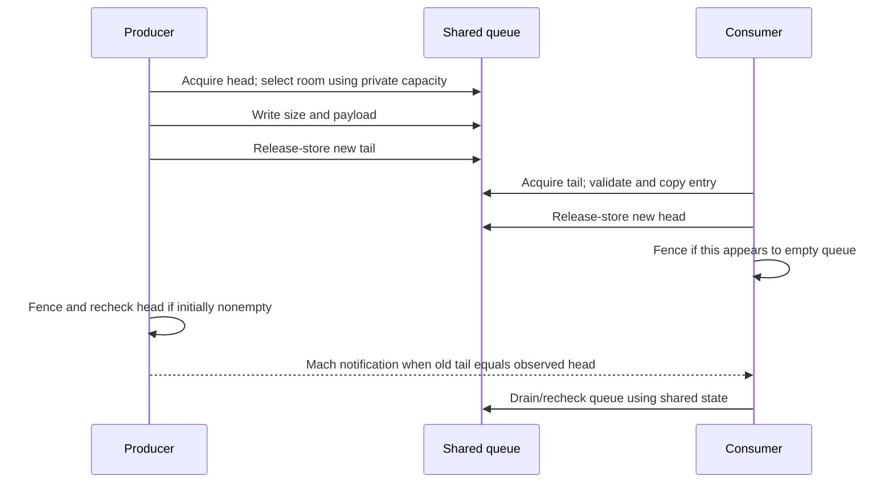
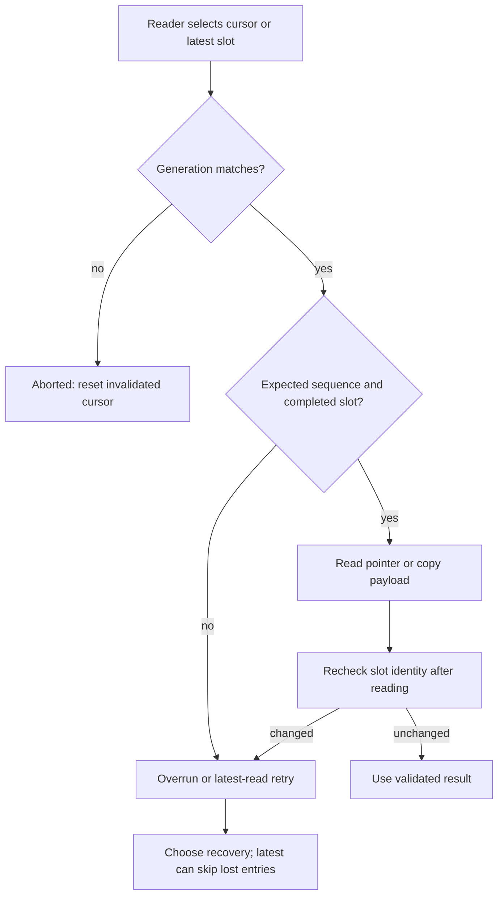

# Shared data queues and asynchronous notifications

[Drivers](README.md) · [User-client lifetime](user-client-and-driverkit-lifetime.md) · [Memory mappings](memory-descriptors-and-cpu-mappings.md) · [Mach delivery](../ipc/message-send-receive.md)

IOKit has several ways to deliver a result after the initiating call returns. A shared queue publishes bytes in mapped memory and may send a Mach message to tell a reader to inspect that memory. An asynchronous external method instead sends a completion message containing its result and arguments. A DriverKit action adds remote object and dispatch rules, described in [DriverKit dispatch and actions](driverkit-dispatch-and-actions.md). These mechanisms do not have interchangeable buffering, ordering, or lifetime contracts.

## 1. Choose the queue by its actual contract

| Implementation | Participants and storage | Full/overwrite behavior | Notification |
| --- | --- | --- | --- |
| `IODataQueue` | Single producer and single consumer; variable-size entries in a byte ring, originally kernel-to-user. | Enqueue returns false when it cannot place an entry without catching the consumer. | Empty-to-nonempty detection sends a small Mach message. |
| `IOSharedDataQueue` | Same basic layout and participant restriction, with kernel-side peek/dequeue and a versioned appendix. | Does not deliberately overwrite unread entries; dequeue can fail without advancing the head. | Inherits the Mach notification mechanism. |
| `IOCircularDataQueue` | Single writer and multiple independent readers; fixed-size slots, per-reader cursors, sequence/generation checks. | Writer can overwrite a reader's slot; readers detect overrun or retry. | No built-in notification; readers pull data. |
| `IOUserClient::sendAsyncResult64()` | Completion payload placed in a Mach message addressed through an asynchronous reference. | Mach send status reports whether sending succeeded; no shared ring is involved. | The message itself contains the completion. |

The participant restrictions are explicit in the [classic queue headers](../../../xnu/iokit/IOKit/IODataQueue.h#L56-L66), [shared-queue header](../../../xnu/iokit/IOKit/IOSharedDataQueue.h#L40-L48), and [circular-queue contract](../../../xnu/iokit/IOKit/IOCircularDataQueueImplementation.h#L370-L395). Atomic head/tail operations do not make the classic queue a multiple-producer queue: two producers could choose the same tail before either publishes it.

## 2. Classic queues separate shared offsets from private allocation metadata

The mapped region begins with a byte capacity and head/tail offsets; entries carry a size followed by that many payload bytes. The four-byte `data` member in the entry declaration marks the start of variable data, not a four-byte payload limit.

[Source: iokit/IOKit/IODataQueueShared.h, lines 57–62](../../../xnu/iokit/IOKit/IODataQueueShared.h#L57-L62)

<!-- source-excerpt: ../../../xnu/iokit/IOKit/IODataQueueShared.h#L57-L62 -->
```c
typedef struct _IODataQueueMemory {
	UInt32            queueSize;
	volatile UInt32   head;
	volatile UInt32   tail;
	IODataQueueEntry  queue[1];
} IODataQueueMemory;
```

`IODataQueue::initWithCapacity()` checks addition and page-rounding overflow, allocates zeroed shared kernel memory, and keeps the allocation capacity in a separate `IODataQueueInternal` alongside the notification header. Enqueue and free consult that private capacity, rather than trusting a possibly user-modified `dataQueue->queueSize`. `initWithEntries()` checks the product and reserves space for an extra entry when deriving capacity. [Allocation and overflow checks](../../../xnu/iokit/Kernel/IODataQueue.cpp#L89-L139), [private metadata](../../../xnu/iokit/Kernel/IODataQueue.cpp#L44-L47), [free](../../../xnu/iokit/Kernel/IODataQueue.cpp#L142-L160).

`IOSharedDataQueue` allocates header + queue + `IODataQueueAppendix`, stores capacity in its private expansion data, initializes appendix version zero, and maintains a private notification-message allocation. The appendix declaration contains a message header, but this implementation's notifier uses `notifyMsg`; the layout declaration alone does not show a send using writable appendix bytes. [Allocation](../../../xnu/iokit/Kernel/IOSharedDataQueue.cpp#L79-L135), [private size accessors](../../../xnu/iokit/Kernel/IOSharedDataQueue.cpp#L399-L416), [appendix layout](../../../xnu/iokit/IOKit/IODataQueueShared.h#L64-L74), [notifier](../../../xnu/iokit/Kernel/IODataQueue.cpp#L261-L292).

`getMemoryDescriptor()` returns an `IOMemoryDescriptor` describing the queue's existing allocation, including the appendix for the shared subclass. It does not transfer the queue object's allocation ownership to that descriptor. The queue's `free()` still frees its backing. Consequently the exporting driver must coordinate queue lifetime with consumers and mappings; retaining the descriptor is not evidence that it retains the queue object. [Base descriptor](../../../xnu/iokit/Kernel/IODataQueue.cpp#L294-L306), [shared descriptor and free](../../../xnu/iokit/Kernel/IOSharedDataQueue.cpp#L137-L174), [mapping ownership](user-client-and-driverkit-lifetime.md).

## 3. Enqueue publishes a complete entry before moving the tail

The producer loads its own tail relaxed and the consumer's head with acquire ordering. It checks both offsets against private capacity, including overflow in payload-plus-header size. Placement has three cases:

1. Tail is at or after head, and the entry fits through the end: write there.
2. It does not fit at the end, but fits strictly before head: put the entry at offset zero, and leave a size marker at the old tail if there is room for that header.
3. Tail is before head: require strictly more space than the entry size.

The strict comparisons preserve `head == tail` as empty. A tail exactly equal to capacity is allowed after an entry ends exactly at the buffer boundary; the next operation must handle wrapping. All data copying precedes the release-store of the new tail. [Placement and publication](../../../xnu/iokit/Kernel/IODataQueue.cpp#L162-L238), [shared-subclass counterpart](../../../xnu/iokit/Kernel/IOSharedDataQueue.cpp#L224-L291).

[Source: iokit/Kernel/IODataQueue.cpp, lines 237–255](../../../xnu/iokit/Kernel/IODataQueue.cpp#L237-L255)

<!-- source-excerpt: ../../../xnu/iokit/Kernel/IODataQueue.cpp#L237-L255 -->
```cpp
	__c11_atomic_store((_Atomic UInt32 *)&dataQueue->tail, newTail, __ATOMIC_RELEASE);

	if (tail != head) {
		//
		// The memory barrier below paris with the one in ::dequeue
		// so that either our store to the tail cannot be missed by
		// the next dequeue attempt, or we will observe the dequeuer
		// making the queue empty.
		//
		// Of course, if we already think the queue is empty,
		// there's no point paying this extra cost.
		//
		__c11_atomic_thread_fence(__ATOMIC_SEQ_CST);
		head = __c11_atomic_load((_Atomic UInt32 *)&dataQueue->head, __ATOMIC_RELAXED);
	}

	if (tail == head) {
		// Send notification (via mach message) that data is now available.
		sendDataAvailableNotification();
```

The extra fence addresses the race where the producer initially sees a nonempty queue while the consumer finishes its last entry. After publishing, the producer executes a sequentially consistent fence and reloads head when needed. If old tail equals observed head, it sends a notification. The consumer executes its matching fence when its head update makes the queue appear empty. This protocol avoids relying solely on the producer's first empty/nonempty observation.



The diagram shows the paired operations, not a mandatory order between the two threads. The consumer must follow the queue protocol, including checking shared state; receiving one message is not permission to assume exactly one entry exists.

## 4. Dequeue validates a record before returning space to the producer

`IOSharedDataQueue::dequeue()` loads head relaxed and tail acquire. Equal offsets mean empty. It determines whether the head record fits through the end of the queue; if its header or payload would cross the end, it examines the record at offset zero. It checks size arithmetic and capacity again using the selected entry size. The source reads shared record fields at several points, so describing this as a full immutable snapshot would be inaccurate. [Record selection and bounds](../../../xnu/iokit/Kernel/IOSharedDataQueue.cpp#L314-L374).

If a destination is supplied but its capacity is insufficient, dequeue returns false before changing head. With `data == NULL`, it advances without copying; this supports inspecting an entry with `peek()` and later consuming it. On successful copy it reports the payload length, release-stores the new head, and performs the empty-transition fence where required:

[Source: iokit/Kernel/IOSharedDataQueue.cpp, lines 376–394](../../../xnu/iokit/Kernel/IOSharedDataQueue.cpp#L376-L394)

<!-- source-excerpt: ../../../xnu/iokit/Kernel/IOSharedDataQueue.cpp#L376-L394 -->
```cpp
	if (data) {
		if (entrySize > *dataSize) {
			// not enough space
			return false;
		}
		__nochk_memcpy(data, (void *)entry->data, entrySize);
		*dataSize = entrySize;
	}

	__c11_atomic_store((_Atomic UInt32 *)&dataQueue->head, newHeadOffset, __ATOMIC_RELEASE);

	if (newHeadOffset == tailOffset) {
		//
		// If we are making the queue empty, then we need to make sure
		// that either the enqueuer notices, or we notice the enqueue
		// that raced with our making of the queue empty.
		//
		__c11_atomic_thread_fence(__ATOMIC_SEQ_CST);
	}
```

`peek()` returns an address into shared memory. It neither copies the payload nor advances head. Its range/wrap inspection is shorter than dequeue's, and the returned pointer carries no independent object reference. The caller still needs the queue to remain mapped and must respect the participant protocol. [Peek body](../../../xnu/iokit/Kernel/IOSharedDataQueue.cpp#L177-L221), [documented peek/dequeue pairing](../../../xnu/iokit/IOKit/IOSharedDataQueue.h#L120-L136).

A false result does not distinguish every reason: full queue, malformed sizes/offsets, empty queue and insufficient output capacity occur in different methods but share boolean return conventions. A driver exposing richer errors must obtain them from its own protocol rather than inventing a specific meaning for every false return.

## 5. A data-available message is a prompt to inspect memory

`setNotificationPort()` constructs a header with `MACH_MSG_TYPE_COPY_SEND`, a remote destination and no local reply port. The body stores the supplied port; it does not itself acquire or release a send-right reference. Port lifetime must therefore be established by the caller/export path. Freeing the queue allocation is not a port-release protocol. [Header setup](../../../xnu/iokit/Kernel/IODataQueue.cpp#L260-L270), [explicit user-client port-release helper](../../../xnu/iokit/Kernel/IOUserClient.cpp#L2249-L2257).

`sendDataAvailableNotification()` uses a zero-timeout kernel Mach send. Success, timeout and no-buffer outcomes are ignored by this void method; other errors are logged. The enqueue result stays successful after the bytes were published, even if notification transmission did not succeed. The implementation treats a timeout as an already outstanding notification, but the broader contract remains that ring state determines available data.

[Source: iokit/Kernel/IODataQueue.cpp, lines 279–291](../../../xnu/iokit/Kernel/IODataQueue.cpp#L279-L291)

<!-- source-excerpt: ../../../xnu/iokit/Kernel/IODataQueue.cpp#L279-L291 -->
```cpp
	if (msgh->msgh_remote_port) {
		kr = mach_msg_send_from_kernel_with_options(msgh, msgh->msgh_size,
		    MACH64_SEND_TIMEOUT, MACH_MSG_TIMEOUT_NONE);
		switch (kr) {
		case MACH_SEND_TIMED_OUT: // Notification already sent
		case MACH_MSG_SUCCESS:
		case MACH_SEND_NO_BUFFER:
			break;
		default:
			IOLog("%s: dataAvailableNotification failed - msg_send returned: %d\n", /*getName()*/ "IODataQueue", kr);
			break;
		}
	}
```

The notification contains no ring payload. This allows many records to be consumed after one wakeup, but it also means the receiving framework/driver must supply its own draining and lifecycle discipline. Userspace framework internals for the classic queue are outside this checkout.

## 6. The circular queue uses reader validation instead of producer backpressure

The newer circular queue implementation is almost entirely in [`IOCircularDataQueueImplementation.h`](../../../xnu/iokit/IOKit/IOCircularDataQueueImplementation.h); the `.cpp` translation unit includes that header. Its capacity is a fixed number of slots with a fixed maximum payload size, while each entry records its actual payload length.

| Structure | Meaning |
| --- | --- |
| `IOCircularDataQueueState` | Atomic 128-bit queue state containing sequence number, next write index, generation and writing/reset status fields. |
| `IOCircularDataQueueEntryHeaderInfo` | Atomic 128-bit per-slot identity/status: sequence, payload size, generation and write-in-progress bit. |
| `IOCircularDataQueueMemoryCursor` | A reader's generation, slot position and sequence number. Each reader keeps its own position. |
| `IOCircularDataQueueDescription` | Private/shipped-out-of-band geometry: allocation length, slot stride, count, payload capacity and sentinel. |
| `IOCircularDataQueue` | Local cursor, mapped memory pointer, geometry copy, and either a kernel descriptor or userspace connection/memory type. |

See [entry state](../../../xnu/iokit/IOKit/IOCircularDataQueueImplementation.h#L93-L126), [queue state](../../../xnu/iokit/IOKit/IOCircularDataQueueImplementation.h#L165-L200), [cursor and description](../../../xnu/iokit/IOKit/IOCircularDataQueueImplementation.h#L248-L298), and [handle](../../../xnu/iokit/IOKit/IOCircularDataQueueImplementation.h#L370-L395).

Kernel creation checks count/size arithmetic, rounds slot data for alignment, and allocates a kernel/user-shared `IOBufferMemoryDescriptor`. It places an `OSData` copy of the description in the descriptor's sharing context. The memory header and entries are aligned for the atomic state fields. Initialization makes the sequence `UINT64_MAX` before the first increment and invalidates the reader cursor. [Creation and mapping metadata](../../../xnu/iokit/IOKit/IOCircularDataQueueImplementation.h#L1621-L1695), [alignment checks](../../../xnu/iokit/IOKit/IOCircularDataQueueImplementation.h#L351-L365), [cursor initialization](../../../xnu/iokit/IOKit/IOCircularDataQueueImplementation.h#L1608-L1616).

The sentinel here is the fixed constant `0xA5A5A5A5A5A5A5A5`. It is a consistency check, not an unpredictable security token. `_isQueueMemoryCorrupted()` compares that sentinel; it does not authenticate every byte of the shared region. Geometry is kept separately so calculations need not trust mutable shared lengths. [Sentinel check](../../../xnu/iokit/IOKit/IOCircularDataQueueImplementation.h#L406-L417), [creation value](../../../xnu/iokit/IOKit/IOCircularDataQueueImplementation.h#L1634).

## 7. Circular publication has both queue and entry commit points

`_enqueueInternal()` validates the handle, nonzero payload, payload capacity, sentinel and selected slot address. It reads the queue state and reports busy if a write is already in progress. It computes the next index modulo slot count and the next sequence; it does not inspect consumer cursors or wait for them.

A compare-exchange marks the queue as being written while leaving its published index and sequence unchanged. The writer then stores the selected entry's new identity with its write-in-progress bit, copies payload, and release-stores that entry as complete. Finally it release-stores the queue state with the advanced index/sequence and cleared writing bit.

[Source: iokit/IOKit/IOCircularDataQueueImplementation.h, lines 646–666](../../../xnu/iokit/IOKit/IOCircularDataQueueImplementation.h#L646-L666)

<!-- source-excerpt: ../../../xnu/iokit/IOKit/IOCircularDataQueueImplementation.h#L646-L666 -->
```cpp
	// Update the entry header info
	IOCircularDataQueueEntryHeaderInfo enHeaderInfo;
	enHeaderInfo.val = 0;
	enHeaderInfo.fields.wrStatus = IOCIRCULARDATAQUEUE_ENTRY_STATE_WRITE_INPROGRESS;
	enHeaderInfo.fields.generation = currState.fields.generation;
	//    enHeaderInfo.fields.seqNum = newState.fields.seqNum;
	enHeaderInfo.fields.seqNum = nextSeqNum;
	enHeaderInfo.fields.dataSize = dataSize;
	atomic_store_explicit(&entry->headerInfoVal, enHeaderInfo.val, memory_order_release);

	entry->sentinel = queueHeaderShadow->sentinel;
	memcpy(entry->data, data, dataSize);
	enHeaderInfo.fields.wrStatus = IOCIRCULARDATAQUEUE_ENTRY_STATE_WRITE_COMPLETE;
	atomic_store_explicit(&entry->headerInfoVal, enHeaderInfo.val, memory_order_release);

	IOCircularDataQueueState finalState = newState;
	finalState.fields.wrStatus = IOCIRCULARDATAQUEUE_STATE_WRITE_COMPLETE;
	// Lets actually update the write index and seq num
	finalState.fields.wrIndex = nextWriteIndex;
	finalState.fields.seqNum = nextSeqNum;
	atomic_store_explicit(&queueMemory->queueStateVal, finalState.val, memory_order_release);
```

This two-level publication lets readers distinguish an incomplete slot from a completed latest queue entry. The compare-exchange can report a concurrent modification; the public contract still specifies a single writer, so it should not be promoted into a general multiwriter guarantee. [Validation and claim](../../../xnu/iokit/IOKit/IOCircularDataQueueImplementation.h#L563-L644).

Reset advances the generation, returns the write index to zero and the sequence to its initial sentinel through a compare-exchange. Existing reader cursors then fail generation checks. The present `_reset()` body constructs a local `newState` and explicitly assigns those three fields without zero-initializing the entire union; the text here does not assume that every reset/write flag is explicitly cleared by that body. This is a source-level limitation to keep separate from the intended generation contract. [Reset implementation](../../../xnu/iokit/IOKit/IOCircularDataQueueImplementation.h#L504-L544).

## 8. Circular readers must handle overwrite, reset and partial progress

Latest reads take the slot preceding the published next-write index and validate queue/entry generation, sequence and writing status. `_getLatestInQueueMemInternal()` allows five attempts when the latest slot changes underneath it. Copying variants read the entry header before copying and compare it with another atomic header load afterward; a changed header causes retry. Pointer-returning variants require a later validity check after reading the bytes. [Latest read and retry](../../../xnu/iokit/IOKit/IOCircularDataQueueImplementation.h#L880-L1002), [pointer contract](../../../xnu/iokit/IOKit/IOCircularDataQueueImplementation.h#L1004-L1007).

`GetNext` requires the next slot's sequence to be exactly cursor sequence + 1. A reader that falls behind therefore gets overrun instead of silently receiving an unrelated record that reused the slot. Generation changes mean abort; no new completed entry means underrun. `CopyNext` also rechecks the header after its copy:

[Source: iokit/IOKit/IOCircularDataQueueImplementation.h, lines 1171–1183](../../../xnu/iokit/IOKit/IOCircularDataQueueImplementation.h#L1171-L1183)

<!-- source-excerpt: ../../../xnu/iokit/IOKit/IOCircularDataQueueImplementation.h#L1171-L1183 -->
```cpp
		memcpy(*data, entry->data, enHeaderInfo.fields.dataSize);
		// Lets re-verify after the memcpy if the buffer is/has been overwritten.

		IOCircularDataQueueEntryHeaderInfo enHeaderInfoAfter;
		enHeaderInfoAfter.val = atomic_load_explicit(&entry->headerInfoVal, memory_order_acquire);
		// Did something change, while we were memcopying ?
		if (enHeaderInfo.val == enHeaderInfoAfter.val) {
			ret = kIOReturnSuccess;
		} else {
			// while we were memcopying, the writer wrapped around and is writing into our index. or the queue got reset
			*size = 0;
			ret = kIOReturnOverrun;
		}
```

The cursor advances before the copy-capacity and final-copy-validation checks. An error can therefore coexist with cursor progress; the caller must not assume that every failed read leaves the cursor untouched. After loss, selecting the latest entry is one available recovery operation, but that necessarily abandons skipped records. [Next-entry checks and cursor update](../../../xnu/iokit/IOKit/IOCircularDataQueueImplementation.h#L1099-L1189).



`IOCircularDataQueueIsCurrentDataValid()` checks the current queue generation and selected entry's sequence/status/sentinel. A pointer into the ring remains overwriteable even after one successful validation; copying into private storage is what preserves bytes beyond that observation. The implementation also has previous/current cursor operations, which use related checks but must be read individually for their return codes. [Validity check](../../../xnu/iokit/IOKit/IOCircularDataQueueImplementation.h#L717-L792), [previous path](../../../xnu/iokit/IOKit/IOCircularDataQueueImplementation.h#L1272-L1393), [public wrappers](../../../xnu/iokit/IOKit/IOCircularDataQueueImplementation.h#L1807-L1918).

Kernel destruction releases the descriptor and deletes the handle; `CopyMemoryDescriptor()` takes a descriptor reference for its caller. In the nonkernel branch, destruction unmaps through the connection. The visible nonkernel creator requires ARM64 LSE2, maps shared memory plus the out-of-band description, and uses assertions for layout consistency. Its body consumes mapping outputs without an immediate success-result branch; these source details are not evidence of a uniformly hardened error path on every platform. [Descriptor and destroy](../../../xnu/iokit/IOKit/IOCircularDataQueueImplementation.h#L1698-L1707), [nonkernel creation](../../../xnu/iokit/IOKit/IOCircularDataQueueImplementation.h#L1716-L1774), [storage release](../../../xnu/iokit/IOKit/IOCircularDataQueueImplementation.h#L481-L502), [handle destruction](../../../xnu/iokit/IOKit/IOCircularDataQueueImplementation.h#L1778-L1794).

## 9. External-method completion is a separate Mach-message protocol

For an asynchronous external method, `is_io_connect_async_method()` installs the supplied wake port in `reference[0]`, adds the 64-bit-caller flag when appropriate, and fills `IOExternalMethodArguments::asyncWakePort`, `asyncReference`, and `asyncReferenceCount`. The method's synchronous return is separate from a later completion. The input/output descriptors created around that call are released after dispatch, so a method scheduling future work must establish any additional lifetime it needs. [Argument construction](../../../xnu/iokit/Kernel/IOUserClient.cpp#L5256-L5282), [dispatch and descriptor release](../../../xnu/iokit/Kernel/IOUserClient.cpp#L5324-L5346).

`_sendAsyncResult64()` masks flag bits from the reference's first word to recover the kernel-held port. Null port returns success without a send. Excess argument count returns message-too-large. It zeroes a stack reply structure, builds a `COPY_SEND` Mach header, chooses the 32- or 64-bit notification layout, and copies the result and supplied arguments. It deliberately does not send `reference[0]` to userspace; that word remains zero in the outgoing reference. [Message construction](../../../xnu/iokit/Kernel/IOUserClient.cpp#L2297-L2370).

[Source: iokit/Kernel/IOUserClient.cpp, lines 2372–2384](../../../xnu/iokit/Kernel/IOUserClient.cpp#L2372-L2384)

<!-- source-excerpt: ../../../xnu/iokit/Kernel/IOUserClient.cpp#L2372-L2384 -->
```cpp
	if ((options & kIOUserNotifyOptionCanDrop) != 0) {
		kr = mach_msg_send_from_kernel_with_options( &replyMsg.msgHdr,
		    replyMsg.msgHdr.msgh_size, MACH64_SEND_TIMEOUT, MACH_MSG_TIMEOUT_NONE);
	} else {
		/* Fail on full queue. */
		kr = mach_msg_send_from_kernel(&replyMsg.msgHdr,
		    replyMsg.msgHdr.msgh_size);
	}
	if ((KERN_SUCCESS != kr) && (MACH_SEND_TIMED_OUT != kr) && !(kIOUCAsyncErrorLoggedFlag & reference[0])) {
		reference[0] |= kIOUCAsyncErrorLoggedFlag;
		IOLog("%s: mach_msg_send_from_kernel(0x%x)\n", __PRETTY_FUNCTION__, kr );
	}
	return kr;
```

The can-drop option selects a zero-timeout send; the ordinary path uses the kernel send helper and returns its status. Neither branch waits for application processing of the completion. Because the send disposition copies the send right, this routine does not consume the driver's retained asynchronous reference. `releaseAsyncReference64()` performs the corresponding port-send release; a driver must arrange its own final completion/cancellation ownership so that reference is released once at the correct boundary. [Reference release](../../../xnu/iokit/Kernel/IOUserClient.cpp#L2236-L2247), [Mach send ownership](../ipc/message-send-receive.md).

## Inspection scope

This chapter follows the complete selected classic enqueue/dequeue/notifier bodies, circular creation/publication/latest/next/validation/destruction paths, and external-method completion construction. It is not a formal memory-order proof or a security audit of hostile concurrent writers. Classic userspace consumer implementations, concrete driver cancellation policies, and all circular previous/current/reset corner cases remain separate inspection targets. The source's checks, partial progress, ignored errors, and configuration restrictions are stated where they affect how these interfaces can be interpreted.

<!-- BEGIN PLATYDOC DOCUMENTATION LICENSE -->
Original Platydoc text and diagrams are licensed under [CC BY 4.0](https://creativecommons.org/licenses/by/4.0/). Quoted source code and third-party material retain their respective licenses.
<!-- END PLATYDOC DOCUMENTATION LICENSE -->
