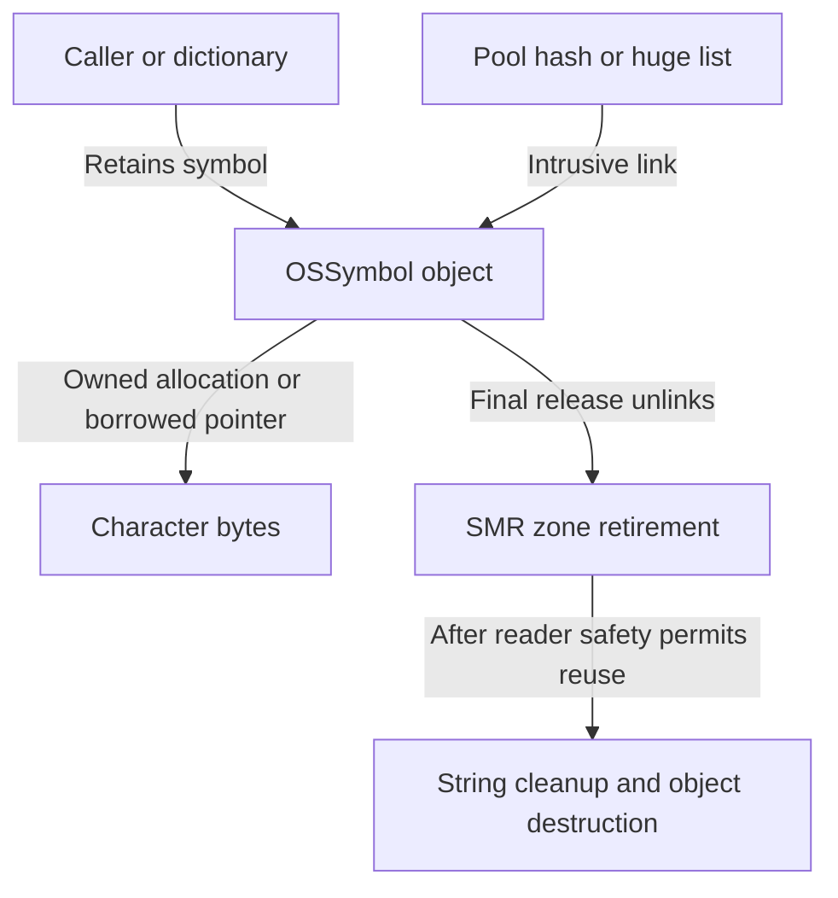
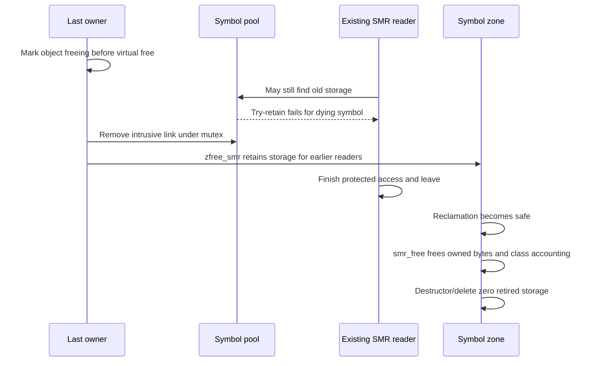

# Symbol interning: identity, backing bytes and delayed destruction

[IOKit guide](README.md) · [Object runtime and collections](object-runtime-and-collections.md) · [SMR hash tables](../../cross-cutting/smr-hash-tables.md) · [SMR zones](../vm/read-only-and-special-zones.md) · [Kext lifetime](kext-loading-and-unloading.md)

`OSSymbol::withCString()` returns a shared identity for a string, used for dictionary keys, metaclass names and registry properties. Obtaining that identity is a concurrent lookup/acquisition operation, not merely allocating an `OSString`. This chapter follows `OSSymbolPool` in `xnu-12377.121.6`: key preparation, duplicate creation, pool resizing, copied/no-copy/permanent storage, module-unload adjustment and the delayed allocator callback. It describes common code and the selected ARM64 integrity-conditioned optimization; no kext or kernel tests were run.

## 1. One symbol identity, several kinds of ownership

`OSSymbol` is a final subclass of `OSString` with an embedded `hashlink`. It inherits the character pointer, length and flags. The lookup key length excludes the NUL terminator; the object's `length` includes it. `isEqualTo(const OSSymbol *)` compares object addresses, whereas comparison to a C string delegates to the string implementation. [Class/link](../../../platydoc-data/xnu/libkern/libkern/c++/OSSymbol.h#L88-L97), [pool key](../../../platydoc-data/xnu/libkern/c++/OSSymbol.cpp#L72-L81), [equality](../../../platydoc-data/xnu/libkern/c++/OSSymbol.cpp#L677-L701).

| State | Meaning |
| --- | --- |
| `kOSSSymbolHashed` | The symbol was installed in the pool; final release must remove its intrusive link. |
| `kOSStringNoCopy` | The character pointer borrows external backing. Ordinary cleanup must not free those bytes. |
| `kOSSSymbolPermanent` | Selected immutable kernel-region symbols bypass ordinary retain/release traffic. This is not implied by no-copy alone. |
| Object retain count | Active caller/collection holdings; ordinary pool membership is not an extra permanent owning reference. |
| SMR zone membership | Keeps retired object storage available to old readers until allocator reclamation is safe. It does not make a dying symbol newly retainable. |

[Flag definitions](../../../platydoc-data/xnu/libkern/libkern/c++/OSString.h#L56-L62), [pool insertion/removal](../../../platydoc-data/xnu/libkern/c++/OSSymbol.cpp#L242-L307), [permanent retain/release](../../../platydoc-data/xnu/libkern/c++/OSSymbol.cpp#L566-L588), [allocation/free](../../../platydoc-data/xnu/libkern/c++/OSSymbol.cpp#L590-L668).

The pool contains a mutex, a simple `smr_hash`, a separate huge-string list, a resize thread call and scheduling/count state. It starts with 4096 buckets. Its traits use `smr_iokit`, byte-string hash/equality and a client-specific acquisition callback. The zone is configured with the same domain and `OSSymbol_smr_free()` as its deferred destruction callback. [Pool state/constructor](../../../platydoc-data/xnu/libkern/c++/OSSymbol.cpp#L68-L164), [zone and pool initialization](../../../platydoc-data/xnu/libkern/c++/OSSymbol.cpp#L394-L405).



The pool's concurrency protection does not make arbitrary mutation of a published string legal. The header warns that immutability is not enforced by the class; changing bytes would invalidate hash/equality assumptions. Likewise its general warning about caller synchronization does not mean the pool lacks its own mutex/SMR protocol. Collection or property mutation still uses the containing object's contract. [Public restrictions](../../../platydoc-data/xnu/libkern/libkern/c++/OSSymbol.h#L59-L86).

## 2. Prepare a safe key before entering SMR

`findSymbol()` has two lookup routes. Ordinary keys use `smr_hash_get()`, which enters a non-preemptible SMR section. Since the supplied key may be pageable, the routine copies it before that call: keys up to 128 bytes use a stack buffer; larger ordinary keys use a temporary `kalloc_data(..., Z_WAITOK_ZERO_NOFAIL)` allocation. It copies exactly `smrk_len` bytes and need not copy a terminator because the traits compare explicit lengths. The temporary allocation is freed after lookup. [Lookup and key copy](../../../platydoc-data/xnu/libkern/c++/OSSymbol.cpp#L199-L229).

The table then attempts an acquisition while the matched object remains SMR-protected:

[OSSymbol.cpp:98–105](../../../platydoc-data/xnu/libkern/c++/OSSymbol.cpp#L98-L105):

<!-- source-excerpt: ../../../platydoc-data/xnu/libkern/c++/OSSymbol.cpp#L98-L105 -->
```cpp
	static bool
	OSSymbol_obj_try_get(void *obj)
	{
		OSSymbol *sym = (OSSymbol *)obj;

		return (sym->flags & kOSSSymbolPermanent) ||
		       sym->taggedTryRetain(nullptr);
	}
```

For a normal symbol, `taggedTryRetain(nullptr)` fails once `OSObject` has installed its freeing sentinel (`0xffff` in the low count field). A successful lookup creates `OSSharedPtr<const OSSymbol>` with `OSNoRetain`, adopting the acquisition already performed inside the table. Retaining again would double-count it. [Try-retain sentinel and CAS](../../../platydoc-data/xnu/libkern/c++/OSObject.cpp#L107-L148), [adopting the result](../../../platydoc-data/xnu/libkern/c++/OSSymbol.cpp#L233-L240).

The huge-string route uses the pool mutex and linearly searches `_huge_head`, then calls the same acquisition callback before unlocking. It does not use non-preemptible SMR lookup for those strings. The reason is cleanup: freeing sufficiently large backing storage cannot be delegated to the preemption-disabled-safe symbol-zone callback. [Design rationale](../../../platydoc-data/xnu/libkern/c++/OSSymbol.cpp#L56-L67), [huge lookup](../../../platydoc-data/xnu/libkern/c++/OSSymbol.cpp#L226-L234).

`OSSymbol_is_huge(size)` is literally `size > KALLOC_SAFE_ALLOC_SIZE`, and that constant is 16 KiB here. The arguments are not perfectly uniform: lookup/insertion test `key.smrk_len` excluding NUL; removal/free/hash test `length` including it. At a key length exactly equal to 16 KiB those expressions disagree. This source trace records that boundary rather than claiming one consistently enforced maximum ordinary-key length. The inspected test sizes do not exercise that exact edge. [Predicate](../../../platydoc-data/xnu/libkern/c++/OSSymbol.cpp#L193-L197), [insertion argument](../../../platydoc-data/xnu/libkern/c++/OSSymbol.cpp#L260-L284), [removal argument](../../../platydoc-data/xnu/libkern/c++/OSSymbol.cpp#L294-L310), [allocator constant](../../../platydoc-data/xnu/osfmk/kern/kalloc.h#L74-L80), [hash assertion](../../../platydoc-data/xnu/libkern/c++/OSSymbol.cpp#L670-L675).

## 3. Creation races with another creator

`withCString()` bounds the scan with `kMaxStringLength`, rejects a string that reaches that bound and first tries the pool. The current limit is 262142; it is an internal construction limit, not a user syscall's string-buffer ABI. If found, the factory returns that acquired symbol immediately. [Factory admission](../../../platydoc-data/xnu/libkern/c++/OSSymbol.cpp#L437-L454), [length constant](../../../platydoc-data/xnu/libkern/libkern/c++/OSString.h#L114-L118).

On a miss it creates a zeroed symbol from `OSSymbol_zone`. For ordinary copied storage it allocates `key length + 1`, copies the non-NUL bytes and relies on the zeroed allocation for termination. Character-buffer allocation failure resets the candidate and returns an empty pointer. It initializes fields directly rather than using the ordinary `OSString::initWithCString*` path, because that invokes `OSObject::init()` and IOTracking, which the deferred SMR destruction path deliberately does not support. The overridden ordinary `initWith*` methods return false. [Creation and allocation failure](../../../platydoc-data/xnu/libkern/c++/OSSymbol.cpp#L470-L492), [disabled initializers](../../../platydoc-data/xnu/libkern/c++/OSSymbol.cpp#L407-L421), [symbol zone allocation](../../../platydoc-data/xnu/libkern/c++/OSSymbol.cpp#L590-L594).

`insertSymbol()` marks the candidate hashed, optionally permanent, verifies its allocation zone and then takes the pool mutex. Under that mutex the simple table's get-or-insert either publishes the candidate or returns an acquired live duplicate. The huge list follows the analogous find/try-retain/prepend rule. A no-longer-acquirable equal object does not prevent a new candidate from being inserted. [Insertion](../../../platydoc-data/xnu/libkern/c++/OSSymbol.cpp#L242-L286), [generic get-or-insert](../../../platydoc-data/xnu/osfmk/kern/smr_hash.h#L1703-L1722).

After unlocking, the losing candidate has its hashed/permanent flags cleared before replacement:

[OSSymbol.cpp:281–286](../../../platydoc-data/xnu/libkern/c++/OSSymbol.cpp#L281-L286):

<!-- source-excerpt: ../../../platydoc-data/xnu/libkern/c++/OSSymbol.cpp#L281-L286 -->
```cpp
	unlock();

	if (sym) {
		symToInsert->flags &= ~(kOSSSymbolHashed | kOSSSymbolPermanent);
		symToInsert.reset(sym, OSNoRetain);
	}
```

Clearing those flags matters: the candidate was never linked, so its cleanup must not remove a nonexistent pool entry; an unpublished candidate marked permanent must become releasable. The pointer replacement releases the candidate and adopts the duplicate's existing reference.

For a worked race, A and B both miss for `"IOExampleKey"`. A installs symbol S. B finishes allocating candidate T, takes the mutex, finds and retains S, then discards T. Both return S while it is alive. If all owners later release S, another call can create a different object at another address for the same bytes. Interning supplies a shared live identity, not an eternal address for every string.

## 4. No-copy and permanent are different decisions

`withCStringNoCopy()` still performs bounds checking, lookup and serialized duplicate resolution. On a miss it installs the caller's pointer with `kOSStringNoCopy` instead of allocating backing. If a live symbol already exists, it returns that symbol; the method name does not imply that the returned object uses this call's buffer. The caller must keep any newly borrowed storage valid and stable for the required lifetime. `withString()` retains an existing `OSSymbol` directly; for another `OSString` it selects copied or no-copy creation from that string's flag. [No-copy factory](../../../platydoc-data/xnu/libkern/c++/OSSymbol.cpp#L495-L530), [OSString conversion](../../../platydoc-data/xnu/libkern/c++/OSSymbol.cpp#L423-L435).

Under `KERNEL_INTEGRITY_KTRR`, `KERNEL_INTEGRITY_CTRR` or `KERNEL_INTEGRITY_PV_CTRR`, both factories test `rorgn_contains(pointer, key length + 1, false)`. A qualifying symbol becomes no-copy and permanent; even the normally copying factory avoids a copy in this case. That is a guarded immutable-region optimization, not a general rule for all literals, all ARM64 configurations or all borrowed strings. [Optimization and range](../../../platydoc-data/xnu/libkern/c++/OSSymbol.cpp#L456-L481), [no-copy variant](../../../platydoc-data/xnu/libkern/c++/OSSymbol.cpp#L514-L527).

Permanent symbols make the overridden tagged retain/release calls no-ops and satisfy the pool's acquisition callback without changing counts. An existing ordinary symbol wins normal duplicate resolution even if a later candidate's backing would have qualified as permanent; the candidate's flags are cleared on losing insertion. [Reference overrides](../../../platydoc-data/xnu/libkern/c++/OSSymbol.cpp#L566-L588), [loser cleanup](../../../platydoc-data/xnu/libkern/c++/OSSymbol.cpp#L281-L286).

## 5. Pool growth and shrink reuse the simple-table protocol

The mutex protects hash mutations and policy observations. The pool's minimum is 4096 buckets. Growth requires `count > 4 × buckets`; shrink requires `buckets > 2 × count` and `buckets > 4096`. The helper uses strict comparisons, so equality alone does not request resizing. Huge-list objects have a separate count and do not contribute to the ordinary table's count. [Pool thresholds](../../../platydoc-data/xnu/libkern/c++/OSSymbol.cpp#L68-L70), [policy wrappers](../../../platydoc-data/xnu/libkern/c++/OSSymbol.cpp#L133-L146), [generic predicates](../../../platydoc-data/xnu/osfmk/kern/smr_hash.h#L814-L851).

Insertion/removal schedules the once-only thread call only if the relevant predicate holds, no call is already scheduled, and startup has reached `STARTUP_SUB_THREAD_CALL`. The callback takes the mutex, clears `_tcallScheduled`, rechecks current density and performs at most one halving or doubling, preferring shrink. The resize helpers return with the mutex unlocked. If neither predicate holds, the callback unlocks directly. [Scheduling sites](../../../platydoc-data/xnu/libkern/c++/OSSymbol.cpp#L261-L269), [removal and callback](../../../platydoc-data/xnu/libkern/c++/OSSymbol.cpp#L295-L332).

The callback discards the resize helper's return value. In particular, allocation failure does not create a dedicated retry loop here; later pool activity can request maintenance again. A requested resize is not proof that a larger table has already been published. The [hash-table companion](../../cross-cutting/smr-hash-tables.md#5-growing-a-simple-table-needs-repeated-reader-grace-periods) explains why growth can hold the mutex across several reader grace periods while lookups continue.

## 6. Final release unlinks before the allocator destroys

For an ordinary object, `OSObject::taggedRelease()` installs the freeing sentinel before calling the virtual `free()` path. A concurrent pool lookup can still inspect storage under SMR but cannot revive the freeing object through try-retain. `OSSymbol::free()` then removes a hashed object under the pool mutex and may schedule shrink. It eventually calls `zfree_smr`, not the ordinary `OSString::free()`/`OSObject::free()` chain. [Final release](../../../platydoc-data/xnu/libkern/c++/OSObject.cpp#L179-L230), [unlink and retirement](../../../platydoc-data/xnu/libkern/c++/OSSymbol.cpp#L642-L668).

The string's cleanup point depends on how it was exposed:

| Case | Character bytes | Symbol storage |
| --- | --- | --- |
| Published ordinary copied symbol | Kept until the SMR zone invokes `smr_free()`. Earlier readers may still compare/hash them. | Retired through `zfree_smr`. |
| Unpublished losing candidate | Freed immediately in `free()` if owned; no lookup observed that candidate. | Still follows the symbol zone's retirement/destruction machinery. |
| Huge copied symbol | Freed in `free()` after locked removal, because huge lookup uses the mutex and large frees must not run in the deferred safe-context callback. | Still retired through the SMR zone. |
| No-copy symbol | Not freed as an owned allocation while the no-copy flag remains set. | Retired as above unless permanent. |
| Permanent symbol | Remains backed by the qualifying region. | Ordinary overridden release does not initiate destruction. |

The first three cases are explicit in the `freeNow` branch. The exact huge-boundary discrepancy described earlier still applies; the table describes the intended ordinary/huge routes away from that edge. [Branch and immediate cleanup](../../../platydoc-data/xnu/libkern/c++/OSSymbol.cpp#L643-L667).

Later, `smr_free()` frees remaining owned string storage, updates metaclass instance accounting and deletes the object. The custom `operator delete` only zeros the memory: the object has already been returned to the allocator's deferred-reclamation machinery. Calling an ordinary object free path here would duplicate ownership work and involve unsupported tracking cleanup. [Deferred callback and delete](../../../platydoc-data/xnu/libkern/c++/OSSymbol.cpp#L596-L640).



The figure follows a published ordinary copied symbol. It does not assert a wall-clock deadline for cleanup or that unlinking immediately decrements class-instance accounting. Nor must cleanup run in a later call: the rare `zfree_item_smr()` fallback, used when an empty bucket could not be allocated, synchronizes with readers and invokes the zone callback within the freeing call. The invariant is reader safety before destruction. [Synchronous fallback](../../../platydoc-data/xnu/osfmk/kern/zalloc.c#L5753-L5770).

## 7. Module unload can replace borrowed backing

`OSRuntimeFinalizeCPP()` first checks that module classes have no instances, begins metaclass unload coordination and calls `OSSymbol::checkForPageUnload()` for the module address interval before executing finalizers. The symbol helper scans the ordinary hash under the pool mutex. For a symbol whose character pointer starts inside `[startAddr, endAddr)`, it asserts no-copy, allocates/copies backing, publishes the replacement pointer, clears no-copy, then synchronizes `smr_iokit` after dropping the mutex. [Runtime caller](../../../platydoc-data/xnu/libkern/c++/OSRuntime.cpp#L301-L332), [pool scan](../../../platydoc-data/xnu/libkern/c++/OSSymbol.cpp#L334-L371).

For a successful allocation, a release fence orders copied contents before assigning the pointer. The source explains that direct atomic release-store syntax is unavailable for this pointer because it is pointer-authenticated:

[OSSymbol.cpp:348–361](../../../platydoc-data/xnu/libkern/c++/OSSymbol.cpp#L348-L361):

<!-- source-excerpt: ../../../platydoc-data/xnu/libkern/c++/OSSymbol.cpp#L348-L361 -->
```cpp
			if (s) {
				memcpy(s, sym->string, sym->length);
				/*
				 * make sure the memcpy is visible for readers
				 * who dereference `string` below.
				 *
				 * We can't use os_atomic_store(&..., release)
				 * because OSSymbol::string is PACed
				 */
				os_atomic_thread_fence(release);
			}
			sym->string = s;
			sym->flags &= ~kOSStringNoCopy;
			mustSync = true;
```

The grace period ensures old SMR lookups that could retain the earlier character pointer have passed before this helper returns. It does not turn every caller's raw `getCStringNoCopy()` result into separately retained backing; external users still need their API's lifetime rules.

Two limits are visible in this body. First, it enumerates `_hash`, not `_huge_head`, so it is not a demonstrated universal relocation of every no-copy symbol. Second, the allocation uses `Z_WAITOK_ZERO`, and assignment/flag clearing are outside `if (s)`: if allocation yields null, the stored string becomes null rather than preserving the old pointer or returning an error. The void helper supplies no transactional failure report. The chapter records that exact branch and does not infer failure-free relocation from the method name. [Full conditional and synchronization](../../../platydoc-data/xnu/libkern/c++/OSSymbol.cpp#L341-L370).

## 8. Dictionary keys show why the distinction matters

`OSDictionary::setObject(const char *, ...)` interns the key through `withCString()`. Its symbol-key implementation compares pointer identities, grows capacity if needed, and retains both key and value. `getObject(const char *)` and `removeObject(const char *)` use `existingSymbolForCString()` instead: a read or removal does not manufacture a previously absent symbol merely to discover that the dictionary has no entry. [Wrappers](../../../platydoc-data/xnu/libkern/c++/OSDictionary.cpp#L542-L587), [identity lookup and owning insertion](../../../platydoc-data/xnu/libkern/c++/OSDictionary.cpp#L358-L409).

A property value can therefore outlive a temporary factory result because the dictionary retains the key. Conversely, merely finding a symbol says nothing about a dictionary value's ownership, property authorization or concurrent registry mutation. Those rules belong to [collections](object-runtime-and-collections.md) and [registry properties](registry-planes-and-properties.md).

The local `iokit_symbol_basic` kernel test creates a copied symbol twice, checks pointer equality and length, and releases both. Its userspace driver requests allocation sizes 32, 2048 and 131072 bytes, exercising ordinary and large-string routes but not the exact 16 KiB key boundary, concurrent creation/unload or every failure path. [Kernel assertions](../../../platydoc-data/xnu/libkern/c++/OSSymbol.cpp#L731-L763), [test driver](../../../platydoc-data/xnu/tests/iokit/ossymbol.c#L27-L34).

The inspected scope includes the full local pool/factory/free implementation and selected `OSObject`, dictionary, runtime-finalization and allocator contracts. It does not establish all caller synchronization, module-provider behavior or a complete race proof. Source tests were read, not executed. Keep pool uniqueness, successful object acquisition, backing-byte lifetime and physical reuse as separate milestones when following a registry or metaclass operation.

<!-- BEGIN PLATYDOC DOCUMENTATION LICENSE -->
Original Platydoc text and diagrams are licensed under [CC BY 4.0](https://creativecommons.org/licenses/by/4.0/). Quoted source code and third-party material retain their respective licenses.
<!-- END PLATYDOC DOCUMENTATION LICENSE -->
