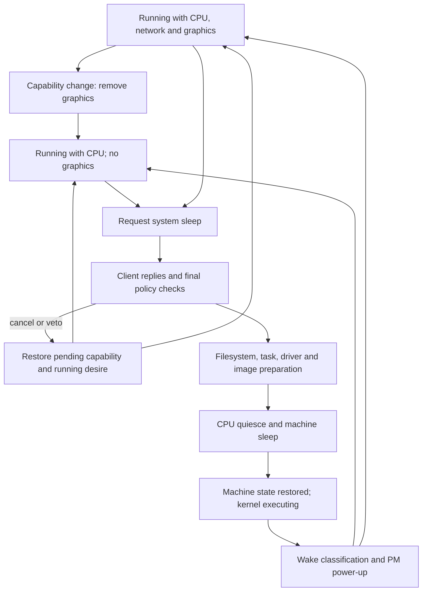
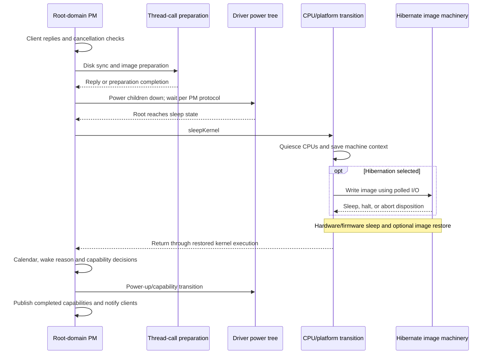

# System sleep requests, capability changes, and wake completion

[Drivers](README.md) · [PM callback protocols](workloop-and-power-protocols.md) · [ARM64 CPU lifecycle](../platform/cpu-power-lifecycle.md) · [Hibernation image](../platform/hibernation-image-creation.md)

System sleep crosses several independently synchronized mechanisms. `IOPMrootDomain` decides which capabilities should remain available and notifies clients. `IOServicePM` drives requests and acknowledgments through its state machine. Filesystem and hibernation preparation run while blocking is still possible. CPU shutdown then enters a much more restricted execution context. Returning from that machine transition begins another sequence of driver, capability and task restoration.

This chapter connects those mechanisms through the current source. It does not assume that display sleep, dark wake, CPU idle, suspend to RAM and hibernation are interchangeable. The [CPU guide](../platform/cpu-power-lifecycle.md) follows ARM64 register/context and timer restoration; [x86 sleep/resume](../platform/x86-sleep-and-resume.md) follows its separate assembly/platform path; [image creation](../platform/hibernation-image-creation.md) and [image restoration](../platform/hibernation-restore.md) explain the persistent-memory image.

The [power assertions and idle-policy companion](power-assertions-and-idle-policy.md) follows the inputs that precede these transitions: assertion IDs and queued publication, DriverKit exclusion counts, service preventer sets, coalesced settings delivery and timer-driven release of root power desires.

## 1. Power state, capabilities and progress are different state

| State | Role in the selected path |
| --- | --- |
| Root-domain power-state ordinal | The `IOServicePM` state being requested or completed, including `SLEEP_STATE`, `ON_STATE`, and configured `AOT_STATE`. |
| `_desiredCapability` | Policy's requested CPU/network/graphics/audio capability combination. |
| `_pendingCapability` | Capabilities targeted by the current transition; clients are notified before these become current. |
| `_currentCapability` / `_highestCapability` | Completed capability state / capabilities reached since wake, used to decide later notification and policy behavior. |
| `_systemTransitionType` | Sleep, wake, capability-only change, initial capability-client synchronization, or no transition. |
| `_systemStateGeneration` | Generation carried by queued follow-up policy work, so a later transition can invalidate an older stimulus. |
| `_systemMessageClientMask` | Which legacy, kernel and userspace policy client classes should receive selected notifications. |
| `fResponseArray`, `fSerialNumber`, `fDoNotPowerDown` | PM-client reply accounting, notification generation, and cancellation decision in `IOServicePM`. |

See [root-domain state](../../../xnu/iokit/IOKit/pwr_mgt/RootDomain.h#L722-L745), [transition setup](../../../xnu/iokit/Kernel/IOPMrootDomain.cpp#L6492), and [reply storage setup](../../../xnu/iokit/Kernel/IOServicePM.cpp#L6284).

[Source: iokit/IOKit/pwr_mgt/RootDomain.h, lines 722–728](../../../xnu/iokit/IOKit/pwr_mgt/RootDomain.h#L722-L728)

<!-- source-excerpt: ../../../xnu/iokit/IOKit/pwr_mgt/RootDomain.h#L722-L728 -->
```cpp
// Track system capabilities.
	uint32_t                _desiredCapability;
	uint32_t                _currentCapability;
	uint32_t                _pendingCapability;
	uint32_t                _highestCapability;
	OSPtr<OSSet>            _joinedCapabilityClients;
	uint32_t                _systemStateGeneration;
```

Dark wake retains CPU capability without graphics capability in the paths below. It can be entered or exited by a capability change while the root domain remains in its running power state. Hardware sleep instead targets a downward power transition and pending capabilities of zero. Consequently, a sleeping display does not establish that CPUs have stopped, and an executing kernel after wake does not establish that graphics and userspace notifications have finished.

`handleOurPowerChangeStart()` distinguishes synchronization from a lower power-state request and from a self-initiated wake. It computes pending capabilities, selects notification classes, and increments the transition generation. `handleOurPowerChangeDone()` publishes the pending capabilities only after the corresponding PM transition completes; cancellation first restores pending state to the existing current state. [Start decisions](../../../xnu/iokit/Kernel/IOPMrootDomain.cpp#L6523-L6594), [completion and publication](../../../xnu/iokit/Kernel/IOPMrootDomain.cpp#L6824-L6999).



The diagram omits configured AOT transitions and intermediate PM-machine states. Those have additional wake-window, task-suspension and run-mode rules in the same root-domain implementation.

## 2. A public sleep request queues policy work

`sleepSystem()` delegates to `sleepSystemOptions()`, which chooses a reason such as software sleep, OS-switch hibernation, or the recognized thermal/notification cases. `privateSleepSystem()` can be called with or without the PM gate. It performs the initial enabled check, requires the policy queue, and submits a demand-sleep event. Successful return means the event was submitted; it is not a synchronous hardware-sleep result. [Request entry](../../../xnu/iokit/Kernel/IOPMrootDomain.cpp#L2986-L3039).

[Source: iokit/Kernel/IOPMrootDomain.cpp, lines 3033–3038](../../../xnu/iokit/Kernel/IOPMrootDomain.cpp#L3033-L3038)

<!-- source-excerpt: ../../../xnu/iokit/Kernel/IOPMrootDomain.cpp#L3033-L3038 -->
```cpp
	pmPowerStateQueue->submitPowerEvent(
		kPowerEventPolicyStimulus,
		(void *) kStimulusDemandSystemSleep,
		sleepReason);

	return kIOReturnSuccess;
```

`IOPMPowerStateQueue` allocates a `PowerEventEntry`, inserts it under its own queue lock, and signals its workloop. `checkForWork()` removes an entry, drops the queue lock around the action, then frees the entry. The root-domain action ultimately evaluates policy under the PM gate. This separates requesting threads from serialized root-domain decisions. [Event queue](../../../xnu/iokit/Kernel/IOPMPowerStateQueue.cpp#L67-L105), [gated evaluation](../../../xnu/iokit/Kernel/IOPMrootDomain.cpp#L9090).

For `kStimulusDemandSystemSleep`, policy asks the display wrangler to idle where applicable and submits an override power-state request carrying the sleep reason. That request still passes through transition setup and notification rules. A queued dark-wake-entry/reentry event instead carries `_systemStateGeneration`; policy acts on it only if the generation still matches. [Demand and generation decisions](../../../xnu/iokit/Kernel/IOPMrootDomain.cpp#L9232-L9306).

There are deliberately two levels of permission:

* `checkSystemSleepEnabled()` checks global/user disable state and boot/shutdown conditions.
* `checkSystemCanSleep()` runs under the gate and additionally checks build support, DriverKit matching/synchronization and power-tree readiness, child preventers, CPU assertions, and selected platform/PCI restrictions.

Emergency conditions bypass some later checks, but occur after earlier configuration and DriverKit readiness checks in this body. An emergency reason therefore must not be summarized as bypassing every sleep restriction. Idle-sleep preventers and the stronger system-sleep checks also serve different policy decisions. [Exact ordering](../../../xnu/iokit/Kernel/IOPMrootDomain.cpp#L7804-L7924).

## 3. Client notification is filtered by transition and recipient

The root domain overrides `askChangeDown()`, `tellChangeDown()`, `tellNoChangeDown()` and `tellChangeUp()` to send system-specific messages through the generic PM notification engine. Capability-aware clients receive `IOPMSystemCapabilityChangeParameters`, including from/to masks, will/did flags, reply reference and permitted reply delay. Legacy clients use the familiar can-sleep, will-sleep and powered-on sequence. [Overrides](../../../xnu/iokit/Kernel/IOPMrootDomain.cpp#L3773-L4019), [capability filtering](../../../xnu/iokit/Kernel/IOPMrootDomain.cpp#L7421-L7495).

The current `systemMessageFilter()` is more precise than the older comment saying asking occurs only for idle sleep. Userspace power policy can receive `CanSystemSleep` during demand sleep too, while `kIOPMSkipAskPowerDown` suppresses the corresponding request to ordinary applications:

[Source: iokit/Kernel/IOPMrootDomain.cpp, lines 7501–7511](../../../xnu/iokit/Kernel/IOPMrootDomain.cpp#L7501-L7511)

<!-- source-excerpt: ../../../xnu/iokit/Kernel/IOPMrootDomain.cpp#L7501-L7511 -->
```cpp
		if ((kIOMessageCanSystemSleep == context->messageType) ||
		    (kIOMessageSystemWillNotSleep == context->messageType)) {
			if (isCapPowerd) {
				allow = true;
				break;
			}

			// Demand sleep, don't ask apps for permission
			if (context->changeFlags & kIOPMSkipAskPowerDown) {
				break;
			}
```

Capability loss requests the userspace capability client's acknowledgment before the change; capability gain requests it after the change. New-client synchronization has its own from-zero/current-capabilities message. `_highestCapability` and the client mask prevent sending an inappropriate legacy or kernel sleep sequence to clients that were never brought into the corresponding full-wake interval. The filter also stops waiting for selected legacy clients after repeated acknowledgment timeouts. These are recipient-specific protocols, not a broadcast in which every registration sees every message. [Capability reply timing](../../../xnu/iokit/Kernel/IOPMrootDomain.cpp#L7477-L7494), [legacy mask and timeout selection](../../../xnu/iokit/Kernel/IOPMrootDomain.cpp#L7524-L7571).

`tellChangeDown()` performs one-time sleep-side work such as notifying kext unload coordination and updating console state, but still calls `tellClientsWithResponse()` for both notification passes. `ignoreTellChangeDown` suppresses duplicate side effects, not the required second notification pass. [Two-pass handling](../../../xnu/iokit/Kernel/IOPMrootDomain.cpp#L3786-L3806).

## 4. Reply cookies, timeout and cancellation advance the PM machine

`tellClientsWithResponse()` allocates a response array and advances the nonzero notification serial. Each notified client is assigned an array index; the reply cookie places the serial's low 16 bits in its upper half and the index's low 16 bits in its lower half. Array entries can represent an outstanding response, a completed response, or a timed acknowledgment record. The optional parallel client array retains notification identities needed for tracing and cleanup. [Array lifetime](../../../xnu/iokit/Kernel/IOServicePM.cpp#L6284-L6428), [cookie construction](../../../xnu/iokit/Kernel/IOServicePM.cpp#L6493-L6513).

`allowPowerChange()` and `cancelPowerChange()` enqueue PM reply requests. Receiving one does not directly run the whole sleep transition on the caller's thread. The gated reply handler calls `responseValid()`, which checks the serial, current array and index before updating the reply state:

[Source: iokit/Kernel/IOServicePM.cpp, lines 7111–7123](../../../xnu/iokit/Kernel/IOServicePM.cpp#L7111-L7123)

<!-- source-excerpt: ../../../xnu/iokit/Kernel/IOServicePM.cpp#L7111-L7123 -->
```cpp
	if (serialComponent != fSerialNumber) {
		return false;
	}

	if (fResponseArray == NULL) {
		return false;
	}

	theFlag = fResponseArray->getObject(ordinalComponent);

	if (theFlag == NULL) {
		return false;
	}
```

The PID accompanying a response is used by this routine for reporting; these checks should not be described as a PID-based authorization mechanism or an indefinitely unique token. Once the array is discarded, an old response cannot complete that absent notification round. [Response processing](../../../xnu/iokit/Kernel/IOServicePM.cpp#L7097-L7181), [reply submission](../../../xnu/iokit/Kernel/IOServicePM.cpp#L7257-L7332).

The cancellation handler sets `fDoNotPowerDown` only when the current state and change flags allow it. `kIOPMSkipAskPowerDown` normally prevents client veto, with explicit policy/priority-notification phase exceptions. It then updates expired client responses, checks for completion, stops the acknowledgment timer and releases response storage when done. A cancel call returning success therefore does not guarantee that this transition accepted its veto. [Allow/cancel dispatch](../../../xnu/iokit/Kernel/IOServicePM.cpp#L8557-L8599).

`updateClientResponses()` can mark an overdue `IOPMClientAck` complete and recompute the timer from the remaining deadlines. `cleanClientResponses()` logs failures where requested and releases the arrays. Acknowledgment timeout ends waiting according to this protocol; it cannot prove that a client's device operation completed. Keep this notification protocol separate from the controlling driver's `setPowerState()` acknowledgment and child-power acknowledgments covered in [PM callback protocols](workloop-and-power-protocols.md). [Deadline update](../../../xnu/iokit/Kernel/IOServicePM.cpp#L7197-L7245), [array cleanup](../../../xnu/iokit/Kernel/IOServicePM.cpp#L6220-L6272).

After replies, `askChangeDownDone()` rechecks system-sleep permission, including assertions created while clients were being notified; configured AOT wake windows can also cancel. The PM state machine marks a canceled transition `kIOPMNotDone` and finishes or reverts it. `systemDidNotSleep()` restores console/tickle and idle-retry behavior and can send the capability policy client a balancing did-change notification with no reply expected. No hardware resume is required to explain these cancellation notifications. [Final policy check](../../../xnu/iokit/Kernel/IOPMrootDomain.cpp#L3855-L3885), [cancellation repair](../../../xnu/iokit/Kernel/IOPMrootDomain.cpp#L3893-L3938), [PM-machine cancel/revert](../../../xnu/iokit/Kernel/IOServicePM.cpp#L8335-L8377).

## 5. Filesystem sync runs before the constrained CPU phase

The root domain registers `sysPowerDownHandler()` as a priority sleep/wake observer. On a will-lose-CPU capability message, the handler requests reply time, evaluates early hibernation policy, notifies the platform, and schedules `disk_sync_callout`. A `gSleepOrShutdownPending` compare-and-swap coordinates with concurrent shutdown; the losing branch delays the callout rather than pretending exclusive control. The callback acknowledges the original notification after its work. [Registration](../../../xnu/iokit/Kernel/IOPMrootDomain.cpp#L1941), [handler](../../../xnu/iokit/Kernel/IOPMrootDomain.cpp#L4050-L4151).

When the root power state is still `ON_STATE`, `disk_sync_callout()` calls `sync_internal()` and, under `HIBERNATION`, waits for prior post-wake trim work through `IOHibernateSystemPostWake(true)`. The other branch performs the post-wake variant and diagnostic work. The decision is based on the power state observed by the callback, not a permanently captured “sleep callback” label. [Callout body](../../../xnu/iokit/Kernel/IOPMrootDomain.cpp#L1212-L1238).

The VFS path has concrete limits:

1. `sync_internal()` starts or signals a sync worker and waits using a configurable timeout, initially five seconds. Thread creation failure and wait error still lead to a zero return.
2. The worker iterates local nonvirtual media first, then other mounts, using `LK_NOWAIT`.
3. Its callback reaches `sync_callback(mp, NULL)`, which requests `VFS_SYNC(..., MNT_NOWAIT, ...)` on writable mounts, temporarily clearing `MNT_ASYNC`.
4. The VFS sync return is discarded. Waiting for the worker does not convert every filesystem operation into synchronous durable media completion.

See [sync flags](../../../xnu/bsd/vfs/vfs_syscalls.c#L3426-L3456), [worker ordering](../../../xnu/bsd/vfs/vfs_syscalls.c#L3482-L3541), and [bounded caller wait](../../../xnu/bsd/vfs/vfs_syscalls.c#L3562-L3604).

[Source: bsd/vfs/vfs_syscalls.c, lines 3585–3595](../../../xnu/bsd/vfs/vfs_syscalls.c#L3585-L3595)

<!-- source-excerpt: ../../../xnu/bsd/vfs/vfs_syscalls.c#L3585-L3595 -->
```c
	error = msleep((caddr_t)&sync_thread_state, &sync_mtx_lck,
	    (PVFS | PDROP | PCATCH), "sync_thread", &ts);
	if (error) {
		struct timeval now;

		microtime(&now);
		if (now.tv_sec - sync_timeout_last_print.tv_sec > 120) {
			printf("sync timed out: %d sec\n", sync_timeout_seconds);
			sync_timeout_last_print.tv_sec = now.tv_sec;
		}
	}
```

This explains why a PM acknowledgment must be interpreted at its actual boundary. File data, filesystem metadata, device caches and hibernation-image commits have their own later completion contracts. See [clustered writeback](../vfs/clustered-writeback.md) for UPL/buffer completion and [image creation](../platform/hibernation-image-creation.md) for polled image writing.

## 6. Tasks, interested drivers and power children have ordered preparation

`willNotifyInterested(SLEEP_STATE)` updates system task-suspension state. `updateTasksSuspend()` combines ordinary and AOT suspension demands under the wake-event lock, then calls `tasks_system_suspend()` outside that lock when the effective state changes. The task routine traverses the task list under `tasks_threads_lock`, skipping the kernel task and driver tasks:

[Source: osfmk/kern/task.c, lines 3253–3263](../../../xnu/osfmk/kern/task.c#L3253-L3263)

<!-- source-excerpt: ../../../xnu/osfmk/kern/task.c#L3253-L3263 -->
```c
	queue_iterate(&tasks, task, task_t, tasks) {
		if (task == kernel_task) {
			continue;
		}
		if (task_is_driver(task)) {
			continue;
		}
		suspend ? task_suspend_internal(task) : task_resume_internal(task);
	}
	lck_mtx_unlock(&tasks_threads_lock);
}
```

The body uses the ordinary internal task suspension/resume machinery. It is not a snapshot of all CPU activity, and driver tasks remain available for the following device operations. On supported desktop builds the root-domain hook also performs a bounded pageout wait after newly suspending tasks. [Root hook](../../../xnu/iokit/Kernel/IOPMrootDomain.cpp#L4451-L4498), [combined suspension state](../../../xnu/iokit/Kernel/IOPMrootDomain.cpp#L1187-L1207), [task traversal](../../../xnu/osfmk/kern/task.c#L3243-L3263).

After interested drivers acknowledge, but before power children are notified, `willNotifyPowerChildren()` runs through a thread call. This permits work that can block on storage without holding the PM execution thread inside the callback. The service's state machine remains blocked on that callout until it returns. Under `HIBERNATION`, the hook raises the watchdog allowance and calls `IOHibernateSystemSleep()` then `IOHibernateIOKitSleep()`. This is the preparation stage for storage, page lists and pollers; the actual image write happens later in the constrained shutdown context. [Hook and contract](../../../xnu/iokit/Kernel/IOPMrootDomain.cpp#L4500-L4544), [thread-call dispatch](../../../xnu/iokit/Kernel/IOServicePM.cpp#L3970).

Sleep policy is evaluated again after drivers have slept and before the platform sleep call. If final policy selects a hibernation-dependent state but setup was disabled or aborted, the visible fallback can publish an aborted-sleep configuration with a one-second wake timer and request a future retry. That is a short sleep/wake route, distinct from canceling the PM transaction before entering hardware sleep. ARM64 hibernation has separate user-activity handling in the earlier hook, so the source does not support one universal abort rule for all architectures. [Early policy](../../../xnu/iokit/Kernel/IOPMrootDomain.cpp#L5777), [final policy/fallback](../../../xnu/iokit/Kernel/IOPMrootDomain.cpp#L5825-L5881), [architecture-specific activity handling](../../../xnu/iokit/Kernel/IOPMrootDomain.cpp#L4526-L4544).

## 7. The platform handoff changes scheduling and execution constraints

When `powerChangeDone()` observes `SLEEP_STATE`, it records sleep time, performs configured final hibernation bookkeeping/policy, and calls `getPlatform()->sleepKernel()`. The virtual platform method is an implementation boundary. The base `IOPlatformExpert` body calls `IOCPUSleepKernel()`, whose body in this checkout is compiled under `!USE_APPLEARMSMP`. The AppleARMSMP platform path must not be reconstructed from that excluded body. [Root handoff](../../../xnu/iokit/Kernel/IOPMrootDomain.cpp#L3153-L3222), [base platform method](../../../xnu/iokit/Kernel/IOPlatformExpert.cpp#L371-L390), [conditional CPU orchestrator](../../../xnu/iokit/Kernel/IOCPU.cpp#L255-L369).

The visible orchestrator performs these ordered operations:

1. Override scheduler core recommendations for sleep and run pre-sleep platform actions.
2. Raise the calling thread to the maximum kernel priority and mark the machine quiescing.
3. Visit other running CPUs, call their platform `haltCPU()`, then `processor_sleep()`.
4. Require execution on the boot CPU, suspend the console and stop the root-domain watchdog.
5. Call the boot CPU's `haltCPU()`. ARM64 additionally calls `processor_sleep()` to transfer to its idle thread and interrupt stack. The x86 branch sleeps through its platform callback instead.
6. After machine return, clear quiescing, restart the watchdog/console, wake stopped secondary CPUs, run post-resume actions, restore scheduler core policy and restore the caller's priority.

`sched_override_available_cores_for_sleep()` acquires `cluster_powerdown_lock` and deliberately keeps it held across this interval. Under the scheduler's availability lock it changes recommendation policy, flushes pulled runnable threads after dropping that inner lock, and suspends ordinary cluster powerdown. The paired restore reverses the override, resumes cluster policy, releases the outer lock, and reapplies configured SMT disablement. This is serialization against competing CPU-power policy, separate from each processor's own offline protocol. [Scheduler bracket](../../../xnu/osfmk/kern/sched_prim.c#L8102-L8167), [CPU shutdown/resume details](../platform/cpu-power-lifecycle.md).

[Source: iokit/Kernel/IOCPU.cpp, lines 281–291](../../../xnu/iokit/Kernel/IOCPU.cpp#L281-L291)

<!-- source-excerpt: ../../../xnu/iokit/Kernel/IOCPU.cpp#L281-L291 -->
```cpp

	/*
	 * We need to boost this thread's priority to the maximum kernel priority to
	 * ensure we can urgently preempt ANY thread currently executing on the
	 * target CPU.  Note that realtime threads have their own mechanism to eventually
	 * demote their priority below MAXPRI_KERNEL if they hog the CPU for too long.
	 */
	old_pri = thread_kern_get_pri(self);
	thread_kern_set_pri(self, thread_kern_get_kernel_maxpri());

	// Sleep the CPUs.
```

Platform action queues add another ordered layer. Registered sleep/quiesce actions are sorted by priority; wake/active queues reverse that ordering. `IOCPURunPlatformQuiesceActions()` and `IOCPURunPlatformActiveActions()` require preemption disabled. Active actions are bracketed by `ml_hibernate_active_pre()` and `ml_hibernate_active_post()`, connecting restored image state to machine wake. These are different callbacks from ordinary PM notifications. The action runner collects a first error while continuing through the queue; the pre-sleep/post-resume wrappers discard its returned status. Do not infer transaction rollback of all platform actions on one callback failure. [Action ordering](../../../xnu/iokit/Kernel/IOPlatformActions.cpp#L87-L99), [execution and hibernation bracket](../../../xnu/iokit/Kernel/IOPlatformActions.cpp#L108-L155), [wrappers](../../../xnu/iokit/Kernel/IOPlatformActions.cpp#L203-L216), [reverse priority](../../../xnu/iokit/Kernel/IOPlatformActions.cpp#L278-L322).



This depicts the conceptual ordering. In particular, normal callbacks may run on other threads, individual driver requests can block their PM state machine, and the platform method can use an external CPU orchestration implementation.

## 8. Returning from machine sleep starts wake policy

Execution resumes after the platform call in `powerChangeDone()`. XNU records the absolute wake time, calls `IOHibernateSystemWake()` when configured, clears `gSleepOrShutdownPending`, and refreshes the calendar clock. It resets per-cycle dark-wake state and classifies the wake using architecture-specific inputs. x86 reads platform wake-type/reason and hibernation properties; ARM64 has its own reset-time, promotion, alarm and hibernation branches. Neither is a universal “wake always enables the display” rule. [Common return](../../../xnu/iokit/Kernel/IOPMrootDomain.cpp#L3217-L3248), [wake classification](../../../xnu/iokit/Kernel/IOPMrootDomain.cpp#L3280-L3410).

The root then queues console/user updates and requests its selected running power state. `updateConsoleUsers()` clears the ordinary task-suspend demand; AOT can retain a separate demand. Later transition setup chooses CPU/network capabilities and optionally graphics/audio, and the completed PM transition updates `_currentCapability` and `_highestCapability`. Configured dark-wake work carries the generation so an obsolete request cannot overwrite a newer transition's policy. [Run-state request](../../../xnu/iokit/Kernel/IOPMrootDomain.cpp#L3411-L3437), [task-resume demand](../../../xnu/iokit/Kernel/IOPMrootDomain.cpp#L1180-L1207), [wake capabilities](../../../xnu/iokit/Kernel/IOPMrootDomain.cpp#L6541-L6570), [completion](../../../xnu/iokit/Kernel/IOPMrootDomain.cpp#L6967-L6999).

During a wake without graphics, `willTellSystemCapabilityDidChange()` closes the opportunity to promote the *same* ongoing wake before capability notifications. Later requests may need a separate capability transition. This explains why waking a CPU, resuming ordinary tasks, powering devices and reporting full wake have separate observable completion points. [Promotion boundary](../../../xnu/iokit/Kernel/IOPMrootDomain.cpp#L4555-L4582).

## Inspection scope

Read paths include request queuing and demand policy; transition/capability publication and generation checks; selected preventers and emergency ordering; recipient filtering; reply cookies, allowed cancellation and response cleanup; bounded VFS sync; task suspension; hibernation preparation/final policy hooks; the non-AppleARMSMP CPU orchestrator and scheduler bracket; platform action ordering; and root-domain wake/cancellation completion.

The [assertion and idle-policy companion](power-assertions-and-idle-policy.md) now covers the selected assertion/preventer/settings/timer implementations. Battery/thermal policy, all AOT/run-mode and clamshell combinations, every child-PM transition, external powerd decisions, AppleARMSMP CPU implementation, physical device power sequencing, firmware and trusted image validation remain outside this chapter. [PM callback protocols](workloop-and-power-protocols.md), [CPU lifecycle](../platform/cpu-power-lifecycle.md), and the hibernation chapters carry the neighboring detailed paths. No sleep/resume workload was executed.

<!-- BEGIN PLATYDOC DOCUMENTATION LICENSE -->
Original Platydoc text and diagrams are licensed under [CC BY 4.0](https://creativecommons.org/licenses/by/4.0/). Quoted source code and third-party material retain their respective licenses.
<!-- END PLATYDOC DOCUMENTATION LICENSE -->
