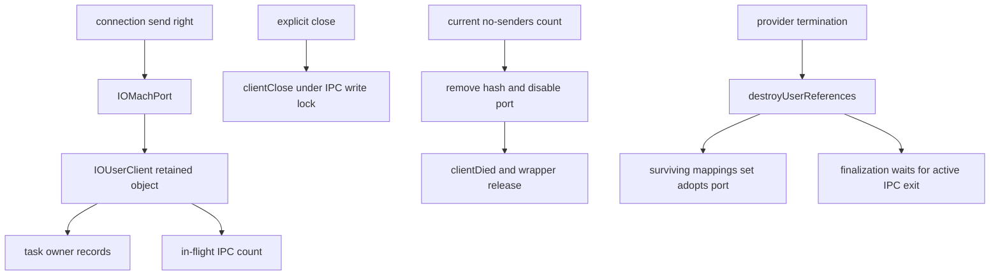

# User-client connections and DriverKit object lifetime

[Drivers](README.md) · [User-client introduction](user-clients-and-driverkit.md) · [Service termination](service-matching-and-termination.md) · [Mach IPC](../ipc/README.md)

A user connection involves several independent owners: a task holds a Mach send right, an `IOMachPort` exports an `OSObject`, a service graph connects the user client to its provider, owner records associate clients with tasks, and calls may already be executing. Closing the connection, losing its final sender, terminating the provider, and releasing the last C++ reference therefore require different operations. This chapter follows those operations and then the corresponding DriverKit object transport. [`IOMachPort`](../../../xnu/iokit/Kernel/IOUserClient.cpp#L175-L310), [`owner records`](../../../xnu/iokit/Kernel/IOUserClient.cpp#L1700-L1774), [`IPC activity`](../../../xnu/iokit/Kernel/IOUserClient.cpp#L603-L694).

## 1. Export identity and object ownership

`IOMachPort` is an intermediate kernel object, rather than the user client itself being the immediate Mach kobject. Its `object` reference is retained with the collection tag. The hash index is based on the object pointer, but lookup also matches the IPC kobject type; object exports, connections, and DriverKit objects consequently do not collapse into one undifferentiated port namespace. `gIOObjectPortLock` protects the export hash and its lifecycle operations. The port's own lock protects inspection of its kobject association and make-send count. [`IOUserClient.cpp`](../../../xnu/iokit/Kernel/IOUserClient.cpp#L205-L305).

[IOUserClient.cpp, lines 249–261](../../../xnu/iokit/Kernel/IOUserClient.cpp#L249-L261)

<!-- source-excerpt: ../../../xnu/iokit/Kernel/IOUserClient.cpp#L249-L261 -->
```cpp
IOMachPort*
IOMachPort::withObject(OSObject *obj)
{
	IOMachPort *machPort = NULL;

	machPort = new IOMachPort;
	release_assert(machPort->init());
	machPort->object = obj;

	obj->taggedRetain(OSTypeID(OSCollection));

	return machPort;
}
```

The reverse lookup crosses both abstractions deliberately. `iokit_lookup_object_in_space()` translates a send right in the supplied IPC space and checks the expected kobject type. While the port is locked it retains the `IOMachPort`; it then unlocks the port and consumes that wrapper reference through a helper which retains the exported object. The resulting object can be used independently of a later removal of the port association. A numeric user-space port name is thus neither a kernel pointer nor a permanent object identity. [`iokit_rpc.c`](../../../xnu/osfmk/device/iokit_rpc.c#L141-L166), [`iokit_copy_object_for_consumed_kobject()`](../../../xnu/iokit/Kernel/IOUserClient.cpp#L650-L678).

For export, `iokit_port_make_send_for_object()` finds or creates the wrapper under the object-port lock and makes a send right on the kobject port. Copyout then inserts that right into the receiving IPC space. Wrapper destruction destroys an extant port and releases the tagged reference on the exported object. These ownership edges explain why destroying a connection port can eventually release a client, but is not itself the client's `stop()` callback. [`IOUserClient.cpp`](../../../xnu/iokit/Kernel/IOUserClient.cpp#L696-L717), [`iokit_rpc.c`](../../../xnu/osfmk/device/iokit_rpc.c#L310-L342), [`IOMachPort::free()`](../../../xnu/iokit/Kernel/IOUserClient.cpp#L400-L413).

## 2. Opening a connection and entering a method

`is_io_service_open_extended()` requires the supplied owning task to be the current task. It performs configured MAC authorization before asking the service for a user client; in this body, non-null serialized open properties are rejected, so the disabled property parser should not be mistaken for a supported route. `IOService::newUserClient()` can call the DriverKit implementation or allocate a configured user-client class, initialize it, attach it, and start it. Failed initialization/start paths release the object and, where attachment occurred, detach it first. [`IOUserClient.cpp`](../../../xnu/iokit/Kernel/IOUserClient.cpp#L4377-L4455), [`IOService.cpp`](../../../xnu/iokit/Kernel/IOService.cpp#L8205-L8276).

After creation, the open routine still has policy and registration work. On a first open it establishes creator/shared-instance state, selects default locking behavior with SDK/compatibility distinctions, evaluates the required-entitlement property, performs client-specific MAC checks where configured, resolves an optional filter policy, and registers task ownership. A failure after creation calls `clientClose()`, clears termination deferral, releases the client, and returns no connection. Success also clears that deferral before publishing the handler. The method's transport return and its result out-parameter are distinct error channels. [`IOUserClient.cpp`](../../../xnu/iokit/Kernel/IOUserClient.cpp#L4456-L4609).

Task ownership records are another graph: each record is linked into both the task's and user client's lists, under `gIOUserClientOwnersLock`. Registration deduplicates a task/client pair. They support task death and application-suspension notification bookkeeping; they are not the same records as Mach port rights. [`IOUserClient.cpp`](../../../xnu/iokit/Kernel/IOUserClient.cpp#L1700-L1774).

The synchronous external-method bridge constructs an `IOExternalMethodArguments` record from scalar and structure arguments. Large input/output structures use descriptors over the current task's ranges; input uses an output-direction, copy-on-write mapping option, and output uses input direction. The bridge invokes the selected filter/method and releases these temporary descriptors afterward. This argument-marshalling lifetime does not itself grant a driver an indefinitely pinned DMA buffer. [`IOUserClient.cpp`](../../../xnu/iokit/Kernel/IOUserClient.cpp#L5133-L5244), [DMA preparation](dma-preparation-and-mapping.md).

`callExternalMethod()` selects read, write, or no default IPC locking according to the client's policy. `ipcEnter()` takes that lock and increments `__ipc`; `ipcExit()` decrements the count and can schedule deferred finalization when the client is inactive and the final call exits. The 2022 dispatch helper separately validates selector bounds, scalar counts, structure sizes or variable-size markers, asynchronous-call permission, and an optional method entitlement before calling the function. Serialization, activity tracking, and argument authorization therefore occur at separate layers. [`IOUserClient.cpp`](../../../xnu/iokit/Kernel/IOUserClient.cpp#L603-L646), [`method entry`](../../../xnu/iokit/Kernel/IOUserClient.cpp#L6583-L6600), [`2022 dispatch`](../../../xnu/iokit/Kernel/IOUserClient.cpp#L6607-L6665).

[IOUserClient.cpp, lines 626–636](../../../xnu/iokit/Kernel/IOUserClient.cpp#L626-L636)

<!-- source-excerpt: ../../../xnu/iokit/Kernel/IOUserClient.cpp#L626-L636 -->
```cpp
	assert(__ipc);
	if (1 == OSDecrementAtomic(&__ipc) && isInactive()) {
		IOLockLock(gIOObjectPortLock);
		if ((finalize = __ipcFinal)) {
			__ipcFinal = false;
		}
		IOLockUnlock(gIOObjectPortLock);
		if (finalize) {
			scheduleFinalize(true);
		}
	}
```

`finalizeUserReferences()` sets `__ipcFinal` while holding the object-port lock if calls remain and reports that immediate finalization cannot proceed. The exit side tests and clears the same flag under that lock. This is a specific finalization handshake; the count should not be treated as a general-purpose object reference or proof that all driver-private asynchronous work has ended. [`IOUserClient.cpp`](../../../xnu/iokit/Kernel/IOUserClient.cpp#L680-L694), [`exit`](../../../xnu/iokit/Kernel/IOUserClient.cpp#L622-L646).

## 3. Three different connection shutdown routes

### Explicit close

`is_io_service_close()` recognizes a surviving mappings set as a special successful close. For a real client, a non-shared instance uses a compare-and-swap on `closed` so repeated closes do not repeatedly invoke `clientClose()`. Shared instances take the callback route independently. The callback runs with write IPC locking/activity tracking; its return is not the close RPC's returned status in this wrapper. Calling close does not itself release every outstanding connection send right. [`IOUserClient.cpp`](../../../xnu/iokit/Kernel/IOUserClient.cpp#L4613-L4635).

[IOUserClient.cpp, lines 4625–4628](../../../xnu/iokit/Kernel/IOUserClient.cpp#L4625-L4628)

<!-- source-excerpt: ../../../xnu/iokit/Kernel/IOUserClient.cpp#L4625-L4628 -->
```cpp
	if (client->sharedInstance || OSCompareAndSwap8(0, 1, &client->closed)) {
		client->ipcEnter(kIPCLockWrite);
		client->clientClose();
		client->ipcExit(kIPCLockWrite);
```

### No senders and task death

A no-senders notification carries a make-send count. `IOMachPort::noMoreSenders()` obtains the current wrapper and checks whether that count is still current while holding the port lock. Only a current notification removes the wrapper from the hash and disables the export; a stale notification cannot tear down a newly remade send-right generation. For connection exports, owner-record removal happens through `uc->noMoreSenders()` before the object-port lock is released. [`IOUserClient.cpp`](../../../xnu/iokit/Kernel/IOUserClient.cpp#L264-L319).

[IOUserClient.cpp, lines 271–276](../../../xnu/iokit/Kernel/IOUserClient.cpp#L271-L276)

<!-- source-excerpt: ../../../xnu/iokit/Kernel/IOUserClient.cpp#L271-L276 -->
```cpp
	lck_mtx_lock(gIOObjectPortLock);

	iokit_lock_port(port);
	machPort  = (IOMachPort *)ipc_kobject_get_locked(port, type);
	destroyed = ipc_kobject_is_mscount_current_locked(port, mscount);
	iokit_unlock_port(port);
```

The connection no-senders handler then takes the client write lock, invokes `clientDied()`, and releases the detached wrapper. The base `clientDied()` uses the shared-instance/`closed` test before invoking `clientClose()`. Object-port and DriverKit-object no-senders handlers have different behavior: memory maps can receive `taskDied()`, and DriverKit cleanup may release a provider's start deferral. These are typed handlers, not one universal destructor. [`IOUserClient.cpp`](../../../xnu/iokit/Kernel/IOUserClient.cpp#L735-L815), [`clientDied()`](../../../xnu/iokit/Kernel/IOUserClient.cpp#L1980-L1996).

Task termination removes ownership records under the owners lock but calls clients outside it. The driver-task phase snapshots owned user servers and notifies them; the general phase removes the task's records and retains clients whose owner list becomes empty for subsequent callbacks. A shared connection can therefore outlive one task owner, and callback delivery is kept outside the lock protecting the two list structures. [`IOUserClient.cpp`](../../../xnu/iokit/Kernel/IOUserClient.cpp#L1820-L1909).

### Provider termination and surviving mappings

Service phase 1 calls `destroyUserReferences()`. Besides releasing ordinary object exports, it removes and disables the connection export, detaches the user client's mappings set, and removes owner records. If mappings survive, a new `IOMachPort` wraps that set and adopts the old connection port; the old wrapper's port field becomes null. Existing connection rights can consequently resolve to the mappings set after the user client has been removed. This is why the explicit-close path has its `OSSet` case. [`IOUserClient.cpp`](../../../xnu/iokit/Kernel/IOUserClient.cpp#L348-L390), [`adoptPort()`](../../../xnu/iokit/Kernel/IOUserClient.cpp#L178-L184), [service phase 1](service-matching-and-termination.md#6-phase-1-make-the-affected-graph-inactive).



## 4. DriverKit message dispatch and object conversion

`uext_server()` resolves the receiving kobject as an `IOUserServer`, calls its server routine, then releases the looked-up object. The server validates basic message shape and object-reference bounds, imports object references, redirects applicable `OSAction` targets, and calls `kernelDispatch()`. Dispatch distinguishes instantiation from a target object's `Dispatch()` implementation. A temporary thread-local user-server context and allocation name surround execution. This is the kernel side of an RPC protocol; generated user-side stubs and driver code are separate components. [`IOUserServer.cpp`](../../../xnu/iokit/Kernel/IOUserServer.cpp#L3149-L3385).

The payload's object-reference array is not sent as trusted kernel pointers. Port descriptors are converted through typed `IKOT_UEXT_OBJECT` exports/lookups. Serialized object values use out-of-line descriptors and `vm_map_copy`: outbound serialization builds a copy from kernel memory; inbound conversion copies it into the kernel map, unserializes it, and deallocates the temporary mapping. `MAX_OBJECT_COUNT` checks multiplication/addition/subtraction bounds before permitting the advertised count. The parser also distinguishes port and OOL descriptor layouts. [`IOUserServer.cpp`](../../../xnu/iokit/Kernel/IOUserServer.cpp#L3387-L3407), [`message parser`](../../../xnu/iokit/Kernel/IOUserServer.cpp#L3684-L3722), [`copy conversion`](../../../xnu/iokit/Kernel/IOUserServer.cpp#L3724-L4007).

There are two cleanup axes: references to imported/exported `OSObject`s and Mach descriptor resources. `consumeObjects()` releases the former; `copyInObjects(..., false, true)` consumes descriptor resources without importing new objects. `copyOutObjects()` has a consume-objects option and an error unwind for already-processed descriptors. Confusing these operations can turn a transport failure into either a leak or a double release. [`IOUserServer.cpp`](../../../xnu/iokit/Kernel/IOUserServer.cpp#L3760-L3905), [`import/unwind`](../../../xnu/iokit/Kernel/IOUserServer.cpp#L3908-L4036).

Incoming non-oneway requests get a reply kmsg. After dispatch, the server consumes incoming object references and ports, exports successful reply objects, or builds an error reply. The reply adopts the incoming reply port and its disposition. A successful server transport return can therefore carry a method error inside the DriverKit reply payload. [`IOUserServer.cpp`](../../../xnu/iokit/Kernel/IOUserServer.cpp#L3243-L3385).

A separate `IOUserServerUEXTTrap()` route copies a bounded input buffer from the caller, permits only the supported small object-reference count, requires a simple reply, resolves an optional typed object argument, and dispatches directly. Its reply rejects descriptors and copies a bounded payload back. This trap path should not be illustrated as though it first builds and sends the same complete Mach RPC as `IOUserServer::rpc()`. [`IOUserServer.cpp`](../../../xnu/iokit/Kernel/IOUserServer.cpp#L3409-L3548), [trap/RPC distinction](../ipc/kernel-rpc-and-exceptions.md).

## 5. Outbound RPC retains a destination and tracks message movement

`queueForObject()` selects a default or method-specific dispatch queue from a service's user variables. A stopped queue has a sentinel distinct from a missing queue. `rpc()` holds `gIOUserServerLock` while selecting the queue/root fallback and copying its send right, then releases the lock before the potentially blocking message operation. This makes the copied right, rather than a borrowed queue-port field, the transport's destination owner. [`IOUserServer.cpp`](../../../xnu/iokit/Kernel/IOUserServer.cpp#L2857-L2905), [`rpc()`](../../../xnu/iokit/Kernel/IOUserServer.cpp#L3551-L3606).

The outgoing Mach header uses a copy-send destination and, for two-way calls, a make-send-once reply port. One-way messages call `kernel_mach_msg_send()`; two-way requests call `kernel_mach_msg_rpc()`. Both report `message_moved`, and the temporary destination send right is released afterward. On failure, descriptor-port cleanup is performed locally only when the message did not move. Once it moved, the caller must respect transport ownership rather than reclaiming the same resources again. [`IOUserServer.cpp`](../../../xnu/iokit/Kernel/IOUserServer.cpp#L3608-L3639).

[IOUserServer.cpp, lines 3631–3639](../../../xnu/iokit/Kernel/IOUserServer.cpp#L3631-L3639)

<!-- source-excerpt: ../../../xnu/iokit/Kernel/IOUserServer.cpp#L3631-L3639 -->
```cpp
	if (MACH_MSG_SUCCESS != ret) {
		if (kIODKLogIPC & gIODKDebug) {
			DKLOG("mach_msg() failed 0x%x\n", ret);
		}
		if (!message_moved) {
			// release ports
			copyInObjects(mach, message, sendSize, false, true);
		}
	}
```

Reply validation checks the reply protocol version, size, message ID, and error flag before interpreting imported objects or an error result. A send-once notification becomes `MIG_SERVER_DIED`; a mismatched version becomes `MIG_REPLY_MISMATCH`. One implementation detail matters when reviewing failure paths: this body assigns the result of `copyOutObjects()` but does not branch on it before assigning the later send result. Do not infer a universal pre-send serialization-error return from the helper's error contract alone. [`IOUserServer.cpp`](../../../xnu/iokit/Kernel/IOUserServer.cpp#L3610-L3627), [`reply checks`](../../../xnu/iokit/Kernel/IOUserServer.cpp#L3641-L3681).

## 6. Remote user-client creation and stop completion

`serviceNewUserClient()` obtains the task's entitlements and requests a remote user-client instance. It requires an `IOUserUserClient`, associates the task, and applies configured DriverKit authorization. The branches distinguish required driver entitlement groups, third-party iOS communication/team policy, general allow-any or bundle-access policy, and entitlements required by the returned user client. Debug policy can bypass selected checks; target-specific branches are not interchangeable. Rejected instances are terminated, have their start deferral cleared, and are released. [`IOUserServer.cpp`](../../../xnu/iokit/Kernel/IOUserServer.cpp#L4746-L4887).

Remote service shutdown records `willTerminate`, `didTerminate`, `stopped`, and `serverDied` under the service's user-variable lock. A normal stop can call remote `Stop`; an inactive provider or slept server chooses the asynchronous route. Failure/offline handling advances local stop completion. `serviceDidTerminate()` defers while the server is alive and stop is incomplete. `serviceDidStop()` marks completion, removes the `openProviders` array under the lock, closes those providers outside it, and reenters `didTerminate()` when that earlier phase was already waiting. This is the concrete bridge back into generic phase-3 stop/detach coordination. [`IOUserServer.cpp`](../../../xnu/iokit/Kernel/IOUserServer.cpp#L6152-L6250).

[IOUserServer.cpp, lines 6195–6201](../../../xnu/iokit/Kernel/IOUserServer.cpp#L6195-L6201)

<!-- source-excerpt: ../../../xnu/iokit/Kernel/IOUserServer.cpp#L6195-L6201 -->
```cpp
	IOLockLock(client->reserved->uvars->uvarsLock);
	client->reserved->uvars->didTerminate = true;
	if (!client->reserved->uvars->serverDied
	    && !client->reserved->uvars->stopped) {
		*defer = true;
	}
	IOLockUnlock(client->reserved->uvars->uvarsLock);
```

User-server `clientClose()` snapshots its services under the server lock before iterating them. Unexpected server loss invokes client-crash handling and interrupt unregistration for applicable services, evaluates configured crash behavior, and terminates the server service. The reference snapshot permits callbacks outside the collection lock; it does not prove that a device has independently stopped DMA. That remains a driver-specific teardown responsibility alongside the generic connection and service protocols. [`IOUserServer.cpp`](../../../xnu/iokit/Kernel/IOUserServer.cpp#L4277-L4351), [DMA completion](dma-preparation-and-mapping.md).

## Reading exercise and limits

Follow a successful open through owner registration, one external method, provider termination during that method, and final `ipcExit()`. Then compare the wrapper surviving as a mappings-set export with a current no-senders notification releasing the original wrapper. The cited bodies provide each ownership transition; no live connection was exercised for this chapter.

Deep review covered open policy/setup failure, typed port export/import, owner-list cleanup, explicit close, no-senders generation checks, active-call finalization, DriverKit server/rpc/trap conversion, descriptor cleanup, user-client entitlement branches, and remote-stop coordination. Legacy method shims, every asynchronous notification/`OSAction` variant, generated method schemas, daemon check-in authentication internals, and external driver behavior remain outside the detailed trace.
