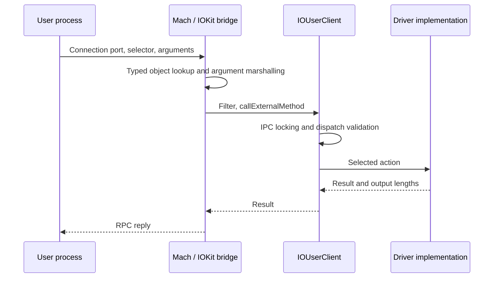

# User clients and DriverKit RPC

[Subsystem overview](README.md) · [Mach IPC](../ipc/README.md) · [Memory mapping](memory-and-dma.md)

Continue with [connection and DriverKit lifetime](user-client-and-driverkit-lifetime.md) for typed port ownership, no-senders generations, in-flight IPC finalization, surviving mapping exports, RPC failure cleanup, and remote-stop completion.

The [class dispatch and actions chapter](driverkit-dispatch-and-actions.md) follows registered method metadata, queue selection, callback target translation, interrupt consumption, cancellation boundaries, and check-in authorization.

For one complete call, [external-method call lifecycle](external-method-call-lifecycle.md) connects a local test service to opener/current-caller authority, scalar and structure transport, dispatch validation, output, async ownership and close.

## A connection is an exported kernel object

IOKit exports registry objects, connections, and DriverKit objects through different Mach kobject types. A user-visible integer is a name in a task's IPC space, not a C++ pointer. `iokit_lookup_object_in_space_with_port_name` translates a send right, checks the expected kobject type, retains the kobject under the port lock, and returns the associated object through the IOKit ownership bridge. Conversely, `iokit_make_send_right` obtains an object port and copies a send right into the task's IPC space. [`typed object lookup`](../../../platydoc-data/xnu/osfmk/device/iokit_rpc.c#L141), [`iokit_make_send_right`](../../../platydoc-data/xnu/osfmk/device/iokit_rpc.c#L310).

The connection type `IKOT_IOKIT_CONNECT` identifies an `IOUserClient`. Other relevant types include `IKOT_IOKIT_OBJECT`, `IKOT_IOKIT_IDENT`, and `IKOT_UEXT_OBJECT`. `IOMachPort` tracks exported-object associations and coordinates their teardown. These typed ports are part of the transport's object-lifetime model; they do not replace authorization inside an operation. [`IOMachPort::noMoreSenders`](../../../platydoc-data/xnu/iokit/Kernel/IOUserClient.cpp#L264).

## Opening a service creates or obtains a user client

The open path begins in `is_io_service_open_extended`. It requires the owning task to be the current task and, under `CONFIG_MACF`, calls the service-open MAC hook. It then asks `service->newUserClient` for a client. The generic `IOService` implementation can delegate to DriverKit, invoke a subclass's legacy constructor path, or allocate the class named by `IOUserClientClass`. The class is initialized with the task and connection type, attached, and started. Each failure path releases or detaches what was acquired. [`is_io_service_open_extended`](../../../platydoc-data/xnu/iokit/Kernel/IOUserClient.cpp#L4377), [`IOService::newUserClient`](../../../platydoc-data/xnu/iokit/Kernel/IOService.cpp#L8205).

Open processing also establishes locking policy and checks the client's entitlement property, a second MAC boundary, and registered filter callbacks. `IOUserClient2022` requires explicit default-locking properties and an entitlement property whose supported forms include a named entitlement or an explicit false value. That requirement should not be generalized to every older subclass, whose compatibility paths differ. Successful open registers task ownership in linked owner records. [`open policy and ownership setup`](../../../platydoc-data/xnu/iokit/Kernel/IOUserClient.cpp#L4470), [`registerOwner`](../../../platydoc-data/xnu/iokit/Kernel/IOUserClient.cpp#L1700).

`IOUserClient` stores `mappings`, `closed`, `sharedInstance`, IPC activity state, owner links, a read/write `lock`, and a separate filter lock. Base `initWithTask` reserves runtime state; concrete subclasses decide what task-derived state and resources they retain. Merely finding a service in the registry does not imply that its connection will open successfully. [`IOUserClient` fields](../../../platydoc-data/xnu/iokit/IOKit/IOUserClient.h#L245), [`initWithTask`](../../../platydoc-data/xnu/iokit/Kernel/IOUserClient.cpp#L1652).

## External methods validate transport shape before driver behavior

`is_io_connect_method` constructs `IOExternalMethodArguments`. Scalars and small structures arrive in-band; larger input/output ranges are represented by memory descriptors over the current task's address space. Input uses `kIODirectionOut` with a copy-on-write mapping option; output uses `kIODirectionIn`. Those directions describe movement relative to host memory. The routine applies a selector filter, calls `callExternalMethod`, copies result counts, and releases temporary descriptors. [`is_io_connect_method`](../../../platydoc-data/xnu/iokit/Kernel/IOUserClient.cpp#L5133), [`IOExternalMethodArguments`](../../../platydoc-data/xnu/iokit/IOKit/IOUserClient.h#L122).

`callExternalMethod` chooses a shared lock, exclusive lock, or no default lock according to the client's policy. In particular, default locking without the single-thread-external-method option uses a read lock: multiple external method calls can coexist. A workloop gate used inside the driver is a separate serialization choice. [`callExternalMethod`](../../../platydoc-data/xnu/iokit/Kernel/IOUserClient.cpp#L6583).

The older dispatch helper checks declared scalar counts and structure sizes before invoking a supplied function, but the subclass must select an appropriate dispatch entry. `IOUserClient2022::dispatchExternalMethod` accepts the entire table plus its length, validates the selector, checks the same sizes, rejects unsupported asynchronous invocation, and can require a per-method entitlement. Neither mechanism validates the meaning of arbitrary bytes in a variable-sized structure; that remains the method implementation's job. [`IOExternalMethodDispatch2022`](../../../platydoc-data/xnu/iokit/IOKit/IOUserClient.h#L168), [`dispatchExternalMethod`](../../../platydoc-data/xnu/iokit/Kernel/IOUserClient.cpp#L6607), [`legacy externalMethod`](../../../platydoc-data/xnu/iokit/Kernel/IOUserClient.cpp#L6667).

## Mappings and close have their own lifetimes

`mapClientMemory64` asks the subclass for `clientMemoryForType`, combines allowed user map flags with the returned options, and creates a mapping in the requested task. The base `clientMemoryForType` is unsupported: the subclass chooses the exported memory types and descriptors. Follow the corresponding map API entry's checks as well as this virtual callback when assessing access. [`mapClientMemory64`](../../../platydoc-data/xnu/iokit/Kernel/IOUserClient.cpp#L2066), [mapping ownership](memory-and-dma.md).

When the connection loses all senders, `IOMachPort::noMoreSenders` verifies that the notification's make-send count is still current, disables/removes the object-port association, and clears owner records. `iokit_connect_no_senders` takes the client's write lock and calls `clientDied`. The default `clientDied` invokes `clientClose` once for a non-shared instance; base `clientClose` returns unsupported. A subclass must implement its actual shutdown, cancellation, and provider-release behavior. This is a protocol with overridable callbacks, not a universal automatic hardware cleanup routine. [`noMoreSenders`](../../../platydoc-data/xnu/iokit/Kernel/IOUserClient.cpp#L264), [`iokit_connect_no_senders`](../../../platydoc-data/xnu/iokit/Kernel/IOUserClient.cpp#L756), [`clientDied`](../../../platydoc-data/xnu/iokit/Kernel/IOUserClient.cpp#L1980).

## DriverKit retains a kernel-side object and transport layer

DriverKit moves driver execution into user processes while retaining kernel services, memory objects, and capability checks. The `.iig` files describe exported interfaces; `IOUserServer.cpp` implements kernel-side transport and service coordination. Service matching recognizes a user-server personality, `startCandidate` launches or reuses its server, and `launchUserServer` coordinates identity, launch tokens, retries, and check-in. The external daemon and the actual driver executable are outside this source path. [`IOService.iig`](../../../platydoc-data/xnu/iokit/DriverKit/IOService.iig), [`startCandidate`](../../../platydoc-data/xnu/iokit/Kernel/IOService.cpp#L4981), [`launchUserServer`](../../../platydoc-data/xnu/iokit/Kernel/IOUserServer.cpp#L6936).

`IOUserServer`'s external-method table contains class-registration and startup operations. Class registration exports a user metaclass object with `IKOT_UEXT_OBJECT`. Startup resolves an identity port to a check-in token and binds it before exporting the server object. This separates “a process can speak the transport” from “this process is the server expected for this launch.” Debug options can alter checks, so read the guards. [`externalMethod`](../../../platydoc-data/xnu/iokit/Kernel/IOUserServer.cpp#L4556), [`externalMethodStart`](../../../platydoc-data/xnu/iokit/Kernel/IOUserServer.cpp#L4607).

For inbound DriverKit RPC, `server` checks message structure and object references, imports the referenced objects, resolves an action target if applicable, and calls `kernelDispatch`. It consumes imported references and marshals the reply or error. For outbound calls, `rpc` chooses an object's dispatch queue or the root queue under `gIOUserServerLock`, obtains a send right, exports object references, and uses kernel Mach send or request/reply operations. Reply version, size, and method ID are checked before objects are imported. [`server`](../../../platydoc-data/xnu/iokit/Kernel/IOUserServer.cpp#L3243), [`rpc`](../../../platydoc-data/xnu/iokit/Kernel/IOUserServer.cpp#L3551), [`IORPC` wire definitions](../../../platydoc-data/xnu/iokit/DriverKit/IORPC.h).

Matching entitlements and opening a DriverKit user client are separate checks. `checkEntitlements` can test required entitlement groups and feed entitlement values into provider property matching. `serviceNewUserClient` checks user-client access rules with platform-specific branches. These are concrete kernel boundaries; they do not describe the complete external signing, approval, installation, or launch policy. [`checkEntitlements`](../../../platydoc-data/xnu/iokit/Kernel/IOUserServer.cpp#L2651), [`serviceNewUserClient`](../../../platydoc-data/xnu/iokit/Kernel/IOUserServer.cpp#L4746), [security](../security/README.md).

<!-- BEGIN PLATYDOC DOCUMENTATION LICENSE -->
Original Platydoc text and diagrams are licensed under [CC BY 4.0](https://creativecommons.org/licenses/by/4.0/). Quoted source code and third-party material retain their respective licenses.
<!-- END PLATYDOC DOCUMENTATION LICENSE -->
