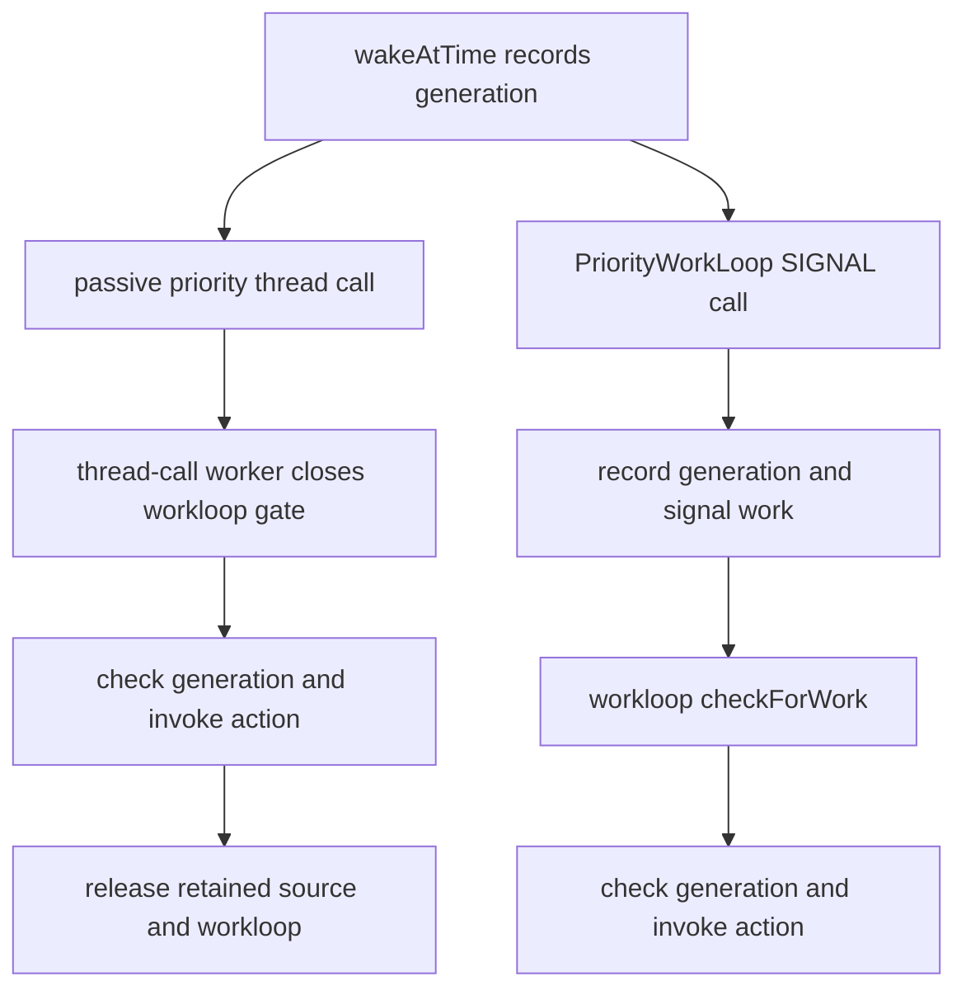

# Workloop execution, event lifetime, and power acknowledgments

[Drivers](README.md) · [Workloop introduction](workloops-and-power.md) · [Runtime waits](../runtime/wait-and-turnstile-protocols.md) · [Thread-call lifetime](../runtime/timer-and-thread-call-lifetime.md)

A workloop combines an execution thread, a recursive gate, event-source ownership, and wakeup state. Those components solve different problems. A driver action can run under the gate on its caller's thread; an interrupt can signal work without taking that gate; a timer can use a thread-call worker or actual workloop delivery; power transitions use a shared PM workloop while invoking selected driver callbacks outside it. Read execution context and ownership separately at each edge. [`IOWorkLoop.cpp`](../../../xnu/iokit/Kernel/IOWorkLoop.cpp#L127-L192), [`runAction()`](../../../xnu/iokit/Kernel/IOWorkLoop.cpp#L565-L577), [`timer callbacks`](../../../xnu/iokit/Kernel/IOTimerEventSource.cpp#L165-L224), [`PM callouts`](../../../xnu/iokit/Kernel/IOServicePM.cpp#L4189-L4238).

For the system-wide sequence built on these callbacks, see [system sleep and wake](system-sleep-and-wake.md): root-domain policy, capability notifications, cancellation, filesystem/task preparation and the platform handoff.

## 1. The gate and wakeup lock protect different invariants

| State | Protocol |
|---|---|
| `gateLock` | Recursive lock serializing event-chain maintenance, `checkForWork()` callbacks, and explicit gated actions. It is not a requirement that the current thread be `workThread`. [`IOWorkLoop.cpp`](../../../xnu/iokit/Kernel/IOWorkLoop.cpp#L375-L427), [`runAction`](../../../xnu/iokit/Kernel/IOWorkLoop.cpp#L565-L577). |
| `workToDoLock`, `workToDo` | Interrupt-safe simple-lock protocol protecting signaling versus worker wait registration. The notifier can mark work while the worker is outside the gate. [`threadMain`](../../../xnu/iokit/Kernel/IOWorkLoop.cpp#L430-L456), [`signalWorkAvailable`](../../../xnu/iokit/Kernel/IOWorkLoop.cpp#L490-L498). |
| `eventChain`, passive chain | Workloop-retained sources, with linkage/workloop association changed through maintenance actions. Only the active chain is polled. [`_maintRequest`](../../../xnu/iokit/Kernel/IOWorkLoop.cpp#L580-L680). |
| Restart/terminate flags | Callback-driven mutations can restart the scan; termination aborts it and transfers final cleanup to worker exit. [`runEventSources`](../../../xnu/iokit/Kernel/IOWorkLoop.cpp#L390-L427), [`free`](../../../xnu/iokit/Kernel/IOWorkLoop.cpp#L236-L296). |

`runEventSources()` closes the gate, clears the restart and work-available state for a scan, and ORs together the active sources' `checkForWork()` results. It repeats if work remains. A maintenance operation can set restart, causing a fresh walk rather than continuing with links invalidated by the callback. A callback returning false does not promise that no interrupt can arrive immediately afterward; the wakeup protocol closes that separate race. [`IOWorkLoop.cpp`](../../../xnu/iokit/Kernel/IOWorkLoop.cpp#L375-L427).

After the scan, the worker takes `workToDoLock` with interrupts disabled and tests termination/work state. It registers its wait before releasing that lock. The producer takes the same lock, sets the work flag, and wakes the worker. The worker can use a continuation unless the precious-stack option requires preservation. This is a concrete driver-layer use of the runtime's register-wait-then-block protocol. [`IOWorkLoop.cpp`](../../../xnu/iokit/Kernel/IOWorkLoop.cpp#L430-L498), [wait registration](../runtime/wait-and-turnstile-protocols.md).

[IOWorkLoop.cpp, lines 438–448](../../../xnu/iokit/Kernel/IOWorkLoop.cpp#L438-L448)

<!-- source-excerpt: ../../../xnu/iokit/Kernel/IOWorkLoop.cpp#L438-L448 -->
```cpp
		IOInterruptState is = IOSimpleLockLockDisableInterrupt(workToDoLock);
		if (!ISSETP(&fFlags, kLoopTerminate) && !workToDo) {
			assert_wait((void *) &workToDo, false);
			IOSimpleLockUnlockEnableInterrupt(workToDoLock, is);
			thread_continue_t cptr = NULL;
			if (!reserved || !(kPreciousStack & reserved->options)) {
				cptr = OSMemberFunctionCast(
					thread_continue_t, this, &IOWorkLoop::threadMain);
			}
			thread_block_parameter(cptr, this);
			goto restartThread;
```

`runAction()` is much smaller than a work-submission API: it closes the recursive gate, invokes the supplied function immediately, and opens the gate. A caller doing a synchronous operation has not changed threads merely because it acquired workloop serialization. This also explains why generic service termination can use a workloop wrapper without enqueueing each callback on the worker. [`IOWorkLoop.cpp`](../../../xnu/iokit/Kernel/IOWorkLoop.cpp#L565-L577), [`IOService::_workLoopAction()`](../../../xnu/iokit/Kernel/IOService.cpp#L2512-L2526).

[IOWorkLoop.cpp, lines 571–576](../../../xnu/iokit/Kernel/IOWorkLoop.cpp#L571-L576)

<!-- source-excerpt: ../../../xnu/iokit/Kernel/IOWorkLoop.cpp#L571-L576 -->
```cpp
	// closeGate is recursive so don't worry if we already hold the lock.
	closeGate();
	res = (*inAction)(target, arg0, arg1, arg2, arg3);
	openGate();

	return res;
```

## 2. Membership, removal, and owner lifetime

On add, `_maintRequest()` retains the source, sets its workloop and next pointer, and appends it to the appropriate chain. On remove it unlinks the source, clears the workloop/next pointers, releases the membership reference, and marks the scan for restart. This makes workloop membership an ownership edge for the event source. The event source's base `init()` stores its owner pointer without retaining that owner, so the owner's callback-visible state needs an independently maintained lifetime. [`IOWorkLoop.cpp`](../../../xnu/iokit/Kernel/IOWorkLoop.cpp#L580-L680), [`IOEventSource.cpp`](../../../xnu/iokit/Kernel/IOEventSource.cpp#L155-L182).

`IOCommandGate` adds coordination for callers waiting on a disabled source. An off-workloop `runAction()` waits for enable under the recursive gate's sleep mechanism; a wake can reveal removal or an aborted wait, in which case the action is not called. Outstanding actions are counted. Removing the command gate marks it removed and wakes enabled-state waiters; it waits for their removal handshake and can defer clearing the workloop association until the remaining action finishes. Clearing a pointer before acknowledging these users would destroy the gate they still need to leave. [`IOCommandGate.cpp`](../../../xnu/iokit/Kernel/IOCommandGate.cpp#L139-L163), [`runAction`](../../../xnu/iokit/Kernel/IOCommandGate.cpp#L196-L269).

`attemptAction()` is a different contract: it tries the gate and reports inability to lock or a disabled off-workloop source instead of waiting. `commandSleep()` requires gate ownership and delegates to the recursive-lock sleep implementation; it drops the gate while sleeping and regains it before returning. State observed before that sleep must be rechecked afterward. A recursive gate is not a blanket guarantee that arbitrary blocking is safe: a blocked action can still depend on another resource or callback that its larger lock ordering prevents from progressing. [`IOCommandGate.cpp`](../../../xnu/iokit/Kernel/IOCommandGate.cpp#L271-L338), [`IOWorkLoop::sleepGate()`](../../../xnu/iokit/Kernel/IOWorkLoop.cpp#L524-L541).

Workloop destruction has two stages. If the worker exists, `free()` disables sources, sets termination under the wakeup lock, wakes the thread, and returns. The exiting worker clears `workThread`, calls `free()` again to release source chains/control-gate/locks/storage, drops its thread reference, and terminates. The initial release initiating this sequence is not proof that the worker's exit instructions have already run. [`IOWorkLoop.cpp`](../../../xnu/iokit/Kernel/IOWorkLoop.cpp#L210-L296), [`thread exit`](../../../xnu/iokit/Kernel/IOWorkLoop.cpp#L458-L467).

## 3. Interrupt arrival and deferred consumption

The primary `IOInterruptEventSource` handler increments `producerCount` and signals work. An auto-disable variant first disables the provider interrupt. In `checkForWork()`, the workloop snapshots the producer count, computes its delta from `consumerCount`, invokes the driver with that count, and advances the consumer to the snapshot. Arrivals during the action belong to a later observation; coalescing counts does not require one kernel-thread wakeup per interrupt. Auto-disable sources are reenabled when the explicit-disable state permits it. [`IOInterruptEventSource.cpp`](../../../xnu/iokit/Kernel/IOInterruptEventSource.cpp#L317-L397), [`primary handlers`](../../../xnu/iokit/Kernel/IOInterruptEventSource.cpp#L448-L519).

Removing an interrupt source has an additional provider-side obligation. `setWorkLoop(NULL)` unregisters the interrupt before clearing its workloop association because the provider may disappear later; an encoded negative interrupt index records the unregistered state so reattachment can register it again. `free()` also unregisters an extant registration. Disabling an interrupt and unregistering its handler are distinct operations with different lifetime consequences. [`IOInterruptEventSource.cpp`](../../../xnu/iokit/Kernel/IOInterruptEventSource.cpp#L234-L297).

## 4. Timer delivery has active and passive implementations

The default `timerEventSource()` chooses kernel-high thread-call priority. In the modern passive implementation, `wakeAtTime()` stores the deadline, retains both source and workloop before submitting a callout, saves the workloop and generation, and passes that generation as the call parameter. If the submission replaces an already pending call, the extra retains are undone: there is still one pending invocation's ownership to account for. [`IOTimerEventSource.cpp`](../../../xnu/iokit/Kernel/IOTimerEventSource.cpp#L358-L364), [`wakeAtTime`](../../../xnu/iokit/Kernel/IOTimerEventSource.cpp#L546-L583).

`timeoutAndRelease()` runs on the selected thread-call worker. It takes the retained workloop's gate, rechecks the action and generation, invokes when current, opens the gate, and releases both references. Generation invalidation prevents an obsolete pending callback from performing the action; its cleanup still releases the invocation's ownership. This is gated delivery but not necessarily execution on `IOWorkLoop::workThread`. [`IOTimerEventSource.cpp`](../../../xnu/iokit/Kernel/IOTimerEventSource.cpp#L165-L194).

[IOTimerEventSource.cpp, lines 179–193](../../../xnu/iokit/Kernel/IOTimerEventSource.cpp#L179-L193)

<!-- source-excerpt: ../../../xnu/iokit/Kernel/IOTimerEventSource.cpp#L179-L193 -->
```cpp
			wl->closeGate();
			IOStatisticsCloseGate();
			doit = me->action;
			if (doit && (me->reserved->calloutGeneration == count)) {
				thread_call_start_iotes_invocation((thread_call_t)me->calloutEntry);
				me->invokeAction(doit, me, me->owner, me->workLoop);
			}
			IOStatisticsOpenGate();
			wl->openGate();
		}
	}
	if (me->reserved->workLoop) {
		me->reserved->workLoop->release();
	}
	me->release();
```

The `PriorityWorkLoop` option instead allocates a `THREAD_CALL_OPTIONS_SIGNAL` call, marks the source active, and uses `timeoutSignaled()`. That callback records the delivered generation and signals work availability. `checkForWork()` later compares it with the current generation, checks enabled/action state, invalidates the signaled marker, and invokes the action on the workloop scan. This option rejects the allow-reenter combination. Other priorities use passive delivery, and the ONCE option is selected unless allow-reenter was requested. [`IOTimerEventSource.cpp`](../../../xnu/iokit/Kernel/IOTimerEventSource.cpp#L199-L305).



Cancellation respects that split. `_thread_call_cancel` uses `thread_call_cancel_wait()` for active sources and ordinary `thread_call_cancel()` for passive ones. `cancelTimeout()` advances the generation, cancels, and clears the deadline. If cancellation actually removed a pending passive call, it releases the source/workloop references that the callback will no longer release. If that call was already running, the callback remains responsible for them. Disabling follows the same generation/cancel pattern. `free()` cancels, then calls `thread_call_free()` and asserts success; it is not implemented as unconditional freeing of a still-queued callback record. [`IOTimerEventSource.cpp`](../../../xnu/iokit/Kernel/IOTimerEventSource.cpp#L356-L420), [underlying cancellation distinctions](../runtime/timer-and-thread-call-lifetime.md).

[IOTimerEventSource.cpp, lines 386–396](../../../xnu/iokit/Kernel/IOTimerEventSource.cpp#L386-L396)

<!-- source-excerpt: ../../../xnu/iokit/Kernel/IOTimerEventSource.cpp#L386-L396 -->
```cpp
IOTimerEventSource::cancelTimeout()
{
	if (reserved) {
		reserved->calloutGeneration++;
	}
	bool active = _thread_call_cancel((thread_call_t) calloutEntry);
	AbsoluteTime_to_scalar(&abstime) = 0;
	if (active && reserved && (kPassive & flags)) {
		release();
		workLoop->release();
	}
```

These mechanisms are complementary: the gate serializes callback state, generations reject stale work, pending-invocation references preserve passive object lifetime, and the active path waits for its signal callback. None should be substituted for the others when explaining source teardown. Older timer instances without expansion data use the separate legacy callback, so the retained-workloop description specifically concerns the modern `reserved` path. [`IOTimerEventSource.cpp`](../../../xnu/iokit/Kernel/IOTimerEventSource.cpp#L141-L194), [`submission branches`](../../../xnu/iokit/Kernel/IOTimerEventSource.cpp#L546-L583).

## 5. PM requests, replies, and blocked state machines

PM initialization creates a shared PM workloop with request, reply, work, and completion event sources. Request submission classifies replies separately from ordinary requests. The incoming queue uses its own lock and limits each dequeue pass, dropping that lock around the action; the workloop gate serializes the subsequent PM-machine work. Incoming submission success does not mean the target hardware has completed its transition. [`IOServicePM.cpp`](../../../xnu/iokit/Kernel/IOServicePM.cpp#L351-L380), [`submit`](../../../xnu/iokit/Kernel/IOServicePM.cpp#L7926-L7943), [`incoming queue`](../../../xnu/iokit/Kernel/IOServicePM.cpp#L9056-L9122).

Each service's PM work queue processes its head request in order. An explicit request dependency or unfinished state-machine invocation blocks that service's head. The global work chain can nevertheless inspect other services; producer/consumer counts record work made available by completion. Retirement flows into a completion queue which releases requests and can unblock dependent work. PM serialization is therefore more specific than one global FIFO in which a sleeping device permanently prevents every other device from advancing. [`IOServicePM.cpp`](../../../xnu/iokit/Kernel/IOServicePM.cpp#L7967-L8030), [`per-service queue`](../../../xnu/iokit/Kernel/IOServicePM.cpp#L9213-L9260), [`global scan`](../../../xnu/iokit/Kernel/IOServicePM.cpp#L9263-L9321).

`isPMBlocked()` names the concrete reasons a transition must stop: a driver thread call is still busy, the controlling driver's acknowledgment timer is nonzero, child/interested-driver acknowledgments remain, an application/client response array remains, or a configured settle timer remains. `actionPMWorkQueueInvoke()` executes transition states only while that predicate permits it. The machine state and the condition blocking it must be read together. [`IOServicePM.cpp`](../../../xnu/iokit/Kernel/IOServicePM.cpp#L8068-L8338).

## 6. Driver return and driver acknowledgment can race

`notifyControllingDriver()` prepares one call parameter, sets `fDriverTimer = -1`, sets `fDriverCallBusy`, and submits the driver callout. The sentinel records that the driver's return has not yet been interpreted. The state machine then waits at its driver-call-completion state. [`IOServicePM.cpp`](../../../xnu/iokit/Kernel/IOServicePM.cpp#L4523-L4561).

[IOServicePM.cpp, lines 4551–4558](../../../xnu/iokit/Kernel/IOServicePM.cpp#L4551-L4558)

<!-- source-excerpt: ../../../xnu/iokit/Kernel/IOServicePM.cpp#L4551-L4558 -->
```cpp
	param->Target = fControllingDriver;
	fDriverCallParamCount = 1;
	fDriverTimer = -1;

	// Block state machine and wait for callout completion.
	assert(!fDriverCallBusy);
	fDriverCallBusy = true;
	thread_call_enter( fDriverCallEntry );
```

`pmDriverCallout()` runs in thread-call context, selects the notification or power-state operation, and calls back into the PM workloop with `runAction()` when finished. That gated completion clears `fDriverCallBusy` and signals the PM work queue. For `setPowerState`, `assertPMDriverCall()` first records the executing thread/target under the PM lock and rejects stopped/inactive calls as appropriate; after the native or DriverKit callback, `deassertPMDriverCall()` removes the record and wakes any stop waiter. The actual driver call is not executed while continuously holding the shared PM workloop gate. [`IOServicePM.cpp`](../../../xnu/iokit/Kernel/IOServicePM.cpp#L4189-L4336), [`call tracking`](../../../xnu/iokit/Kernel/IOServicePM.cpp#L8641-L8725).

The callback's return and a later `acknowledgeSetPowerState()` have different meanings. An implied acknowledgment or negative result clears the timer. A positive result, if no acknowledgment has arrived, is converted into timeout ticks after imposing a minimum. The acknowledgment API itself queues a reply. If that reply arrives while `fDriverTimer == -1`, its handler clears the sentinel; when callback completion later interprets a positive result, the zero timer preserves the already-received acknowledgment instead of starting a new wait. If the timer is already positive, the acknowledgment stops the timer/watchdog and permits further machine work. [`IOServicePM.cpp`](../../../xnu/iokit/Kernel/IOServicePM.cpp#L1684-L1757), [`return interpretation`](../../../xnu/iokit/Kernel/IOServicePM.cpp#L4568-L4616).

Children introduce their own pending acknowledgment count and ordering. `notifyChildren()` checks ready connections, supports strict ordering, and can defer selected child notifications according to root-domain policy. These branches share the state-machine blocking mechanism but do not reuse the controlling driver's single timer as the complete child-state model. Parent capability propagation, application response policy, and root-domain decisions add further branches beyond this selected transition. [`IOServicePM.cpp`](../../../xnu/iokit/Kernel/IOServicePM.cpp#L3995-L4168), [`blocking reasons`](../../../xnu/iokit/Kernel/IOServicePM.cpp#L8068-L8125).

## 7. PM stop blocks new calls and performs bounded coordination

`PMstop()` sets `PMStop` under the PM lock before waiting for recorded driver calls, then submits a PM-stop request. Future `assertPMDriverCall()` checks this flag before admitting a callback. The eventual gated handler removes sleep-prevention state/properties, detaches power relationships, removes interested-driver references, and cancels the idle timer with its associated reference release when cancellation removes the pending call. These operations are separate from service-plane detach. [`IOServicePM.cpp`](../../../xnu/iokit/Kernel/IOServicePM.cpp#L696-L820), [`admission check`](../../../xnu/iokit/Kernel/IOServicePM.cpp#L8641-L8704).

The wait is deliberately qualified. `waitForPMDriverCall()` skips an entry executing on the current thread to avoid waiting for itself, and its sleep has a 15-second deadline. A timeout logs and ends that waiting loop. Thus the function attempts to drain relevant calls but cannot be documented as an unconditional proof that every previous callback has returned. The queue entry and deassert wakeup are the normal completion protocol; self-call and timeout are explicit exceptions in this checkout. [`IOServicePM.cpp`](../../../xnu/iokit/Kernel/IOServicePM.cpp#L8754-L8798).

[IOServicePM.cpp, lines 8787–8796](../../../xnu/iokit/Kernel/IOServicePM.cpp#L8787-L8796)

<!-- source-excerpt: ../../../xnu/iokit/Kernel/IOServicePM.cpp#L8787-L8796 -->
```cpp
		if (wait) {
			fLockedFlags.PMDriverCallWait = true;
			clock_interval_to_deadline(15, kSecondScale, &deadline);
			waitResult = PM_LOCK_SLEEP(&fPMDriverCallQueue, deadline);
			fLockedFlags.PMDriverCallWait = false;
			if (THREAD_TIMED_OUT == waitResult) {
				PM_ERROR("%s: waitForPMDriverCall timeout\n", fName);
				wait = false;
			}
		}
```

## Sources inspected and limits

Deep review covered workloop scan/wakeup/removal/free, command-gate waiting and removal, interrupt registration/counting, both modern timer delivery modes and cancellation, PM request/reply scheduling, selected blocked-state predicates, driver callout/acknowledgment races, and PM stop admission/wait/cleanup. Read [service termination](service-matching-and-termination.md) alongside this chapter to see which callbacks use these gates.

The complete PM state graph, every timer priority/clock combination, hardware interrupt controllers, filter subclass internals, dark-wake policy, and driver-specific reentrancy rules are not exhaustively reviewed. No device/interrupt or suspend-resume workload was executed; diagrams describe the selected source paths and their configuration branches.
