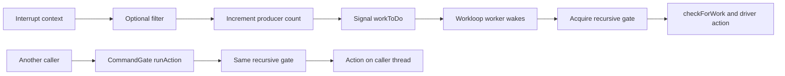

# Workloops, interrupts, and power transitions

[Subsystem overview](README.md) · [Service lifecycle](registry-and-service-lifecycle.md) · [Memory transfer](memory-and-dma.md)

Continue with [workloop and power protocols](workloop-and-power-protocols.md) for wait registration, source removal, active/passive timer delivery, generation-based cancellation, PM acknowledgment races, and bounded stop coordination.

The [interrupt routing and command ownership guide](interrupt-routing-and-command-queues.md) follows controller resolution, sharing, filters and command pools/rings. The [device power-state machine](device-power-state-machine.md) follows ordered state tables, parent reservations, child join/acknowledgment dependencies and transition completion, including the disabled settle-timer boundary.

## A workloop combines a worker with a lock

`IOWorkLoop::init` allocates a recursive `gateLock`, a simple `workToDoLock`, an internal command gate used for maintenance, and a kernel thread. The gate serializes protected driver operations; the simple lock protects wakeup state in contexts that can include interrupts. They have different purposes. [`IOWorkLoop::init`](../../../xnu/iokit/Kernel/IOWorkLoop.cpp#L127).

`runEventSources` closes the gate, walks the active `eventChain`, and calls `checkForWork`. It repeats while sources request more work or the chain must restart. Passive event sources are kept separately and do not incur polling. `threadMain` then uses the wakeup flag and thread wait machinery to sleep until signaled. [`runEventSources`](../../../xnu/iokit/Kernel/IOWorkLoop.cpp#L375), [`threadMain`](../../../xnu/iokit/Kernel/IOWorkLoop.cpp#L430).

Adding and removing sources goes through the internal command gate. `_maintRequest` retains an added source, sets its workloop, and inserts it in the active or passive chain. Removal clears those links and releases it. `IOEventSource::init` stores its owner pointer without retaining it. The driver must keep the owner alive for callbacks and dismantle sources before releasing state they use. Workloop membership does not independently retain every object reachable through a source. [`_maintRequest`](../../../xnu/iokit/Kernel/IOWorkLoop.cpp#L580), [`IOEventSource::init`](../../../xnu/iokit/Kernel/IOEventSource.cpp#L155).

## A command gate does not imply a thread switch

`IOCommandGate::runAction` obtains the workloop's recursive gate and directly invokes the supplied action. The calling thread can be a user-client RPC thread, a kernel worker, or the workloop thread itself. `inGate()` and `onThread()` answer different questions. Disabled command gates make off-workloop callers wait until enabled or torn down; the workloop thread has a special allowed path. [`runAction`](../../../xnu/iokit/Kernel/IOCommandGate.cpp#L196), [`inGate` and `onThread`](../../../xnu/iokit/Kernel/IOWorkLoop.cpp#L477).

`commandSleep` requires the gate to be held and delegates to a gate sleep operation. That operation releases the lock while sleeping and reacquires it on return. Shared state must be checked again after waking: another action may have changed it while the lock was released. The source explicitly panics if `commandSleep` is called without owning the gate. [`commandSleep`](../../../xnu/iokit/Kernel/IOCommandGate.cpp#L315), [`sleepGate`](../../../xnu/iokit/Kernel/IOWorkLoop.cpp#L524).

This distinction explains several common reading mistakes. A gated method can block its caller without dispatching to a new thread. Being on the workloop does not serialize state against code that never takes its gate. Holding a recursive gate avoids self-deadlock for nested acquisition but does not resolve lock-order cycles involving other services or waits for callbacks. The [runtime locking guide](../runtime/README.md) covers the underlying wait/lock primitives.

## Interrupt handling has two stages

`IOInterruptEventSource::interruptOccurred` selects the normal or auto-disable path. The primary handler updates `producerCount` and signals work availability. The workloop later computes `producerCount - consumerCount`; `checkForWork` calls the driver's action with that interrupt count. Multiple arrivals can therefore be delivered in one action, rather than one thread activation per hardware interrupt. Auto-disable handling includes provider interrupt disable/enable coordination. [`interruptOccurred`](../../../xnu/iokit/Kernel/IOInterruptEventSource.cpp#L508), [`checkForWork`](../../../xnu/iokit/Kernel/IOInterruptEventSource.cpp#L317).

`IOFilterInterruptEventSource` adds a filter executed on the primary interrupt path. It signals deferred work only if that filter requests it. The filter is where a driver can quickly decide whether an interrupt belongs to it or capture minimal status; it cannot be treated like the later gated action. [`normalInterruptOccurred`](../../../xnu/iokit/Kernel/IOFilterInterruptEventSource.cpp#L209).

## Power management is a queued state machine

Power registration is distinct from ordinary attachment. `PMinit` establishes PM state and, for initial root-domain setup, creates the global PM workloop with request, reply, work, and completion event sources. `joinPMtree` asks the platform expert to place the device into the power topology. `registerPowerDriver` copies the driver's power-state table, validates ordering/version, retains the controlling driver, and submits a request. Successful submission is not proof that hardware has changed state. [`PMinit`](../../../xnu/iokit/Kernel/IOServicePM.cpp#L351), [`joinPMtree`](../../../xnu/iokit/Kernel/IOServicePM.cpp#L665), [`registerPowerDriver`](../../../xnu/iokit/Kernel/IOServicePM.cpp#L1156).

`IOServicePM` keeps `RequestHead`, `MachineState`, acknowledgment timers, `HeadNote` transition data, `DesiredPowerState`, `CurrentPowerState`, parent capabilities, power-state entries, and the controlling driver. Desired state and current state can differ during a transition or while parent capabilities constrain the child. The state table distinguishes capability flags, power supplied to children, and power required from parents. [`IOServicePM`](../../../xnu/iokit/Kernel/IOServicePMPrivate.h#L169), [`power-state and parent fields`](../../../xnu/iokit/Kernel/IOServicePMPrivate.h#L265).

`changePowerStateTo` requests a state for the driver power client; other requesters can also influence the result. The PM machine includes client notification, interested-driver notification, hardware programming, settling, and completion states. Hardware callbacks run through `pmDriverCallout` in thread-call context; completion reenters the PM workloop through `runAction`. They are not all run while continuously holding the PM workloop gate. [`changePowerStateTo`](../../../xnu/iokit/Kernel/IOServicePM.cpp#L2450), [`state enumeration`](../../../xnu/iokit/Kernel/IOServicePM.cpp#L298), [`pmDriverCallout`](../../../xnu/iokit/Kernel/IOServicePM.cpp#L4206).

`driverSetPowerState` invokes the controlling driver's `setPowerState`, or forwards to the user server for a DriverKit service. An asynchronous acknowledgment arrives through `acknowledgeSetPowerState`, which queues a reply; the handler explicitly covers acknowledgment racing with an in-flight callback. `PMstop` first inhibits future driver calls and attempts to drain prior calls, then schedules removal from the power plane. Its wait skips calls on the current thread and has a timeout; see [bounded PM-stop coordination](workloop-and-power-protocols.md#7-pm-stop-blocks-new-calls-and-performs-bounded-coordination). [`driverSetPowerState`](../../../xnu/iokit/Kernel/IOServicePM.cpp#L4247), [`acknowledgeSetPowerState`](../../../xnu/iokit/Kernel/IOServicePM.cpp#L1684), [`PMstop`](../../../xnu/iokit/Kernel/IOServicePM.cpp#L696).

## Root-domain policy ends at the platform boundary

`IOPMrootDomain` coordinates system sleep and wake with the device power machinery. `privateSleepSystem` checks that sleep is enabled and queues a demand-sleep policy stimulus. It does not immediately stop processors. In the eventual sleep transition, `powerChangeDone` performs root-domain bookkeeping, optional hibernation work, and calls `getPlatform()->sleepKernel()`. Execution resumes after that call on wake. [`privateSleepSystem`](../../../xnu/iokit/Kernel/IOPMrootDomain.cpp#L3025), [`powerChangeDone` sleep boundary](../../../xnu/iokit/Kernel/IOPMrootDomain.cpp#L3155).

The complete decision includes power assertions, clients, thermal state, wake capabilities, and platform policy. Those branches were surveyed only at their entry boundaries here. Continue in [platform](../platform/README.md) and the upstream [hibernation document](../../../xnu/doc/lifecycle/hibernation.md) for processor and image-save details; this chapter establishes who queues, acknowledges, and performs driver transitions.

<!-- BEGIN PLATYDOC DOCUMENTATION LICENSE -->
Original Platydoc text and diagrams are licensed under [CC BY 4.0](https://creativecommons.org/licenses/by/4.0/). Quoted source code and third-party material retain their respective licenses.
<!-- END PLATYDOC DOCUMENTATION LICENSE -->
