# Mach IPC: names, capabilities, messages, and kernel interfaces

[Guide index](../../README.md) · [Architecture](../../architecture.md)

Mach IPC connects a task-local name space to kernel objects and transfers messages containing data, port rights, and memory. It is also the transport for many kernel RPC interfaces and exception notifications. Start by separating **a port name**, **a right**, **the port object**, and **a queued kernel message**: these have different ownership and lifetime rules. [`ipc_space.h`](../../../xnu/osfmk/ipc/ipc_space.h#L141), [`ipc_entry.h`](../../../xnu/osfmk/ipc/ipc_entry.h#L109), [`ipc_port.h`](../../../xnu/osfmk/ipc/ipc_port.h#L119), [`ipc_kmsg.h`](../../../xnu/osfmk/ipc/ipc_kmsg.h#L145).

```mermaid
flowchart LR
    A[Sender IPC space: name and right] --> CI[copyin: names become object rights]
    CI --> K[ipc_kmsg: owns transferred resources]
    K --> P[Destination ipc_port]
    P --> Q[Message queue or waiting receiver]
    Q --> CO[copyout: install rights and memory]
    CO --> B[Receiver IPC space and VM map]
    P --> KO[Kernel-owned destination]
    KO --> MIG[MIG dispatch and kobject operation]
    MIG --> Reply[Reply kmsg]
    Reply --> Q
```

Normal user destinations use `ipc_mqueue_send_locked()` and `ipc_mqueue_post()`. A destination in `ipc_space_kernel` is dispatched by `ipc_kobject_server()` directly in the sending kernel execution path; the reply then re-enters delivery. Consequently, “Mach message” does not always imply another userspace server or even another kernel server thread. [`ipc_kmsg_send()`](../../../xnu/osfmk/ipc/ipc_kmsg.c#L5129).

## Reading route

1. [Names and rights](names-and-rights.md): distinguish names, table entries, kernel rights, references, and user-reference counts. Continue with [port and right lifecycle](ports-and-rights-lifecycle.md) for allocation, transfer, receive-right migration, death, notifications, and namespace teardown.
2. [Message representation and the call boundary](message-path.md): understand the packed `mach_msg2` trap ABI, user/kernel layouts, header dispositions, descriptors, and resource ownership.
3. [Message send, delivery, and receive](message-send-receive.md): trace queue capacity, waiting senders, direct delivery, port sets, receiver copyout, reply messages, and phase-specific failures.
4. [Kernel RPC and MIG](kernel-rpc-and-exceptions.md): follow the destination port, operation ID, generated conversion, synchronous kernel dispatch, and request/reply cleanup.
5. [Mach exception delivery](exception-delivery.md): connect ARM faults to exception-action registration, thread/task/host fallback, exception RPC/replies, Unix signals, and validated thread-state changes.
6. [Port policy and work attribution](policies-and-attribution.md): introduction to guarded/immovable/pinned rights, reply restrictions, vouchers, and importance. Continue with [guards and policy enforcement](guards-and-policy-enforcement.md) for construction, guarded operations, deferred exceptions, persona checks, and notification policy; [vouchers and importance](vouchers-and-importance.md) traces immutable voucher construction, cache release races, thread adoption, and donation ownership. [Bank accounts and charging](bank-accounts-and-charging.md) follows account deduplication, role references, bill selection, quantum splitting, live reporting and release.
7. [Mach trap catalog](../../interfaces/mach-traps.md) and [MIG message catalog](../../interfaces/mach-messages/README.md): complete numbered trap slots and subsystem/routine declarations, with argument profiles, local receiver paths and external boundaries. The [entry map](../../interfaces/README.md) separates trap selectors from message IDs and BSD calls.

## Where does a message go?

For a userspace send, the destination is the port named by the send header's `msgh_remote_port`, resolved in the **sender's** IPC space. The message does not address a process ID, function pointer, or thread ID. What happens next depends on the destination port and the available receiver:

| Destination or state | Delivery path |
| --- | --- |
| Ordinary receive right, eligible receiver already waiting | Transfer the kernel message to the receiving thread's `ith_kmsg` and wake it; it later copies the message into its receive buffer |
| Ordinary receive right, no eligible receiver | Enqueue the message on that port's `ip_messages`; an authorized receiver later dequeues it |
| Receive right in a port set | A receive on the set can select a ready member; messages remain associated with their member ports |
| Kernel-object destination | Dispatch in the sending thread through `ipc_kobject_server`; the resulting reply follows its reply-port delivery path |
| Reply port supplied by the caller | The server sends a second message to that port, commonly using a transferred send-once right |

These choices and their locking/ownership contracts are expanded in [delivery](message-send-receive.md) and [kernel dispatch](kernel-rpc-and-exceptions.md). A task can have many ports and many receiving threads; possession of a receive right determines the endpoint that can be received from, while the wait/queue machinery determines which receiving operation gets a particular message.

For a first end-to-end exercise, follow a small message with `COPY_SEND` for the destination and `MAKE_SEND_ONCE` for its reply port. Then add one OOL memory descriptor. Track who owns each right after every successful call and on each error return. The actual header copyin handles aliases between destination, reply, and voucher names, so begin with distinct names before studying those cases. [`ipc_kmsg_copyin_header_rights()`](../../../xnu/osfmk/ipc/ipc_kmsg.c#L1875).

## Neighboring subsystems

| Boundary | Connecting operations |
|---|---|
| [Runtime](../runtime/README.md) | Message queues register waits; turnstiles propagate dependencies; continuations resume receives. [`ipc_mqueue_receive()`](../../../xnu/osfmk/ipc/ipc_mqueue.c#L876). |
| [VM](../vm/README.md) | OOL descriptors become `vm_map_copy_t` objects on send and mapped addresses on receive. [`ipc_kmsg_copyin_ool_descriptor()`](../../../xnu/osfmk/ipc/ipc_kmsg.c#L2291). |
| [Processes](../processes/README.md) | Task/thread port objects expose Mach operations; BSD process identity and signal delivery remain separate layers. [`ipc_tt.c`](../../../xnu/osfmk/kern/ipc_tt.c), [`exception.c`](../../../xnu/osfmk/kern/exception.c). |
| [Security](../security/README.md) | Space/port policy, kobject filters, task-port conversion evaluation, and guard exceptions constrain capability use. [`ipc_policy.c`](../../../xnu/osfmk/ipc/ipc_policy.c), [`ipc_kobject.c`](../../../xnu/osfmk/kern/ipc_kobject.c#L557). |
| [Drivers](../drivers/README.md) | I/O Kit and user-extension endpoints can be kernel object destinations; `IKOT_UEXT_OBJECT` uses a distinct server path. [`ipc_kobject_server()`](../../../xnu/osfmk/kern/ipc_kobject.c#L643). |

## Sources inspected and limits

The review follows selected implementation paths in this checkout. It is not a security audit, formal proof, built-kernel trace, or complete review of every IPC routine.

| Depth | Sources | Reviewed scope and limits |
|---|---|---|
| Deep path review | [`mach_msg.c`](../../../xnu/osfmk/ipc/mach_msg.c), [`ipc_mqueue.c`](../../../xnu/osfmk/ipc/ipc_mqueue.c) | Modern trap, send/receive staging, full-queue sleep, direct receiver delivery, receive continuation, port-set readiness, result handling. Legacy trap/vector corner cases not exhausted. |
| Deep path review | [`ipc_kmsg.c`](../../../xnu/osfmk/ipc/ipc_kmsg.c), [`ipc_kmsg.h`](../../../xnu/osfmk/ipc/ipc_kmsg.h) | Header/body copyin, selected descriptor conversions, OOL memory, kernel send dispatch, copyout/deflation contract, cleanup and pseudo-receive. All descriptor encodings and signature machinery not audited. |
| Deep path review | [`ipc_right.c`](../../../xnu/osfmk/ipc/ipc_right.c), [`ipc_entry.c`](../../../xnu/osfmk/ipc/ipc_entry.c), [`ipc_object.c`](../../../xnu/osfmk/ipc/ipc_object.c), headers | SMR and locked lookup, name generations, rights versus urefs/references, copyin/copyout dispositions, dead-name conversion and destruction. Not every aliasing/growth/race branch is audited. |
| Deep path review | [`ipc_port.c`](../../../xnu/osfmk/ipc/ipc_port.c), [`ipc_space.c`](../../../xnu/osfmk/ipc/ipc_space.c), [`ipc_pset.c`](../../../xnu/osfmk/ipc/ipc_pset.c), [`ipc_notify.c`](../../../xnu/osfmk/ipc/ipc_notify.c) | Receiver ownership/migration, transit and circularity checks, destruction versus backup transfer, notifications, set membership and namespace teardown. Combined importance/notification races remain outside exhaustive review. |
| Deep path review | [`ipc_kobject.c`](../../../xnu/osfmk/kern/ipc_kobject.c), [`ipc_tt.c`](../../../xnu/osfmk/kern/ipc_tt.c), [`exception.c`](../../../xnu/osfmk/kern/exception.c), [`ipc_mig.c`](../../../xnu/osfmk/kern/ipc_mig.c), [`mach_types.defs`](../../../xnu/osfmk/mach/mach_types.defs), [`ux_handler.c`](../../../xnu/osfmk/kern/ux_handler.c) | Typed dispatch, split request/reply layout, ownership cleanup, exception-action registration/fallback, behavior payloads, kernel reply port, Unix kobject handler and thread-state restoration. Generated MIG stubs were not built or inspected. |
| Deep selected paths | [`ipc_voucher.c`](../../../xnu/osfmk/ipc/ipc_voucher.c), [`ipc_voucher.h`](../../../xnu/osfmk/ipc/ipc_voucher.h), [`ipc_importance.c`](../../../xnu/osfmk/ipc/ipc_importance.c), [`ipc_importance.h`](../../../xnu/osfmk/ipc/ipc_importance.h) | Voucher/cache counts, construction/deduplication, no-senders ownership, manager release races, send/receive/adoption, importance inheritance and cleanup. Full manager registration, delayed-drop propagation and legacy combinations remain bounded; bank lifecycle has a separate companion below. |
| Deep selected bank paths | [`bank.c`](../../../xnu/osfmk/bank/bank.c), [`bank_internal.h`](../../../xnu/osfmk/bank/bank_internal.h), [`thread.c`](../../../xnu/osfmk/kern/thread.c#L3364-L3410), scheduler credit sites | Value derivation, account roles/deduplication, made-count release reconciliation, adoption/borrowed bill lifetime, quantum splitting, live totals and task/account teardown. External runtime policy and empirical billing accuracy remain outside this review. |
| Deep selected policy paths | [`mach_port.c`](../../../xnu/osfmk/ipc/mach_port.c), [`ipc_policy.c`](../../../xnu/osfmk/ipc/ipc_policy.c), [`thread.c`](../../../xnu/osfmk/kern/thread.c#L2429) | Construction, guard/context/destruction/movement, deferred guard AST policy, reply persona and notification policy. Complete product-tunable/entitlement matrix and external service behavior not reconstructed. |
| Focused/interface review | [`mach_kernelrpc.c`](../../../xnu/osfmk/ipc/mach_kernelrpc.c), [`mach_port.c`](../../../xnu/osfmk/ipc/mach_port.c), [`ipc_policy.c`](../../../xnu/osfmk/ipc/ipc_policy.c), [`ipc_voucher.c`](../../../xnu/osfmk/ipc/ipc_voucher.c), [`ipc_importance.c`](../../../xnu/osfmk/ipc/ipc_importance.c) | Representative trap wrappers and integration entry points. Full service lifecycle and external libdispatch/XPC behavior remain outside this review; detailed voucher and guard boundaries are reviewed separately above. |

The original [kmsg layout guide](../../../xnu/doc/mach_ipc/kmsg.md), [port types](../../../xnu/doc/mach_ipc/port_types.md), [IPC security concepts](../../../xnu/doc/mach_ipc/ipc_security_concepts.md), and [guard exceptions](../../../xnu/doc/mach_ipc/guard_exceptions.md) are useful companion references. Selected design sections were consulted; use source conditions for checkout-specific behavior.

[Synchronous dependencies and special reply ports](synchronous-dependencies-and-special-replies.md) traces client donation, destination/workloop handoff, state-dependent references and receive reset. Label substitution, detailed trailers and per-thread destruction are expanded in the policy, representation and delivery chapters.

<!-- BEGIN PLATYDOC DOCUMENTATION LICENSE -->
Original Platydoc text and diagrams are licensed under [CC BY 4.0](https://creativecommons.org/licenses/by/4.0/). Quoted source code and third-party material retain their respective licenses.
<!-- END PLATYDOC DOCUMENTATION LICENSE -->
