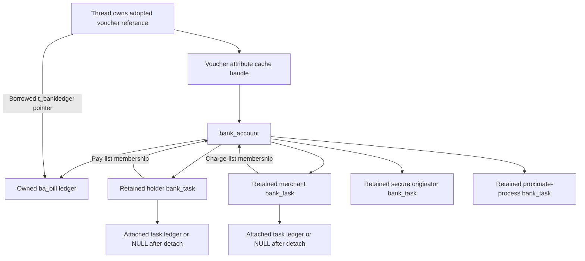
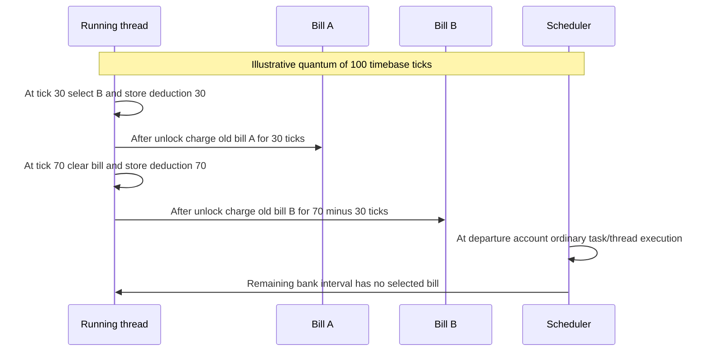

# Bank accounts, voucher adoption, and execution charging

[Mach IPC](README.md) · [Vouchers and importance](vouchers-and-importance.md) · [Runtime accounting](../runtime/time-and-accounting.md) · [Ledgers](../runtime/ledgers-limits-and-settlement.md) · [Recount](../runtime/recount-and-resource-attribution.md)

The bank voucher manager records work performed by one task for another. A voucher carries a bank attribute; adoption selects a temporary bill and optional scheduling/persona context; scheduler boundaries and voucher changes charge elapsed work; account release rolls that bill into task totals. The objects, accounting reference counts and task references have distinct lifetimes. This chapter traces the local common/ARM64-relevant code in `xnu-12377.121.6`, building on the existing voucher recipe/cache explanation.

## 1. Objects and the four task roles

`bank_init()` registers a manager for `MACH_VOUCHER_ATTR_KEY_BANK`. Its values may be a default placeholder, a bank-task object, or a bank-account object. `BANK_DEFAULT_TASK_VALUE` is a persistent special value resolved in the current task's context; it is not a pointer to a fully allocated bank task. [Manager registration](../../../xnu/osfmk/bank/bank.c#L207-L219), [value definitions](../../../xnu/osfmk/bank/bank_internal.h#L45-L65), [create command](../../../xnu/osfmk/bank/bank.c#L331-L346).

| Object/field | Meaning and ownership |
| --- | --- |
| `bank_task` | Snapshot of process/persona identity, optional retained home thread group, retained task ledger while attached, and payable/chargeable lists with separate locks. It can survive the underlying task's bank attachment. |
| `ba_holder` | Task on whose behalf work is billed. The account is linked in its `bt_accounts_to_pay`. |
| `ba_merchant` | Task performing the work. The account is linked in its `bt_accounts_to_charge`. |
| `ba_secureoriginator` | Originator retained according to secure-persona propagation rules. It need not be the immediate sender. |
| `ba_proximateprocess` | Task that most recently propagated the voucher in the send preprocessing path. |
| `ba_bill` | Owned temporary ledger for the account's CPU/energy charges. |
| `ba_thread_group`, `ba_so_persona` | Scheduling attribution and persona data. Their presence does not itself authorize all operations under that identity. |

The role pointers retain bank-task objects; the debug `be_task` pointer explicitly lacks a task reference. Names like holder/merchant are bookkeeping roles, not Mach port names or file credentials. [Bank task/account layouts](../../../xnu/osfmk/bank/bank_internal.h#L55-L150), [account ownership acquisition](../../../xnu/osfmk/bank/bank.c#L1114-L1130).



List arrows identify membership, while account role arrows identify retained references. Repeated roles can refer to the same bank-task object, but each acquired role reference still has its matching release.

## 2. Creating a bank-task context and an account

`get_bank_task_context()` can create a candidate outside the task lock, then recheck under the lock before installation. A losing candidate is destroyed; the winning context references the task ledger and publishes the attachment with the global bank-task synchronization. Context initialization captures identity/persona information, initializes both list locks/queues and retains the home group when configured. Creation is not merely storing the raw `task_t` into the voucher. [Context allocation](../../../xnu/osfmk/bank/bank.c#L955-L1018), [lookup/publication race](../../../xnu/osfmk/bank/bank.c#L1149-L1197).

`bank_account_alloc_init()` allocates a candidate bill and account before acquiring list locks. Under the holder's pay-list lock it searches for an account matching merchant, secure originator, proximate process, thread group and persona ID. Holder identity is implicit in the list being searched. The actual predicate is narrower than comparing the entire persona structure:

[osfmk/bank/bank.c, lines 1090–1103](../../../xnu/osfmk/bank/bank.c#L1090-L1103):

<!-- source-excerpt: ../../../xnu/osfmk/bank/bank.c#L1090-L1103 -->
```c
	queue_iterate(&bank_holder->bt_accounts_to_pay, bank_account, bank_account_t, ba_next_acc_to_pay) {
		if (bank_account->ba_merchant != bank_merchant ||
		    bank_account->ba_secureoriginator != bank_secureoriginator ||
		    bank_account->ba_proximateprocess != bank_proximateprocess ||
		    bank_get_bank_account_thread_group(bank_account) != thread_group ||
		    bank_account->ba_so_persona.persona_id != persona->persona_id) {
			continue;
		}

		entry_found = TRUE;
		/* Take a made ref, since this value would be returned to voucher system. */
		bank_account_made_reference(bank_account);
		break;
	}
```

A match takes another made reference and discards the unused candidate ledger/object. A miss acquires the merchant's charge-list lock while still holding the holder's pay-list lock, links the account into both lists, then completes its role/group reference ownership. Thus repeated equivalent voucher derivations can share a bill rather than allocate independent accounting objects. The retained input/value ownership and locks are part of that publication path; the lists alone are not a general safe lockless lookup facility. [Allocation/deduplication/cleanup](../../../xnu/osfmk/bank/bank.c#L1058-L1140).

The candidate allocations here use no-fail kernel allocation semantics. By contrast, recipe validation and redemption can return ordinary errors before an account is published. Distinguish invalid-capability/recipe failures from an imagined recoverable allocation branch that this body does not implement.

## 3. Send, receive, and explicit redemption change different roles

The voucher subsystem invokes manager commands; it does not directly edit these account fields. The existing [voucher chapter](vouchers-and-importance.md) follows recipe resolution, attribute-cache deduplication and send/receive transport. The bank-specific decisions are:

| Command | Bank transformation or rejection |
| --- | --- |
| `MACH_VOUCHER_ATTR_BANK_CREATE` | Returns the persistent default-current-task placeholder. |
| Send preprocessing | Resolves that placeholder, preserves the billing holder, records the sending task as the current merchant/proximate process, and applies entitlement-dependent secure-originator/persona propagation. The all-self/group/persona case can use a bank-task value instead of an account. |
| Auto redemption on receive | Preserves the holder and carried originator/proximate information, makes the receiver the merchant, and applies receiver rules for group/persona selection. A fully self-attributed case can collapse to the default value. |
| Explicit redeem | Requires an account's merchant to match the current bank task; otherwise returns `KERN_INVALID_CAPABILITY`. A valid account acquires another made reference. |
| Modify persona | Validates entitlement, recipe size, process identity and persona admission. Billing identity alone bypasses none of these checks. |

These rows map to [creation/persona modification](../../../xnu/osfmk/bank/bank.c#L293-L420), [auto redemption](../../../xnu/osfmk/bank/bank.c#L425-L501), [send preprocessing](../../../xnu/osfmk/bank/bank.c#L510-L597), and [explicit redemption](../../../xnu/osfmk/bank/bank.c#L600-L634). A forwarded request can therefore preserve its original payer while changing the immediate sender and the task doing the work.

## 4. Made counts are not storage references

The common `bank_element` has an atomic storage reference count, `be_made`, and a voucher-reference flag. `be_made` tracks values handed back to the voucher system. A bank task takes the voucher-held storage reference on the transition from no made references to some made references; it does not retain storage once per made count. Accounts likewise reconcile their accumulated made count against the manager's release synchronization value. [Count definitions](../../../xnu/osfmk/bank/bank_internal.h#L55-L62), [send value reference transition](../../../xnu/osfmk/bank/bank.c#L557-L585), [release dispatch](../../../xnu/osfmk/bank/bank.c#L235-L284).

The voucher cache can release a value after a concurrent derivation has made it again. `bank_account_dealloc_with_sync()` therefore checks `ba_made == sync` under the holder's pay-list lock. A mismatch releases temporary state and returns `KERN_FAILURE` without destroying the account. The voucher layer's retry/reconciliation protocol handles that result; treating it as a leaked object or blindly freeing it would be incorrect. [Release comparison](../../../xnu/osfmk/bank/bank.c#L1234-L1265), [voucher release protocol](vouchers-and-importance.md).

## 5. Adoption keeps the bill alive through the old charge

`thread_set_voucher_name()` rejects a dead name, converts a valid name into a voucher reference, and extracts bank ledger/group/persona information. It replaces `ith_voucher` under the thread mutex, changes the bank ledger and bank-derived group, and only then releases the old voucher. That order keeps the previous account/bill alive until the elapsed work attributed to it has been charged. [Adoption and error paths](../../../xnu/osfmk/kern/thread.c#L3364-L3410).

[osfmk/kern/thread.c, lines 3386–3397](../../../xnu/osfmk/kern/thread.c#L3386-L3397):

<!-- source-excerpt: ../../../xnu/osfmk/kern/thread.c#L3386-L3397 -->
```c
	bank_get_bank_ledger_thread_group_and_persona(new_voucher, &bankledger, &banktg, &persona_id);

	thread_mtx_lock(thread);
	voucher = thread->ith_voucher;
	thread->ith_voucher_name = voucher_name;
	thread->ith_voucher = new_voucher;
	thread_mtx_unlock(thread);

	bank_swap_thread_bank_ledger(thread, bankledger);
#if CONFIG_THREAD_GROUPS
	thread_group_set_bank(thread, banktg);
#endif /* CONFIG_THREAD_GROUPS */
```

The thread does not take a separate ledger reference in this assignment. `bank_get_bank_ledger_thread_group_and_persona()` derives borrowed pointers from the retained voucher/account. It can return a persona even when no distinct billing ledger is necessary. `bank_get_bank_account_ledger()` suppresses a bill when holder and merchant are identical; the group/persona can still matter. The combined getter also suppresses redundant same-task/same-home-group context. [Extraction](../../../xnu/osfmk/bank/bank.c#L1829-L1878), [same-holder bill rule](../../../xnu/osfmk/bank/bank.c#L1698-L1708).

## 6. Splitting a quantum across adopted bills

A voucher may change while a thread is still executing its current quantum. `bank_swap_thread_bank_ledger()` is restricted to the current thread or a not-yet-started thread. Under `splsched` and the thread lock it calculates remaining quantum time, elapsed consumption, and the portion not already charged by previous voucher swaps. It records new deduction baselines, samples the current thread's energy, and changes `t_bankledger`. After unlocking/restoring interrupt state it credits the old bill. [Complete swap](../../../xnu/osfmk/bank/bank.c#L1898-L1963).

[osfmk/bank/bank.c, lines 1934–1953](../../../xnu/osfmk/bank/bank.c#L1934-L1953):

<!-- source-excerpt: ../../../xnu/osfmk/bank/bank.c#L1934-L1953 -->
```c
	if (processor != NULL) {
		if ((int64_t)processor->quantum_end > ctime) {
			remainder = (int64_t)processor->quantum_end - ctime;
		}

		consumed = thread->quantum_remaining - remainder;
		effective_ledger_time_consumed = consumed - thread->t_deduct_bank_ledger_time;
	}

	thread->t_deduct_bank_ledger_time = consumed;

	thread_energy = recount_current_thread_energy_nj();
	effective_energy_consumed =
	    thread_energy - thread->t_deduct_bank_ledger_energy;
	assert(effective_energy_consumed >= 0);
	thread->t_deduct_bank_ledger_energy = thread_energy;

	thread->t_bankledger = new_ledger;

	thread_unlock(thread);
```

`thread->t_deduct_bank_ledger_time` prevents later quantum expiry or switch-out from charging the already attributed prefix again. Quantum expiry and scheduler departure credit task/thread CPU accounting and the remaining applicable bank portion, then reset the deduction state. The scheduler's `AST_LEDGER` exception has its own branch; do not model all departures as unconditional credits. [Quantum expiry](../../../xnu/osfmk/kern/priority.c#L123-L131), [departure accounting](../../../xnu/osfmk/kern/sched_prim.c#L3515-L3536).



In this example A receives 30 ticks, B receives 40, and the final 30 is not charged to either bill. Ordinary task execution still represents all execution. Bank attribution is a separate report of work performed for another holder; it is not removal of those ticks from the merchant's lifetime execution.

Units must be traced at the writer. The bank template labels CPU time with the string `"ns"`, but these scheduler/swap producers directly use Mach absolute-time/quantum differences with no conversion at the shown credit sites. Keep those worked values in timebase units; the metadata string alone does not prove nanosecond conversion. Energy credits use the Recount energy delta in nanojoules. [Template labels](../../../xnu/osfmk/bank/bank.c#L75-L84), [CPU/energy producers](../../../xnu/osfmk/bank/bank.c#L1934-L1963), [clock units](../runtime/clocks-and-time-domains.md).

## 7. Live reports and final bill rollup

`bank_billed_balance()` holds the holder's pay-list lock while combining settled task totals with balances in still-live bills. That lock prevents a concurrent account release from both moving a bill into the task total and removing it while the report traverses membership. It does not stop an executing thread from adding to a bill. The serviced view performs the corresponding charge-list traversal and obtains the necessary task-ledger reference before taking that list lock. Safe wrappers retain the bank context under global synchronization before using it from another task. [Billed report](../../../xnu/osfmk/bank/bank.c#L1442-L1500), [serviced report and safe wrapper](../../../xnu/osfmk/bank/bank.c#L1502-L1645).

Final account release first references the merchant ledger before taking the holder pay-list lock, avoiding a later nested acquisition of the merchant's pay lock. After the made-count comparison succeeds, it takes the merchant charge-list lock, rolls bill balances into the holder's `*_billed_to_me` and merchant's `*_billed_to_others` entries, and removes the account from both lists. It then releases locks, temporary merchant-ledger reference, bill, all four bank-task role references and optional group before freeing the account. [Final release](../../../xnu/osfmk/bank/bank.c#L1234-L1304), [CPU/energy rollup](../../../xnu/osfmk/bank/bank.c#L1315-L1348).

The rollup explicitly skips identical destination ledgers. A detached/null destination is tolerated by ledger update validation; this path does not resurrect a destroyed task or promise that late charges become visible through a dead task's former ledger. That limitation matters when following vouchers that outlive their original tasks.

## 8. Task detachment, configuration, and remaining boundaries

`bank_task_destroy()` detaches `task->bank_context` under global bank-task synchronization. `bank_destroy_bank_task_ledger()` separately clears `bt_ledger` under the pay-list lock and drops that ledger reference. Accounts and voucher values can still retain the identity object. Final bank-task deallocation requires empty account lists and no attached ledger, releases the retained group, destroys the locks and frees storage. Logical task detachment is not synonymous with immediate destruction of every referenced account. [Task detach](../../../xnu/osfmk/bank/bank.c#L1358-L1373), [ledger detach](../../../xnu/osfmk/bank/bank.c#L1679-L1691), [final bank-task free](../../../xnu/osfmk/bank/bank.c#L1202-L1224).

| Selection or verification boundary | What the local implementation establishes |
| --- | --- |
| `CONFIG_THREAD_GROUPS` | Adds retained home/account groups and bank-driven adoption. Group selection can matter without cross-task billing. [Fields](../../../xnu/osfmk/bank/bank_internal.h#L78-L83), [getter](../../../xnu/osfmk/bank/bank.c#L1848-L1878). |
| `CONFIG_COALITIONS && CONFIG_TELEMETRY` | Adds captured resource-coalition identity used by telemetry. It does not make the account a coalition membership object. [Field](../../../xnu/osfmk/bank/bank_internal.h#L78-L80). |
| Development/debug | Adds diagnostic global lists and non-owning task pointers. These are not production lifetime guarantees. [Element definition](../../../xnu/osfmk/bank/bank_internal.h#L55-L62), [account list](../../../xnu/osfmk/bank/bank.c#L1131-L1140). |
| Bank ledger template | Two non-scalable entries avoid interpreting a bank bill as an open task pmap tab. [Template](../../../xnu/osfmk/bank/bank.c#L75-L84), [finalize](../../../xnu/osfmk/bank/bank.c#L1389-L1395). |
| Validation performed for this chapter | Source paths, copied excerpts and documentation links were checked. No kernel execution or dedicated end-to-end bank charging test was performed. |

The reviewed lifecycle includes value derivation, account deduplication, reference reconciliation, adoption, quantum splitting, live reporting and teardown. External XPC/libdispatch policy, all persona/entitlement combinations, and empirical CPU/energy accuracy remain outside it. Continue with [voucher ownership](vouchers-and-importance.md), [ledger mechanics](../runtime/ledgers-limits-and-settlement.md), and [Recount measurement](../runtime/recount-and-resource-attribution.md) for their distinct parts of the path.

<!-- BEGIN PLATYDOC DOCUMENTATION LICENSE -->
Original Platydoc text and diagrams are licensed under [CC BY 4.0](https://creativecommons.org/licenses/by/4.0/). Quoted source code and third-party material retain their respective licenses.
<!-- END PLATYDOC DOCUMENTATION LICENSE -->
