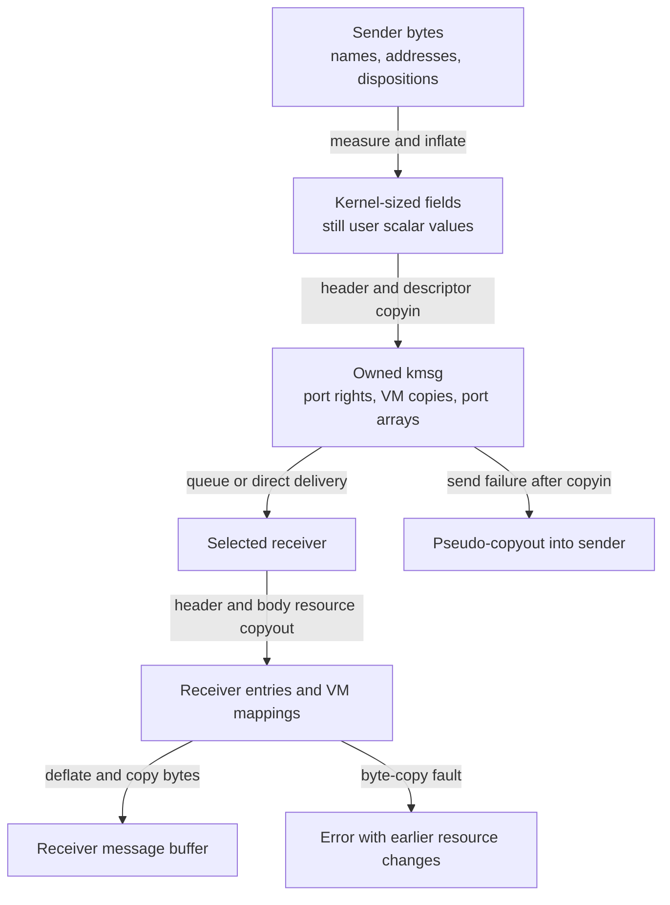
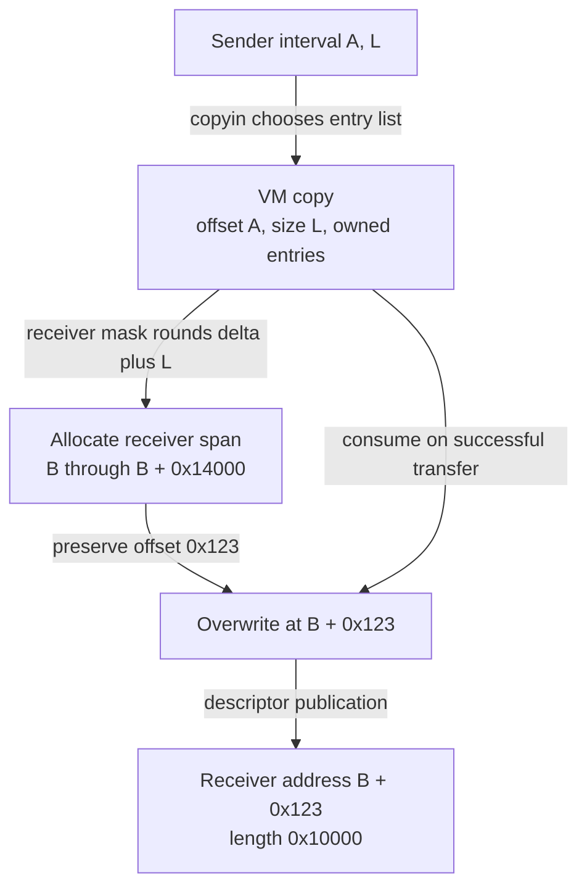
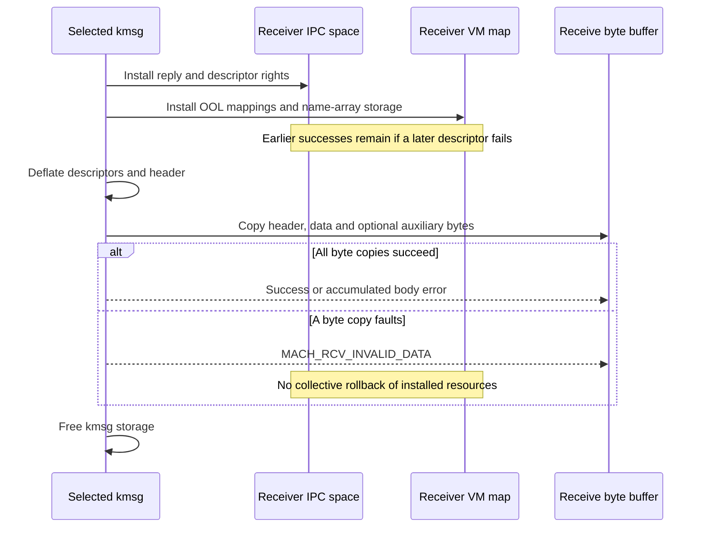

# Complex messages: aliasing, memory transfer and partial copyout

[IPC guide](README.md) · [Message representation](message-path.md) · [Send and receive](message-send-receive.md) · [VM copies](../vm/wiring-and-memory-entries.md)

A complex Mach message crosses several independently mutable namespaces. Its header and descriptors start as user values, become owned kernel resources, and finally become values in another task. The difficult cases are not the queue insertion itself: two fields can name the same right, VM acquisition can fault, a later descriptor can fail after earlier moves, and receiver resources can exist before the receive buffer becomes readable.

This chapter follows the common user-message path in `xnu-12377.121.6`. It expands the conversion and compensation mechanisms behind the [delivery chapter](message-send-receive.md), without repeating port-set selection or special-reply turnstiles. Examples select ordinary permitted ports and untagged ARM64 memory; a particular message still has to pass its task, destination and descriptor policies. Kernel-generated messages and generated MIG marshalling have different caller contracts.

## 1. A message has three representations and several owners

Use this illustrative request to keep the resources distinct:

| User field | Meaning before send | Owned kernel representation after successful copyin |
| --- | --- | --- |
| Remote name `D`, `COPY_SEND` | Sender's send right naming destination port `P` | A message-owned send right to `P` |
| Local name `R`, `MAKE_SEND_ONCE` | Sender's receive right for a reply endpoint | A newly made send-once right to that endpoint |
| Port descriptor `Q`, `MOVE_SEND` | One send uref in the sender's IPC entry | A carried send right; that sender uref has been consumed |
| OOL memory `(A,L)` | An interval in the sender's VM map | A `vm_map_copy_t`, not a receiver address |
| OOL port array `(N,count)` | User bytes containing task-local port names | Kernel array of owned port rights or null/dead sentinels |

The exact conversion order is schema validation, copied-byte inflation, further schema checks, header-right conversion, destination-dependent header validation, then descriptor conversion. There can therefore be a policy failure **after header acquisition** but before any body acquisition. The caller frees only storage when copyin fails because the conversion layer has already cleaned its acquired resources. [`ipc_kmsg_copyin_from_user`](../../../platydoc-data/xnu/osfmk/ipc/ipc_kmsg.c#L3055-L3118), [`send caller`](../../../platydoc-data/xnu/osfmk/ipc/mach_msg.c#L700-L735).



`MACH_MSGH_BITS_COMPLEX` means there is a descriptor count and descriptor array. It does not make these transitions one transaction. The header, each descriptor, an OOL name array, and the final inline message buffer have different failure boundaries.

### Inflation changes layout before it acquires rights

User descriptors can have different sizes. The measurement pass validates each type and its bounds, accumulates the user descriptor size and records a size bit for each of the first 64 descriptors. With at most 64 descriptors, inflation works from right to left using that mask. With more, it first moves the user descriptor bytes to the end of the available kernel descriptor region and expands left to right. This prevents writing a larger kernel descriptor over a user descriptor that has not yet been read. [`measurement`](../../../platydoc-data/xnu/osfmk/ipc/ipc_kmsg.c#L2731-L2777), [`inflation directions`](../../../platydoc-data/xnu/osfmk/ipc/ipc_kmsg.c#L2621-L2682).

At this point an address-sized field can still contain a **user scalar**, despite living in a kernel-sized structure. The descriptor converter later replaces it with a port pointer, `vm_map_copy_t` or kernel port array. Cleanup must know how far conversion progressed; a pointer-sized value alone does not identify ownership. [`representation contract`](../../../platydoc-data/xnu/osfmk/ipc/ipc_kmsg.c#L1577-L1588), [`descriptor-prefix cleanup`](../../../platydoc-data/xnu/osfmk/ipc/ipc_kmsg.c#L2834-L2871).

## 2. Header aliasing needs a coordinated right operation

The header-copyin state is `ikm_copyinhdr_state_t`. It keeps destination, reply and voucher names, dispositions, acquired pointers and separate deferred cleanup records. Validation precedes the space write lock; locked lookup then establishes the actual entries and validates the later reply/voucher conversions before committing the destination. [`state`](../../../platydoc-data/xnu/osfmk/ipc/ipc_kmsg.c#L1600-L1622), [`locked lookup`](../../../platydoc-data/xnu/osfmk/ipc/ipc_kmsg.c#L1875-L1948).

Important alias cases are decided explicitly:

- Destination equal to voucher permits only destination `MOVE_SEND` or `COPY_SEND`.
- Destination equal to reply rejects `MOVE_SEND_ONCE` in either role.
- A valid reply name equal to the voucher name is rejected.
- Destination/reply pairs involving a make disposition can be processed individually because the required receive right has been established under the space lock.
- Two move/copy send dispositions on the same entry become one combined destination conversion.

These are checks on **name/entry identity**, not just whether two entries eventually point to the same port. The validator and disposition selector implement these cases in [`ipc_kmsg.c:1699–1730`](../../../platydoc-data/xnu/osfmk/ipc/ipc_kmsg.c#L1699-L1730) and [`ipc_kmsg.c:1751–1862`](../../../platydoc-data/xnu/osfmk/ipc/ipc_kmsg.c#L1751-L1862).

For a live, ordinary, unpinned send-only entry with finite non-saturated urefs, let the initial count be `u`:

| Destination/reply dispositions on the same name | Combined conversion | Sender urefs afterward | Owned send rights produced |
| --- | --- | --- | --- |
| `COPY_SEND`, `COPY_SEND` | Copy plus `DEST_EXTRA_COPY` | `u` | Two |
| `MOVE_SEND`, `COPY_SEND`, in either order | Move plus `DEST_EXTRA_COPY` | `u - 1` | Two |
| `MOVE_SEND`, `MOVE_SEND` | Move plus `DEST_EXTRA_MOVE` | `u - 2`, requiring `u >= 2` | Two |

[Source: ipc_kmsg.c, lines 1843–1855](../../../platydoc-data/xnu/osfmk/ipc/ipc_kmsg.c#L1843-L1855)

<!-- source-excerpt: ../../../platydoc-data/xnu/osfmk/ipc/ipc_kmsg.c#L1843-L1855 -->
```c
	if (disp1 == MACH_MSG_TYPE_MOVE_SEND && disp2 == MACH_MSG_TYPE_MOVE_SEND) {
		*xtra |= IPC_OBJECT_COPYIN_FLAGS_DEST_EXTRA_MOVE;
		return MACH_MSG_TYPE_MOVE_SEND;
	}

	if (disp1 == MACH_MSG_TYPE_MOVE_SEND && disp2 == MACH_MSG_TYPE_COPY_SEND) {
		*xtra |= IPC_OBJECT_COPYIN_FLAGS_DEST_EXTRA_COPY;
		return MACH_MSG_TYPE_MOVE_SEND;
	}
	if (disp1 == MACH_MSG_TYPE_COPY_SEND && disp2 == MACH_MSG_TYPE_MOVE_SEND) {
		*xtra |= IPC_OBJECT_COPYIN_FLAGS_DEST_EXTRA_COPY;
		return MACH_MSG_TYPE_MOVE_SEND;
	}
```

`ipc_right_copyin()` derives `moves` from the extra-move flag and checks the available urefs before changing the entry. A single uref cannot satisfy two moves: it returns an invalid-right result rather than moving the first and discovering the shortage on the second. When all urefs are moved, a send-only entry is removed and its reference transfers to the caller; a combined send/receive entry instead retains its receive right and injects the reference needed by the carried send right. When urefs remain, the conversion creates a separate naked send right. The extra operation then creates the second carried right. [`move count`](../../../platydoc-data/xnu/osfmk/ipc/ipc_right.c#L2128-L2146), [`validation and ownership transfer`](../../../platydoc-data/xnu/osfmk/ipc/ipc_right.c#L2390-L2458).

Thus for `u=1`, a move-plus-copy can remove the sender's entry yet leave two message-owned rights to the same port. Those rights are two ownership obligations, not two distinct port objects. The table deliberately excludes pinned/immovable/reply-port policy and saturated urefs: the body has separate rejection and pegged-count rules. [`reply preflight`](../../../platydoc-data/xnu/osfmk/ipc/ipc_right.c#L1921-L2021), [`copy and move policies`](../../../platydoc-data/xnu/osfmk/ipc/ipc_right.c#L2316-L2458).

The implementation's header atomicity is bounded. Once destination acquisition succeeds, subsequent prevalidated header acquisitions must succeed, and combined moves are coordinated. However, the distinct-entry branch explicitly accepts a potentially observable race between destination/reply port deaths and their notification outcomes. It performs those copyins consecutively rather than serializing both port deaths. Do not extend the function's atomicity comment into a global snapshot of independent ports, much less the whole message. [`death-order qualification`](../../../platydoc-data/xnu/osfmk/ipc/ipc_kmsg.c#L1809-L1840), [`post-destination acquisitions`](../../../platydoc-data/xnu/osfmk/ipc/ipc_kmsg.c#L1973-L2005).

## 3. OOL memory crosses through an owned VM copy

The user address is interpreted in the sender's `vm_map_t`; it is never the receiver's destination address. `ipc_kmsg_copyin_ool_descriptor()` has three principal cases:

| Input | Copyin behavior |
| --- | --- |
| Zero length | Null VM copy; no memory acquisition |
| Length above `msg_ool_size_small`, `MACH_MSG_PHYSICAL_COPY`, no deallocation | Copy bytes to pre-reserved pageable `ipc_kernel_copy_map`, zero the unused final-page tail, then create a VM copy while destroying that temporary mapping |
| Other nonempty input | Call `vm_map_copyin()` on the sender map, forwarding `deallocate` |

The body walker reserves the combined temporary copy-map requirement before converting individual descriptors. Each successful large physical copy advances `paddr` and reduces the remaining reserved `psize`; a failure releases only the unused reservation, while converted descriptors own their VM copies. [`size accumulation`](../../../platydoc-data/xnu/osfmk/ipc/ipc_kmsg.c#L2269-L2280), [`reservation and cleanup`](../../../platydoc-data/xnu/osfmk/ipc/ipc_kmsg.c#L2809-L2871), [`memory converter`](../../../platydoc-data/xnu/osfmk/ipc/ipc_kmsg.c#L2291-L2358).

The requested copy mode does not uniquely determine VM representation. `msg_ool_size_small` is based on `KHEAP_MAX_SIZE`, and VM's selector considers size, range bounds, forced entry-list flags, MTE and private-data restrictions. A virtual-copy request can therefore result in a kernel byte buffer. Conversely, the IPC physical-copy path permits virtual copying when the original mapping is being deallocated. [`threshold`](../../../platydoc-data/xnu/osfmk/ipc/ipc_init.c#L115-L123), [`VM selector`](../../../platydoc-data/xnu/osfmk/vm/vm_map.c#L11372-L11488), [copy representations](../vm/wiring-and-memory-entries.md#the-two-current-vm_map_copy-representations).

An entry-list copy owns copied map-entry views and their backing references, with COW setup where required. It is not a pin on the sender's original map entry or a guarantee of physical contiguity. VM can leave some source entries marked `needs_copy` even when a later part of copyin fails. Such a side effect can be valid without a successfully returned transfer object. [`entry-list acquisition`](../../../platydoc-data/xnu/osfmk/vm/vm_map.c#L11590-L11670), [`copyin failure contract`](../../../platydoc-data/xnu/osfmk/vm/vm_map.c#L11854-L11865).

### A misaligned 16 KiB receive example

Select native ARM64 pages and receiver map pages of `0x4000` bytes. Assume ordinary readable backing and that VM selects an entry-list copy for source address `A = 0x100000123`, length `L = 0x10000`. This representation retains the unaligned source address in `copy->offset`; a kernel-buffer copy instead uses offset zero and does not take this branch. [`copy offset`](../../../platydoc-data/xnu/osfmk/vm/vm_map.c#L11961-L11974).

The receiver converter recognizes a non-page-aligned entry-list offset or length, computes a rounded allocation using the **receiver map's** page mask, and preserves the in-page displacement before calling `vm_map_copy_overwrite()`:

```text
Illustrative arithmetic, with equal 16 KiB native and receiver pages:

delta             = copy.offset & 0x3fff = 0x123
rounded size      = round_up(delta + L, 0x4000) = 0x14000
allocated base    = B = 0x200000000
returned address  = B + delta = 0x200000123
returned length   = 0x10000
allocation span   = [B, B + 0x14000)
```

Keeping `delta` means page-rounded deallocation of the returned address/length covers the original allocation. In this example, returning `B` with length `0x10000` would cover only four pages, leaving the allocation's fifth page outside that rounded deallocation. This calculation explains the alignment decision; it does not promise entry substitution instead of physical copying. Overwrite makes that decision from its own protection, backing and alignment conditions. [`misaligned receive`](../../../platydoc-data/xnu/osfmk/ipc/ipc_kmsg.c#L3806-L3864), [overwrite decisions](../vm/copy-overwrite-and-remap.md).



If the VM copyout fails, the descriptor converter discards the copy and sets its output address/size to zero. Resource shortage becomes `MACH_MSG_VM_KERNEL`; other failures become `MACH_MSG_VM_SPACE`. This is a descriptor result, not rollback of all receiver state. In particular, this local misaligned wrapper does not itself remove its rounded allocation after an overwrite error; the lower overwrite path has its own partial-progress contract. By comparison, ordinary kernel-buffer copyout explicitly removes newly allocated destination space when its byte copy fails. [`OOL error handling`](../../../platydoc-data/xnu/osfmk/ipc/ipc_kmsg.c#L3855-L3885), [`kernel-buffer cleanup`](../../../platydoc-data/xnu/osfmk/vm/vm_map.c#L10591-L10610).

## 4. An OOL port array has two different partial-progress boundaries

An array descriptor transfers **names stored in memory** and **rights denoted by those names**. `count * sizeof(mach_port_name_t)` is the user byte length; the kernel allocation holds `mach_port_ool_t` records containing port pointers. On copyin, the implementation places the copied names at the end of that larger allocation, then walks forward converting them to records without needing a second allocation. Null/dead names become corresponding sentinels. [`array type`](../../../platydoc-data/xnu/osfmk/mach/port.h#L229-L242), [`array layout and loop`](../../../platydoc-data/xnu/osfmk/ipc/ipc_kmsg.c#L2442-L2472).

There is an additional policy gate: when OOL-array restriction is enforced for an enhanced-v2 caller, dispositions other than `COPY_SEND` are denied before allocation. Destination/schema policy is also applied earlier. The following move example is therefore conditional on a caller/destination combination that admits it; it is not a recipe for bypassing those gates. [`disposition admission`](../../../platydoc-data/xnu/osfmk/ipc/ipc_kmsg.c#L2422-L2440), [policy enforcement](guards-and-policy-enforcement.md).

Suppose the input is three names `[a,b,c]`, each with `MOVE_SEND`, and `deallocate=true`. Copying the name bytes succeeds, `a` and `b` are valid, but `c` is a valid-looking name with no transferable right. The order is:

1. Copy all name bytes into the kernel array.
2. Attempt deallocation of the source name-array memory; the return value is discarded.
3. Move `a`, then `b`, each through its own `ipc_object_copyin()`.
4. Fail on `c`; destroy the already acquired rights for `a` and `b`, and free the kernel array.
5. The enclosing body walker destroys the header and earlier successfully converted descriptors.

[Source: ipc_kmsg.c, lines 2457–2459](../../../platydoc-data/xnu/osfmk/ipc/ipc_kmsg.c#L2457-L2459)

<!-- source-excerpt: ../../../platydoc-data/xnu/osfmk/ipc/ipc_kmsg.c#L2457-L2459 -->
```c
	if (dsc->deallocate) {
		(void)mach_vm_deallocate_kernel(map, dsc->u_address, names_size);
	}
```

[Source: ipc_kmsg.c, lines 2471–2481](../../../platydoc-data/xnu/osfmk/ipc/ipc_kmsg.c#L2471-L2481)

<!-- source-excerpt: ../../../platydoc-data/xnu/osfmk/ipc/ipc_kmsg.c#L2471-L2481 -->
```c
		kr = ipc_object_copyin(space, name, user_disp, kmsg->ikm_flags,
		    IPC_COPYIN_KMSG_OOL_PORT_ARRAY_DESCRIPTOR, NULL, &port);

		if (kr != KERN_SUCCESS) {
			for (mach_msg_size_t j = 0; j < i; j++) {
				port = array[j].port;
				if (IP_VALID(port)) {
					ipc_object_destroy(port, result_disp);
				}
			}
			mach_port_array_free(array, count);
```

The names `a` and `b` are not reinserted as compensation. Their source urefs were moved; the acquired rights are destroyed. The source array's mapping may already be gone if its deallocation succeeded. With `COPY_SEND`, the acquired duplicate rights are destroyed while the original sender urefs remain. A failure in array element `j` is handled inside that descriptor; a failure in descriptor `i` is handled by the outer prefix cleanup. These are nested ownership intervals, not one common rollback loop.

Receive has a different order: allocate user memory for the returned names, copy each right into the receiving IPC space, write the resulting names into the allocated region, then free the kernel array.

[Source: ipc_kmsg.c, lines 3952–3960](../../../platydoc-data/xnu/osfmk/ipc/ipc_kmsg.c#L3952-L3960)

<!-- source-excerpt: ../../../platydoc-data/xnu/osfmk/ipc/ipc_kmsg.c#L3952-L3960 -->
```c
		if (kr == MACH_MSG_SUCCESS) {
			for (mach_msg_size_t i = 0; i < count; i++) {
				mr |= ipc_kmsg_copyout_port(space,
				    array[i].port, disp, NULL, &names[i]);
			}
			if (copyoutmap(map, names, rcv_addr, names_length)) {
				mr |= MACH_MSG_VM_SPACE;
			}
			mach_port_array_free(array, count);
```

Individual right-copyout errors are ORed together; later elements are still processed. A failure writing the **name array** can occur after rights have been installed. This is earlier than—and independent of—the final write of the inline message descriptor pointing to that array. The inspected path adds `MACH_MSG_VM_SPACE` but does not collectively revoke those installed rights or discard the receiver allocation on that byte-write failure. If allocation fails before right conversion, it instead destroys the descriptor's carried rights. [`allocation-failure branch`](../../../platydoc-data/xnu/osfmk/ipc/ipc_kmsg.c#L3961-L3973).

## 5. Header copyout reserves capacity, then reconciles port lifetime

After selection, the receiver still does not own all carried capabilities in its namespace. `ipc_kmsg_copyout_header()` reserves possible reply/voucher entries under the receiver-space write lock. Table growth can unlock/relock and requires retry. It checks the reply port's activity and label; a label substitution can consume the original right, unlock the space and port, replace the message's reply pointer, and restart. A send right can reuse an existing reverse-hash entry; a send-once right gets its own claimed entry. [`capacity and retry`](../../../platydoc-data/xnu/osfmk/ipc/ipc_kmsg.c#L3289-L3334), [`label and entry selection`](../../../platydoc-data/xnu/osfmk/ipc/ipc_kmsg.c#L3336-L3381).

The function retains the reply port across releasing its lock and inspecting the destination. This extra hold is important: the reply's entry has been installed, but another thread can act on the port before destination conversion finishes. Strict-reply context and voucher delivery are separate decisions; a receiver declining voucher delivery can still trigger the selected reply-context processing before the voucher right is released. [`reply hold/context`](../../../platydoc-data/xnu/osfmk/ipc/ipc_kmsg.c#L3383-L3416), [`voucher branch`](../../../platydoc-data/xnu/osfmk/ipc/ipc_kmsg.c#L3419-L3477).

The received header swaps the roles: the remote field becomes the received reply name, and the local field reports the destination receive name. That local name is not a newly delivered right. If the destination is still active, `ipc_object_copyout_dest()` reports whether this space still owns its receive right; a concurrent move can make the answer null. If the destination died, the code compares its death timestamp with the retained reply port's state:

[Source: ipc_kmsg.c, lines 3575–3584](../../../platydoc-data/xnu/osfmk/ipc/ipc_kmsg.c#L3575-L3584)

<!-- source-excerpt: ../../../platydoc-data/xnu/osfmk/ipc/ipc_kmsg.c#L3575-L3584 -->
```c
		if (IP_VALID(reply)) {
			ip_mq_lock(reply);
			if (ip_active(reply) ||
			    IP_TIMESTAMP_ORDER(timestamp,
			    ip_get_death_time(reply))) {
				dest_name = MACH_PORT_DEAD;
			} else {
				dest_name = MACH_PORT_NULL;
			}
			ip_mq_unlock(reply);
```

With a valid retained reply, destination-dead is reported when the reply is still active or the destination died before it. Otherwise destination-null is reported. Equal timestamps, including the same-port case, do not satisfy the strict timestamp ordering. This preserves the selected observable header relationship; it does not resurrect a dead port. The comparison is a signed timestamp difference, not ordinary unsigned `<` across wrap. [`timestamp ordering`](../../../platydoc-data/xnu/osfmk/ipc/ipc_port.h#L429-L435), [`death ordering rationale`](../../../platydoc-data/xnu/osfmk/ipc/ipc_kmsg.c#L3518-L3563), [`final header fields`](../../../platydoc-data/xnu/osfmk/ipc/ipc_kmsg.c#L3618-L3624).

## 6. Receiver resource installation precedes message-byte delivery

`mach_msg_receive_results()` first snapshots the thread's receive state because VM/copyio work can cause nested kernel IPC and reuse its scratch fields. It completes special-reply/turnstile cleanup, handles importance/voucher processing, then performs resource copyout. Only afterward does it deflate the message and copy its bytes. [`receive snapshot and ordering`](../../../platydoc-data/xnu/osfmk/ipc/mach_msg.c#L279-L385).

The descriptor walker does not stop at the first failure. It processes every descriptor, accumulates IPC/VM error bits and adds `MACH_RCV_BODY_ERROR`. A body-right copyout consumes its supplied right even when it can only return null/dead. A guarded receive-right descriptor has another notable branch: without receiver opt-in, and outside pseudo-receive, it destroys the carried right and returns a null name; the local helper can still return success, with a development/debug guard notification. [`body walker`](../../../platydoc-data/xnu/osfmk/ipc/ipc_kmsg.c#L4094-L4134), [`right consumption`](../../../platydoc-data/xnu/osfmk/ipc/ipc_kmsg.c#L3629-L3682), [`guarded opt-in`](../../../platydoc-data/xnu/osfmk/ipc/ipc_kmsg.c#L4015-L4047).



Consider a receiver that installs a reply right and descriptor-0 send right, fails descriptor-1 OOL allocation, then successfully converts descriptor-2. It receives a partial body representation and body-error bits if the final byte copy succeeds. If that final copy faults, `MACH_RCV_INVALID_DATA` replaces the result, reported byte sizes become zero, and the kmsg storage is freed. The earlier namespace changes are not reversed. Neither a zero reported size nor the final error proves “nothing arrived.” [`body-error versus header-error handling`](../../../platydoc-data/xnu/osfmk/ipc/mach_msg.c#L361-L385), [`final byte copies and cleanup`](../../../platydoc-data/xnu/osfmk/ipc/ipc_kmsg.c#L4822-L4870).

This is also why destruction after deflation is not ordinary `ipc_kmsg_destroy()`: descriptors no longer hold those owned kernel resources. Deflation mutates the representation enough that normal header accessors are no longer valid. The remaining path copies bytes and frees storage. [`deflation contract`](../../../platydoc-data/xnu/osfmk/ipc/ipc_kmsg.c#L4754-L4764).

## 7. Failed-send compensation has its own reply and error rules

A complete copyin followed by queue timeout/interruption leaves an unsent owned kmsg. The trap invokes `mach_msg_receive_pseudo()` and ORs its result into the send error. In contrast, copyin failure has already destroyed its acquired prefix and never enters this compensation path. [`trap branches`](../../../platydoc-data/xnu/osfmk/ipc/mach_msg.c#L718-L735).

Pseudo-copyout restores resources into the **sender's current space/map**, using the send buffers as output buffers. It preserves remote/local send roles instead of swapping them. Ordinary ports go through body-style right copyout and can receive different names; OOL memory can receive a new address.

A reply-type port is special: `ipc_kmsg_copyout_reply_port()` consumes the carried send-once right, finds the existing receive entry by reverse lookup and changes the disposition to `MAKE_SEND_ONCE` when that entry is found. It does not simply install another send-once name. If the space is dead, the helper reports an IPC-space error; a dead port or missing reverse entry can produce dead/null with a success result. [`special reply restoration`](../../../platydoc-data/xnu/osfmk/ipc/ipc_kmsg.c#L3698-L3758).

Voucher restoration distinguishes original acquisition. A moved voucher needs a send right copied back. For an originally copied voucher, the old name is preserved and the acquired voucher right is destroyed. The pseudo path marks `ith_knote = ITH_KNOTE_PSEUDO`, enabling its specific guarded-descriptor handling, then resets it after the descriptor walk. [`pseudo header/voucher/body`](../../../platydoc-data/xnu/osfmk/ipc/ipc_kmsg.c#L4293-L4378).

There is a further observable limit in the wrapper: it returns resource-copyout status and **discards the return from the final message-byte copy**.

[Source: mach_msg.c, lines 634–637](../../../platydoc-data/xnu/osfmk/ipc/mach_msg.c#L634-L637)

<!-- source-excerpt: ../../../platydoc-data/xnu/osfmk/ipc/mach_msg.c#L634-L637 -->
```c
	current_thread()->ith_recv_bufs = recv_bufs;
	mr = ipc_kmsg_copyout_pseudo(kmsg, space, map);
	(void)ipc_kmsg_put_to_user(kmsg, &recv_bufs, &msgr, options, map, mr);
	return mr;
```

Therefore the send error plus compensation bits is not an acknowledgment that the restored names/addresses were successfully written back to the original send buffer. Resources can have been returned under new values even when that buffer write failed. This is narrower than the ordinary receive path, which does return the final `ipc_kmsg_put_to_user()` result. The source establishes the distinction; it does not supply a universal userspace recovery algorithm for an inaccessible buffer.

## 8. Review failure by stage, not just by the return-code family

| Last stage reached | State to inspect | Cleanup/publication consequence |
| --- | --- | --- |
| Byte/schema validation | Kernel storage containing user values | No descriptor resources acquired yet |
| Coordinated header acquisition | Header pointers and cleanup records | Later policy failure destroys acquired header resources |
| Descriptor `i`, array element `j` | Header, completed descriptor prefix, current element prefix | Nested cleanup destroys acquired resources; prior source moves/deallocation are not reversed |
| Complete copyin, failed send | Owned unsent kmsg | Pseudo-copyout attempts compensation with potentially new values |
| Successful selection, header failure | Kmsg still carries body resources | Receive-error handling destroys remaining resources and emits minimal information |
| Body copyout | Receiver space/map plus converted descriptor values | Continue after errors; successful installations remain |
| Final receive byte copy | Already converted resources, deflated bytes | Byte fault frees storage without collective resource rollback |

The nearby [importance propagation](importance-propagation-and-delayed-drops.md), [receive-right lifetime](ports-and-rights-lifecycle.md), [synchronous dependency](synchronous-dependencies-and-special-replies.md), and [VM overwrite](../vm/copy-overwrite-and-remap.md) chapters explain additional state attached to these stages. Their cleanup protocols must not be inferred from descriptor ownership alone.

The local `ool_port_array_policies` test constructs arrays and checks admission failures across destination types and dispositions, with platform/hardening skips. It is evidence for policy expectations, not a test of the copyout-fault or partial-array scenarios above. [`construction`](../../../platydoc-data/xnu/tests/ipc/port_type_policy.c#L147-L175), [`policy cases`](../../../platydoc-data/xnu/tests/ipc/port_type_policy.c#L538-L590). Numeric and failure examples here are deductions from inspected branches, not results from running a kernel workload. Generated MIG bodies, external server recovery, all ABI combinations and exhaustive concurrent death/fault interleavings remain outside this trace.

<!-- BEGIN PLATYDOC DOCUMENTATION LICENSE -->
Original Platydoc text and diagrams are licensed under [CC BY 4.0](https://creativecommons.org/licenses/by/4.0/). Quoted source code and third-party material retain their respective licenses.
<!-- END PLATYDOC DOCUMENTATION LICENSE -->
