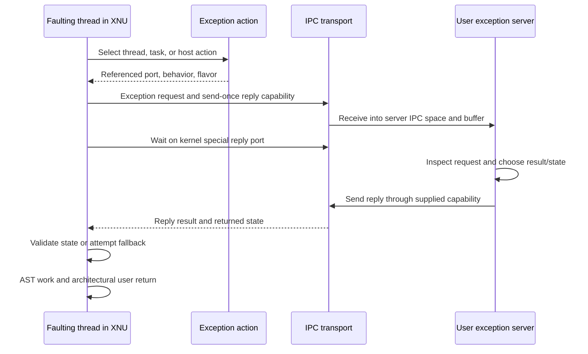

# From an ARM fault to a Mach exception reply

[IPC overview](README.md) · [Kernel RPC](kernel-rpc-and-exceptions.md) · [ARM64 entry](../platform/arm64-exception-entry.md) · [ARM64 return](../platform/arm64-exception-return.md)

An ARM exception and a Mach exception are different events in the same possible execution path. Hardware first enters a vector and XNU saves machine state. XNU may resolve the condition entirely inside the kernel. If it needs an exception handler, it selects a Mach exception action and sends an RPC to that action's port. The handler's reply can affect whether XNU tries another handler or updates the faulting thread's user state. Only later does the machine return path restore registers and execute its exception-return instruction.

A normal `svc` carrying `mach_msg2_trap` is an architectural synchronous exception, but that alone does not create an `EXC_*` notification. An ordinary page fault resolved by VM also does not require a debugger message. Conversely, `EXC_RESOURCE`, `EXC_GUARD`, and corpse notifications can originate from kernel policy rather than one synchronous CPU fault. [`handle_svc()`](../../../xnu/osfmk/arm64/sleh.c#L2743), [`handle_user_abort()`](../../../xnu/osfmk/arm64/sleh.c#L1920), [`exception_triage_thread()`](../../../xnu/osfmk/kern/exception.c#L743).

## The objects at each stage

| Object | Meaning in this trace | Principal source |
| --- | --- | --- |
| `arm_context_t`, `arm_saved_state_t` | Kernel-owned saved CPU context, reached through `thread.machine.upcb` for user execution | [`thread_status.h`](../../../xnu/osfmk/mach/arm/thread_status.h#L1220), [`machine_thread`](../../../xnu/osfmk/arm/thread.h#L149) |
| `exception_type_t`, `mach_exception_data_type_t code[]` | Mach classification and exception-specific code/subcode; not a raw copy of every ESR field | [`exception_types.h`](../../../xnu/osfmk/mach/exception_types.h), [`handle_user_abort()`](../../../xnu/osfmk/arm64/sleh.c#L1920) |
| `exception_action` | Destination send capability, behavior, requested state flavor, privilege/hardening and MAC-label state | [`exception.h`](../../../xnu/osfmk/kern/exception.h#L45-L57) |
| `thread_ro.tro_exc_actions` | Optional thread-level action array; guarded by the thread mutex when selected/updated | [`thread.h`](../../../xnu/osfmk/kern/thread.h#L210), [`ipc_thread_init_exc_actions()`](../../../xnu/osfmk/kern/ipc_tt.c#L833) |
| `task.exc_actions[]` | Task-level fallback array; protected by `itk_lock` | [`task.h`](../../../xnu/osfmk/kern/task.h#L333) |
| `host.exc_actions[]` | Host-level fallback; protected by the host lock | [`host.h`](../../../xnu/osfmk/kern/host.h), [`ipc_host.c`](../../../xnu/osfmk/kern/ipc_host.c#L492) |
| `ipc_port`, `ipc_kmsg`, reply port | Destination capability, transport-owned request, and return channel | [Port lifetime](ports-and-rights-lifecycle.md), [message transport](message-send-receive.md) |
| `thread_state_data_t` and a flavor such as `ARM_THREAD_STATE64` | Exported register representation in a state-style RPC; distinct from the private saved-state layout | [`mach/thread_status.h`](../../../xnu/osfmk/mach/thread_status.h), [`ARM state conversion`](../../../xnu/osfmk/arm64/status.c#L100-L174) |
| `uthread` signal state | BSD's pending signal and exception metadata if the Unix handler accepts the exception | [`ux_exception.c`](../../../xnu/bsd/uxkern/ux_exception.c#L114-L186) |

The action itself is small; its pointer references an `ipc_port` object:

[Source: exception.h, lines 45–57](../../../xnu/osfmk/kern/exception.h#L45-L57)

<!-- source-excerpt: ../../../xnu/osfmk/kern/exception.h#L45-L57 -->
```c
struct exception_action {
	struct ipc_port         * XNU_PTRAUTH_SIGNED_PTR("exception_action.port") port; /* exception port */
	thread_state_flavor_t   flavor;         /* state flavor to send */
	exception_behavior_t    behavior;       /* exception type to raise */
	boolean_t               privileged;     /* survives ipc_task_reset */
	boolean_t               hardened;       /* associated with the task's hardened_exception_action */
	struct label            *label;         /* MAC label associated with action */
};
struct hardened_exception_action {
	struct exception_action ea;
	uint32_t                signed_pc_key;
	exception_mask_t        exception;
};
```

The “activation” in the [fallback comment](../../../xnu/osfmk/kern/exception.c#L770) is historical terminology for the thread-level action. The current association to find is `tro_exc_actions`, not an assumed array directly embedded in every `thread`.

## Installing a handler stores send rights, not a callback address

A userspace handler must arrange to own a receive right for an exception endpoint and make a send right available to the registration operation. `thread_set_exception_ports()` and `task_set_exception_ports()` install that capability for selected exception-mask bits, behavior, and state flavor. Handler code runs in the receiving server's normal execution context after it receives a message. Registration does not place a userspace function pointer into the CPU vector table.

[`set_exception_ports_validation()`](../../../xnu/osfmk/kern/ipc_tt.c#L3963-L4016) checks mask, behavior, endpoint suitability, state flavor, and policy. Identity-protected and hardened configurations impose additional restrictions; a sketch that assumes every process may register every behavior will not describe this snapshot. The thread setter also checks MAC policy and thread activity before modifying the array.

For each selected action, the kernel copies a send capability and publishes the associated behavior/flavor under the governing mutex:

[Source: ipc_tt.c, lines 4072–4077](../../../xnu/osfmk/kern/ipc_tt.c#L4072-L4077)

<!-- source-excerpt: ../../../xnu/osfmk/kern/ipc_tt.c#L4072-L4077 -->
```c
			old_port[i] = action->port;
			action->port = exception_port_copy_send(new_port);
			action->behavior = new_behavior;
			action->flavor = new_flavor;
			action->privileged = privileged;
			action->hardened = hardened;
```

The surrounding [`thread_set_exception_ports_internal()`](../../../xnu/osfmk/kern/ipc_tt.c#L4030-L4099) unlocks before releasing replaced send rights, then consumes the input send right on success. One registered endpoint can consequently be held by several action slots, each with its own holding. `task_set_exception_ports()` has the corresponding per-task loop. `get` and `swap` APIs report grouped masks with copied capabilities; they are not raw pointers into these arrays. [`task setter`](../../../xnu/osfmk/kern/ipc_tt.c#L4143-L4222), [`task swap`](../../../xnu/osfmk/kern/ipc_tt.c#L4342), [`task get`](../../../xnu/osfmk/kern/ipc_tt.c#L4640).

Task creation copies inherited exception send rights, while reset/termination release or clear actions according to their contracts. The `privileged` flag affects survival across IPC reset. These lifetimes explain why the registration remains usable independently of the caller's original port name. They do not keep the endpoint alive after its receive right is destroyed. [`inheritance`](../../../xnu/osfmk/kern/ipc_tt.c#L265-L272), [`task reset`](../../../xnu/osfmk/kern/ipc_tt.c#L715-L767), [right destruction](ports-and-rights-lifecycle.md).

## A concrete unresolved user memory fault

For a user data/instruction abort, `handle_user_abort()` starts with `EXC_BAD_ACCESS`, the current thread/map, and two Mach code values. For VM-serviceable faults it first tries reference/modify repair when applicable, then `vm_fault()` with `THREAD_ABORTSAFE`. Successful or aborted fault work returns to the machine path for retry/return. Only an unresolved case proceeds toward reporting the fault.

The ordinary failing VM branch sets `codes[0]` to the VM result and later `codes[1]` to the fault address. Alignment, tag-check, pointer-authentication, code-signing and fatal-policy branches can alter that path. This is why a Mach exception code is not interchangeable with ESR or FAR even when the fault address originated in FAR. [`VM attempt and result`](../../../xnu/osfmk/arm64/sleh.c#L1954-L2016), [`code/subcode and policy`](../../../xnu/osfmk/arm64/sleh.c#L2060-L2116).

`exception_triage()` handles selected pointer-authentication/unrecoverable flags before calling `exception_triage_thread()`. Those preliminary routines can consume control flow by arranging termination. For the ordinary delivery path, the order is thread → task → host. At each level, a successful RPC or `MACH_RCV_PORT_DIED` stops fallback:

[Source: exception.c, lines 773–794](../../../xnu/osfmk/kern/exception.c#L773-L794)

<!-- source-excerpt: ../../../xnu/osfmk/kern/exception.c#L773-L794 -->
```c
	mutex   = &thread->mutex;
	tro     = get_thread_ro(thread);
	actions = tro->tro_exc_actions;
	if (KERN_SUCCESS == check_exc_receiver_dependency(exception, actions, mutex)) {
		kr = exception_deliver(thread, exception, code, codeCnt, actions, mutex);
		if (kr == KERN_SUCCESS || kr == MACH_RCV_PORT_DIED) {
			goto out;
		}
	}

	/*
	 * Maybe the task level will handle it.
	 */
	task    = tro->tro_task;
	mutex   = &task->itk_lock_data;
	actions = task->exc_actions;
	if (KERN_SUCCESS == check_exc_receiver_dependency(exception, actions, mutex)) {
		kr = exception_deliver(thread, exception, code, codeCnt, actions, mutex);
		if (kr == KERN_SUCCESS || kr == MACH_RCV_PORT_DIED) {
			goto out;
		}
	}
```

The host branch repeats that decision with `host_priv->exc_actions`. `MACH_RCV_PORT_DIED` is a distinguished transport outcome in this control flow, not proof that handler code returned `KERN_SUCCESS`. `check_exc_receiver_dependency()` separately rejects an `EXC_CRASH` destination received in the current task's own space; that check is not applied indiscriminately to every exception type. [`host branch and return`](../../../xnu/osfmk/kern/exception.c#L796-L815), [`dependency check`](../../../xnu/osfmk/kern/exception.c#L707-L727).

## Snapshot the action before making a blocking RPC

`exception_deliver()` indexes the selected action, locks its owner, copies a send capability for the exception port, reads behavior/flavor and hardening state, then unlocks. It does not hold the action mutex through a potentially blocking server exchange:

[Source: exception.c, lines 246–255](../../../xnu/osfmk/kern/exception.c#L246-L255)

<!-- source-excerpt: ../../../xnu/osfmk/kern/exception.c#L246-L255 -->
```c
	lck_mtx_lock(mutex);
	exc_port = exception_port_copy_send(excp->port);
	if (!IP_VALID(exc_port)) {
		lck_mtx_unlock(mutex);
		return KERN_FAILURE;
	}
	task = get_threadtask(thread);

	flavor = excp->flavor;
	behavior = excp->behavior;
```

For hardened actions it adds `TSSF_ONLY_PC`; afterward it separates behavior from `MACH_EXCEPTION_CODES` and other flags. The legacy `exc` interface uses narrower codes, while `mach_exc` uses 64-bit codes. The MAC exception-send check and `ipc_exception_send_allowed()` can reject delivery before an RPC. The known Unix handler has an explicit MAC-label exception in this code. [`selection, unlock, and checks`](../../../xnu/osfmk/kern/exception.c#L256-L297).

`TH_IN_MACH_EXCEPTION` marks the thread during this work. Cleanup clears it, releases the exception/task/thread/token send rights acquired by this path, and frees the temporary output-state buffer. The code's temporary send reference protects port storage during construction; it does not prevent the receiver from destroying its endpoint or refusing a request. [`cleanup`](../../../xnu/osfmk/kern/exception.c#L585-L613).

## Behavior determines the actual message contract

The definitions in [`mach_exc.defs`](../../../xnu/osfmk/mach/mach_exc.defs#L62-L220) describe the RPC payloads and `catch_` server prefix. The build produces client/server code; these generated bodies are not checked in. The action's `behavior` chooses among the following implemented cases:

| Behavior | Request includes | Reply and state handling |
| --- | --- | --- |
| `EXCEPTION_DEFAULT` | Thread and task ports, exception, code array | A success/error result; no returned register-state array in this RPC |
| `EXCEPTION_STATE` | Exception/codes, flavor and old thread state | New flavor/state, checked before applying |
| `EXCEPTION_STATE_IDENTITY` | Thread/task ports plus old state | Returned state is applied here only for a non-corpse event when the supplied thread port is a control port |
| `EXCEPTION_IDENTITY_PROTECTED` | Thread ID and a task identity-token port, exception/codes | Result without ordinary task/thread control ports in the request |
| `EXCEPTION_STATE_IDENTITY_PROTECTED` | Identity token/thread ID plus old state | Returned state subject to flavor, policy, authentication and hardened restrictions |

The explicit control-versus-read choice appears in the default and state-identity cases. With Developer Mode enabled or a corpse task, this path supplies control ports; otherwise it supplies read ports. The state-identity condition is consequently significant: receiving a state-shaped reply does not always authorize installing it. [`port choice`](../../../xnu/osfmk/kern/exception.c#L356-L395), [`state-identity application`](../../../xnu/osfmk/kern/exception.c#L567-L575).

For a state-only exchange the relevant interface prefix is:

[Source: mach_exc.defs, lines 100–107](../../../xnu/osfmk/mach/mach_exc.defs#L100-L107)

<!-- source-excerpt: ../../../xnu/osfmk/mach/mach_exc.defs#L100-L107 -->
```c
routine		mach_exception_raise_state(
			exception_port	: mach_port_t;
			exception	: exception_type_t;
			code		: mach_exception_data_t, const;
		  inout flavor		: int;
			old_state	: thread_state_t, const;
		    out new_state	: thread_state_t
#if MACH_EXC_SERVER_SECTOKEN
```

The later interface lines add configured audit/security-token parameters. The full declaration is the serialization contract; this excerpt is not a compilable stand-alone definition. `flavor` identifies a particular public register representation and its count, not an arbitrary byte length.

## The faulting thread becomes the IPC client

During synchronous exception delivery the current thread executes kernel code constructing the request and can block waiting for its reply. This does not necessarily suspend every other thread in the process. A handler in userspace is an independently schedulable receiver; its receive buffer and IPC namespace are not the faulting thread's buffer or namespace.

The checked-in kernel RPC transport, [`kernel_mach_msg_rpc_common()`](../../../xnu/osfmk/kern/ipc_mig.c#L334-L546), obtains `thread.ith_kernel_reply_port`, creating the kernel special reply port when needed. It inserts a send-once reply capability and converts the kernel-originated message's rights before sending:

[Source: ipc_mig.c, lines 398–406](../../../xnu/osfmk/kern/ipc_mig.c#L398-L406)

<!-- source-excerpt: ../../../xnu/osfmk/kern/ipc_mig.c#L398-L406 -->
```c
	/* insert send-once right for the reply port and send right for the adopted voucher */
	hdr->msgh_local_port = reply;
	hdr->msgh_bits |=
	    MACH_MSGH_BITS_SET_PORTS(
		0,
		MACH_MSG_TYPE_MAKE_SEND_ONCE,
		has_voucher ? MACH_MSG_TYPE_MOVE_SEND : 0);

	mr = ipc_kmsg_copyin_from_kernel(kmsg);
```

It retains a destination reference for synchronous dependency linkage, calls `ipc_kmsg_send()`, links the special reply port to that destination, then receives on `reply->ip_waitq`. `ith_state`, `ith_kmsg`, and `ith_seqno` carry the receive result. Interruptible termination can discard the special reply port; a valid reply undergoes size checks and is copied to the kernel caller without ordinary userspace name installation. [`send, wait and interrupt handling`](../../../xnu/osfmk/kern/ipc_mig.c#L424-L498), [`kernel reply conversion`](../../../xnu/osfmk/kern/ipc_mig.c#L500-L546).

The generated exception stub is the bridge between the `.defs` arguments and this kernel messaging ABI. The Makefile lists `mach_exc_user.c` and the server outputs; no generated stub body is being presented as inspected source. [`generated files`](../../../xnu/osfmk/mach/Makefile#L350-L403). The lower transport and its ownership rules are directly inspectable.



This diagram selects a userspace endpoint. If the action points to a kernel kobject, IPC instead invokes its kernel dispatcher in the current kernel execution path, as explained next. Both choices use port/right semantics; only one requires a separate userspace receiver.

## The default Unix handler is a kernel kobject in this tree

`ux_handler_init()` allocates a permanent `IKOT_UX_HANDLER` endpoint. During BSD initialization, `ux_handler_setup()` installs its send capability in host-level actions for the configured exception mask:

[Source: ux_handler.c, lines 104–108](../../../xnu/osfmk/kern/ux_handler.c#L104-L108)

<!-- source-excerpt: ../../../xnu/osfmk/kern/ux_handler.c#L104-L108 -->
```c
	kr = host_set_exception_ports(host_priv_self(),
	    EXC_MASK_ALL & ~(EXC_MASK_RPC_ALERT | EXC_MASK_GUARD),
	    ux_handler_send_right,
	    EXCEPTION_DEFAULT | MACH_EXCEPTION_CODES,
	    0);
```

This is a kernel kobject handler, not a dedicated historical Unix exception-server thread that should be assumed from older XNU descriptions. `ipc_kobject_server()` routes its MIG request, and `catch_mach_exception_raise()` validates the destination, converts the supplied thread port to a referenced thread with read access, then calls `handle_ux_exception()`. [`handler creation`](../../../xnu/osfmk/kern/ux_handler.c#L64-L79), [`catch routine`](../../../xnu/osfmk/kern/ux_handler.c#L128-L169).

The catch routine is also a concrete example of the kernel MIG ownership contract:

[Source: ux_handler.c, lines 153–169](../../../xnu/osfmk/kern/ux_handler.c#L153-L169)

<!-- source-excerpt: ../../../xnu/osfmk/kern/ux_handler.c#L153-L169 -->
```c
out:
	if (kr == KERN_SUCCESS) {
		/*
		 * Following the MIG 'consume on success' protocol,
		 * consume references to the port arguments.
		 * (but NOT the exception_port, as the first argument is borrowed)
		 *
		 * If we return non-success, the kobject server will eat the port
		 * references for us.
		 */

		ipc_port_release_send(thread_port);
		ipc_port_release_send(task_port);
	}

	thread_deallocate(target_thread);
	return kr;
```

`handle_ux_exception()` acquires the BSD process reference for the thread, asks machine-specific translation first, then applies generic mappings. For example, an ordinary `EXC_BAD_ACCESS` with `KERN_INVALID_ADDRESS` maps to SIGSEGV; other bad-access codes generally map to SIGBUS, with a later stack-overflow correction. It records exception/subcode in the `uthread` and calls `threadsignal()`. A selected fatal signal can later terminate the process; a handled signal can change its next user context. [`translation`](../../../xnu/bsd/uxkern/ux_exception.c#L56-L108), [`process/signal work`](../../../xnu/bsd/uxkern/ux_exception.c#L114-L186).

## A successful state reply does not immediately load hardware registers

For `EXCEPTION_STATE`, XNU obtains an exported state using `thread_getstatus_to_user()`, allocates a result buffer, calls the exception RPC, and feeds a successful reply into `thread_setstatus_from_user()` together with the original state, validation flags, and audit token:

[Source: exception.c, lines 341–349](../../../xnu/osfmk/kern/exception.c#L341-L349)

<!-- source-excerpt: ../../../xnu/osfmk/kern/exception.c#L341-L349 -->
```c
			if (kr == KERN_SUCCESS) {
				if (exception != EXC_CORPSE_NOTIFY) {
					kr = thread_setstatus_from_user(thread, flavor,
					    (thread_state_t)new_state, new_state_cnt,
					    (thread_state_t)old_state, old_state_cnt,
					    set_flags,
					    &audit_token);
				}
				goto out_release_right;
```

The thread-state layer checks/translates the representation before the architecture setter updates `thread.machine.upcb`. On ARM64, conversion to saved state explicitly clears the mode bits to user mode and accepts only the allowed CPSR user bits while preserving other kernel-controlled bits. A returned CPSR value therefore cannot simply request EL1 or EL2 privilege:

[Source: status.c, lines 115–123](../../../xnu/osfmk/arm64/status.c#L115-L123)

<!-- source-excerpt: ../../../xnu/osfmk/arm64/status.c#L115-L123 -->
```c
/*
 * Copy values from ts64 to saved_state.
 *
 * For safety, CPSR is sanitized as follows:
 *
 * - ts64->cpsr.{N,Z,C,V} are copied as-is into saved_state->cpsr
 * - ts64->cpsr.M is ignored, and saved_state->cpsr.M is reset to EL0
 * - All other saved_state->cpsr bits are preserved as-is
 */
```

The implementation follows immediately below that comment, including pointer-authentication-aware updates. [`thread_setstatus_from_user()`](../../../xnu/osfmk/kern/thread_act.c#L1222-L1236), [`machine_thread_set_state()`](../../../xnu/osfmk/arm64/status.c#L1632-L1672), [`conversion implementation`](../../../xnu/osfmk/arm64/status.c#L125-L173). Hardened exception handling can restrict changes to PC and use task-specific pointer authentication diversifiers; those choices are visible in the behavior branches, not merely in the generic setter.

For ordinary synchronous exceptions, `exception_triage_thread()` ultimately calls `thread_exception_return()`. That path reloads the thread's persistent user PCB, processes pending AST work, restores the approved machine state, and performs the architectural EL1→EL0 return. It can resume at a changed PC, retry a faulting instruction after repair, or enter signal delivery; success does not imply “advance past every faulting instruction.” See [ARM64 exception return](../platform/arm64-exception-return.md).

For a caught BSD signal, [`sendsig()`](../../../xnu/bsd/dev/arm/unix_signal.c#L279) constructs a userspace signal frame and [`sendsig_set_thread_state64()`](../../../xnu/bsd/dev/arm/unix_signal.c#L174-L191) sets the user trampoline PC/arguments/stack. A later [`sigreturn()`](../../../xnu/bsd/dev/arm/unix_signal.c#L800) validates/restores user context through the state APIs. That is another change to the context consumed by the return machinery, rather than a kernel `bl` directly invoking the application's signal handler.

## Failures and limits to keep in the trace

- Missing/invalid thread action, rejected policy, or unsuccessful handler result can move selection to the task and host actions. Endpoint death and interruptible receive have their own transport outcomes; fallback does not simply depend on whether a port name was nonzero.
- `EXC_CRASH`, `EXC_RESOURCE`, `EXC_GUARD`, and `EXC_CORPSE_NOTIFY` are excluded from the ordinary unconditional `thread_exception_return()` branch. Fatal pointer-authentication and unrecoverable cases can take separate termination paths before normal triage.
- A handler replying success without fixing a still-faulting instruction/mapping can cause another fault. The kernel does not infer an arbitrary repair from that reply code.
- Kernel-mode aborts have recovery-table and panic paths of their own. This userspace fault trace does not promise delivery of every kernel exception to a userspace server.

The reviewed path covers registration, action lifetime/selection, the five RPC behaviors, kernel reply transport, Unix signal reflection, user-state validation, and the return boundary. It does not audit every hardened entitlement branch, corpse/backtrace protocol, signal trampoline implementation, generated stub, or external debugger. For EL2 and protected monitor crossings, use [exception levels and monitors](../platform/exception-levels-and-monitors.md); those transitions are separate from the Mach RPC described here.
