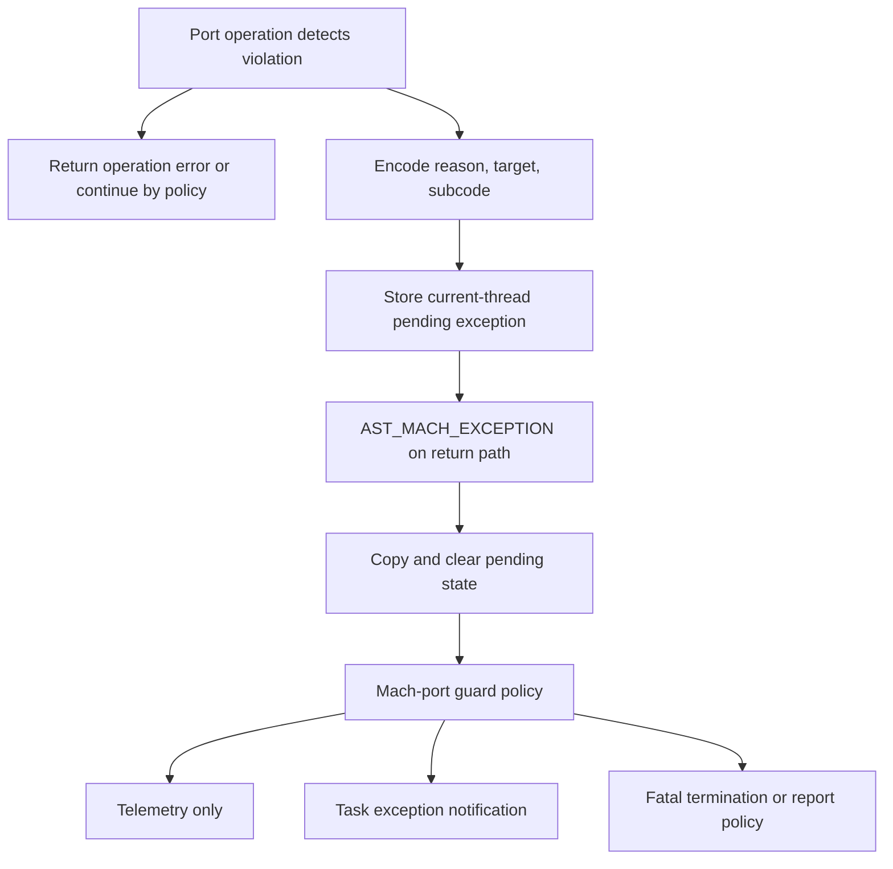
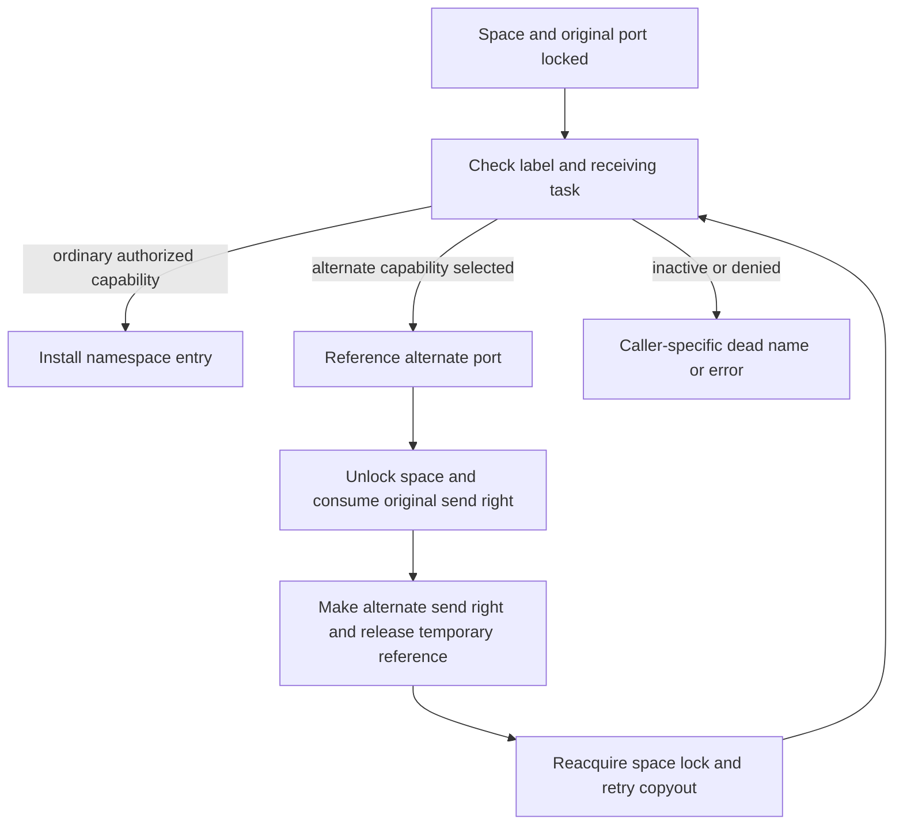

# Guards, port types, and policy enforcement

[IPC overview](README.md) · [Port/right lifecycle](ports-and-rights-lifecycle.md) · [Policy introduction](policies-and-attribution.md) · [Vouchers and importance](vouchers-and-importance.md)

A right can exist and still be forbidden for a particular operation. XNU evaluates the port type, its current receive state, entry flags, space policy, guard/context state, and operation-specific options. A policy report can also be deferred until return to userspace or emitted as telemetry. To understand a denial, follow the actual return value and the guard exception path separately. The type policy table and individual checks jointly define this checkout's behavior. [`ipc_policy_array`](../../../platydoc-data/xnu/osfmk/ipc/ipc_policy.c#L1614), [`mach_port_construct()`](../../../platydoc-data/xnu/osfmk/ipc/mach_port.c#L2420).

## 1. A port type supplies policy; state supplies the current restriction

`ipc_policy_array` associates types with construction entitlement requirements, receive movability, send movability, notification support, and reply semantics. Some entries are updated during initialization or kobject registration. For example, the initial ordinary-port policy allows receive movement and all three principal notification registrations; notification ports have a different construction/receive purpose; strong reply and special reply types are receive-immovable and support dead-name registration. These are policy inputs, not a promise that every check is enforced identically for every process. [`initial table`](../../../platydoc-data/xnu/osfmk/ipc/ipc_policy.c#L1614), [`runtime adjustment`](../../../platydoc-data/xnu/osfmk/ipc/ipc_policy.c#L1734), [`kobject registration`](../../../platydoc-data/xnu/osfmk/ipc/ipc_policy.c#L1790).

`mach_port_construct()` first validates option combinations and selects one port type. Service-port information and bootstrap status affect the service type; reply-port strength depends on enhanced policy; connection creation derives its label from a service port. It then evaluates construction entitlement policy, queue-limit bounds, and special tracking requirements before allocating the port. The initialized port receives requested send ownership, donation flags, guard/context, and service bookkeeping. The post-allocation path is structured around already validated options. [`construction dispatch and checks`](../../../platydoc-data/xnu/osfmk/ipc/mach_port.c#L2420).

Keep four independent concepts visible when tracing this code:

| Property | Stored or derived from | Operational consequence |
|---|---|---|
| Guard and context | `ip_guarded`, `ip_strict_guard`, `ip_context` | Selected destructive or transfer operations require the expected context |
| Receive immovability | Port label/state plus type move policy | A valid receive right can still fail move copyin |
| Send immovability | Port policy and relevant entry state | A valid send right can be restricted when transferred |
| Pinned send entry | Namespace entry flags | Paths that consume the final user reference must enforce pinning |

The guard helper changes receive immovability when requested, but removing a guard does not reverse that change. Nor does possession of a matching guard bypass every port-type policy. [`guard/unguard helpers`](../../../platydoc-data/xnu/osfmk/ipc/mach_port.c#L2278), [`receive movement check`](../../../platydoc-data/xnu/osfmk/ipc/ipc_policy.c#L952), [`right copyin`](../../../platydoc-data/xnu/osfmk/ipc/ipc_right.c#L2112).

## 2. Guard installation and context access are distinct interfaces

`mach_port_guard()` translates a receive right and holds the port lock while installing the guard. Its helper rejects a nonzero existing `ip_context`, then writes the guard value and flags. The implementation tests the context, not a blanket “already guarded” predicate; a zero-valued guard is therefore an important boundary case when reasoning about repeated calls. Strictness affects context visibility and replacement, not whether a correctly matching `mach_port_unguard()` can succeed. [`mach_port_guard()`](../../../platydoc-data/xnu/osfmk/ipc/mach_port.c#L2743), [`mach_port_guard_locked()`](../../../platydoc-data/xnu/osfmk/ipc/mach_port.c#L2278).

[Guard removal checks and state changes](../../../platydoc-data/xnu/osfmk/ipc/mach_port.c#L2322)

<!-- source-excerpt: ../../../platydoc-data/xnu/osfmk/ipc/mach_port.c#L2322-L2338 -->
```c
	/* Port locked and active */
	if (!port->ip_guarded) {
		/* Port already unguarded; Raise exception */
		mach_port_guard_exception(name, 0, kGUARD_EXC_UNGUARDED);
		return KERN_INVALID_ARGUMENT;
	}

	if (port->ip_context != guard) {
		/* Incorrect guard; Raise exception */
		mach_port_guard_exception(name, port->ip_context, kGUARD_EXC_INCORRECT_GUARD);
		return KERN_INVALID_ARGUMENT;
	}

	port->ip_context = 0;
	port->ip_guarded = port->ip_strict_guard = 0;

	return KERN_SUCCESS;
```

Ordinary context APIs are not synonyms for guard APIs. `mach_port_get_context()` returns zero for a strictly guarded port, concealing the stored guard from that interface. `mach_port_set_context()` reports `kGUARD_EXC_SET_CONTEXT` and returns `KERN_INVALID_ARGUMENT` for a strict guard; otherwise it writes the context, including on a non-strict guarded port. `mach_port_swap_guard()` requires a guarded port, rejects strict guards, checks the old context, and replaces it. A caller designing a protocol must choose strictness deliberately instead of assuming every stored context is protected against overwrite. [`get context`](../../../platydoc-data/xnu/osfmk/ipc/mach_port.c#L1126), [`set context`](../../../platydoc-data/xnu/osfmk/ipc/mach_port.c#L1195), [`swap guard`](../../../platydoc-data/xnu/osfmk/ipc/mach_port.c#L2892).

`MPO_CONTEXT_AS_GUARD` construction performs guard installation as part of creating the port. Service ports additionally remember launchd's name/context for a later port-destroyed recovery. This state is not a generic user-supplied security identity: the port type and service recovery rules determine when it is meaningful. [`construction completion`](../../../platydoc-data/xnu/osfmk/ipc/mach_port.c#L2620).

## 3. Destruction and movement do not all test guards the same way

The syscall/RPC interface alone is insufficient to infer the guard condition. The relevant lower-level paths differ:

| Operation | Current implementation boundary |
|---|---|
| `mach_port_destruct()` | Validates the receive right and optional send-uref delta; a guarded port must match the passed guard. An unguarded receive right is not rejected merely for lacking a guard. |
| Generic right destruction | A receive right with both `ip_guarded` and nonzero context rejects the unguarded destruction path. |
| `mod_refs(RECEIVE, -1)` | Rejects a guarded receive right, including a zero-context guard. |
| `MOVE_RECEIVE` copyin | First checks move policy; a guarded descriptor additionally validates the transmitted guard/flags before moving ownership. |
| Guarded receive copyout with `IMMOVABLE_RECEIVE` | Installs a non-strict guard and receive context derived from the receive-message address, and marks the receive right immovable. |

See [`ipc_right_destruct()`](../../../platydoc-data/xnu/osfmk/ipc/ipc_right.c#L1664), [`ipc_right_destroy()`](../../../platydoc-data/xnu/osfmk/ipc/ipc_right.c#L901), [`receive mod_refs`](../../../platydoc-data/xnu/osfmk/ipc/ipc_right.c#L1297), [`receive copyin`](../../../platydoc-data/xnu/osfmk/ipc/ipc_right.c#L2235), and [`receive copyout`](../../../platydoc-data/xnu/osfmk/ipc/ipc_right.c#L2690). These distinctions are why a source comment saying “guarded destruction” must be checked against its actual body.

`ipc_move_receive_allowed()` first applies the enforced strong-service-port restriction, then emits selected weak-reply/contained-space policy reports, then rejects an immovable receive right. The intermediate reports use `expect_continue`; they are not equivalent to the final `false` branch. Following a successful transfer, the port moves through limbo/in-transit receiver states rather than retaining its old namespace identity; the [receive-right lifecycle](ports-and-rights-lifecycle.md) explains that ownership change. [`ipc_move_receive_allowed()`](../../../platydoc-data/xnu/osfmk/ipc/ipc_policy.c#L952).

Guarded-descriptor validation accepts either an unguarded port with `MACH_MSG_GUARD_FLAGS_UNGUARDED_ON_SEND` and zero supplied context, or a guarded port with a matching context. The guarded case does not additionally reject that flag. Copyout can install a new guard appropriate to the receiver. Do not model a transmitted guard as an immutable secret attached to the port for its entire lifetime. [`ipc_right_copyin_check_guard_locked()`](../../../platydoc-data/xnu/osfmk/ipc/ipc_right.c#L2030), [`copyout guard installation`](../../../platydoc-data/xnu/osfmk/ipc/ipc_right.c#L2690).

## 4. A guard exception is a deferred report with policy-dependent consequences

`mach_port_guard_exception()` encodes `GUARD_TYPE_MACH_PORT`, the reason/flavor, the target name, and subcode into the thread's exception state. It makes fatal-range reasons sticky, and can make optional reasons sticky according to the task's fatal guard behavior. The pending exception is associated with the current thread, not delivered by sending an arbitrary Mach notification to the misused port. [`Mach-port encoding`](../../../platydoc-data/xnu/osfmk/ipc/ipc_policy.c#L1123), [original encoding guide](../../../platydoc-data/xnu/doc/mach_ipc/guard_exceptions.md).

The shared thread staging routine ignores kernel-task threads and permits only the current thread to write its saved pending exception. A pending sticky exception cannot be overwritten. A non-sticky exception is retained against another non-sticky exception, but can be replaced by a sticky one:

[Pending Mach exception and AST publication](../../../platydoc-data/xnu/osfmk/kern/thread.c#L2458)

<!-- source-excerpt: ../../../platydoc-data/xnu/osfmk/kern/thread.c#L2458-L2472 -->
```c
	if (thread->mach_exc_info.code && (thread->mach_exc_sticky || !sticky)) {
		return;
	}

	thread->mach_exc_info.os_reason = os_reason;
	thread->mach_exc_info.exception_type = exception_type;
	thread->mach_exc_info.code = code;
	thread->mach_exc_info.subcode = subcode;
	thread->mach_exc_sticky = sticky;
	thread->mach_exc_ktriage = ktriage;

	spl_t s = splsched();
	thread_ast_set(thread, AST_MACH_EXCEPTION);
	ast_propagate(thread);
	splx(s);
```

The AST copies the saved exception state and clears the slot before dispatching it, preventing the consumed event from remaining pending during exception handling. Mach-port guards go through `mach_port_guard_ast()`. The handler first consumes associated unified-policy information; telemetry-only reports can be emitted and returned immediately. Fatal-range reasons terminate through the fatal exception/notification path. Optional and soft reasons evaluate task behavior flags controlling delivery, once-only delivery, fatal handling, and corpse/report generation. A handler receiving a notification does not universally cancel fatal policy. [`mach_exception_ast()`](../../../platydoc-data/xnu/osfmk/kern/thread.c#L2553), [`guard dispatch`](../../../platydoc-data/xnu/osfmk/kern/thread.c#L2500), [`mach_port_guard_ast()`](../../../platydoc-data/xnu/osfmk/ipc/ipc_policy.c#L1326).



For debugging, record both outputs: the operation's `kern_return_t`/Mach message result and the later guard reason/subcode. An immediate invalid-right error, a queued fatal guard, and a telemetry-only policy violation are different observations even when they arise near the same source condition. The [exception delivery guide](exception-delivery.md) describes action registration and kernel exception RPC; the guard AST decides which of those paths is requested here.

## 5. Reply type checks and persona context protect different boundaries

A reply send-once right conveys permission to send one reply; it does not by itself enforce the intended reply-port type or work persona. `ipc_validate_local_port()` examines the request's reply port using destination reply semantics and the sender's space policy. Enhanced kobject and bootstrap policies permit different reply type sets, and translated/simulated compatibility cases are explicit. A denial returns `MACH_SEND_INVALID_REPLY`; the broader message schema checks are a separate stage. [`local-port validation`](../../../platydoc-data/xnu/osfmk/ipc/ipc_policy.c#L567), [`schema validation`](../../../platydoc-data/xnu/osfmk/ipc/ipc_policy.c#L632).

Strict reply context uses `ip_reply_context`, independently of the receive guard's `ip_context`. Receive-header copyout links it only when `enforce_strict_reply`, `MACH_RCV_WITH_STRICT_REPLY(option)`, and a valid voucher all hold; a nonparticipating receive clears the reply context. [`receive-side opt-in`](../../../platydoc-data/xnu/osfmk/ipc/ipc_kmsg.c#L3390). The linking helper converts the message voucher, obtains its bank persona, releases the temporary voucher reference, and records a usable persona on the reply port. When strict reply enforcement is enabled, a non-kernel send using a send-once destination with nonzero reply context validates the **sending thread's adopted voucher**, not merely a voucher supplied in the outgoing message. [`ipc_kmsg_link_reply_context_locked()`](../../../platydoc-data/xnu/osfmk/ipc/ipc_kmsg.c#L1471), [`send gating`](../../../platydoc-data/xnu/osfmk/ipc/ipc_kmsg.c#L5170).

Validation snapshots and clears the stored reply context before checking the sender. It accepts an inactive destination at this stage, leaving destination death handling to the surrounding send path; otherwise missing/invalid adopted voucher state or a persona mismatch yields `MACH_SEND_INVALID_CONTEXT` and the applicable guard report. Clearing even on failure makes this a consumed reply-context check, not a permanent label that can be reused indefinitely. [`ipc_kmsg_validate_reply_context_locked()`](../../../platydoc-data/xnu/osfmk/ipc/ipc_kmsg.c#L1518).

This explains a concrete distinction: receiving a message with a valid voucher and receiving its reply right does not automatically adopt that voucher on the worker thread. Userspace's subsequent voucher/thread operation affects the strict reply check. The kernel adoption and accounting boundary is described in [vouchers and importance](vouchers-and-importance.md); external XPC/libdispatch scheduling behavior is not inferred here.

## 6. Notification policy is separate from notification ownership

There are two policy questions: may this observed port register a particular notification, and may the proposed notification destination receive notifications? `mach_port_request_notification()` checks the destination, then dispatches by notification type. The observed port's type policy controls no-senders and port-destroyed registration; the latter also has service ownership and single-registration rules. [`notification request entry`](../../../platydoc-data/xnu/osfmk/ipc/mach_port.c#L1514), [`port-destroyed policy`](../../../platydoc-data/xnu/osfmk/ipc/ipc_policy.c#L1533).

The destination check contains an especially important checkout-specific boundary:

[Notification destination report currently does not return denial](../../../platydoc-data/xnu/osfmk/ipc/ipc_policy.c#L1476)

<!-- source-excerpt: ../../../platydoc-data/xnu/osfmk/ipc/ipc_policy.c#L1476-L1482 -->
```c
	/* Check if this port type is allowed to receive notifications */
	if (!ipc_policy(notify_port)->pol_can_receive_notifications) {
		mach_port_guard_exception(CAST_MACH_PORT_TO_NAME(notify_port),
		    ip_type(notify_port), kGUARD_EXC_INVALID_NOTIFICATION_PORT);
		/* TODO: disable after verifying telemetry - rdar://164128769 */
		// return false;
	}
```

Thus a disallowed destination type produces a guard report but does not make this helper return false in this body. Contained-space use of a non-notification port is likewise marked telemetry and uses `expect_continue`. This says what the helper returns; it does not promise the deferred guard consequence is harmless. The observed-port checks still independently reject invalid registrations. [`ipc_port_can_receive_notifications()`](../../../platydoc-data/xnu/osfmk/ipc/ipc_policy.c#L1465).

For a strong or weak service port, enforced port-destroyed registration additionally requires initproc, an immovable notification destination, and an initproc receiver. Recovery copyout validates the service's expected launchd namespace name and restores its saved context as a strict guard. The notification is transferring the live receive right back into an authorized ownership setting, not destroying and recreating a new port with an unrelated label. [`service registration checks`](../../../platydoc-data/xnu/osfmk/ipc/ipc_policy.c#L1502), [`service recovery copyout`](../../../platydoc-data/xnu/osfmk/ipc/ipc_right.c#L2690).

The [notification lifecycle section](ports-and-rights-lifecycle.md) covers no-senders synchronization, dead-name extra urefs, port-destroyed receive-right transfer, and notification send-once consumption. One locking detail connects that lifecycle to policy: `ipc_right_request_alloc()` holds the space write lock while looking up the entry and locks the live port. Replacing an existing request frees a slot and is atomic with new registration. If a new request cannot allocate a port request-table slot, it drops the space lock, grows the table, and restarts lookup; it cannot reuse the old namespace entry pointer after that unlock. Immediate armed send-possible delivery and dead-name delivery have explicit unlock/ownership branches. [`ipc_right_request_alloc()`](../../../platydoc-data/xnu/osfmk/ipc/ipc_right.c#L450).

Send-possible registration can also create a port importance contribution for an eligible donor; request cancellation and destruction must balance it through the same lifecycle machinery. This couples notification state to the importance graph without making notifications themselves vouchers. Full combinations of request replacement, port death, service recovery, and importance propagation are beyond this focused review. [`request allocation and importance arm`](../../../platydoc-data/xnu/osfmk/ipc/ipc_right.c#L570), [importance ownership](vouchers-and-importance.md).

## Sources inspected and limits

| Depth | Sources | Scope and limit |
|---|---|---|
| Deep selected paths | [`mach_port.c`](../../../platydoc-data/xnu/osfmk/ipc/mach_port.c), [`ipc_right.c`](../../../platydoc-data/xnu/osfmk/ipc/ipc_right.c) | Construction, context and guard operations, guarded destruction/movement, receive copyout, notification registration/growth. Not every construction option, right alias, or concurrent teardown combination is audited. |
| Deep selected paths | [`ipc_policy.c`](../../../platydoc-data/xnu/osfmk/ipc/ipc_policy.c), [`thread.c`](../../../platydoc-data/xnu/osfmk/kern/thread.c#L2429) | Type policy inputs, movement denial versus telemetry, notification policy, guard encoding/staging/AST. Product-specific entitlement provisioning and the complete policy-tunable matrix are outside the review. |
| Focused integration | [`ipc_kmsg.c`](../../../platydoc-data/xnu/osfmk/ipc/ipc_kmsg.c#L1471) | Reply persona linkage, validation, and send gating. Full message schema validation remains in the transport guides. |
| Design companions | [Guard exceptions](../../../platydoc-data/xnu/doc/mach_ipc/guard_exceptions.md), [port types](../../../platydoc-data/xnu/doc/mach_ipc/port_types.md), [IPC security concepts](../../../platydoc-data/xnu/doc/mach_ipc/ipc_security_concepts.md) | Encoding/design context and selected policy descriptions; implementation branches above take precedence for this checkout. External service-manager behavior is not reconstructed. |

## Copyout labels can substitute the capability

The label check is not always a yes/no filter. `ipc_kobject_label_check_or_substitute()` can consume the original send right and return another send capability. Its caller holds the active space's write lock and the active port lock. A substitution releases both; ordinary success retains the caller's lock context. This difference drives explicit restart loops in both descriptor/object copyout and reply-header copyout. [Helper contract and body](../../../platydoc-data/xnu/osfmk/kern/ipc_kobject.c#L1400-L1489), [object copyout](../../../platydoc-data/xnu/osfmk/ipc/ipc_object.c#L853-L935), [reply-header retry](../../../platydoc-data/xnu/osfmk/ipc/ipc_kmsg.c#L3253-L3371).

`IPC_LABEL_SUBST_TASK_READ` and `IPC_LABEL_SUBST_THREAD_READ` select helpers that inspect the labeled read port's underlying task/thread. They use `ikol_alt_port` only when that object belongs to the receiving task; the alternate port's identity comes from kernel label setup, not a name provided by the receiving application. The implementation therefore needs both the kobject and `space->is_task`, not merely the public right disposition. [Substitution helpers](../../../platydoc-data/xnu/osfmk/kern/ipc_kobject.c#L1340-L1397).

Only send rights take substitution. A labeled kobject receive-right copyout is an invariant violation; an incompatible substitution disposition is refused. Without substitution, the space privilege mask must include all required label privileges. An inactive/denied reply becomes a dead reply name in the header path, whereas ordinary object copyout reports `KERN_INVALID_CAPABILITY`. Those are distinct caller contracts, not one universal error mapping. [Label decision](../../../platydoc-data/xnu/osfmk/kern/ipc_kobject.c#L1434-L1489), [header denial](../../../platydoc-data/xnu/osfmk/ipc/ipc_kmsg.c#L3337-L3350).

The ownership change is visible in the helper:

[Source: `osfmk/kern/ipc_kobject.c`, lines 1459–1483](../../../platydoc-data/xnu/osfmk/kern/ipc_kobject.c#L1459-L1483).

<!-- source-excerpt: ../../../platydoc-data/xnu/osfmk/kern/ipc_kobject.c#L1459-L1483 -->
```c

		if (subst != IP_NULL) {
			ip_reference(subst);
			is_write_unlock(space);

			/*
			 * We do not hold a proper send right on `subst`,
			 * only a reference.
			 *
			 * Because of how thread/task termination works,
			 * there is no guarantee copy_send() would work,
			 * so we need to make_send().
			 *
			 * We can do that because ports tagged with
			 * IPC_LABEL_SUBST_{THREAD,TASK} do not use
			 * the no-senders notification.
			 */

			ip_label_put(port, label);
			ipc_port_release_send_and_unlock(port);
			/* no check: dPAC integrity */
			port = ipc_port_make_send_any(subst);
			ip_release(subst);
			*subst_portp = port;
			return true;
```

The temporary reference stabilizes the alternate port but is not itself a send right. Because termination can invalidate the assumptions of copying an existing send right, the helper makes a send right through `ipc_port_make_send_any()` and releases the temporary reference. Its source comment explicitly relies on these substituted ports not using no-senders notification. The retry then rechecks space liveness, table capacity and the new port; the old lock/right must not be reused. [Object restart](../../../platydoc-data/xnu/osfmk/ipc/ipc_object.c#L909-L931).



## Strict reply: a consumed check, with two independent voucher locations

A request's voucher port and the responding thread's adopted voucher occupy different kernel state. Receive-header copyout optionally converts the request voucher, extracts its bank persona, releases the temporary voucher reference, and records a usable persona on the reply port. No usable persona means this helper installs no new context. A receive that does not participate clears the stored context explicitly. [Recording](../../../platydoc-data/xnu/osfmk/ipc/ipc_kmsg.c#L1471-L1502), [receive gating](../../../platydoc-data/xnu/osfmk/ipc/ipc_kmsg.c#L3378-L3400).

At send, the surrounding predicates select a non-kernel send-once destination with context and strict enforcement enabled. The validator snapshots and clears `ip_reply_context` before checking the adopted voucher. Even failure consumes the recorded check:

[Source: `osfmk/ipc/ipc_kmsg.c`, lines 1525–1542](../../../platydoc-data/xnu/osfmk/ipc/ipc_kmsg.c#L1525-L1542).

<!-- source-excerpt: ../../../platydoc-data/xnu/osfmk/ipc/ipc_kmsg.c#L1525-L1542 -->
```c
	uint32_t dest_ctx = dest_port->ip_reply_context;
	dest_port->ip_reply_context = 0;

	if (!ip_active(dest_port)) {
		return MACH_MSG_SUCCESS;
	}

	if (voucher == IPC_VOUCHER_NULL || !MACH_PORT_VALID(voucher_name)) {
		if ((option & MACH_SEND_KERNEL) == 0) {
			mach_port_guard_exception(voucher_name,
			    MPG_PAYLOAD(MPG_FLAGS_STRICT_REPLY_INVALID_VOUCHER, dest_ctx),
			    kGUARD_EXC_STRICT_REPLY);
		}
		return MACH_SEND_INVALID_CONTEXT;
	}

	kern_return_t __assert_only kr;
	uint32_t persona_id = 0;
```

A valid adopted voucher with a different persona takes the mismatched-persona guard path and returns `MACH_SEND_INVALID_CONTEXT`. An already inactive destination passes this particular context check so the surrounding send code handles endpoint death. Attaching a valid voucher to the outgoing reply message does not replace adopting the required execution context on the worker. [Persona mismatch](../../../platydoc-data/xnu/osfmk/ipc/ipc_kmsg.c#L1544-L1564), [actual send arguments](../../../platydoc-data/xnu/osfmk/ipc/ipc_kmsg.c#L5161-L5189).

For an illustrative worker pool, receiving request A with persona P and then dispatching its reply capability to worker B is insufficient: B must have the matching adopted context when this enforced path runs. The kernel source establishes that condition; it does not establish how an external dispatch library manages its worker pool. Scheduler dependency transfer is separately explained in [synchronous IPC](synchronous-dependencies-and-special-replies.md).

<!-- BEGIN PLATYDOC DOCUMENTATION LICENSE -->
Original Platydoc text and diagrams are licensed under [CC BY 4.0](https://creativecommons.org/licenses/by/4.0/). Quoted source code and third-party material retain their respective licenses.
<!-- END PLATYDOC DOCUMENTATION LICENSE -->
