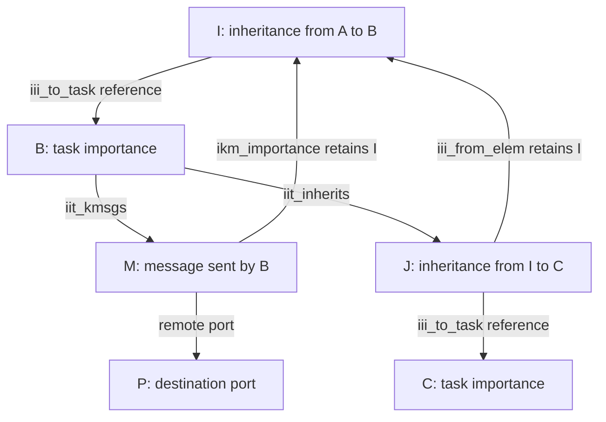
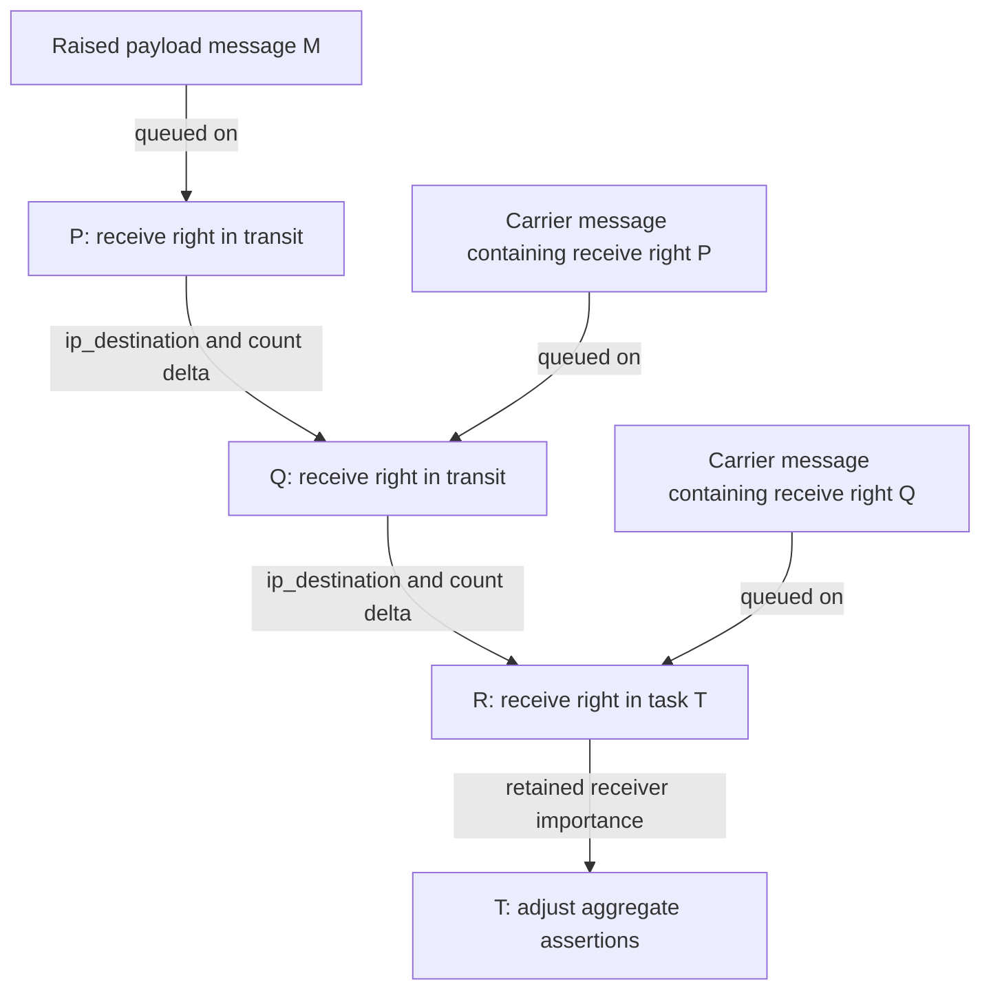
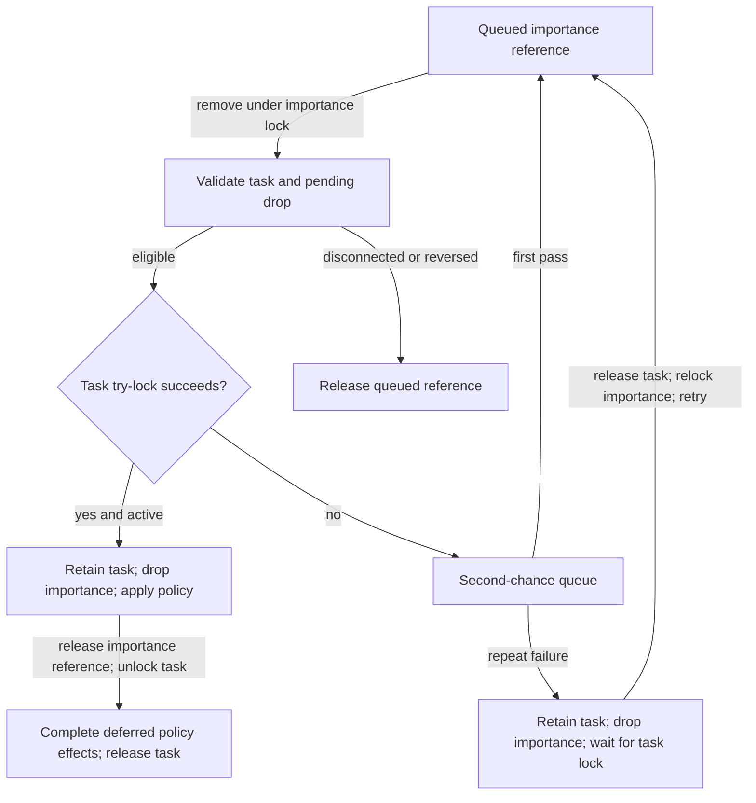

# Importance propagation, port migration and delayed policy drops

[IPC guide](README.md) · [Voucher ownership](vouchers-and-importance.md) · [Port lifetime](ports-and-rights-lifecycle.md) · [Synchronous turnstiles](synchronous-dependencies-and-special-replies.md)

A message can already be queued when its sender becomes important, stops donating, or transfers the destination's receive right to another task. XNU therefore records a dependency graph and changes the donations represented by existing work. This chapter follows those changes through queued messages, ports in transit, inherited vouchers and task policy. It covers the common implementation with `IMPORTANCE_INHERITANCE` enabled in `xnu-12377.121.6`; legacy external assertions and exec watchports are identified at their boundaries. The examples are deductions from source, not executed traces. [`ipc_importance.c`](../../../xnu/osfmk/ipc/ipc_importance.c#L581-L1174).

## 1. Five forms of state must stay separate

| State | Representation | What it records |
| --- | --- | --- |
| Message relationship | `ikm_importance`, `ikm_inheritance`, `MACH_MSGH_BITS_RAISEIMP` | Which importance element the message retains; which task's outgoing-work list contains it; whether its current message contribution is raised. |
| Port contribution | `ip_impcount`, `ip_impdonation`, `ip_tempowner`, `ip_imp_task` | Assertions behind the port and their current route toward a receiver. A non-donating carrier can still carry a moved port's assertions. |
| Task graph state | `iit_assertcnt`, `iit_receiver`, `iit_denap`, `iit_donor`, `iit_live_donor` | Aggregate assertions and eligibility to receive or propagate them. |
| Inherited external responsibility | `iii_externcnt`, `iii_externdrop`, `iii_donating`, `iii_to_task`, `iii_from_elem` | Externalized assertions represented by an inheritance, how many were explicitly dropped, and whether the remainder currently contributes to its receiving task. |
| Applied/pending policy | `iit_updatepolicy`, `iit_updateq`, `iit_updatetime`; task `requested_policy.trp_boosted` | Need for a task-policy update, its queued ownership, and the policy bit already applied to the task. |

Definitions: [importance elements and task fields](../../../xnu/osfmk/ipc/ipc_importance.h#L62-L170), [port fields](../../../xnu/osfmk/ipc/ipc_port.h#L119-L204), [task boost setter](../../../xnu/osfmk/kern/task_policy.c#L3473-L3505). The object reference count and voucher-manager `iie_made` count retain storage/handles; neither is the task assertion count. `III_EXTERN(i) = iii_externcnt - iii_externdrop`, with the analogous `IIT_EXTERN` for a task.

An effective donor is a task marked `iit_donor`, or an ordinary importance receiver with positive `iit_assertcnt`. A task marked only `iit_denap` can receive an App Nap wakeup assertion without becoming a downstream donor. `iit_live_donor` marks eligibility for live donor updates; the current effective donor decision still uses `iit_donor`, which is refreshed from `effective_policy.tep_live_donor`. Do not substitute the field comments for these predicates. [Donor predicates](../../../xnu/osfmk/ipc/ipc_importance.c#L1641-L1738), [mutually exclusive receiver setup](../../../xnu/osfmk/ipc/ipc_importance.c#L1747-L1859), [live update](../../../xnu/osfmk/ipc/ipc_importance.c#L1543-L1607).

### Retained source and propagation list are different

If a message retains an inheritance `I(A→B)`, `ikm_importance` points to that inheritance, but its list link is placed on **B's** `iit_kmsgs`. Likewise a further inheritance whose `iii_from_elem` is `I(A→B)` is linked into B's `iit_inherits`. B's aggregate donation transitions must affect B's outstanding work even if that work retains a more specific incoming voucher relationship. Unlinking reverses the same choice and returns the held element reference to its caller. [Message link/unlink](../../../xnu/osfmk/ipc/ipc_importance.c#L179-L226), [inheritance link/find/unlink](../../../xnu/osfmk/ipc/ipc_importance.c#L240-L324).

Source: [`ipc_importance_kmsg_link`, lines 187–192](../../../xnu/osfmk/ipc/ipc_importance.c#L187-L192).

<!-- source-excerpt: ../../../xnu/osfmk/ipc/ipc_importance.c#L187-L192 -->
```c
	link_elem = (IIE_TYPE_INHERIT == IIE_TYPE(elem)) ?
	    (ipc_importance_elem_t)((ipc_importance_inherit_t)elem)->iii_to_task :
	    elem;

	queue_enter(&link_elem->iie_kmsgs, kmsg, ipc_kmsg_t, ikm_inheritance);
	kmsg->ikm_importance = elem;
```



These are reference/list relationships, not a packet route or a recursive call stack. The object history can be nested while propagation is organized by the tasks doing work.

## 2. Sending establishes a live edge, even before it carries a boost

`ipc_importance_send()` starts with the destination port locked. It exits early for a destination without `ip_impdonation`, `MACH_SEND_NOIMPORTANCE`, or a sender that can never donate. Otherwise it selects an importance value belonging to the sender task, directly or through an inheritance targeted at that task, and falls back to the sender's base importance. It retains the selected element and links the kmsg under the importance lock. **An eligible sender that is not currently a donor still leaves this link in place.** A later transition can raise already queued work. Forced `MACH_SEND_IMPORTANCE` instead uses a static contribution without this dynamic source link. [Send decisions and publication](../../../xnu/osfmk/ipc/ipc_importance.c#L2502-L2625).

Lock acquisition is observable to the caller. If `ipc_importance_lock_try()` fails, the helper drops the port lock before taking the importance lock, then reacquires the port when needed. Its Boolean result reports whether the original port-lock snapshot was lost. The send path rechecks the destination after this transition. A valid initial lookup is therefore insufficient to assume the endpoint remained live throughout donation. [Lock transition and port update](../../../xnu/osfmk/ipc/ipc_importance.c#L2584-L2690), [send retry](../../../xnu/osfmk/ipc/ipc_kmsg.c#L5190-L5357).

There are two sources of later graph changes:

- Internal assertion hold/drop reaches `ipc_importance_task_check_transition()`. It changes the aggregate count, but schedules propagation/policy work only when the Boolean condition `iit_assertcnt > 0` changes. Increasing 1 to 2, or reducing 2 to 1, retains the same downstream donor state. The drop branch defensively floors the count at `IIT_EXTERN`, rather than allowing this operation to remove externally accounted responsibility. [Transition helper](../../../xnu/osfmk/ipc/ipc_importance.c#L596-L683), [hold/drop entry points](../../../xnu/osfmk/ipc/ipc_importance.c#L1190-L1265).
- Live donor refresh compares the previous and new marked-donor state. It propagates with `update_task_imp = FALSE`, because the originating task policy change has already happened. The outgoing dependencies need adjustment even though the origin needs no second policy update. [Live propagation](../../../xnu/osfmk/ipc/ipc_importance.c#L1580-L1607), [policy-side caller](../../../xnu/osfmk/kern/task_policy.c#L3337-L3349).

## 3. Propagation updates each edge, then follows only changed tasks

`ipc_importance_task_propagate_helper()` handles two lists under the importance lock. For queued messages, it first checks and toggles `MACH_MSGH_BITS_RAISEIMP`. This bit prevents applying the same hold/drop twice to one message as the graph is adjusted. It then locks the message's remote port and invokes `ipc_port_importance_delta_internal()`, which returns a retained receiver importance, if one can be identified. A recipient whose aggregate count crosses zero is added to the propagation queue, donating that reference to the queue. Otherwise the temporary reference is released. [Message propagation](../../../xnu/osfmk/ipc/ipc_importance.c#L698-L760).

Source: [raised-message guard and hold, lines 717–725](../../../xnu/osfmk/ipc/ipc_importance.c#L717-L725).

<!-- source-excerpt: ../../../xnu/osfmk/ipc/ipc_importance.c#L717-L725 -->
```c
		/* toggle the kmsg importance bit as a barrier to parallel adjusts */
		if (IIT_UPDATE_HOLD == type) {
			if (MACH_MSGH_BITS_RAISED_IMPORTANCE(hdr->msgh_bits)) {
				continue;
			}

			/* mark the message as now carrying importance */
			hdr->msgh_bits |= MACH_MSGH_BITS_RAISEIMP;
			delta = 1;
```

For inherited values, propagation uses the net `III_EXTERN` count, not one unit per inheritance object. On hold, a nonzero, previously inactive inheritance becomes `iii_donating`; its gross external and dropped counts are added to the destination task's corresponding fields. On drop, those fields are subtracted and `iii_donating` is cleared. The task's assertion count changes by the net number. Zero remaining external assertions are skipped, as are already-donating holds and already-inactive drops. [Inheritance propagation](../../../xnu/osfmk/ipc/ipc_importance.c#L765-L825).

The outer routine uses `iit_props` as a work queue, distinct from `iit_updates` used for pending policy. It propagates onward only through ordinary receivers that are not independently marked donors. A marked donor continues donating even when its received assertion count falls to zero; a denap-only receiver does not relay the boost. Immediate hold policy updates are appended; immediate drop updates are inserted at the front, tending to process downstream drops before the upstream task that caused them. Policy work begins only after the current graph traversal is complete. [Traversal and update queues](../../../xnu/osfmk/ipc/ipc_importance.c#L1087-L1174).

### Worked graph: two reasons to keep a server boosted

Assume eligible ordinary receiver B is not independently marked donor. B has one raised incoming message from A and one unrelated assertion from U. B has sent message M to C and holds an inheritance J targeted at D with `iii_externcnt = 3`, `iii_externdrop = 1`, `iii_donating = TRUE`. Assume C and D have no other assertions; counts are illustrative and all endpoints are live.

| Change | B aggregate | M → C | J → D | Propagation consequence |
| --- | --- | --- | --- | --- |
| Initial state | 2 | M raised; C receives 1 | Net 2; D receives 2 | Both outstanding edges contribute. |
| A withdraws its message contribution | 2 → 1 | Unchanged | Unchanged | B remains an effective donor; no downstream transition. |
| U releases the remaining assertion | 1 → 0 | Raised bit cleared; C loses 1 | Donating cleared; D loses 2 | C and D reach zero and can propagate their own drops. |
| A supplies new work/boost | 0 → 1 | Still-linked M can become raised again | If J still has net 2, it can donate again | No message retransmission or new inheritance allocation is required. |

This is a graph-state example, not a guarantee that M remains queued until the last row. Receipt/destruction can unlink M and voucher release can zero J's external counts between transitions. Those operations are serialized through the same importance machinery. [Unlinking at receive](../../../xnu/osfmk/ipc/ipc_importance.c#L2860-L2947), [message cleanup](../../../xnu/osfmk/ipc/ipc_importance.c#L3323-L3410), [attribute release](../../../xnu/osfmk/ipc/ipc_importance.c#L3430-L3492).

## 4. A receive right in transit extends the port path

Suppose P's receive right is inside a message queued on Q, and Q's receive right is inside a message queued on R. A new raised message sent **to P** must account through `P.ip_destination = Q` and `Q.ip_destination = R`, eventually reaching R's receiver task. P's data message is still queued on P: the assertion traversal does not forward that payload to Q or R. [Destination-chain adjustment](../../../xnu/osfmk/ipc/ipc_port.c#L2681-L2786).



The helper cannot hold an arbitrary starting port lock while blocking on a whole destination chain. For a transit port it drops that lock, acquires `ipc_port_multiple_lock()`, and uses `ipc_port_destination_chain_lock()` to lock the chain. It releases the serialization lock after the chain is protected, applies the delta while unlocking from the starting port toward the base, and retains any base task importance before dropping the last port lock. Its Boolean return says whether the caller's port lock was dropped. An inactive base receives an extra port reference: retaining only its predecessor locks would cease protecting it as those predecessors are unlocked. [Locking and inactive-tail reference](../../../xnu/osfmk/ipc/ipc_port.c#L1309-L1357), [caller contract](../../../xnu/osfmk/ipc/ipc_port.c#L2664-L2786).

`ipc_port_impcount_delta()` ignores inactive ports and clamps excessive deductions to the current count, returning the actual delta to carry onward. A send-possible request has additional revalidation after the unlocked window: only a still-needed request without an existing `ip_spimportant` contribution receives the one-unit boost; otherwise the delta becomes zero. These defenses are part of the actual implementation, not a proof that all concurrent mutations fit an ideal arithmetic model. [Count adjustment](../../../xnu/osfmk/ipc/ipc_port.c#L2592-L2660), [send-possible recheck](../../../xnu/osfmk/ipc/ipc_port.c#L2714-L2732).

### Moving the receive right changes where existing assertions are charged

Receive copyin makes the port a temporary owner and records the old task's deduction in `icrc_assert_count`. Ports already accounting to a specific `ip_imp_task` defer that particular transfer to circularity/enqueue processing. `ipc_importance_check_circularity()` then does more than detect a loop: it installs the transit destination, clears the temporary-owner association, adds the port's existing count along the destination chain, and selects its new base task. It can transfer through a carrier that is not itself donation-enabled. [Receive copyin](../../../xnu/osfmk/ipc/ipc_right.c#L2295-L2321), [combined traversal](../../../xnu/osfmk/ipc/ipc_importance.c#L2216-L2490).

When old and new importance owners differ, the new task's hold occurs before the saved old task's drop. The importance lock protects this handoff against a competing message cleanup removing the contribution before the new task has received it. The helper may run policy work that temporarily releases that lock, but it has already installed the new accounting before making that transition. When both owners are the same, it avoids a needless drop/reacquire. [Transfer ordering](../../../xnu/osfmk/ipc/ipc_importance.c#L2441-L2469).

Source: [new task before old task, lines 2454–2467](../../../xnu/osfmk/ipc/ipc_importance.c#L2454-L2467).

<!-- source-excerpt: ../../../xnu/osfmk/ipc/ipc_importance.c#L2454-L2467 -->
```c
	if (imp_task != IIT_NULL) {
		assert(imp_lock_held);
		if (transfer_assertions) {
			ipc_importance_task_hold_internal_assertion_locked(imp_task, assertcnt);
		}
	}

	if (release_imp_task != IIT_NULL) {
		assert(imp_lock_held);
		if (transfer_assertions) {
			ipc_importance_task_drop_internal_assertion_locked(release_imp_task, assertcnt);
		}
	}

```

Receive copyout removes the now-unneeded contribution from the immediate carrier port and completes/releases its send-turnstile association and port reference. It does not automatically apply another full task boost: the ordinary receiver already obtained that accounting when the handoff was queued. The exact copyout and circularity contracts are described in [port lifetime](ports-and-rights-lifecycle.md#6-the-receive-right-can-leave-every-task-namespace). [Copyout completion](../../../xnu/osfmk/ipc/ipc_right.c#L2801-L2818).

These same transit edges also connect send turnstiles. `ipc_port_send_update_inheritor()` selects the destination port's send turnstile for an in-transit receive right. This is separate from `ip_impcount`: a dependency can carry live thread priority through the turnstile graph while importance accounting governs task policy. [Send inheritor selection](../../../xnu/osfmk/ipc/ipc_port.c#L1705-L1759).

## 5. Applying policy without reversing task/importance lock order

`ipc_importance_task_process_updates()` enters with the importance lock. Each queued record owns an importance reference. It removes the record and rejects disconnected tasks; a delayed-drop record whose count has become positive is also discarded without applying the drop. It cannot simply block on the task lock while retaining the importance lock, because other paths take task then importance. [Update processing](../../../xnu/osfmk/ipc/ipc_importance.c#L837-L968), [opposite lock order in disconnect](../../../xnu/osfmk/ipc/ipc_importance.c#L2115-L2136).

The first failed `task_lock_try()` moves the record to a private second-chance queue. On a second-chance failure, it also retains the task, puts the record at the front, drops the importance lock, waits by taking/releasing the task lock, and releases the task reference. It then reacquires importance and retries from queue state. It does not use a raw task pointer across this wait or assume the queued update remained necessary. A concurrent reversed transition can remove a record from an ordinary update queue. [Second-chance protocol](../../../xnu/osfmk/ipc/ipc_importance.c#L893-L927), [reversal](../../../xnu/osfmk/ipc/ipc_importance.c#L651-L679).

After obtaining an active task lock, it retains the task and drops importance. `task_update_boost_locked()` sets the requested boost bit and runs task-policy recomputation. After releasing the importance reference and task lock, `task_policy_update_complete_unlocked()` processes deferred effects; the pending token explicitly asks to reevaluate turnstile boosting. Thus **graph mutation, task-policy recomputation and unlocked completion are three distinct stages**. [Application and completion](../../../xnu/osfmk/ipc/ipc_importance.c#L931-L960), [task setter](../../../xnu/osfmk/kern/task_policy.c#L3473-L3505).



The diagram omits the separate inactive-task rejection after taking its lock. These queues coordinate lock ordering; they are not a persistent background worker queue for every hold/drop.

## 6. Hysteresis delays policy withdrawal, not graph accounting

The normal traversal queues a delayed drop only for a **downstream** denap receiver, on a drop transition, after thread-call support exists. The originating task is excluded from that particular branch. `ipc_importance_task_delayed_drop()` moves any existing update reference to the global delayed queue or takes a new one, records `mach_absolute_time()`, and arms one thread call if none is outstanding. Constants select a 1-second target plus 100-ms skew, with 200-ms leeway. These are implementation scheduling parameters, not an externally promised duration. [Selection](../../../xnu/osfmk/ipc/ipc_importance.c#L1134-L1164), [queueing](../../../xnu/osfmk/ipc/ipc_importance.c#L1031-L1075), [constants](../../../xnu/osfmk/ipc/ipc_importance.c#L56-L68).

Source: [ordinary delayed-drop predicate, lines 1143–1147](../../../xnu/osfmk/ipc/ipc_importance.c#L1143-L1147).

<!-- source-excerpt: ../../../xnu/osfmk/ipc/ipc_importance.c#L1143-L1147 -->
```c
				if (!boost && temp_task_imp != task_imp &&
				    ipc_importance_delayed_drop_call != NULL &&
				    ipc_importance_task_is_marked_denap_receiver(temp_task_imp)) {
					ipc_importance_task_delayed_drop(temp_task_imp);
				} else {
```

The graph's assertion counts and donation flags have already changed. The delayed queue keeps the **applied policy** boosted for a while to avoid repeatedly dropping and restoring it during bursts of work. If the task gains a new assertion before the callback, `ipc_importance_task_check_transition()` deliberately leaves a delayed record in place. No redundant hold policy update is needed because the prior boost was never withdrawn. At scan time a positive count cancels this pending drop. If it reaches zero again before the scan, the same record can still authorize the drop. [Reversal handling](../../../xnu/osfmk/ipc/ipc_importance.c#L651-L679), [scan rejection](../../../xnu/osfmk/ipc/ipc_importance.c#L884-L891).

### The callback batches request timestamps

The scanner passes `ipc_importance_delayed_drop_timestamp`—the scheduled cutoff—to `ipc_importance_task_process_updates()`. That processor compares the stored **request timestamp** `iit_updatetime` directly with the cutoff. It does not add `DENAP_DROP_DELAY` to each record before testing it. Consequently later entries with timestamps at or before the earlier call's cutoff can be processed in the same scan, even if their own nominal target interval has not elapsed. After the scan, a remaining first record supplies the next `request timestamp + delay` deadline. [Cutoff comparison](../../../xnu/osfmk/ipc/ipc_importance.c#L859-L866), [scan and rearm](../../../xnu/osfmk/ipc/ipc_importance.c#L983-L1020).

Illustrative sequence, assuming the callback runs near its requested deadline and no further events intervene:

| Time relative to first request | Graph count / queue | Policy effect |
| --- | --- | --- |
| 0 ms | Downstream denap task D reaches zero; record timestamp 0; requested cutoff 1100 ms. | D's previously applied boost remains. |
| 200 ms | D gains an assertion; record stays queued. | No redundant boost update. |
| 900 ms | D loses it again; ordinary transition leaves the existing delayed record. | Counts are zero immediately; applied boost still remains. |
| About 1100 ms | Scanner sees timestamp 0 ≤ cutoff and count zero. | It can finally apply the drop. This is not 1100 ms after the 900-ms change. |

If D still had an assertion at scan time, the scan would release the record instead. A different task queued at 900 ms can also fall under that first cutoff. These are consequences of the shown comparisons, not timing measurements or guarantees about thread-call scheduling.

### Explicit external-drop commands have an additional path

`MACH_VOUCHER_IMPORTANCE_ATTR_DROP_EXTERNAL` is the one supported command in `ipc_importance_command()`. It validates input/output sizes and selects an inheritance value. A zero count queries the remaining external assertions. A nonzero drop requires a denap receiver and sufficient `III_EXTERN`; otherwise it returns `KERN_INVALID_TASK` or `KERN_FAILURE`. Partial drops adjust counters. When the last external assertion of a donating inheritance is removed, it clears that inheritance's donation, removes its gross counters from the destination task, and starts/resets delayed-drop hysteresis **even if other task assertions remain**. Only then does it check whether the aggregate task count crossed zero. Thus this explicit command can delay the destination's own update; it is not restricted to the downstream-only branch above. [Command](../../../xnu/osfmk/ipc/ipc_importance.c#L3685-L3783).

The timer infrastructure is initialized at `STARTUP(THREAD_CALL, STARTUP_RANK_MIDDLE, ...)`; allocation failure panics. Earlier graph code checks whether the delayed call exists and can use immediate policy handling instead. [Initialization](../../../xnu/osfmk/ipc/ipc_importance.c#L3805-L3825).

## 7. Releasing work and disconnecting a task do not erase the same graph

| Event | Graph/lifetime consequence |
| --- | --- |
| Message received | Converts suitable dynamic importance into receiver-targeted inherited responsibility; removes the old message link and port contribution. See [voucher receive](vouchers-and-importance.md#7-receive-transfers-the-relationship-then-cleanup-balances-it). |
| Message destroyed | Unlinks its importance element, clears any raised contribution, adjusts the active destination and releases the element. Inactive-port accounting is not charged down again. |
| Last voucher-cache use returned | `release_value(sync)` rejects a stale made-count snapshot with `KERN_FAILURE`. On a matching snapshot it clears `iie_made`, removes any donating inheritance's external responsibility, propagates a resulting aggregate transition, and releases the made reference. |
| Final inheritance object reference | Unlinks it from the upstream graph, balances any remaining external contribution, then releases both upstream-element and downstream-task-importance references. This also covers relationships owned outside the voucher-cache release route. |
| Task disconnect | Clears task↔importance association under task then importance lock, resets the task's donor/legacy effects, releases its reference and task ownership. Other graph references can keep the importance object alive. |

Cleanup evidence: [message cleanup](../../../xnu/osfmk/ipc/ipc_importance.c#L3323-L3410), [manager release](../../../xnu/osfmk/ipc/ipc_importance.c#L3430-L3492), [final element release](../../../xnu/osfmk/ipc/ipc_importance.c#L380-L463), [disconnect](../../../xnu/osfmk/ipc/ipc_importance.c#L2111-L2142).

The disconnect contract explicitly allows remaining upstream assertions to influence downstream work after the local task is detached. A surviving importance object has `iit_task == TASK_NULL`; graph propagation can still traverse its outstanding relationships, while policy processing skips it because there is no task left to update. Removing a task therefore does not justify freeing every inheritance that mentions it. [Reset effects and propagation](../../../xnu/osfmk/ipc/ipc_importance.c#L2041-L2071), [disconnect rationale](../../../xnu/osfmk/ipc/ipc_importance.c#L2095-L2108), [policy skip](../../../xnu/osfmk/ipc/ipc_importance.c#L874-L881).

## Review boundary

This review follows selected graph mutations, receiver migration, counter transitions, queue-owned references, lock retries, timer comparisons and teardown in the visible kernel. It does not infer libdispatch/App Nap policy decisions, prove all graph interleavings, or establish product timing. Legacy explicit assertion delivery, every exec/watchport combination and all policy side effects remain outside this chapter. A useful separate source test, [`three_ulock_sync_ipc_hop_noimportance`](../../../xnu/tests/turnstile_multihop.c#L797-L807), sets the flag that [adds `MACH_SEND_NOIMPORTANCE` to the send](../../../xnu/tests/turnstile_multihop.c#L430-L440) while exercising synchronous dependency chains; it reinforces why the [turnstile protocol](synchronous-dependencies-and-special-replies.md) must be read separately. That test was inspected, not run, and does not validate the delayed-drop timeline above.

<!-- BEGIN PLATYDOC DOCUMENTATION LICENSE -->
Original Platydoc text and diagrams are licensed under [CC BY 4.0](https://creativecommons.org/licenses/by/4.0/). Quoted source code and third-party material retain their respective licenses.
<!-- END PLATYDOC DOCUMENTATION LICENSE -->
