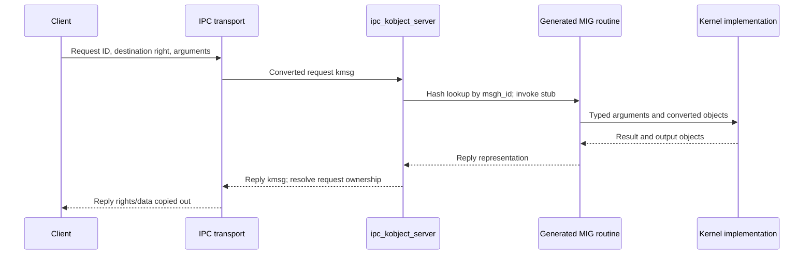

# Kernel RPC, MIG, and exceptions

[IPC overview](README.md) · [Message transport](message-send-receive.md) · [Mach exception delivery](exception-delivery.md) · [Port policy](policies-and-attribution.md)

## A Mach trap and a Mach RPC are different entry routes

The Mach trap table selects C entry functions from trap numbers. It includes `mach_msg2_trap`, messaging's transport entry, alongside specialized operations. For example, `_kernelrpc_mach_vm_allocate_trap()` translates a current-task name and directly calls `mach_vm_allocate_external()`; `_kernelrpc_mach_port_allocate_trap()` similarly invokes the port allocator. These routes do not construct an ordinary request kmsg for those operations. [`syscall_sw.c`](../../../xnu/osfmk/kern/syscall_sw.c#L120), [`mach_kernelrpc.c`](../../../xnu/osfmk/ipc/mach_kernelrpc.c#L59), [`mach_kernelrpc.c`](../../../xnu/osfmk/ipc/mach_kernelrpc.c#L168).

A message-based kernel RPC instead sends a message to a kernel-owned port. `ipc_kmsg_send()` detects that destination in `ipc_space_kernel`, unlocks it, and calls `ipc_kobject_server()`. That function dispatches a generated routine and returns a reply kmsg for delivery, unless the operation deliberately produces no immediate reply. These are different paths that can reach related implementation functions. [`ipc_kmsg.c`](../../../xnu/osfmk/ipc/ipc_kmsg.c#L5231), [`ipc_kobject.c`](../../../xnu/osfmk/kern/ipc_kobject.c#L643).

The distinction is visible in an actual public wrapper. `mach_vm_allocate()` first attempts the direct trap, then falls back to the generated RPC only on `MACH_SEND_INVALID_DEST`:

[Source: mach_vm.c, lines 57–61](../../../xnu/libsyscall/mach/mach_vm.c#L57-L61)

<!-- source-excerpt: ../../../xnu/libsyscall/mach/mach_vm.c#L57-L61 -->
```c
	rv = _kernelrpc_mach_vm_allocate_trap(target, address, size, flags);

	if (rv == MACH_SEND_INVALID_DEST) {
		rv = _kernelrpc_mach_vm_allocate(target, address, size, flags);
	}
```

The trap's [`port_name_to_current_task_noref()` use](../../../xnu/osfmk/ipc/mach_kernelrpc.c#L58-L78) restricts that fast route to a suitable current-task name; it copies the address argument and invokes VM directly. The fallback's [`mach_vm.defs` declaration](../../../xnu/osfmk/mach/mach_vm.defs#L65-L115) supplies the message interface. The fallback condition here does not mean a request message was necessarily queued and rejected: the direct trap can produce that code before any request kmsg exists. A Mach API name alone therefore does not tell you whether its successful call used message transport.

## The destination selects an object; the message ID selects an operation

| Value | What it selects | What it does not establish |
| --- | --- | --- |
| User destination name | An entry in the calling task's IPC space, resolved during copyin | A global kernel object address or a PID |
| Kernel `ipc_port` and kobject type | A typed exported kernel-object association, such as a task or IOKit connection | Permission for every possible operation |
| `msgh_id` | A registered MIG request routine for ordinary kobject dispatch | A CPU vector, Mach trap number, or standalone capability |
| Stub input conversion | A referenced object usable for the routine's required flavor/type | Lifetime beyond the routine's release contract |
| Request's reply capability | Where a reply can be sent | Which thread will necessarily receive it or whether the caller is already waiting |

For a user-server endpoint, IPC queues/delivers the message and user code interprets the ID. For a kernel-owned destination, `ipc_kmsg_send()` calls the server synchronously in the sending thread's kernel execution. `current_thread()` and `current_task()` therefore still supply the caller context used by many authorization checks. Blocking inside the kernel operation may schedule another thread, but dispatch itself does not allocate a dedicated server thread. DriverKit/UEXT destinations of type `IKOT_UEXT_OBJECT` select `uext_server()` instead of the MIG routine table; that entry likewise calls `IOUserServer::server()` in the current thread. [`dispatch selection`](../../../xnu/osfmk/kern/ipc_kobject.c#L643-L675), [`caller context`](../../../xnu/osfmk/kern/ipc_kobject.c#L471-L475), [`UEXT entry`](../../../xnu/iokit/Kernel/IOUserServer.cpp#L3214-L3233).

The send path replaces its local request variable with the reply, reloads the header, and continues toward the reply's destination:

[Source: ipc_kmsg.c, lines 5221–5239](../../../xnu/osfmk/ipc/ipc_kmsg.c#L5221-L5239)

<!-- source-excerpt: ../../../xnu/osfmk/ipc/ipc_kmsg.c#L5221-L5239 -->
```c
		/*
		 * Call the server routine, and get the reply message to send.
		 */
		kmsg = ipc_kobject_server(port, kmsg, options);
		if (kmsg == IKM_NULL) {
			return MACH_MSG_SUCCESS;
		}
		/* reload hdr since kmsg changed */
		hdr = ikm_header(kmsg);

		ipc_kmsg_init_trailer_and_sign(kmsg, TASK_NULL);

		/* restart the KMSG_INFO tracing for the reply message */
		KDBG(MACHDBG_CODE(DBG_MACH_IPC, MACH_IPC_KMSG_INFO) | DBG_FUNC_START);
		port = hdr->msgh_remote_port;
		assert(IP_VALID(port));
		ip_mq_lock(port);
		/* fall thru with reply - same options */
		kernel_reply = TRUE;
```

At this point the `kmsg` variable no longer denotes the original request. The returned message may be queued on a user reply endpoint or a kernel RPC client's special reply endpoint. A null reply means this send is finished without immediate reply delivery.

## MIG supplies the typed boundary

MIG interface descriptions live in `.defs` files. `task.defs` declares subsystem `task 3400`, routine arguments, and build-conditioned names/types. `mach_types.defs` defines kernel input conversion, output conversion, and destructor contracts: `task_t` uses `convert_port_to_task_mig()`, `convert_task_to_port_kernel()`, and `task_deallocate_mig()`. The Makefile generates sender and server C sources/headers from these descriptions. A missing checked-in `*_server.c` can therefore be a generated artifact, not a missing subsystem. [`task.defs`](../../../xnu/osfmk/mach/task.defs#L65), [`mach_types.defs`](../../../xnu/osfmk/mach/mach_types.defs#L125), [`mach/Makefile`](../../../xnu/osfmk/mach/Makefile#L440).

[Source: mach_types.defs, lines 124–131](../../../xnu/osfmk/mach/mach_types.defs#L124-L131)

<!-- source-excerpt: ../../../xnu/osfmk/mach/mach_types.defs#L124-L131 -->
```c
/* Task control, read, inspect, name port. In descending capability. */
type task_t = mach_port_t
#if	KERNEL_SERVER
		intran: task_t convert_port_to_task_mig(mach_port_t)
		outtran: mach_port_t convert_task_to_port_kernel(task_t)
		destructor: task_deallocate_mig(task_t)
#endif	/* KERNEL_SERVER */
		;
```

This declaration explains why a wire argument represented as a port becomes a `task_t` for the kernel implementation and why that temporary task reference must later be released. It does not say that every reference in the request is consumed in the same way: request destination, reply capability, body descriptors, and typed temporary objects each have their own contract.



The stub box is a build-generated boundary inferred from `.defs`, Makefile rules, and the dispatch ABI; generated bodies were not inspected here. `ipc_kobject_server_internal()` reads the request ID, looks it up in `mig_buckets`, allocates a zeroed reply of the registered size, applies optional kobject message filtering, and invokes `kroutine` with separate header/data/trailer pointers. A missing ID yields `MIG_BAD_ID`. An ID selects a routine; valid typed port conversion and policy still determine whether its target is usable. [`ipc_kobject.c`, table setup](../../../xnu/osfmk/kern/ipc_kobject.c#L201), [`ipc_kobject_server_internal()`](../../../xnu/osfmk/kern/ipc_kobject.c#L458).

### Dispatch structures and split message storage

`mig_kern_subsystem` describes a generated subsystem's ID range and routine descriptors; each descriptor supplies its unmarshalling function, argument/descriptor counts, and reply sizing. `mig_init()` walks the registered subsystem list at MACH_IPC startup, rejects duplicate IDs, and inserts only real stubs into a bounded hash table. Its local entry is:

[Source: ipc_kobject.c, lines 149–155](../../../xnu/osfmk/kern/ipc_kobject.c#L149-L155)

<!-- source-excerpt: ../../../xnu/osfmk/kern/ipc_kobject.c#L149-L155 -->
```c
typedef struct {
	mach_msg_id_t num;
	int kobjidx;
	mig_kern_routine_t kroutine;    /* Kernel server routine */
	unsigned int kreply_size;       /* Size of kernel reply msg */
	unsigned int kreply_desc_cnt;   /* Number of descs in kernel reply msg */
} mig_hash_t;
```

See [`mig.h`](../../../xnu/osfmk/mach/mig.h#L122-L167) for the generated dispatch ABI and [`mig_init()`](../../../xnu/osfmk/kern/ipc_kobject.c#L201-L270) for table construction. `kobjidx` connects a routine to a filtering index; it is not the port's kobject type.

The request and reply need not each be one contiguous allocation. The dispatcher explicitly computes header, user-data, and trailer pointers, then passes them separately:

[Source: ipc_kobject.c, lines 579–582](../../../xnu/osfmk/kern/ipc_kobject.c#L579-L582)

<!-- source-excerpt: ../../../xnu/osfmk/kern/ipc_kobject.c#L579-L582 -->
```c
	__BeforeKobjectServerTrace(idx);
	/* See contract in header doc for ipc_kobject_reply_status() */
	(*ptr->kroutine)(req_hdr, req_data, req_trailer, reply_hdr, reply_data);
	__AfterKobjectServerTrace(idx);
```

That invocation matters when following a message in memory: casting the header pointer to a presumed monolithic generated request can be wrong for the current kmsg layout. The reply allocator reserves the exact registered reply size and descriptor count, with zeroing. The dispatch code temporarily initializes an error-compatible header area even when success would use a split user-data buffer. [`layout and initialization`](../../../xnu/osfmk/kern/ipc_kobject.c#L479-L556), [kmsg representation](message-send-receive.md).

## Request/reply ownership is part of the server ABI

The server wrapper consumes the request destination right. Kernel MIG servers do not take message voucher ownership; the wrapper releases that voucher. On success, the implementation/stub contract has disposed of request contents, and the reply right moves into the reply message, so request storage can be freed. On an error, request contents remain intact and are destroyed while preserving rights already handled by the wrapper/reply. `MIG_NO_REPLY` permits a server to keep the reply capability for later use and suppress immediate reply construction. [`ipc_kobject.c`](../../../xnu/osfmk/kern/ipc_kobject.c#L589), [`ipc_kobject_server()`](../../../xnu/osfmk/kern/ipc_kobject.c#L675).

The reply initialization makes the direction change explicit:

[Source: ipc_kobject.c, lines 396–405](../../../xnu/osfmk/kern/ipc_kobject.c#L396-L405)

<!-- source-excerpt: ../../../xnu/osfmk/kern/ipc_kobject.c#L396-L405 -->
```c
	OutP->Head.msgh_size = sizeof(mig_reply_error_t);
	OutP->Head.msgh_bits =
	    MACH_MSGH_BITS_SET(MACH_MSGH_BITS_LOCAL(InP->msgh_bits), 0, 0, 0);
	OutP->Head.msgh_remote_port = InP->msgh_local_port;
	OutP->Head.msgh_local_port = MACH_PORT_NULL;
	OutP->Head.msgh_voucher_port = MACH_PORT_NULL;
	OutP->Head.msgh_id = InP->msgh_id + 100;

	OutP->NDR = NDR_record;
	OutP->RetCode = kr;
```

The request's local reply right becomes the reply's remote destination. The `+100` is this MIG reply-ID convention, not a transport rule applied to all arbitrary Mach messages. `NDR` and `RetCode` are protocol data; an application-defined message can use another payload format.

There are also two levels of result. `MACH_MSG_SUCCESS` from the send path describes transport progress. A successfully delivered MIG reply can contain a failing `kern_return_t`, such as `MIG_BAD_ID` or an implementation error. The client stub interprets that reply status. Likewise, a successful send with `MIG_NO_REPLY` does not promise that a synchronous caller already has its reply.

| Resource at server completion | Success / retained asynchronous reply | Error reply |
| --- | --- | --- |
| Request destination send/send-once right | Wrapper releases it | Wrapper releases it |
| Request voucher | Wrapper releases it | Wrapper releases it |
| Request body rights/memory | Implementation/generated-stub contract owns their disposition | Wrapper destroys remaining contents |
| Reply capability | Moved into reply or deliberately saved by `MIG_NO_REPLY` contract | Kept for sending the error reply |
| Request allocation | Freed after contents handled | Destroyed with local/remote skips for rights already accounted for |

The decisive cleanup is directly visible:

[Source: ipc_kobject.c, lines 711–727](../../../xnu/osfmk/kern/ipc_kobject.c#L711-L727)

<!-- source-excerpt: ../../../xnu/osfmk/kern/ipc_kobject.c#L711-L727 -->
```c
	if (reply == IKM_NULL ||
	    ipc_kobject_reply_status(reply) == KERN_SUCCESS) {
		/*
		 *	The server function is responsible for the contents
		 *	of the message.  The reply port right is moved
		 *	to the reply message, and we have deallocated
		 *	the destination port right, so we just need
		 *	to free the kmsg.
		 */
		ipc_kmsg_free(request);
	} else {
		/*
		 *	The message contents of the request are intact.
		 *  Remote port has been released above. Do not destroy
		 *  the reply port right either, which is needed in the reply message.
		 */
		ipc_kmsg_destroy(request, IPC_KMSG_DESTROY_SKIP_LOCAL | IPC_KMSG_DESTROY_SKIP_REMOTE);
```

`ipc_kobject_reply_status()` interprets the server ABI: a completed complex reply means success, while simple/error forms expose a `RetCode`. An oversized failed reply can be replaced with a smaller `mig_reply_error_t` allocation to keep split-layout calculations valid. The wrapper also rejects a missing reply destination or a reply directed back to a kernel kobject. [`status contract`](../../../xnu/osfmk/kern/ipc_kobject.c#L291-L348), [`error resizing`](../../../xnu/osfmk/kern/ipc_kobject.c#L589-L631), [`reply destination checks`](../../../xnu/osfmk/kern/ipc_kobject.c#L730-L760).

The Unix exception handler's [`catch_mach_exception_raise()`](../../../xnu/osfmk/kern/ux_handler.c#L128-L169) is a readable concrete implementation of consume-on-success: it releases the thread/task argument port references when successful, leaves them for generic error cleanup otherwise, and separately releases its converted thread reference. See the [exception delivery walkthrough](exception-delivery.md).

Kernel-originated RPC is another useful path: `kernel_mach_msg_rpc_common()` uses a thread's kernel special reply port, constructs a send-once reply right, optionally attaches an adopted/default voucher for a non-kobject destination, and performs IPC. This underlies outgoing kernel requests; “server” and “client” are roles in a particular exchange, not permanent properties of userspace versus kernel. [`ipc_mig.c`](../../../xnu/osfmk/kern/ipc_mig.c#L334).

## Task/thread capabilities and lifetime

Task port flavors form an ordered capability test: name, inspect, read, control. `task_port_kotype_valid_for_flavor()` accepts a port of the required or stronger type; thread conversion has corresponding control/read/inspect handling. `convert_port_to_task_with_flavor_locked_noref()` checks type, kobject attachment, permitted corpse handling, and conversion policy. Its referenced wrapper produces a task reference without consuming the port reference. [`ipc_tt.c`](../../../xnu/osfmk/kern/ipc_tt.c#L2394), [`ipc_tt.c`](../../../xnu/osfmk/kern/ipc_tt.c#L2439), [`ipc_tt.c`, thread flavors](../../../xnu/osfmk/kern/ipc_tt.c#L2903).

Those checks are not a claim that possessing a name automatically authorizes every operation. Conversion evaluation considers caller/victim identity, flavor, Developer Mode, and platform-specific restrictions. Some public operations also have specialized user-entry validation rather than only a generic typed argument. Keep those details with [security](../security/README.md) and [processes](../processes/README.md). [`task_conversion_eval_internal()`](../../../xnu/osfmk/kern/ipc_tt.c#L2277), [`task.defs`, `task_info_from_user`](../../../xnu/osfmk/mach/task.defs#L166).

Task ports themselves do **not** hold a reference on the task. `ipc_task_disable()` sets `ipc_active = false` to prevent lazy creation, then disables each existing flavor kobject before task storage can be released. The corresponding thread code has the same resurrection concern. This makes IPC disablement a crucial phase of [runtime termination](../runtime/objects-and-lifecycle.md), separate from the eventual port object's lifetime. [`ipc_tt.c`, task disable](../../../xnu/osfmk/kern/ipc_tt.c#L427), [`ipc_tt.c`, thread disable](../../../xnu/osfmk/kern/ipc_tt.c#L877).

## Exceptions are kernel-initiated message exchanges

`exception_triage_thread()` attempts thread-level actions, then task actions, then host actions, subject to receiver-dependency checks. Success or `MACH_RCV_PORT_DIED` stops fallback. `exception_deliver()` snapshots the selected port/behavior/state flavor under its governing mutex and retains a send capability across the outgoing exception call. It checks MAC/IPC exception policy before selecting an exception RPC behavior. [`exception.c`, triage](../../../xnu/osfmk/kern/exception.c#L743), [`exception.c`, delivery](../../../xnu/osfmk/kern/exception.c#L192).

`EXCEPTION_STATE` sends machine thread state and validates the returned state before applying it. `EXCEPTION_DEFAULT` supplies task/thread ports: this implementation chooses control ports when Developer Mode is enabled or the task is a corpse, otherwise read ports. Identity-protected behaviors use a task identity token and thread ID; hardened state handling imposes additional register-update constraints. Exception delivery therefore must not be summarized as invariably handing a debugger full task control. [`exception.c`, state](../../../xnu/osfmk/kern/exception.c#L298), [`exception.c`, default/identity](../../../xnu/osfmk/kern/exception.c#L358).

The expanded [exception delivery walkthrough](exception-delivery.md) follows registration, action arrays, unresolved ARM faults, the kernel special reply port, each behavior's payload, the Unix kobject handler, state validation, and the return to user execution. [ARM64 entry](../platform/arm64-exception-entry.md) and [return](../platform/arm64-exception-return.md) describe the hardware transition; [EL2 and monitors](../platform/exception-levels-and-monitors.md) describes the separate privileged-call boundaries. Corpse/backtrace policy and every hardened-registration branch remain outside the full path trace.

<!-- BEGIN PLATYDOC DOCUMENTATION LICENSE -->
Original Platydoc text and diagrams are licensed under [CC BY 4.0](https://creativecommons.org/licenses/by/4.0/). Quoted source code and third-party material retain their respective licenses.
<!-- END PLATYDOC DOCUMENTATION LICENSE -->
