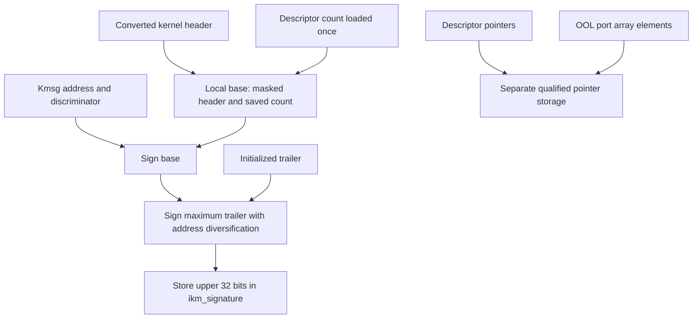
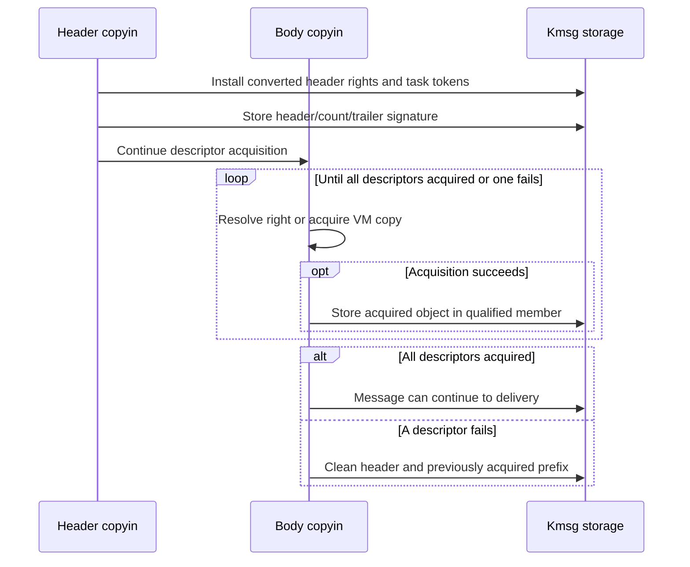
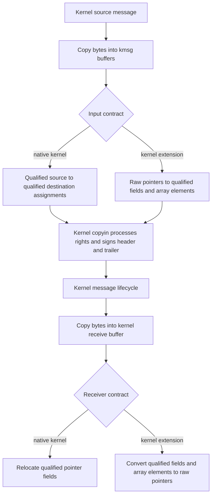

# Message integrity and descriptor authentication

[IPC overview](README.md) · [Message representation](message-path.md) · [Complex message conversion](complex-message-copyin-and-copyout.md) · [ARM64 thread-state conversion](../security/arm64-thread-state-conversion.md)

An `ipc_kmsg` changes representation several times: user names become owned kernel port pointers, user memory addresses become VM-copy objects, and receiving translates those objects back into names and addresses. This chapter follows the integrity bookkeeping across those changes in `xnu-12377.121.6`. Two mechanisms cooperate: a stored signature covers a selected header/count/trailer snapshot, while pointer-authentication annotations describe individual descriptor pointers. Neither replaces the rights, VM, queue-lock or ownership operations explained in the linked chapters. [Message storage](../../../xnu/osfmk/ipc/ipc_kmsg.h#L134-L178), [signature computation](../../../xnu/osfmk/ipc/ipc_kmsg.c#L464-L514), [descriptor annotations](../../../xnu/osfmk/mach/message.h#L390-L396).

## 1. What is signed, and which representation is being signed?

`ikm_signature` is a 32-bit field in the kmsg allocation. The nearby field comment describes a signature for kernel-processed data; the implementation gives the precise scope. `__ipc_kmsg_sign()` builds a local `mach_msg_base_t`: the kernel header plus a descriptor count. For a complex message it loads the count once through `os_atomic_load(..., relaxed)`; for a simple message it uses zero. This is not a copy of the descriptor array or of the inline payload. [Field declaration](../../../xnu/osfmk/ipc/ipc_kmsg.h#L145-L159), [base representation](../../../xnu/osfmk/mach/message.h#L654-L660), [local snapshot](../../../xnu/osfmk/ipc/ipc_kmsg.c#L470-L493).

The function masks `msgh_bits` down to `MACH_MSGH_BITS_USER`, then excludes the voucher disposition bits. Kernel bookkeeping bits can therefore change without changing this selected snapshot. On a `ptrauth_calls` build, it mixes a kmsg-derived diversifier with the base, then chains the entire maximum trailer with address diversification. It stores the upper 32 bits of the resulting value. On the other compile-time branch the returned signature is zero. [Masking and feature branch](../../../xnu/osfmk/ipc/ipc_kmsg.c#L491-L513).

[osfmk/ipc/ipc_kmsg.c, lines 491–506](../../../xnu/osfmk/ipc/ipc_kmsg.c#L491-L506).

<!-- source-excerpt: ../../../xnu/osfmk/ipc/ipc_kmsg.c#L491-L506 -->
```c

#if __has_feature(ptrauth_calls)
	{
		uintptr_t data = (uintptr_t)kmsg;

		data &= ~(0xffffLL << 48); /* clear upper 16 bits */
		data |= OS_PTRAUTH_DISCRIMINATOR("kmsg.ikm_signature") << 48;

		data  = ptrauth_utils_sign_blob_generic(&base, sizeof(base), data, 0);
		data  = ptrauth_utils_sign_blob_generic(trailer,
		    MAX_TRAILER_SIZE, data, PTRAUTH_ADDR_DIVERSIFY);
		signature = (uint32_t)(data >> 32);
	}
#else
	(void)kmsg;
	(void)trailer;
```

| Item | Treatment in this path | Consequence when reading the code |
| --- | --- | --- |
| Kernel header fields | Included through the local base, with the bit masks above | The signed header is the converted kernel representation, not the original 24-byte user header |
| Descriptor count | Included in the same base; zero for a simple message | Validation returns this same snapshot count to its caller |
| Maximum trailer | Chained into the signature, including its initialized token fields | Initializing the trailer precedes storing the signature |
| Descriptor port/VM-copy/array pointers | Separate qualified pointer fields | Do not attribute these to a whole-body checksum |
| OOL port array elements | Each `.port` has its own qualified representation | The array pointer and its elements are separate storage locations |
| Inline payload and OOL memory contents | Not passed to `__ipc_kmsg_sign()` as payload bytes | The stored signature is not a content digest for an application protocol |

The pointer rows follow the [port descriptor](../../../xnu/osfmk/mach/message.h#L409-L425), [OOL memory descriptor](../../../xnu/osfmk/mach/message.h#L459-L481), [OOL port-array descriptor](../../../xnu/osfmk/mach/message.h#L505-L526) and [array-element definition](../../../xnu/osfmk/mach/port.h#L229-L240). Sender identity is obtained separately from the sending task's tokens during trailer initialization; a successful signature comparison does not replace that identity construction. [Trailer initialization](../../../xnu/osfmk/ipc/ipc_kmsg.c#L528-L550).



This diagram shows the `ptrauth_calls` branch. The blob helper's implementation is present locally: the ARM64 assembly mixes length and diversifier, full 64-bit words, remaining bytes and an epilogue cookie with `pacga`. Its header documents the generic-key contract and zero lower 32 bits. The C-level call graph establishes the inputs and stored result; actual compiler-emitted pointer authentication for qualified assignments is not inspected here. [Blob-helper contract](../../../xnu/libkern/libkern/ptrauth_utils.h#L37-L67), [assembly implementation](../../../xnu/osfmk/arm64/machine_routines_asm.s#L2056-L2121).

## 2. Signing happens before body conversion finishes

`ipc_kmsg_copyin_header()` resolves the destination/reply rights, installs their pointers into the header, transfers ownership from its temporary state and captures QoS. It then initializes and signs the trailer using `current_task()`. Body descriptors still have their separate acquisition work ahead of them. Signing the header is therefore not a certificate that every descriptor has already been converted successfully. [Header completion](../../../xnu/osfmk/ipc/ipc_kmsg.c#L2146-L2168), [body conversion](../../../xnu/osfmk/ipc/ipc_kmsg.c#L2800-L2875).

For a port descriptor, inflation initially records the user name through `u_name`. The body helper resolves the right using the sender's IPC space and stores the resulting port through the qualified `name` member. For OOL memory, the input `u_address` describes sender virtual memory; the acquired `vm_map_copy_t` is stored through `address`. The union members are different interpretations of one slot at different stages. They are not interchangeable handles. [Port inflation](../../../xnu/osfmk/ipc/ipc_kmsg.c#L2173-L2192), [port acquisition](../../../xnu/osfmk/ipc/ipc_kmsg.c#L2197-L2235), [OOL acquisition](../../../xnu/osfmk/ipc/ipc_kmsg.c#L2291-L2367).

[osfmk/mach/message.h, lines 390–396](../../../xnu/osfmk/mach/message.h#L390-L396).

<!-- source-excerpt: ../../../xnu/osfmk/mach/message.h#L390-L396 -->
```c
#if XNU_KERNEL_PRIVATE && __has_feature(ptrauth_calls)
#define __ipc_desc_sign(d) \
	__ptrauth(ptrauth_key_process_independent_data, \
	    1, ptrauth_string_discriminator("ipc_desc." d))
#else
#define __ipc_desc_sign(d)
#endif /* KERNEL */
```

`__ipc_desc_sign` selects the process-independent data key, enables storage-address diversification, and supplies a field-role discriminator such as `ipc_desc.port`. The qualifier is present only with both `XNU_KERNEL_PRIVATE` and `ptrauth_calls`. An OOL array additionally uses `__mach_port_array_auth` on each element. Read accesses and assignments through these qualified members carry the compiler's pointer-authentication contract; user numeric names and addresses use the unqualified union views. [Descriptor union](../../../xnu/osfmk/mach/message.h#L409-L425), [array element qualifier](../../../xnu/osfmk/mach/port.h#L229-L240).



The error path uses the number of descriptors successfully acquired so far. It cleans the header, cleans that prefix, and releases remaining reserved IPC-copy-map storage. It does not use the full signed descriptor count to destroy unconverted user values as if they were acquired kernel objects. A signature and an ownership-progress counter answer different questions. [Partial acquisition cleanup](../../../xnu/osfmk/ipc/ipc_kmsg.c#L2857-L2870).

[osfmk/ipc/ipc_kmsg.c, lines 2857–2869](../../../xnu/osfmk/ipc/ipc_kmsg.c#L2857-L2869).

<!-- source-excerpt: ../../../xnu/osfmk/ipc/ipc_kmsg.c#L2857-L2869 -->
```c
		}

		if (MACH_MSG_SUCCESS != mr) {
			/* clean from start of message descriptors to copied_in_dscs */
			ipc_kmsg_clean_header(kmsg);
			ipc_kmsg_clean_descriptors(kbase->msgb_dsc_array,
			    copied_in_dscs);
			if (psize) {
				kmem_free(ipc_kernel_copy_map, paddr, psize);
			}
			return mr;
		}
	}
```

## 3. Validation returns the count that was checked

`ipc_kmsg_validate_signature()` requires kmsg alignment, computes the current signature while saving the local descriptor count, compares against `ikm_signature`, and returns the saved count. A mismatch calls the panic helper. This is not a recoverable Mach send/receive error result. On a non-`ptrauth_calls` build, computation still produces the descriptor-count output but the signature computation returns zero. [Validation](../../../xnu/osfmk/ipc/ipc_kmsg.c#L558-L571), [mismatch action](../../../xnu/osfmk/ipc/ipc_kmsg.c#L452-L462).

[osfmk/ipc/ipc_kmsg.c, lines 558–571](../../../xnu/osfmk/ipc/ipc_kmsg.c#L558-L571).

<!-- source-excerpt: ../../../xnu/osfmk/ipc/ipc_kmsg.c#L558-L571 -->
```c
ipc_kmsg_validate_signature(
	ipc_kmsg_t kmsg)
{
	uint32_t         sig;
	mach_msg_size_t  dsc_count;

	ikm_require_aligned(kmsg);
	sig = __ipc_kmsg_sign(kmsg, ipc_kmsg_get_trailer(kmsg), &dsc_count);
	if (sig != kmsg->ikm_signature) {
		__ikm_signature_check_panic(kmsg, sig);
	}

	return dsc_count;
}
```

The relaxed count load in the signing function prevents a compiler re-fetch of that value, as its adjacent comment explains. It is not a queue-lock acquisition, publication barrier or lifetime reference. Callers still need their normal message ownership and synchronization. For example, queue peeking holds the message-queue lock while selecting and inspecting the message. [Count load](../../../xnu/osfmk/ipc/ipc_kmsg.c#L476-L485), [locked peek](../../../xnu/osfmk/ipc/ipc_mqueue.c#L1180-L1220).

| Consumer | Position of validation | Subsequent operation |
| --- | --- | --- |
| Ordinary receiver copyout | Before header conversion; saved count reused for descriptor traversal | Install receiver names/mappings and convert descriptor representations |
| Failed-send pseudo-copyout | Before restoring a user-facing representation | Transfer retained resources back through the pseudo-receive rules |
| Receive-too-large reporting with `MACH_RCV_LARGE` | After computing the size decision, before reporting selected message fields | Leave the message queued and return the required receive information |
| Queue peek | While holding the queue lock, before reading the selected header/trailer metadata | Return the requested observation without consuming the message |
| Deferred destruction | Before `ipc_kmsg_clean()` | Release owned header/body resources, dequeue and free the kmsg |

See [ordinary copyout](../../../xnu/osfmk/ipc/ipc_kmsg.c#L4244-L4270), [pseudo-copyout](../../../xnu/osfmk/ipc/ipc_kmsg.c#L4290-L4360), [too-large selection](../../../xnu/osfmk/ipc/ipc_mqueue.c#L1090-L1140), [peek](../../../xnu/osfmk/ipc/ipc_mqueue.c#L1180-L1220) and [deferred destruction](../../../xnu/osfmk/ipc/ipc_kmsg.c#L1352-L1376). The table deliberately does not imply that every size read is preceded by validation.

During ordinary copyout, a port pointer is consumed through `name` and the receiver's numeric result is written through `u_name`. OOL copyout similarly reads the VM-copy pointer through `address`, maps or disposes of the copy as required, then records the user address through `u_address`. The original kernel representation is being dismantled; it is not retained unchanged beside the receiver representation. [Port copyout](../../../xnu/osfmk/ipc/ipc_kmsg.c#L3759-L3772), [OOL copyout](../../../xnu/osfmk/ipc/ipc_kmsg.c#L3788-L3882).

Integrity checking does not make copyout transactional. Header conversion can fail; descriptor conversion can make partial progress. Those resource and output rules are traced in [complex message conversion](complex-message-copyin-and-copyout.md). Likewise, destruction can intentionally null header rights and re-sign before placing a message on the delayed queue. The reaper leaves the current kmsg on that queue while cleaning it to prevent nested cleanup from recursively processing it. [Destroy flags and re-signing](../../../xnu/osfmk/ipc/ipc_kmsg.c#L1280-L1310), [reaper ordering](../../../xnu/osfmk/ipc/ipc_kmsg.c#L1352-L1376).

## 4. Copying a kernel message requires pointer relocation

Moving bytes with `memcpy()` changes the storage address of descriptor pointer slots. Because those slots are address-diversified, the kernel path follows the byte copy with typed pointer assignments. `ipc_kmsg_get_from_kernel()` chooses between two input contracts using `MACH64_POLICY_KERNEL_EXTENSION`: raw extension pointers are signed into qualified members, while native kernel descriptors are relocated through qualified source and destination members. [Allocation and byte copy](../../../xnu/osfmk/ipc/ipc_kmsg.c#L4920-L4938), [branch selection](../../../xnu/osfmk/ipc/ipc_kmsg.c#L4940-L4951).

[osfmk/ipc/ipc_kmsg.c, lines 623–641](../../../xnu/osfmk/ipc/ipc_kmsg.c#L623-L641).

<!-- source-excerpt: ../../../xnu/osfmk/ipc/ipc_kmsg.c#L623-L641 -->
```c
		case MACH_MSG_PORT_DESCRIPTOR:
			dst_dsc->kdesc_port.name =
			    src_dsc->kdesc_port.name;
			break;
		case MACH_MSG_OOL_VOLATILE_DESCRIPTOR:
		case MACH_MSG_OOL_DESCRIPTOR:
			dst_dsc->kdesc_memory.address =
			    src_dsc->kdesc_memory.address;
			break;
		case MACH_MSG_OOL_PORTS_DESCRIPTOR:
			dst_dsc->kdesc_port_array.address =
			    src_dsc->kdesc_port_array.address;
			break;
		case MACH_MSG_GUARDED_PORT_DESCRIPTOR:
			dst_dsc->kdesc_guarded_port.name =
			    src_dsc->kdesc_guarded_port.name;
			break;
		default:
			__ipc_kmsg_descriptor_invalid_type_panic(src_dsc);
```

`ipc_kmsg_relocate_descriptors()` does not independently copy every descriptor byte. Its caller has already copied the buffers. It performs the pointer-field assignments needed at the new addresses. For an OOL port array, relocating the outer descriptor moves the array pointer slot, but does not move the array elements themselves. In contrast, signing an incoming extension's raw array converts each element through `.port` before storing the qualified array address. [Relocation helper](../../../xnu/osfmk/ipc/ipc_kmsg.c#L615-L647), [extension signing](../../../xnu/osfmk/ipc/ipc_kmsg.c#L574-L612).



This is a representation diagram, not a guarantee that every constructed message reaches a receiver. `ipc_kmsg_copyin_from_kernel()` separately processes dispositions and rights and initializes its kernel-sender trailer. Its signing also precedes the body loop. Receiving into a kernel buffer chooses relocation or stripping in `ipc_kmsg_put_to_kernel()` before freeing the kmsg storage. That buffer-copy helper is not itself a signature-validation entry point; the destination-copyout path performs validation separately. [Kernel copyin](../../../xnu/osfmk/ipc/ipc_kmsg.c#L4991-L5110), [destination-to-kernel conversion](../../../xnu/osfmk/ipc/ipc_kmsg.c#L4499-L4539), [put-to-kernel](../../../xnu/osfmk/ipc/ipc_kmsg.c#L5343-L5392), [strip helper](../../../xnu/osfmk/ipc/ipc_kmsg.c#L650-L696).

## 5. Representation summary and review limits

The complete representation path is user numeric value → acquired kernel object in a qualified slot → receiver numeric value. Header/count/trailer validation occurs while the message still owns its kernel resources; native-kernel relocation and extension conversion preserve their separate pointer-storage contracts. Resource ownership follows the copyin/copyout/cleanup helpers rather than the presence of a signature alone.

The transport tests provide source examples for [trailers](../../../xnu/tests/ipc/mach_msg_transport.c#L184), [port descriptors](../../../xnu/tests/ipc/mach_msg_transport.c#L444), [OOL port arrays](../../../xnu/tests/ipc/mach_msg_transport.c#L587) and [memory descriptors](../../../xnu/tests/ipc/mach_msg_transport.c#L649). They exercise public transport expectations; they are not evidence that this documentation ran a PAC-enabled kernel or verified every signature branch. The [data-authentication tests](../../../xnu/osfmk/tests/ptrauth_data_tests.c#L70-L100) separately include generic blob-helper comparisons.

This review establishes selected local C/assembly paths and compile-time variants. It does not inspect compiler output, establish a product's key configuration, or cover every combination of message layout, descriptor kind and concurrent destruction. The existing [delivery chapter](message-send-receive.md) remains the authority in this handbook for queue ownership and completion; the [thread-state companion](../security/arm64-thread-state-conversion.md) follows a different PAC use at register-state boundaries.

<!-- BEGIN PLATYDOC DOCUMENTATION LICENSE -->
Original Platydoc text and diagrams are licensed under [CC BY 4.0](https://creativecommons.org/licenses/by/4.0/). Quoted source code and third-party material retain their respective licenses.
<!-- END PLATYDOC DOCUMENTATION LICENSE -->
