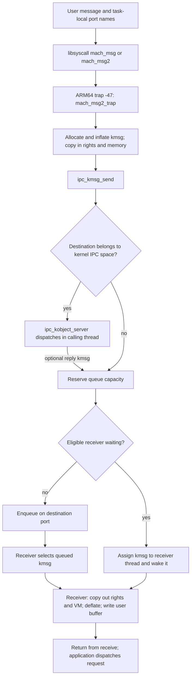
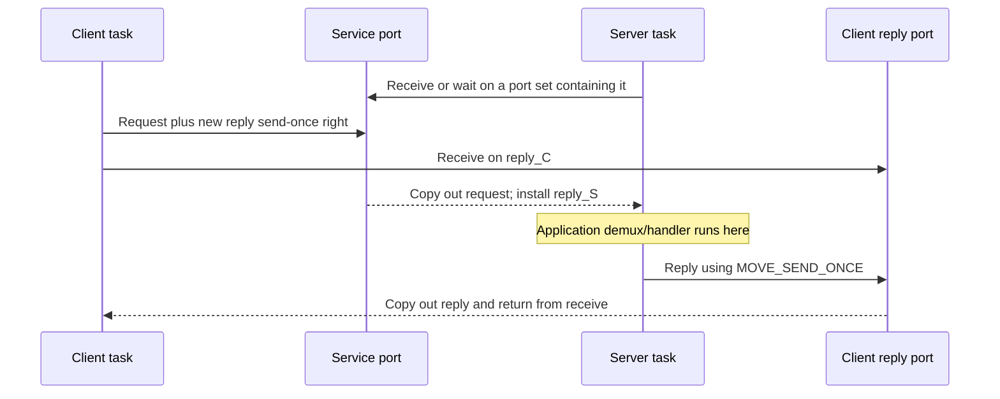

# A message from userspace to its receiver

[IPC overview](README.md) · [Names and rights](names-and-rights.md) · [Detailed send and receive](message-send-receive.md)

A Mach message is a byte sequence plus an ownership transfer. The kernel copies its ordinary bytes, resolves port names in the sender's IPC space, and turns memory descriptors into VM objects. It then gives the resulting `ipc_kmsg` to a destination or queues it until a receiver is ready. Receiving creates names and mappings in the receiving task before copying the user representation to its buffer. A successful send means transport accepted the message; it does not mean a userspace handler has executed. [`ipc_kmsg_copyin_from_user()`](../../../xnu/osfmk/ipc/ipc_kmsg.c#L3055), [`ipc_kmsg_send()`](../../../xnu/osfmk/ipc/ipc_kmsg.c#L5129), [`mach_msg_receive_results()`](../../../xnu/osfmk/ipc/mach_msg.c#L279).

This chapter follows the modern LP64/ARM64 userspace route in this checkout. [The companion chapter](message-send-receive.md) follows allocation, rights, queue locks, blocking, copyout, and failure cleanup in detail. Read [ports and rights lifetime](ports-and-rights-lifecycle.md) for the name-table operations below those calls, and [kernel RPC and exceptions](kernel-rpc-and-exceptions.md) for dispatch after the transport boundary.

## The stages and the actual delivery point



For a **userspace server**, the kernel delivery endpoint is its receive right. A request resides either in that port's message queue or in a selected receiver thread's `ith_kmsg`. The eventual application handler runs after receive copyout and trap return. XNU does not infer a userspace function address from `msgh_id`. A user library or generated MIG demultiplexer interprets that ID. The checked-in `mach_msg_server_once()` demonstrates this boundary: receive completes, then the library calls the supplied `demux` function. [`ipc_mqueue_post()`](../../../xnu/osfmk/ipc/ipc_mqueue.c#L640), [`mach_msg_server_once()`](../../../xnu/libsyscall/mach/mach_msg.c#L561).

[The userspace server invokes its demultiplexer after receive succeeds](../../../xnu/libsyscall/mach/mach_msg.c#L627).

<!-- source-excerpt: ../../../xnu/libsyscall/mach/mach_msg.c#L627-L632 -->
```c
	if (mr == MACH_MSG_SUCCESS) {
		/* we have a request message */

		old_state = voucher_mach_msg_adopt(&bufRequest->Head);

		(void) (*demux)(&bufRequest->Head, &bufReply->Head);
```

For a **kernel kobject**, `ipc_kmsg_send()` recognizes a destination in `ipc_space_kernel`, unlocks the port, and directly calls `ipc_kobject_server()`. This is execution in the current kernel call path, not dispatch to a generic kernel server thread. A returned reply kmsg continues into the ordinary reply-port delivery path; a null result means no immediate reply. Typed MIG conversion, method lookup, and error replies are covered by [kernel RPC](kernel-rpc-and-exceptions.md). [`ipc_kmsg_send()`](../../../xnu/osfmk/ipc/ipc_kmsg.c#L5218).

For a **userspace exception server**, the producer is a kernel exception RPC, but the handler's receive port still uses the message delivery and userspace copyout machinery. The exception handler runs in its own task after receiving. For a user fault, the faulting thread's exception path waits for/interprets the reply; it is not the userspace handler's execution context. Follow the [exception delivery trace](exception-delivery.md) for action selection, exception message construction, and reply validation. [`exception_deliver()`](../../../xnu/osfmk/kern/exception.c#L192), [`kernel_mach_msg_rpc_common()`](../../../xnu/osfmk/kern/ipc_mig.c#L334).

## What is in a message

The public header is 24 bytes in userspace. Its first fields describe bits and total message size; three names describe destination, optional reply right, and voucher; the integer ID belongs to the protocol. In a kernel build, `mach_port_t` in this header can represent a port pointer, so the kernel header occupies 32 bytes. `mach_msg_user_header_t` explicitly preserves the 24-byte user format even in kernel code. [`message.h`](../../../xnu/osfmk/mach/message.h#L660).

[Public header and its kernel/user size assertion](../../../xnu/osfmk/mach/message.h#L609).

<!-- source-excerpt: ../../../xnu/osfmk/mach/message.h#L609-L618 -->
```c

typedef struct {
	mach_msg_bits_t               msgh_bits;
	mach_msg_size_t               msgh_size;
	mach_port_t                   msgh_remote_port;
	mach_port_t                   msgh_local_port;
	mach_port_name_t              msgh_voucher_port;
	mach_msg_id_t                 msgh_id;
} mach_msg_header_t;
xnu_static_assert_struct_size_kernel_user(mach_msg_header_t, 32, 24);
```

| Part | User representation | Kernel treatment |
|---|---|---|
| `msgh_bits` | Remote/local/voucher dispositions plus flags such as `MACH_MSGH_BITS_COMPLEX` | Dispositions determine which rights are copied, moved, or made. Flags are validated and normalized. |
| `msgh_size` | Message bytes including header, descriptor count/descriptors, and inline payload; excludes receive trailer | Modern send uses the separate packed send size, then computes the inflated kernel size. |
| Remote name | Destination right in sender's IPC space | Becomes an owned destination port reference/right. On receive the destination name is reported as **local**. |
| Local name | Optional reply right to transfer | Becomes a reply port object; on receive its newly translated name is **remote**. It is not a sender identity field. |
| Voucher name | Optional voucher capability | The port is kept separately in `ikm_voucher_port` during kernel processing. |
| `msgh_id` | Protocol message number | Opaque to ordinary queueing; a server demultiplexer gives it meaning. |

With `MACH_MSGH_BITS_COMPLEX`, a four-byte `mach_msg_body_t` descriptor count follows the header. Descriptors immediately follow that count; ordinary inline bytes follow them. A noncomplex message can still contain arbitrary inline data. The kernel only interprets port names/addresses in declared header fields and descriptors: an integer in inline data is not automatically transferred as a capability. [`message format comment`](../../../xnu/osfmk/mach/message.h#L369), [`descriptor measurement`](../../../xnu/osfmk/ipc/ipc_kmsg.c#L2730).

| Descriptor | Important fields | Owned representation after copyin |
|---|---|---|
| `mach_msg_port_descriptor_t` | `name`, `disposition`, `type` | A port pointer and normalized right type. |
| `mach_msg_ool_descriptor_t` | `address`, `size`, `deallocate`, `copy`, `type` | A `vm_map_copy_t`, with requested byte length. |
| `mach_msg_ool_ports_descriptor_t` | `address`, `count`, `disposition`, `deallocate`, `copy` | An allocated array of kernel port objects, each with a transferred right. |
| `mach_msg_guarded_port_descriptor_t` | `name`, `context`, `flags`, `disposition` | A receive-right transfer with guard checks; this implementation accepts `MOVE_RECEIVE`. |

User descriptors have varying sizes: a user port descriptor is 12 bytes; a 64-bit OOL memory descriptor is 16 bytes, versus 12 for its 32-bit form. They therefore cannot be walked as an array of equally sized `mach_msg_descriptor_t` unions. Kernel descriptors have a uniform `KERNEL_DESC_SIZE`; inflation and deflation bridge those representations. [`port descriptor`](../../../xnu/osfmk/mach/message.h#L409), [`OOL descriptor layouts`](../../../xnu/osfmk/mach/message.h#L438), [`guarded descriptor validation`](../../../xnu/osfmk/ipc/ipc_kmsg.c#L2527).

[The 64-bit OOL descriptor carries an address and transfer controls](../../../xnu/osfmk/mach/message.h#L449).

<!-- source-excerpt: ../../../xnu/osfmk/mach/message.h#L449-L457 -->
```c
typedef struct {
	uint64_t                      address;
	boolean_t                     deallocate: 8;
	mach_msg_copy_options_t       copy: 8;
	unsigned int                  pad1: 8;
	mach_msg_descriptor_type_t    type: 8;
	mach_msg_size_t               size;
} mach_msg_ool_descriptor64_t;
xnu_static_assert_struct_size(mach_msg_ool_descriptor64_t, 16);
```

The **trailer** is receive metadata appended after the message. Requested formats add sequence number, security token, audit token, and port context to the minimal type/size trailer. Its size must fit in the receive capacity even though it is excluded from `msgh_size`. The sequence number comes from the particular destination port when a message is selected; it does not impose a global order across a port set or force application handlers to finish in order. [`trailer definitions`](../../../xnu/osfmk/mach/message.h#L721), [`receive size check`](../../../xnu/osfmk/ipc/ipc_mqueue.c#L156).

Sender identity in the trailer comes from kernel-maintained task tokens, not an inline field supplied by the application. `ipc_kmsg_init_trailer_and_sign()` initializes those tokens at send conversion; receive-time deflation supplies the selected sequence/context and requested layout. An audit token is explicitly opaque in its public declaration. [`trailer initialization`](../../../xnu/osfmk/ipc/ipc_kmsg.c#L528), [`audit token`](../../../xnu/osfmk/mach/message.h#L755), [`trailer deflation`](../../../xnu/osfmk/ipc/ipc_kmsg.c#L4581).

[User-sender trailer identity is obtained from the task](../../../xnu/osfmk/ipc/ipc_kmsg.c#L539).

<!-- source-excerpt: ../../../xnu/osfmk/ipc/ipc_kmsg.c#L539-L550 -->
```c
	mach_msg_max_trailer_t *trailer = ipc_kmsg_get_trailer(kmsg);

	if (sender == TASK_NULL) {
		memcpy(trailer, &KERNEL_TRAILER_TEMPLATE, sizeof(*trailer));
	} else {
		bzero(trailer, sizeof(*trailer));
		trailer->msgh_trailer_type = MACH_MSG_TRAILER_FORMAT_0;
		trailer->msgh_trailer_size = MACH_MSG_TRAILER_MINIMUM_SIZE;
		task_get_tokens(sender, &trailer->msgh_sender, &trailer->msgh_audit);
	}

	ipc_kmsg_sign(kmsg, trailer);
```

## From libsyscall to the ARM64 trap

`mach_msg()` calls `mach_msg_overwrite()`. In the LP64/ARM64 implementation, that wrapper calls `mach_msg2()` using a scalar buffer or a message/auxiliary vector pair. A different receive buffer, supported voucher auxiliary reception, or auxiliary data produced by libdispatch can select vectors. Vector slot 0 is the message; slot 1 is auxiliary data. `msgv_rcv_addr`, when nonzero, supplies a distinct receive address. This is not the same concept as an OOL memory descriptor inside the message. [`mach_msg()`](../../../xnu/libsyscall/mach/mach_msg.c#L160), [`mach_msg_overwrite()`](../../../xnu/libsyscall/mach/mach_msg.c#L190), [`mach_msg_vector_t`](../../../xnu/osfmk/mach/message.h#L632).

The ordinary wrapper normally sets `MACH64_SEND_MQ_CALL`. Its macOS compatibility branch can use `MACH64_SEND_ANY` when the newer auxiliary-data support is unavailable. Message-based kernel interfaces use the appropriate kobject call mode; their generated/client paths are discussed in [kernel RPC](kernel-rpc-and-exceptions.md). Do not equate the public `mach_msg()` function with the deprecated `mach_msg_overwrite_trap()`: the wrapper here uses the modern trap. [`wrapper call mode`](../../../xnu/libsyscall/mach/mach_msg.c#L287), [`legacy trap comment`](../../../xnu/osfmk/ipc/mach_msg.c#L805).

`mach_msg2()` packs five pairs of 32-bit fields into the eight-argument trap ABI. The helper reads the descriptor count only for a complex send. Its packing operation is the exact contract the kernel reverses:

[Packing the modern message arguments](../../../xnu/osfmk/mach/message.h#L1540).

<!-- source-excerpt: ../../../xnu/osfmk/mach/message.h#L1540-L1547 -->
```c
#define MACH_MSG2_SHIFT_ARGS(lo, hi) ((uint64_t)hi << 32 | (uint32_t)lo)
	return mach_msg2_internal(data, option64,
	           MACH_MSG2_SHIFT_ARGS(header.msgh_bits, send_size),
	           MACH_MSG2_SHIFT_ARGS(header.msgh_remote_port, header.msgh_local_port),
	           MACH_MSG2_SHIFT_ARGS(header.msgh_voucher_port, header.msgh_id),
	           MACH_MSG2_SHIFT_ARGS(descriptors, rcv_name),
	           MACH_MSG2_SHIFT_ARGS(rcv_size, priority), timeout);
#undef MACH_MSG2_SHIFT_ARGS
```

| Trap argument | Low 32 bits | High 32 bits |
|---|---|---|
| `msgh_bits_and_send_size` | Header bits | Scalar send bytes; vector send count in vector mode |
| `msgh_remote_and_local_port` | Remote name | Local/reply name |
| `msgh_voucher_and_id` | Voucher name | Message ID |
| `desc_count_and_rcv_name` | Descriptor count | Receive port/port-set name |
| `rcv_size_and_priority` | Scalar receive capacity; vector receive count in vector mode | Message priority |

The other arguments are `data`, the 64-bit option word, and `timeout`. The kernel casts timeout to `mach_msg_timeout_t`; queue waits convert it from milliseconds to a deadline. In vector mode actual byte sizes live in the copied vector entries, while the packed size positions hold vector counts. [`mach_msg2_trap()`](../../../xnu/osfmk/ipc/mach_msg.c#L927), [`deadline conversion`](../../../xnu/osfmk/ipc/ipc_mqueue.c#L473).

`mach_msg2_internal()` strips library-only interruption controls and calls the assembly trap entry. The shared trap declaration is `kernel_trap(mach_msg2_trap, -47, 8)`. On ARM64 the macro places the negative trap number in `x16`, executes `svc`, then returns to the caller after kernel exit. [`libsyscall call`](../../../xnu/libsyscall/mach/mach_msg.c#L106), [`trap declaration`](../../../xnu/osfmk/mach/syscall_sw.h#L128).

[ARM64 trap stub macro](../../../xnu/osfmk/mach/arm/syscall_sw.h#L110).

<!-- source-excerpt: ../../../xnu/osfmk/mach/arm/syscall_sw.h#L110-L117 -->
```c
#define kernel_trap(trap_name, trap_number, num_args) \
.globl _##trap_name                                           %% \
.text                                                         %% \
.align  2                                                     %% \
_##trap_name:                                                 %% \
    mov x16, #(trap_number)                                   %% \
    svc #SWI_SYSCALL                                          %% \
    ret
```

The exception entry reaches `handle_svc()`, which sends negative syscall numbers through `mach_syscall()` after handling special time traps. `mach_syscall()` negates the number to index `mach_trap_table`, extracts arguments from saved user state, applies enabled trap filters, invokes the selected C function, and writes the result register. Slot 47 names `mach_msg2_trap`. This transport trap is distinct from an individual Mach RPC method ID. See [platform entry/return](../platform/README.md) for saved-state and return mechanics. [`handle_svc()`](../../../xnu/osfmk/arm64/sleh.c#L2743), [`argument extraction`](../../../xnu/osfmk/arm64/bsd_arm64.c#L87), [`mach_syscall()`](../../../xnu/osfmk/arm64/bsd_arm64.c#L194), [`table slot`](../../../xnu/osfmk/kern/syscall_sw.c#L154).

## The trap's two operations

`mach_msg2_trap()` derives effective options from the current task's IPC policy and performs option preflight. It then builds `send_uctx.send_header` directly from the packed fields. `msgh_size` starts at zero in that temporary header because the separately supplied size is authoritative. The body/descriptor bytes are subsequently copied from the supplied message address; the first 24 bytes are not recopied to obtain these already supplied header fields. [`trap unpacking`](../../../xnu/osfmk/ipc/mach_msg.c#L965), [`get and inflate`](../../../xnu/osfmk/ipc/ipc_kmsg.c#L2891).

[The kernel synthesizes its user-header context from trap arguments](../../../xnu/osfmk/ipc/mach_msg.c#L965).

<!-- source-excerpt: ../../../xnu/osfmk/ipc/mach_msg.c#L965-L977 -->
```c
	if (option64 & MACH64_SEND_MSG) {
		mach_msg_send_uctx_t send_uctx = {
			.send_header = {
				.msgh_bits         = (mach_msg_bits_t) (mb_ss),
				.msgh_size         = 0,
				.msgh_remote_port  = (mach_port_name_t)(mr_lp),
				.msgh_local_port   = (mach_port_name_t)(mr_lp >> 32),
				.msgh_voucher_port = (mach_port_name_t)(mv_id),
				.msgh_id           = (mach_msg_id_t)   (mv_id >> 32),
			},
			.send_dsc_count = (mach_msg_size_t)dc_rn,
		};
		mach_msg_priority_t priority = (mach_msg_priority_t)(rs_pr >> 32);
```

Sending and receiving are sequential operations. A send error skips receive. Once send succeeds, receive validation can still fail, or receive can time out. There is no rollback of a request already delivered to its destination. The same invocation can therefore return a receive error after the server has started work. With scalar arguments the receive normally overwrites the original buffer; vectors permit a separate receive address. [`send/receive boundary`](../../../xnu/osfmk/ipc/mach_msg.c#L1003), [`receive address selection`](../../../xnu/osfmk/ipc/mach_msg.c#L1021).

[A send failure prevents entering the receive branch](../../../xnu/osfmk/ipc/mach_msg.c#L1006).

<!-- source-excerpt: ../../../xnu/osfmk/ipc/mach_msg.c#L1006-L1015 -->
```c
send_fail:
	/* if send failed, skip receive */
	if (mr != MACH_MSG_SUCCESS) {
		KDBG(MACHDBG_CODE(DBG_MACH_IPC, MACH_IPC_KMSG_INFO) | DBG_FUNC_END, mr);
		goto end;
	}

	if (option64 & MACH64_RCV_MSG) {
		mach_port_name_t    rcv_name   = (mach_port_name_t)(dc_rn >> 32);
		mach_port_name_t    sync_send  = MACH_PORT_NULL;
```

## A request/reply exchange without confusing the names

Suppose client C holds a send right named `service_C` to a service port whose receive right is `service_S` in server S. C also holds a permitted reply receive right named `reply_C`. These names belong to different IPC spaces; their numeric values need not match. The example assumes the applicable reply-port and destination policies permit the exchange; see [policy and attribution](policies-and-attribution.md).

| Moment | Remote field | Local field | What the rights mean |
|---|---|---|---|
| C sends request | `service_C`, `COPY_SEND` | `reply_C`, `MAKE_SEND_ONCE` | Keep C's service send right; make a send-once right from C's reply receive right. |
| S receives request | A new name `reply_S`, `PORT_SEND_ONCE` | `service_S`, `PORT_SEND` | S owns the reply send-once right. The local field identifies the receive endpoint; it does not grant a new service send right. |
| S sends reply | `reply_S`, `MOVE_SEND_ONCE` | Null | Consume the one-use reply capability. |
| C receives reply | Null | `reply_C`, `PORT_SEND_ONCE` | The destination right has been consumed by delivery; C still owns its reply receive right. |

The header fields are reversed during normal receive **after** rights are translated into the receiving namespace. The disposition names `PORT_SEND`/`PORT_SEND_ONCE` describe the normalized carried right types; for these values the constants alias the corresponding move dispositions. Send-once copyout allocates a distinct name rather than merging with an existing send entry. [`header copyout`](../../../xnu/osfmk/ipc/ipc_kmsg.c#L3253), [`reply-name allocation`](../../../xnu/osfmk/ipc/ipc_kmsg.c#L3368), [right translation](ports-and-rights-lifecycle.md).

[The final normal-receive header swaps destination and reply roles](../../../xnu/osfmk/ipc/ipc_kmsg.c#L3620).

<!-- source-excerpt: ../../../xnu/osfmk/ipc/ipc_kmsg.c#L3620-L3624 -->
```c
	msg->msgh_bits = MACH_MSGH_BITS_SET(reply_type, dest_type,
	    voucher_type, mbits);
	msg->msgh_local_port = CAST_MACH_NAME_TO_PORT(dest_name);
	msg->msgh_remote_port = CAST_MACH_NAME_TO_PORT(reply_name);
	msg->msgh_voucher_port = voucher_name;
```



The client can start its receive before or after the reply is posted. The queue covers that race. `mach_msg_server_once()` explicitly sends a reply using the received reply capability; MIG code can move that capability from the request header into its reply. The kernel transport does not automatically create an application reply just because the request had a local port. [`userspace demux and reply send`](../../../xnu/libsyscall/mach/mach_msg.c#L631).

## Where to continue and what was inspected

Follow [detailed send and receive](message-send-receive.md) for the precise ownership sequence, queue reservations, direct receiver delivery, port sets, OOL memory, and error handling. Follow [kernel RPC and exceptions](kernel-rpc-and-exceptions.md) when the destination executes a kernel interface or the producer is an exception path.

| Inspection depth | Sources | Scope and limits |
|---|---|---|
| Function-body trace | [`libsyscall/mach_msg.c`](../../../xnu/libsyscall/mach/mach_msg.c), [`message.h`](../../../xnu/osfmk/mach/message.h), [`ipc/mach_msg.c`](../../../xnu/osfmk/ipc/mach_msg.c) | Modern wrapper, vectors, packed ABI, restart handling, server-once receive/demux/reply, send/receive phases. Legacy ABI is navigation only. |
| Function-body trace | [`ipc_kmsg.c`](../../../xnu/osfmk/ipc/ipc_kmsg.c), [`ipc_mqueue.c`](../../../xnu/osfmk/ipc/ipc_mqueue.c) | Allocation/inflation, header/body conversion, representative OOL paths, delivery, blocking, copyout and cleanup; expanded in the companion chapter. |
| Targeted entry-path read | [`ARM trap macro`](../../../xnu/osfmk/mach/arm/syscall_sw.h), [`syscall_sw.c`](../../../xnu/osfmk/kern/syscall_sw.c), [`sleh.c`](../../../xnu/osfmk/arm64/sleh.c), [`bsd_arm64.c`](../../../xnu/osfmk/arm64/bsd_arm64.c) | ARM64 SVC dispatch and C-call boundary. Full exception-vector/register preservation analysis remains in platform documentation. |
| Boundary review | [`ipc_policy.c`](../../../xnu/osfmk/ipc/ipc_policy.c), [`ipc_kobject.c`](../../../xnu/osfmk/kern/ipc_kobject.c), [`ipc_mig.c`](../../../xnu/osfmk/kern/ipc_mig.c), [`exception.c`](../../../xnu/osfmk/kern/exception.c) | Destination policy and kernel/user server distinction. Full RPC/exception traces are owned by the linked guide. Generated MIG source and external libdispatch implementation were not built or inspected. |

The snippets are exact ranges from this checkout. These are static source traces, not execution measurements; enabled platform, policy, and configuration branches still matter.
