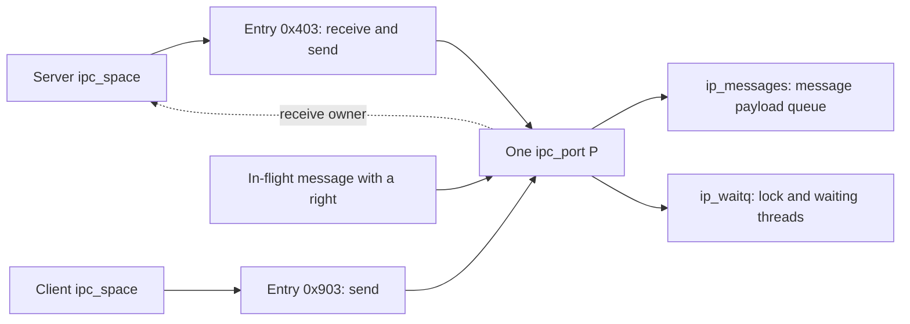
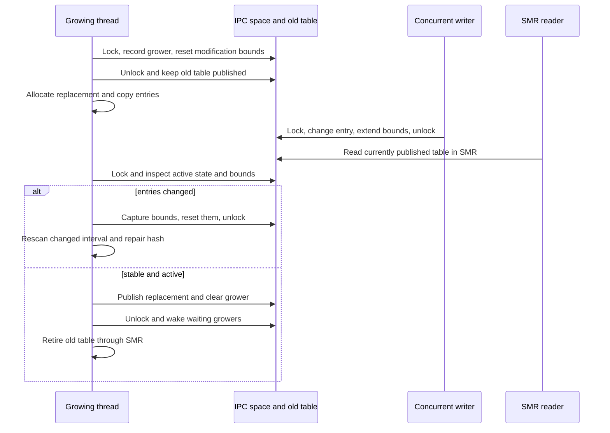

# Port names, namespace entries, and references

[IPC overview](README.md) · [Port and right lifecycle](ports-and-rights-lifecycle.md) · [Message transport](message-path.md)

A Mach port name identifies an entry in one IPC space. That entry records rights to a kernel object; the integer is neither the object pointer nor an identifier shared by all processes. To follow a right across a message, track three things separately: the sender's entry, the owned right in the kernel message, and the receiver's entry after copyout. The endpoint can remain the same while its names, owners, and reference counts change. [`ipc_object_copyin`](../../../xnu/osfmk/ipc/ipc_object.c#L526), [`ipc_object_copyout`](../../../xnu/osfmk/ipc/ipc_object.c#L853).

[IPC spaces and entries](../../structures/ipc-spaces-and-entries.md) expands the structure layout, name arithmetic, allocation/publication and table-reader protocols. [Ports and kobjects](../../structures/ipc-ports-and-kobjects.md) follows the entry's object pointer into the endpoint's state-dependent representation, references and conversion rules.



The names in this diagram are illustrative valid encodings, not promised allocator output. A task can also have several distinct send-once entries referring to the same port. Ordinary send and receive rights coalesce into one name per space through the reverse-lookup rules. [`ipc_right_reverse`](../../../xnu/osfmk/ipc/ipc_right.c#L362), [`copyout entry selection`](../../../xnu/osfmk/ipc/ipc_object.c#L932).

## 1. Read the current structures before reading old Mach descriptions

| Structure | Fields and interpretation | Protection and ownership |
| --- | --- | --- |
| `ipc_space` | `is_table` is an SMR-published typed entry table; `is_task` connects the namespace to its task; `is_policy` and `is_label` hold policy; free/hash counts and `is_grower` support allocation. | `is_lock` is a ticket lock. A null published table marks an inactive space. The space itself has a separate reference count in `is_bits`. |
| `ipc_entry` | Object pointer union; rights/generation/user-reference bits; request/free-list union; reverse-hash metadata; retirement overlay. | The space lock stabilizes mutation. Removal/identity-changing paths also lock the object; some copyout accounting finishes after unlocking it while the entry still holds a reference. The entry has no independent reference count. |
| `ipc_object` | Shared initial header of ports and port sets: immutable `io_type`, mutable `io_state`, `io_references`, and label storage. | Type can be inspected without the object lock; state/label access has a lock and accessor protocol. References keep storage alive. |
| `ipc_port` | Object header, wait queue, message queue, state-dependent receiver/destination/timestamp, rights counters, notifications, turnstile, context. | Its lock is the wait-queue lock. Receive ownership and object lifetime are different properties. |
| `ipc_pset` | Object header, `ips_wqset`, and `ips_klist`. | A wait-set object with its own lock, reference count, and namespace entry; member ports retain their own payload queues. |

Source definitions: [`ipc_space`](../../../xnu/osfmk/ipc/ipc_space.h#L141), [`ipc_entry`](../../../xnu/osfmk/ipc/ipc_entry.h#L109), [`ipc_object`](../../../xnu/osfmk/ipc/ipc_object.h#L225), [`ipc_port`](../../../xnu/osfmk/ipc/ipc_port.h#L119), [`ipc_pset`](../../../xnu/osfmk/ipc/ipc_pset.h#L77).

### The space and entry table

The task's usual namespace is `task->itk_space`. Special spaces also exist for kernel-owned rights. An active space's table can grow while readers are running; `is_grower`, modified-index bounds, and SMR retirement coordinate publication and cleanup. Obtain the table size using the typed-table helpers. In particular, the historical comment in `ipc_space.h` mentioning `is_table[0].ie_size` does not describe the current `ipc_entry` fields. [`ipc_space_create`](../../../xnu/osfmk/ipc/ipc_space.c#L275), [`ipc_entry_grow_table`](../../../xnu/osfmk/ipc/ipc_entry.c), [`table retirement`](../../../xnu/osfmk/ipc/ipc_space.c#L132).

[ipc_space namespace and growth state — source lines 141–154](../../../xnu/osfmk/ipc/ipc_space.h#L141):

<!-- source-excerpt: ../../../xnu/osfmk/ipc/ipc_space.h#L141-L154 -->
```c
struct ipc_space {
	lck_ticket_t    is_lock;
	os_ref_atomic_t is_bits;        /* holds refs, active, growing */
	ipc_entry_num_t is_table_hashed;/* count of hashed elements */
	ipc_entry_num_t is_table_free;  /* count of free elements */
	unsigned int    is_entropy[IS_ENTROPY_CNT]; /* pool of entropy taken from RNG */
	struct bool_gen is_prng;
	SMR_POINTER(ipc_entry_table_t XNU_PTRAUTH_SIGNED_PTR("ipc_space.is_table")) is_table; /* an array of entries */
	task_t XNU_PTRAUTH_SIGNED_PTR("ipc_space.is_task") is_task; /* associated task */
	unsigned long   is_policy;      /* manually dPACed, ipc_space_policy_t */
	thread_t        is_grower;      /* thread growing the space */
	ipc_label_t     is_label;       /* [private] mandatory access label */
	ipc_entry_num_t is_low_mod;     /* lowest modified entry during growth */
	ipc_entry_num_t is_high_mod;    /* highest modified entry during growth */
```

The entry has **two separate unions**. Its first union provides typed aliases for an object pointer, a volatile lookup alias, and `ie_self` used when retiring the whole table. Its second union overlays all normal bits/request/hash fields with `ie_smr_node`. `ie_request` is a notification-request index, not a pointer to the object or the receiver. For a free entry, the same word is `ie_next`, linking free slots. `ie_dist` and `ie_index` belong to the object-to-name reverse hash; they are not the generation or the current entry's object pointer. [`entry layout and hash description`](../../../xnu/osfmk/ipc/ipc_entry.h#L85).

[ipc_entry unions — source lines 109–131](../../../xnu/osfmk/ipc/ipc_entry.h#L109):

<!-- source-excerpt: ../../../xnu/osfmk/ipc/ipc_entry.h#L109-L131 -->
```c
struct ipc_entry {
	union {
		struct ipc_object *XNU_PTRAUTH_SIGNED_PTR("ipc_entry.ie_object") ie_object;
		struct ipc_port   *XNU_PTRAUTH_SIGNED_PTR("ipc_entry.ie_object") ie_port;
		struct ipc_pset   *XNU_PTRAUTH_SIGNED_PTR("ipc_entry.ie_object") ie_pset;
		struct ipc_object *XNU_PTRAUTH_SIGNED_PTR("ipc_entry.ie_object") volatile ie_volatile_object;
		struct ipc_entry_table *XNU_PTRAUTH_SIGNED_PTR("ipc_entry.ie_self") ie_self;
	};
	union {
		struct {
			ipc_entry_bits_t    ie_bits;
			union {
				mach_port_index_t ie_next;         /* next in freelist, or...  */
				ipc_table_index_t ie_request;      /* dead name request notify */
			};

			/* hash fields */
			uint32_t            ie_dist;
			mach_port_index_t   ie_index;
		};
		struct smr_node             ie_smr_node;
	};
};
```

Index zero is reserved and holds the free-list head during normal operation. On retirement, `ipc_space_retire_table` stores the table pointer in that base entry's `ie_self` and uses its `ie_smr_node` for the deferred free callback. The union is a reuse of storage at different lifetime stages; it does not mean that every active entry simultaneously contains an SMR callback. [`ipc_space_retire_table`](../../../xnu/osfmk/ipc/ipc_space.c#L132).

### Common header, port, and message queue

`io_type` identifies the kernel object kind, such as a regular port, service port, kobject port, or port set. It is different from the entry's `MACH_PORT_TYPE_SEND`/`RECEIVE` rights. `io_state` describes whether an object is active and where a receive right resides. `io_references` controls storage lifetime. The label union can identify service, bootstrap, connection, kobject, or timer state; use `io_label_get`/`ip_label_put` and related helpers rather than assuming its pointer is stable. The source requires the object lock while a resolved label value is live. [`ipc_object` field contracts](../../../xnu/osfmk/ipc/ipc_object.h#L190), [`label lifetime`](../../../xnu/osfmk/ipc/ipc_object.h#L257).

[ipc_object reference count and label union — source lines 243–253](../../../xnu/osfmk/ipc/ipc_object.h#L243):

<!-- source-excerpt: ../../../xnu/osfmk/ipc/ipc_object.h#L243-L253 -->
```c
	os_ref_atomic_t                         io_references;
	union {
		/* these are dPACed when on a port header */
		const void                      *iol_pointer;
		unsigned long                    iol_value;
		struct ipc_service_port_label   *iol_service;
		struct ipc_bootstrap_port_label *iol_bootstrap;
		struct ipc_conn_port_label      *iol_connection;
		struct ipc_kobject_label        *iol_kobject;
		struct mk_timer                 *iol_mktimer;
	};
```

The current `ipc_port` embeds `ip_waitq` and `ip_messages` as separate members. `ipc_mqueue` contains the message list, receive sequence number/name, counts, limit, and a union used for event/scheduling integration. It does **not** contain its own wait queue. `ip_receiver_name` is a macro alias for `ip_messages.imq_receiver_name`. [`ipc_port` wait queue](../../../xnu/osfmk/ipc/ipc_port.h#L119), [`receiver-name alias`](../../../xnu/osfmk/ipc/ipc_port.h#L216).

[ipc_mqueue payload state — source lines 83–93](../../../xnu/osfmk/ipc/ipc_mqueue.h#L83):

<!-- source-excerpt: ../../../xnu/osfmk/ipc/ipc_mqueue.h#L83-L93 -->
```c
typedef struct ipc_mqueue {
	circle_queue_head_t     imq_messages;
	mach_port_seqno_t       imq_seqno;
	mach_port_name_t        imq_receiver_name;
	uint16_t                imq_msgcount;
	uint16_t                imq_qlimit;
	/*
	 * The imq_context structure member fills in a 32-bit padding gap
	 * in ipc_mqueue.
	 */
	uint32_t                imq_context;
```

The receiver union must be decoded from object state: `ip_receiver` is valid in a space, `ip_destination` is the referenced port carrying a receive right in transit, and `ip_timestamp` records death. A nonzero union value is not by itself evidence of a valid receiving task. Further unions distinguish ordinary no-senders requests from kobject state and distinguish special-reply/watchport/port-destroyed state. [`port union contracts`](../../../xnu/osfmk/ipc/ipc_object.h#L122).

[ipc_port queue and receiver union — source lines 152–162](../../../xnu/osfmk/ipc/ipc_port.h#L152):

<!-- source-excerpt: ../../../xnu/osfmk/ipc/ipc_port.h#L152-L162 -->
```c
	struct ipc_mqueue               ip_messages;

	/*
	 * IMPORTANT: Direct access of unionized fields are highly discouraged.
	 * Use accessor functions below and see header doc for possible states.
	 */
	union {
		struct ipc_space       *XNU_PTRAUTH_SIGNED_PTR("ipc_port.ip_receiver") ip_receiver;
		struct ipc_port        *XNU_PTRAUTH_SIGNED_PTR_AUTH_NULL("ipc_port.ip_destination") ip_destination;
		ipc_port_timestamp_t    ip_timestamp;
	};
```

A port set has no shared message payload queue into which its members' messages are copied. Membership links port wait queues to `ips_wqset`; a receive waits for a ready member. This checkout supports insertion into a set without removing membership in other sets; `mach_port_move_member` has the separate behavior of unlinking all except the chosen set. [`mach_port_insert_member`](../../../xnu/osfmk/ipc/mach_port.c#L2153), [`mach_port_move_member`](../../../xnu/osfmk/ipc/mach_port.c#L1403), [transport and waiting](message-path.md).

[ipc_pset layout — source lines 77–84](../../../xnu/osfmk/ipc/ipc_pset.h#L77):

<!-- source-excerpt: ../../../xnu/osfmk/ipc/ipc_pset.h#L77-L84 -->
```c
struct ipc_pset {
	/*
	 * Initial sub-structure in common with all ipc_objects.
	 */
	struct ipc_object       ips_object;
	struct waitq_set        ips_wqset;
	struct klist            ips_klist;
};
```

## 2. A name combines a slot index with a finite generation

The public encoding reserves the low byte for generation information and shifts the index by eight bits:

[Mach port name encoding — source lines 278–280](../../../xnu/osfmk/mach/port.h#L278):

<!-- source-excerpt: ../../../xnu/osfmk/mach/port.h#L278-L280 -->
```c
#define MACH_PORT_INDEX(name)           ((name) >> 8)
#define MACH_PORT_GEN(name)             (((name) & 0xff) << 24)
#define MACH_PORT_MAKE(index, gen)      (((index) << 8) | ((gen) >> 24))
```

For example, `0x403` selects index `4` and compares against generation bits `0x03000000`. `ipc_entry_lookup` rejects index zero, an out-of-range slot, a mismatching generation, or a slot with no right. `MACH_PORT_NULL` and `MACH_PORT_DEAD` are distinguished sentinels, not entries to dereference. A dead-name **entry** with a valid ordinary name is different from the `MACH_PORT_DEAD` sentinel. [`ipc_entry_lookup`](../../../xnu/osfmk/ipc/ipc_entry.c#L160), [`sentinel definitions`](../../../xnu/osfmk/mach/port.h#L244).

Inside `ie_bits`, user references occupy 16 bits, rights occupy five bits, extended flags occupy three, and generation/rollover state occupies eight. Six bits store the generation count. `IE_BITS_GEN` presents the two low generation bits as set regardless of the internal rollover selector; externally selected names are checked with `ipc_entry_name_mask`. Do not describe the scheme as a simple monotonically increasing eight-bit counter. [`bit definitions`](../../../xnu/osfmk/ipc/ipc_entry.h#L141), [`ipc_entry_name_mask`](../../../xnu/osfmk/ipc/ipc_entry.c#L112).

[ipc_entry_next_gen — source lines 137–148](../../../xnu/osfmk/ipc/ipc_entry.c#L137):

<!-- source-excerpt: ../../../xnu/osfmk/ipc/ipc_entry.c#L137-L148 -->
```c
static ipc_entry_bits_t
ipc_entry_next_gen(ipc_entry_bits_t oldgen, ipc_space_t space)
{
	ipc_entry_bits_t roll = oldgen & IE_BITS_ROLL_MASK;
	ipc_entry_bits_t delta = IE_BITS_GEN_ONE + (roll << IE_BITS_ROLL_BITS);
	ipc_entry_bits_t newgen;

	if (os_add_overflow(oldgen, delta, &newgen)) {
		newgen = ipc_entry_make_gen(0, space);
	}
	return newgen;
}
```

The rollover selector changes the increment and is randomized when the generation wraps. The comment above `ipc_entry_make_gen` lists possible periods of 64, 32, 22, or 16 reuses. `ipc_entry_claim` removes a free slot, advances generation, clears the request field, stores the object, and constructs the name. `ipc_entry_dealloc` returns the slot to the free list while preserving generation/rollover bits. This catches many stale-name errors but does not create a permanently unique identifier. [`generation initialization`](../../../xnu/osfmk/ipc/ipc_entry.c#L118), [`claim`](../../../xnu/osfmk/ipc/ipc_entry.c#L251), [`deallocation`](../../../xnu/osfmk/ipc/ipc_entry.c#L499).

## 3. Rights, user references, and object references count different things

| Quantity | What it counts | What it does not count |
| --- | --- | --- |
| Entry `MACH_PORT_TYPE_*` bits | Rights represented by this name | Port class, outstanding messages, or allocated references |
| `IE_BITS_UREFS` | User references to the entry's send/send-once/dead-name right | Total senders in all tasks |
| `ip_srights` | Kernel send-right instances, including one per space entry that has send rights and standalone rights held by messages/kernel code | The sum of all send user references |
| `ip_sorights` | Send-once right instances | The make-send count or ordinary send rights |
| `ip_mscount` | Make-send events since initialization/reset | Copy-send events, uref additions, or a lifetime-global sequence number |
| `io_references` | References keeping the port allocation alive, including entries and standalone right holders | Whether the endpoint is active or still has a receiver |

The representation deliberately shares one object reference for a combined send/receive entry. A receive-only or port-set entry stores zero in the uref field even though `mach_port_get_refs` reports its implicit single user reference. A send-once entry stores one and never coalesces with another send-once right. A combined send/receive entry stores its **send** urefs; its receive right remains unique. [`mach_port_get_refs`](../../../xnu/osfmk/ipc/mach_port.c#L804), [`allocation initialization`](../../../xnu/osfmk/ipc/ipc_port.c#L905), [`copyout`](../../../xnu/osfmk/ipc/ipc_right.c#L2587).

The distinction between making and copying a standalone send right is visible in these small functions. Both add a send-right instance and an object reference; only making one increments `ip_mscount`:

[ipc_port_make_send_any_locked — source lines 2841–2850](../../../xnu/osfmk/ipc/ipc_port.c#L2841):

<!-- source-excerpt: ../../../xnu/osfmk/ipc/ipc_port.c#L2841-L2850 -->
```c
ipc_port_t
ipc_port_make_send_any_locked(
	ipc_port_t      port)
{
	require_ip_active(port);
	port->ip_mscount++;
	ip_srights_inc(port);
	ip_reference(port);
	return port;
}
```

[ipc_port_copy_send_any_locked — source lines 2892–2899](../../../xnu/osfmk/ipc/ipc_port.c#L2892):

<!-- source-excerpt: ../../../xnu/osfmk/ipc/ipc_port.c#L2892-L2899 -->
```c
void
ipc_port_copy_send_any_locked(
	ipc_port_t      port)
{
	assert(port->ip_srights > 0);
	ip_srights_inc(port);
	ip_reference(port);
}
```

When a standalone send right is copied into a space that already has one, `ipc_right_copyout_any_send` consumes the redundant send-right instance and object reference, then increments that entry's urefs. If the space only has a receive entry, it adds the send capability but releases the extra object reference because the entry already owns one. A fresh send-only entry acquires both. [`send copyout cases`](../../../xnu/osfmk/ipc/ipc_right.c#L2639).

### A concrete server/client accounting trace

Assume an ordinary movable port `P`, no extra kernel references, no pending notification requests, unsaturated urefs, and no concurrency. The server `S` gets name `0x403`; client `C` will get `0x903`. `R` denotes receive and `S(n)` denotes send with `n` urefs. The object-reference column counts only references to `P`, not transport destination ports.

| Step | Server entry | Client entry | `P.ip_srights` | `P.io_references` | `P.ip_mscount` |
| --- | --- | --- | ---: | ---: | ---: |
| Allocate receive in server | `R` | — | 0 | 1 | 0 |
| Insert `MAKE_SEND` at server's same name | `R + S(1)` | — | 1 | 1 | 1 |
| `mod_refs(SEND, +2)` in server | `R + S(3)` | — | 1 | 1 | 1 |
| Copy one send right into a message to client, before delivery | `R + S(3)` | — | 2 | 2 | 1 |
| Client receives the right | `R + S(3)` | `S(1)` | 2 | 2 | 1 |
| Another `COPY_SEND` is delivered to the same client | `R + S(3)` | `S(2)` under the **same** name | 2 | 2 | 1 |
| Client deallocates one uref | `R + S(3)` | `S(1)` | 2 | 2 | 1 |
| Client moves its last send right into a message back to server | `R + S(3)` | — | 2 | 2 | 1 |
| Server receives and merges that right | `R + S(4)` | — | 1 | 1 | 1 |
| Server removes all four send urefs | `R` | — | 0 | 1 | 1 |

At the second delivery there is briefly an extra in-flight send right/reference; coalescing removes it. When the client moves its final send uref, its entry's reference becomes the message's reference, so the total need not change. The final row leaves a live receive endpoint; it is not port death. The implementation steps are [`same-name insertion`](../../../xnu/osfmk/ipc/ipc_object.c#L763), [`ipc_right_delta`](../../../xnu/osfmk/ipc/ipc_right.c#L1204), [`MOVE_SEND`](../../../xnu/osfmk/ipc/ipc_right.c#L2359), [`copyout`](../../../xnu/osfmk/ipc/ipc_right.c#L2587), and [`ipc_right_dealloc`](../../../xnu/osfmk/ipc/ipc_right.c#L990).

The “one message carries one reference” rule is a useful local observation for these standalone rights, not a universal formula for every port reference in the kernel. Turnstiles, kobject owners, lookups, notifications, and in-transit destination chains can introduce additional lifetime holders.

### Saturation is deliberate

Send and dead-name urefs saturate at `MACH_PORT_UREFS_MAX`. Copyout succeeds while leaving a saturated entry pegged; ordinary deallocation and move operations leave the saturated count pegged too. In `ipc_right_delta`, only a delta removing the whole saturated count changes it; underflow or an out-of-range delta is rejected. Some legacy function comments still list uref-overflow errors, so read the active implementation. [`copyout saturation`](../../../xnu/osfmk/ipc/ipc_right.c#L2676), [`delta saturation`](../../../xnu/osfmk/ipc/ipc_right.c#L1528).

## 4. Lookup stabilizes a relationship; it does not always acquire ownership

| Operation | Successful return contract |
| --- | --- |
| `ipc_right_lookup_write` | Space is locked; entry is usable while that protection remains. |
| `ipc_right_lookup_read` | Object is locked and candidate entry identity was revalidated; SMR has been exited. The caller receives bits and object, not an entry pointer to keep. |
| `ipc_object_translate` / `ipc_port_translate_receive` | Appropriate active object is locked; **no object reference is donated**. |
| `ipc_object_copyin` | Transfers or creates an owned right and performs deferred cleanup after unlocking the space. |
| `ipc_object_copyout` | Consumes the supplied right on both success and its cleanup-on-failure path. |
| `ipc_object_copyout_name` | Consumes the supplied reference on success; callers handle failure ownership explicitly. |

Sources: [`write lookup`](../../../xnu/osfmk/ipc/ipc_right.c#L273), [`read lookup`](../../../xnu/osfmk/ipc/ipc_right.c#L109), [`translate contract`](../../../xnu/osfmk/ipc/ipc_object.c#L245), [`copyin`](../../../xnu/osfmk/ipc/ipc_object.c#L526), [`copyout`](../../../xnu/osfmk/ipc/ipc_object.c#L853), [`named copyout`](../../../xnu/osfmk/ipc/ipc_object.c#L981).

Read lookup enters the IPC SMR domain, obtains the table and a candidate object, and attempts to lock that object. It reloads the table **after** taking the object lock, then verifies the slot still refers to that object and has the requested generation/right state. Table growth may retire an old table; object locking alone does not keep that table allocation alive. Conversely, SMR alone does not establish that a candidate object is the one now named by the entry. [`ipc_right_lookup_read` ordering argument](../../../xnu/osfmk/ipc/ipc_right.c#L109).

[Read lookup final identity checks — source lines 237–254](../../../xnu/osfmk/ipc/ipc_right.c#L237):

<!-- source-excerpt: ../../../xnu/osfmk/ipc/ipc_right.c#L237-L254 -->
```c
	if (__improbable(entry->ie_object != object)) {
		kr = KERN_INVALID_NAME;
		goto out_put_unlock;
	}

	ipc_entry_bits_t bits = entry->ie_bits;
	if (__improbable(IE_BITS_GEN(bits) != MACH_PORT_GEN(name) ||
	    IE_BITS_TYPE(bits) == MACH_PORT_TYPE_NONE)) {
		kr = KERN_INVALID_NAME;
		goto out_put_unlock;
	}

	/* Done with hazardous accesses to the table */
	smr_ipc_leave();

	*bitsp = bits;
	*objectp = object;
	return KERN_SUCCESS;
```

The lookup design also depends on the port/port-set zones' sequestering and cleared-memory properties, which make locking and validating a possibly stale candidate address possible. Final object-reference release calls type-specific free; safe-release variants can defer work when preemption context requires it. A reference protects storage, while the object lock and state check establish whether an operation may proceed. [`zone and lookup rationale`](../../../xnu/osfmk/ipc/ipc_object.c#L104), [`object release`](../../../xnu/osfmk/ipc/ipc_object.c#L198).

`ipc_port_lock` locks `ip_waitq`; port-set locking uses `ips_wqset`. Entry mutations ordinarily take the space lock before the port lock. Operations involving several ports or a destination chain have specialized ordering and restart rules; do not invent a general arbitrary two-port locking order from the single-port path. [`ipc_port_lock`](../../../xnu/osfmk/ipc/ipc_port.c#L163), [`port/set translation`](../../../xnu/osfmk/ipc/ipc_object.c), [`destination-chain locking`](../../../xnu/osfmk/ipc/ipc_port.c#L1321).

## 5. Growing a live namespace

An IPC table is not a process-wide array that can be resized by stopping all lookups. Writers serialize with the space lock, SMR readers can observe a published table concurrently, and allocating a larger table may block. `ipc_entry_grow_table` therefore builds a private replacement while the old table remains live, revisits entries changed during the copy, and publishes only after a final locked consistency check. The old table remains allocated until the IPC SMR domain permits retirement. [Growth protocol](../../../xnu/osfmk/ipc/ipc_entry.c#L624-L844), [SMR retirement](../../../xnu/osfmk/ipc/ipc_space.c#L122-L142).

### Capacity, free slots and reverse hashing are different constraints

`ipc_entries_hold(space, entries_needed)` checks capacity while the active space is write-locked; it does not allocate or remove entries. It first assumes all requested entries may need reverse hashing and rejects a projected hash population above `table_count * 7 / 8`. Then it follows the free list to ensure enough slots exist. Thus `KERN_NO_SPACE` from this helper can mean excessive projected hash occupancy even with free names remaining. Keeping the space locked between hold and claim makes that availability usable; there is no separately reference-counted reservation object. [Capacity predicate](../../../xnu/osfmk/ipc/ipc_entry.c#L185-L237).

`ipc_entry_claim` removes the free-list head, decrements `is_table_free`, advances the slot generation, clears the request field and installs the supplied object pointer. The object must be null, locked or not yet initialized. The caller must finish initialization and mark the claimed entry modified before releasing the space lock, so a concurrent grower cannot overlook it. Deallocation performs the inverse free-list insertion, preserves generation/rollover state, clears the object and calls `ipc_entry_modified`. [Claim contract and body](../../../xnu/osfmk/ipc/ipc_entry.c#L240-L302), [deallocation](../../../xnu/osfmk/ipc/ipc_entry.c#L499-L536).

The reverse hash shares storage with the name table but has a different indexing meaning. `table[h].ie_index` names the slot holding the actual object/right; the object pointer is read from `table[ie_index]`. The bucket's own name entry can be unrelated. Hashing uses `os_hash_kernel_pointer(object) % table_count`; `ie_dist` records bounded probe displacement. Insertions use Robin Hood displacement and deletions close holes in the probe cluster. Only **pure send** entries participate, not receive-plus-send, send-once, port-set or dead-name entries. `is_table_hashed` tracks that population. [Reverse-hash representation](../../../xnu/osfmk/ipc/ipc_hash.c#L147-L185), [lookup](../../../xnu/osfmk/ipc/ipc_hash.c#L198-L258), [insert/delete](../../../xnu/osfmk/ipc/ipc_hash.c#L271-L415).

For an illustrative 32-slot table, index zero is reserved, so at most 31 ordinary name entries are available. The hold check allows a projected hash count of 28 (`32 * 7 / 8`) and rejects 29. This does not assert that every real allocation requests that exact capacity: typed-array allocation and the growth-size helper determine actual table capacity, and receive-heavy namespaces need not have one hash entry per used slot. `IPC_ENTRY_TABLE_MIN` is 32 and `IPC_ENTRY_TABLE_PERIOD` is 16; these feed the typed-array sizing helpers rather than describing a linked-list bucket count. [Typed table declaration](../../../xnu/osfmk/ipc/ipc_entry.h#L135-L137), [initial allocation](../../../xnu/osfmk/ipc/ipc_space.c#L275-L306), [growth sizing](../../../xnu/osfmk/ipc/ipc_entry.c#L648-L671).

### Elect one grower, then release the lock

`is_grower` records the current growing thread. A second caller enters `is_write_sleep`, which sleeps on the space address with the first grower as inheritor; the ticket-lock sleep releases and later reacquires the space lock. On waking, `ipc_entry_grow_table` returns `KERN_SUCCESS` to its caller, which must recheck whether the space is alive and whether enough entries are now available. This is not a guarantee that the other allocation succeeded or that its capacity suits the waiting caller. [Concurrent-grower branch](../../../xnu/osfmk/ipc/ipc_entry.c#L640-L647), [sleep helper](../../../xnu/osfmk/ipc/ipc_space.c#L174-L180), [allocation retry loop](../../../xnu/osfmk/ipc/ipc_entry.c#L318-L344).

With no existing grower, the routine computes a size from either `ITS_SIZE_NONE` (ordinary growth) or an explicit target count (named allocation). It caps the byte size at `CONFIG_IPC_TABLE_ENTRIES_SIZE_MAX`; a target beyond the supported count or inability to enlarge at the cap returns `KERN_NO_SPACE`. The configuration lists 3 MiB and 7 MiB table-size ceilings for different memory classes; use `ipc_entry_table_size_to_count` for the selected build rather than treating those byte limits as port counts. [Configured caps](../../../xnu/config/MASTER#L291-L292), [maximum conversion](../../../xnu/osfmk/ipc/ipc_entry.c#L84-L95), [size decisions](../../../xnu/osfmk/ipc/ipc_entry.c#L648-L671).

Before unlocking, the grower installs itself and initializes the modification interval to empty: `is_low_mod = old_count`, `is_high_mod = 0`. It allocates a zeroed private table with `Z_WAITOK | Z_ZERO` and initializes the added slots' randomized free list. If allocation returns null, it reacquires the lock, clears `is_grower`, unlocks, wakes competing growers, and returns `KERN_RESOURCE_SHORTAGE`. It does not replace or retire the original table on that failure. [Grower setup and allocation](../../../xnu/osfmk/ipc/ipc_entry.c#L674-L703), [completion/wakeup helper](../../../xnu/osfmk/ipc/ipc_entry.c#L589-L603).



The rescan branch repeats until the locked check finds no new modifications. The diagram omits allocation failure and termination, covered below; it does not impose a fixed retry bound on the kernel algorithm.

### Copy only a provisional snapshot and rebuild its hash

The first scan covers slots 1 through `old_count - 1`. For each, the grower reads `ie_object`, `ie_bits` and `ie_request` (which can instead be `ie_next`) into locals and places a compiler barrier after the reads. Those fields can be mutually inconsistent because the old table is being changed without the grower's lock. The copy is therefore provisional: it must not be used as a published right lookup result or dereferenced as a validated live object relationship. The hash helpers use the sampled object as an identity/hash value, not as authority to access the object body. [Snapshot and caution](../../../xnu/osfmk/ipc/ipc_entry.c#L706-L727), [pointer hash](../../../xnu/osfmk/ipc/ipc_hash.c#L182-L183).

If the copied object's identity or rights type changed relative to the private table, the grower deletes any old private pure-send hash entry, copies the new normal fields, then inserts a new pure-send hash entry when required. If identity/type did not change, it still refreshes bits and request/free-list state. It never copies old `ie_index`/`ie_dist` bucket placement verbatim: the modulus changed with table capacity, and hash-only modifications do not contribute to the entry rescan interval. [Copy and private rehash](../../../xnu/osfmk/ipc/ipc_entry.c#L724-L745).

`ipc_entry_modified` extends the smallest/largest modified indexes under the space's writer serialization. After each scan the grower locks the space. If the bounds are nonempty, it captures them, resets the shared interval, unlocks and scans that inclusive range again. Modifications during the next pass form another interval. The interval may include unchanged slots between two changed indexes; this deliberately avoids storing one dirty bit per entry. [Modification recorder](../../../xnu/osfmk/ipc/ipc_entry.c#L549-L580), [rescan decision](../../../xnu/osfmk/ipc/ipc_entry.c#L791-L817).

For example, while G copies the old table, W removes index 4 and changes the urefs at index 19. W extends the interval to `[4, 19]`. G's first private copy can contain old, new or mixed fields for those entries; it cannot publish yet. G captures that range under lock and recopies it. If W changes index 7 during the second pass, another pass covers the new recorded interval. Only a final check holding the space lock with no recorded changes permits publication. This is a worked schedule of the code, not an assertion that growth has bounded latency under arbitrarily sustained mutation.

### Rebase the free list and publish one replacement

Each pass recopies the old slot-zero free-list head separately, then follows the provisional free chain to find its tail. Traversal is bounded by the old entry count, checks that entries still look free, and stops on zero or out-of-range indexes. Concurrent list changes can cause it to stop early; the subsequent modification check forces another pass. Named allocation also marks the previous free-list entry modified when it removes a slot from the middle; slot zero is special because the grower recopies it explicitly. [Free-list reconstruction](../../../xnu/osfmk/ipc/ipc_entry.c#L746-L762), [named allocation splice](../../../xnu/osfmk/ipc/ipc_entry.c#L430-L467).

At the final stable locked check, the grower joins the added free slots onto that tail, increments `is_table_free` by the capacity difference and publishes `ntable`. It does not add references for every copied port or replay right-creation operations: the replacement represents the same namespace entries. Old storage is being retired, not interpreted as a second set of rights to destroy. [Exact publication and retirement](../../../xnu/osfmk/ipc/ipc_entry.c#L820-L838):

<!-- source-excerpt: ../../../xnu/osfmk/ipc/ipc_entry.c#L820-L838 -->
```c
	/* link new free entries onto the rest of the freelist */
	assert(nbase[free_index].ie_next == 0 &&
	    nbase[free_index].ie_object == IPC_OBJECT_NULL);
	nbase[free_index].ie_next = ocount;

	assert(smr_serialized_load(&space->is_table) == otable);

	space->is_table_free += ncount - ocount;
	smr_serialized_store(&space->is_table, ntable);

	ipc_space_done_growing_and_unlock(space);

	/*
	 *	Now we need to free the old table.
	 */
	ipc_space_retire_table(otable);
	is_write_lock(space);

	return KERN_SUCCESS;
```

After publication, `ipc_space_retire_table` reuses reserved entry zero for `ie_self` and `ie_smr_node`, then queues `ipc_space_free_table` in the IPC SMR domain. That callback frees only the old table allocation. Readers that entered before publication can still be holding the previous table pointer, which is why immediate freeing would be unsafe. The [lookup protocol](#4-lookup-stabilizes-a-relationship-it-does-not-always-acquire-ownership) additionally reloads the published table after locking the candidate object; publication and an SMR grace period solve different parts of the problem. [Retirement implementation](../../../xnu/osfmk/ipc/ipc_space.c#L122-L142).

## 6. Exhaustion, termination and the caller's lock state

| Routine/result | Lock and retry contract |
| --- | --- |
| `ipc_entries_hold`: success or `KERN_NO_SPACE` | Space remains locked and active. No allocation occurred; an object may also be locked. |
| `ipc_entry_claim`: success | Space remains locked; caller finishes the entry and records modification before unlocking. |
| `ipc_entry_grow_table`: `KERN_SUCCESS` | Space is locked again, but callers must recheck liveness/capacity and redo any lookup invalidated by the unlock. This can mean this grower succeeded, another grower finished, the target already fitted, or the space died. |
| `ipc_entry_grow_table`: `KERN_RESOURCE_SHORTAGE` / `KERN_NO_SPACE` | Space is unlocked. Do not unconditionally unlock it again on the caller's error path. |
| `ipc_entry_alloc`: success / failure | Starts unlocked; returns a claimed entry with space locked on success, otherwise leaves it unlocked. |
| `ipc_entry_alloc_name` | Can return an existing occupied slot with matching generation, not necessarily a newly claimed right. An out-of-range target causes growth and restart; generation collision and invalid name encoding have separate errors. |

Sources: [hold and claim contracts](../../../xnu/osfmk/ipc/ipc_entry.c#L185-L254), [grow result contract](../../../xnu/osfmk/ipc/ipc_entry.c#L607-L621), [allocation loop](../../../xnu/osfmk/ipc/ipc_entry.c#L318-L344), [named allocation](../../../xnu/osfmk/ipc/ipc_entry.c#L364-L486).

A concrete caller is `ipc_object_copyout`: it checks liveness and holds an entry before locking the target port. If hold fails, it grows and restarts before rechecking the port state, label policy and reverse lookup. It does not carry an entry pointer or object lock across growth. Header copyout can hold capacity for both reply and voucher entries; a dead space or growth error becomes `MACH_RCV_HEADER_ERROR | MACH_MSG_IPC_SPACE`. These receive errors occur after earlier message phases have already made progress; they are not a rollback of the original send. [Object copyout loop](../../../xnu/osfmk/ipc/ipc_object.c#L875-L910), [header capacity and errors](../../../xnu/osfmk/ipc/ipc_kmsg.c#L3287-L3327), [phase-specific ownership](message-send-receive.md#7-errors-tell-you-which-resources-moved).

### Termination wins publication, then destroys rights

`ipc_space_terminate` takes the space lock, saves its table and clears the published `is_table` pointer. That marks the namespace inactive immediately. If there is a grower, termination sleeps until it completes. The grower sees the inactive space at its locked final check, clears its grower state, discards the private replacement and returns success with the space relocked; the normal allocation caller then detects death. The old published table remains alive for the copying grower until that handoff finishes. [Termination handshake](../../../xnu/osfmk/ipc/ipc_space.c#L400-L425), [grower's dead-space branch](../../../xnu/osfmk/ipc/ipc_entry.c#L780-L789).

With no writer/grower still mutating the inactive namespace, termination processes receive rights first, then other nonempty entries, reducing notifications aimed at receive rights that are themselves about to disappear. It retires the old table through SMR, zeroes the free count and releases the space's active reference; the caller's space reference remains. This is distinct from growth retirement, which frees table storage without terminating its represented rights. [Two-pass cleanup](../../../xnu/osfmk/ipc/ipc_space.c#L428-L477), [rights teardown](ports-and-rights-lifecycle.md#9-space-teardown-and-concurrency-boundaries).

### Resource limits are deferred policy as well as immediate errors

Reaching the configured table ceiling sets the at-maximum notification flag and `AST_PROC_RESOURCE`, then returns `KERN_NO_SPACE`. Separately, under `CONFIG_PROC_RESOURCE_LIMITS`, successful capacity checks compare `table_count - is_table_free` with configured soft/hard thresholds and arm the same AST path. This is a used-entry measure, not the number of distinct `ipc_port` objects or send urefs; it also includes reserved slot zero because only normal free entries are subtracted. The soft/hard precheck uses `>` and an `if/else if`; the later AST rechecks current usage with `>=` and suppresses duplicate reports. They are not synchronous allocation caps implemented by `ipc_entries_hold`. [Threshold detection](../../../xnu/osfmk/ipc/ipc_space.c#L519-L533), [report selection](../../../xnu/osfmk/ipc/ipc_space.c#L550-L617), [maximum AST](../../../xnu/osfmk/ipc/ipc_space.c#L625-L631).

`task_port_space_ast` queries the space and calls `SENDING_NOTIFICATION__THIS_PROCESS_HAS_TOO_MANY_MACH_PORTS` when reporting is due. For the system table limit, both returned threshold values are zero; the handler constructs `EXC_RESOURCE` / `RESOURCE_TYPE_PORTS` / `FLAVOR_PORT_SPACE_FULL` and invokes fatal-exception exit logic. PID 0 and PID 1 are exempt in this handler. A configured hard-limit report instead creates an `IKOT_TASK_FATAL` token port for the notification; its no-senders callback tries to terminate the identified task, while token-port allocation failure takes an immediate self-kill path. Soft-limit reports carry the soft flag without that fatal port. [AST dispatch](../../../xnu/osfmk/kern/task.c#L8600-L8609), [fatal token lifecycle](../../../xnu/osfmk/kern/task.c#L8612-L8647), [report/exit handling](../../../xnu/osfmk/kern/task.c#L8650-L8708).

The local code therefore supports both an immediate failed operation and later process-level resource handling. The external resource-notification consumer's collection/timing behavior is not implemented here. This chapter does not claim that a configured hard-limit violation kills at the exact allocation that crossed the threshold.

## Sources inspected and boundaries

This page follows current structure definitions, generation allocation/reuse, reverse lookup, send accounting, copyout, lookup lifetime, live-table replacement, reverse hashing, capacity errors and termination in `ipc_entry`, `ipc_space`, `ipc_object`, `ipc_port`, `ipc_pset`, and `ipc_right`. It does not reproduce every policy-specific label or every transport optimization. The growth discussion is a source trace, not a stress-test result or a proof of progress under unlimited concurrent mutation. [Port sets and persistent readiness](port-sets-and-waitq-readiness.md) explains the independent membership/link lifetime beneath receive multiplexing. Continue with [port and right lifecycle](ports-and-rights-lifecycle.md) for the API paths, receive movement, destruction, and notifications, then [message transport](message-path.md) for message construction and error cleanup.

<!-- BEGIN PLATYDOC DOCUMENTATION LICENSE -->
Original Platydoc text and diagrams are licensed under [CC BY 4.0](https://creativecommons.org/licenses/by/4.0/). Quoted source code and third-party material retain their respective licenses.
<!-- END PLATYDOC DOCUMENTATION LICENSE -->
