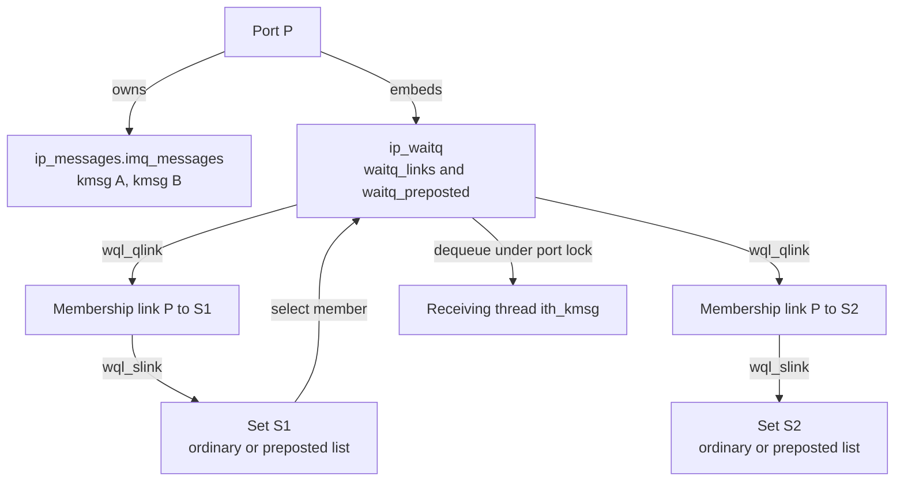
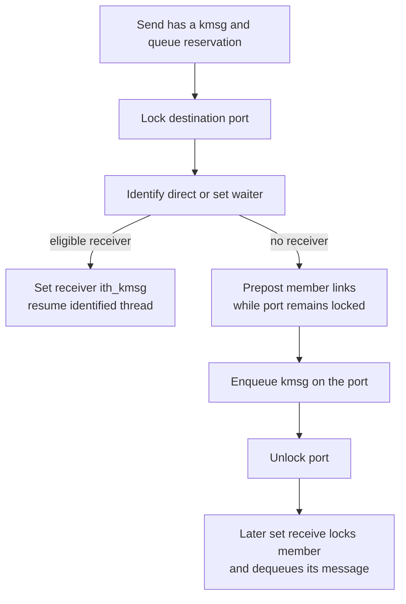
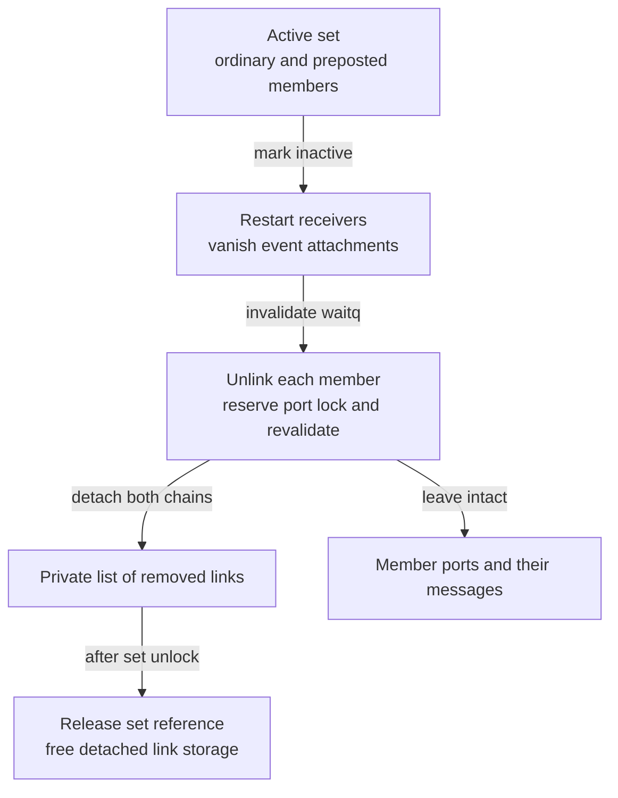

# Port sets, membership and persistent readiness

[IPC overview](README.md) · [Names and rights](names-and-rights.md) · [Message delivery](message-send-receive.md#5-receive-from-a-port-or-a-set-of-ports) · [Port lifecycle](ports-and-rights-lifecycle.md)

Receiving on a port set asks the kernel to choose a ready member port. The message remains attached to that port until selection transfers it to the receiving thread. What the set retains is membership and readiness, allowing a receiver that arrives after the sender to find work. This chapter follows that representation in `xnu-12377.121.6`, including insertion into an already-busy set, concurrent receive, lazy readiness clearing and teardown. The [delivery chapter](message-send-receive.md) supplies the surrounding message copyin, queue-capacity and copyout paths. [Set receive selection](../../../platydoc-data/xnu/osfmk/ipc/ipc_mqueue.c#L917-L985).

## 1. Three different relationships: right, membership and message

A task's `ipc_entry` with `MACH_PORT_TYPE_PORT_SET` refers to an `ipc_pset`. Another entry holds a member port's receive right. Set membership does not duplicate that right, grant a sender a new destination, or move the port's `ipc_kmsg` objects. The set embeds `ips_wqset` and its event-notification list `ips_klist`; the member port embeds `ip_waitq` and the separate payload queue `ip_messages`. [Set layout](../../../platydoc-data/xnu/osfmk/ipc/ipc_pset.h#L77-L84), [port layout](../../../platydoc-data/xnu/osfmk/ipc/ipc_port.h#L119-L162), [membership admission](../../../platydoc-data/xnu/osfmk/ipc/ipc_object.c#L300-L367).

| Object or field | What it represents |
| --- | --- |
| `port->ip_messages.imq_messages` | Messages owned by this destination port's queue. |
| `port->ip_waitq.waitq_links` | Membership links from one port to zero or more sets. |
| `pset->ips_wqset.wqset_links` | This set's member links that are not currently marked preposted. |
| `pset->ips_wqset.wqset_preposts` | Member links marked as having signaled readiness; some can be stale until inspected. |
| `port->ip_waitq.waitq_preposted` | Port-wide readiness bit checked under the port lock. Clearing it invalidates readiness in all sets without visiting each set immediately. |
| `pset->ips_klist` | Attached `EVFILT_MACHPORT` knotes; a separate notification route from a thread blocked in Mach receive. |

The waitq header overlays fields according to `waitq_type`. For `WQT_PORT`, the `_ts` union member points to the receive turnstile, while `_links` contains memberships. For `WQT_PORT_SET`, `_links` contains the ordinary member links and the extended `waitq_set` adds `_preposts`. Do not decode these unions as the same kind of queue for every waitq type. [Header unions and set extension](../../../platydoc-data/xnu/osfmk/kern/waitq.h#L260-L328).



This diagram shows one possible queued-message state. Direct delivery to an already waiting receiver can bypass the payload list, and receiving through either set consumes the same underlying messages.

## 2. One two-way link per membership

On the 64-bit build, the allocated link is small and contains two independent queue chains. [Exact `waitq_link` layout](../../../platydoc-data/xnu/osfmk/kern/waitq.c#L169-L174):

<!-- source-excerpt: ../../../platydoc-data/xnu/osfmk/kern/waitq.c#L169-L174 -->
```c
struct waitq_link {
	uintptr_t       wql_wqs;       /**< wait queue set for this link      */
	queue_chain_t   wql_qlink;     /**< linkage through the waitq list    */
	queue_chain_t   wql_slink;     /**< linkage through the wqset list    */
	struct waitq   *wql_wq;        /**< wait queue for this link          */
};
```

`wql_qlink` links into the port's membership list. `wql_slink` links into exactly one of the set's ordinary/preposted lists. `wql_wq` points back to the port waitq. `wql_wqs` contains the set pointer plus `WQL_PREPOST_MARKER`, bit zero; `wql_wqs()` masks that bit before returning the pointer. The marker records which set list owns `wql_slink`, while the port's `waitq_preposted` says whether the readiness still holds. These are separate pieces of state. The marker is changed while both endpoint locks are held. [Marker contract](../../../platydoc-data/xnu/osfmk/kern/waitq.c#L97-L114), [pointer and list accessors](../../../platydoc-data/xnu/osfmk/kern/waitq.c#L227-L256).

The storage comes from the typed `waitq_link_zone`; `waitq_link_alloc(WQT_PORT_SET)` uses `Z_WAITOK | Z_ZERO`. The public membership routines allocate this storage before acquiring the space/port/set locks. `waitq_link_locked` checks for an existing relationship, fills the endpoints and enqueues both chains. Successful installation clears the caller's `linkp`; a duplicate returns `KERN_ALREADY_IN_SET` and leaves the unused allocation for the caller to free. Its low-level invalid-set branch does not install the link and leaves it with the caller even though it returns success; public translation normally establishes an active, locked set first. [Allocation/free](../../../platydoc-data/xnu/osfmk/kern/waitq.c#L335-L367), [installation](../../../platydoc-data/xnu/osfmk/kern/waitq.c#L1925-L1946), [public insert cleanup](../../../platydoc-data/xnu/osfmk/ipc/mach_port.c#L2153-L2191).

The link operations do not acquire a new port or set object reference. Their two-way lifetime is enforced by locks and mandatory unlinking before endpoint storage can be freed. For example, after dropping a destination set's lock during `mach_port_move_member`, the still-locked member port and its installed link prevent that set from being freed and reused. The retained set address is used for identity comparison, not dereferenced by the unlink-all exception test. [Move's lifetime argument](../../../platydoc-data/xnu/osfmk/ipc/mach_port.c#L1449-L1457), [set destruction](../../../platydoc-data/xnu/osfmk/ipc/ipc_pset.c#L236-L264).

## 3. Membership APIs and their lock contracts

`ipc_object_translate_port_pset` looks up both names in the **same** space, requires a receive right and a port-set right, locks the port, then locks the set, verifies their active state and drops the space lock. It returns both objects locked without donating references. Invalid names, wrong right types and inactive objects are distinct failure paths; selected wrong-right cases also raise a guard exception. [Translation body](../../../platydoc-data/xnu/osfmk/ipc/ipc_object.c#L300-L367).

| Operation | Membership result | Storage and result handling |
| --- | --- | --- |
| `mach_port_insert_member(space, P, S)` | Add P to S without changing P's other memberships. | Allocate link first; translation and add errors propagate; free an unconsumed allocation after unlocking. |
| `mach_port_extract_member(space, P, S)` | Remove only P–S. | Unlink under port-then-set locks; free the detached link afterward; return `KERN_NOT_IN_SET` if absent. |
| `mach_port_move_member(space, P, S)` | Ensure P belongs to S, then remove every other membership. | Keep the port locked across dropping S's lock and unlinking other sets. A pre-existing P–S relationship is acceptable: this caller ignores the add routine's duplicate result. |
| `mach_port_move_member(space, P, MACH_PORT_NULL)` | Remove all P memberships. | Requires only receive-right translation; reports `KERN_NOT_IN_SET` when there were none. |

Sources: [insert](../../../platydoc-data/xnu/osfmk/ipc/mach_port.c#L2153-L2191), [extract](../../../platydoc-data/xnu/osfmk/ipc/mach_port.c#L2212-L2248), [move](../../../platydoc-data/xnu/osfmk/ipc/mach_port.c#L1403-L1471). The introductory comment above `mach_port_insert_member` says a port cannot already be a member of a port set; the actual body and `wql_find` reject membership in the **same specified set**, not membership in another set. [Lookup by target set](../../../platydoc-data/xnu/osfmk/kern/waitq.c#L321-L332).

`mach_port_get_set_status` enumerates both set lists, because preposting changes list placement, not membership. It allocates output storage before locking, retries with a larger allocation if the member count outgrows it, sorts the collected receive names and packages the array as a VM copy. Its output is a snapshot, not a lock or a promise that those names remain members on the next call. [Enumeration and output](../../../platydoc-data/xnu/osfmk/ipc/mach_port.c#L1264-L1358), [both-list traversal](../../../platydoc-data/xnu/osfmk/kern/waitq.c#L1871-L1883).

### Adding a port that already has messages

Installing the link is not sufficient. `ipc_mqueue_add_locked` holds both endpoint locks and repeatedly pairs queued messages with threads already waiting on the new set. It uses `waitq_wakeup64_identify_locked`, which identifies/removes a waiter but holds it off the runqueue until the message receive state is prepared. A non-Mach waiter is simply resumed; an undersized Mach receiver with `MACH_RCV_LARGE` gets size/name information without consuming the message. Otherwise the routine dequeues the message, releases its queue-count reservation, fills `ith_kmsg` and `ith_seqno`, and resumes the thread. [Add and matching loop](../../../platydoc-data/xnu/osfmk/ipc/ipc_mqueue.c#L208-L320).

When there is a message but no waiting thread, insertion explicitly calls `waitq_link_prepost_locked`. Waking the set directly does not discover its newly added member automatically. The helper moves the existing membership link; it allocates no readiness node. [Explicit prepost](../../../platydoc-data/xnu/osfmk/ipc/ipc_mqueue.c#L231-L249), [exact transition](../../../platydoc-data/xnu/osfmk/kern/waitq.c#L1960-L1966):

<!-- source-excerpt: ../../../platydoc-data/xnu/osfmk/kern/waitq.c#L1960-L1966 -->
```c
	if (!wql_wqs_preposted(link)) {
		wql_wqs_mark_preposted(link);
		waitq->waitq_preposted = true;
		circle_dequeue(&wqset->wqset_links, &link->wql_slink);
		circle_enqueue_tail(&wqset->wqset_preposts, &link->wql_slink);
		ipc_pset_prepost(wqset, waitq);
	}
```

Thus an empty set can gain immediately receivable work from a membership operation even when no new send occurs.

## 4. Sending: identify a receiver or retain readiness

`IPC_MQUEUE_RECEIVE` is `NO_EVENT64`. That matters because the general waitq wakeup traverses linked sets only for this zero-event/preposting form. `ipc_mqueue_post` starts with the destination port locked, calls `waitq_wakeup64_identify_locked`, and transfers the kmsg directly if it finds an eligible Mach receiver. If none is available, it enqueues the kmsg on that port. Message capacity has already been reserved by the preceding send path. [Event definition](../../../platydoc-data/xnu/osfmk/ipc/ipc_mqueue.h#L122), [post implementation](../../../platydoc-data/xnu/osfmk/ipc/ipc_mqueue.c#L640-L773), [set traversal predicate](../../../platydoc-data/xnu/osfmk/kern/waitq.c#L1286-L1301).

The selector first searches the port's own waiters, then walks memberships. For an unmarked link it locks the set and searches its waiters. If no thread has been selected, it marks/moves that link to `wqset_preposts`, sets the port-wide readiness bit and calls `ipc_pset_prepost`. An already-marked link can skip the set lock and waiter search: its marker cannot be cleared without the port lock, and the selector restores the port readiness bit to true. Selection stops after enough threads have been found. It does not broadcast a separate copy of the message to each set. [Wake selection](../../../platydoc-data/xnu/osfmk/kern/waitq.c#L1201-L1273).

The wakeup/prepost attempt occurs before the no-receiver branch enqueues the message. This does not expose a usable ready port with unfinished queue state: both publication and queue insertion happen while holding the port lock, and a receiving set scan must acquire that lock before selecting the message. Treat readiness as a lock-protected protocol, not an independent atomic count of messages. [Post lock and enqueue](../../../platydoc-data/xnu/osfmk/ipc/ipc_mqueue.c#L657-L707), [prepost scan locking](../../../platydoc-data/xnu/osfmk/kern/waitq.c#L2018-L2058).



The diagram omits invalidation and buffer-size failures, which are handled in the cited post loop and the [delivery chapter](message-send-receive.md#4-reserve-capacity-then-post-the-message).

## 5. Receiving: lock a member, revalidate, then consume

`ipc_mqueue_receive_on_thread_and_unlock` enters with the requested port or set locked. For a set it calls `waitq_set_first_prepost(..., WQS_PREPOST_LOCK)`. A successful result leaves both the set and selected port locked; the caller drops the set lock and invokes the ordinary port selection routine. That routine handles size checks, dequeuing, sequence numbering and publication into the receiving thread. Selection returns the **member** receiver name when reporting `MACH_RCV_TOO_LARGE`, rather than presenting the set as the message endpoint. [Set-to-port transition](../../../platydoc-data/xnu/osfmk/ipc/ipc_mqueue.c#L931-L978), [selection and size result](../../../platydoc-data/xnu/osfmk/ipc/ipc_mqueue.c#L1088-L1143).

The set-first starting point would invert the normal port-then-set lock order if it simply waited for a busy port while keeping the set locked. Instead, `waitq_set_first_prepost` reserves a port-lock ticket. If it must wait, it drops the set lock, waits for the port lock, reacquires the set lock, then checks that the set is still valid and the same link is still at the head and names the same port. If those checks fail, it unlocks the port and retries or returns no candidate. Code that calls this helper must allow the set lock to be dropped temporarily. [Ticket and revalidation](../../../platydoc-data/xnu/osfmk/kern/waitq.c#L2018-L2048), [helper contract](../../../platydoc-data/xnu/osfmk/kern/waitq.h#L1072-L1089).

A valid ready member is rotated to the end of the prepost list unless `WQS_PREPOST_PEEK` was requested. This spreads repeated set selection across ready members; it does not establish global arrival order across ports or guarantee that messages within a port ignore QoS ordering. The actual Mach receive path here requests `WQS_PREPOST_LOCK` without `PEEK`, including a size-only result that leaves the message queued. [Flags at call site](../../../platydoc-data/xnu/osfmk/ipc/ipc_mqueue.c#L931-L942), [rotation](../../../platydoc-data/xnu/osfmk/kern/waitq.c#L2050-L2057), [message queue selection](../../../platydoc-data/xnu/osfmk/ipc/ipc_mqueue.c#L1101-L1138).

### Clearing readiness is deliberately lazy across sets

When a receive consumes the last queued message, `ipc_mqueue_release_msgcount` calls `waitq_clear_prepost_locked` under the port lock. That helper only sets `waitq_preposted = false`. It does not walk every membership, take every set lock or free any links. A later set scan detects this false bit, clears its own link marker and moves that link back to `wqset_links`. Membership remains intact. [Empty-queue clearing](../../../platydoc-data/xnu/osfmk/ipc/ipc_mqueue.c#L622-L625), [single-bit clear](../../../platydoc-data/xnu/osfmk/kern/waitq.c#L1865-L1869), [exact lazy cleanup](../../../platydoc-data/xnu/osfmk/kern/waitq.c#L2060-L2069):

<!-- source-excerpt: ../../../platydoc-data/xnu/osfmk/kern/waitq.c#L2060-L2069 -->
```c
		/*
		 * We found a link that is no longer preposted,
		 * someone must have called waitq_clear_prepost_locked()
		 * and this set just only noticed.
		 */
		wql_wqs_clear_preposted(link);
		waitq_unlock(wq);

		circle_dequeue(q, &link->wql_slink);
		circle_enqueue_tail(&wqset->wqset_links, &link->wql_slink);
```

For example, P belongs to S1 and S2 and has one queued message. Both links may be preposted. A receive through S1 consumes the message and clears P's bit. S2's link can still physically be in its prepost list, but a receive through S2 locks P, observes the cleared bit and removes the stale readiness. If another message arrives before S2 scans, the sender can restore P's bit using the still-marked link; S2 can then select that new message. No message is duplicated, and a prepost-list length is not a reliable count of queued messages. [Already-marked send case](../../../platydoc-data/xnu/osfmk/kern/waitq.c#L1212-L1226), [scan](../../../platydoc-data/xnu/osfmk/kern/waitq.c#L2050-L2069).

### Empty set: register a wait without losing a send

After finding no ready member, the receive code still holds the set lock. It checks validity, handles a zero timeout, sets `ith_state = MACH_RCV_IN_PROGRESS` and calls `waitq_assert_wait64_locked`. Keeping the lock closes the gap between checking for work and registering the wait; the code treats an unexpected prepost-triggered `THREAD_AWAKENED` at this point as a panic. It unlocks only after registration, and its caller must actually block when requested. After unlocking, the wakeup side owns the waiting thread's `ith_*` fields until it resumes. [Wait setup and invariant](../../../platydoc-data/xnu/osfmk/ipc/ipc_mqueue.c#L980-L1071).

The logical waitq is not necessarily where the scheduler stores the thread. Port-set waitqs use an IRQ-safe global waitq selected by hashing the set pointer; `thread->waitq` retains the original set and `thread->wait_event` retains the event for matching. Direct port receives instead use the port's receive turnstile as their safe queue. Wait registration raises to `splsched`, locks the safe queue and records the logical identity. This distinguishes membership links, ready-member links and waiting-thread links. [Safe-queue selection](../../../platydoc-data/xnu/osfmk/kern/waitq.c#L522-L532), [thread insertion](../../../platydoc-data/xnu/osfmk/kern/waitq.c#L540-L576), [assert-wait implementation](../../../platydoc-data/xnu/osfmk/kern/waitq.c#L1319-L1428).

## 6. Kqueue observes readiness through another attachment

`ipc_pset_prepost` invokes `KNOTE` on `ips_klist`, passing the posting member waitq as a hint. `filt_psetevent` returns `FILTER_ACTIVE` directly because the posting port is already locked; trying to select and lock that member again inside the callback would deadlock. The event says that processing should run, not that the knote now owns a particular kmsg. Later filter processing uses the message receive machinery to poll or receive, so another consumer can remove the message before that processing occurs. [Prepost callback](../../../platydoc-data/xnu/osfmk/ipc/ipc_pset.c#L898-L924), [filter processing](../../../platydoc-data/xnu/osfmk/ipc/ipc_pset.c#L1007-L1177).

A knote attachment has its own reference/teardown lifecycle: `filt_psetdetach` completes turnstile state, locks the set, unlinks the knote unless it already vanished, clears `kn_ipc_pset`, unlocks and releases the set reference. These are not the raw member-link ownership rules. The [synchronous IPC companion](synchronous-dependencies-and-special-replies.md) covers donation and workloop relationships beyond this readiness handoff. [Detach](../../../platydoc-data/xnu/osfmk/ipc/ipc_pset.c#L808-L827).

## 7. Removing membership, moving a receiver and destroying a set

Removing one membership detaches both link chains while both endpoint locks are held. The caller frees the detached storage after unlocking. Removing all memberships starts with the port locked, takes each set lock in turn, removes the set-side chain, collects links on a free list, then rebuilds the port-side list with only the optional retained membership. It neither dequeues messages nor destroys the member receive right. [Single unlink](../../../platydoc-data/xnu/osfmk/kern/waitq.c#L1972-L1985), [unlink all from a port](../../../platydoc-data/xnu/osfmk/kern/waitq.c#L1988-L2015).

Moving the receive right out of its namespace is a broader operation. `ipc_port_prepare_move` unlinks all memberships and calls `ipc_mqueue_changed` to restart direct receive waiters and disconnect event attachments. It preserves queued messages for the moved endpoint. Destroying the port adds `ipc_mqueue_destroy_locked`: sender wakeups, delayed destruction of queued kmsgs, count reset, waitq invalidation and membership removal. Continue with [receive-right migration](ports-and-rights-lifecycle.md#6-the-receive-right-can-leave-every-task-namespace) for transit ownership. [Move preparation](../../../platydoc-data/xnu/osfmk/ipc/ipc_port.c#L664-L692), [queue destruction](../../../platydoc-data/xnu/osfmk/ipc/ipc_mqueue.c#L1240-L1287).

Destroying a **set** starts with its lock and an owned reference. `ipc_pset_destroy` marks the object inactive, calls `ipc_mqueue_changed` to restart its receive waiters and vanish its knotes, invalidates the set waitq and removes all member links. It then unlocks, consumes the supplied reference and frees the detached links. Member ports and payload messages survive this operation. [Set destruction](../../../platydoc-data/xnu/osfmk/ipc/ipc_pset.c#L236-L264), [restart notification](../../../platydoc-data/xnu/osfmk/ipc/ipc_mqueue.c#L354-L409).

Set-side unlinking must again avoid blocking on a port while holding its set lock. `waitq_set_unlink_all_locked` marks the set invalid first, processes both ordinary and preposted lists, uses ticket reservation/drop/reacquire with head-and-port revalidation, and periodically drops/reacquires the set lock after a bounded batch (`waitq_set_unlink_batch`, default 64). Detached links are collected for later freeing. Invalidation prevents new valid installations while this cleanup makes progress; the temporary unlock is not permission for callers to assume the old list head remains unchanged. [Batch setting](../../../platydoc-data/xnu/osfmk/kern/waitq.c#L95), [set-side teardown](../../../platydoc-data/xnu/osfmk/kern/waitq.c#L1815-L1863).



## 8. Evidence, tests and limits

This mechanism is in shared IPC/waitq code; its core behavior is not selected by the ARM64 legacy/PPL/SPTM pmap backend. The shown link layout is the `__LP64__` branch. `select()` uses a different `waitq_sellink` representation with one-way links and generation validation; its lazy unlink scheme must not be imported into the bidirectional port-set explanation. [Layout variants](../../../platydoc-data/xnu/osfmk/kern/waitq.c#L116-L201), [select-link rationale](../../../platydoc-data/xnu/osfmk/kern/waitq.c#L140-L155).

The `DEBUG || DEVELOPMENT` kernel test `waitq_basic_test` checks duplicate membership, wakeup with no waiter, prepost clearing and duplicate unlink. The userspace Darwin test calls it through `debug.test.waitq_basic`. Those sources provide executable examples of the link/readiness contract; they do not establish exhaustive race coverage and were inspected, not executed here. [Kernel test](../../../platydoc-data/xnu/osfmk/kern/waitq.c#L2671-L2707), [test caller](../../../platydoc-data/xnu/tests/ipc/waitq.c#L11-L30). The separate [port deallocation regression](../../../platydoc-data/xnu/tests/mach_port_deallocate_21692215.c#L10-L40) exercises set membership followed by deallocation.

The public IPC and waitq bodies needed for these paths are present. This chapter does not infer libdispatch's userspace scheduling decisions or claim that a source-level fairness rotation proves end-to-end scheduler fairness. Full message layout, right transfer, priority donation and syscall/MIG declarations remain in the linked companion chapters.

<!-- BEGIN PLATYDOC DOCUMENTATION LICENSE -->
Original Platydoc text and diagrams are licensed under [CC BY 4.0](https://creativecommons.org/licenses/by/4.0/). Quoted source code and third-party material retain their respective licenses.
<!-- END PLATYDOC DOCUMENTATION LICENSE -->
