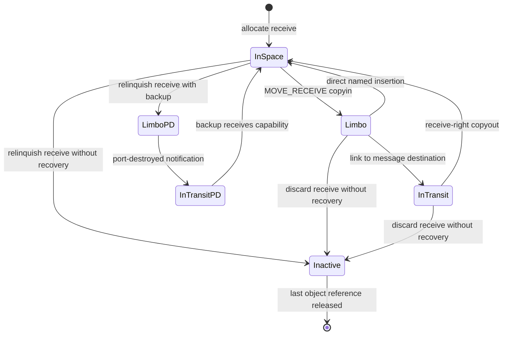
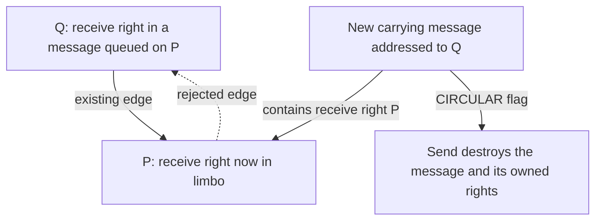

# Port and right lifecycle

[IPC overview](README.md) · [Names, layouts, and reference accounting](names-and-rights.md) · [Message transport](message-path.md) · [Port policy](policies-and-attribution.md)

A right operation has two related effects: it changes a namespace entry and it changes who owns a kernel capability. Port death is a third event, caused by loss of the receive right without successful recovery. Final object deallocation is a fourth, occurring only after all references disappear. This page traces those transitions for ordinary ports, then identifies the policy and concurrency conditions that constrain them. [`ipc_right_copyin`](../../../platydoc-data/xnu/osfmk/ipc/ipc_right.c#L2112), [`ipc_port_destroy`](../../../platydoc-data/xnu/osfmk/ipc/ipc_port.c#L1140), [`ipc_object_release`](../../../platydoc-data/xnu/osfmk/ipc/ipc_object.c#L198).

The examples use `R` for a receive right, `S(n)` for one send entry with `n` user references, and `SO` for a send-once entry. Unless stated otherwise, ports are ordinary movable ports, entries are not pinned, counts are below saturation, notifications are initially absent, and operations succeed without competing threads. Names such as `0x403` identify entries only in the named task's space.

For the storage behind these transitions, use [IPC spaces and entries](../../structures/ipc-spaces-and-entries.md) and [ports and kernel-object associations](../../structures/ipc-ports-and-kobjects.md). They give field maps, access preconditions, counter distinctions, allocator/free paths and the boundary between retaining a port and obtaining a referenced service object.

## 1. Where a public operation becomes a kernel right operation

The C implementation of a Mach API is not necessarily the first function entered from userspace. Several common operations have direct traps for the current task. For example, `_kernelrpc_mach_port_allocate_trap` resolves the target through `port_name_to_current_task_noref`, invokes `mach_port_allocate(task->itk_space, ...)`, and copies out the resulting integer name. The deallocate and mod-refs traps use the same current-task restriction. Their initial result is `MACH_SEND_INVALID_DEST` if the target cannot use this path. The checked-in libsyscall wrappers try these direct traps first, then call the corresponding generated RPC only on that return code; the insert-right wrapper uses the same pattern. [`mach_kernelrpc.c`](../../../platydoc-data/xnu/osfmk/ipc/mach_kernelrpc.c#L168), [`allocation/deallocation/mod-refs wrappers`](../../../platydoc-data/xnu/libsyscall/mach/mach_port.c#L97-L171), [`insertion wrapper`](../../../platydoc-data/xnu/libsyscall/mach/mach_port.c#L262-L278).

Message-based calls pass through MIG and typed port conversion. In particular, the kernel `mach_port_insert_right` receives an already imported `ipc_port_t`, whereas its public interface supplies a name plus a disposition. Conversely, `mach_port_extract_right` produces an owned kernel right; a message reply exports it into the caller's namespace. Treating those C parameters as userspace integer names obscures the ownership boundary. [`mach_port.defs` insert/extract interfaces](../../../platydoc-data/xnu/osfmk/mach/mach_port.defs#L322), [`mach_port_insert_right`](../../../platydoc-data/xnu/osfmk/ipc/mach_port.c#L1659), [kernel RPC guide](kernel-rpc-and-exceptions.md).

| User operation | Principal implementation path | Ownership result on success |
| --- | --- | --- |
| Allocate receive | `mach_port_allocate` → `mach_port_allocate_full` → `ipc_port_alloc` → `ipc_object_alloc_entry` / `ipc_port_init` / `ipc_entry_init` | New entry owns the new port's initial reference and receive right. |
| Insert right | Trap imports source through `ipc_object_copyin`, then `mach_port_insert_right` → `ipc_object_copyout_name`; same-name make/copy has a fast path | Destination entry takes or merges the imported right. |
| Extract right | `mach_port_extract_right` → `ipc_object_copyin` → `ipc_right_copyin` | Caller of the kernel routine receives an owned right; reply copyout can install it in a different space. |
| Deallocate | `mach_port_deallocate` → `mach_port_deallocate_kernel` → `ipc_right_lookup_write` → `ipc_right_dealloc` | One applicable uref is removed, or the single port-set right is destroyed. |
| Modify references | `mach_port_mod_refs` → `ipc_right_lookup_write` → `ipc_right_delta` | Only the requested right component changes. |
| Destroy name | `mach_port_destroy` → `ipc_right_lookup_write` → `ipc_right_destroy` | Every right at that name is removed, subject to guards and pinning. |

The entry functions below document which locks they return held. The high-level handlers start with nothing locked; most `ipc_right_*` mutation helpers consume a space-lock hold supplied by their caller. [`allocation`](../../../platydoc-data/xnu/osfmk/ipc/mach_port.c#L588), [`deallocation`](../../../platydoc-data/xnu/osfmk/ipc/mach_port.c#L736), [`delta`](../../../platydoc-data/xnu/osfmk/ipc/mach_port.c#L889), [`destroy`](../../../platydoc-data/xnu/osfmk/ipc/mach_port.c#L692).

## 2. Allocation creates a receive endpoint before it creates send authority

`mach_port_allocate_full` accepts receive, port-set, or dead-name allocation. A send right is derived from an existing receive or send capability; requesting a standalone `MACH_PORT_RIGHT_SEND` allocation takes the invalid-value branch. Receive allocation constructs an `IOT_PORT` label and calls `ipc_port_alloc` with `IP_INIT_NONE`. The routine allocates zeroed port storage, obtains a namespace entry under the space lock, initializes the port with its wait-queue lock held, initializes the entry, and releases the space lock. The API handler then unlocks the port. [`allocation switch`](../../../platydoc-data/xnu/osfmk/ipc/mach_port.c#L628), [`ipc_port_alloc`](../../../platydoc-data/xnu/osfmk/ipc/ipc_port.c#L905).

[Port allocation and namespace publication — source lines 925–939](../../../platydoc-data/xnu/osfmk/ipc/ipc_port.c#L925):

<!-- source-excerpt: ../../../platydoc-data/xnu/osfmk/ipc/ipc_port.c#L925-L939 -->
```c
	port = ip_alloc();
	object = ip_to_object(port);
	kr = ipc_object_alloc_entry(space, object, &name, &entry);
	if (kr != KERN_SUCCESS) {
		ipc_port_label_free(label);
		ip_free(port);
		return kr;
	}

	/* space is locked */
	ipc_port_init(port, space, label, flags, name);
	/* port is locked */
	ipc_entry_init(space, object, type, entry, urefs, name);

	is_write_unlock(space);
```

`ipc_port_init` initializes the reference count and wait queue before fields that share wait-queue storage. It initializes `ip_messages`, records the receiver space/name, and installs an in-space label. With `IP_INIT_NONE`, no send rights exist and `ip_mscount` is zero. Other internal allocation callers can request `IP_INIT_MAKE_SEND_RIGHT`, creating the combined receive/send entry from the start. [`ipc_port_init`](../../../platydoc-data/xnu/osfmk/ipc/ipc_port.c#L837), [`initial entry type and urefs`](../../../platydoc-data/xnu/osfmk/ipc/ipc_port.c#L914).

The allocation return contract is subtle: the returned port is locked, but the caller does **not** receive an extra owned reference; the entry already owns the initial reference. Unlocking it completes the ordinary API operation. If a later kernel operation needs to keep the object beyond that protection, it needs its own reference. [`ipc_port_alloc` contract](../../../platydoc-data/xnu/osfmk/ipc/ipc_port.c#L889).

Port-set allocation constructs an `ipc_pset` and namespace entry. Dead-name allocation creates an entry with `MACH_PORT_TYPE_DEAD_NAME`, one uref, and a null object pointer. It does not create a dead `ipc_port`. The explicit-name receive/port-set paths use the corresponding named allocator and validate name encoding and collisions through `ipc_entry_alloc_name`. In this checkout, the dead-name arm of `mach_port_allocate_full` calls `ipc_object_alloc_dead` even when the QoS name flag was set; do not infer named-dead-entry behavior from the generic API comment. [`ipc_pset_alloc`](../../../platydoc-data/xnu/osfmk/ipc/ipc_pset.c), [`ipc_object_alloc_dead`](../../../platydoc-data/xnu/osfmk/ipc/ipc_object.c#L381), [`named-entry validation`](../../../platydoc-data/xnu/osfmk/ipc/ipc_entry.c#L364), [`allocation tail`](../../../platydoc-data/xnu/osfmk/ipc/mach_port.c#L647).

## 3. Dispositions describe the source operation

`MAKE_SEND`, `COPY_SEND`, and `MOVE_SEND` all produce the internal right type `MACH_MSG_TYPE_PORT_SEND`; make/move-send-once produce `PORT_SEND_ONCE`, and move-receive produces `PORT_RECEIVE`. The receiver learns the resulting kind, not a permanent history of how the sender created it. [`ipc_object_copyin_type`](../../../platydoc-data/xnu/osfmk/ipc/ipc_object.c#L489).

| Disposition | Required source right | Namespace effect | Owned kernel result |
| --- | --- | --- | --- |
| `MAKE_SEND` | `R` | Receive entry remains; this does not itself add a send uref to the source entry. | New send-right instance and reference; increments `ip_mscount` and `ip_srights`. |
| `COPY_SEND` | `S(n)` | Source urefs unchanged. | New send-right instance and reference; increments `ip_srights`, not `ip_mscount`. |
| `MOVE_SEND` | `S(n)` | Normally removes one uref. Last send uref removes the send component, possibly the whole entry. | An owned send-right instance; may transfer an existing reference or create a separate one while the entry survives. |
| `MAKE_SEND_ONCE` | `R` | Receive entry remains. | New send-once right and reference; increments `ip_sorights`, not make-send count. |
| `MOVE_SEND_ONCE` | `SO` | Removes its entry. | Transfers the existing send-once right and reference. |
| `MOVE_RECEIVE` | `R` | Removes receive component; retains a send component if present. | The sole receive right, with a reference, first placed in limbo. |

These are the ordinary live-port branches of [`ipc_right_copyin`](../../../platydoc-data/xnu/osfmk/ipc/ipc_right.c#L2112), [`make send`](../../../platydoc-data/xnu/osfmk/ipc/ipc_port.c#L2841), [`copy send`](../../../platydoc-data/xnu/osfmk/ipc/ipc_port.c#L2892), and [`make send-once`](../../../platydoc-data/xnu/osfmk/ipc/ipc_port.c#L3062). There is no copy-receive or copy-send-once disposition. A receive right can mint several send-once capabilities for an ordinary port, but each imported send-once right gets its own namespace entry and a single uref. Reply-port policies add restrictions; the commented-out single-outstanding-send-once diagnostic in this checkout is not an unconditional enforced invariant. [`send-once policy branch`](../../../platydoc-data/xnu/osfmk/ipc/ipc_right.c#L2180), [`send-once copyout`](../../../platydoc-data/xnu/osfmk/ipc/ipc_right.c#L2626).

### Moving one uref is not always moving one object reference

An entry with `R + S(1)` owns one object reference shared by both components. Moving its final send uref leaves `R` in the entry, so the code adds an object reference for the standalone send right. A send-only entry with its final uref can instead give its entry reference to the caller and disappear. `ip_srights` need not change in either final-uref case. [`MOVE_SEND` reference rationale](../../../platydoc-data/xnu/osfmk/ipc/ipc_right.c#L2402).

[Last send uref with and without a surviving receive entry — source lines 2425–2439](../../../platydoc-data/xnu/osfmk/ipc/ipc_right.c#L2425):

<!-- source-excerpt: ../../../platydoc-data/xnu/osfmk/ipc/ipc_right.c#L2425-L2439 -->
```c
				entry->ie_bits = bits & ~
				    (IE_BITS_UREFS_MASK | MACH_PORT_TYPE_SEND);
				ipc_entry_modified(space, name, entry);
				ip_reference(port);
			} else {
				assert(IE_BITS_TYPE(bits) ==
				    MACH_PORT_TYPE_SEND);

				/* ... that we steal from the entry when it dies */
				request = ipc_right_request_cancel(port, name, entry);
				ipc_hash_delete(space, ip_to_object(port),
				    name, entry);
				ipc_entry_dealloc(space, ip_to_object(port),
				    name, entry);
				/* transfer entry's reference to caller */
```

When more send urefs remain, `ipc_port_copy_send_any_locked` creates the separately owned kernel send right and the entry loses a uref. Header copyin can request an extra move when header fields alias; the local `moves` variable can therefore exceed one. Saturated entries remain pegged rather than decrementing. Message-header transaction logic belongs in [message transport](message-path.md). [`remaining-uref branch`](../../../platydoc-data/xnu/osfmk/ipc/ipc_right.c#L2441), [`copyin flags`](../../../platydoc-data/xnu/osfmk/ipc/ipc_right.c#L2112).

`ipc_object_copyin` performs the operation with the space locked, then unlocks before handling released port references, `PORT_DELETED` notifications, importance changes, and freed wait-queue links recorded by copyin. A caller must inspect both the returned right and the helper's ownership contract; a successful pointer result is not merely a borrowed lookup. [`copyin wrapper`](../../../platydoc-data/xnu/osfmk/ipc/ipc_object.c#L526), [`cleanup helpers`](../../../platydoc-data/xnu/osfmk/ipc/ipc_right.c#L2050).

### Copyout coalesces ordinary rights

`ipc_object_copyout` locks the receiving space, ensures entry capacity, locks and validates the port and label, and finds an existing send/receive entry through `ipc_right_reverse`. Send-once skips reverse lookup and takes a fresh entry. If a send entry already exists, copyout consumes the incoming send-right instance and reference, then increments that entry's urefs. If only a receive entry exists, it adds the send component, retaining its kernel send-right count while consuming the redundant object reference. A fresh send entry takes both the right and reference. [`copyout selection`](../../../platydoc-data/xnu/osfmk/ipc/ipc_object.c#L873), [`ipc_right_reverse`](../../../platydoc-data/xnu/osfmk/ipc/ipc_right.c#L362).

[Send copyout into an existing send or receive entry — source lines 2644–2661](../../../platydoc-data/xnu/osfmk/ipc/ipc_right.c#L2644):

<!-- source-excerpt: ../../../platydoc-data/xnu/osfmk/ipc/ipc_right.c#L2644-L2661 -->
```c
		if (bits & MACH_PORT_TYPE_SEND) {
			__assert_only mach_port_urefs_t urefs = IE_BITS_UREFS(bits);

			assert(port->ip_srights > 1);
			assert(urefs > 0);
			assert(urefs <= MACH_PORT_UREFS_MAX);

			/* consume send right and ref */
			ip_srights_dec(port);
			ip_mq_unlock(port);
			ip_release_live(port);
		} else if (bits & MACH_PORT_TYPE_RECEIVE) {
			assert(IE_BITS_TYPE(bits) == MACH_PORT_TYPE_RECEIVE);
			assert(IE_BITS_UREFS(bits) == 0);

			/* transfer send right to entry, consume ref */
			ip_mq_unlock(port);
			ip_release_live(port);
```

This is why two delivered copies can produce `S(2)` at one name instead of two distinct names or two enduring kernel send-right instances. See the [complete reference-count transition table](names-and-rights.md#3-rights-user-references-and-object-references-count-different-things).

## 4. Insertion and extraction expose the same transfer machinery

For `mach_port_insert_right`, the same-name `MAKE_SEND`/`COPY_SEND` trap optimization goes directly to `ipc_object_insert_send_right`. Making at an existing receive name increments `ip_mscount` on every call; it introduces a kernel send-right instance only if the entry did not already have a send component. Copying at an existing send name increments urefs only. These optimized operations avoid creating and immediately coalescing a temporary kernel right. [`trap fast path`](../../../platydoc-data/xnu/osfmk/ipc/mach_kernelrpc.c#L238), [`ipc_object_insert_send_right`](../../../platydoc-data/xnu/osfmk/ipc/ipc_object.c#L763).

Other insertion cases import the source first and then attempt named copyout. `ipc_object_copyout_name` rejects an inactive port and certain labeled kobject ports, obtains the requested slot, and checks reverse identity. If the target space already holds the send/receive right under another name, the result is `KERN_RIGHT_EXISTS`; if the requested name holds an incompatible right, it is `KERN_NAME_EXISTS`. An invalid name encoding or slot-generation collision can fail earlier in `ipc_entry_alloc_name`. Send-once rights do not use the ordinary coalescing lookup. [`named copyout`](../../../platydoc-data/xnu/osfmk/ipc/ipc_object.c#L981), [`entry-name validation`](../../../platydoc-data/xnu/osfmk/ipc/ipc_entry.c#L364).

The trap's two-stage ordering means an insertion failure does **not** imply that a moved source right is still present:

[Insertion imports before it validates the destination slot — source lines 252–262](../../../platydoc-data/xnu/osfmk/ipc/mach_kernelrpc.c#L252):

<!-- source-excerpt: ../../../platydoc-data/xnu/osfmk/ipc/mach_kernelrpc.c#L252-L262 -->
```c
	rv = ipc_object_copyin(task->itk_space, args->poly, args->polyPoly,
	    IPC_OBJECT_COPYIN_FLAGS_ALLOW_IMMOVABLE_SEND, IPC_COPYIN_KERNEL_DESTINATION, NULL, &port);
	if (rv != KERN_SUCCESS) {
		goto done;
	}
	disp = ipc_object_copyin_type(args->polyPoly);

	rv = mach_port_insert_right(task->itk_space, args->name, port, disp);
	if (rv != KERN_SUCCESS && IP_VALID(port)) {
		ipc_object_destroy(port, disp);
	}
```

For example, suppose this task has send-only `A = S(1)` for port P and requested name B belongs to an unrelated port. A `MOVE_SEND` insertion at B can remove A during copyin, fail named copyout with `KERN_NAME_EXISTS`, and destroy the extracted right. The helper has no rollback that recreates A. This is a concrete consequence of the trap code above, distinct from the message-send pseudo-receive recovery path. [`MOVE_SEND`](../../../platydoc-data/xnu/osfmk/ipc/ipc_right.c#L2402), [send error ownership](message-path.md).

`mach_port_extract_right` validates the requested disposition, imports from the target space with `ipc_object_copyin`, and sets the returned internal disposition using `ipc_object_copyin_type`. Its source space can differ from the eventual reply receiver's space. Passing the literal `MACH_PORT_NULL` or `MACH_PORT_DEAD` sentinel is rejected, even though a valid named dead entry can be processed by the underlying copyin machinery with `DEADOK`. The explicit immovable-send allowance applies only to `COPY_SEND` from the current space. [`extract implementation`](../../../platydoc-data/xnu/osfmk/ipc/mach_port.c#L1698), [`copyin DEADOK mask`](../../../platydoc-data/xnu/osfmk/ipc/ipc_object.c#L540), [`dead-right branches`](../../../platydoc-data/xnu/osfmk/ipc/ipc_right.c#L2531).

Ordinary `ipc_object_copyout` consumes its supplied right even on failure through its cleanup path. Named copyout consumes it on success only; the insertion trap explicitly destroys it on failure. Keeping that distinction visible avoids both leaks and double releases in kernel callers. [`ordinary cleanup`](../../../platydoc-data/xnu/osfmk/ipc/ipc_object.c#L951), [`named copyout contract`](../../../platydoc-data/xnu/osfmk/ipc/ipc_object.c#L961).

## 5. Deallocate, modify, and destroy have different scopes

| Starting entry | `mach_port_deallocate` | `mach_port_mod_refs` | `mach_port_destroy` |
| --- | --- | --- | --- |
| `S(n)` | Remove one uref; on final uref remove send instance and entry. | Change send urefs; final removal deletes entry. | Remove the whole entry and its one kernel send-right instance, regardless of urefs. |
| `R + S(n)` | Remove one send uref; final send removal leaves `R`. | `SEND` changes send urefs. `RECEIVE,-1` relinquishes receive and handles remaining send state. | Remove both components and relinquish receive. |
| `R` | Invalid right. | Only zero or minus one is accepted for receive. | Relinquish receive and remove the name. |
| `SO` | Remove entry and dispose of the unused send-once right. | Only zero or minus one is accepted. | Remove entry and dispose of the right. |
| Dead name `D(n)` | Remove one dead-name uref. | Adjust dead-name urefs; zero removes entry. | Remove the entry. |
| Port set | Destroy the set and remove its entry. | Only zero or minus one is accepted. | Destroy the set and remove its entry. |

All rows are subject to saturation, guard, and pinning checks. The current implementation explicitly supports deallocation of a port-set right. [`ipc_right_dealloc`](../../../platydoc-data/xnu/osfmk/ipc/ipc_right.c#L990), [`ipc_right_delta`](../../../platydoc-data/xnu/osfmk/ipc/ipc_right.c#L1204), [`ipc_right_destroy`](../../../platydoc-data/xnu/osfmk/ipc/ipc_right.c#L852).

Adding send urefs with `mod_refs` requires an existing send component; `mod_refs(RECEIVE-name, SEND, +1)` is not a make-send operation. Send and dead-name overflow pegs the count at `MACH_PORT_UREFS_MAX`; subsequent ordinary decrements do not drain it. An explicit negative delta equal to that maximum removes the saturated component. Underflow and deltas outside the accepted bounds fail. [`missing send component`](../../../platydoc-data/xnu/osfmk/ipc/ipc_right.c#L1491), [`send saturation`](../../../platydoc-data/xnu/osfmk/ipc/ipc_right.c#L1522), [`dead-name saturation`](../../../platydoc-data/xnu/osfmk/ipc/ipc_right.c#L1441).

Removing the final send component decrements `ip_srights`, potentially prepares a no-senders notification, and drops an object reference only if the entry itself disappears. Removing a receive component is more consequential. With a port-destroyed request, the remaining send component can stay live while the receive right is handed to the backup. Without recovery, the remaining send component becomes a dead-name entry; its object pointer is cleared. The former receive entry carries `IE_BITS_EX_RECEIVE`, which affects some later guard diagnostics. [`receive delta`](../../../platydoc-data/xnu/osfmk/ipc/ipc_right.c#L1264).

Guard checks differ by entry point. `ipc_right_delta` refuses removal of any guarded receive right. `ipc_right_destroy` refuses a guarded receive right when its context is nonzero. `mach_port_destruct` is the guard-aware operation: it checks the supplied guard against `ip_context`, accepts a nonpositive send-uref delta, and combines the send adjustment with receive destruction. A positive delta or incompatible right is rejected. Do not turn these into a blanket statement that every guarded port rejects every destruction API. [`delta guard check`](../../../platydoc-data/xnu/osfmk/ipc/ipc_right.c#L1296), [`destroy guard check`](../../../platydoc-data/xnu/osfmk/ipc/ipc_right.c#L901), [`ipc_right_destruct`](../../../platydoc-data/xnu/osfmk/ipc/ipc_right.c#L1664).

Active pinned send rights reject removal of their final component in the relevant paths. Moving immovable rights and invalid guard operations can raise a guard exception in addition to returning a kernel error. Port context is also constrained by strict guarding; these checks operate on the receive capability and port policy, not on the numerical name alone. [`pinned destruction`](../../../platydoc-data/xnu/osfmk/ipc/ipc_right.c#L912), [`move policy`](../../../platydoc-data/xnu/osfmk/ipc/ipc_policy.c#L952), [`set context`](../../../platydoc-data/xnu/osfmk/ipc/mach_port.c#L1195), [policy guide](policies-and-attribution.md).

For a nonnull space, destroy and deallocate treat literal null/dead sentinel names as successful no-ops. Mod-refs does so only for the send/send-once right selectors; other selectors return an invalid-name error. A stale, nonsentinel name instead goes through generation-checked lookup and can fail with `KERN_INVALID_NAME`. [`destroy`](../../../platydoc-data/xnu/osfmk/ipc/mach_port.c#L703), [`deallocate`](../../../platydoc-data/xnu/osfmk/ipc/mach_port.c#L748), [`mod-refs`](../../../platydoc-data/xnu/osfmk/ipc/mach_port.c#L906).

## 6. The receive right can leave every task namespace

A live port need not currently have a receive entry in a task. During transfer it can be in limbo or in transit. The `ip_receiver` / `ip_destination` / `ip_timestamp` union must be interpreted using `io_state`; reading every branch as a receiver-space pointer is wrong. The receiver's name is zero while moving. [`port ownership fields`](../../../platydoc-data/xnu/osfmk/ipc/ipc_port.h#L152), [`object states`](../../../platydoc-data/xnu/osfmk/ipc/ipc_object.h#L122).



The diagram groups movable and immovable in-space states for readability. Policy can select `IO_STATE_IN_SPACE_IMMOVABLE` after copyout, and recovery states have additional service-port rules. [`ipc_port_mark_in_space`](../../../platydoc-data/xnu/osfmk/ipc/ipc_port.c#L697), [`PD transition`](../../../platydoc-data/xnu/osfmk/ipc/ipc_port.c#L759).

`MOVE_RECEIVE` first verifies receive ownership and movability, then validates a guarded descriptor if one was supplied. If the entry also has send rights, it removes the receive bit, sets `IE_BITS_EX_RECEIVE`, inserts the send-only entry into reverse lookup, and adds a reference for the departing receive right. With a receive-only entry, it cancels the entry's request and transfers the existing entry reference. [`receive copyin`](../../../platydoc-data/xnu/osfmk/ipc/ipc_right.c#L2233), [`guarded descriptor validation`](../../../platydoc-data/xnu/osfmk/ipc/ipc_right.c#L2030).

`ipc_port_prepare_move` unlinks the port from all port sets, wakes direct queue waiters through `ipc_mqueue_changed`, and resets receive-side state. It does **not** discard the queued payload messages when used for a move. Destruction adds a separate `ipc_mqueue_destroy_locked` step. [`prepare move`](../../../platydoc-data/xnu/osfmk/ipc/ipc_port.c#L664), [`inactive transition`](../../../platydoc-data/xnu/osfmk/ipc/ipc_port.c#L803).

[Receive-side state reset during movement — source lines 684–692](../../../platydoc-data/xnu/osfmk/ipc/ipc_port.c#L684):

<!-- source-excerpt: ../../../platydoc-data/xnu/osfmk/ipc/ipc_port.c#L684-L692 -->
```c
	if (io_state_in_space(label->io_state)) {
		ipc_mqueue_changed(ip_get_receiver(port), &port->ip_waitq);
	} else {
		ipc_mqueue_changed(NULL, &port->ip_waitq);
	}

	port->ip_mscount = 0;
	port->ip_messages.imq_seqno = 0;
	port->ip_context = port->ip_guarded = port->ip_strict_guard = 0;
```

The moved port is linked to the destination port of its carrying message, not directly to a future task. `ipc_port_check_circularity` ensures that this dependency does not form a cycle. Without importance inheritance, it has a try-lock fast path and a serialized destination-chain walk; with `IMPORTANCE_INHERITANCE`, it delegates the combined traversal/accounting to `ipc_importance_check_circularity`. Do not treat the circularity result itself as a userspace return code; the transport handles the result. [`circularity check`](../../../platydoc-data/xnu/osfmk/ipc/ipc_port.c#L1378), [message transport](message-path.md).

[Transit records and retains the carrier destination — source lines 781–799](../../../platydoc-data/xnu/osfmk/ipc/ipc_port.c#L781):

<!-- source-excerpt: ../../../platydoc-data/xnu/osfmk/ipc/ipc_port.c#L781-L799 -->
```c
ipc_port_mark_in_transit(ipc_port_t port, ipc_port_t dest)
{
	ipc_object_label_t label = ip_label_get(port);

	ipc_release_assert(io_state_in_limbo(label.io_state));

	ip_reference(dest);
	port->ip_receiver_name = MACH_PORT_NULL;
	port->ip_destination = dest;

	if (label.io_state == IO_STATE_IN_LIMBO) {
		label.io_state = IO_STATE_IN_TRANSIT;
	} else {
		assert(label.io_state == IO_STATE_IN_LIMBO_PD);
		label.io_state = IO_STATE_IN_TRANSIT_PD;
	}

	io_label_set_and_put(&port->ip_object, &label);
}
```

Successful receive copyout writes the new receiver space/name, adds the receive bit, and consumes the extra reference if it merges with an existing send entry. It removes that entry from the send-only reverse hash. After unlocking, it completes the old destination's send-turnstile association and releases the destination reference. Guarded receive descriptors can establish a new guard/context at the receiving side; this is not preservation of the sender's arbitrary context. [`receive copyout`](../../../platydoc-data/xnu/osfmk/ipc/ipc_right.c#L2690), [`destination release`](../../../platydoc-data/xnu/osfmk/ipc/ipc_right.c#L2801).

### Locking a chain without creating a cycle

The graph edge is `P.ip_destination = Q`: P's receive right is being carried by a message addressed to Q. Consider an existing Q→P edge, created by sending Q's receive right to P. Trying next to send P's receive right to Q would create P→Q→P. Neither task could retrieve either receive right without first retrieving the other. The check prevents this graph from being installed; it does not reject ordinary two-way RPC between tasks whose receive rights remain in their spaces. [Circularity contract](../../../platydoc-data/xnu/osfmk/ipc/ipc_importance.c#L2194-L2235).



With importance enabled, the concrete lock protocol is:

1. `port == dest` returns circular immediately, before preparing the destination turnstile. Otherwise prepare the destination send-turnstile association. Latch the moving port's donation state, and acquire importance when donation or an existing carried count requires it.
2. Lock the moving port, then **try** the destination lock. A destination that is not in transit is an immediate non-circular endpoint; the pair can be linked while protected. Failed try-lock or a transit destination releases those port locks before the slow path.
3. The slow path acquires importance and `ipc_port_multiple_lock()`, then locks every destination-chain port through the non-transit base. A base equal to the moving port proves a cycle. Otherwise it locks the moving port while the full existing chain remains protected, then releases the serialization lock before installing the new edge.
4. A cycle unwinds the chain locks and completes the prepared destination turnstile association. A successful link retains the destination, transfers importance accounting, updates any source send turnstile, and finishes turnstile work after port locks are dropped.

[Fast and slow checks](../../../platydoc-data/xnu/osfmk/ipc/ipc_importance.c#L2232-L2329), [publication, donation and completion](../../../platydoc-data/xnu/osfmk/ipc/ipc_importance.c#L2330-L2490). The `!IMPORTANCE_INHERITANCE` variant has the same port-chain serialization shape without the assertion transfer. [Non-importance path](../../../platydoc-data/xnu/osfmk/ipc/ipc_port.c#L1378-L1518).

The base may have died while a receive right was in transit. `ipc_port_destination_chain_lock()` takes an extra reference to an inactive base because callers unlock predecessors before the tail. Without this reference, the very chain that made the tail reachable would no longer protect its storage during unwinding. The caller releases this extra reference separately from every port lock and the normal transit destination reference. [Inactive-tail protection](../../../platydoc-data/xnu/osfmk/ipc/ipc_port.c#L1321-L1357).

Circularity has a surprising send result. Descriptor copyin records `MACH_MSGH_BITS_CIRCULAR`; `ipc_kmsg_send()` destroys that message and returns `MACH_MSG_SUCCESS`. Therefore successful send status does not establish that this carrying message was queued or that its receive right remains usable. The source receive right has already left its namespace; destruction now invokes the normal owned-right disposal/recovery paths. [Descriptor flagging](../../../platydoc-data/xnu/osfmk/ipc/ipc_kmsg.c#L2217-L2227), [send handling](../../../platydoc-data/xnu/osfmk/ipc/ipc_kmsg.c#L5157-L5163).

Source: [`ipc_kmsg_send`, lines 5157–5163](../../../platydoc-data/xnu/osfmk/ipc/ipc_kmsg.c#L5157-L5163).

<!-- source-excerpt: ../../../platydoc-data/xnu/osfmk/ipc/ipc_kmsg.c#L5157-L5163 -->
```c
	hdr = ikm_header(kmsg);
	/* don't allow the creation of a circular loop */
	if (hdr->msgh_bits & MACH_MSGH_BITS_CIRCULAR) {
		ipc_kmsg_destroy(kmsg, IPC_KMSG_DESTROY_ALL);
		KDBG(MACHDBG_CODE(DBG_MACH_IPC, MACH_IPC_KMSG_INFO) | DBG_FUNC_END, MACH_MSGH_BITS_CIRCULAR);
		return MACH_MSG_SUCCESS;
	}
```

The same links have two further effects: existing assertions behind a moved port must reach its new responsible task, and live send/synchronous waits can inherit toward the carrier's send turnstile. These are distinct accounting and scheduler mechanisms. Continue with [importance propagation and port migration](importance-propagation-and-delayed-drops.md#4-a-receive-right-in-transit-extends-the-port-path) and [synchronous dependencies](synchronous-dependencies-and-special-replies.md).

### Worked server handoff

Assume server S has `0x403 = R + S(1)` for P, client C has `0x903 = S(1)` for P, and worker W owns a separate carrier port Q's receive right. S transfers P's receive right in a message to Q. Counts below refer to **P**, excluding temporary lookup references and Q's separate references.

| Stage | S: `0x403` | C: `0x903` | W's entry for P | P's receive state | P's ordinary send instances / object refs |
| --- | --- | --- | --- | --- | --- |
| Before transfer | `R + S(1)` | `S(1)` | None | In S | 2 / 2 |
| Receive right copied in | `S(1)` | `S(1)` | None | Limbo; kernel owns `R` | 2 / 3 |
| Message linked to Q | `S(1)` | `S(1)` | None | In transit; destination Q | 2 / 3 |
| W receives, fresh name `0x603` | `S(1)` | `S(1)` | `R` | In W | 2 / 3 |
| S deallocates final send uref | None | `S(1)` | `R` | In W | 1 / 2 |
| C deallocates final send uref | None | None | `R` | In W; possible no-senders event | 0 / 1 |

The receive copyin resets P's make-send count. Messages already queued on P remain available to its new receive owner; Q is the queue carrying the handoff message. If W already had a send entry for P, receive copyout would merge `R` into that name and release the redundant reference instead of creating `0x603`. S's and C's send authority does not depend on P remaining in S's namespace. [`receive copyin`](../../../platydoc-data/xnu/osfmk/ipc/ipc_right.c#L2266), [`prepare move`](../../../platydoc-data/xnu/osfmk/ipc/ipc_port.c#L664), [`copyout merge`](../../../platydoc-data/xnu/osfmk/ipc/ipc_right.c#L2770).

If the owned receive right is discarded before delivery, `ipc_object_destroy(PORT_RECEIVE)` calls `ipc_port_release_receive`. That function captures the transit destination, invokes port destruction/recovery, and then completes and releases the saved destination linkage. This cleanup is essential even though no task currently holds a receive entry. [`ipc_object_destroy`](../../../platydoc-data/xnu/osfmk/ipc/ipc_object.c#L681), [`ipc_port_release_receive`](../../../platydoc-data/xnu/osfmk/ipc/ipc_port.c#L3161).

## 7. Port death and dead names are separate updates

`ipc_port_destroy` takes a locked active port and consumes its caller's reference. It first checks whether a usable port-destroyed notification can recover the receive right. Without that path, it resets receiver state, records a timestamp, marks the label inactive, invalidates the message queue under the same lock hold, then arranges queued-message cleanup. Releasing the lock before marking the queue invalid would allow a new waiter to sleep on a queue being destroyed. [`ipc_port_destroy`](../../../platydoc-data/xnu/osfmk/ipc/ipc_port.c#L1140), [`ipc_port_mark_inactive`](../../../platydoc-data/xnu/osfmk/ipc/ipc_port.c#L803), [`ipc_mqueue_destroy_locked`](../../../platydoc-data/xnu/osfmk/ipc/ipc_mqueue.c#L1240).

Port death does not synchronously visit every namespace with a send entry. Such an entry can temporarily still point at the inactive port and retain its object reference. `ipc_right_check`, called by operations such as `ipc_right_info`, locks the port, detects inactivity, removes the entry's send/send-once kernel count and send-only reverse hash record, changes its type to dead name, and clears its object pointer. The caller subsequently releases the former entry reference. [`ipc_right_check`](../../../platydoc-data/xnu/osfmk/ipc/ipc_right.c#L660), [`ipc_right_info`](../../../platydoc-data/xnu/osfmk/ipc/ipc_right.c#L1855).

[Changing the entry kind after observing port death — source lines 704–706](../../../platydoc-data/xnu/osfmk/ipc/ipc_right.c#L704):

<!-- source-excerpt: ../../../platydoc-data/xnu/osfmk/ipc/ipc_right.c#L704-L706 -->
```c
	/* convert entry to dead name */
	bits &= ~(IE_BITS_TYPE_MASK | IE_BITS_PINNED_SEND);
	bits |= MACH_PORT_TYPE_DEAD_NAME;
```

If the entry had a pending notification request that requires accounting, conversion also adds one dead-name uref. This is recorded in the entry lazily because the notification path does not hold the target space reference. The notification message contains a scalar local name; trying to transfer a real right to a dead port would instead produce the dead sentinel. [`dead-name accounting rationale`](../../../platydoc-data/xnu/osfmk/ipc/ipc_right.c#L708).

[One-time notification accounting and removal of the object pointer — source lines 724–734](../../../platydoc-data/xnu/osfmk/ipc/ipc_right.c#L724):

<!-- source-excerpt: ../../../platydoc-data/xnu/osfmk/ipc/ipc_right.c#L724-L734 -->
```c
	if (entry->ie_request != IE_REQ_NONE) {
		if (ipc_port_request_type(port, name, entry->ie_request) != 0) {
			/* if urefs are pegged due to overflow, leave them pegged */
			if (IE_BITS_UREFS(bits) < MACH_PORT_UREFS_MAX) {
				bits++; /* increment urefs */
			}
		}
		entry->ie_request = IE_REQ_NONE;
	}
	entry->ie_bits = bits;
	entry->ie_object = IPC_OBJECT_NULL;
```

For example, let C hold `0x903 = S(2)` for P and arm a dead-name request delivered to a separate live notification port N. With no backup, destruction of P's receive right sends a notification containing C's `0x903`. On C's next relevant lookup, the entry becomes `D(3)`: its two former urefs plus the notification's extra dead-name uref. Releasing two leaves `D(1)`; releasing the final one makes the slot reusable. This is an accounting example without saturation or concurrent cancellation. The event does not magically remove C's name. [`port request delivery`](../../../platydoc-data/xnu/osfmk/ipc/ipc_port.c#L1092), [`lazy conversion`](../../../platydoc-data/xnu/osfmk/ipc/ipc_right.c#L724), [`dead-name deallocation`](../../../platydoc-data/xnu/osfmk/ipc/ipc_right.c#L1023).

There is a transport-specific exception to immediate lazy conversion: `ipc_right_check` can leave an inactive send-once destination with no pending request in its send-once form when called for `IPC_COPYIN_KMSG_DESTINATION`; subsequent send handling consumes it. Thus the general dead-name rule is not a promise that every internal visit immediately rewrites an entry. [`destination special case`](../../../platydoc-data/xnu/osfmk/ipc/ipc_right.c#L672).

Destroying a port set is different. `ipc_pset_destroy` marks the set inactive, wakes waiters, invalidates its wait queue, and unlinks member queues and preposts. It does not destroy the member ports' receive rights or their queued messages. A port may belong to multiple sets through `mach_port_insert_member`; `mach_port_move_member` removes other memberships, and `mach_port_extract_member` removes one. [`set destruction`](../../../platydoc-data/xnu/osfmk/ipc/ipc_pset.c#L236), [`insert member`](../../../platydoc-data/xnu/osfmk/ipc/mach_port.c#L2153), [`move member`](../../../platydoc-data/xnu/osfmk/ipc/mach_port.c#L1403), [`extract member`](../../../platydoc-data/xnu/osfmk/ipc/mach_port.c#L2212).

See [port sets and persistent readiness](port-sets-and-waitq-readiness.md) for the two-way membership representation, prepost clearing and set/port lock handoffs. The [namespace growth and exhaustion](names-and-rights.md#5-growing-a-live-namespace) sections explain how entry allocation and concurrent termination preserve those names.

## 8. Notifications carry capabilities, accounting snapshots, or names

A notification request typically stores an owned send-once right to the notification destination. Ordinary no-senders uses `ip_nsrequest`; receive-right recovery uses `ip_pdrequest` or its watchport representation. Per-name dead-name/send-possible requests use a request-table slot in the observed port and an index in `ipc_entry.ie_request`. The slot stores the requesting namespace's scalar name and notification send-once right. The port can therefore notify without locking every requesting space. [`port fields`](../../../platydoc-data/xnu/osfmk/ipc/ipc_port.h#L164), [`request record`](../../../platydoc-data/xnu/osfmk/ipc/ipc_port.h#L102), [`ipc_right_request_alloc`](../../../platydoc-data/xnu/osfmk/ipc/ipc_right.c#L450).

| Event | Trigger and content | Distinction to retain |
| --- | --- | --- |
| `NO_SENDERS` | Last ordinary kernel send-right instance disappears; notification carries make-send count snapshot. | Send-once rights do not keep `ip_srights` nonzero; queued messages can remain. |
| `PORT_DESTROYED` | Receive relinquishment is intercepted by an armed backup; notification carries the receive right. | Successful recovery keeps the endpoint live. |
| `DEAD_NAME` | Port dies with a per-name request; message carries that namespace's name. | Entry conversion and extra uref accounting can happen later. |
| `PORT_DELETED` | A live entry's pending request is canceled as the name/right disappears. | Local-name deletion is not proof of endpoint death. |
| `SEND_ONCE` | An unused send-once right is disposed of. | The implementation can release without sending when inactive or at the kernel queue limit. |
| `SEND_POSSIBLE` | An armed request reports that sending can proceed; immediate cases exist. | Shares request machinery with death reporting; it is not an acknowledgment of message processing. |

The notification wire definitions are in [`notify.defs`](../../../platydoc-data/xnu/osfmk/mach/notify.defs#L78); generation and cleanup are in [`ipc_notify.c`](../../../platydoc-data/xnu/osfmk/ipc/ipc_notify.c#L94).

### No-senders: one request and a snapshot

Registration requires a receive right and a policy permitting no-senders. The handler returns the previous request and either stores the new send-once right or immediately emits if `ip_srights == 0`, `sync <= ip_mscount`, and the new notification right is valid. The exact condition matters:

[No-senders registration and immediate delivery — source lines 1593–1607](../../../platydoc-data/xnu/osfmk/ipc/mach_port.c#L1593):

<!-- source-excerpt: ../../../platydoc-data/xnu/osfmk/ipc/mach_port.c#L1593-L1607 -->
```c
		*previousp = port->ip_nsrequest;
		mscount    = port->ip_mscount;

		if (port->ip_srights == 0 && sync <= mscount && IP_VALID(notify)) {
			port->ip_nsrequest = IP_NULL;
		} else {
			port->ip_nsrequest = notify;
			notify = IP_NULL;
		}

		ip_mq_unlock_label_put(port, &label);

		if (notify) {
			ipc_notify_no_senders_mqueue(notify, mscount);
		}
```

`sync` is used in this immediate-registration decision; this implementation does not store it as a threshold beside the future request. When a release later takes `ip_srights` to zero, `ipc_notify_no_senders_prepare` detaches the ordinary request under the port lock and captures `ip_mscount`. Emission happens after unlocking. It is a one-shot request, not a subscription that stays armed. New send rights can be made after the snapshot; a receiver must interpret the count according to its protocol rather than treating delivery as a permanent statement that nobody can send again. Receive movement resets the count. [`last-send release`](../../../platydoc-data/xnu/osfmk/ipc/ipc_port.c#L3016), [`prepare notification`](../../../platydoc-data/xnu/osfmk/ipc/ipc_notify.c#L134), [`receive reset`](../../../platydoc-data/xnu/osfmk/ipc/ipc_port.c#L690).

Kobject no-senders uses the same prepare/emit abstraction but can retain the kobject port and invoke its policy callback rather than send a queued Mach notification. This distinction matters for object-lifetime protocols such as kernel-exposed resources. [`kobject preparation`](../../../platydoc-data/xnu/osfmk/ipc/ipc_notify.c#L141), [`kobject emission`](../../../platydoc-data/xnu/osfmk/ipc/ipc_notify.c#L172), [kernel RPC](kernel-rpc-and-exceptions.md).

An outstanding ordinary no-senders request found during actual port destruction is disposed of as a send-once right, not emitted by that destruction branch as a no-senders message. There is a separate possibility that removing a combined receive/send entry already prepared a no-senders event before invoking `ipc_port_destroy`. Follow the caller's ordering rather than generalizing either case to all receiver destruction. [`destruction of stored request`](../../../platydoc-data/xnu/osfmk/ipc/ipc_port.c#L1264), [`combined-entry destroy ordering`](../../../platydoc-data/xnu/osfmk/ipc/ipc_right.c#L936).

### Port-destroyed: a receive-right recovery mechanism

Registration requires `sync == 0`, a receive right, and the relevant port policy. Immovable receive rights and types that forbid recovery are rejected; service ports have extra checks. The current policy permits only one registration and returns `KERN_FAILURE` if one is already armed. The successful handler sets `previousp` to null; it is not the generic replace-and-return-old behavior used by no-senders. [`registration`](../../../platydoc-data/xnu/osfmk/ipc/mach_port.c#L1544), [`ipc_allow_register_pd_notification`](../../../platydoc-data/xnu/osfmk/ipc/ipc_policy.c#L1533).

When `ipc_port_destroy` finds a nonnull active notification destination, it puts the receive right into `IO_STATE_IN_LIMBO_PD`, recomputes scheduling linkage, and sends a notification that consumes both the notification send-once right and the recovered receive right:

[Recovery branch of port destruction — source lines 1211–1218](../../../platydoc-data/xnu/osfmk/ipc/ipc_port.c#L1211):

<!-- source-excerpt: ../../../platydoc-data/xnu/osfmk/ipc/ipc_port.c#L1211-L1218 -->
```c
	if (pdrequest != IP_NULL && ip_active(pdrequest)) {
		ipc_port_mark_in_limbo_pd(port, &label, &free_l);

		ipc_port_send_turnstile_recompute_push_locked(port);
		/* port unlocked */

		/* consumes our refs for port and pdrequest */
		ipc_notify_port_destroyed(pdrequest, port);
```

The notification interface confirms that this is an actual capability transfer:

[Port-destroyed notification carries MOVE_RECEIVE — source lines 102–108](../../../platydoc-data/xnu/osfmk/mach/notify.defs#L102):

<!-- source-excerpt: ../../../platydoc-data/xnu/osfmk/mach/notify.defs#L102-L108 -->
```c
/* MACH_NOTIFY_PORT_DESTROYED: 0105 */
simpleroutine mach_notify_port_destroyed(
		notify	: mach_port_move_send_once_t;
#if	SEQNOS
	msgseqno seqno	: mach_port_seqno_t;
#endif	/* SEQNOS */
		rights	: mach_port_move_receive_t);
```

The backup's receive path installs the live right in its own namespace and can continue servicing the same queued endpoint. Existing senders still refer to P. If the backup destination is already inactive, the direct destruction path runs. The unlocked activity check is an optimization rather than a guarantee of later delivery; notification send/cleanup must still handle races and consume the owned rights. [`ipc_port_destroy`](../../../platydoc-data/xnu/osfmk/ipc/ipc_port.c#L1208), [`ipc_notify_should_send` rationale](../../../platydoc-data/xnu/osfmk/ipc/ipc_notify.c#L70), [`ipc_notify_port_destroyed`](../../../platydoc-data/xnu/osfmk/ipc/ipc_notify.c#L127).

### Recovery consumes the old registration before attempting transfer

`ipc_port_destroy()` detaches `ip_pdrequest` under the port lock and clears the stored field before testing notification delivery. A recovery attempt therefore does not leave the same backup registration armed on P. This matters if the notification's destination dies or the carrying transfer becomes circular: disposing of the notification's receive descriptor re-enters P's receive-right cleanup, which no longer finds that same registration and cannot endlessly retry it. The notification interface is `simpleroutine` with `MOVE_SEND_ONCE` and `MOVE_RECEIVE`; the wrapper documents consumption of both owned capabilities. Its generated message stub is not present as a checked-in body, so do not invent its allocation layout or guarantee a successful queued notification from the wrapper alone. [Detach before send](../../../platydoc-data/xnu/osfmk/ipc/ipc_port.c#L1174-L1218), [wrapper](../../../platydoc-data/xnu/osfmk/ipc/ipc_notify.c#L126-L131), [declaration](../../../platydoc-data/xnu/osfmk/mach/notify.defs#L102-L108), [kernel receive-right circularity handling](../../../platydoc-data/xnu/osfmk/ipc/ipc_kmsg.c#L4954-L4976).

A transit receive right also has a saved **old** destination. `ipc_port_release_receive()` saves that destination before calling destruction/recovery; afterwards it completes the old destination's send-turnstile association and releases its retained port reference. A successful recovery can create a different new transit destination during the call, so the old pointer must not be recovered by rereading P's union afterwards. [Saved destination](../../../platydoc-data/xnu/osfmk/ipc/ipc_port.c#L3161-L3181).

Source: [old transit edge cleanup, lines 3170–3180](../../../platydoc-data/xnu/osfmk/ipc/ipc_port.c#L3170-L3180).

<!-- source-excerpt: ../../../platydoc-data/xnu/osfmk/ipc/ipc_port.c#L3170-L3180 -->
```c
	ip_mq_lock(port);

	ipc_release_assert(ip_is_moving(port));
	dest = ip_get_destination(port);

	ipc_port_destroy(port); /* consumes ref, unlocks */

	if (dest != IP_NULL) {
		ipc_port_send_turnstile_complete(dest);
		ip_release(dest);
	}
```

Receive migration and recovery also move/drop importance accounting. `ip_tempowner` and optional `ip_imp_task` identify whether assertions were charged to a saved task rather than the current task. `ipc_port_destroy()` uses `current_thread()->ith_assertions` and a `top` test to coordinate nested destruction, clears that bookkeeping before the final task drop, and releases any saved task-importance reference. A backup branch keeping the port live does not mean the relinquishing task retains the old assertion charge. [Destruction accounting](../../../platydoc-data/xnu/osfmk/ipc/ipc_port.c#L1140-L1204), [final drops](../../../platydoc-data/xnu/osfmk/ipc/ipc_port.c#L1287-L1304), [new-owner accounting](importance-propagation-and-delayed-drops.md#moving-the-receive-right-changes-where-existing-assertions-are-charged).

### Dead-name, deletion, and send-once disposal

For a live entry, dead-name/send-possible registration cancels a prior per-name request and allocates a new request slot. When replacing a request, freeing its old slot guarantees room for the new slot, making that swap atomic within the locked operation. Growing the request table instead drops locks and retries. Canceling by supplying a null notification right returns the previous request to the caller. [`request replacement`](../../../platydoc-data/xnu/osfmk/ipc/ipc_right.c#L508), [`request growth`](../../../platydoc-data/xnu/osfmk/ipc/ipc_right.c#L538).

Read the actual dead-entry registration branch carefully. This checkout constructs `opts == 0` for `MACH_NOTIFY_DEAD_NAME`; only `SEND_POSSIBLE` sets the option bits. The branch that immediately emits a dead-name notification for an already-dead entry requires nonzero `options`:

[Already-dead immediate notification condition — source lines 587–589](../../../platydoc-data/xnu/osfmk/ipc/ipc_right.c#L587):

<!-- source-excerpt: ../../../platydoc-data/xnu/osfmk/ipc/ipc_right.c#L587-L589 -->
```c
		/* treat send_possible requests as immediate w.r.t. dead-name */
		if (options && notify != IP_NULL &&
		    (entry->ie_bits & MACH_PORT_TYPE_DEAD_NAME)) {
```

Consequently, a nonnull plain `DEAD_NAME` registration on an entry already known dead reaches `KERN_INVALID_ARGUMENT` here, even though historical comments above the public handler describe a sync-dependent immediate dead-name behavior. A null-notify no-op with no existing request succeeds earlier. This is a source-specific distinction, not an assumption about older Mach implementations. [`options construction`](../../../platydoc-data/xnu/osfmk/ipc/mach_port.c#L1612), [`error result`](../../../platydoc-data/xnu/osfmk/ipc/ipc_right.c#L611), [`early cancellation no-op`](../../../platydoc-data/xnu/osfmk/ipc/ipc_right.c#L475).

On actual port death, `ipc_port_dnnotify` walks the port's request table and emits dead-name notifications for remaining valid requests, including send-possible requests. When a live entry is removed first, its cancellation instead supplies the send-once right used by `ipc_notify_port_deleted`. The locks decide which transition claims the request; the delivery helper itself does not search the namespace. [`dead-name scan`](../../../platydoc-data/xnu/osfmk/ipc/ipc_port.c#L1092), [`request cancellation`](../../../platydoc-data/xnu/osfmk/ipc/ipc_right.c#L415), [`deleted delivery`](../../../platydoc-data/xnu/osfmk/ipc/ipc_notify.c#L116).

Disposing of a send-once right takes `ipc_notify_send_once_and_unlock`: inactive destinations release directly; kernel destinations use a kobject callback; destinations at the kernel queue limit release directly; otherwise a Mach send-once notification is sent. This is why “dropping a send-once right always delivers a message” overstates the implementation. The right is consumed in every branch. [`send-once disposal`](../../../platydoc-data/xnu/osfmk/ipc/ipc_notify.c#L181).

## 9. Space teardown and concurrency boundaries

`ipc_space_terminate` locks the space, clears the SMR-published entry table to make the space inactive, waits for any table grower, and unlocks. It then visits receive entries first and other rights second. Destroying receive endpoints first suppresses many pointless notifications to the same dying space. The detached table is retired through SMR, and the space's active reference is released. That order separates namespace visibility, endpoint teardown, entry-table reclamation, and eventual space storage lifetime. [`ipc_space_terminate`](../../../platydoc-data/xnu/osfmk/ipc/ipc_space.c#L400), [`entry termination`](../../../platydoc-data/xnu/osfmk/ipc/ipc_right.c#L744), [namespace lookup and SMR](names-and-rights.md#4-lookup-stabilizes-a-relationship-it-does-not-always-acquire-ownership).

For local mutations, the space lock stabilizes the entry; the port lock protects receive state, kernel right counters, and notification slots. Releasing the space lock before emitting notifications or destroying message contents avoids carrying namespace protection into recursively invoked IPC cleanup. Multi-port transfers and turnstile changes have their own lock-order, temporary-reference, and deferred-completion protocols. Holding a reference alone does not establish that a port is active; holding a port lock alone does not establish that an arbitrary namespace entry still names it. [`copyin cleanup ordering`](../../../platydoc-data/xnu/osfmk/ipc/ipc_object.c#L557), [`right destruction ordering`](../../../platydoc-data/xnu/osfmk/ipc/ipc_right.c#L920), [`circularity locking`](../../../platydoc-data/xnu/osfmk/ipc/ipc_port.c#L1417).

A useful source-reading checklist is to record the entry bits before and after a branch, the owner of each standalone right/reference, the port's state and receiver/destination field, and who emits or releases each notification right. Then follow the error label with the same accounting. Those four observations explain most otherwise confusing differences between deallocation, message copyin, receive transfer, and endpoint destruction.

## Sources inspected and limits

| Depth | Implementation inspected | Limits |
| --- | --- | --- |
| Deep path review | `mach_port_allocate*`, insert/extract/deallocate/mod-refs/destroy/destruct handlers in [`mach_port.c`](../../../platydoc-data/xnu/osfmk/ipc/mach_port.c), representative traps in [`mach_kernelrpc.c`](../../../platydoc-data/xnu/osfmk/ipc/mach_kernelrpc.c), and direct-trap/RPC fallback wrappers in [`libsyscall/mach_port.c`](../../../platydoc-data/xnu/libsyscall/mach/mach_port.c) | Generated MIG stub bodies were not built or inspected. |
| Deep path review | Copyin, copyout, lookup, reverse coalescing, delta/deallocation/destruction, dead-name conversion, and request operations in [`ipc_right.c`](../../../platydoc-data/xnu/osfmk/ipc/ipc_right.c), [`ipc_object.c`](../../../platydoc-data/xnu/osfmk/ipc/ipc_object.c) | Header alias transactions, pseudo-receive, and descriptor-by-descriptor transport recovery are documented by the transport guide. |
| Deep path review | Allocation, movement, circularity locking with and without importance, receive release, destruction, and request notifications in [`ipc_port.c`](../../../platydoc-data/xnu/osfmk/ipc/ipc_port.c); delivery in [`ipc_notify.c`](../../../platydoc-data/xnu/osfmk/ipc/ipc_notify.c) | The [importance companion](importance-propagation-and-delayed-drops.md) follows selected donation transfers; exhaustive multi-port races and generated notification stubs remain outside review. |
| Focused review | Receive-first teardown in [`ipc_space.c`](../../../platydoc-data/xnu/osfmk/ipc/ipc_space.c), set destruction in [`ipc_pset.c`](../../../platydoc-data/xnu/osfmk/ipc/ipc_pset.c), relevant movement/recovery checks in [`ipc_policy.c`](../../../platydoc-data/xnu/osfmk/ipc/ipc_policy.c) | Policy behavior depends on port type, task policy, build flags, and runtime enforcement. This is not a complete policy matrix. |

For the original design context, see [port types](../../../platydoc-data/xnu/doc/mach_ipc/port_types.md), [guard exceptions](../../../platydoc-data/xnu/doc/mach_ipc/guard_exceptions.md), and [IPC security concepts](../../../platydoc-data/xnu/doc/mach_ipc/ipc_security_concepts.md). The claims above follow active source branches where older comments and current implementation differ.

<!-- BEGIN PLATYDOC DOCUMENTATION LICENSE -->
Original Platydoc text and diagrams are licensed under [CC BY 4.0](https://creativecommons.org/licenses/by/4.0/). Quoted source code and third-party material retain their respective licenses.
<!-- END PLATYDOC DOCUMENTATION LICENSE -->
