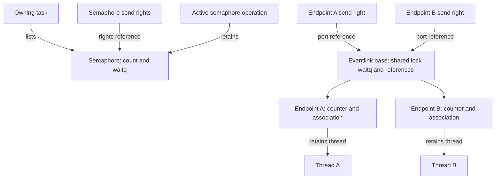
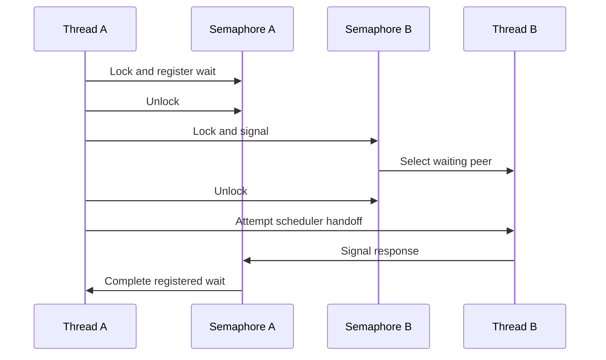
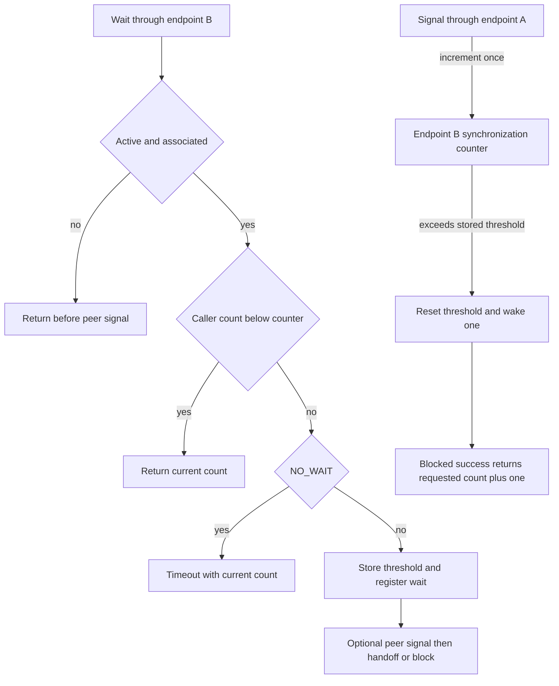

# Mach semaphores and eventlink signal/wait

[IPC guide](README.md) · [Scheduler wait protocol](../runtime/wait-and-turnstile-protocols.md) · [POSIX named semaphores](../processes/posix-named-ipc.md) · [Mach trap catalog](../../interfaces/mach-traps.md)

A Mach semaphore remembers available signals and can wake competing waiters. An eventlink connects two endpoints: signaling through one endpoint advances the other endpoint's counter, while a wait compares its local counter with a caller-supplied observation. Both reach scheduler wait queues, but their counters, associations, ownership and teardown rules differ. This chapter follows those common implementations in `xnu-12377.121.6`, including signal-before-wait and combined signal/wait operations.

The kernel bodies are present in this checkout. The explanations below are source traces, not measurements of handoff latency or promises that a particular product exposes every interface. The existing POSIX chapter covers names, descriptors and permissions around its backing semaphore; this chapter starts at that backing object's Mach implementation.

## 1. The interface and object models

| Boundary | Mach semaphore | Eventlink |
| --- | --- | --- |
| Creation/control | Task MIG routines create/destroy; semaphore MIG routines also declare wait/signal | MIG create, associate, disassociate and destroy |
| Fast signal/wait entry | Mach trap slots 33–39 | BSD slots 496–498, despite the `mach_` name |
| Capability | Send right naming an `IKOT_SEMAPHORE` port | Send right naming one `IKOT_EVENTLINK` endpoint |
| State | One `semaphore`, count, waitq and owning task | Two `ipc_eventlink` endpoints in one reference-counted base with one waitq |
| Wait eligibility | Valid semaphore capability; no permanent per-thread binding | Explicitly associated thread or wildcard association, plus active pair |
| Remembered signal | Positive available count, consumed one at a time | Endpoint synchronization counter compared with caller's count |
| Destruction scope | Owning task's semaphore becomes inactive | Either endpoint can invalidate the whole pair |

Sources: [semaphore task operations](../../../platydoc-data/xnu/osfmk/mach/task.defs#L334-L347), [semaphore operation declarations](../../../platydoc-data/xnu/osfmk/mach/semaphore.defs#L50-L81), [trap table](../../../platydoc-data/xnu/osfmk/kern/syscall_sw.c#L139-L145), [eventlink declarations](../../../platydoc-data/xnu/osfmk/mach/mach_eventlink.defs#L39-L60), [BSD slots](../../../platydoc-data/xnu/bsd/kern/syscalls.master#L779-L781), [eventlink structures](../../../platydoc-data/xnu/osfmk/ipc/ipc_eventlink.h#L69-L95).

[Semaphore representation — `sync_sema.h`, lines 52–59](../../../platydoc-data/xnu/osfmk/kern/sync_sema.h#L52-L59).

<!-- source-excerpt: ../../../platydoc-data/xnu/osfmk/kern/sync_sema.h#L52-L59 -->
```c
typedef struct semaphore {
	queue_chain_t     task_link;  /* chain of semaphores owned by a task */
	struct waitq      waitq;      /* queue of blocked threads & lock     */
	task_t            owner;      /* task that owns semaphore            */
	ipc_port_t        port;       /* semaphore port                      */
	os_ref_atomic_t   ref_count;  /* reference count                     */
	int               count;      /* current count value                 */
} Semaphore;
```

`owner` is a task responsible for the semaphore's lifecycle, not the thread that must signal it. Likewise, an eventlink thread association restricts waiting on one endpoint; it is not a mutex owner or an automatic turnstile inheritor. Both implementations use `WQT_QUEUE` and explicit event keys. A semaphore's key is the common `SEMAPHORE_EVENT` within its own queue; an eventlink's key is its endpoint address within the shared queue. [Semaphore initialization/key](../../../platydoc-data/xnu/osfmk/kern/sync_sema.c#L58-L59), [waitq initialization](../../../platydoc-data/xnu/osfmk/kern/sync_sema.c#L128-L142), [eventlink initialization](../../../platydoc-data/xnu/osfmk/ipc/ipc_eventlink.c#L171-L188), [endpoint-key wait](../../../platydoc-data/xnu/osfmk/ipc/ipc_eventlink.c#L751-L764).



The task-list arrow records ownership, not an extra reference for each list entry. The eventlink base starts with two references, one for each port; an active conversion adds a temporary reference. The diagram shows explicit thread associations; the wildcard association has no retained thread. [Semaphore initial reference](../../../platydoc-data/xnu/osfmk/kern/sync_sema.c#L128-L142), [eventlink initial references](../../../platydoc-data/xnu/osfmk/ipc/ipc_eventlink.c#L171-L188), [association ownership](../../../platydoc-data/xnu/osfmk/ipc/ipc_eventlink.c#L396-L410).

## 2. Constructing and obtaining a semaphore

`semaphore_create()` rejects a null task, a negative initial value and policy bits outside `SYNC_POLICY_USER_MASK`. It allocates storage, locks the task, then rechecks `task->active` before initializing the waitq, reference count, available count and owning-task list entry. A task terminating during allocation therefore prevents publication. The supported policy mask excludes the defined-but-unsupported fixed-priority policy; it includes FIFO/LIFO ordering and the obsolete prepost bit. [Creation](../../../platydoc-data/xnu/osfmk/kern/sync_sema.c#L95-L146), [policy definitions](../../../platydoc-data/xnu/osfmk/mach/sync_policy.h#L38-L57).

`port_name_to_semaphore()` resolves a send right in the current IPC space, then validates the stable kobject type and takes a semaphore reference while the port is locked. A valid port for another kobject is `KERN_INVALID_CAPABILITY`; an invalid name or failed send-right translation has its own error. A retained semaphore can still be inactive, so the operation subsequently checks `owner` under the semaphore's waitq lock. [Name conversion](../../../platydoc-data/xnu/osfmk/kern/sync_sema.c#L1150-L1190), [stable-object conversion](../../../platydoc-data/xnu/osfmk/kern/sync_sema.c#L1206-L1225), [active predicate](../../../platydoc-data/xnu/osfmk/kern/sync_sema.c#L68-L72).

Creation returns a semaphore reference to the output conversion. `convert_semaphore_to_port()` lazily allocates its port and makes a send right. When this starts a new collection of extant send rights, the input reference is donated to that collection; otherwise the extra input reference is released. `semaphore_no_senders()` later drops the donated reference. Kernel clients can instead retain the semaphore pointer without creating a port. [Port publication](../../../platydoc-data/xnu/osfmk/kern/sync_sema.c#L1231-L1264), [no-senders reference](../../../platydoc-data/xnu/osfmk/kern/sync_sema.c#L1265-L1278).

The MIG declarations distinguish ordinary converted arguments, whose destructor drops a temporary semaphore reference, from `semaphore_consume_ref_t`: destroy receives a move-send argument and its C body consumes the converted object reference itself. A right consumed by a message and an object reference consumed by a C receiver are separate parts of that contract. The generated server bodies are build outputs, not inspected implementations here. [Type conversions](../../../platydoc-data/xnu/osfmk/mach/mach_types.defs#L609-L623), [destroy receiver](../../../platydoc-data/xnu/osfmk/kern/sync_sema.c#L284-L309).

## 3. Semaphore count, wait registration, and preposting

The count has two roles. A positive value is available credit. Zero means no stored credit. Negative state is the sentinel `-1`, indicating that the waiter path has been used; it is **not** the number of blocked threads. The implementation deliberately leaves exact queue membership to the waitq, including when timeouts remove waiters. This differs from the older comment describing a decrement into arbitrary negative counts.

[Actual count and wait branch — `sync_sema.c`, lines 679–698](../../../platydoc-data/xnu/osfmk/kern/sync_sema.c#L679-L698).

<!-- source-excerpt: ../../../platydoc-data/xnu/osfmk/kern/sync_sema.c#L679-L698 -->
```c
	if (!semaphore_active(wait_semaphore)) {
		kr = KERN_TERMINATED;
	} else if (wait_semaphore->count > 0) {
		wait_semaphore->count--;
		kr = KERN_SUCCESS;
	} else if (option & SEMAPHORE_TIMEOUT_NOBLOCK) {
		kr = KERN_OPERATION_TIMED_OUT;
	} else {
		wait_semaphore->count = -1;  /* we don't keep an actual count */

		thread_set_pending_block_hint(self, kThreadWaitSemaphore);
		(void)waitq_assert_wait64_locked(
			&wait_semaphore->waitq,
			SEMAPHORE_EVENT,
			THREAD_ABORTSAFE,
			TIMEOUT_URGENCY_USER_NORMAL,
			deadline, TIMEOUT_NO_LEEWAY,
			self);

		semaphore_signal_options |= SEMAPHORE_THREAD_HANDOFF;
```

Under `splsched()` and the semaphore lock, a wait first checks activity, then consumes positive credit, then handles a nonblocking request, and only otherwise registers an abort-safe wait with its deadline. Thus a zero-duration timed wait can succeed if credit already exists. `waitq_assert_wait64_locked()` records the wait before the caller later hands off or blocks; registering a wait does not itself switch execution to another thread. [Lock and release](../../../platydoc-data/xnu/osfmk/kern/sync_sema.c#L676-L701), [scheduler wait registration](../../../platydoc-data/xnu/osfmk/kern/waitq.c#L1319-L1439), [wait protocol](../runtime/wait-and-turnstile-protocols.md#1-registering-a-wait-does-not-immediately-leave-the-cpu).

| Signal operation | Existing waiter | No selectable waiter |
| --- | --- | --- |
| Ordinary `semaphore_signal` | Wake one | Store one credit; public wrapper maps internal `KERN_NOT_WAITING` to success |
| `semaphore_signal_thread` with a concrete thread | Wake that thread only if it waits on this semaphore | Return `KERN_NOT_WAITING`; no prepost |
| Targeted signal with null thread | Select one existing waiter | No prepost; unlike ordinary signal |
| `semaphore_signal_all` | Reset negative hint to zero and wake all selected waiters | No new credit; an already positive count remains unchanged |

Sources: [signal branches](../../../platydoc-data/xnu/osfmk/kern/sync_sema.c#L339-L416), [targeted/null-thread entry](../../../platydoc-data/xnu/osfmk/kern/sync_sema.c#L428-L479), [ordinary public result](../../../platydoc-data/xnu/osfmk/kern/sync_sema.c#L496-L542), [broadcast wrapper](../../../platydoc-data/xnu/osfmk/kern/sync_sema.c#L553-L596).

The broadcast comment says that the count returns to zero, but the body resets it only in the negative-count branch. The table follows that body. Similarly, a negative hint can outlast the last waiter: an ordinary signal that finds no thread resets it to zero and then preposts one credit. These distinctions matter when reconstructing signal-before-wait behavior. [Broadcast condition](../../../platydoc-data/xnu/osfmk/kern/sync_sema.c#L369-L390), [empty-queue repair](../../../platydoc-data/xnu/osfmk/kern/sync_sema.c#L394-L416).

For a worked sequence, start at count zero and issue two ordinary signals before any wait: the count becomes two. Two waits consume those credits and return without blocking. A third wait writes `-1` and registers with the waitq. If it times out, a later ordinary signal repairs the now-empty waiter hint and leaves one credit. Replacing the initial two ordinary signals with `signal_all` would leave zero credits. These are source-derived cases, not runtime observations.

## 4. Combined semaphore wait and signal orders two objects

The combined trap obtains the signal-semaphore reference first and the wait-semaphore reference second. A failed name conversion therefore prevents entry into the combined operation. Once inside `semaphore_wait_internal()`, the caller completes its local count decision or wait registration, unlocks that semaphore, and only then signals the other one. It never holds both semaphore locks across the entire operation. [Trap conversions](../../../platydoc-data/xnu/osfmk/kern/sync_sema.c#L985-L1008), [registration then signal](../../../platydoc-data/xnu/osfmk/kern/sync_sema.c#L676-L716).



This selected exchange assumes both semaphores are active and B is waiting. A publishes its wait before enabling B to send a response, so a fast B response can satisfy the registered wait before A actually leaves the CPU. The scheduler still decides whether direct handoff is possible. There is no global two-object transaction or guarantee that the two calls alternate indefinitely.

The signal side runs even when the local wait consumed existing credit, selected the nonblocking timeout result, or found the local semaphore inactive. The combined operation's error return therefore does not prove that no peer was signaled. A timeout occurring after registration likewise does not undo the peer signal. [Signal before immediate return](../../../platydoc-data/xnu/osfmk/kern/sync_sema.c#L707-L751).

If the signal semaphore has become inactive, the code tries to remove the current thread's wait. A wakeup that already won can preserve its result; an interruption result from this cleanup is converted to termination. This is reconciliation with concurrent completion, not rollback of an already consumed credit or peer action. [Dead signal-side handling](../../../platydoc-data/xnu/osfmk/kern/sync_sema.c#L718-L741).

[Result reconciliation — `sync_sema.c`, lines 735–740](../../../platydoc-data/xnu/osfmk/kern/sync_sema.c#L735-L740).

<!-- source-excerpt: ../../../platydoc-data/xnu/osfmk/kern/sync_sema.c#L735-L740 -->
```c
			assert(self->handoff_thread == THREAD_NULL);
			clear_wait(self, THREAD_INTERRUPTED);
			kr = semaphore_convert_wait_result(self->wait_result);
			if (kr == KERN_ABORTED) {
				kr = KERN_TERMINATED;
			}
```

For trap callers that actually block, the thread stores the wait semaphore, optional signal semaphore and caller continuation. `semaphore_wait_continue()` releases those retained references and invokes `thread_syscall_return` with the converted wait result. Immediate returns release them in the trap wrapper instead. Kernel callers such as POSIX `sem_wait` use the non-continuation interface and supply their own surrounding lifetime protection. [Continuation ownership](../../../platydoc-data/xnu/osfmk/kern/sync_sema.c#L633-L646), [block setup](../../../platydoc-data/xnu/osfmk/kern/sync_sema.c#L754-L778), [trap return](../../../platydoc-data/xnu/osfmk/kern/sync_sema.c#L833-L855), [POSIX held fd reference](../../../platydoc-data/xnu/bsd/kern/posix_sem.c#L981-L1036).

## 5. Eventlinks publish two endpoints and a waiting association

`mach_eventlink_create()` requires the supplied task to be the current task and the option to equal `MELC_OPTION_NO_COPYIN`. Although the header declares `MELC_OPTION_WITH_COPYIN`, this create body does not implement it. Initialization creates two kernel-object ports with send rights, sets each synchronization counter to zero, sets each wait counter to `UINT64_MAX`, and initializes their common FIFO waitq last. There is no semaphore-style owning-task list in the eventlink base. [Create admission](../../../platydoc-data/xnu/osfmk/ipc/ipc_eventlink.c#L213-L236), [pair initialization](../../../platydoc-data/xnu/osfmk/ipc/ipc_eventlink.c#L171-L188), [declared options](../../../platydoc-data/xnu/osfmk/mach/mach_eventlink_types.h#L42-L52).

`mach_eventlink_associate()` rejects nonzero copyin addresses or masks. With `MELA_OPTION_NONE`, a nonnull converted thread is retained and stored in the endpoint. With `MELA_OPTION_ASSOCIATE_ON_WAIT`, the declared use is a null thread and the endpoint stores `THREAD_ASSOCIATE_WILD`. Reassociating an endpoint already carrying either form returns `KERN_NAME_EXISTS`. Association does not reset the signal counter. [Association checks and publication](../../../platydoc-data/xnu/osfmk/ipc/ipc_eventlink.c#L360-L410).

The wait path checks the actual association under the shared lock. An explicit association requires `current_thread()` to match. Wildcard association permits a caller only while the endpoint's wait-counter sentinel denotes no registered threshold. It does not permanently replace the wildcard with the first caller's thread pointer.

[Wait association gate — `ipc_eventlink.c`, lines 728–740](../../../platydoc-data/xnu/osfmk/ipc/ipc_eventlink.c#L728-L740).

<!-- source-excerpt: ../../../platydoc-data/xnu/osfmk/ipc/ipc_eventlink.c#L728-L740 -->
```c
	/* Check if waiting thread is associated to eventlink */
	if (wait_eventlink->el_thread != THREAD_ASSOCIATE_WILD &&
	    wait_eventlink->el_thread != self) {
		kr = KERN_INVALID_ARGUMENT;
		goto unlock;
	}

	/* Check if thread already waiting for associate on wait case */
	if (wait_eventlink->el_thread == THREAD_ASSOCIATE_WILD &&
	    wait_eventlink->el_wait_counter != UINT64_MAX) {
		kr = KERN_INVALID_ARGUMENT;
		goto unlock;
	}
```

Possessing a send right is sufficient to reach signaling; the signal path has no matching associated-thread check. Waiting and signaling through the same endpoint have different effects: wait examines that endpoint; signal obtains `eventlink_remote_side()` and changes its peer. These are kernel endpoint identities, not task-local integer-name relationships. Transferring a send right to another task preserves the referenced endpoint. [Signal conversion and peer selection](../../../platydoc-data/xnu/osfmk/ipc/ipc_eventlink.c#L497-L519), [name conversion](../../../platydoc-data/xnu/osfmk/ipc/ipc_eventlink.c#L1037-L1061), [movable send registration](../../../platydoc-data/xnu/osfmk/ipc/ipc_eventlink.c#L125-L127).

## 6. Eventlink counts describe observations, not consumable credits

Each ordinary signal increments the peer endpoint's `el_sync_counter` by exactly one. The ABI's `signal_count` argument is unused by both public kernel signal entries in this snapshot. A caller passing zero still issues one signal. The helper wakes a waiter only when the incremented synchronization count exceeds `el_wait_counter`; before selecting it, the helper resets that wait threshold to `UINT64_MAX`. If no thread is selected, the public signal still returns success. [Signal arguments](../../../platydoc-data/xnu/osfmk/ipc/ipc_eventlink.c#L489-L511), [combined argument](../../../platydoc-data/xnu/osfmk/ipc/ipc_eventlink.c#L604-L621), [counter/wakeup body](../../../platydoc-data/xnu/osfmk/ipc/ipc_eventlink.c#L880-L899), [public result](../../../platydoc-data/xnu/osfmk/ipc/ipc_eventlink.c#L544-L555).

[Counter comparison and wait registration — `ipc_eventlink.c`, lines 742–765](../../../platydoc-data/xnu/osfmk/ipc/ipc_eventlink.c#L742-L765).

<!-- source-excerpt: ../../../platydoc-data/xnu/osfmk/ipc/ipc_eventlink.c#L742-L765 -->
```c
	/* Check if the signal count exceeds the count provided */
	if (*count < wait_eventlink->el_sync_counter) {
		*count = wait_eventlink->el_sync_counter;
		kr = KERN_SUCCESS;
	} else if (eventlink_option & IPC_EVENTLINK_NO_WAIT) {
		/* Check if no block was passed */
		*count =  wait_eventlink->el_sync_counter;
		kr = KERN_OPERATION_TIMED_OUT;
	} else {
		/* Update the wait counter and add thread to waitq */
		wait_eventlink->el_wait_counter = *count;
		old_signal_count = wait_eventlink->el_sync_counter;

		thread_set_pending_block_hint(self, kThreadWaitEventlink);
		(void)waitq_assert_wait64_locked(
			&ipc_eventlink_base->elb_waitq,
			CAST_EVENT64_T(wait_eventlink),
			THREAD_ABORTSAFE,
			TIMEOUT_URGENCY_USER_NORMAL,
			deadline, TIMEOUT_NO_LEEWAY,
			self);

		eventlink_option |= IPC_EVENTLINK_HANDOFF;
	}
```

For an active, properly associated endpoint, a stale caller count returns immediately with the current synchronization count. Otherwise `NO_WAIT` returns timeout and also supplies the current count. A blocking attempt records the supplied threshold and the old synchronization count, then registers an abort-safe wait on the endpoint's event key. A future threshold is not rejected here: the peer must signal enough times to exceed it.

For example, A signals through endpoint A three times before B waits on endpoint B. B's synchronization counter is three. B waits with observed count zero and immediately receives three; the kernel counter remains three. Repeating a wait with zero again also observes three. Waiting with three asks for progress beyond three. Unlike a semaphore wait, this operation does not consume one unit from a shared available count.



The diagram separates local count handling from signal delivery. In a combined call, immediate success and `NO_WAIT` timeout still proceed through the peer-signal step before returning; only failed activity/association admission exits before it. Signal-before-wait is remembered by the counter rather than a queued notification record.

### Combined eventlink operations share a lock

`mach_eventlink_signal_wait_until()` resolves one endpoint and derives its peer from the same base. After local association/count processing, it calls the peer signal helper while still holding the base's shared waitq lock. Only after both sides' state changes does it unlock and enter scheduler handoff/blocking. Thus the counterpart to two independently locked semaphores is one pair-wide lock, not two arbitrary eventlinks supplied by the user. [One conversion and peer derivation](../../../platydoc-data/xnu/osfmk/ipc/ipc_eventlink.c#L657-L681), [signal under the shared lock](../../../platydoc-data/xnu/osfmk/ipc/ipc_eventlink.c#L767-L791).

Consider B already waiting at threshold zero on endpoint B. A calls signal/wait on A with local count zero. It registers A's threshold, increments B to one, resets B's threshold and wakes B. B can signal/wait on B to register its next threshold and increment A, completing A's registered wait. The pair lock orders each registration before its associated peer signal; scheduler selection determines which runnable thread executes next.

## 7. Handoff, timeouts, interruption, and returned counts

Both combined paths request `WAITQ_HANDOFF` only after taking the wait-registration branch. `thread_go()` can retain a selected peer in the current thread's `handoff_thread` field instead of putting it immediately on a run queue. The synchronizer removes that field and passes the reference to `thread_handoff_*` with `THREAD_HANDOFF_SETRUN_NEEDED`. Those helpers attempt `thread_prepare_for_handoff()` and consume the peer reference; if no direct target is usable, they block through ordinary scheduling. Handoff is an optimization with eligibility conditions, not a promise that signaling directly invokes the peer. [Semaphore request](../../../platydoc-data/xnu/osfmk/kern/sync_sema.c#L394-L408), [eventlink request](../../../platydoc-data/xnu/osfmk/ipc/ipc_eventlink.c#L883-L896), [wake-to-handoff](../../../platydoc-data/xnu/osfmk/kern/sched_prim.c#L1043-L1089), [handoff ownership and fallback](../../../platydoc-data/xnu/osfmk/kern/syscall_subr.c#L337-L409), [scheduler eligibility](../../../platydoc-data/xnu/osfmk/kern/sched_prim.c#L6167-L6255).

Semaphore timed waits validate seconds/nanoseconds and convert a relative duration to an absolute deadline; `{0,0}` selects nonblocking behavior. Eventlinks accept only `KERN_CLOCK_MACH_ABSOLUTE_TIME` and take an absolute deadline directly; zero with ordinary options is used as an indefinite wait, while `MELSW_OPTION_NO_WAIT` explicitly prohibits blocking. Do not interchange these timeout conventions. [Semaphore validation/conversion](../../../platydoc-data/xnu/osfmk/kern/sync_sema.c#L914-L944), [deadline helper](../../../platydoc-data/xnu/osfmk/kern/sync_sema.c#L74-L84), [eventlink clock admission](../../../platydoc-data/xnu/osfmk/ipc/ipc_eventlink.c#L657-L674), [indefinite-wait local test](../../../platydoc-data/xnu/tests/mach_eventlink.c#L764-L769).

| Scheduler result | Both synchronizers' returned Mach result |
| --- | --- |
| `THREAD_AWAKENED` | `KERN_SUCCESS` |
| `THREAD_TIMED_OUT` | `KERN_OPERATION_TIMED_OUT` |
| `THREAD_INTERRUPTED` | `KERN_ABORTED` |
| `THREAD_RESTART` | `KERN_TERMINATED` |

Sources: [semaphore conversion](../../../platydoc-data/xnu/osfmk/kern/sync_sema.c#L605-L623), [eventlink conversion](../../../platydoc-data/xnu/osfmk/ipc/ipc_eventlink.c#L826-L846). `THREAD_ABORTSAFE` makes interruption a real completion route; destruction uses restart. The semaphore's count is not incremented simply because a wait times out.

Eventlink completion has a deliberately different count rule from its immediate catch-up branch. A blocked success increments the caller's requested count by one; an unsuccessful block returns the synchronization count saved before registering the wait. It does not reread the newest counter after waking.

[Blocked count result — `ipc_eventlink.c`, lines 796–803](../../../platydoc-data/xnu/osfmk/ipc/ipc_eventlink.c#L796-L803).

<!-- source-excerpt: ../../../platydoc-data/xnu/osfmk/ipc/ipc_eventlink.c#L796-L803 -->
```c
	/* Increment the count value if eventlink_signal was called */
	if (kr == KERN_SUCCESS) {
		*count += 1;
	} else {
		*count = old_signal_count;
	}

	return kr;
```

For a wait registered with count three, a successful wake returns four even if more peer signals occurred before the thread resumed. Its next wait can immediately catch up to the newer counter. On timeout, the returned value instead reflects `old_signal_count`; it is not evidence that no peer signal happened during the attempted wait. The combined operation's peer increment is never rolled back by this result conversion.

The return path also does not reset `el_wait_counter` after timeout/interruption. That reset occurs in the threshold-crossing signal branch or forced wakeup. In wildcard mode, a still-recorded threshold consequently remains relevant to the next call's association gate; clearing scheduler queue membership alone does not establish that this gate will admit another wait. Explicit disassociation forces the threshold reset and releases the association. This is a source-visible state distinction, not a claim that every timeout schedule was exercised. [No reset on return](../../../platydoc-data/xnu/osfmk/ipc/ipc_eventlink.c#L791-L810), [threshold reset](../../../platydoc-data/xnu/osfmk/ipc/ipc_eventlink.c#L867-L896), [disassociation](../../../platydoc-data/xnu/osfmk/ipc/ipc_eventlink.c#L430-L476).

### The eventlink result has two packed fields

The BSD wrappers store the synchronizer's result in the 64-bit return register and return BSD errno zero. Its low 56 bits contain the count; its high eight bits contain the Mach error. Libsyscall extracts the error and overwrites the caller's count pointer even when that error is nonzero. Internal counters are 64-bit fields, while this interface masks the returned count to 56 bits; the examples use small values and do not assert unbounded counter arithmetic. [BSD wrappers](../../../platydoc-data/xnu/bsd/kern/sys_eventlink.c#L58-L88), [encoding](../../../platydoc-data/xnu/osfmk/mach/mach_eventlink_types.h#L59-L70), [library unpacking](../../../platydoc-data/xnu/libsyscall/mach/mach_eventlink.c#L74-L104).

This split explains why the API uses BSD syscall slots rather than ordinary Mach traps. A successful BSD syscall transport return does not imply that the eventlink wait succeeded. There is no user-count-buffer copyout inside the synchronizer: the library performs the pointer update after receiving the packed register result. [Library interface rationale](../../../platydoc-data/xnu/libsyscall/mach/mach_eventlink.c#L37-L61).

## 8. Destroy, no-senders, and final storage release

For semaphores, explicit destruction deactivates only when the supplied task matches the recorded owner. It removes the task-list entry under task protection, sets `owner=TASK_NULL` and count zero under the semaphore lock, then wakes the negative-count path with `THREAD_RESTART`. The public body always consumes its semaphore reference; a nonnull non-owner task does not deactivate the object but still reaches a success return. The task port and semaphore right therefore supply separate inputs to this operation. [Destroy admission and reference consumption](../../../platydoc-data/xnu/osfmk/kern/sync_sema.c#L284-L309), [deactivation/wakeup](../../../platydoc-data/xnu/osfmk/kern/sync_sema.c#L164-L202).

Task teardown calls `semaphore_destroy_all()` to deactivate every listed semaphore. This drains task ownership, not all outstanding object references. Wait continuations and kernel holders can retain an inactive semaphore until they release it. Conversely, dropping the last send right releases the port's collective reference; if it is the final reference, `semaphore_free()` deallocates the lazily created port, deactivates any remaining task ownership, deinitializes the waitq and frees storage. Its non-current-owner path uses a try-lock or retains the task and retries in task-before-semaphore lock order. [Task teardown call](../../../platydoc-data/xnu/osfmk/kern/task.c#L3119-L3126), [destroy-all](../../../platydoc-data/xnu/osfmk/kern/sync_sema.c#L319-L332), [final release/lock handoff](../../../platydoc-data/xnu/osfmk/kern/sync_sema.c#L214-L275), [reference decrement](../../../platydoc-data/xnu/osfmk/kern/sync_sema.c#L1126-L1139).

Eventlink disassociation is narrower than pair destruction: it clears one association and forces a restart wake on that endpoint, without incrementing its synchronization count or invalidating the shared waitq. Pair destruction clears both associations, forces their waiters to restart, clears both stored port pointers and invalidates the shared waitq. It retains the peer port across dropping the pair lock. [Disassociate](../../../platydoc-data/xnu/osfmk/ipc/ipc_eventlink.c#L430-L476), [pair deactivation](../../../platydoc-data/xnu/osfmk/ipc/ipc_eventlink.c#L275-L317), [forced wake](../../../platydoc-data/xnu/osfmk/ipc/ipc_eventlink.c#L867-L878).

[Different local and peer port treatment — `ipc_eventlink.c`, lines 316–329](../../../platydoc-data/xnu/osfmk/ipc/ipc_eventlink.c#L316-L329).

<!-- source-excerpt: ../../../platydoc-data/xnu/osfmk/ipc/ipc_eventlink.c#L316-L329 -->
```c
	/* Mark the eventlink as inactive */
	waitq_invalidate(&ipc_eventlink_base->elb_waitq);

	ipc_eventlink_unlock(ipc_eventlink);
	splx(s);

	/* Destroy the local eventlink port */
	ipc_kobject_dealloc_port(ipc_eventlink_port, IPC_KOBJECT_NO_MSCOUNT,
	    IKOT_EVENTLINK);
	/* Drops port reference */

	/* Clear the remote eventlink port without destroying it */
	(void)ipc_kobject_disable(ipc_eventlink_port_remote, IKOT_EVENTLINK);
	ip_release(ipc_eventlink_port_remote);
```

Only the selected endpoint's port is destroyed there. The peer port remains but its kobject is disabled; conversion can consequently return `KERN_TERMINATED` without an endpoint pointer. The destroy receiver intentionally returns success for an already terminated eventlink. The MIG destroy argument moves a send right and still declares an object-reference destructor, unlike semaphore destroy's consume-reference type. [Remote conversion](../../../platydoc-data/xnu/osfmk/ipc/ipc_eventlink.c#L1000-L1018), [destroy result](../../../platydoc-data/xnu/osfmk/ipc/ipc_eventlink.c#L239-L246), [MIG contract](../../../platydoc-data/xnu/osfmk/mach/mach_types.defs#L628-L642).

An endpoint's no-senders callback obtains a temporary reference and attempts pair destruction. If the pair is already terminated, it deallocates the remaining disabled port instead. The first pair teardown drops both original port-backed base references and releases explicit associated-thread references. Active operations retain the base until their releases; the final decrement deinitializes the waitq and frees the base. Thus last-send-right loss on one endpoint can terminate the other endpoint's waits, while logical termination and allocation release remain distinct. [No-senders](../../../platydoc-data/xnu/osfmk/ipc/ipc_eventlink.c#L1074-L1103), [port/thread reference drops](../../../platydoc-data/xnu/osfmk/ipc/ipc_eventlink.c#L331-L340), [base reference/free](../../../platydoc-data/xnu/osfmk/ipc/ipc_eventlink.c#L912-L959).

## 9. Source tests and implementation limits

| Local source | What the inspected body asserts | Limit of that evidence |
| --- | --- | --- |
| [Eventlink timeout/no-wait helpers](../../../platydoc-data/xnu/tests/mach_eventlink.c#L55-L98) | Timeout result and returned count zero for the selected initial state | No general assertion about all timeout-versus-signal schedules |
| [Local/remote destroy and deallocation](../../../platydoc-data/xnu/tests/mach_eventlink.c#L454-L548), [wait result helper](../../../platydoc-data/xnu/tests/mach_eventlink.c#L100-L118) | A blocked wait reports termination; destroy cases add send urefs to distinguish explicit destruction from last-right loss | Sleep-based coordination is not exhaustive concurrency validation |
| [Immediate combined cases](../../../platydoc-data/xnu/tests/mach_eventlink.c#L169-L224) | `NO_WAIT` timeout and stale-count success preserve their selected count results | Not proof that immediate returns have no peer-side effects |
| [Wildcard association](../../../platydoc-data/xnu/tests/mach_eventlink.c#L742-L785) | Successful exchange, then invalid-argument wait after explicit disassociation | Does not test wildcard reuse after every interruption/timeout |
| [Semaphore handoff benchmark body](../../../platydoc-data/xnu/tests/handoff_perf.c#L678-L738) | Two zero-count semaphores, preposted startup, repeated wait/signal and follower termination during cleanup | No measured latency or guarantee of direct handoff is reported here |

Both implementation files are listed as `standard` in the local build inventory. Eventlink debug-list bookkeeping and handoff counters have `DEVELOPMENT || DEBUG` guards; they do not define the normal counter protocol. This review follows common code used from the ARM64-capable syscall/trap routes, without assuming a platform availability matrix from file presence or test metadata. [Build entries](../../../platydoc-data/xnu/osfmk/conf/files#L89-L89), [semaphore build entry](../../../platydoc-data/xnu/osfmk/conf/files#L190-L190), [debug eventlink bookkeeping](../../../platydoc-data/xnu/osfmk/ipc/ipc_eventlink.c#L55-L68), [handoff counter guard](../../../platydoc-data/xnu/osfmk/kern/syscall_subr.c#L379-L382).

The declared MIG conversion/destructor contracts and local receiver bodies were read; generated MIG code was not built. User-library synchronization protocols, fairness under all scheduler configurations, counter-wrap behavior and every destroy/timeout interleaving remain outside this chapter. No kernel build, live semaphore/eventlink test, performance benchmark or HTML generation was performed.

<!-- BEGIN PLATYDOC DOCUMENTATION LICENSE -->
Original Platydoc text and diagrams are licensed under [CC BY 4.0](https://creativecommons.org/licenses/by/4.0/). Quoted source code and third-party material retain their respective licenses.
<!-- END PLATYDOC DOCUMENTATION LICENSE -->
