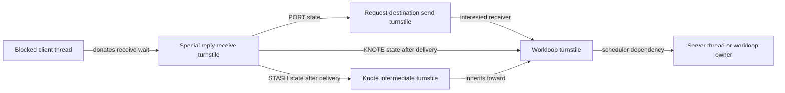

# Synchronous IPC dependencies and special reply ports

[IPC guide](README.md) · [Message delivery](message-send-receive.md) · [Runtime turnstiles](../runtime/wait-and-turnstile-protocols.md) · [Reply policy](guards-and-policy-enforcement.md)

A synchronous caller needs the server to run before it can receive a reply. The reply capability authorizes that reply; a separate turnstile relationship tells the scheduler where the caller's dependency leads. In this checkout, a special reply port can redirect its receive turnstile toward the request destination, a workloop, or an intermediate knote turnstile. This chapter follows the ownership and reset rules in the architecture-independent IPC implementation, with no assumption about external libdispatch/XPC behavior. [`ipc_port_recv_update_inheritor`](../../../xnu/osfmk/ipc/ipc_port.c#L1641-L1673).

## The objects in one request and reply

| Object | State relevant to the dependency |
| --- | --- |
| Calling `thread` | `ith_special_reply_port` for user RPC, `ith_kernel_reply_port` for kernel RPC; its donated turnstile must return at receive completion |
| Special reply `ipc_port` | Receive queue, owner thread, `ip_sync_link_state` and state-dependent `ip_sync_inheritor_*`; this port remains distinct from the request destination |
| Request destination `ipc_port` | Send turnstile can identify an interested workloop, a receive right in transit, or another supported receiver dependency |
| Request `ipc_kmsg` | Owns the reply capability while queued/in transit; the server later receives that right |
| `knote` | During event-driven receive, remembers the first port in `kn_ext[3]` or `kn_ipc_port`, and may hold another turnstile in `kn_hook` |

Definitions and contracts: [`ipc_port`](../../../xnu/osfmk/ipc/ipc_port.h#L119-L204), [binding](../../../xnu/osfmk/kern/ipc_tt.c#L1416), [knote protocol](../../../xnu/osfmk/ipc/ipc_pset.c#L280-L328).

`thread_get_special_reply_port()` first unbinds any prior user special reply port, allocates `IOT_SPECIAL_REPLY_PORT` with a send right, then binds it to the current thread. Binding retains the port; the returned task-local name provides send and receive capabilities. Allocation failure returns `MACH_PORT_NULL`. A kernel caller instead uses a special port in `ipc_space_reply`. The legacy `mach_reply_port()` trap allocates ordinary `IOT_PORT`, so its name alone does not imply this scheduling protocol. [Allocation and binding](../../../xnu/osfmk/kern/ipc_tt.c#L1319-L1450).

## Establishing the destination link

The receive-side helper checks that the supplied receive port is this thread's `ith_special_reply_port`, and rejects a syntactically invalid destination name with `MACH_RCV_INVALID_NOTIFY`. It translates the destination send right, temporarily retains the port, unlocks it, and attempts linkage. Failure to translate a previously valid destination does not itself fail the receive: the destination receive right may already have disappeared. [`mach_msg_rcv_link_special_reply_port`](../../../xnu/osfmk/ipc/mach_msg.c#L1066-L1098).

`ipc_port_link_special_reply_port()` prepares the destination's send turnstile before acquiring the special reply port lock. It then requires a still-special port in `PORT_SYNC_LINK_ANY` without an existing destination. Successful publication takes an independent destination reference; rejected publication completes the unused prepared turnstile association. These are two lifetimes, not one reference count. [Complete operation](../../../xnu/osfmk/ipc/ipc_port.c#L1867-L1913).

[Source: `osfmk/ipc/ipc_port.c`, lines 1890–1902](../../../xnu/osfmk/ipc/ipc_port.c#L1890-L1902).

<!-- source-excerpt: ../../../xnu/osfmk/ipc/ipc_port.c#L1890-L1902 -->
```c
	    special_reply_port->ip_sync_inheritor_port != IPC_PORT_NULL) {
		drop_turnstile_ref = TRUE;
	} else {
		/* take a reference on dest_port */
		ip_reference(dest_port);
		special_reply_port->ip_sync_inheritor_port = dest_port;
		special_reply_port->ip_sync_link_state = PORT_SYNC_LINK_PORT;
	}

	ip_mq_unlock(special_reply_port);

	if (special_reply) {
		/*
```



The arrows describe dependencies, not message routing or ownership of a server thread. The request still follows ordinary queue/direct-delivery selection. `ipc_port_send_update_inheritor()` has additional branches for in-transit receive rights, exec watchports and bootstrap check-in; its result may be a thread or another turnstile. A valid destination capability alone does not identify the runnable server. [Send inheritor selection](../../../xnu/osfmk/ipc/ipc_port.c#L1675-L1759).

## State determines which union member may be used

| `PORT_SYNC_LINK_*` state | Meaning and relevant ownership |
| --- | --- |
| `ANY` | No destination/workloop link; new linkage is permitted |
| `PORT` | `ip_sync_inheritor_port` retains the destination, with a prepared send-turnstile association |
| `WORKLOOP_KNOTE` | `ip_sync_inheritor_knote` identifies a knote; that knote holds the associated port reference |
| `WORKLOOP_STASH` | `ip_sync_inheritor_ts` holds an additional referenced intermediate turnstile |
| `NO_LINKAGE` | Further linkage is suppressed until the receive-side reset permits it |
| `RCV_THREAD` | A related receive-right/bootstrap state, using the receiving thread as send-turnstile inheritor; it is not another branch of special-reply receive inheritance |

The shared constants cover both special-reply and receive-right protocols. Read the union using the actual port role. [Constants](../../../xnu/osfmk/ipc/ipc_port.h#L250-L287), [receive inheritors](../../../xnu/osfmk/ipc/ipc_port.c#L1641-L1673), [bootstrap receive-right state](../../../xnu/osfmk/ipc/ipc_port.c#L2264-L2328).

## Event-driven receipt transfers the scheduling dependency

When receive copyout installs a special-reply send-once right through a relevant knote, `ipc_right_copyout_any_send()` requests `IPC_PORT_ADJUST_SR_LINK_WORKLOOP`. This is an actual capability-copyout boundary: donation changes as the server receives the reply endpoint. [Call site](../../../xnu/osfmk/ipc/ipc_right.c#L2619-L2640).

`filt_machport_stash_port()` uses the workloop turnstile directly for the first remembered port. A later eligible port uses the intermediate turnstile in `kn_hook`; `filt_machport_turnstile_prepare_lazily()` allocates it before the port's message-queue lock is held. Eligibility for the Mach-port knote requires the relevant receive/sync-peek options and `EV_DISPATCH`. An unsupported knote yields `NO_LINKAGE`, not an invented runnable receiver. [Stashing and lazy preparation](../../../xnu/osfmk/ipc/ipc_pset.c#L395-L492).

This design also supports abandoning a delivered request. Re-enabling the knote completes its saved links: the first port is checked under its port lock to ensure it still points to this knote, because it may already have replied and been reused. The intermediate turnstile's inheritor is cleared, its association completed, and its reference released. Several dependent ports can therefore be disconnected through one intermediate object without walking all their state at once. [Completion](../../../xnu/osfmk/ipc/ipc_pset.c#L494-L582).

## Reset, interruption and port death

`ipc_port_adjust_special_reply_port_locked()` consumes the port lock. It saves the old destination or stashed-turnstile pointer, clears the corresponding union member, installs the selected state, and either returns the thread's donated turnstile or updates the existing turnstile's inheritor. Completion/cleanup and saved-reference release occur after unlocking. This prevents treating a changed dependency graph as if all its old edges remain owned. [State change and cleanup](../../../xnu/osfmk/ipc/ipc_port.c#L2049-L2188).

[Source: `osfmk/ipc/ipc_port.c`, lines 2161–2188](../../../xnu/osfmk/ipc/ipc_port.c#L2161-L2188).

<!-- source-excerpt: ../../../xnu/osfmk/ipc/ipc_port.c#L2161-L2188 -->
```c
		ts = ipc_port_rcv_turnstile(special_reply_port);
		if (ts) {
			turnstile_reference(ts);
			ipc_port_recv_update_inheritor(special_reply_port, ts,
			    TURNSTILE_IMMEDIATE_UPDATE);
		}
	}

	ip_mq_unlock(special_reply_port);

	if (get_turnstile) {
		turnstile_cleanup();
	} else if (ts) {
		/* Call turnstile cleanup after dropping the interlock */
		turnstile_update_inheritor_complete(ts, TURNSTILE_INTERLOCK_NOT_HELD);
		turnstile_deallocate(ts);
	}

	if (port_stashed_turnstile) {
		turnstile_deallocate(port_stashed_turnstile);
	}

	/* Release the ref on the dest port and its turnstile */
	if (dest_port) {
		ipc_port_send_turnstile_complete(dest_port);
		/* release the reference on the dest port, space lock might be held */
		ip_release_safe(dest_port);
	}
```

`mach_msg_receive_results_complete()` resets permitted linkage before the receive object reference is dropped. An interrupted/timed-out receive and `MACH_RCV_TOO_LARGE` with `MACH_RCV_LARGE` do not mean a reply was consumed: the helper consequently distinguishes resetting the link from marking a received message. The message-sent/lost-link diagnostic bits are development/debug features, not universal production bookkeeping. [Receive completion](../../../xnu/osfmk/ipc/mach_msg.c#L1111-L1151), [diagnostic implementations](../../../xnu/osfmk/ipc/ipc_port.c#L1965-L2035).

Port destruction marks the endpoint inactive, updates send inheritance and unlinks special-reply state before finishing queued-message destruction. Unbinding a thread's reply port is another lifetime boundary; merely removing a scheduler edge does not destroy the receive right or every send-once right. [Death ordering](../../../xnu/osfmk/ipc/ipc_port.c#L1225-L1262), [thread unbinding](../../../xnu/osfmk/kern/ipc_tt.c#L1451-L1532).

## A worked RPC and its independent checks

Consider an illustrative client A sending to service S with a send-once reply right for R. A waits on R and links R to S. If S is monitored by a participating workloop, A's wait can influence that workloop before its server executes. Delivery transfers the reply right and can replace the S dependency with a knote/workloop dependency. Sending the reply, receive completion, knote re-enablement without reply, and port destruction have different cleanup paths; none can leave an old destination reference merely because the next RPC will reuse R.

If strict reply is requested, receipt may separately record a bank persona in `ip_reply_context`. The server's adopted voucher is checked when replying. That identity check neither creates the turnstile linkage nor proves the server adopted the voucher simply by receiving its right. See [strict reply and copyout policy](guards-and-policy-enforcement.md). The same separation applies to exception RPC, whose kernel special-reply transport is traced in [exception delivery](exception-delivery.md).

This source review covers the visible state transitions and selected knote integration. External dispatch libraries, every combined workloop event race, scheduler policy choices and generated MIG client code remain separate boundaries; no kernel execution is claimed.

<!-- BEGIN PLATYDOC DOCUMENTATION LICENSE -->
Original Platydoc text and diagrams are licensed under [CC BY 4.0](https://creativecommons.org/licenses/by/4.0/). Quoted source code and third-party material retain their respective licenses.
<!-- END PLATYDOC DOCUMENTATION LICENSE -->
