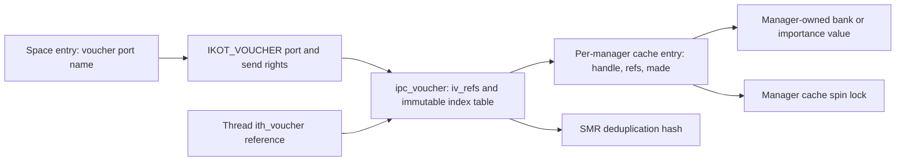
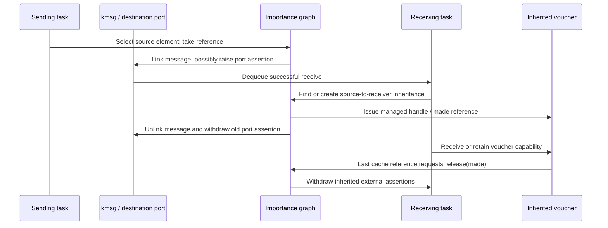

# Vouchers, attribute caches, and importance inheritance

[IPC overview](README.md) · [Policy introduction](policies-and-attribution.md) · [Message delivery](message-send-receive.md) · [Guards and policy enforcement](guards-and-policy-enforcement.md)

A voucher is a capability for an immutable collection of managed attributes. The attributes can identify accounting relationships and importance inheritance; they are not copies of a task's entire identity or scheduling state. Message transport, voucher transformation, thread adoption, and withdrawal of a donation are separate operations. This chapter follows their actual ownership boundaries. It assumes the [port/right distinction](names-and-rights.md): one voucher object can have many kernel references and a voucher port with many send rights and names. [`ipc_voucher.h`](../../../xnu/osfmk/ipc/ipc_voucher.h#L68), [`ipc_importance.h`](../../../xnu/osfmk/ipc/ipc_importance.h#L62).

## 1. Four objects and four kinds of count

The voucher stores indices, not inline resource-manager objects:

[ipc_voucher layout](../../../xnu/osfmk/ipc/ipc_voucher.h#L73)

<!-- source-excerpt: ../../../xnu/osfmk/ipc/ipc_voucher.h#L73-L78 -->
```c
struct ipc_voucher {
	os_ref_atomic_t         iv_refs;        /* reference count */
	iv_index_t              iv_table[MACH_VOUCHER_ATTR_KEY_NUM];
	ipc_port_t              iv_port;        /* port representing the voucher */
	struct smrq_slink       iv_hash_link;   /* link on hash chain */
};
```

`iv_refs` protects this object. Each non-default `iv_table` element names an entry in the corresponding attribute manager's cache. `iv_port` is the lazy-created `IKOT_VOUCHER` capability. `iv_hash_link` places the voucher in the global deduplication hash, whose key is the complete array of indices. Once published, that array is immutable, so looking up an attribute does not require a per-voucher mutation lock. Allocation uses an SMR-enabled zone and hash; reference acquisition through the hash must succeed before the caller can retain a candidate. [`ipc_voucher_init()` and allocation](../../../xnu/osfmk/ipc/ipc_voucher.c#L182), [`hash key, comparison, and try-get`](../../../xnu/osfmk/ipc/ipc_voucher.c#L221), [`iv_lookup()`](../../../xnu/osfmk/ipc/ipc_voucher.c#L303).



| Count or owner | What it measures | What it does not measure |
|---|---|---|
| Namespace send urefs / port send rights | User references to a capability, and kernel-held send rights | Number of vouchers or attribute values |
| `iv_refs` | Kernel ownership of one immutable voucher object | Number of messages, tasks, or managers universally |
| `ivace_refs` | References to an attribute-cache entry, including voucher construction/copying | Number of times the manager manufactured that value |
| `ivace_made` | Manager-returned value references accumulated into this cache entry | Number of currently live voucher objects |

These distinctions are visible in the two cache-reference paths. Copying a known cache index increments `ivace_refs`; obtaining a handle from a manager finds or creates a cache entry and increments both `refs` and `made`. Default entries are special, and persistent entries skip ordinary release accounting. The cache control owns its table, growth state, freelist, and spin lock; growth can relocate the table, so a saved pointer to an entry is not valid across every unlock. [`ivace_reference_by_index()`](../../../xnu/osfmk/ipc/ipc_voucher.c#L628), [`ivace_reference_by_value()`](../../../xnu/osfmk/ipc/ipc_voucher.c#L666), [`ivac_entry` and control](../../../xnu/osfmk/ipc/ipc_voucher.h#L115).

## 2. Construction is a transaction over recipes

`host_create_mach_voucher()` enters `ipc_create_mach_voucher_internal()` with user-format recipes and no privileged manager control. The internal routine checks recipe/header bounds, resolves each previous-voucher name to an owned voucher reference, applies the recipe, then releases that temporary reference. Invalid names, malformed contents, unsupported commands, or manager failures abort construction; `iv_dealloc(..., FALSE)` releases all attribute references accumulated by the unpublished voucher. A zero-length recipe array returns the null voucher successfully. This is distinct from constructing a non-null voucher whose indices all happen to be default. [`host_create_mach_voucher()`](../../../xnu/osfmk/ipc/ipc_voucher.c#L2070), [`construction and unwind`](../../../xnu/osfmk/ipc/ipc_voucher.c#L1407).

Three recipe families explain the ownership:

- `COPY` copies one attribute or all attributes from a previous voucher. It takes references by cache index before those indices can outlive their source voucher.
- `REMOVE` releases an attribute in the voucher being built and restores its default index; a previous voucher can constrain which value is removed.
- Manager-specific commands call `ivam_get_value`, then intern the returned handle in that manager's cache. Replacement acquires the new reference before releasing the old one, avoiding unnecessary destroy/recreate churn when the handles coincide.

`SET_VALUE_HANDLE` is not a user API for injecting an arbitrary kernel pointer. Its implementation requires matching key privilege from a voucher attribute control and validates the handle-sized content. The importance receive path uses this privileged form internally. [`ipc_execute_voucher_recipe_command()`](../../../xnu/osfmk/ipc/ipc_voucher.c#L1070), [`privileged handle check`](../../../xnu/osfmk/ipc/ipc_voucher.c#L1204), [`manager replacement`](../../../xnu/osfmk/ipc/ipc_voucher.c#L940).

After every recipe succeeds, `iv_dedup()` uses the immutable index array as the hash key. If an equal voucher already exists, the hash returns a referenced existing object and the newly built duplicate is deallocated, including its attribute references. Otherwise the new object becomes the canonical hash entry. Consequently, constructing the same logical attribute combination need not allocate another long-lived voucher or another port. Equality here is equality of the interned indices, with manager-specific handle semantics below that layer. [`iv_dedup()`](../../../xnu/osfmk/ipc/ipc_voucher.c#L1293).

Some enhanced-space checks in construction are explicitly policy telemetry paths using `ipc_triage_policy_violation_and_expect_continue()`. Do not turn every size or command policy check into a claimed unconditional rejection: bounds validation and policy reporting are separate branches. [`ipc_create_mach_voucher_internal()`](../../../xnu/osfmk/ipc/ipc_voucher.c#L1407), [policy enforcement distinctions](guards-and-policy-enforcement.md).

## 3. Voucher ports donate one object reference to no-senders

Converting a voucher to a port consumes the caller's voucher reference. The first send-right creation donates that reference to the port's no-senders lifecycle; subsequent conversion releases the passed reference because the existing send-right population already keeps the voucher alive. This is a kernel kobject callback, not an ordinary userspace `MACH_NOTIFY_NO_SENDERS` queue consumer. [`convert_voucher_to_port()`](../../../xnu/osfmk/ipc/ipc_voucher.c#L439), [general notification lifecycle](ports-and-rights-lifecycle.md).

[First-send reference donation](../../../xnu/osfmk/ipc/ipc_voucher.c#L448)

<!-- source-excerpt: ../../../xnu/osfmk/ipc/ipc_voucher.c#L448-L456 -->
```c
	/*
	 * make a send right and donate our reference for ipc_voucher_no_senders
	 * if this is the first send right
	 */
	if (!ipc_kobject_make_send_lazy_alloc_port(&voucher->iv_port,
	    voucher, IKOT_VOUCHER)) {
		ipc_voucher_release(voucher);
	}
	return voucher->iv_port;
```

[Voucher no-senders callback](../../../xnu/osfmk/ipc/ipc_voucher.c#L425)

<!-- source-excerpt: ../../../xnu/osfmk/ipc/ipc_voucher.c#L425-L433 -->
```c
ipc_voucher_no_senders(ipc_port_t port, __unused mach_port_mscount_t mscount)
{
	ipc_voucher_t voucher = ip_get_voucher(port);

	assert(ip_type(port) == IKOT_VOUCHER);

	/* consume the reference donated by convert_voucher_to_port */
	ipc_voucher_release(voucher);
}
```

The reverse conversion has a different contract. `convert_port_to_voucher()` requires a valid voucher port whose lifetime is stabilized by an existing port right; it adds a voucher reference without consuming that right. `convert_port_name_to_voucher()` translates a send name in the current IPC space, obtains the voucher reference while the translated port is locked, then unlocks. The tracing-only unsafe conversion has a weaker contract and must not be substituted into these ownership arguments. [`port conversion`](../../../xnu/osfmk/ipc/ipc_voucher.c#L353), [`name conversion`](../../../xnu/osfmk/ipc/ipc_voucher.c#L379), [`unsafe tracing conversion`](../../../xnu/osfmk/ipc/ipc_voucher.c#L329).

On the last `iv_refs` release, `iv_dealloc()` removes a published voucher from the hash, deallocates its kobject port if present (asserting that no send rights remain), releases each cached attribute index, and frees the voucher through its SMR zone. Removing a namespace send name therefore need not destroy the voucher immediately: a thread or another kernel owner may still hold `iv_refs`. Conversely, releasing a thread's voucher reference need not destroy its port while senders exist. [`ipc_voucher_release()`](../../../xnu/osfmk/ipc/ipc_voucher.c#L103), [`iv_dealloc()`](../../../xnu/osfmk/ipc/ipc_voucher.c#L256).

## 4. The last cached reference cannot simply free a handle

`ivace_release()` is a useful example of a lock-drop protocol. After the last nonpersistent cache reference is removed, it marks the entry `ivace_releasing`, snapshots its handle and `made` count, and calls the manager **without** holding the cache lock. The manager may use other locks or messaging. On return the cache lock is acquired and the entry is found again by index, because table growth might have moved it. [`ivace_release()`](../../../xnu/osfmk/ipc/ipc_voucher.c#L746).

[Release callback crosses the cache lock boundary](../../../xnu/osfmk/ipc/ipc_voucher.c#L799)

<!-- source-excerpt: ../../../xnu/osfmk/ipc/ipc_voucher.c#L799-L815 -->
```c
	ivace->ivace_releasing = TRUE;
	value = ivace->ivace_value;

redrive:
	assert(value == ivace->ivace_value);
	assert(!ivace->ivace_free);
	made = ivace->ivace_made;
	ivac_unlock(ivac);

	/* callout to manager's release_value */
	kr = (ivam->ivam_release_value)(ivam, key, value, made);

	/* recalculate entry address as table may have changed */
	ivac_lock(ivac);
	ivace = ivace_lookup(ivac, value_index);
	assert(value == ivace->ivace_value);

```

While this callback runs, another operation can obtain the same manager value. If `made` changed, an accepted release subtracts the acknowledged old count; if references are already back at zero, the code redrives the callback with the updated count. If the manager rejects an unchanged-count release, the cache leaves the entry alive: a newly acquired manager reference may not yet have been reflected in the cache. Only successful reconciliation with zero references permits hash removal and freelist recycling. The releasing flag permits one returning thread to reconcile these races rather than launching competing returns. [`release reconciliation and removal`](../../../xnu/osfmk/ipc/ipc_voucher.c#L817), [`cache protocol rationale`](../../../xnu/osfmk/ipc/ipc_voucher.h#L98).

The importance manager demonstrates why the `made` handshake is needed: its `release_value()` compares the cache's snapshot with `iie_made` under the importance lock. A newer issued value causes `KERN_FAILURE`; a match clears the made count, withdraws outstanding external boosts represented by an inherited value, and releases the made-reference ownership. A cache reference count and a manager reference count cannot be collapsed without losing this race. [`ipc_importance_release_value()`](../../../xnu/osfmk/ipc/ipc_importance.c#L3430).

## 5. Send, receive, and thread adoption are separate transitions

The transport maintains a voucher port and disposition separately in the kmsg. Preprocessing and redemption replace that port rather than editing its object. The preparation helper starts with a `COPY ALL` recipe and adds a transformation only for each nondefault attribute whose manager advertises the requested processing flag. Attributes belonging to other managers survive unchanged. [`ipc_voucher_prepare_processing_recipe()`](../../../xnu/osfmk/ipc/ipc_voucher.c#L2275).

| Transition | Preconditions and result | Ownership consequence |
|---|---|---|
| Send preprocessing | Valid voucher, non-kernel sender; supported `SEND_PREPROCESS` recipes create a replacement | Release old voucher send right; install new port while preserving the kmsg's voucher disposition |
| Receive postprocessing | `MACH_RCV_VOUCHER`, valid voucher, non-kernel receiver; supported `AUTO_REDEEM` recipes create a replacement | Release old right; install replacement as `MOVE_SEND` |
| Thread adoption | `thread_set_voucher_name()` resolves an optional name and swaps `ith_voucher` | Thread keeps an object reference independently of the caller's send name; old reference is released |

The first two paths are [`send preprocessing`](../../../xnu/osfmk/ipc/ipc_voucher.c#L2172) and [`receive postprocessing`](../../../xnu/osfmk/ipc/ipc_voucher.c#L2222). On successful receive, importance processing precedes voucher postprocessing and user copyout. Failure in `ipc_kmsg_copyout()` (right/OOL conversion) invokes `ipc_importance_unreceive()`; failure in the later `ipc_kmsg_put_to_user()` byte copy does not. This ordering allows importance to produce an inherited voucher before managers redeem its other attributes, while cleanup remains specific to the failed phase. [`mach_msg_receive_results()`](../../../xnu/osfmk/ipc/mach_msg.c#L306).

Adoption is an explicit call. `thread_set_voucher_name()` converts the name, obtains the bank ledger, thread-group, and persona information, swaps voucher/name under `thread_mtx_lock()`, updates bank accounting and the configured thread group, then releases the old voucher. Null clears adoption; a dead name is rejected. `bank_get_bank_ledger_thread_group_and_persona()` can suppress a redundant account when holder/merchant/group already coincide, so the existence of a bank attribute does not imply every adoption creates a separate ledger charge path. [`thread_set_voucher_name()`](../../../xnu/osfmk/kern/thread.c#L3364), [`bank interpretation`](../../../xnu/osfmk/bank/bank.c#L1823), [runtime accounting](../runtime/time-and-accounting.md).

## 6. Importance begins with a message link and a port assertion

Importance is compiled under `IMPORTANCE_INHERITANCE`; legacy receive behavior is additionally conditional on `LEGACY_IMPORTANCE_DELIVERY`. Its base `ipc_importance_elem` contains reference/type bits, manager-issued `iie_made`, a list of linked kmsgs, and external assertion/drop counts. A task element adds the task association, donor/receiver flags, assertion count, inheritance list, and deferred update links. An inheritance element adds its source element, destination task importance, depth, and donating state. These are an ownership graph, not a saved thread priority. [`structures`](../../../xnu/osfmk/ipc/ipc_importance.h#L62), [`inheritance layout`](../../../xnu/osfmk/ipc/ipc_importance.h#L152).

`ipc_importance_send()` begins with the destination port locked. A port without donation support, `MACH_SEND_NOIMPORTANCE`, or a sender that can never donate avoids the ordinary donation path. For an eligible sender, it selects a compatible importance attribute from the voucher or the sender's task base, takes an element reference, and links the kmsg into that element. A sender that is not currently donating can still leave this dynamic link so later state transitions can affect queued work. When it donates now, the message's raise-importance state and destination port assertion are established together. [`ipc_importance_send()`](../../../xnu/osfmk/ipc/ipc_importance.c#L2502).

The importance lock cannot always be acquired immediately while retaining the port lock. The routine can drop/reacquire the port lock, and returns whether it did so. Its caller must then revalidate the destination before completing delivery; port activity or receiver state could have changed. This lock transition is part of send retry correctness, not permission to assume the original destination snapshot remains valid. [`importance send locking`](../../../xnu/osfmk/ipc/ipc_importance.c#L2584), [`ipc_kmsg_send()`](../../../xnu/osfmk/ipc/ipc_kmsg.c#L5129).



## 7. Receive transfers the relationship, then cleanup balances it

`ipc_importance_receive()` with `MACH_RCV_VOUCHER` asks `ipc_importance_inherit_from_kmsg()` to turn the incoming relationship into an inheritance targeted at the current task. The helper can reuse an existing matching inheritance, coalesce a relationship already targeted there, reject dynamic self-donation, or allocate a new object after dropping the importance lock and then recheck the graph. Depth is bounded (`III_DEPTH_MAX` is 32); the overflow path resets the source relationship to a task-level element rather than extending the chain indefinitely. Static raised-importance messages have a separate source-null case. [`inheritance creation`](../../../xnu/osfmk/ipc/ipc_importance.c#L2696), [`depth constants`](../../../xnu/osfmk/ipc/ipc_importance.h#L169).

When a donating inheritance is installed, the receiver assertion is acquired before the old message/port assertion is removed. The kmsg link is detached under the importance lock; dropping the old port boost occurs after unlocking because receiver ownership may have changed. The receive routine builds a voucher using `COPY ALL` plus a privileged importance `SET_VALUE_HANDLE`, transferring the newly issued handle reference into the cache. Without `MACH_RCV_VOUCHER`, it cannot produce this voucher ownership; it unlinks the message and follows the configured legacy or nonlegacy assertion cleanup. [`inheritance completion`](../../../xnu/osfmk/ipc/ipc_importance.c#L2974), [`ipc_importance_receive()`](../../../xnu/osfmk/ipc/ipc_importance.c#L3139).

| Exit | Required balance |
|---|---|
| Successful receive with inherited voucher | Message link removed; made reference retained through the voucher attribute; prior port assertion removed |
| Right/OOL conversion failure in `ipc_kmsg_copyout()` | `ipc_importance_unreceive()` clears raised state and applicable legacy bookkeeping. Header failure cleans remaining voucher ownership through the receive-error path; body failure can occur after header rights, including the voucher right, have been installed in the receiver namespace. |
| Final message byte-copy failure | No additional `ipc_importance_unreceive()` call; rights already installed are not universally rolled back. See the transport guide for phase-specific ownership. |
| Message destroyed before delivery | `ipc_importance_clean()` unlinks/releases the source element and withdraws a raised port assertion if the port remains active |
| Last inherited attribute returned successfully | Manager clears made ownership and external assertions, propagates a drop when the destination's aggregate state changes |

These exits are explicit in [`unreceive`](../../../xnu/osfmk/ipc/ipc_importance.c#L3286), [`message cleanup`](../../../xnu/osfmk/ipc/ipc_importance.c#L3323), and [`attribute release`](../../../xnu/osfmk/ipc/ipc_importance.c#L3430). An inactive port is not charged down a second time: its destruction already removed its importance contribution.

A task's aggregate assertion transition schedules policy work. The update queue holds task-importance references; its processor tries the task lock, uses a second-chance queue when lock ordering prevents immediate acquisition, and takes stable task ownership before running task policy updates outside the importance lock. Thus graph mutation and task-policy application need not occur under one enormous lock or in the same step. [`ipc_importance_task_check_transition()`](../../../xnu/osfmk/ipc/ipc_importance.c#L596), [`ipc_importance_task_process_updates()`](../../../xnu/osfmk/ipc/ipc_importance.c#L837). Live queue/reply turnstile propagation remains a separate scheduling dependency; see [waits and turnstiles](../runtime/wait-and-turnstile-protocols.md).

## Sources inspected and limits

| Depth | Sources | Scope and limit |
|---|---|---|
| Deep selected paths | [`ipc_voucher.c`](../../../xnu/osfmk/ipc/ipc_voucher.c), [`ipc_voucher.h`](../../../xnu/osfmk/ipc/ipc_voucher.h) | Object/cache representations, creation, deduplication, conversion, release reconciliation, send/receive processing. Manager registration, every extraction/command API, table-growth internals, and deprecated managers are not fully traced. |
| Deep selected paths | [`ipc_importance.c`](../../../xnu/osfmk/ipc/ipc_importance.c), [`ipc_importance.h`](../../../xnu/osfmk/ipc/ipc_importance.h) | Send link/boost, inheritance creation, receive/unreceive/cleanup, manager release, task-transition/update boundary. Full graph propagation, delayed-drop timing, watchport interactions, and all legacy combinations are not audited. |
| Focused integration | [`mach_msg.c`](../../../xnu/osfmk/ipc/mach_msg.c#L306), [`ipc_kmsg.c`](../../../xnu/osfmk/ipc/ipc_kmsg.c#L5129), [`thread.c`](../../../xnu/osfmk/kern/thread.c#L3364), [`bank.c`](../../../xnu/osfmk/bank/bank.c#L1823) | Receive ordering, send revalidation, thread adoption, bank interpretation. Complete bank account/ledger creation and external userspace voucher scheduling policy remain outside this chapter. |
