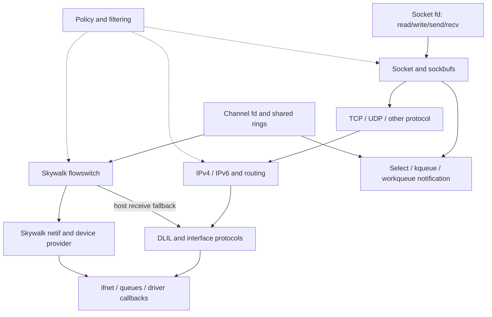

# Networking

[Guide index](../../README.md) · [Architecture](../../architecture.md)

XNU networking contains both a conventional BSD socket stack and Skywalk's channel/nexus infrastructure. They share interfaces, policy, packet scheduling, and compatibility paths, but their userspace interfaces and packet ownership models differ. Start with one concrete packet path before following the many protocol and policy extensions.

This chapter describes the supplied `xnu-12377.121.6` snapshot. It was developed by reading declarations and selected implementation paths; no kernel was built or run. Build options, provider registration, interface capabilities, socket type, and runtime policy determine which branches are active.

## Reading route

1. [Sockets and buffering](sockets.md): fd-to-socket dispatch, protocol registration, lifetime, locking, and readiness.
2. [TCP, IP, interfaces, and mbufs](tcp-ip-interfaces.md): a send and receive path, packet ownership, routing, loopback, and protocol variants.
3. [Policy and protocol extensions](policy-extensions.md): NECP, content filters, PF, IPsec, flow diversion, and MPTCP.
4. [Skywalk channels and flowswitch](skywalk.md): shared rings, packet pools, validation, a concrete transmit path, and host-stack interaction.

Continue with the mechanism guides when the overview raises a lifetime or synchronization question:

| Guide | Concrete questions answered |
| --- | --- |
| [Socket lifetime, buffering, and I/O ownership](socket-lifecycle-and-io.md) | Which reference/lock survives user copy? Who owns data after a failed send? How do receive, ancillary rights, wait-all, upcalls, and close interact? |
| [TCP connections, timers, and close](tcp-connections-and-timers.md) | When are listener children allocated/promoted/accepted? Which ACK/FIN transitions matter? What keeps timer work alive, and how do retransmit, persist, keepalive, and delayed ACK differ? |
| [Packets, routes, and interfaces](packets-routes-and-interfaces.md) | How do shared mbuf storage, route invalidation, protocol callbacks, I/O references, and asynchronous interface detach fit together? |
| [Skywalk channel, pool, and flow lifecycles](skywalk-lifecycles.md) | How do alloc/free rings differ from TX/RX, how is outstanding packet ownership validated, and what survives channel or flow deletion? |
| [Internet PCBs, ports, and lifetime](internet-pcbs-ports-and-lifetime.md) | How are local ports and receive tuples published, how do wanted references bridge table/socket locks, and when can a dead PCB be reclaimed? |
| [UDP send, receive, and errors](udp-send-receive-and-errors.md) | How do implicit bind, per-message options, header/checksum construction, receive demultiplexing, record admission, and asynchronous errors work? |
| [IPv6 output and neighbor discovery](ipv6-output-and-neighbor-discovery.md) | Which source/route/scope/MTU decisions precede output, and who owns a packet while its next hop is unresolved? |
| [Mbuf allocation caches and pressure](mbuf-allocation-caches-and-pressure.md) | How do plain/composite allocation classes, CPU buckets, slabs, shared backing and pressure reclamation interact under `CONFIG_MBUF_MCACHE`? |
| [Kernel control sockets and network statistics](kernel-control-sockets-and-network-statistics.md) | How do registered callbacks become socket connections, and how do ntstat sources, subscriptions, partial queries and PCB teardown use that transport? |
| [Skywalk packets, buflets, and pools](skywalk-packets-buflets-and-pools.md) | How are packets constructed, exported, validated, cloned and freed across user, kernel and device-provider boundaries? |
| [Skywalk memory arenas and mapping](skywalk-memory-arenas-and-mapping.md) | How do regions, segments, slabs, magazines and IOSK task mappings establish backing, protection and revocation? |
| [Skywalk controllers, providers, and nexus port lifetime](skywalk-controller-provider-and-port-lifetime.md) | How do domains, two provider layers, controller authority, instance publication, port bindings, external callbacks and deferred close fit together? |
| [Skywalk channel ABI, readiness, and event delivery](skywalk-channel-abi-and-readiness.md) | When is a channel fd published, how do mapped structures and options work, when do low-water filters fire, and who owns an event packet? |

For a first pass below TCP, read PCB lifetime, UDP, IPv6/ND and mbuf allocation in that order; kernel control sockets provide a separate control-plane route. For deeper Skywalk work, start with packet representation and memory backing, then follow controllers/ports, channel ABI/readiness, and channel/ring/flow lifetimes. These chapters advance the existing [whole-Skywalk expansion program](../../audits/processes-vfs-networking.md#a12--p1-complete-skywalk-expansion-program); netif scheduling, deeper flow algorithms, policy and diagnostics remain separate tracks.

The diagram shows architectural relationships, not a mandatory sequence through every box. A direct netif channel, a UNIX-domain socket, and a TCP socket exercise different paths. The flowswitch TX path examined here copies user-pool packets into device-pool packets; “shared rings” does not establish end-to-end zero-copy behavior.

## Main state and ownership boundaries

| Object | Main job | Source |
| --- | --- | --- |
| `socket`, `sockbuf` | Endpoint state, accept queues, send/receive buffers, readiness | [`socketvar.h`](../../../xnu/bsd/sys/socketvar.h) |
| `domain`, `protosw`, `pr_usrreqs` | Address-family registration and protocol operations | [`domain.h`](../../../xnu/bsd/sys/domain.h), [`protosw.h`](../../../xnu/bsd/sys/protosw.h) |
| `inpcb`, `tcpcb` | Internet addresses/ports/routing and TCP connection state | [`in_pcb.h`](../../../xnu/bsd/netinet/in_pcb.h), [`tcp_var.h`](../../../xnu/bsd/netinet/tcp_var.h) |
| `mbuf` | BSD packet fragments, packet lists, metadata, external storage | [`mbuf.h`](../../../xnu/bsd/sys/mbuf.h) |
| `ifnet`, `if_proto`, `rtentry` | Interface lifetime, family/media callbacks, routes | [`if_var_private.h`](../../../xnu/bsd/net/if_var_private.h), [`route_private.h`](../../../xnu/bsd/net/route_private.h) |
| `kern_channel`, `nexus_adapter`, `kern_nexus` | Skywalk endpoint, ring implementation, provider instance | [`channel_var.h`](../../../xnu/bsd/skywalk/channel/channel_var.h), [`nexus_adapter.h`](../../../xnu/bsd/skywalk/nexus/nexus_adapter.h), [`nexus_var.h`](../../../xnu/bsd/skywalk/nexus/nexus_var.h) |
| `__kern_packet`, `kern_pbufpool` | Skywalk metadata/buffers and allocation ownership | [`packet_var.h`](../../../xnu/bsd/skywalk/packet/packet_var.h), [`pbufpool_var.h`](../../../xnu/bsd/skywalk/packet/pbufpool_var.h) |

Networking enters through [BSD process descriptors](../processes/descriptors-ipc.md), blocks/wakes [Mach threads](../runtime/README.md), consults [credentials and MAC policy](../security/README.md), and connects to [driver infrastructure](../drivers/README.md) through interface/provider callbacks. Socket readiness is part of [BSD kevent machinery](../processes/events-threads.md), not a separate scheduling system.

## Sources inspected and limits

“Detailed” means selected bodies and their immediate ownership/locking relationships were read; it does not imply a complete protocol or concurrency audit.

| Area | Inspection performed | Limits |
| --- | --- | --- |
| [`uipc_syscalls.c`](../../../xnu/bsd/kern/uipc_syscalls.c), [`sys_socket.c`](../../../xnu/bsd/kern/sys_socket.c), [`uipc_socket.c`](../../../xnu/bsd/kern/uipc_socket.c), [`uipc_socket2.c`](../../../xnu/bsd/kern/uipc_socket2.c) | Detailed creation, accept/connect, send consumption/waits, receive copy/peek/control/wait-all, buffer locks, upcalls and close/ref gates | Every option, batched syscall variant, ancillary type, UNIX-domain rights collector, and protocol-specific race was not traced |
| TCP sources and headers | Detailed attach/connect/listen, selected handshake/ACK/FIN branches, accept promotion/dequeue, timer scheduler references, retransmit/persist/keepalive/delayed-ACK handlers and close deferral | Full state-machine/concurrency audit, congestion-control algorithms, SACK/RACK details, and attacks remain outside coverage |
| IPv4, DLIL, interface/routing sources | Detailed selected input/output ownership, protocol callbacks, route cache/gateway/final-release locks, interface object/I/O references, attach serialization and final detach | IPv4 fragmentation/reassembly, multicast, ARP, all route mutation, and driver-specific paths remain outside these traces; selected IPv6/ND paths have a companion below |
| [`in_pcb.c`](../../../xnu/bsd/netinet/in_pcb.c), UDP and IPv6/ND sources | Shared PCB publication, wanted-reference handoff and GC; datagram output/input/error ownership; selected IPv6 route/scope/MTU and neighbor resolution/aging paths | Every bind/reuse combination, source-address ranking, IPv6 input reassembly, multicast and router/prefix configuration remains separate |
| [`uipc_mbuf.c`](../../../xnu/bsd/kern/uipc_mbuf.c), [`uipc_mbuf_mcache.c`](../../../xnu/bsd/kern/uipc_mbuf_mcache.c), [`mcache.c`](../../../xnu/bsd/kern/mcache.c) and declarations | Chain/sharing/free contracts plus configured plain/composite caches, component construction, CPU/slab allocation and pressure paths | Alternate zone allocator, every paired-buffer/checksum/tag convention and external driver frees were not exhaustively traced |
| Skywalk controller/domain/provider, channel/ring, flowswitch, netif, packet-pool and memory sources; local `IOSkywalkSupport.cpp` | Registration and deferred object lifetime, binding/admission/publication, readiness/low-water/event/advisory paths, partial sync/defunct, packet ownership and region/cache/task mapping | Full namespace/route preparation, RX aggregation, netif scheduling, every metadata/configuration API and hardware providers remain separate tracks |
| [`kern_control.c`](../../../xnu/bsd/kern/kern_control.c), [`ntstat.c`](../../../xnu/bsd/net/ntstat.c) | Registration/connection and callback lifetime, message ownership, source subscription/publication, partial queries and detach cleanup | Every provider filter/message field and userspace observer behavior was not reconstructed |
| NECP, content filter, PF, IPsec, flow divert, MPTCP | Selected representative bodies plus navigation survey | These pages identify integration points; they are not complete subsystem specifications |

For source navigation, distinguish three callback families: socket protocol operations (`protosw`), protocols attached to an interface (`if_proto`), and Skywalk provider operations. They connect at specific points and should not be treated as one interchangeable dispatch table.

<!-- BEGIN PLATYDOC DOCUMENTATION LICENSE -->
Original Platydoc text and diagrams are licensed under [CC BY 4.0](https://creativecommons.org/licenses/by/4.0/). Quoted source code and third-party material retain their respective licenses.
<!-- END PLATYDOC DOCUMENTATION LICENSE -->
