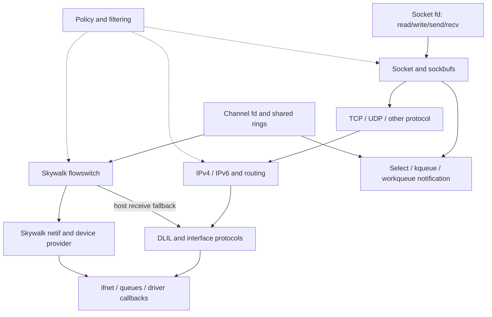

# Networking

[Guide index](../../README.md) · [Architecture](../../architecture.md)

XNU networking contains both a conventional BSD socket stack and Skywalk's channel/nexus infrastructure. They share interfaces, policy, packet scheduling, and compatibility paths, but their userspace interfaces and packet ownership models differ. Start with one concrete packet path before following the many protocol and policy extensions.

This chapter describes the supplied `xnu-12377.121.6` snapshot. It was developed by reading declarations and selected implementation paths; no kernel was built or run. Build options, provider registration, interface capabilities, socket type, and runtime policy determine which branches are active.

## Reading route

The [network structure companions](../../structures/README.md#follow-messages-and-packets-into-their-storage) explain [socket allocation and attachments](../../structures/sockets-and-protocol-attachments.md), [sockbuf records and counters](../../structures/socket-buffers-and-record-queues.md), [Internet PCB/TCP storage](../../structures/internet-pcbs-and-transport-storage.md), and [mbuf views and external backing](../../structures/mbufs-and-external-storage.md). Use these field/ownership maps alongside the operation guides below.

For three distinct packet mechanisms, follow [BPF capture and filter lifetime](bpf-capture-and-filter-lifecycle.md), [PF rule publication and state](pf-rules-states-and-packet-ownership.md), and [IPsec policy, associations and transforms](ipsec-policy-associations-and-transforms.md). These connect control calls to packet decisions, buffers, retained state and reclamation.

[IPsec interface lifecycle](ipsec-interface-lifecycle.md) continues from association/transform state into virtual-interface control, mbuf and Skywalk packet paths, and disconnect draining. [MPTCP sessions and subflows](mptcp-sessions-and-subflows.md) follows the connection above individual TCP paths, including data numbering, reinjection, receive ordering and teardown.

1. [Sockets and buffering](sockets.md): fd-to-socket dispatch, protocol registration, lifetime, locking, and readiness.
2. [TCP, IP, interfaces, and mbufs](tcp-ip-interfaces.md): a send and receive path, packet ownership, routing, loopback, and protocol variants.
3. [Policy and protocol extensions](policy-extensions.md): NECP, content filters, PF, IPsec, flow diversion, and MPTCP.
4. [Skywalk channels and flowswitch](skywalk.md): shared rings, packet pools, validation, a concrete transmit path, and host-stack interaction.

Continue with the mechanism guides when the overview raises a lifetime or synchronization question:

For a single operation that connects the layers, follow [the Skywalk channel walkthrough](../../cross-cutting/skywalk-channel-operation.md): a local user-pipe test moves through controller/nexus setup, guarded descriptors, IOKit task mappings, packet transfer, readiness and teardown. Its visible-slot table distinguishes backpressure from stale published state.

| Guide | Concrete questions answered |
| --- | --- |
| [Socket lifetime, buffering, and I/O ownership](socket-lifecycle-and-io.md) | Which reference/lock survives user copy? Who owns data after a failed send? How do receive, ancillary rights, wait-all, upcalls, and close interact? |
| [TCP connections, timers, and close](tcp-connections-and-timers.md) | When are listener children allocated/promoted/accepted? Which ACK/FIN transitions matter? What keeps timer work alive, and how do retransmit, persist, keepalive, and delayed ACK differ? |
| [TCP loss recovery and congestion control](tcp-loss-recovery-and-congestion-control.md) | How do cumulative ACKs, SACK holes and RACK transmission records differ? Which evidence selects retransmission, how do recovery timers interact, and how does congestion control change the send window? |
| [Routing control and IPv4 ARP](routing-control-and-ipv4-arp.md) | How do routing-socket requests mutate scoped routes, which errors follow partial mutation, and who owns packets during ARP queueing, reply, timeout and route deletion? |
| [IP reassembly and ICMP feedback](ip-fragment-reassembly-and-icmp.md) | How do IPv4 overlap trimming and IPv6 dirty queues differ, when are fragments reclaimed, and how do quoted packets reach UDP/TCP and change path MTU? |
| [Packets, routes, and interfaces](packets-routes-and-interfaces.md) | How do shared mbuf storage, route invalidation, protocol callbacks, I/O references, and asynchronous interface detach fit together? |
| [Skywalk channel, pool, and flow lifecycles](skywalk-lifecycles.md) | How do alloc/free rings differ from TX/RX, how is outstanding packet ownership validated, and what survives channel or flow deletion? |
| [Internet PCBs, ports, and lifetime](internet-pcbs-ports-and-lifetime.md) | How are local ports and receive tuples published, how do wanted references bridge table/socket locks, and when can a dead PCB be reclaimed? |
| [UDP send, receive, and errors](udp-send-receive-and-errors.md) | How do implicit bind, per-message options, header/checksum construction, receive demultiplexing, record admission, and asynchronous errors work? |
| [IPv6 guide and source map](ipv6.md) | How do addresses, advertised routers, scoped routes, sockets, input/output, neighbors and multicast form one family of operations? |
| [IPv6 addresses, autoconfiguration and DAD](ipv6-addresses-autoconfiguration-and-dad.md) | When are addresses published, usable, deprecated, duplicate or expired, and how do stable/CGA/temporary addresses and DAD timers interact? |
| [IPv6 router advertisements and prefix lifetime](ipv6-router-advertisements-and-prefix-lifetime.md) | How do RA options update independent router/prefix/address/route objects, and what do L/A bits, the two-hour rule and reachability change? |
| [IPv6 scopes and source selection](ipv6-source-selection-and-scopes.md) | How are zones represented, which source wins, why can ranking restart, and who owns source/interface/route results? |
| [IPv6 sockets and packet options](ipv6-sockets-and-packet-options.md) | How do native/mapped bind/connect, UDP send/receive, sticky/ancillary options, controls and raw/ICMPv6 admission work? |
| [IPv6 input and forwarding](ipv6-input-extension-headers-and-forwarding.md) | How do parser offsets and next-header dispatch work, what is local, and who owns a forwarded or rejected packet? |
| [IPv6 output and neighbor discovery](ipv6-output-and-neighbor-discovery.md) | Which source/route/scope/MTU decisions precede output, and who owns a packet while its next hop is unresolved? |
| [IPv6 neighbor messages and reachability](ipv6-neighbor-messages-and-reachability.md) | What do NS/NA flags change, how do NUD timers and passive observations interact, and how are redirects admitted? |
| [IPv6 multicast membership and MLD](ipv6-multicast-membership-and-mld.md) | How do socket and interface filters differ, when are reports queued/committed, and why can final leave retain ownership? |
| [Mbuf allocation caches and pressure](mbuf-allocation-caches-and-pressure.md) | How do plain/composite allocation classes, CPU buckets, slabs, shared backing and pressure reclamation interact under `CONFIG_MBUF_MCACHE`? |
| [Kernel control sockets and network statistics](kernel-control-sockets-and-network-statistics.md) | How do registered callbacks become socket connections, and how do ntstat sources, subscriptions, partial queries and PCB teardown use that transport? |
| [NECP policy evaluation](necp-policy-evaluation.md) | How do staged policy sessions become compiled rules, how do socket/IP matches accumulate results, and when do cached decisions need reevaluation? |
| [NECP clients and flow registration](necp-clients-and-flow-registration.md) | Which objects belong to an fd, client UUID or flow registration, how do agent assignments/results become visible, and what survives a failed action or close? |
| [Socket content filtering](socket-content-filtering.md) | How do pass/peek offsets, provider control queues, held records, reinjection, backpressure and shutdown differ for streams and datagrams? |
| [Flow diversion and provider lifetime](flow-diversion-and-provider-lifetime.md) | How does NECP replace a socket's protocol route, how do provider groups and per-flow credit differ, and what survives connect, retry, half-close, detach and provider loss? |
| [Skywalk packets, buflets, and pools](skywalk-packets-buflets-and-pools.md) | How are packets constructed, exported, validated, cloned and freed across user, kernel and device-provider boundaries? |
| [Skywalk memory arenas and mapping](skywalk-memory-arenas-and-mapping.md) | How do regions, segments, slabs, magazines and IOSK task mappings establish backing, protection and revocation? |
| [Skywalk controllers, providers, and nexus port lifetime](skywalk-controller-provider-and-port-lifetime.md) | How do domains, two provider layers, controller authority, instance publication, port bindings, external callbacks and deferred close fit together? |
| [Skywalk channel ABI, readiness, and event delivery](skywalk-channel-abi-and-readiness.md) | When is a channel fd published, how do mapped structures and options work, when do low-water filters fire, and who owns an event packet? |
| [Skywalk user and kernel pipes](skywalk-user-and-kernel-pipes.md) | How do paired user-pipe rings transfer packet attachments and recover capacity? How do kernel-pipe provider callbacks, connection ownership and defunct teardown differ? |
| [Skywalk namespaces and flow lookup](skywalk-namespaces-and-flow-lookup.md) | How do address/port reservations interact with BSD, how do protocol tokens and flow IDs differ, and which normalized/masked key selects a retained flow? |
| [Flowswitch classification, routes, and delivery](skywalk-flowswitch-classification-routes-and-datapaths.md) | What does parsing validate, who owns packets during ARP/ND, how do device/destination pools and RX rings receive data, and what survives a route failure? |
| [Netif links, queues, and servicing](skywalk-netif-links-queues-and-scheduling.md) | How are logical links/qsets and provider queues initialized and retained, and how do native/compat, polling, mitigation and low-latency paths move packets? |
| [Interface scheduling and FQ-CoDel](interface-packet-scheduling-and-fq-codel.md) | How do class groups, per-flow queues, deficits, delay control, ECN, drops and asynchronous feedback determine admission and dequeue? |
| [Skywalk fragments, reassembly and tracking](skywalk-fragments-reassembly-and-flow-tracking.md) | How are fragment chains keyed, validated, retained and expired, and how does passive TCP/UDP tracking affect flow viability and close? |
| [TCP aggregation, segmentation and offloads](skywalk-tcp-aggregation-segmentation-and-offloads.md) | When can receive packets aggregate, how do the two software-segmentation paths rewrite/copy packets, and what survives offload-install failure? |
| [Netif filters and reinjection](skywalk-netif-filters-and-reinjection.md) | Which representation does a filter receive, who retains the original packet, how is direction/progress carried, and how do disable/remove/reinject differ? |
| [Netif agents and traffic rules](skywalk-netif-agents-and-traffic-rules.md) | How do agents create port/flow identities, how are rules admitted and matched, and when are publication and provider notification complete? |
| [Skywalk diagnostics, configuration and tests](skywalk-diagnostics-configuration-and-tests.md) | Which objects and counters are exported, under which authority and locks? How do sizing races, partial output, channel failures, runtime knobs and local test assertions relate to the datapath? |

For a first pass below TCP, read PCB lifetime, UDP, the [IPv6 reading route](ipv6.md) and mbuf allocation in that order. Continue through routing control/IPv4 ARP and IP reassembly/ICMP to connect route changes, unresolved neighbors, retained fragments and transport errors; kernel control sockets provide a separate control-plane route. For deeper Skywalk work, start with packet representation and memory backing, then follow controllers/ports, channel ABI/readiness, and channel/ring/flow lifetimes. Continue through namespaces/lookup, classification/routes/delivery, netif queues and interface scheduling. The fragment/tracking, aggregation/segmentation, filter/reinjection and agent/traffic-rule companions extend those paths. For policy and retained socket data, continue through NECP evaluation, client/flow ownership and socket content filtering. The diagnostics companion then connects those paths to exported state, failure evidence and selected tests. The chapters describe selected policy commands, protocol paths and provider variants; they do not cover every combination.

The diagram shows architectural relationships, not a mandatory sequence through every box. A direct netif channel, a UNIX-domain socket, and a TCP socket exercise different paths. The flowswitch TX path examined here copies user-pool packets into device-pool packets; “shared rings” does not establish end-to-end zero-copy behavior.

## Main state and ownership boundaries

| Object | Main job | Source |
| --- | --- | --- |
| `socket`, `sockbuf` | Endpoint state, accept queues, send/receive buffers, readiness | [`socketvar.h`](../../../platydoc-data/xnu/bsd/sys/socketvar.h) |
| `domain`, `protosw`, `pr_usrreqs` | Address-family registration and protocol operations | [`domain.h`](../../../platydoc-data/xnu/bsd/sys/domain.h), [`protosw.h`](../../../platydoc-data/xnu/bsd/sys/protosw.h) |
| `inpcb`, `tcpcb` | Internet addresses/ports/routing and TCP connection state | [`in_pcb.h`](../../../platydoc-data/xnu/bsd/netinet/in_pcb.h), [`tcp_var.h`](../../../platydoc-data/xnu/bsd/netinet/tcp_var.h) |
| `mbuf` | BSD packet fragments, packet lists, metadata, external storage | [`mbuf.h`](../../../platydoc-data/xnu/bsd/sys/mbuf.h) |
| `ifnet`, `if_proto`, `rtentry` | Interface lifetime, family/media callbacks, routes | [`if_var_private.h`](../../../platydoc-data/xnu/bsd/net/if_var_private.h), [`route_private.h`](../../../platydoc-data/xnu/bsd/net/route_private.h) |
| `kern_channel`, `nexus_adapter`, `kern_nexus` | Skywalk endpoint, ring implementation, provider instance | [`channel_var.h`](../../../platydoc-data/xnu/bsd/skywalk/channel/channel_var.h), [`nexus_adapter.h`](../../../platydoc-data/xnu/bsd/skywalk/nexus/nexus_adapter.h), [`nexus_var.h`](../../../platydoc-data/xnu/bsd/skywalk/nexus/nexus_var.h) |
| `__kern_packet`, `kern_pbufpool` | Skywalk metadata/buffers and allocation ownership | [`packet_var.h`](../../../platydoc-data/xnu/bsd/skywalk/packet/packet_var.h), [`pbufpool_var.h`](../../../platydoc-data/xnu/bsd/skywalk/packet/pbufpool_var.h) |

Networking enters through [BSD process descriptors](../processes/descriptors-ipc.md), blocks/wakes [Mach threads](../runtime/README.md), consults [credentials and MAC policy](../security/README.md), and connects to [driver infrastructure](../drivers/README.md) through interface/provider callbacks. Socket readiness is part of [BSD kevent machinery](../processes/events-threads.md), not a separate scheduling system.

## Sources inspected and limits

“Detailed” means selected bodies and their immediate ownership/locking relationships were read; it does not imply a complete protocol or concurrency audit.

| Area | Inspection performed | Limits |
| --- | --- | --- |
| [`uipc_syscalls.c`](../../../platydoc-data/xnu/bsd/kern/uipc_syscalls.c), [`sys_socket.c`](../../../platydoc-data/xnu/bsd/kern/sys_socket.c), [`uipc_socket.c`](../../../platydoc-data/xnu/bsd/kern/uipc_socket.c), [`uipc_socket2.c`](../../../platydoc-data/xnu/bsd/kern/uipc_socket2.c) | Detailed creation, accept/connect, send consumption/waits, receive copy/peek/control/wait-all, buffer locks, upcalls and close/ref gates | Every option, batched syscall variant, ancillary type, UNIX-domain rights collector, and protocol-specific race was not traced |
| TCP sources and headers | Detailed attach/connect/listen, selected handshake/ACK/FIN branches, accept promotion/dequeue, timer scheduler references and close deferral; companion traces cumulative ACK release, SACK holes, RACK records/loss timing, retransmission selection and NewReno window decisions | Selected recovery paths, not every congestion algorithm, option/ECN interaction, state-machine interleaving or measured network behavior |
| IPv4, DLIL, interface/routing sources | Detailed selected input/output ownership, protocol callbacks, route cache/gateway/final-release locks, interface object/I/O references, attach serialization and final detach | Routing/ARP and common reassembly/ICMP now have dedicated companions; IPv4 multicast/IGMP and driver-specific paths remain partial |
| [`in_pcb.c`](../../../platydoc-data/xnu/bsd/netinet/in_pcb.c), UDP and IPv6/ND sources | Shared PCB publication, wanted-reference handoff and GC; datagram ownership; IPv6 address/DAD, RA/prefix/router lifetimes, scope/source/route selection, options/raw sockets, input/forwarding, output/fragments, NUD/redirects and multicast/MLD | Every bind/reuse/policy combination, tunnel/translation/proxy variant and concurrent failure path is not reconstructed; external daemons, routers and hardware remain boundaries |
| [`uipc_mbuf.c`](../../../platydoc-data/xnu/bsd/kern/uipc_mbuf.c), [`uipc_mbuf_mcache.c`](../../../platydoc-data/xnu/bsd/kern/uipc_mbuf_mcache.c), [`mcache.c`](../../../platydoc-data/xnu/bsd/kern/mcache.c) and declarations | Chain/sharing/free contracts plus configured plain/composite caches, component construction, CPU/slab allocation and pressure paths | Alternate zone allocator, every paired-buffer/checksum/tag convention and external driver frees were not exhaustively traced |
| Skywalk controller/domain/provider, channel/ring, user/kernel pipe, flowswitch, netif, packet-pool and memory sources; local `IOSkywalkSupport.cpp` | Registration and deferred object lifetime, binding/admission/publication, readiness/event/advisory paths, partial sync/defunct, packet ownership and memory mapping; paired-pipe slot transfer/refcounts and kernel-provider callback/slot-storage lifetime; namespace reservation/key lookup; default classification/routes/RX/TX; logical links/qsets, native/compat servicing and FQ-CoDel | Packet-transformation and filter/agent companions cover selected fragment/tracking, aggregation/GSO, steering rollback, reinjection and traffic-rule paths; the diagnostics companion traces selected snapshots/counters/configuration/tests, while remaining diagnostic cases, every configuration/API/policy combination and external hardware providers remain bounded |
| [`kern_control.c`](../../../platydoc-data/xnu/bsd/kern/kern_control.c), [`ntstat.c`](../../../platydoc-data/xnu/bsd/net/ntstat.c) | Registration/connection and callback lifetime, message ownership, source subscription/publication, partial queries and detach cleanup | Every provider filter/message field and userspace observer behavior was not reconstructed |
| NECP and socket content filtering | Policy staging/apply, socket/IP matching and cache/results; client/fd/flow ownership, agent/result publication, observer readiness; filter pass/peek queues, reinjection, close and datagram flow cleanup | Selected local mechanisms, not all TLVs/actions/conditions, provider decisions, configuration/race combinations or userspace policy |
| BPF, PF and IPsec | Capture/program/buffer lifetime; staged PF rules, UDP/TCP peer state, sequence/ACK windows, selected loose/proxy paths and same-family NAT/checksums; IPsec policy/association lifetime, ESP, IPv6 stages, request ordering and association retirement | Full SYN-proxy reachability, all request/parser/helper/crypto/provider combinations and exhaustive protocol interleavings remain outside review |
| Flow diversion | NECP dispatch, socket/PCB/group ownership, provider admission and token parsing, connect/results, credit/control queues, data delivery, retry/fallback and detach/provider loss | Selected local paths and source-test assertions; userspace provider policy, every token/control variant and concurrent teardown schedule remain outside review |
| MPTCP | Selected representative bodies plus navigation survey | Complete connection/subflow algorithms remain separate |

For source navigation, distinguish three callback families: socket protocol operations (`protosw`), protocols attached to an interface (`if_proto`), and Skywalk provider operations. They connect at specific points and should not be treated as one interchangeable dispatch table.

<!-- BEGIN PLATYDOC DOCUMENTATION LICENSE -->
Original Platydoc text and diagrams are licensed under [CC BY 4.0](https://creativecommons.org/licenses/by/4.0/). Quoted source code and third-party material retain their respective licenses.
<!-- END PLATYDOC DOCUMENTATION LICENSE -->
