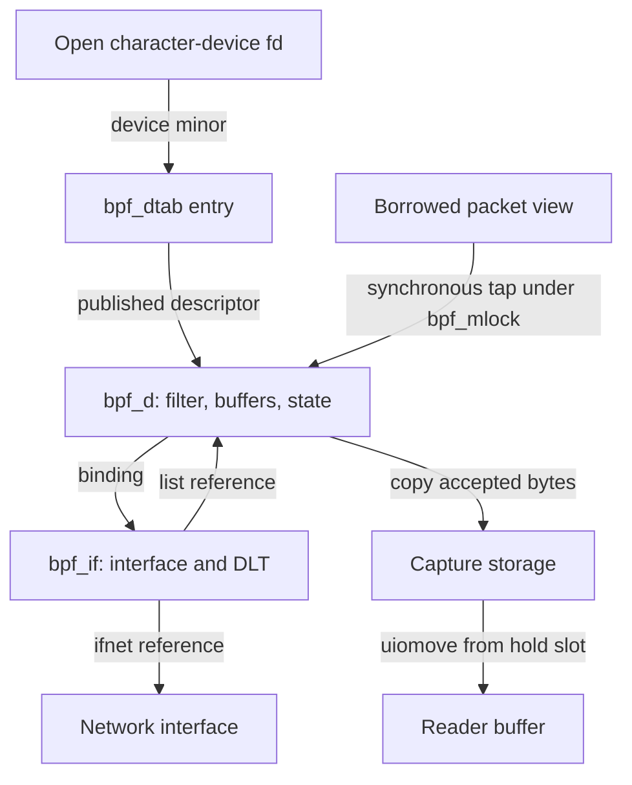
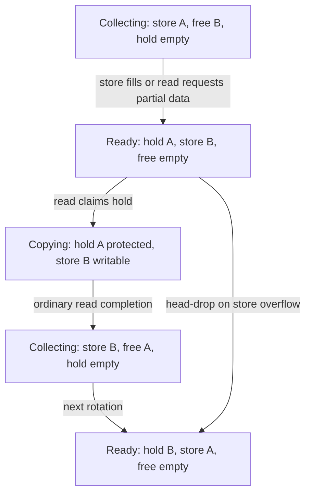
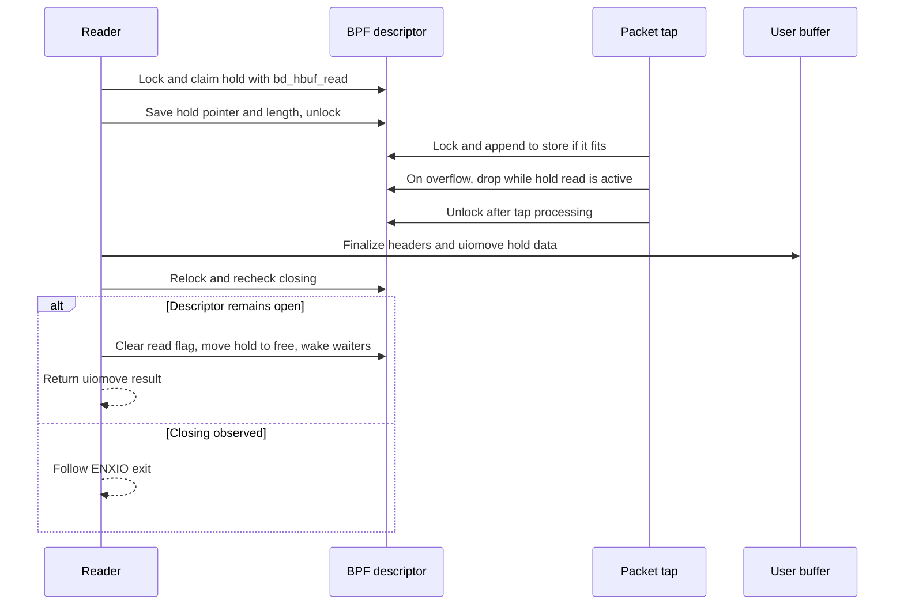

# Classic BPF capture and filter lifetime

[Networking](README.md) · [Packet and interface lifetime](packets-routes-and-interfaces.md) · [Command dispatch and validation](../../interfaces/command-dispatch-and-validation.md) · [Network policy extensions](policy-extensions.md)

Classic BSD BPF attaches a per-open capture descriptor to an interface/data-link entry, runs a small filter program over each observed packet, and copies selected bytes into buffers for `read()`. The filter's return value is a requested capture length. This chapter follows that operation in `xnu-12377.121.6`: device admission, filter replacement, attachment, interpretation, buffer rotation, reads, and teardown. It does not describe an eBPF subsystem or PF firewall rule execution.

The [command-dispatch companion](../../interfaces/command-dispatch-and-validation.md#worked-argument-conversion-installing-a-bpf-program) explains the generic ioctl path and 32/64-bit outer argument conversion. This chapter begins with the BPF objects and continues through the packet path that those commands configure.

## Device, descriptor, interface entry, and packet view

The [`bpfilter` configuration](../../../xnu/config/MASTER#L500-L503) selects [`bpf.c` and `bpf_filter.c`](../../../xnu/bsd/conf/files#L164-L165). `bpf_init()` registers the character-device operation table and initial nodes. The table connects open/close/read/write/ioctl/select to the BPF implementations; it does not provide a device mmap operation. [Registration](../../../xnu/bsd/net/bpf.c#L4553-L4580), [operation table](../../../xnu/bsd/net/bpf.c#L275-L290).

| Object | State and lifetime role |
| --- | --- |
| `bpf_dtab[minor]` | `NULL` for an unopened device, `BPF_DEV_RESERVED` during open/close, otherwise a `struct bpf_d *` |
| `struct bpf_d` | Per-open filter pointer/count, buffer slots/lengths, interface binding, direction, counters, timeout state, references, and closing/read/write flags |
| `struct bpf_if` | One interface/data-link attachment, its listener list, padded capture-header lengths, and optional send/tap callbacks |
| `struct ifnet` | Network interface retained by the BPF interface attachment; its `if_bpf` pointer locates the tap's primary entry |
| `struct bpf_packet` | Synchronous packet view: optional separate header plus an mbuf chain or, under `SKYWALK`, a native packet |

See [device-table states](../../../xnu/bsd/net/bpf.c#L211-L238), [descriptor fields](../../../xnu/bsd/net/bpfdesc.h#L93-L169), [interface entry](../../../xnu/bsd/net/bpfdesc.h#L198-L209), and [mbuf view construction](../../../xnu/bsd/net/bpf.c#L3411-L3440). A userspace fd, a device minor, a BPF descriptor, and an interface attachment are separate objects.



The packet edge represents observation during the call, not transfer of the original packet into the descriptor. `catchpacket()` copies bytes into separately allocated capture storage. The packet's surrounding network path retains its own ownership rules.

## Open reserves a minor; binding supplies capture storage

`bpf_make_dev_t()` requests nodes owned by root/wheel with mode `0600`. Those are initial creation permissions, not an assertion about permissions after administrators or other components change them. The ordinary file/vnode admission path precedes `bpfopen()`; the BPF open body itself checks minor validity and exclusive use, rather than performing an additional `suser()` test. [Node creation](../../../xnu/bsd/net/bpf.c#L659-L701), [open](../../../xnu/bsd/net/bpf.c#L997-L1086).

Under `bpf_mlock`, open reserves an unused minor before allocating `bpf_d`. It acquires the initial descriptor reference, selects the default buffer size and `BPF_D_INOUT`, marks the descriptor detached, allocates its timeout call, and finally publishes the pointer in `bpf_dtab`. Allocation failure restores the table entry to `NULL`. Opening the last minor also attempts to grow the node set. The saved `bd_opened_by` process pointer is explicitly for comparison without a process reference; it must not be interpreted as process ownership. [Initialization and publication](../../../xnu/bsd/net/bpf.c#L1029-L1085).

The packet buffers are allocated on the binding path, not by the successful open. `BIOCSBLEN` accepts a buffer-size change only when not attached or detaching; it clamps to the implementation's minimum/cap and writes the chosen size back to the ioctl argument. A later reader must request exactly `bd_bufsize` bytes. [Buffer-size command](../../../xnu/bsd/net/bpf.c#L2122-L2156), [read-size check](../../../xnu/bsd/net/bpf.c#L1285-L1296).

`BIOCSETIF` copies/terminates an interface name, calls `ifunit()`, then `bpf_setif()`. The latter waits for active buffer reads/writes, rechecks closing, searches registered interface/data-link entries, skips unwanted `DLT_PKTAP` entries and restricted coprocessor interfaces, allocates buffers, and detaches an old binding before attaching the new one. A successful ordinary `BIOCSETIF` resets the descriptor. [Name dispatch](../../../xnu/bsd/net/bpf.c#L2272-L2288), [binding implementation](../../../xnu/bsd/net/bpf.c#L2834-L2900).

Each registered `bpf_if` holds an `ifnet_reference()`. Registration rejects an existing identical interface/DLT pair and keeps one interface's entries together, preferring Ethernet's normal DLT as its first entry. This registration is distinct from a reader joining that entry's listener list. [Interface registration](../../../xnu/bsd/net/bpf.c#L4387-L4486).

Listener publication precedes optional tap enablement. The descriptor takes a listener-list reference even when enablement later returns an error, because it remains linked. Exact source: [`bpf.c:717-726`](../../../xnu/bsd/net/bpf.c#L717-L726).

<!-- source-excerpt: ../../../xnu/bsd/net/bpf.c#L717-L726 -->
```c
	d->bd_bif = bp;
	d->bd_next = bp->bif_dlist;
	bp->bif_dlist = d;
	bpf_bpfd_cnt++;

	/*
	 * Take a reference on the device even if an error is returned
	 * because we keep the device in the interface's list of listeners
	 */
	bpf_acquire_d(d);
```

For the first listener, `bpf_attachd()` arranges the primary DLIL tap and invokes an optional provider tap callback. It then updates detach and pktap-finalization flags. If that callback returns an error, `bpf_setif()` reports `ENXIO` without undoing the already published listener in this branch. Therefore a failed bind is not a universal “nothing changed” result. [Tap enablement and return](../../../xnu/bsd/net/bpf.c#L728-L763), [caller error handling](../../../xnu/bsd/net/bpf.c#L2874-L2898).

## Filter replacement has an explicit publication boundary

The outer ioctl structure contains an instruction count and a userspace address. `BIOCSETF32`/`BIOCSETF64` and their `NR` variants normalize those fields before calling `bpf_setf()`. Copying the outer structure does not copy the instruction array. [ABI structures](../../../xnu/bsd/net/bpf_private.h#L97-L105), [endpoint dispatch](../../../xnu/bsd/net/bpf.c#L2160-L2177).

The ioctl holds `bpf_mlock` and a descriptor reference. `bpf_setf()` waits while `bd_hbuf_read` is set; after the sleep reacquires the lock, it checks `BPF_CLOSING` and only then reads the old filter pointer. It bounds the count by `BPF_MAXINSNS` (512), allocates a candidate, copies the array, and calls `bpf_validate()`. Publication assigns the candidate pointer/count before optionally resetting capture state and freeing the old program. [Wait and candidate construction](../../../xnu/bsd/net/bpf.c#L2772-L2812), [publication and cleanup](../../../xnu/bsd/net/bpf.c#L2809-L2825), [instruction limit](../../../xnu/bsd/net/bpf.h#L129).

| Request/result | Program and queued capture state |
| --- | --- |
| Non-null, valid `BIOCSETF` program | Publish candidate; flush buffered records and reset counters; free old program |
| Non-null, valid `BIOCSETFNR` program | Publish candidate and free old program; retain existing buffered records/counters |
| Copyin or validation failure | Free candidate, return `EINVAL`; old filter remains selected |
| Candidate allocation failure | Return `ENOMEM`; old filter remains selected |
| Null instruction pointer with nonzero count | Return `EINVAL` |
| Null instruction pointer with zero count | Remove filter and reset capture state, including for an `NR` command |

The last case is an important exception to shorthand descriptions of “no-reset.” Exact source: [`bpf.c:2786-2797`](../../../xnu/bsd/net/bpf.c#L2786-L2797).

<!-- source-excerpt: ../../../xnu/bsd/net/bpf.c#L2786-L2797 -->
```c
	old = d->bd_filter;
	if (bf_insns == USER_ADDR_NULL) {
		if (bf_len != 0) {
			return EINVAL;
		}
		d->bd_filter = NULL;
		d->bd_filter_len = 0;
		reset_d(d);
		if (old != 0) {
			kfree_data_addr(old);
		}
		return 0;
```

`reset_d()` returns a hold buffer to the free slot, clears store/hold lengths and packet counts, resets receive/drop/filter/write counters, and discards previous-header compression length. It asserts that a hold read is not active. `BIOCFLUSH` uses the same wait/recheck/reset pattern. [Reset](../../../xnu/bsd/net/bpf.c#L1743-L1765), [flush command](../../../xnu/bsd/net/bpf.c#L2182-L2193).

The tap also holds `bpf_mlock` while following and executing `bd_filter`. That common lock connects replacement to use: the old instruction array is not freed concurrently with execution inside the inspected tap critical section. An `NR` replacement can, however, leave records selected by the old program available to a later read alongside records selected after replacement. Program publication and queue flushing are different events.

## Validation and the classic interpreter

Each [`bpf_insn`](../../../xnu/bsd/net/bpf.h#L1217-L1222) contains an opcode, two 8-bit conditional branch offsets, and a 32-bit operand. `bpf_filter()` has 32-bit accumulator `A`, index `X`, and 16 zero-initialized scratch words. A null filter returns unsigned `-1` to request all available bytes. `RET K` returns the constant; `RET A` returns the accumulator. [Interpreter setup and return instructions](../../../xnu/bsd/net/bpf_filter.c#L427-L464), [scratch size](../../../xnu/bsd/net/bpf.h#L1212).

`bpf_validate()` checks a length of 1–512, selected load modes and operand limits, scratch indices, ALU operation classes and constant division by zero, jump destinations, and a final return-class instruction. These are the checks in this validator; do not silently substitute another BPF implementation's verifier or an eBPF type analysis. Packet loads still need runtime bounds checks. [Validator](../../../xnu/bsd/net/bpf_filter.c#L787-L902).

Jump targets are relative to the following instruction. The unconditional test checks addition wrap as well as the upper bound; conditional offsets are tested against the program length. Exact source: [`bpf_filter.c:875-889`](../../../xnu/bsd/net/bpf_filter.c#L875-L889).

<!-- source-excerpt: ../../../xnu/bsd/net/bpf_filter.c#L875-L889 -->
```c
			from = i + 1;
			switch (BPF_OP(p->code)) {
			case BPF_JA:
				if (from + p->k < from || from + p->k >= ((u_int)len)) {
					return 0;
				}
				break;
			case BPF_JEQ:
			case BPF_JGT:
			case BPF_JGE:
			case BPF_JSET:
				if (from + p->jt >= ((u_int)len) || from + p->jf >= ((u_int)len)) {
					return 0;
				}
				break;
```

At runtime, unsupported full opcodes return zero in the kernel. Packet load failures, invalid scratch indices, and division by a zero `X` also return zero rather than an errno to the capturing process. The validator and interpreter therefore answer different questions: whether to publish the program, and how a particular packet evaluates. [Opcode/load failure](../../../xnu/bsd/net/bpf_filter.c#L450-L480), [scratch/jump execution](../../../xnu/bsd/net/bpf_filter.c#L628-L691), [division by X](../../../xnu/bsd/net/bpf_filter.c#L704-L709).

The tap calls the interpreter with `buflen == 0`, selecting kernel packet-view loads. The `bp_xword`/`bp_xhalf`/`bp_xbyte` helpers dispatch to mbuf or Skywalk accessors. For mbufs, offsets first cross the optional separate header and then walk fragments; absent bytes set an error that causes filter rejection. “Packet offset 12” is an offset in this presented byte stream, not a CPU pointer or a guaranteed IP-header offset. [Packet-view accessors](../../../xnu/bsd/net/bpf_filter.c#L360-L416), [mbuf offset traversal](../../../xnu/bsd/net/bpf_filter.c#L116-L151), [tap call](../../../xnu/bsd/net/bpf.c#L3369-L3373).

### Worked four-instruction program

The local test helper supplies a compact real program. Exact source: [`tests/bpflib.c:157-167`](../../../xnu/tests/bpflib.c#L157-L167).

<!-- source-excerpt: ../../../xnu/tests/bpflib.c#L157-L167 -->
```c
	struct bpf_insn insns[] = {
		BPF_STMT(BPF_LD + BPF_H + BPF_ABS, type_offset),
		BPF_JUMP(BPF_JMP + BPF_JEQ + BPF_K, type, 0, 1),
		BPF_STMT(BPF_RET + BPF_K, pkt_size),
		BPF_STMT(BPF_RET + BPF_K, 0),
	};
	struct bpf_program prog;

	prog.bf_len = sizeof(insns) / sizeof(struct bpf_insn);
	prog.bf_insns = insns;
	return ioctl(fd, BIOCSETF, &prog);
```

For an illustrative Ethernet view, choose `type_offset = 12`, `type = 0x0806`, and `pkt_size = 64`. Instruction 0 loads the 16-bit EtherType. Instruction 1's true offset zero selects instruction 2, returning 64; its false offset one selects instruction 3, returning zero. A packet too short for the load also returns zero. The branch validator computes targets 2 and 3, both within the four-instruction array.

Returning 64 requests at most 64 bytes of the presented packet, before capture-header and buffer limits. It does not return a Boolean “allow this packet onto the network,” and it does not promise that a record will fit in capture storage. This example applies to the chosen Ethernet layout; a different DLT or prepended pktap header changes the offsets the program sees.

## Tap direction, capture length, and record layout

`bpf_tap_in()` and `bpf_tap_out()` build packet views with explicit direction. The registered default callback instead derives outbound status from a null receive-interface pointer. `bpf_tap_imp()` locks, rechecks `if_bpf`, selects the requested/default DLT, and walks its listeners. Per-descriptor direction gating occurs before `bd_rcount` increments and before interpreter execution. `BIOCSDIRECTION` permits `NONE`, `IN`, `OUT`, and `INOUT`; the older see-sent switch selects `IN` or `INOUT`. [Entry wrappers](../../../xnu/bsd/net/bpf.c#L3443-L3473), [tap selection and filtering](../../../xnu/bsd/net/bpf.c#L3315-L3375), [direction commands](../../../xnu/bsd/net/bpf.c#L2407-L2458).

For nonzero filter results, pktap-specific truncation/header conversion can alter the captured representation before `bd_fcount` increments and `catchpacket()` runs. Thus received, matched, and buffer-dropped counts measure different stages. A rejected direction does not contribute to this descriptor's receive count; a positive filter result can still encounter buffer pressure. [Post-filter handling](../../../xnu/bsd/net/bpf.c#L3375-L3404).

The ordinary uncompressed record has a BPF header, padding selected for the DLT, and copied packet bytes. `bh_datalen` is the original presented packet length; `bh_caplen` is the bytes actually captured; `bh_hdrlen` includes header padding. Readers must use `bh_hdrlen` rather than assume `sizeof(struct bpf_hdr)` locates payload. Record starts use four-byte `BPF_WORDALIGN`. [Header ABI](../../../xnu/bsd/net/bpf.h#L202-L220), [alignment](../../../xnu/bsd/net/bpf.h#L123-L127), [DLT-specific header sizing](../../../xnu/bsd/net/bpf.c#L4466-L4482).

For ordinary capture, `catchpacket()` computes `totlen = hdrlen + min(snaplen, packet_length)`, caps it to `bd_bufsize`, and returns if the header itself cannot fit. It starts at the aligned previous store length. As an illustrative calculation, use a 4096-byte buffer, an 18-byte padded BPF header, a 100-byte packet, and filter result 64: the first record occupies 82 bytes; the next starts at offset 84. If the old store length is 4050, the next start is 4052 and `4052 + 82 > 4096`, selecting rotation/drop logic. These are record-buffer offsets, independent of VM page size. [Length calculation](../../../xnu/bsd/net/bpf.c#L4049-L4071), [ordinary header and copy](../../../xnu/bsd/net/bpf.c#L4211-L4221), [store-length publication](../../../xnu/bsd/net/bpf.c#L4277-L4289).

Extended headers add direction/service/process-related metadata; some process and pktap fields are finalized during read. Header compression adds previous-prefix buffers and changes stored payload/capture lengths. The simple byte calculation above excludes those modes. [Extended header construction](../../../xnu/bsd/net/bpf.c#L4117-L4210), [compression](../../../xnu/bsd/net/bpf.c#L4222-L4276), [read finalization](../../../xnu/bsd/net/bpf.c#L1441-L1518).

## Two allocations rotate through three slots

After successful ordinary buffer allocation there are two `bd_bufsize` data allocations: one in `bd_sbuf` and one in `bd_fbuf`. `bd_hbuf` is the slot for completed data awaiting a reader. The header's historical “mbuf clusters” wording is not the allocation mechanism here: [`bpf_allocbufs()`](../../../xnu/bsd/net/bpf.c#L4317-L4350) uses `kalloc_data()`, with extra small allocations when compression is requested.



The head-drop edge is available only with no active hold read and with head-drop mode enabled; it discards the unread hold records. The diagram omits failure exits and compression-prefix bookkeeping.

The rotation itself changes slots and lengths, not packet ownership or physical mappings. Exact source: [`bpf.c:1250-1262`](../../../xnu/bsd/net/bpf.c#L1250-L1262).

<!-- source-excerpt: ../../../xnu/bsd/net/bpf.c#L1250-L1262 -->
```c
#define ROTATE_BUFFERS(d) do { \
	if (d->bd_hbuf_read) \
	        panic("rotating bpf buffers during read"); \
	(d)->bd_hbuf = (d)->bd_sbuf; \
	(d)->bd_hlen = (d)->bd_slen; \
	(d)->bd_hcnt = (d)->bd_scnt; \
	(d)->bd_sbuf = (d)->bd_fbuf; \
	(d)->bd_slen = 0; \
	(d)->bd_scnt = 0; \
	(d)->bd_fbuf = NULL; \
	if ((d)->bd_headdrop != 0) \
	        (d)->bd_prev_slen = 0; \
} while(false)
```

On a store overflow, `catchpacket()` drops the arriving packet if a hold read is active. With no free slot, normal mode also drops the arriving packet; head-drop mode instead charges the old hold packet count to drops and reuses that buffer. A successful rotation wakes readers. If the packet fits, an active reader does not prevent appending to the independent store buffer. Immediate mode or an already expired readiness timeout also requests a wakeup after append. [Overflow and wakeup choices](../../../xnu/bsd/net/bpf.c#L4070-L4112).

## Read protects a slot while dropping the mutex

`bpfread()` obtains a descriptor reference and checks exact requested buffer size. It stops a pending readiness timer, remembers whether one expired, and waits for another hold reader to finish. After waits it rechecks closing. With no hold buffer, immediate/nonblocking/previously-timed-out reads rotate a nonempty store buffer; otherwise an unbound descriptor returns `ENXIO`, nonblocking returns `EWOULDBLOCK`, and a blocking call sleeps with `bd_rtout`. [Read setup and wait loop](../../../xnu/bsd/net/bpf.c#L1268-L1356).

The sleep releases and reacquires the BPF mutex. An interrupt can still produce a data return if hold/store data became available; with no data, `ERESTART` is normalized to `EINTR`. A timeout returns an existing hold buffer, rotates nonempty store data, or returns zero bytes when both are empty. A zero-byte timeout here is not evidence that the network interface has permanently reached an EOF. [Interrupted and timed-out reads](../../../xnu/bsd/net/bpf.c#L1357-L1423).



Before dropping the mutex, the reader sets `bd_hbuf_read`, snapshots the hold pointer/length/flags, and increments total-read accounting. While unlocked it can finalize metadata and call `uiomove()`, which can fault. Filter reset/replacement and teardown use the read flag to avoid treating the held buffer as freely rotatable storage. [Claim and unlock](../../../xnu/bsd/net/bpf.c#L1426-L1439), [copy and closing recheck](../../../xnu/bsd/net/bpf.c#L1520-L1535).

On the ordinary still-open completion path, recycling occurs regardless of `uiomove()`'s result. Exact source: [`bpf.c:1537-1546`](../../../xnu/bsd/net/bpf.c#L1537-L1546).

<!-- source-excerpt: ../../../xnu/bsd/net/bpf.c#L1537-L1546 -->
```c
	d->bd_hbuf_read = false;
	d->bd_fbuf = d->bd_hbuf;
	d->bd_hbuf = NULL;
	d->bd_hlen = 0;
	d->bd_hcnt = 0;
	wakeup((caddr_t)d);

	bpf_release_d(d);
	lck_mtx_unlock(bpf_mlock);
	return error;
```

Consequently, a copyout error is not a request to retry the same held records: this branch consumes/recycles the hold buffer and returns the error. It also does not undo the earlier total-read accounting. The separate closing exit precedes this recycling block; the diagram deliberately preserves that distinction instead of asserting one cleanup sequence for every concurrent-close schedule.

Read's timed sleep and select/kqueue's asynchronous timer are separate mechanisms. `bpf_start_timer()` changes `IDLE` to `WAITING`; its callback changes a waiting descriptor to `TIMED_OUT` and wakes consumers when store data exists. `bpf_ready()` combines a nonempty hold with immediate/timed-out store availability. `bpf_wakeup()` reaches sleepers, async signals, select, and knotes. [Timer helpers](../../../xnu/bsd/net/bpf.c#L906-L950), [callback and wakeup](../../../xnu/bsd/net/bpf.c#L1553-L1594), [readiness predicate](../../../xnu/bsd/net/bpfdesc.h#L176-L179).

## Detach and close remove different access paths

`bpf_detachd()` marks the descriptor detaching, unlinks it from the listener list, clears its binding, disables the primary tap when appropriate, and clears input-diversion/promiscuous state. It drops `bpf_mlock` around promiscuous-mode and provider-disable calls, then reacquires it, marks detached, rereads closing, and releases the listener-list reference. The retained reference spans that unlocked interval. The lock-order explanation in `bpf_tap_imp()` connects this to callbacks arriving while an IOKit gate lock is held. [Detach](../../../xnu/bsd/net/bpf.c#L772-L895), [lock-order explanation](../../../xnu/bsd/net/bpf.c#L3325-L3336).

Interface-wide `bpfdetach()` removes matching interface entries from the global list. For each listener it takes an additional descriptor reference, waits for active buffer reads/writes, detaches, wakes consumers, and drops that extra reference. It then releases the interface reference. The fd can remain open with no binding; the empty read path reports `ENXIO` so it can be rebound. [Interface detach](../../../xnu/bsd/net/bpf.c#L4495-L4548), [unbound read behavior](../../../xnu/bsd/net/bpf.c#L1334-L1344).

Device close has a further admission barrier: under the mutex it marks `BPF_CLOSING` and replaces the device-table pointer with `BPF_DEV_RESERVED`. New operations cannot obtain the descriptor from the table. It cancels a pending readiness timer or enters `BPF_DRAINING` and waits for an already-running callback to acknowledge completion. [Close admission and timer drain](../../../xnu/bsd/net/bpf.c#L1094-L1163), [callback drain acknowledgement](../../../xnu/bsd/net/bpf.c#L1584-L1592).

Close then detaches any binding, clears select state, frees the timer call, waits for active buffer read/write flags, and calls `bpf_freed()` for buffers/filter. It publishes a free minor and releases its descriptor reference under the same mutex. Final `bpf_release_d()` frees the descriptor only at zero references and asserts detached state. The read/write flags protect storage use; references protect the descriptor allocation; the table sentinel blocks new admissions. [Close completion](../../../xnu/bsd/net/bpf.c#L1175-L1201), [buffer/filter freeing](../../../xnu/bsd/net/bpf.c#L4357-L4375), [reference operations](../../../xnu/bsd/net/bpf.c#L953-L989).

## Source tests and remaining boundaries

| Local source | What it demonstrates and what it does not |
| --- | --- |
| [`bpf_direction`](../../../xnu/tests/bpf_direction.c#L76-L103) | Checks initial `INOUT`, accepted direction values, and `EINVAL` for an invalid value; command round trips do not by themselves measure all packet directions |
| [`bpf_seesent`](../../../xnu/tests/bpf_direction.c#L105-L134) | Toggles the older see-sent interface and checks the returned setting |
| [`bpf_no_timestamp`](../../../xnu/tests/bpf_timestamp.c#L44-L73) | Toggles timestamp suppression and checks the setting, rather than verifying every captured header |
| [`bpflib` filter helpers](../../../xnu/tests/bpflib.c#L141-L168) | Supplies concrete reject-all and four-instruction type-filter programs for tracing validation/execution |
| [`bpf_write` capture check](../../../xnu/tests/bpf_write.c#L250-L295) | Writes a selected frame, reads a buffer sized by the BPF interface, and compares captured length/bytes; depends on its test interface setup and traffic assumptions |

These tests were read, not run. No target kernel, device permissions, callback provider, or hardware traffic was measured. The chapter traces ordinary mbuf capture and identifies the local Skywalk packet-view branches; it does not exhaust native-packet accessors, compression, pktap truncation, `BIOCSETUP` descriptor cloning, packet injection/batch writes, every readiness interleaving, or every ioctl. In particular, the concurrent closing/read branches are documented in their actual order, not presented as a proof that every possible schedule completes.

For further reading, connect the BPF mutex/refcount rules to [interface teardown](packets-routes-and-interfaces.md), outer command copying to [command dispatch](../../interfaces/command-dispatch-and-validation.md), and native packet representation to [Skywalk packets and buflets](skywalk-packets-buflets-and-pools.md). A filter result, capture record, readable buffer, and successful userspace transfer are four distinct outcomes.

<!-- BEGIN PLATYDOC DOCUMENTATION LICENSE -->
Original Platydoc text and diagrams are licensed under [CC BY 4.0](https://creativecommons.org/licenses/by/4.0/). Quoted source code and third-party material retain their respective licenses.
<!-- END PLATYDOC DOCUMENTATION LICENSE -->
